# Lecture 1 — Introduction, part 1: history of computer vision: slide-by-slide

Text and figures of all 69 slides of
[`lecture_1_part_1.pdf`](https://cs231n.stanford.edu/slides/2025/lecture_1_part_1.pdf),
transcribed from the deck (speaker: Fei-Fei Li; CS231n, Stanford, Spring 2025). Cite these as "part 1, slide N". Diagrams, plots and photographs are described in prose since the KB is read as text.

**Slide numbers vs PDF pages.** The printed slide number equals the PDF page number for every slide, 1–69.

**Running footer (not repeated per slide).** Every slide carries a dark-red footer bar reading "Fei-Fei Li & Ehsan Adeli & Zane Durante", "CS231n: Lecture 1 - N" and the date "April 1, 2025". It is omitted from the transcriptions below. Some slides add "Slide inspiration: Justin Johnson" at the bottom right; that is transcribed where present.

Many slides are **build steps** — the same slide re-shown with one more element revealed. They are transcribed individually so that a citation to any one of them resolves, with a note of what each adds relative to the previous one.

**Images.** 47 slides are rendered as images, each placed under its heading: 8, 12, 14–17,
19–24, 27, 29, 30, 32–41, 43, 44, 46–57, 59, 61–64 and 66–68. The others have none, because they
are the title, anniversary collage and course-staff photographs (1–4), intermediate builds of the
Venn diagram (5–7, 9–11), agenda and section dividers (13, 18, 26, 65, 69), text only (25), a
plain grey fixation frame (28), recap or build slides that repeat a rendered figure (31 repeats
27, 29 and 30; 42 repeats 41; 45 repeats 44; 60 repeats the layout of 59), or slide 58, a black
rectangle where an embedded video did not render. Never construct an image path for a slide not
listed here.

Companion pages: [wiki page for this lecture](../../wiki/01-introduction.md) · [transcript](../transcripts/01-introduction.md) · [part 2 slides](01-introduction-part-2.md)

## Contents

| Slides | Section |
| ------ | ------- |
| 1 | Title |
| 2–4 | Welcome to CS231n; past course staff; returning lecturers (ten-year anniversary) |
| 5–12 | Venn diagram: AI, computer vision, machine learning, deep learning, "this class", NLP, speech, robotics, contributing disciplines |
| 13 | Today's agenda |
| 14–17 | Why vision: Cambrian explosion, eyes in nature, camera obscura, computer vision everywhere |
| 18–25 | History of vision: Hubel and Wiesel 1959, Roberts 1963, Summer Vision Project 1966, Marr, recognition via parts, edge detection, the AI winter |
| 26–31 | Cognitive science and neuroscience: Biederman, RSVP, Thorpe 150 ms, fMRI correlates; visual recognition is fundamental |
| 32–35 | Recognition via grouping (Normalized Cuts), matching (SIFT), face detection (Viola-Jones), datasets (Caltech 101, PASCAL) |
| 36–40 | Neural-network history: Perceptron, Minsky and Papert XOR, Neocognitron, backprop, LeNet |
| 41–42 | 2000s "Deep Learning" (RBM pretraining) and the lack of datasets |
| 43–47 | ImageNet challenge, error chart, AlexNet 2012, AlexNet vs Neocognitron |
| 48–60 | 2012 to present: deep learning explosion and applications (architectures, classification, retrieval, detection, segmentation, video, pose, Atari, medical, captioning, scene graphs, DeepDream, style transfer, GANs, DALL-E) |
| 61–64 | Computation, algorithms, data; GFLOP per dollar; AI's explosive growth |
| 65–68 | Challenges: harm, saving lives, what we still cannot do |
| 69 | Today's agenda (CS231n overview next) |

---

## Slide 1 — CS231n: Deep Learning for Computer Vision

Title: "CS231n: Deep Learning for Computer Vision". Subtitle: "Lecture 1: Introduction". The background is a faint pink watermark of the Stanford University seal (a tree, the year 1891, and a ring of text).

## Slide 2 — Welcome to CS231n

Title: "Welcome to CS231n" on a translucent grey band across the top. The full-slide background photograph is a dark, futuristic collage: a large glowing eye (concentric rings of orange, purple and white light with scattered digits) on the right, surrounded by many floating image tiles of faces, a brain, and abstract blue-lit scenes.

## Slide 3 — Welcome to CS231n

Title: "Welcome to CS231n", over the same faded eye background. Overlaid are screenshots of the course staff web pages ("Instructors" / "Course Instructors" and "Teaching Assistants", each a grid of circular headshots with names) for seven offerings, each tagged with a dark-red year label: 2015 (top left; two instructors, listed as Fei-Fei Li and Andrej Karpathy, plus four TAs), 2016, 2017, 2018, 2020, 2021 and 2023. The photos and names are too small to read individually except the two 2015 instructor names; the point is the growing team of instructors and TAs over the years.

## Slide 4 — CS231n's Ten Year Anniversary: Returning Lecturers

Title: "CS231n's Ten Year Anniversary: Returning Lecturers". Eleven rounded-rectangle portrait cards in two rows. Cards with a pink background (returning in 2025) and cards faded grey (not returning) are:

Top row (6):
- Fei-Fei Li, 2015-2025 (pink)
- Andrej Karpathy, 2015-2016 (faded grey)
- Justin Johnson, 2016-2019, 2025 (pink)
- Serena Yeung, 2017-2019 (faded grey)
- Ranjay Krishna, 2020-2021 (pink)
- Danfei Xu, 2020-2021 (faded grey)

Bottom row (5, all pink):
- Jiajun Wu, 2022
- Ruohan Gao, 2022-2023
- Yunzhu Li, 2023
- Ehsan Adeli, 2024-2025
- Zane Durante, 2024-2025

## Slide 5 — [Venn diagram, build 1: Artificial Intelligence]

A single large black ellipse filling the slide, labelled "Artificial Intelligence" at its top. Bottom right: "Slide inspiration: Justin Johnson". This starts a Venn-diagram build that adds one region per slide.

## Slide 6 — [Venn diagram, build 2: Computer Vision and Machine Learning]

Same as slide 5, plus two overlapping ellipses inside the AI ellipse: "Computer Vision" (left) and "Machine Learning" (right). They overlap in the middle. Both lie inside AI.

## Slide 7 — [Venn diagram, build 3: Deep Learning]

Same as slide 6, plus a smaller ellipse labelled "Deep Learning" lying inside Machine Learning and straddling the Computer Vision / Machine Learning overlap (its left part is inside the overlap region, its right part inside Machine Learning only).

## Slide 8 — [Venn diagram, build 4: "This class"]

![Part 1, slide 8 — [Venn diagram, build 4: "This class"]](../images/01-introduction-part-1/slide-8.png)

Same as slide 7, plus the region where Deep Learning overlaps Computer Vision (the left part of the Deep Learning ellipse inside Computer Vision) is filled solid red. A tan arrow comes down from the label "This class" (top right) and points to that red region.

## Slide 9 — [Venn diagram, build 5: Natural Language Processing]

Same as slide 8, plus a tilted ellipse labelled "Natural Language Processing" at the bottom centre, overlapping Computer Vision, Machine Learning and Deep Learning and extending to the lower part of the AI ellipse.

## Slide 10 — [Venn diagram, build 6: Speech Recognition]

Same as slide 9, plus another tilted ellipse labelled "Speech Recognition" at the bottom right, overlapping Natural Language Processing, Deep Learning and Machine Learning.

## Slide 11 — [Venn diagram, build 7: Robotics]

Same as slide 10, plus a long, tilted ellipse labelled "Robotics" stretching from the upper left (extending beyond the AI ellipse) diagonally down to the red region, overlapping Computer Vision, Machine Learning and Deep Learning.

## Slide 12 — [Venn diagram, build 8: contributing disciplines]

![Part 1, slide 12 — [Venn diagram, build 8: contributing disciplines]](../images/01-introduction-part-1/slide-12.jpg)

Same as slide 11, plus six yellow-orange oval labels placed around the edges of the diagram: "Mathematics" (top left), "Neuroscience" (top right), "Computer Science" (right), "Psychology" (bottom right), "Biology" (bottom centre) and "Physics" (bottom left). They represent fields that feed into AI and its subfields.

## Slide 13 — Today's agenda

- A brief history of computer vision and deep learning
- CS231n overview

(On this page the date in the footer is cropped to "April 1,".)

## Slide 14 — Evolution's Big Bang: Cambrian Explosion, 530-540million years, B.C.

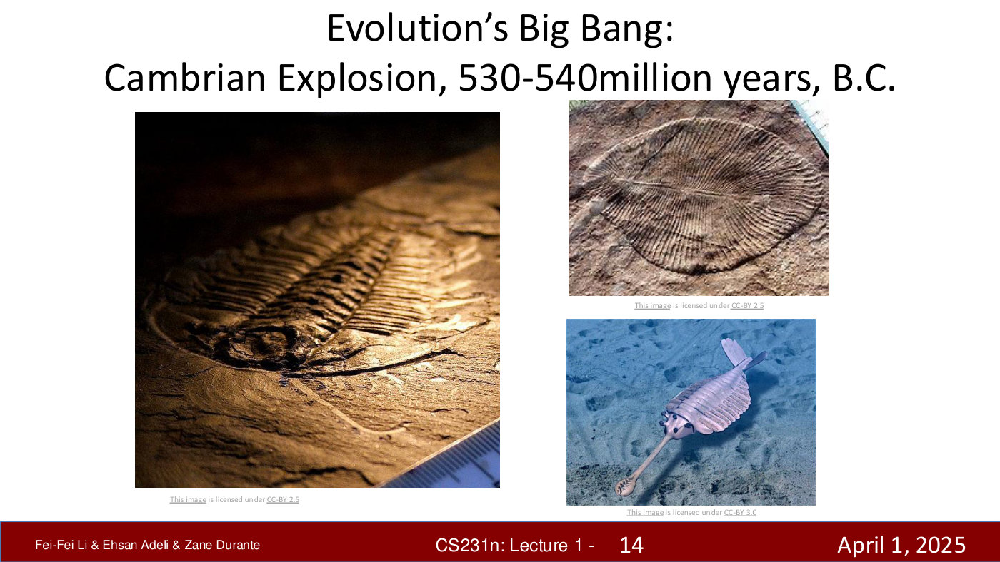

Title (as printed, with "530-540million" run together): "Evolution's Big Bang: Cambrian Explosion, 530-540million years, B.C." Three images, each with a small "This image is licensed under CC-BY 2.5 / 3.0" credit:
- Left, large: a warmly lit photograph of a trilobite-like fossil impressed in rock, segmented body, with a ruler edge visible at the lower right (CC-BY 2.5).
- Top right: a photograph of a flat, oval, leaf-shaped fossil with fine parallel ribbing on reddish rock (CC-BY 2.5).
- Bottom right: an illustration or model of a swimming Cambrian animal (a segmented, many-finned body with a long stalk-like proboscis ending in a claw) over a blue sandy sea floor (CC-BY 3.0).

## Slide 15 — [photographs: eyes of four animals]

![Part 1, slide 15 — [photographs: eyes of four animals]](../images/01-introduction-part-1/slide-15.jpg)

No title or text. Four equal quadrant close-up photographs of eyes/vision organs: top left, a red octopus arm with rows of suckers (on black); top right, the face of a bee-like insect with a large black compound eye and yellow markings against a green background; bottom left, a green chameleon's head with a swirled eye; bottom right, a human baby's face with wide blue-grey eyes looking upward. The date "April 1, 2025" and the slide number "15" appear faintly in the bottom corners instead of the footer bar.

## Slide 16 — Camera Obscura

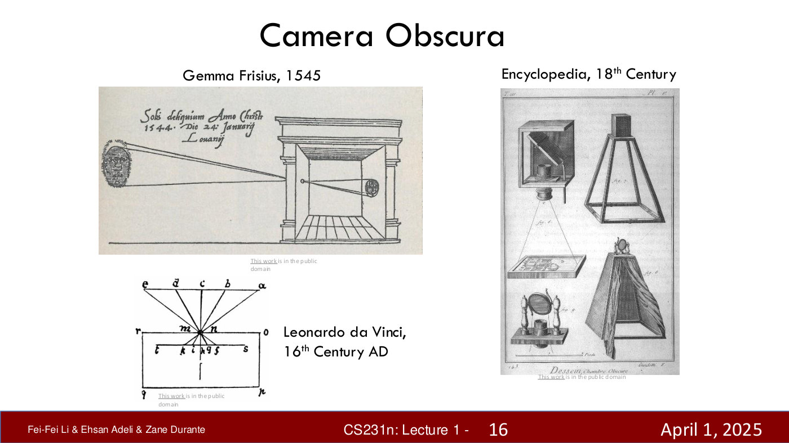

Title: "Camera Obscura". Four public-domain images ("This work is in the public domain"):
- Top left, captioned "Gemma Frisius, 1545": an old engraving showing a distant sun/object at the left with a ray cone passing through a small hole into a dark room (a square room drawn with a tiled floor), where an inverted image forms; hand-written Latin text above it mentions a date (24 January 1544).
- Bottom left, captioned "Leonardo da Vinci, 16th Century AD": a line-drawing diagram of rays (labelled with letters such as a, b, c, d, e on top and m, n, r, o, t, s, p, q etc.) converging through a pinhole in a box and crossing to form an inverted image.
- Right, captioned "Encyclopedia, 18th Century": an 18th-century encyclopedia plate with several drawings of camera obscura devices: a box with an internal mirror and lens, a pyramid-shaped frame, a tent-like hooded device, and a small mirror-and-lens apparatus.

## Slide 17 — Computer Vision is everywhere!

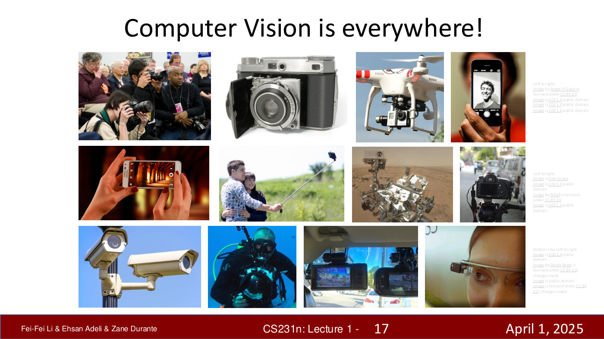

Title: "Computer Vision is everywhere!". A grid of 12 photographs in three rows (4 per row), with tiny image-credit notes at the right of each row ("Left to right: Image by Roger H Goun is licensed under CC BY 2.0; Image is CC0 1.0 public domain" etc.; second row: "Image is free to use", CC0 public domain, "Image by NASA is licensed under CC BY 2.0", CC0 public domain; bottom row: CC0 public domain, "Image by Derek Keats is licensed under CC BY 2.0; changes made", public domain, "Image is licensed under CC-BY 2.0; changes made").
- Row 1: a crowd of photographers with cameras at an event; a vintage folding film camera; a white quadcopter drone with a camera underneath; a smiling man's selfie shown on a smartphone screen held up in front of his face.
- Row 2: hands holding a smartphone filming a tunnel; a couple taking a selfie with a selfie stick in a field; a Mars rover (NASA) on reddish terrain; a camera on a tripod on a street.
- Row 3: two surveillance cameras on a pole; a scuba diver holding an underwater camera rig; two dashboard cameras inside a car windshield; a close-up of a person wearing smart glasses (a head-mounted camera).

## Slide 18 — Where did we come from?

Single red centred line: "Where did we come from?" (section divider)

## Slide 19 — Hubel and Wiesel, 1959

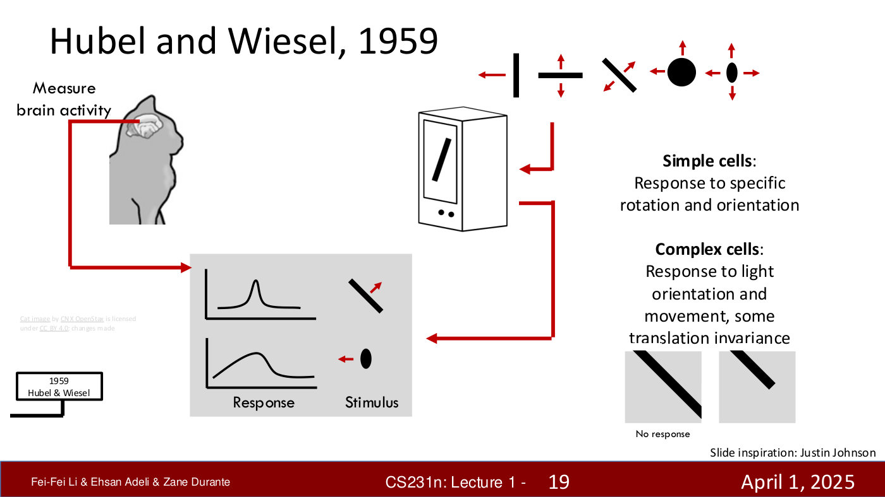

Title: "Hubel and Wiesel, 1959". A diagram of the cat visual-cortex experiment:
- Top left: a grey silhouette of a cat with the brain area marked; label "Measure brain activity"; a red line runs from the brain down to a grey box at the lower left.
- Top centre: a drawing of a monitor/projector showing a tilted bar. Above it, a row of stimulus symbols with red motion arrows: a vertical bar moving left, a horizontal bar moving up/down, a diagonal bar moving diagonally, a black disc moving in all four directions, a small ellipse moving left/right and up/down. Red arrows connect the stimulus symbols to the monitor and the monitor to the response box.
- The grey response box (lower left centre) shows two small response plots (axes with curves) next to stimuli: the top plot is a sharp single peak, paired with a diagonal bar moving diagonally; the bottom plot is a broader rising-then-falling curve, paired with a small black ellipse with a left-pointing arrow. Labels: "Response" and "Stimulus".
- Right-hand text: "Simple cells: Response to specific rotation and orientation" and "Complex cells: Response to light orientation and movement, some translation invariance".
- Bottom right: two grey squares each containing a thick diagonal black bar (the left bar is larger and extends corner to corner, the right one is shorter and thinner and placed in the upper part); the left is captioned "No response" (the right square has no caption).
- Credit (tiny, left): "Cat image by CNX OpenStax is licensed under CC BY 4.0; changes made". 
- Bottom-left timeline marker box: "1959 Hubel & Wiesel". Bottom right: "Slide inspiration: Justin Johnson".

## Slide 20 — Larry Roberts, 1963

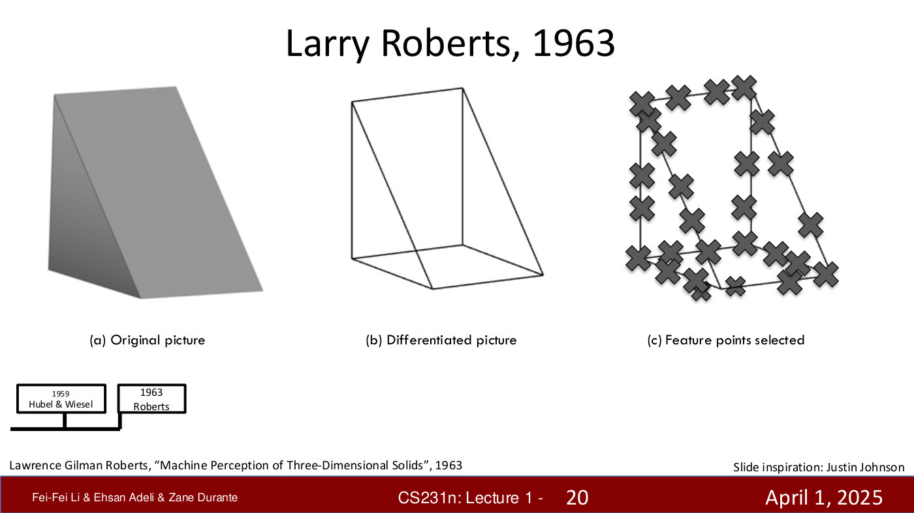

Title: "Larry Roberts, 1963". Three panels showing a wedge-shaped block:
- (a) "Original picture": a grey shaded photograph-like image of a wedge/prism.
- (b) "Differentiated picture": a black line drawing of the wedge's edges (edge map).
- (c) "Feature points selected": the same line drawing with about 30 dark-grey X marks on the corners and along the edges.

Bottom-left timeline marker: "1959 Hubel & Wiesel" and "1963 Roberts" boxes joined on a branching timeline. Citation: Lawrence Gilman Roberts, "Machine Perception of Three-Dimensional Solids", 1963. Bottom right: "Slide inspiration: Justin Johnson".

## Slide 21 — [document: "The Summer Vision Project", Seymour Papert, 1966]

![Part 1, slide 21 — [document: "The Summer Vision Project", Seymour Papert, 1966]](../images/01-introduction-part-1/slide-21.jpg)

No slide title. A scanned typewritten memo fills the slide:

"MASSACHUSETTS INSTITUTE OF TECHNOLOGY / PROJECT MAC / Artificial Intelligence Group July 7, 1966 / Vision Memo. No. 100. / THE SUMMER VISION PROJECT / Seymour Papert / The summer vision project is an attempt to use our summer workers effectively in the construction of a significant part of a visual system. The particular task was chosen partly because it can be segmented into sub-problems which will allow individuals to work independently and yet participate in the construction of a system complex enough to be a real landmark in the development of "pattern recognition"."

Below the memo: link https://dspace.mit.edu/handle/1721.1/6125. Bottom-left timeline marker: "1959 Hubel & Wiesel", "1963 Roberts". Bottom right: "Slide inspiration: Justin Johnson".

## Slide 22 — [David Marr, "Vision": stages of visual representation]

![Part 1, slide 22 — [David Marr, "Vision": stages of visual representation]](../images/01-introduction-part-1/slide-22.jpg)

No title at the top; caption at the bottom: "Stages of Visual Representation, David Marr, 1970s".

- Left: a book cover, grey-white, with the word "VISION" in large letters, three purple Pac-Man-like shapes forming a Kanizsa triangle illusion, and "David Marr" at the bottom (with a foreword by Shimon Ullman and afterword by Tomaso Poggio, small print; "Copyrighted Material" at the top and bottom).
- Right, a four-stage pipeline of tall boxes joined by arrows left to right. Above each box is an example image (tiny credit "This image is CC0 1.0 public domain" under the first and last):
  1. Header "Input Image"; example photo: an orange basketball on a wooden court floor; box body text: "Perceived intensities".
  2. Header "Primal Sketch"; example "Edge image": the basketball photo as a grey-scale line/edge drawing; body: "Zero crossings, blobs, edges, bars, ends, virtual lines, groups, curves boundaries".
  3. Header "2 ½-D Sketch"; example "2 ½-D sketch": a similar edge drawing with a white disc over the area where the ball was and the ball drawn at lower right; body: "Local surface orientation and discontinuities in depth and in surface orientation".
  4. Header "3-D Model Representation"; example "3-D model": a shaded grey sphere; body: "3-D models hierarchically organized in terms of surface and volumetric primitives".
- Image labels above the examples read "Input image", "Edge image", "2 ½-D sketch", "3-D model".
- Timeline markers bottom-left: "1959 Hubel & Wiesel", "1963 Roberts", "1970s David Marr". Bottom right: "Slide inspiration: Justin Johnson".

## Slide 23 — Recognition via Parts (1970s)

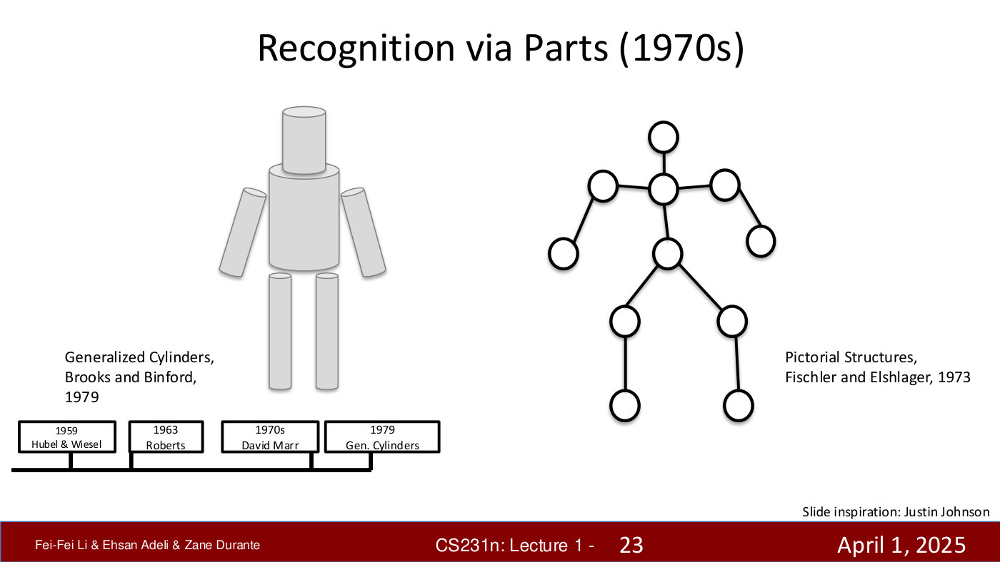

Title: "Recognition via Parts (1970s)". Two figures:
- Left: a human figure built from grey 3-D cylinders (head, torso, two arm cylinders tilted outward, two leg cylinders), captioned "Generalized Cylinders, Brooks and Binford, 1979".
- Right: a stick-figure graph of white circles (nodes) joined by black lines: head node on top, a central neck/shoulder node with two arms each of two nodes, a torso node below, then two legs each of two nodes; captioned "Pictorial Structures, Fischler and Elshlager, 1973".

Timeline: "1959 Hubel & Wiesel", "1963 Roberts", "1970s David Marr", "1979 Gen. Cylinders". Bottom right: "Slide inspiration: Justin Johnson".

## Slide 24 — Recognition via Edge Detection (1980s)

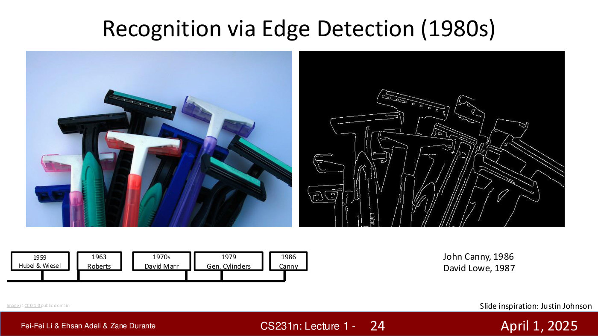

Title: "Recognition via Edge Detection (1980s)". Left: a colour photograph of a pile of disposable razors (blue, black, green, pink, red, white and purple handles) on a pale background. Right: a black image with white outlines of the same razors (the edge-detected version). Right text: "John Canny, 1986 / David Lowe, 1987". Credit bottom-left: "Image is CC0 1.0 public domain".

Timeline: "1959 Hubel & Wiesel", "1963 Roberts", "1970s David Marr", "1979 Gen. Cylinders", "1986 Canny". Bottom right: "Slide inspiration: Justin Johnson".

## Slide 25 — Arriving at an "AI winter"

Title: Arriving at an "AI winter"

- Enthusiasm (and funding!) for AI research dwindled
- "Expert Systems" failed to deliver on their promises
- But subfields of AI continues to grow
  - Computer vision, NLP, robotics, compbio, etc.

Timeline: same boxes as slide 24 (the "1959 Hubel & Wiesel" box text overflows slightly), plus a blue box "AI Winter" sitting on the timeline line to the right of "1986 Canny". Tiny credit notes at bottom-left (left, middle, right image credits: CC BY 3.0; public domain; CC BY 2.0 changes made) with no visible images. Bottom right: "Slide inspiration: Justin Johnson".

## Slide 26 — In the meantime…seminal work in cognitive and neuroscience

Centred red text: "In the meantime…seminal work in cognitive and neuroscience" (section divider).

## Slide 27 — Perceiving Real-World Scenes (Biederman)

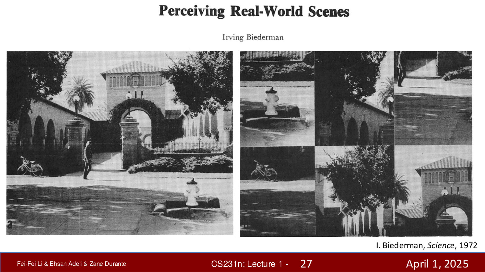

The slide shows the first page header of a paper: "Perceiving Real-World Scenes, Irving Biederman". Two black-and-white photographs:
- Left: a coherent scene of a Stanford campus-style building with a tower and arched gateway, a man standing, a bicycle at the left and a fire hydrant in the foreground (panel labelled "a" at the lower left).
- Right: the same photograph cut into a jumbled grid of tiles (about six pieces) rearranged out of order so the scene is incoherent: pieces include the hydrant, the bicycle, the tower, trees, arches and pavement.

Citation, bottom right: "I. Biederman, Science, 1972".

## Slide 28 — Rapid Serial Visual Perception (RSVP)

Title: "Rapid Serial Visual Perception (RSVP)". A plain mid-grey rectangle with a small black fixation cross "+" in the centre (the first frame of an RSVP stimulus sequence). Citation: "Potter, etc. 1970s".

## Slide 29 — Speed of processing in the human visual system (Thorpe, Fize & Marlot)

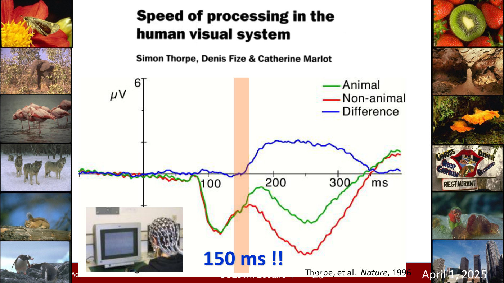

A full-slide figure from the paper "Speed of processing in the human visual system, Simon Thorpe, Denis Fize & Catherine Marlot" with citation "Thorpe, et al. Nature, 1996" at the bottom. (No separate slide title; the footer is partly covered by the figure and the slide number 29 is hidden behind it.)

- Down both left and right edges are columns of small stimulus photographs (six per side): left column, top to bottom, a moth on a red-yellow flower, an elephant in savanna, flamingos in water, three wolves in snow, a squirrel on a log, penguins; right column, strawberries and a kiwi, a cave interior, orange fungus on moss, a restaurant sign, red food or fruit, a city skyline.
- Centre: an event-related-potential chart. Vertical axis labelled "µV" with the top tick marked "6"; horizontal axis in "ms" with labels 100, 200, 300 ms. Three curves (legend, top right): green "Animal", red "Non-animal", blue "Difference".
  - Green and red curves: flat near zero until about 80 ms, then both dip together to a first trough at about 110 ms, rise to a small local peak around 170 ms (green higher, near zero; red lower), then dip to a second, deeper trough around 250–270 ms (red deepest, green less deep), and climb back above zero by about 340–380 ms, ending slightly positive. The green and red curves separate from each other from about 150 ms.
  - Blue "Difference" curve: flat near zero until about 150 ms, rises to a broad positive plateau between about 190 and 290 ms, and returns to zero by about 340 ms.
  - A pale orange vertical band at about 150 ms marks where the difference first appears; large blue text below it: "150 ms !!".
- Inset (lower left): a photograph of a person seen from behind wearing an EEG electrode cap, sitting at a computer monitor.
No numeric values beyond 6, 100, 200, 300 appear on the axes.

## Slide 30 — Neural correlates of object & scene recognition

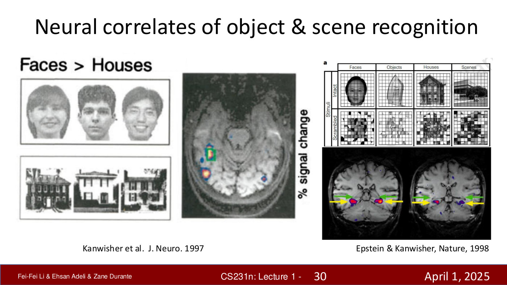

Title: "Neural correlates of object & scene recognition".
- Left panel, headed "Faces > Houses": top row three greyscale face photographs, bottom row three greyscale photographs of houses; to the right an axial brain MRI slice with coloured (red/yellow/blue) activation blobs, one box outlined in green, and a rotated axis label "% signal change". Citation: "Kanwisher et al. J. Neuro. 1997".
- Right panel: a grid labelled "a" with column headings "Faces", "Objects", "Houses", "Scenes" and two row groups "Stimuli: Intact" (top) and "Scrambled" (bottom): intact images are a face, an object, a house and a building scene; scrambled versions are the same images cut into shuffled tiles. Below it, two coronal brain MRI slices with coloured activation blobs marked by green and yellow arrows pointing at both hemispheres. Citation: "Epstein & Kanwisher, Nature, 1998".

## Slide 31 — Visual recognition is a fundamental task for visual intelligence

Red centred text: "Visual recognition is a fundamental task for visual intelligence". Underneath, three images recapping earlier slides: left, the black-and-white Biederman scene photograph (slide 27); middle, a 2×2 collage of four stimulus photos (moth on flower, orange fungus, elephant, fruit) from the Thorpe study (slide 29); right, the grid of intact/scrambled stimuli over the pair of brain MRI scans from Epstein & Kanwisher (slide 30).

## Slide 32 — Recognition via Grouping (1990s)

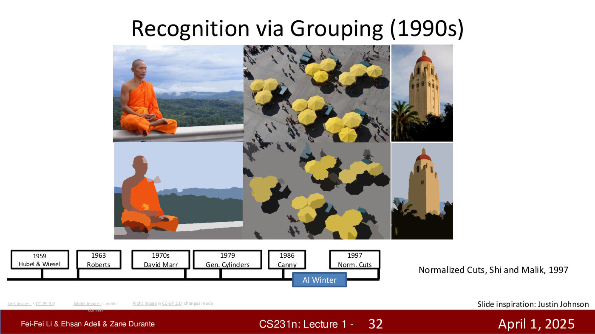

Title: "Recognition via Grouping (1990s)". A 2×3 image grid: top row original photographs, bottom row their segmentations into flat-coloured regions: (left) a monk in orange robes meditating on a ledge in front of green hills and sky; (middle) an aerial view of a plaza with yellow umbrellas, people and tables; (right) a tall tower (with a red-tiled top) and palm tree against black sky. The bottom row shows each as a flat-colour region segmentation. Right text: "Normalized Cuts, Shi and Malik, 1997". Tiny credits at bottom-left (left image CC BY 3.0; middle public domain; right CC BY 2.0 changes made).

Timeline: "1959 Hubel & Wiesel", "1963 Roberts", "1970s David Marr", "1979 Gen. Cylinders", "1986 Canny", blue "AI Winter" box, "1997 Norm. Cuts". Bottom right: "Slide inspiration: Justin Johnson".

## Slide 33 — Recognition via Matching (2000s)

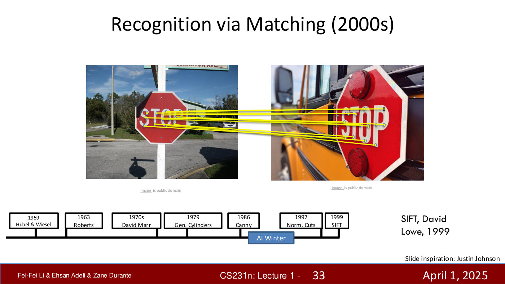

Title: "Recognition via Matching (2000s)". Two photographs of stop signs: left, a red octagonal STOP sign on a pole at a street corner with a long shadow; right, a close-up of a STOP sign on the side of a yellow school bus (red flashing lights above and below). About eight yellow lines connect matching keypoints from the left sign to the right sign. Both images are marked "Image is public domain". Right text: "SIFT, David Lowe, 1999".

Timeline adds "1999 SIFT" after "1997 Norm. Cuts". Bottom right: "Slide inspiration: Justin Johnson".

## Slide 34 — Face Detection

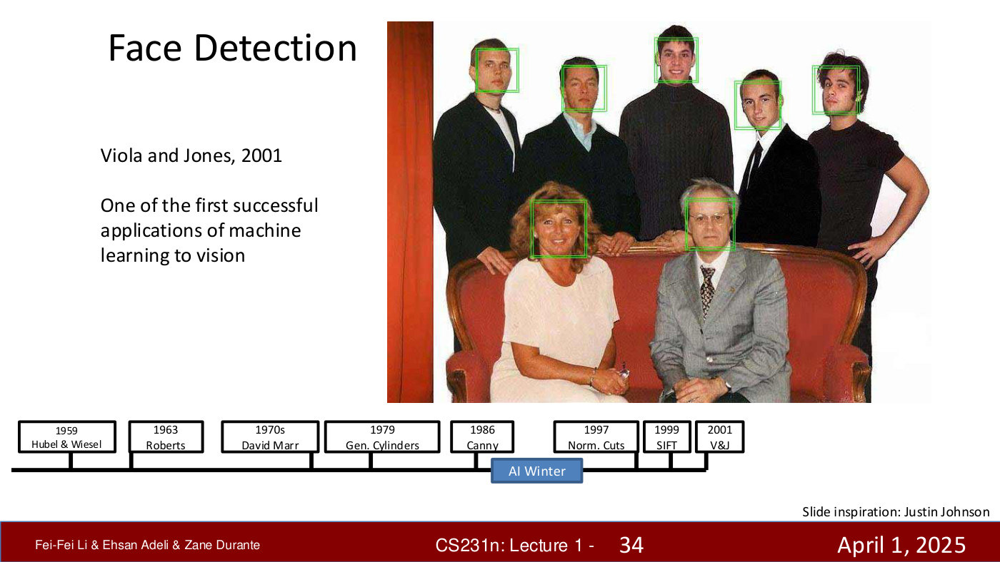

Title: "Face Detection". Left text: "Viola and Jones, 2001 / One of the first successful applications of machine learning to vision". Right: a group photograph of seven people (five standing men at the back, a woman and an older man seated on a red sofa in front), each face enclosed by a green square (detected face).

Timeline adds "2001 V&J". Bottom right: "Slide inspiration: Justin Johnson".

## Slide 35 — [Caltech 101 and PASCAL Visual Object Challenge]

![Part 1, slide 35 — [Caltech 101 and PASCAL Visual Object Challenge]](../images/01-introduction-part-1/slide-35.jpg)

Two headings: "Caltech 101 images" (left, blue) and "PASCAL Visual Object Challenge" (right).
- Left: a dense mosaic of about 100 small thumbnail photographs of different object categories (airplane, ant, goldfish, barrel, brain, buddha, camera, cell phone, dollar bill, dalmatian, piano, motorbike, sailboat, soccer ball, stapler, stop sign, strawberry, umbrella, etc.).
- Right: three photographs with yellow bounding boxes and yellow class labels: a train (label "Train"), an airplane ("Airplane"), and a boy in sunglasses playing in spray ("Person"). Credits: "Image is CC0 1.0 public domain".

Timeline adds "2004, 2007 Caltech101; PASCAL" after "2001 V&J". Bottom right: "Slide inspiration: Justin Johnson".

## Slide 36 — [Rumelhart/Hinton/Williams paper title; Rosenblatt's perceptron machine]

![Part 1, slide 36 — [Rumelhart/Hinton/Williams paper title; Rosenblatt's perceptron machine]](../images/01-introduction-part-1/slide-36.jpg)

No separate title. Left: the title block of the paper "Learning representations by back-propagating errors, David E. Rumelhart*, Geoffrey E. Hinton† & Ronald J. Williams*" with affiliations ("* Institute for Cognitive Science, C-015, University of California, San Diego, La Jolla, California 92093, USA; † Department of Computer Science, Carnegie-Mellon University, Pittsburgh, Philadelphia 15213, USA"), and beneath it a diagram of a perceptron: an oval "S-SET" at the left with three arrows fanning out to ovals "A_I SET", "A_II SET", "A_III SET", each connected by an arrow to "R_I SET", "R_II SET", "R_III SET" at the right.
- Right: a black-and-white photograph of a large cabinet of tangled wires (the Mark I Perceptron hardware, label "MARK I PERCEPTRON" visible at the top), captioned "Frank Rosenblatt, ~1957".

Timeline: same as slide 35 plus a new box below the line at the left: "1958 Perceptron" attached under "1959 Hubel & Wiesel". Bottom right: "Slide inspiration: Justin Johnson".

## Slide 37 — Minsky and Papert, 1969

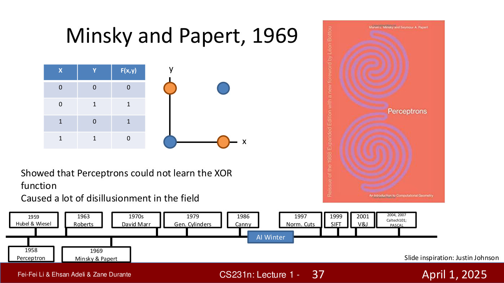

Title: "Minsky and Papert, 1969".
- Left: a truth table with blue header row "X | Y | F(x,y)" and rows: (0, 0, 0), (0, 1, 1), (1, 0, 1), (1, 1, 0) (the XOR function).

| X | Y | F(x,y) |
| - | - | ------ |
| 0 | 0 | 0 |
| 0 | 1 | 1 |
| 1 | 0 | 1 |
| 1 | 1 | 0 |

- Middle: a 2-D plot with a vertical axis "y" and horizontal axis "x" showing four points: orange at (0,1), blue at (1,1), blue at (0,0), orange at (1,0). Orange and blue mark the two classes, which are diagonal to each other and cannot be separated by one straight line.
- Right: the red cover of the book "Perceptrons" (Minsky and Papert; "Reissue of the 1988 Expanded Edition with a new foreword by Léon Bottou"; "An Introduction to Computational Geometry"), with two purple spiral shapes.
- Text: "Showed that Perceptrons could not learn the XOR function / Caused a lot of disillusionment in the field".

Timeline adds below the line: "1969 Minsky & Papert". Bottom right: "Slide inspiration: Justin Johnson".

## Slide 38 — Neocognitron: Fukushima, 1980

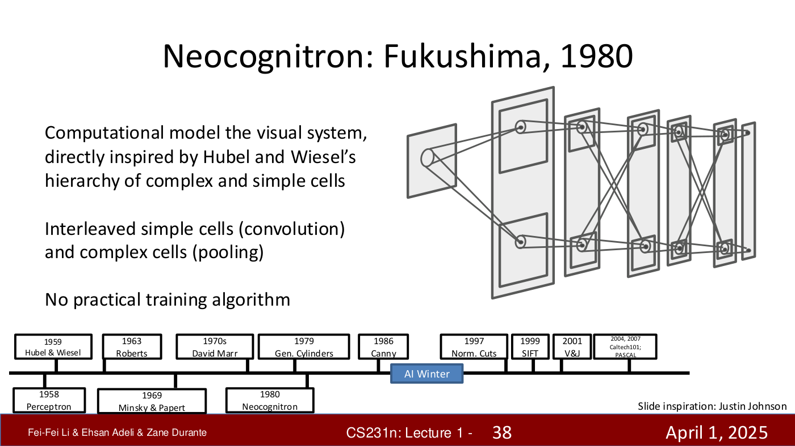

Title: "Neocognitron: Fukushima, 1980". Left text:
- "Computational model the visual system, directly inspired by Hubel and Wiesel's hierarchy of complex and simple cells"
- "Interleaved simple cells (convolution) and complex cells (pooling)"
- "No practical training algorithm"

Right: a diagram of a layered network drawn as a series of progressively smaller grey rectangles (slabs) with small squares and circles inside them, connected by crossing lines from a small input square on the left to the successive layers, ending at a thin slab on the right.

Timeline adds below the line: "1980 Neocognitron". Bottom right: "Slide inspiration: Justin Johnson".

## Slide 39 — Backprop: Rumelhart, Hinton, and Williams, 1986

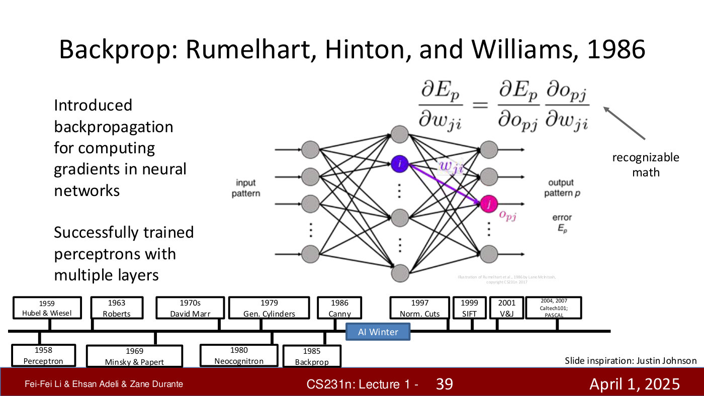

Title: "Backprop: Rumelhart, Hinton, and Williams, 1986". Left text: "Introduced backpropagation for computing gradients in neural networks / Successfully trained perceptrons with multiple layers".

Equation at top right: $\frac{\partial E_p}{\partial w_{ji}} = \frac{\partial E_p}{\partial o_{pj}} \frac{\partial o_{pj}}{\partial w_{ji}}$, with a grey arrow pointing to it from the label "recognizable math".

Diagram: a fully connected feed-forward network of grey circles in three columns, with horizontal arrows entering from the left labelled "input pattern" and arrows leaving on the right labelled "output pattern p" and "error E_p" (E subscript p). One hidden-layer node is highlighted blue-purple with label "i", one output node is highlighted pink with label "j", and the purple line between them is labelled $w_{ji}$; the pink node is labelled $o_{pj}$. Tiny credit: "Illustration of Rumelhart et al., 1986 by Lane McIntosh, copyright CS231n 2017".

Timeline adds below the line: "1985 Backprop" (the title and the Canny box say 1986; the timeline box prints 1985). Bottom right: "Slide inspiration: Justin Johnson".

## Slide 40 — Convolutional Networks: LeCun et al, 1998

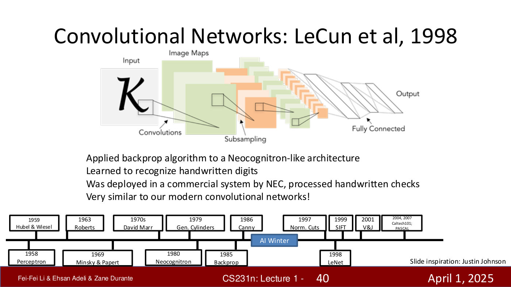

Title: "Convolutional Networks: LeCun et al, 1998". Diagram: an input image (a handwritten-style letter "K") on the left, followed by a series of feature-map stacks (green and orange translucent squares of decreasing size) with small squares and lines showing receptive fields; labels "Input", "Image Maps", "Convolutions", "Subsampling", "Fully Connected", "Output". Text below:
- Applied backprop algorithm to a Neocognitron-like architecture
- Learned to recognize handwritten digits
- Was deployed in a commercial system by NEC, processed handwritten checks
- Very similar to our modern convolutional networks!

Timeline adds below the line: "1998 LeNet". Bottom right: "Slide inspiration: Justin Johnson".

## Slide 41 — 2000s: "Deep Learning"

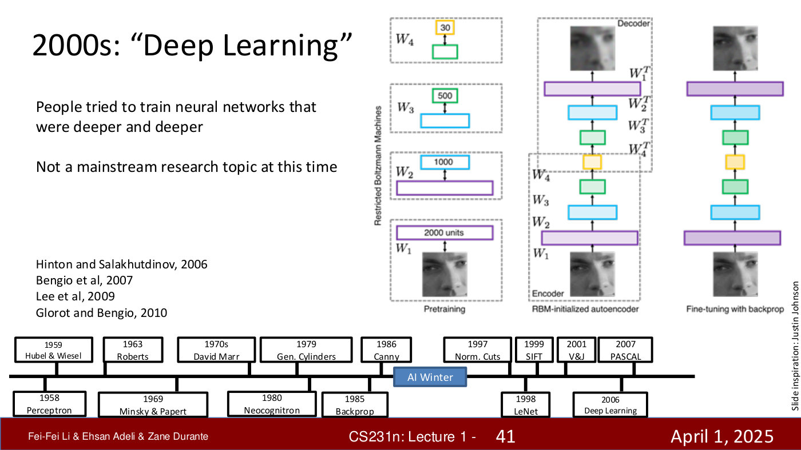

Title: 2000s: "Deep Learning"

- People tried to train neural networks that were deeper and deeper
- Not a mainstream research topic at this time

References (bottom left): Hinton and Salakhutdinov, 2006 / Bengio et al, 2007 / Lee et al, 2009 / Glorot and Bengio, 2010.

Figure (right), three panels of a deep autoencoder with a small greyscale face image at the bottom of each:
- "Pretraining" (left, vertical axis label "Restricted Boltzmann Machines"): four stacked dashed boxes, each a pair of rectangles with a double arrow, with weights $W_1$ (bottom; "2000 units" above the face image), $W_2$ ("1000"), $W_3$ ("500"), $W_4$ ("30" at the top, in a yellow box). Layers are trained one at a time.
- "RBM-initialized autoencoder" (middle): an Encoder box (bottom; stack of coloured bars with weights $W_1$ to $W_4$ going up to a small yellow bottleneck layer) and a Decoder box (top; transposed weights $W_4^T$, $W_3^T$, $W_2^T$, $W_1^T$ going back up), ending at a reconstructed face image at the top.
- "Fine-tuning with backprop" (right): the same stack of coloured bars (purple, blue, green, yellow bottleneck, green, blue, purple) with the face image in and a reconstructed face out.

Timeline now has two rows. Above the line: "1959 Hubel & Wiesel", "1963 Roberts", "1970s David Marr", "1979 Gen. Cylinders", "1986 Canny", [blue "AI Winter" box], "1997 Norm. Cuts", "1999 SIFT", "2001 V&J", "2007 PASCAL" (here the Caltech101 mention is dropped). Below the line: "1958 Perceptron", "1969 Minsky & Papert", "1980 Neocognitron", "1985 Backprop", "1998 LeNet", and new "2006 Deep Learning". Vertical text, right edge: "Slide inspiration: Justin Johnson".

## Slide 42 — 2000s: "Deep Learning"

Same as slide 41, plus a new line in red below the two bullets: "No good dataset to work on".

## Slide 43 — ImageNet Large Scale Visual Recognition Challenge

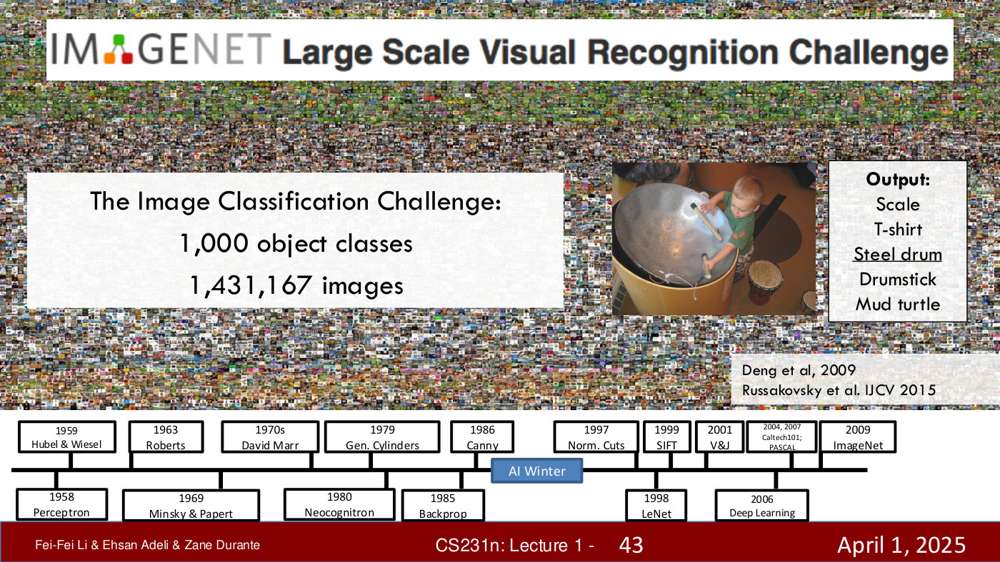

Background: a dense mosaic of thousands of tiny photographs. A white banner at the top reads "IMAGENET Large Scale Visual Recognition Challenge" (the ImageNet logo with a red/green/orange coloured "A" shape).

- Left white panel: "The Image Classification Challenge: / 1,000 object classes / 1,431,167 images".
- Middle: a photograph of a small child hitting a steel drum (a steel pan) with a mallet, an African drum next to it.
- Right box headed "Output:" with a list: Scale, T-shirt, Steel drum (underlined), Drumstick, Mud turtle (five output labels for the photograph; the slide underlines "Steel drum" and does not explain the scoring).
- Bottom right: "Deng et al, 2009 / Russakovsky et al. IJCV 2015".

Timeline: same as slide 41 but "2004, 2007 Caltech101; PASCAL" is restored in place of "2007 PASCAL", and a new box "2009 ImageNet" is added above the line at the far right.

## Slide 44 — [ImageNet challenge bar chart of winning error by year]

![Part 1, slide 44 — [ImageNet challenge bar chart of winning error by year]](../images/01-introduction-part-1/slide-44.jpg)

Same banner and mosaic background as slide 43, and the same timeline. A bar chart (a white plot panel):
- Axes: vertical axis, unlabelled numbers 0 to 30 in steps of 5 (the slide gives no axis title; in the lecture these are "the errors", ≈33:35); horizontal axis lists years and winning entries. 10 bars, one data series (blue), with the value printed above each bar:
  - 2010, "Lin et al": 28.2
  - 2011, "Sanchez & Perronnin": 25.8
  - 2012, "Krizhevsky et al (AlexNet)": 16.4
  - 2013, "Zeiler & Fergus": 11.7
  - 2014, "Simonyan & Zisserman (VGG)": 7.3
  - 2014, "Szegedy et al (GoogLeNet)": 6.7
  - 2015, "He et al (ResNet)": 3.6
  - 2016, "Shao et al": 3.0
  - 2017, "Hu et al (SENet)": 2.3
  - "Human", "Russakovsky et al": 5.1
- The trend: error falls steadily each year; from 2015 on the winners are below the human value of 5.1.

## Slide 45 — [ImageNet challenge bar chart, AlexNet highlighted]

Same as slide 44, plus a label "AlexNet, 2012" above the 2012 bar with a red downward arrow pointing at the 16.4 bar. The timeline gains a new box below the line at the far right: "2012 AlexNet".

## Slide 46 — AlexNet: Deep Learning Goes Mainstream

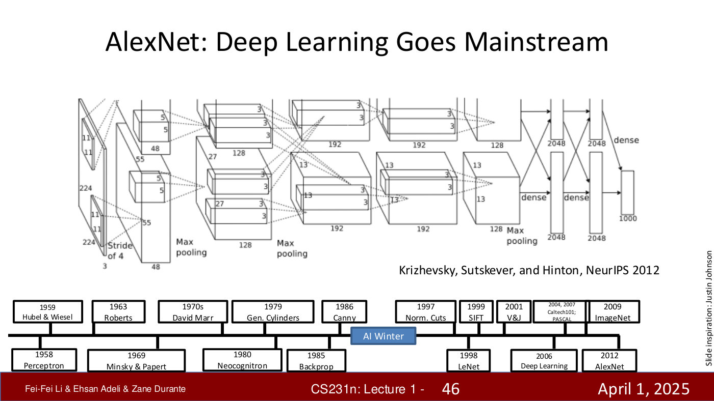

Title: "AlexNet: Deep Learning Goes Mainstream". A large (cropped at top) line drawing of the AlexNet architecture: input 224×224×3 image on the left with 11×11 filters and "Stride of 4"; two parallel streams (top and bottom) of 3-D convolutional blocks with sizes 55, 48, 27, 128, 13, 192, 192, 128 and 5×5 and 3×3 kernels, "Max pooling" labels, followed by "dense" layers of 2048 units in both streams, with crossing lines between the streams, then "dense" and a final 1000-unit output. Citation: "Krizhevsky, Sutskever, and Hinton, NeurIPS 2012". Timeline as slide 45.

## Slide 47 — AlexNet vs. Neocognitron: 32 years apart

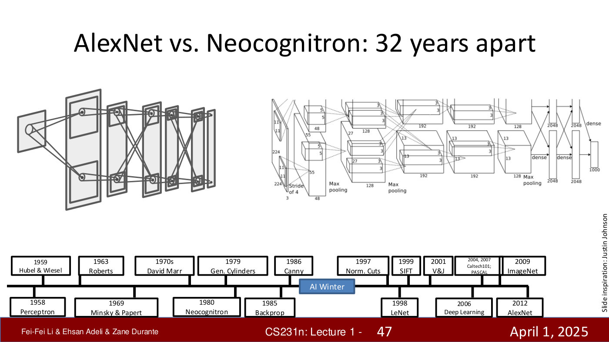

Title: "AlexNet vs. Neocognitron: 32 years apart". Left: the Neocognitron diagram from slide 38 (progressively smaller grey slabs with crossing connections). Right: the AlexNet diagram from slide 46. The two are shown side by side to make the point that the architectures are structurally similar. Timeline as slide 45.

## Slide 48 — 2012 to Present: Deep Learning Explosion

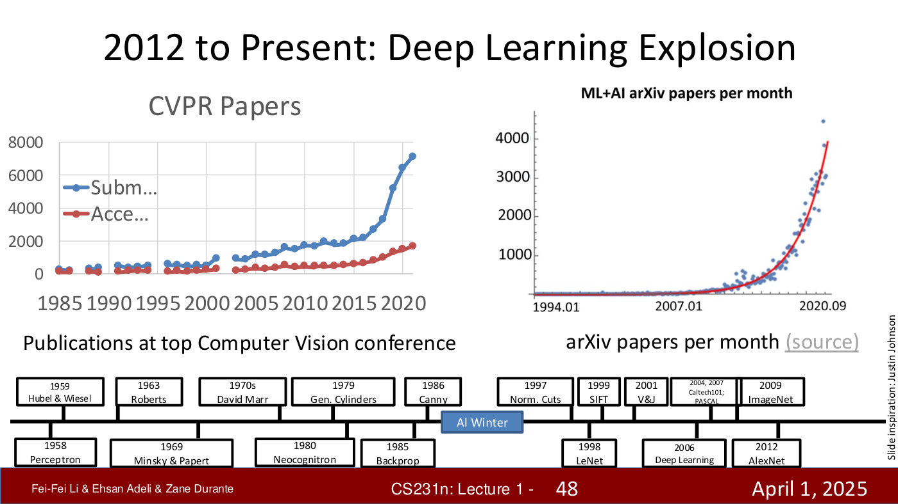

Title: "2012 to Present: Deep Learning Explosion". Two charts:

Left chart, title "CVPR Papers", caption "Publications at top Computer Vision conference":
- Axes: vertical 0 to 8000 (ticks 0, 2000, 4000, 6000, 8000); horizontal years 1985 to 2020 (ticks every 5 years). Not labelled with axis titles. 2 series, with legend text truncated on the slide: blue line with dots "Subm…" (submissions) and red line with dots "Acce…" (accepted).
- Blue (submitted): approx. 300 in 1985, about 400-500 in the 1990s, about 1000 around 2000, about 1200 around 2005, about 1700 around 2010, about 2100 in 2015, then a steep rise to about 5200 (c. 2019), about 6500 (2020) and about 7100 at the right end.
- Red (accepted): approx. 200-300 up to 2000, about 500 around 2010, about 700 in 2015, rising slowly to about 1700 at the right end.

Right chart, title "ML+AIarXiv papers per month" (printed "ML+AI arXiv papers per month"), caption "arXiv papers per month (source)":
- Axes: vertical 0 to about 4000+ (ticks 1000, 2000, 3000, 4000); horizontal dates labelled "1994.01", "2007.01", "2020.09".
- Series: blue scatter dots (monthly counts) with a fitted red curve. Both are near zero until about 2010, then rise exponentially to about 3900 for the curve at 2020.09 (the highest dot is about 4400).

Timeline as slide 45. Vertical text at right: "Slide inspiration: Justin Johnson".

## Slide 49 — 2012 to Present: Deep Learning is Everywhere

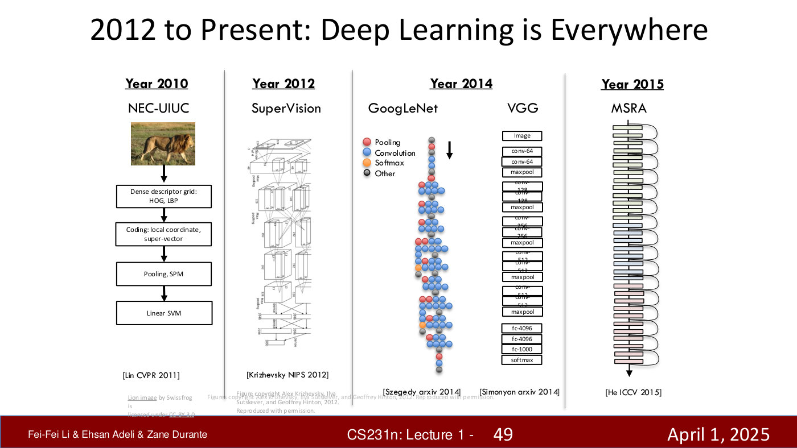

Title: "2012 to Present: Deep Learning is Everywhere". Four columns, each headed by a year (underlined) and a model name, showing how network architectures changed:
- "Year 2010 — NEC-UIUC": a lion photo, then a vertical flow chart of boxes joined by arrows: "Dense descriptor grid: HOG, LBP" → "Coding: local coordinate, super-vector" → "Pooling, SPM" → "Linear SVM". Reference "[Lin CVPR 2011]". Credit: "Lion image by Swissfrog is licensed under CC BY 3.0".
- "Year 2012 — SuperVision": the AlexNet diagram rotated to run vertically. Reference "[Krizhevsky NIPS 2012]". Credit: "Figure copyright Alex Krizhevsky, Ilya Sutskever, and Geoffrey Hinton, 2012. Reproduced with permission."
- "Year 2014 — GoogLeNet" and "VGG": GoogLeNet is a long vertical chain of small coloured circles (legend: red = Pooling, blue = Convolution, orange = Softmax, grey = Other; a downward arrow), arranged as a thick column with many parallel branches; reference "[Szegedy arxiv 2014]". VGG is a vertical list of boxes: Image, conv-64, conv-64, maxpool, conv-128, conv-128, maxpool, conv-256, conv-256, maxpool, conv-512, conv-512, maxpool, conv-512, conv-512, maxpool, fc-4096, fc-4096, fc-1000, softmax (some labels overlap in the render); reference "[Simonyan arxiv 2014]".
- "Year 2015 — MSRA": a very tall stack of thin rectangles (layers) with curved skip-connection arrows on the right side of each pair (a residual network), with a downward arrow; reference "[He ICCV 2015]".

## Slide 50 — 2012 to Present: Deep Learning is Everywhere (image classification, image retrieval)

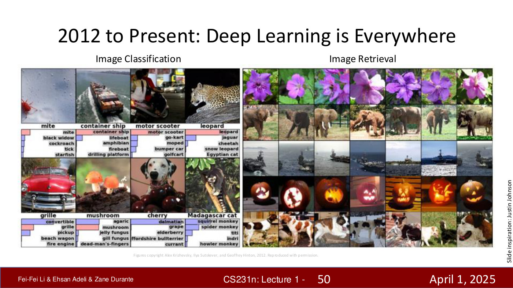

Title: "2012 to Present: Deep Learning is Everywhere". Subheadings "Image Classification" (left) and "Image Retrieval" (right).
- Left: eight photographs in two rows of four, each with the label below and a list of the five highest-scoring classes with horizontal score bars (the correct label's bar is drawn in pink where it appears among the five). Labels and five-class lists:
  - "mite": mite, black widow, cockroach, tick, starfish
  - "container ship": container ship, lifeboat, amphibian, fireboat, drilling platform
  - "motor scooter": motor scooter, go-kart, moped, bumper car, golfcart
  - "leopard": leopard, jaguar, cheetah, snow leopard, Egyptian cat
  - "grille": convertible, grille, pickup, beach wagon, fire engine
  - "mushroom": agaric, mushroom, jelly fungus, gill fungus, dead-man's-fingers
  - "cherry": dalmatian, grape, elderberry, (a Staffordshire bullterrier entry, truncated on the slide as "ffordshire bullterrier"), currant
  - "Madagascar cat": squirrel monkey, spider monkey, titi, indri, howler monkey
  (The photos are: a red mite on white, a container ship, a scooter, a leopard on a branch, a red vintage car front, orange mushrooms, a dalmatian dog behind cherries, a lemur on a branch.)
- Right: a 5×7 grid of photographs, each row showing similar-looking images retrieved for one query: row 1 purple flowers; row 2 elephants; row 3 warships/aircraft carriers at sea; row 4 lit jack-o'-lanterns; row 5 white-and-brown spotted dogs.
Credit: "Figures copyright Alex Krizhevsky, Ilya Sutskever, and Geoffrey Hinton, 2012. Reproduced with permission."

## Slide 51 — 2012 to Present: Deep Learning is Everywhere (object detection, image segmentation)

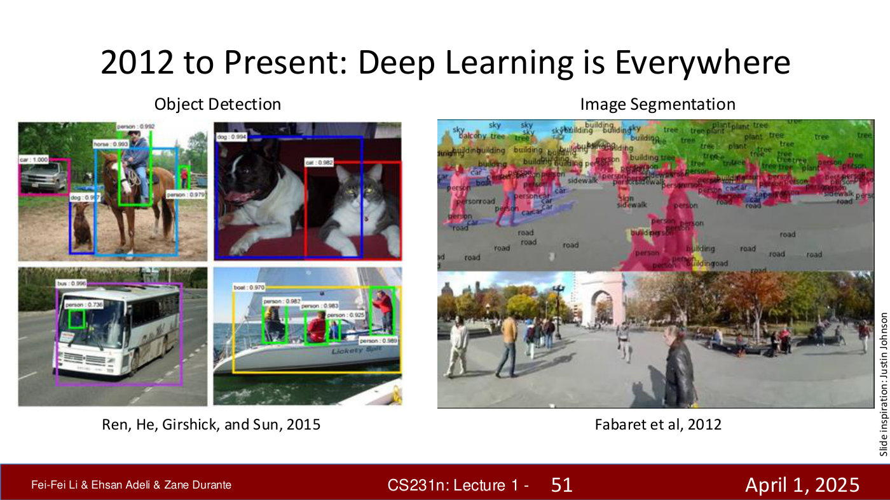

Subheadings "Object Detection" (left) and "Image Segmentation" (right).
- Left, captioned "Ren, He, Girshick, and Sun, 2015": four photographs with coloured bounding boxes and class-plus-confidence labels: a horse with rider (boxes "horse : 0.993", "person : 0.992", "dog : 0.997", "person : 0.979", plus a car "car : 1.000" in the background); a dog and a cat lying together ("dog : 0.994", "cat : 0.982"); a bus ("bus : 0.996", "person : 0.736"); a sailboat with people ("boat : 0.970", "person : 0.983", "person : 0.983", "person : 0.925", "person : 0.989").
- Right, captioned "Fabaret et al, 2012" (as printed): a wide street-scene panorama (a park plaza with a stone arch and pedestrians) at the bottom, and above it the same scene overlaid with a semantic segmentation: coloured regions (green for trees/plants, grey for road, pink-red for people, etc.) with word labels such as "sky", "building", "tree", "plant", "person", "car", "road", "sidewalk", "balcony".

## Slide 52 — 2012 to Present: Deep Learning is Everywhere (video classification, activity recognition)

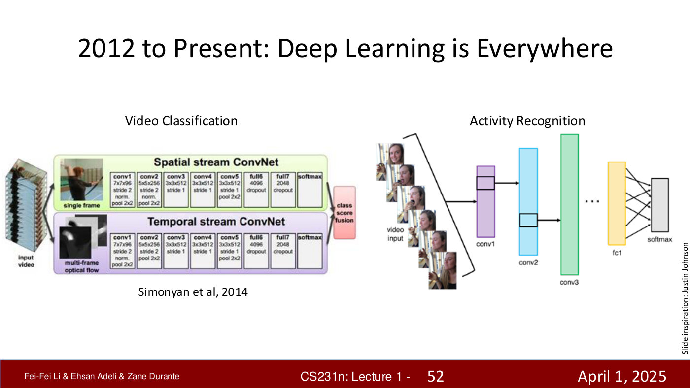

Subheadings "Video Classification" (left, citing "Simonyan et al, 2014") and "Activity Recognition" (right).
- Left: a two-stream network diagram. An "input video" frame stack on the far left feeds two parallel branches: a green "Spatial stream ConvNet" (input: "single frame") and a purple "Temporal stream ConvNet" (input: "multi-frame optical flow"). Each is a row of layer boxes: conv1 (7x7x96, stride 2, norm., pool 2x2), conv2 (5x5x256, stride 2, norm., pool 2x2), conv3 (3x3x512, stride 1), conv4 (3x3x512, stride 1), conv5 (3x3x512, stride 1, pool 2x2), full6 (4096, dropout), full7 (2048, dropout), softmax. Both feed a red box "class score fusion".
- Right: a stack of video frames of a woman (eating) labelled "video input", with a bracket and arrow into a 3-D convnet drawn as vertical bars: conv1 (purple), conv2 (blue), conv3 (green), then "…", fc1 (yellow) and softmax (grey) with connecting lines; small squares on conv1 and conv2 show local receptive fields.

## Slide 53 — 2012 to Present: Deep Learning is Everywhere (pose recognition, Atari)

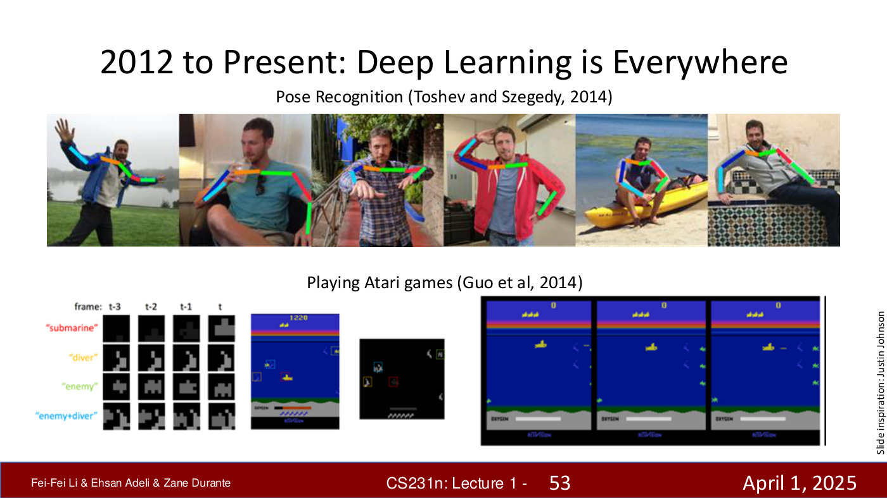

- "Pose Recognition (Toshev and Szegedy, 2014)": a strip of six photographs of a man in different poses (arms raised, drinking, pointing, saluting, sitting on a kayak, reclining), each overlaid with a coloured skeleton (blue, green, orange, red segments for limbs and torso).
- "Playing Atari games (Guo et al, 2014)": at the left, a small grid of four rows labelled "submarine" (red), "diver" (yellow), "enemy" (green) and "enemy+diver" (blue), with four black-and-white pixel maps each for frames "t-3, t-2, t-1, t" (frame label row); next to it an Atari underwater game screenshot (score 1220) with boxes around objects and a small black-and-white image of detected objects; at the right, three consecutive screenshots of the same game (a yellow submarine on blue water, with an oxygen gauge at the bottom, the score at the top shows 0).

## Slide 54 — 2012 to Present: Deep Learning is Everywhere (medical imaging, galaxies, whales)

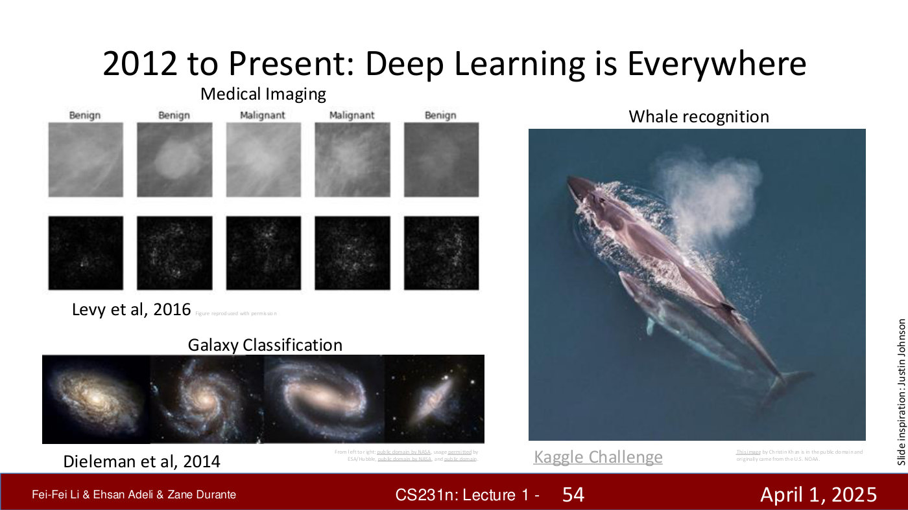

- "Medical Imaging" (Levy et al, 2016; figure reproduced with permission): a top row of five grey-scale breast-imaging patches labelled "Benign, Benign, Malignant, Malignant, Benign", and under each a dark, speckled saliency-style image.
- "Galaxy Classification" (Dieleman et al, 2014): four galaxy images (spiral, spiral, barred spiral, an edge-on galaxy). Credit: "From left to right: public domain by NASA, usage permitted by ESA/Hubble, public domain by NASA, and public domain."
- "Whale recognition" (large, right): an aerial photograph of a whale with a spout and a calf swimming on dark blue water; "Kaggle Challenge" link below. Credit: "This image by Christin Khan is in the public domain and originally came from the U.S. NOAA."

## Slide 55 — 2012 to Present: Deep Learning is Everywhere (image captioning)

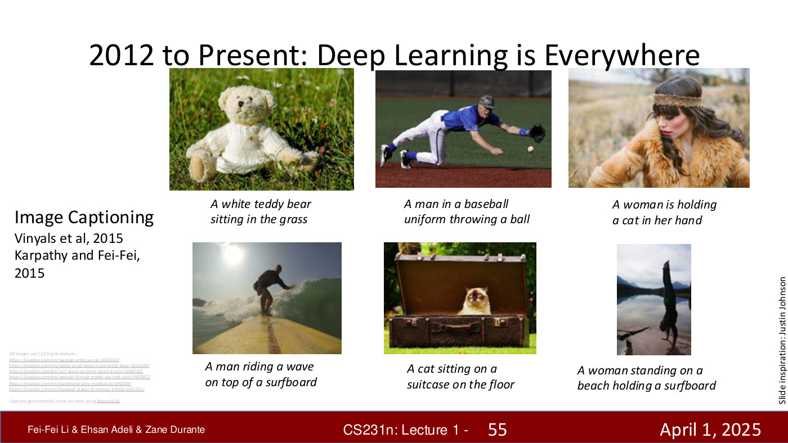

Left text: "Image Captioning / Vinyals et al, 2015 / Karpathy and Fei-Fei, 2015". Six photographs with their generated captions:
- "A white teddy bear sitting in the grass" (photo: a plush teddy bear in grass)
- "A man in a baseball uniform throwing a ball" (a player diving on a field)
- "A woman is holding a cat in her hand" (a woman in a fur coat and headband)
- "A man riding a wave on top of a surfboard" (a surfer on a wave)
- "A cat sitting on a suitcase on the floor" (a cat in an open suitcase on grass)
- "A woman standing on a beach holding a surfboard" (a person doing a handstand beside a lake)

Small print: "All images are CC0 Public domain:" followed by six pixabay.com URLs; "Captions generated by Justin Johnson using Neuraltalk2".

## Slide 56 — 2012 to Present: Deep Learning is Everywhere (scene graphs / visual relationships)

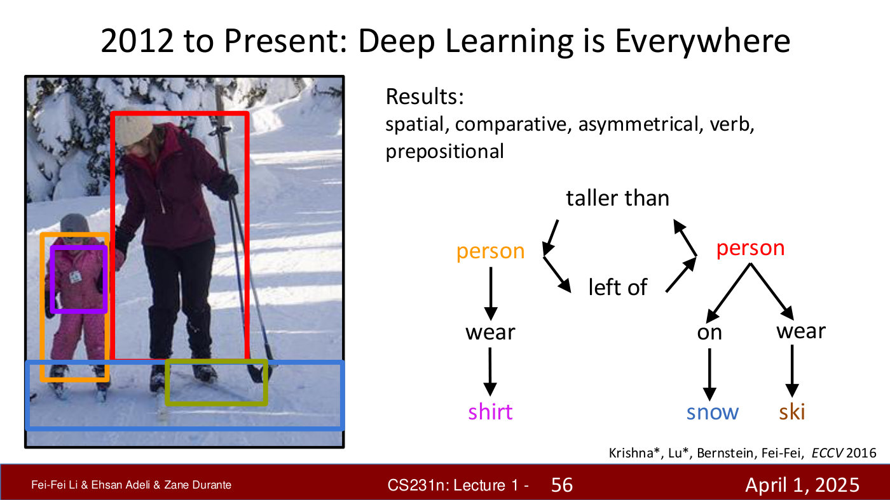

Left: a photograph of a woman and a small child skiing in snow, overlaid with coloured boxes: a red box around the woman, an orange box around the child, a purple box around the child's shirt, a blue box across the snow at the bottom, and an olive-green box around the woman's skis. Right: text "Results: spatial, comparative, asymmetrical, verb, prepositional", then a graph of words coloured to match the boxes: "person" (orange) —wear→ "shirt" (purple); "person" (orange) —"left of"→ "person" (red); "person" (red) —"taller than"→ "person" (orange); "person" (red) —"on"→ "snow" (blue); "person" (red) —"wear"→ "ski" (brown/olive). Citation: "Krishna*, Lu*, Bernstein, Fei-Fei, ECCV 2016".

## Slide 57 — [DeepDream and neural style transfer]

![Part 1, slide 57 — [DeepDream and neural style transfer]](../images/01-introduction-part-1/slide-57.jpg)

No title text. Left: two large "DeepDream" images: top, a psychedelic texture of many red/orange animal-like faces and swirls; bottom, a hazy landscape of hills filled with pagoda- or tower-like shapes. Right: a photo of three San Francisco row houses on a hill, shown at the top centre, and three stylised versions: one with a Starry-Night-like swirl style (top right), one in a colourful bokeh-dot mosaic style (centre) with a small inset of the style image (a colourful pattern), and one in the style of a Van Gogh painting of tree roots (right) with that painting as an inset. Citations: "Mordvinsev et al, 2015" and "Gatys et al, 2016". Small credits: "Figures copyright Justin Johnson, 2015. Reproduced with permission. Generated using the Inceptionism approach from a blog post by Google Research."; "Original image is CC0 public domain; Starry Night and Tree Roots by Van Gogh are in the public domain; Bokeh image is in the public domain; Stylized images copyright Justin Johnson, 2017; reproduced with permission".

## Slide 58 — 2012 to Present: Deep Learning is Everywhere (progressive GAN video)

Title: "2012 to Present: Deep Learning is Everywhere". A large solid black rectangle (an embedded video that did not render; nothing visible). Citation: Karras et al, "Progressive Growing of GANs for Improved Quality, Stability, and Variation", ICLR 2018.

## Slide 59 — 2012 to Present: Deep Learning is Everywhere (DALL·E, avocado armchair)

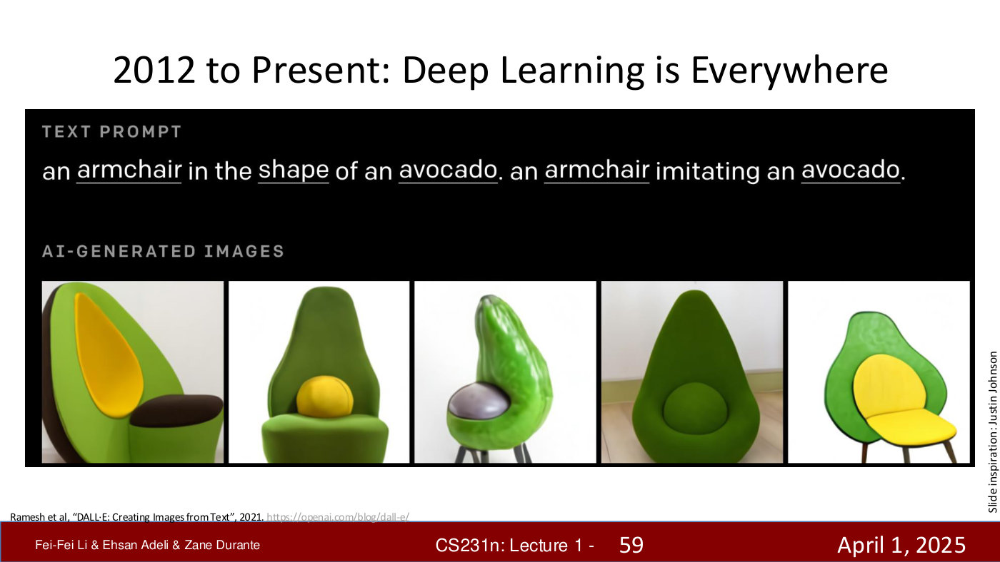

A DALL·E screenshot on black. "TEXT PROMPT": "an armchair in the shape of an avocado. an armchair imitating an avocado." (the words armchair, shape, avocado underlined). "AI-GENERATED IMAGES": five images on white of armchairs that look like avocados (green outer shell, yellow-green inner, brown pit-shaped seat or cushion; various shapes and viewpoints). Citation: Ramesh et al, "DALL·E: Creating Images from Text", 2021. https://openai.com/blog/dall-e/

## Slide 60 — 2012 to Present: Deep Learning is Everywhere (DALL·E, peach armchair)

Same layout as slide 59. Text prompt: "an armchair in the shape of a peach. an armchair imitating a peach." Five AI-generated images of peach-coloured (pink-orange) armchairs shaped like peaches, some with a green leaf on top. Same citation as slide 59.

## Slide 61 — [Computation, Algorithms, Data]

![Part 1, slide 61 — [Computation, Algorithms, Data]](../images/01-introduction-part-1/slide-61.jpg)

No title. Three side-by-side image panels, each with a bold white or grey label at the bottom; the date "April 1, 2025" and the number "61" appear faintly at the bottom corners instead of the footer bar.
- Left, label "Computation": a photograph of a data-centre aisle lined on both sides with racks of servers lit in blue, with a pale floor.
- Middle, label "Algorithms": a diagram of a feed-forward neural network drawn pointing upward on white: four dark-red circles at the bottom (inputs), a row of three grey circles, a row of two grey circles, and one dark-red circle at the top (output), with arrows connecting every node to the nodes of the next layer.
- Right, label "Data": a dense mosaic grid of many small photographs of everyday objects, food, and scenes (clocks, cameras, pastries, shoes, etc.).

## Slide 62 — GFLOP per Dollar

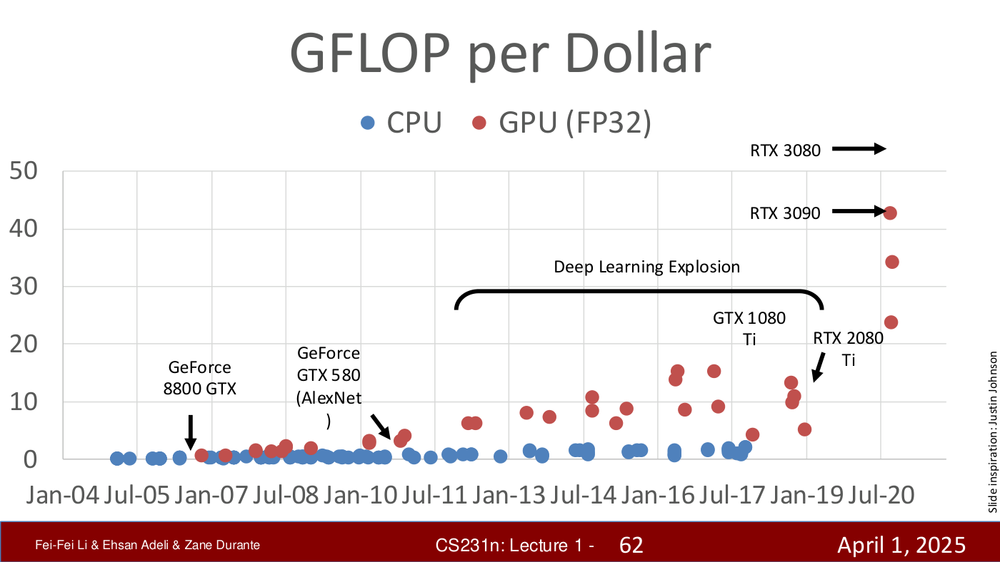

Title: "GFLOP per Dollar". A scatter chart.
- Axes: vertical, unlabelled, 0 to 50 in steps of 10 (GFLOP per dollar); horizontal, dates from Jan-04 to Jul-20 labelled Jan-04, Jul-05, Jan-07, Jul-08, Jan-10, Jul-11, Jan-13, Jul-14, Jan-16, Jul-17, Jan-19, Jul-20.
- 2 series (legend at top): blue dots "CPU" and red dots "GPU (FP32)".
  - Blue (CPU): stays very low, close to 0, rising to only about 1–2 by 2014–2018 (a handful of points near 1.5 around 2013–2018).
  - Red (GPU FP32): about 1–3 from 2007 to 2010, about 3–4 in early 2010, about 6–8 in 2011–2013, about 6–15 in 2014–2017 (e.g. ~15 in early 2016 and mid-2017), about 10–13 in late 2018 (around Oct-18) and about 5 at Jan-19, then jumping to about 24, 34 and 43 at the right edge (around Sep 2020).
- Annotations: black arrow with text "GeForce 8800 GTX" (pointing at roughly Jan-07); "GeForce GTX 580 (AlexNet)" (arrow pointing at about Jan-10 / mid-2010 red points; the text wraps with a stray ")" line); a curly bracket spanning about Jul-11 to Jan-19 labelled "Deep Learning Explosion"; "GTX 1080 Ti" and "RTX 2080 Ti" (the latter with an arrow pointing down at the 2018-19 points); at the top right, "RTX 3080" with an arrow pointing off to the right (off the chart, beyond the plotted points, at about y = 50) and "RTX 3090" with an arrow to the top red point at about 43.
Vertical text at right: "Slide inspiration: Justin Johnson".

## Slide 63 — GFLOP per Dollar (with Tensor Cores)

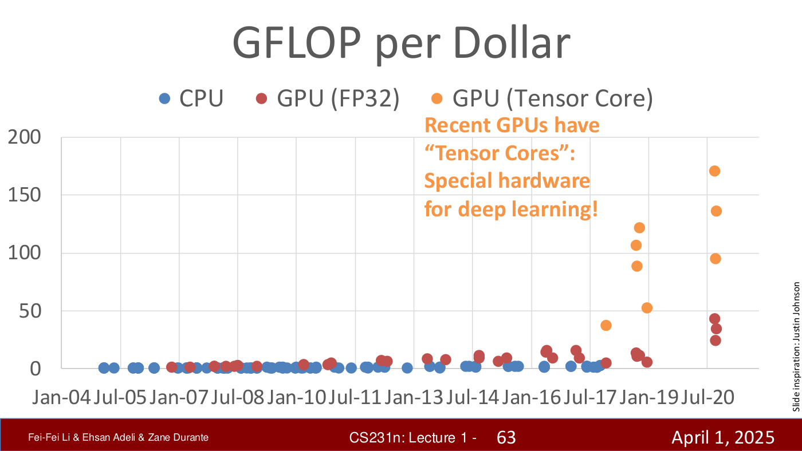

Same title and horizontal axis as slide 62, with a new vertical scale of 0 to 200 (ticks every 50). Now 3 series: blue "CPU" (all near 0), red "GPU (FP32)" (same points as slide 62, now looking low: up to about 15 until 2018, then about 5–13 in 2018-19 and about 24, 34, 43 at the right edge), and a new orange series "GPU (Tensor Core)": about 37 (mid-2017), about 53, 88, 107, 122 (around early 2019), and about 95, 136 and 171 at the right edge (c. Sep 2020). Orange bold text: "Recent GPUs have "Tensor Cores": Special hardware for deep learning!". Vertical text at right: "Slide inspiration: Justin Johnson".

## Slide 64 — AI's Explosive Growth & Impact

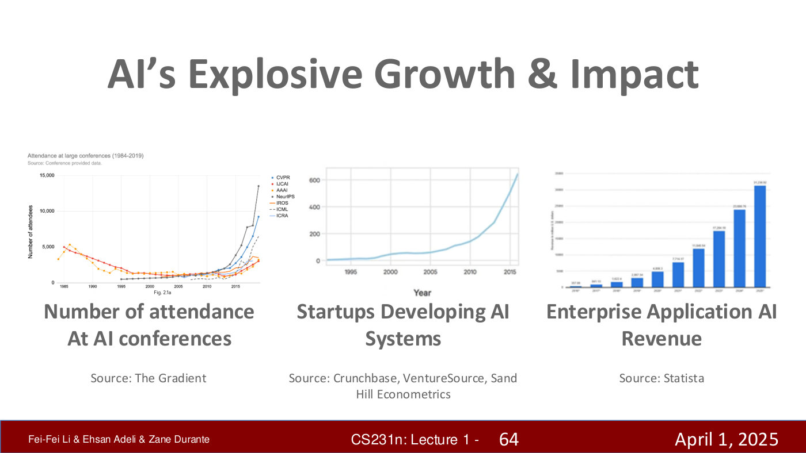

Title: "AI's Explosive Growth & Impact". Three small charts, each with a caption and source:
1. Left, "Number of attendance At AI conferences" (source: The Gradient). Line chart titled "Attendance at large conferences (1984-2019)", "Source: Conference provided data.", vertical axis "Number of attendees" (0 to 15,000, ticks 0, 5,000, 10,000, 15,000), horizontal axis years 1985 to 2015+, "Fig. 2.1a". 7 series (legend): CVPR (blue dots/line), IJCAI (red dots/line), AAAI (orange dots, dotted), NeurIPS (dark grey dots/line), IROS (orange solid), ICML (grey dashed), ICRA (light-blue solid). Qualitatively: AAAI and IJCAI start at about 3,000–5,000 in the mid-1980s and decline to about 1,000–1,500 by the late 1990s; all stay about 1,000–2,000 until about 2012; then NeurIPS rises fastest to about 13,500 in 2019 (about 8,000 in 2017–2018), CVPR to about 9,200, ICML to about 6,500, with IROS about 3,500, ICRA about 3,000, IJCAI about 3,000, AAAI about 3,200 at the end.
2. Middle, "Startups Developing AI Systems" (source: Crunchbase, VentureSource, Sand Hill Econometrics). One light-blue line; vertical axis 0 to 600 (ticks 0, 200, 400, 600); horizontal axis "Year" 1995–2015. The line starts near 5 at about 1992 and stays low through the late 1990s, about 50 around 2000–2005, then rises to about 100 in 2008, about 140 in 2010, about 180 in 2011, about 230 in 2012, about 280 in 2013, about 510 in 2015 and about 640 in 2016.
3. Right, "Enterprise Application AI Revenue" (source: Statista). A blue bar chart of 10 yearly bars, vertical axis labelled (in tiny print) "Revenue in million U.S. dollars", 0 to 35,000 in steps of 5,000; x-axis labels "2016*" through "2025*" (tiny print; the slide does not say what the asterisks mean). Bars grow roughly exponentially; printed bar values, left to right: 357.99, 641.13, 1,622.4, 3,067.54, 4,808.3, 7,714.17, 11,840.54, 17,284.19, 23,886.79, 31,230.92.

## Slide 65 — Despite the successes, computer vision still has a long way to go

Centred red text: "Despite the successes, computer vision still has a long way to go" (section divider).

## Slide 66 — Computer Vision Can Cause Harm

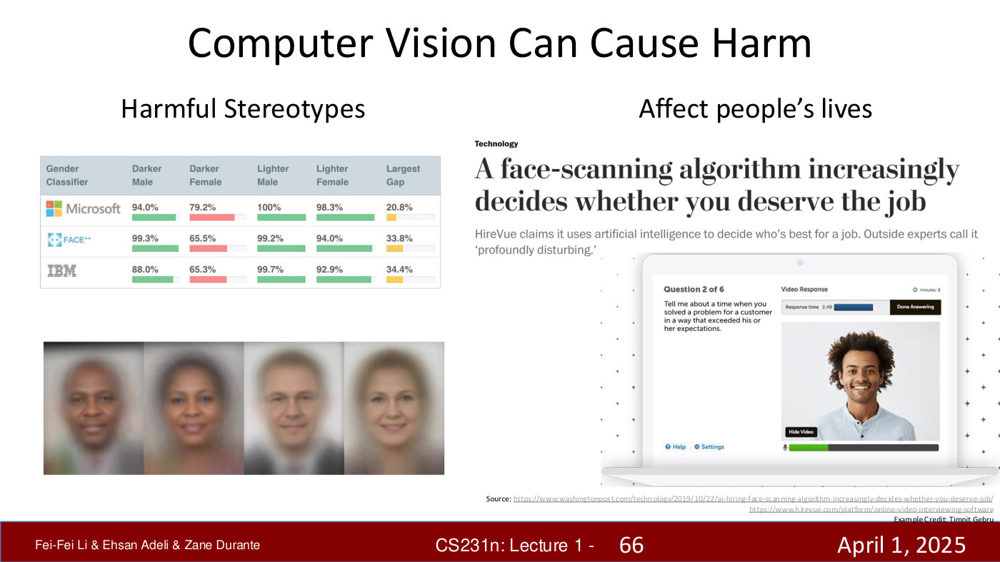

Title: "Computer Vision Can Cause Harm". Two columns.
- Left, "Harmful Stereotypes": a table of gender-classifier accuracy by skin tone and gender, with a small coloured bar under each value (green for high, red/pink for low, yellow for the gap):

| Gender Classifier | Darker Male | Darker Female | Lighter Male | Lighter Female | Largest Gap |
| ----------------- | ----------- | ------------- | ------------ | -------------- | ----------- |
| Microsoft | 94.0% | 79.2% | 100% | 98.3% | 20.8% |
| FACE++ | 99.3% | 65.5% | 99.2% | 94.0% | 33.8% |
| IBM | 88.0% | 65.3% | 99.7% | 92.9% | 34.4% |

  Below the table: a row of four blurry, averaged portrait photographs (a darker-skinned man, a darker-skinned woman, a lighter-skinned man, a lighter-skinned woman).
- Right, "Affect people's lives": a newspaper-style screenshot with the kicker "Technology" and the headline "A face-scanning algorithm increasingly decides whether you deserve the job", sub-headline "HireVue claims it uses artificial intelligence to decide who's best for a job. Outside experts call it 'profoundly disturbing.'", overlaid with a laptop screenshot of a video-interview interface ("Question 2 of 6 ... Tell me about a time when you solved a problem for a customer in a way that exceeded his or her expectations", a "Video Response" panel with a response timer and a "Done Answering" button, and a smiling man's face on screen).
- Source lines: https://www.washingtonpost.com/technology/2019/10/22/ai-hiring-face-scanning-algorithm-increasingly-decides-whether-you-deserve-job/ and https://www.hirevue.com/platform/online-video-interviewing-software; "Example Credit: Timnit Gebru".

## Slide 67 — Computer Vision Can Save Lives

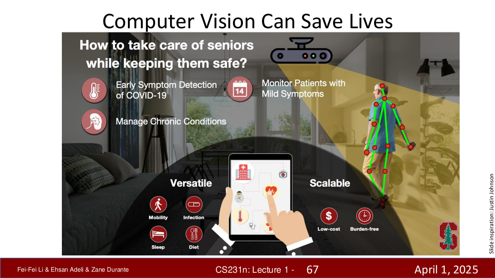

Title: "Computer Vision Can Save Lives". A composite graphic over a darkened living-room photograph, with a Stanford "S" tree logo at the bottom right:
- Heading text: "How to take care of seniors while keeping them safe?"
- Four round icon bullets: "Early Symptom Detection of COVID-19" (thermometer), "Monitor Patients with Mild Symptoms" (calendar, "14"), "Manage Chronic Conditions" (head with a lung/heart-like symbol).
- At the top, a drawing of a ceiling-mounted sensor with a yellow cone of view pointing down to a walking elderly man overlaid with a green-and-red skeleton (pose estimation).
- Bottom: a hand holding a tablet with a health-care app (hospital, doctor, thermometer icons). Left label "Versatile" with icons "Mobility", "Infection", "Sleep", "Diet"; right label "Scalable" with icons "Low-cost" and "Burden-free".
Vertical text at right: "Slide inspiration: Justin Johnson".

## Slide 68 — And there is a lot we don't know how to do

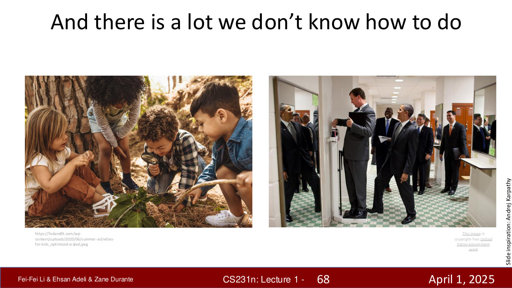

Title: "And there is a lot we don't know how to do". Two photographs:
- Left: four young children crouched in a wooded area examining plants and the ground, one holding a magnifying glass up to a plant. Credit text (small): https://fedandfit.com/wp-content/uploads/2020/06/summer-activities-for-kids_optimized-scaled.jpeg
- Right: a hallway scene with several men in dark suits; one man stands on a bathroom-style scale while another man (in front) playfully presses his foot on it, and others around them are laughing; mirrors and lockers on the walls. Credit: "This image is copyright-free United States government work".
Vertical text at right: "Slide inspiration: Andrej Karpathy".

## Slide 69 — Today's agenda

Title: "Today's agenda". Two bullets: "A brief history of computer vision & deep learning" (greyed out, i.e. already covered) and "CS231n overview" (in black, i.e. next).
