# Lecture 1 — Introduction, part 2: course overview (slide-by-slide)

Text and figures of all 50 pages of [`lecture_1_part_2.pdf`](https://cs231n.stanford.edu/slides/2025/lecture_1_part_2.pdf), CS231N (Stanford, Spring 2025), presented by Ehsan Adeli. Cite these as "part 2, slide N" using the **printed** slide number (footer, after "Lecture 1 -"). The running footer ("Stanford CS231n 10th Anniversary", "Lecture 1 - N", "April 1, 2025") is omitted from the entries below. Figures are described in prose because the KB is read as text. Many slides are build steps; each is transcribed individually with a note of what it adds.

## Slide numbers vs PDF pages

Not 1:1. PDF pages 1–3 print slides 1–3; PDF page 4 = slide 6 … page 42 = slide 44 (offset +2); PDF page 43 = slide 46 … page 50 = slide 53 (offset +3). Printed numbers 4, 5 and 45 do not exist in the PDF (hidden slides in the source deck).

**Not presented aloud.** The recording skips slides 33–48 and 50: the award ceremony, CVPR
statistics and every logistics slide (lectures, website, sections, Ed, office hours, communication,
assignments, grading, late policy, collaboration policy, prerequisites, textbooks, why take the
class). For those slides this file is the only source; the transcript has nothing on them.

**Images.** 17 slides are rendered as images, each placed under its heading: 8–10, 14–18, 22–28,
34 and 52. The others have none, because they are the title, staff and guest-lecturer photographs
(1–3), agenda, divider and title-only slides (6, 11–13, 19–21, 29, 30, 35), a build step that adds
nothing to slide 8 (7), photographs of award winners and the award ceremony (31–33), the schedule
screenshot, whose table is transcribed in full below (37), or text-only logistics slides (36,
38–44, 46–51, 53). Never construct an image path for a slide not listed here.

Companion pages: [wiki page for this lecture](../../wiki/01-introduction.md) · [transcript](../transcripts/01-introduction.md) · [part 1 slides](01-introduction-part-1.md)

## Contents

| Slides | Section |
| ------ | ------- |
| 1–3 | Title; instructors; guest lecturers |
| 6 | Course overview agenda (four parts) |
| 7–10 | Deep Learning Basics: image classification; linear classifier, regularization and optimization, neural networks |
| 11–12 | Agenda recap; Perceiving and Understanding the Visual World |
| 13–18 | Tasks vs. models: tasks beyond classification, models beyond MLP (CNN, RNN, attention/Transformers), large-scale distributed training |
| 19–20 | Agenda: Perceiving; Generative and Interactive Visual Intelligence |
| 21–28 | Beyond 2D recognition: self-supervised learning, generative modeling, vision language models, 3D vision, embodied intelligence |
| 29–30 | Agenda: Generative and Interactive; Human-Centered Applications and Implications |
| 31–34 | Recognition of the field: 2018 Turing Award, 2024 Nobel Prize in Physics, Longuet-Higgins Prize, CVPR paper statistics |
| 35–42 | Logistics: lectures, website, discussion sections, Ed, office hours, communication, assignments |
| 43–44 | Grading and late policy |
| 46 | Collaboration policy |
| 47–48 | Prerequisites; optional textbooks |
| 49–50 | Learning objectives; why take this class |
| 51–53 | Course structure by lecture; next time; contact email |

---

## Slide 1 — CS231n: Deep Learning for Computer Vision (title)

Title: "CS231n: Deep Learning for Computer Vision". Bottom-left: "Lecture 1 – Part 2 – Overview". Right: "Spring 2025" in red. A red rubber-stamp-style graphic at the upper right, tilted, reads "UPDATED SYLLABUS AND ASSIGNMENTS". Background: a faint pink Stanford University seal (with a tree, "1891").

## Slide 2 — Instructors

Four headshot photographs in a row, with names beneath: Fei-Fei Li (woman with long dark hair, hand under her chin), Ehsan Adeli (man with dark hair and a goatee, black shirt), Zane Durante (smiling man in a light-blue collared shirt, green foliage behind), Justin Johnson (young man with short hair looking to the side, dark t-shirt).

## Slide 3 — Guest Lecturers

Four headshot photographs in a row, with names beneath: Jiajun Wu, Ranjay Krishna, Ruohan Gao, Yunzhu Li (all smiling or neutral men; Wu, Gao and Li wear glasses; Krishna has dark wavy hair and a white t-shirt).

## Slide 6 — CS231n overview

Four-item agenda list; the first is highlighted (black), the other three greyed out:
- **Deep Learning Basics** (highlighted)
- Perceiving and Understanding the Visual World
- Generative and Interactive Visual Intelligence
- Human-Centered Applications and Implications

## Slide 7 — Deep Learning Basics

Bullet: "Image Classification: A core task in Computer Vision". Figure: a photograph of a grey tabby cat sitting, with a black arrow pointing right to the word "cat" (an image goes in, a class label comes out). Caption under the photo: "This image by Nikita is licensed under CC-BY 2.0".

## Slide 8 — Deep Learning Basics

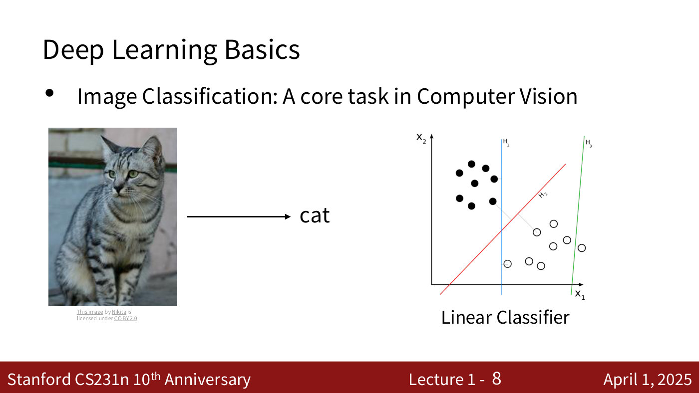

Same as slide 7 (cat photo, arrow to "cat"), plus a new figure at right captioned "Linear Classifier": a 2D scatter plot with axes x₁ (horizontal) and x₂ (vertical). About 8 filled black dots cluster at upper left and about 8 hollow circles at lower right. Three separating lines are drawn: a blue vertical line (labelled H₁), a red diagonal line running lower-left to upper-right (labelled H₂ in small text) with a thin segment marking the margin to nearby points, and a green near-vertical line at far right (labelled H₃). It illustrates linear decision boundaries separating two classes (the red one separates them best).

## Slide 9 — Deep Learning Basics

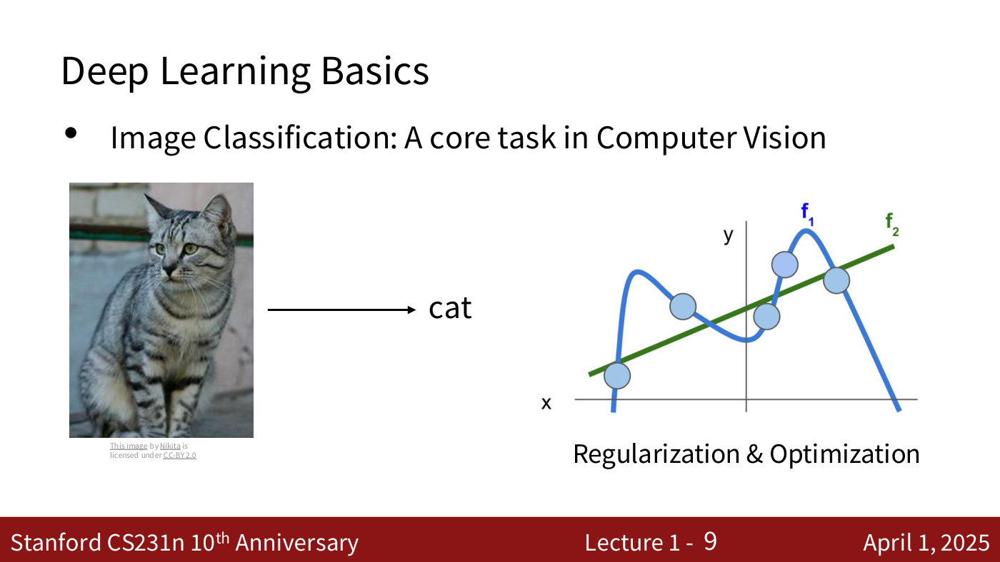

Same as slide 7, plus at right (replacing the linear classifier) a figure captioned "Regularization & Optimization": axes x (horizontal) and y (vertical), five light-blue data points. A wiggly blue curve "f₁" passes through all five points (overfit, with large swings and falling off steeply at both ends), and a straight green line "f₂" passes near them (the simpler fit). It illustrates complex vs. simple fits and regularization.

## Slide 10 — Deep Learning Basics

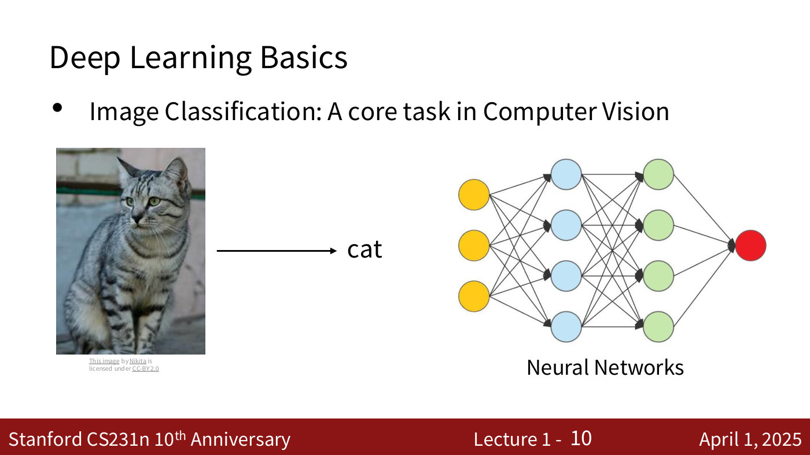

Same as slide 7, plus at right a figure captioned "Neural Networks": a fully connected feed-forward network diagram with 3 yellow input nodes, a layer of 4 blue nodes, a layer of 4 green nodes, and 1 red output node; every node is connected by arrows to all nodes of the next layer.

## Slide 11 — CS231n overview

Same agenda as slide 6: "Deep Learning Basics" highlighted; the other three greyed out.

## Slide 12 — CS231n overview

Same agenda; now "Perceiving and Understanding the Visual World" is highlighted and the other three greyed out.

## Slide 13 — Perceiving and Understanding the Visual World

Two large circles side by side with no other text: a light-orange circle labelled "Tasks" (left) and a grey-blue circle labelled "Models" (right).

## Slide 14 — Tasks Beyond Image Classification

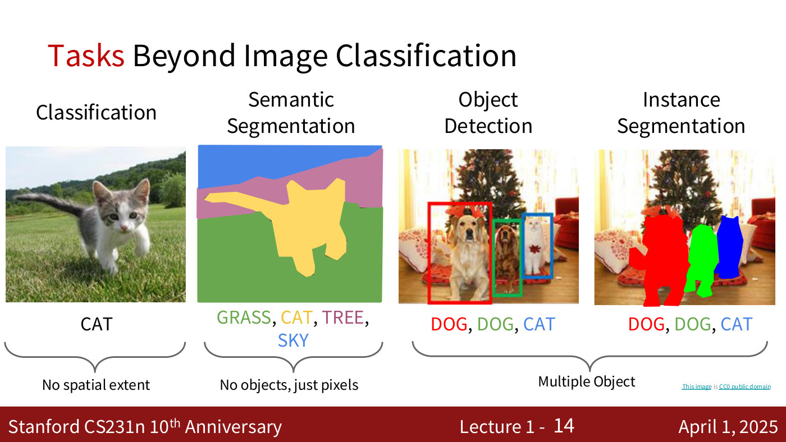

Title word "Tasks" is in red. Four example panels, left to right:
- **Classification**: photo of a kitten walking on grass; label "CAT". Brace beneath: "No spatial extent".
- **Semantic Segmentation**: the same scene as a flat-colour map: blue top (sky), purple band (tree), green bottom (grass), a yellow cat silhouette; label "GRASS, CAT, TREE, SKY" (each word coloured to match: green, yellow, purple, blue). Brace beneath: "No objects, just pixels".
- **Object Detection**: photo of two dogs and a cat in front of a Christmas tree, with three rectangular boxes: red around the left golden dog, green around the middle dog, blue around the cat; label "DOG, DOG, CAT" (red, green, blue).
- **Instance Segmentation**: same photo with the animals filled with solid colour masks (red, green, blue silhouettes); label "DOG, DOG, CAT".
A shared brace under the last two panels: "Multiple Object". Small credit: "This image is CC0 public domain".

## Slide 15 — Tasks Beyond Image Classification

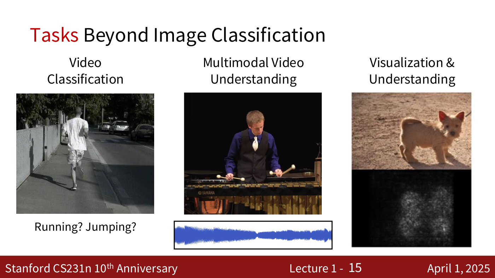

Three examples:
- **Video Classification**: a grayscale street frame showing a person in white shirt and shorts running along a sidewalk, seen from behind; caption "Running? Jumping?".
- **Multimodal Video Understanding**: a young man in a dark vest playing a marimba/vibraphone (Yamaha) with mallets against a black background; beneath it a blue audio waveform in a box.
- **Visualization & Understanding**: a photo of a small tan terrier-type dog on dirt, and below it a black image with a faint white blotchy glow in the middle (a saliency/visualization map).

## Slide 16 — Models Beyond Multi-Layer Perceptron

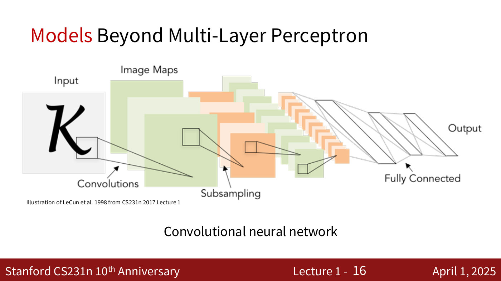

Title word "Models" in red. Figure: convolutional network diagram. At left, the input image (a script capital letter "K") with a small square patch highlighted; "Input" label. Stacks of green "Image Maps" (feature maps) connected by lines from the patch ("Convolutions"), followed by smaller orange stacks ("Subsampling"), then alternating green and orange smaller stacks, ending in flattened layers labelled "Fully Connected" and "Output". Caption below: "Convolutional neural network". Credit: "Illustration of LeCun et al. 1998 from CS231n 2017 Lecture 1".

## Slide 17 — Models Beyond Multi-Layer Perceptron

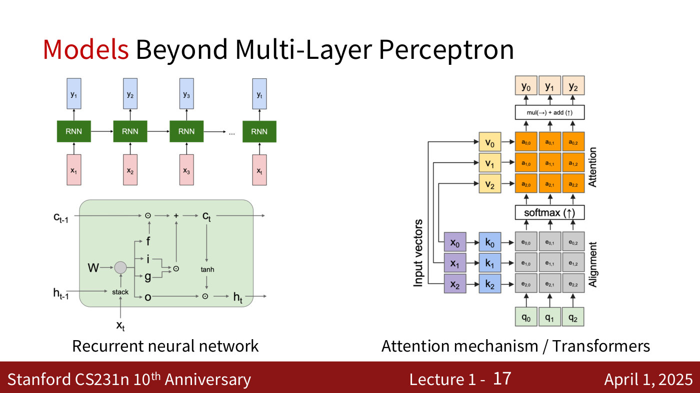

Two figures:
- Left, "Recurrent neural network": an unrolled RNN chain: inputs x₁, x₂, x₃, …, x_t (pink boxes) feed RNN blocks (green) that pass state left to right and output y₁, y₂, y₃, …, y_t (blue boxes). Below it an LSTM cell diagram: inputs c_{t-1} and h_{t-1} and x_t, "stack" of h and x multiplied by W, producing gates f, i, g, o; elementwise multiplications (⊙) and a "+" produce c_t; c_t passes through "tanh" and is multiplied by o to give h_t.
- Right, "Attention mechanism / Transformers": input vectors x₀, x₁, x₂ (purple) produce keys k₀, k₁, k₂ (blue) and values v₀, v₁, v₂ (yellow); queries q₀, q₁, q₂ (green) at the bottom. Alignment grid e_{i,j} (grey) from queries and keys, then "softmax (↑)", then an Attention grid a_{i,j} (orange), combined with values by "mul(→) + add (↑)" to give outputs y₀, y₁, y₂ (top). Side labels: "Input vectors", "Alignment", "Attention".

## Slide 18 — Large Scale Distributed Training

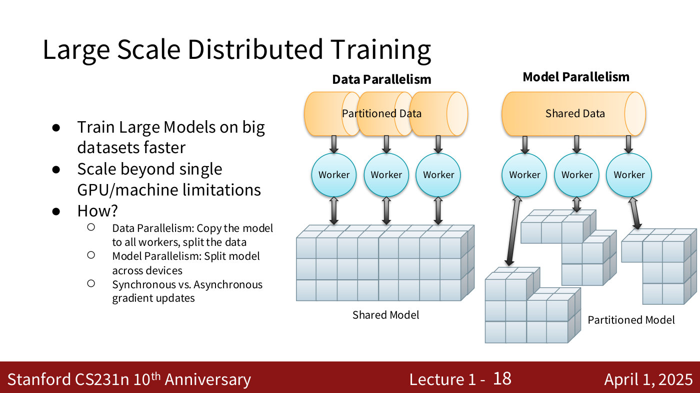

Bullets:
- Train Large Models on big datasets faster
- Scale beyond single GPU/machine limitations
- How?
  - Data Parallel: Copy the model to all workers, split the data
  - Model Parallel: Split model across devices
  - Synchronous vs. Asynchronous gradient updates

Figure: two diagrams. "Data Parallelism": a cylinder of "Partitioned Data" split into three, each feeding one "Worker" (blue circle); each Worker has a double-headed arrow to one "Shared Model" (a single block of cubes). "Model Parallelism": a cylinder of "Shared Data" feeding three Workers; each Worker connects (double arrow) to a different piece of a "Partitioned Model" (cube blocks split into three parts).

## Slide 19 — CS231n overview

Same agenda; "Perceiving and Understanding the Visual World" highlighted, others greyed.

## Slide 20 — CS231n overview

Same agenda; "Generative and Interactive Visual Intelligence" highlighted, others greyed.

## Slide 21 — Beyond 2D Recognition

Title only; the rest of the slide is blank.

## Slide 22 — Beyond 2D Recognition: Self-supervised Learning

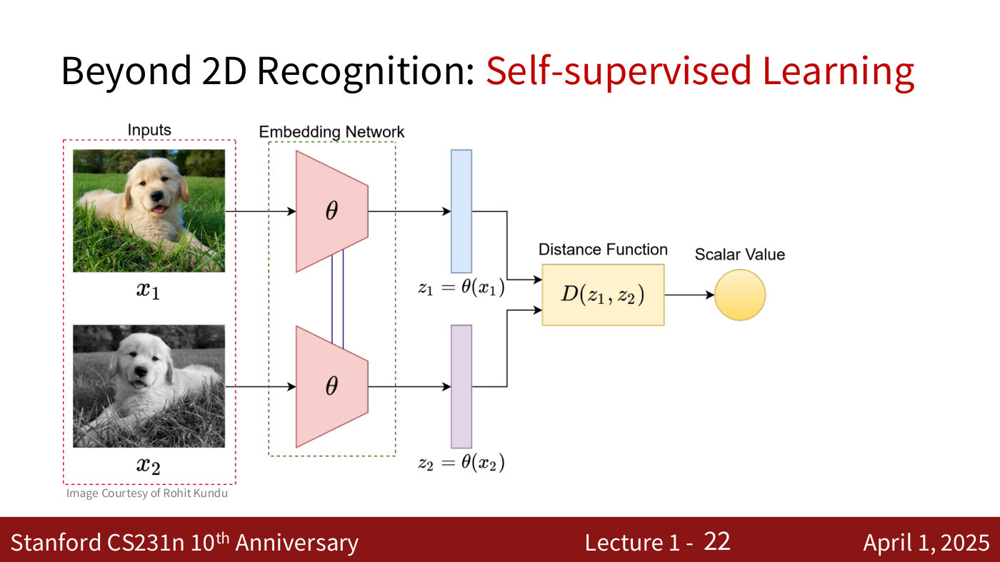

Subtitle "Self-supervised Learning" in red. Figure: a Siamese-network diagram. Left box "Inputs" holds two photos of the same golden puppy on grass: x₁ (colour) and x₂ (grayscale version). Each goes into an "Embedding Network" box containing a pink trapezoid labelled θ (the two θ networks are linked by a line, i.e. shared weights). Outputs are vectors z₁ = θ(x₁) (blue bar) and z₂ = θ(x₂) (purple bar), which both feed a yellow "Distance Function" box D(z₁, z₂), whose output is a yellow circle labelled "Scalar Value". Credit: "Image Courtesy of Rohit Kundu".

## Slide 23 — Beyond 2D Recognition: Generative Modeling

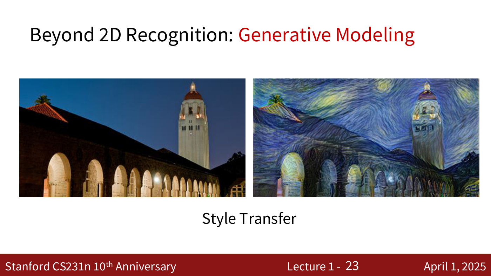

Subtitle "Generative Modeling" in red. Two photographs side by side, caption "Style Transfer": left, a night photo of the Stanford Hoover Tower and an arcade of lit arches under a dark blue sky; right, the same scene re-rendered in the swirling brush-stroke style of Van Gogh's "The Starry Night" (swirling blue and yellow sky, same buildings).

## Slide 24 — Beyond 2D Recognition: Generative Modeling

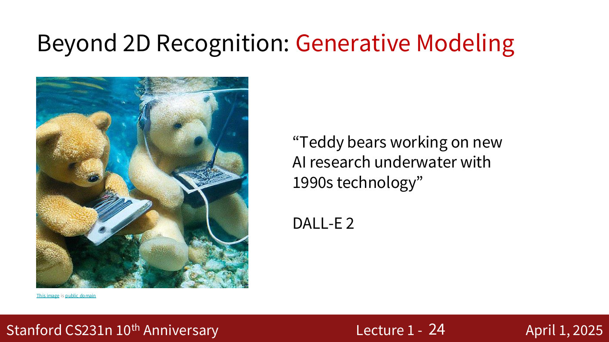

At left, a generated image of two fluffy teddy bears underwater, each typing on a laptop, with bubbles and a coral/rocky floor. At right, the quoted prompt: "Teddy bears working on new AI research underwater with 1990s technology" followed by "DALL-E 2". Credit: "This image is public domain".

## Slide 25 — Beyond 2D Recognition: Generative Modeling

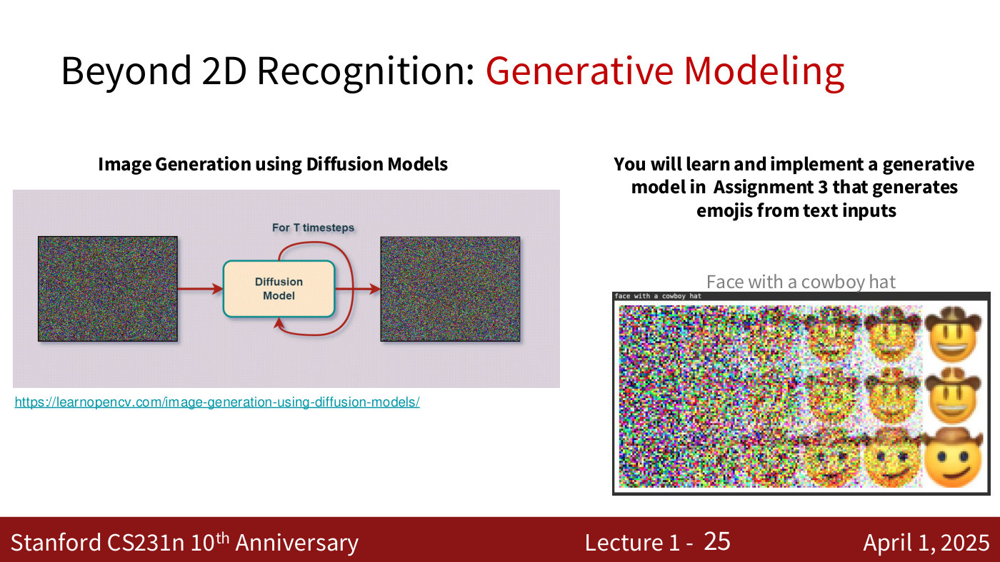

Left, bold heading "Image Generation using Diffusion Models": a diagram with a noisy-static image on the left, an arrow into a box "Diffusion Model" with a looping arrow labelled "For T timesteps", and an arrow out to another noisy-static image on the right (iterative denoising). URL below it: https://learnopencv.com/image-generation-using-diffusion-models/

Right, bold text: "You will learn and implement a generative model in  Assignment 3 that generates emojis from text inputs". Below, the text prompt "Face with a cowboy hat" and a grid of 3 rows by about 6 columns of small emoji images showing progressive denoising from colourful noise (left) to clear cowboy-hat smiley-face emojis (right).

## Slide 26 — Beyond 2D Recognition: Vision Language Models

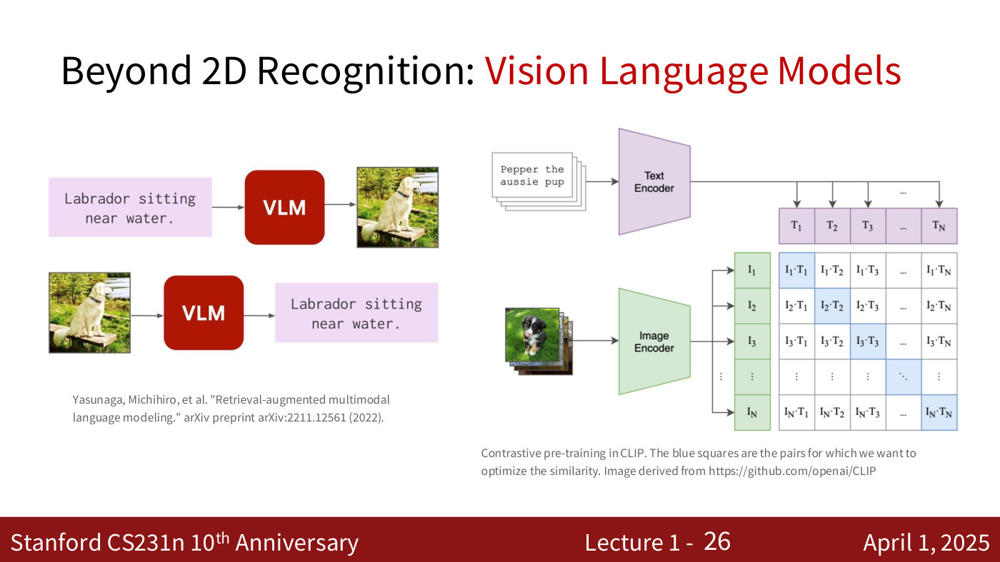

Subtitle "Vision Language Models" in red. Left: two VLM diagrams. Top: a text box "Labrador sitting near water." with an arrow into a red box "VLM" and an arrow to a photo of a yellow Labrador sitting on a wooden platform (text to image). Bottom: that photo, arrow into a red "VLM" box, arrow to the text box "Labrador sitting near water." (image to text). Citation: "Yasunaga, Michihiro, et al. "Retrieval-augmented multimodal language modeling." arXiv preprint arXiv:2211.12561 (2022)."

Right: the CLIP contrastive pre-training diagram. A stack of text snippets ("Pepper the aussie pup") goes into a purple "Text Encoder", yielding text embeddings T₁, T₂, T₃, …, T_N across the top. A stack of images (a black-and-white/brown dog photo) goes into a green "Image Encoder", yielding image embeddings I₁, I₂, I₃, …, I_N down the left side. An N×N grid of dot products I_i·T_j (I₁·T₁, I₁·T₂, … I_N·T_N); the diagonal cells are shaded blue. Caption: "Contrastive pre-training in CLIP. The blue squares are the pairs for which we want to optimize the similarity. Image derived from https://github.com/openai/CLIP"

## Slide 27 — Beyond 2D Recognition: 3D Vision

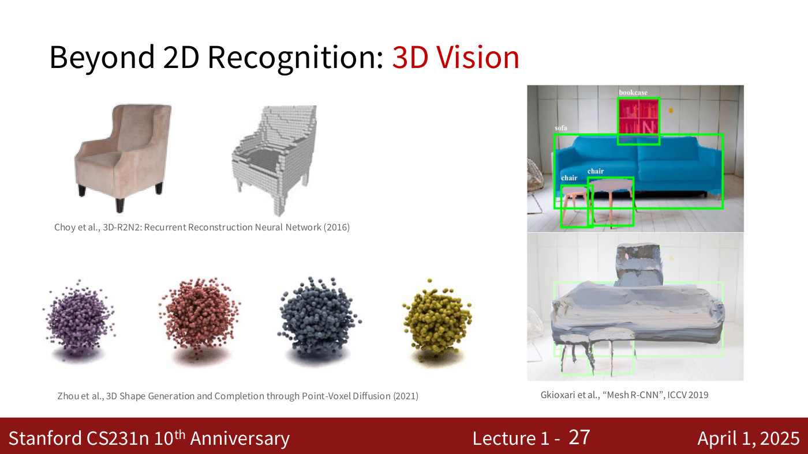

Subtitle "3D Vision" in red. Three figure groups:
- Top left: a photo of a pink-beige wingback armchair and, beside it, its voxel (blocky grey cube) 3D reconstruction. Citation: "Choy et al., 3D-R2N2: Recurrent Reconstruction Neural Network (2016)".
- Bottom left: four fuzzy point-cloud blobs (purple, red/pink, dark grey-blue, yellow-olive) of generated 3D shapes. Citation: "Zhou et al., 3D Shape Generation and Completion through Point-Voxel Diffusion (2021)".
- Right: a living-room photo with green bounding boxes labelled "bookcase", "sofa", "chair", "chair" (blue sofa, red bookcase, small chairs) and below it the reconstructed 3D meshes of those objects (grey surfaces) in the same scene. Citation: "Gkioxari et al., "Mesh R-CNN", ICCV 2019".

## Slide 28 — Beyond 2D Recognition: Embodied Intelligence

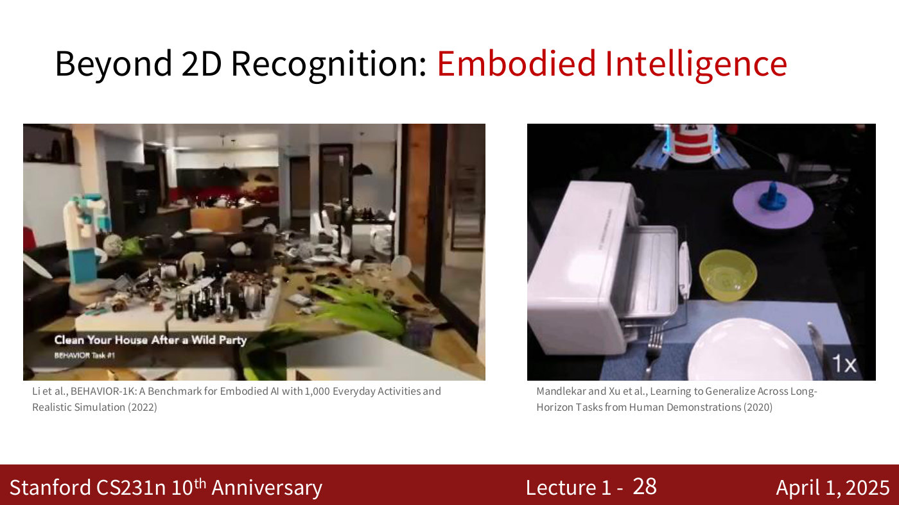

Subtitle "Embodied Intelligence" in red. Two video frames:
- Left: a simulated messy living room/kitchen with strewn bottles, dishes and a plant, and a robot with a light-blue arm at left; caption overlay "Clean Your House After a Wild Party" and "BEHAVIOR Task #1". Citation: "Li et al., BEHAVIOR-1K: A Benchmark for Embodied AI with 1,000 Everyday Activities and Realistic Simulation (2022)".
- Right: a top-down view of a robot workspace with a white toaster-oven-like box, a white plate with a fork and knife, a yellow bowl and a purple plate with a blue object; "1x" at bottom right. Citation: "Mandlekar and Xu et al., Learning to Generalize Across Long-Horizon Tasks from Human Demonstrations (2020)".

## Slide 29 — CS231n overview

Same agenda; "Generative and Interactive Visual Intelligence" highlighted, others greyed.

## Slide 30 — CS231n overview

Same agenda; now "Human-Centered Applications and Implications" highlighted, others greyed.

## Slide 31 — 2018 Turing Award for deep learning

Subtitle: "most prestigious technical award, is given for major contributions of lasting importance to computing." Three portrait photographs with name labels: Geoffrey Hinton (older man with grey hair, dark jacket, name badge), Yoshua Bengio (smiling man with curly grey hair and glasses, red shirt), Yann LeCun (man with glasses speaking at a podium with a ThinkPad laptop). Each credited "This image is CC0 public domain".

## Slide 32 — 2024 Nobel Prize in Physics

Two photos: left, captioned "Hinton speaking at the Nobel Prize Lectures in Stockholm in 2024" (older man with grey hair, dark suit, tie, headset mic); right, captioned "John Hopfield in 2016" (smiling older man with white hair, grey blazer). Credits "This image is CC0 public domain". Right-hand text: "In 2024, he was jointly awarded the Nobel Prize in Physics with John Hopfield "for foundational discoveries and inventions that enable machine learning with artificial neural networks."" ("Nobel Prize in Physics" and "John Hopfield" are hyperlinks.)

## Slide 33 — IEEE PAMI Longuet-Higgins Prize

Text: "Award recognizes ONE Computer Vision paper from ten years ago with significant impact on computer vision research." Red line: "At CVPR 2019, it was awarded to the 2009 original ImageNet paper". Two photographs of a conference stage. Left: a projection screen reading "PAMI Longuet-Higgins Prize / Retrospective Most Impactful Paper from CVPR 2009 / ImageNet: A large-scale hierarchical image database / Jia Deng, Wei Dong, Richard Socher, Li-Jia Li, Kai Li, and Li Fei-Fei", with a few people at the bottom left. Right: a closer shot of people standing on stage at a lectern, with a white arrow and the label "That's Fei-Fei" pointing to one woman in the group; the screen shows "ImageNet: A large-… Jia Deng, Li-Jia Li, K…".

## Slide 34 — [CVPR Nashville and CVPR paper statistics]

![Part 2, slide 34 — [CVPR Nashville and CVPR paper statistics]](../images/01-introduction-part-2/slide-34.jpg)

No title text. Top left: the CVPR Nashville logo (navy guitar shape, "CVPR Nashville, June 11-15, 2025"). Right: a dusk photo of the Nashville skyline across a river, with the same logo overlaid. Bottom left: a line chart "CVPR Conference Paper Statistics". X-axis "Year", 2006–2023 (yearly); y-axis 0 to 10000 (gridlines 0, 2500, 5000, 7500, 10000). Two series (legend: blue "Submitted Papers", red "Accepted Papers"):
- Submitted Papers (blue): 2006 1131; 2007 1250; 2008 1593; 2009 1464; 2010 1724; 2011 1677; 2012 1933; 2013 1798; 2014 1807; 2015 2123; 2016 2145; 2017 2680; 2018 3309; 2019 5165; 2020 6424; 2021 7093; 2022 8161; 2023 9155.
- Accepted Papers (red): 2006 318; 2007 353; 2008 508; 2009 383; 2010 462; 2011 440; 2012 466; 2013 472; 2014 540; 2015 602; 2016 643; 2017 783; 2018 979; 2019 1294; 2020 1467; 2021 1661; 2022 2063; 2023 2359.
Submissions are roughly flat (~1100–2100) until 2016, then rise steeply after 2017; acceptances grow more slowly.

## Slide 35 — Logistics

Section divider; the single word "Logistics".

## Slide 36 — Lectures

- Tuesdays and Thursdays between 12:00 PM to 1:20 PM at NVIDIA Auditorium
- Lectures will not be streamed on Zoom but will be broadcast live via Panopto (underlined)
- Slides will be posted on the course website shortly before each lecture
- All lectures will be recorded and uploaded to Canvas (link) after the lecture under the "Panopto Course Videos" Tab.

## Slide 37 — Course website [http://cs231n.stanford.edu/] - Refresh!

Title includes the hyperlink http://cs231n.stanford.edu/ ("- Refresh!"). The slide is a screenshot of the course website Schedule section. Text: "Schedule. Lectures will occur Tuesday/Thursday from 12:00-1:20pm Pacific Time at NVIDIA Auditorium. Discussion sections will (generally) occur on Fridays from 12:30-1:20pm Pacific Time at NVIDIA Auditorium. Check Ed for any exceptions. Updated lecture slides will be posted here shortly before each lecture. For ease of reading, we have color-coded the lecture category titles in blue, discussion sections (and final project poster session) in yellow, and the midterm exam in red. Note that the schedule is subject to change as the quarter progresses."

Table with columns Date | Description | Course Materials | Events | Deadlines:

| Date | Description | Course Materials | Events | Deadlines |
| --- | --- | --- | --- | --- |
| 04/01 | **Lecture 1: Introduction** — Computer vision overview; Course overview; Course logistics | | | |
| (blue band) | **Deep Learning Basics** | | | |
| 04/03 | **Lecture 2: Image Classification with Linear Classifiers** — The data-driven approach; K-nearest neighbor; Linear Classifiers; Algebraic / Visual / Geometric viewpoints; Softmax loss | | | |
| 04/04 (yellow row) | Python / Numpy Review Session | 12:30-1:20pm PT | | |
| 04/08 | **Lecture 3: Regularization and Optimization** — Regularization; Stochastic Gradient Descent; Momentum, AdaGrad, Adam; Learning rate schedules | | | |
| 04/09 | | | Assignment 1 **out** (green) | |
| 04/10 | **Lecture 4: Neural Networks and Backpropagation** — Multi-layer Perceptron; Backpropagation | | | |
| 04/11 (yellow row) | Backprop Review Session | 12:30-1:20pm PT | | |

## Slide 38 — Friday Discussion Sections

"6 Discussion sections Fridays 12:30-1:20 pm, NVIDIA Auditorium". Table (yellow rows):

| Date | Session |
| --- | --- |
| 04/04 | Python / Numpy Review Session |
| 04/11 | Backprop Review Session |
| 04/18 | Final Project Overview and Guidelines |
| 04/25 | PyTorch / TensorFlow Review Session |
| 05/02 | RNNs & Transformers |
| 05/09 | Midterm Review Session |

Then: "Hands-on tutorials, with more practical details than the main lecture". "Check Canvas for the Zoom link for the discussion sessions! Recordings will be available on Canvas." "This Friday: Python / numpy / Colab"

## Slide 39 — Ed

- For questions about assignments, final project, midterm, logistics, etc, use Ed! (Ed is a link)
- Access: Canvas -> Deep Learning for Computer Vision -> Ed Discussion
- CGOE students: Use your @stanford.edu address to register for Ed; contact scpd-customerservice@stanford.edu for help. (email is a link)

## Slide 40 — Office Hours

We'll be hosting both in-person and remote office hours. (starting week 2)
- Location
  - In-person: Huang Basement, check for CS231n signs, check the course website and Canvas
  - Remote: Zoom and QueueStatus to setup queues
    - Please see Canvas or Ed for the QueueStatus link
    - TAs will admit students to their Zoom meeting rooms for 1-1 conversations when it's your turn using QueueStatus.
- The office hour schedule is on the course website (link)

## Slide 41 — Overview on communication

- Course Website: http://cs231n.stanford.edu/
  - Syllabus, lecture slides, links to assignment downloads, etc
- Ed:
  - Use this for most communication with course staff
  - Ask questions about homework, grading, logistics, etc
  - Use private questions only if your post will violate the honor code if you release it publicly
- Course email address:
  - cs231n-staff-spr25@stanford.edu
- Gradescope:
  - For turning in homework and receiving grades
- Canvas:
  - For watching recorded lectures
  - For watching recorded discussion sessions

## Slide 42 — Assignments

"All assignments will be completed using Google Colab"

Assignment 1: Will be out Wednesday 4/9, due 4/23  by 11:59 PM
- K-Nearest Neighbor
- Linear classifiers: Softmax
- Two-layer neural network
- Image features
- Deep neural network and optimizers

## Slide 43 — Grading

"All assignments, coding and written portions, will be submitted via Gradescope." (Gradescope is a link)

An auto-grading system:
- A consistent grading scheme
- Public tests:
  - Students see results of public tests immediately
- Private tests
  - Generalizations of the public tests to thoroughly test your implementation

## Slide 44 — Grading

- 3 Assignments: 12% + 18% + 15% = 45%
- In-Class Midterm Exam: 20%
- Course Project: 35%
  - Project Proposal: 1%
  - Milestone: 2%
  - Final Project Report: 29%
  - Poster & Poster Session: 3%
- Participation Extra Credit: up to 3%
- Late policy
  - 4 free late days – use up to 2 late days per assignment
  - Afterward, 25% off per day late
  - No late days for project report

(The percentages are printed in orange/red.)

## Slide 46 — Collaboration policy

"We follow the Stanford Honor Code and the CS Department Honor Code – read them!" (both are links)
- Rule 1: Don't look at solutions or code that are not your own; everything you submit should be your own work
- Rule 2: Don't share your solution code with others; however discussing ideas or general strategies is fine and encouraged
- Rule 3: Indicate in your submissions anyone you worked with
- Rule 4: Do not submit AI-generated responses

"Turning in something late/incomplete is better than violating the honor code"

## Slide 47 — Prerequisites

Proficiency in Python
- All class assignments will be in Python (and use numpy)
- Later in the class, you will be using Pytorch and TensorFlow
- A Python tutorial available on course website (link)

College Calculus, Linear Algebra

## Slide 48 — Optional textbook resources

- Deep Learning (link)
  - by Goodfellow, Bengio, and Courville
  - Here is a free version (link)
- Mathematics of deep learning
  - Chapters 5, 6 7 are useful to understand vector calculus and continuous optimization
  - Free online version (link)
- Dive into deep learning
  - An interactive deep learning book with code, math, and discussions, based on the NumPy interface.
  - Free online version (link)

## Slide 49 — Learning objectives

Three red headings, each with bullets:
- **Formalize computer vision applications into tasks**
  - Formalize inputs and outputs for vision-related problems
  - Understand what data and computational requirements you need to train a model
- **Develop and train vision models**
  - Learn to code, debug, and train convolutional neural networks.
  - Learn how to use software frameworks like PyTorch and TensorFlow
- **Gain an understanding of where the field is and where it is headed**
  - What new research has come out in the last 0-5 years?
  - What are open research challenges?
  - What ethical and societal considerations should we consider before deployment?

## Slide 50 — Why should you take this class?

Become a vision researcher (an incomplete list of conferences)
- Get involved with vision research at Stanford (link): apply using this form (link).
- CVPR 2025 conference (link)
- ICCV 2025 conference (link)

Become a vision engineer in industry (an incomplete list of industry teams)
- Perception team at Google AI (link), Vision at Google Cloud (link)
- Vision at Meta AI (link)
- Vision at Amazon AWS (link)
- Nvidia, Apple, Microsoft, OpenAI, Salesforce, ……

Apply computer vision to solve problems in other fields of science & engineering

"General interest" (partly clipped by the footer at the bottom of the slide)

## Slide 51 — CS231n: Deep Learning for Computer Vision

- Deep Learning Basics (Lecture 2 – 4)
- Perceiving and Understanding the Visual World (Lecture 5 – 12)
- Reconstructing and Interacting with the Visual World (Lecture 13 – 17)
- Human-Centered Artificial Intelligence (Lecture 18)

(Note: the section names here differ from the agenda on slides 6–30, which name "Generative and Interactive Visual Intelligence" and "Human-Centered Applications and Implications".)

## Slide 52 — Next time: Image classification with Linear Classifiers

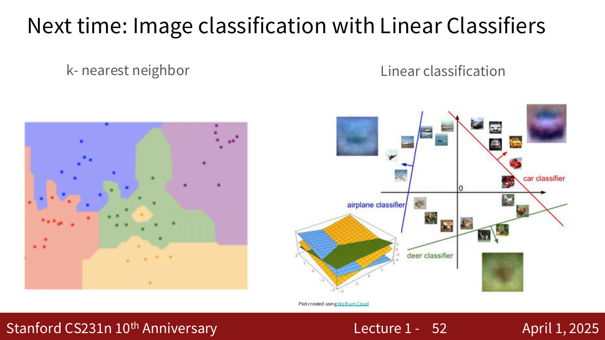

Two figures with headings "k- nearest neighbor" and "Linear classification":
- Left: a 2D map coloured into five irregular regions (red/salmon at left, blue at top-centre, green in the middle, purple at right, orange/yellow at bottom), each containing same-coloured dots, with a small orange island inside the green region; it shows the decision regions of a k-nearest-neighbor classifier.
- Right: the CIFAR-style linear-classification picture: a 2D plane with scattered small images (airplanes, cars, deer and others), and three lines with normal arrows: a blue "airplane classifier" line at left, a red "car classifier" line at upper right, and a green "deer classifier" line at bottom; large blurry template images (blue for airplane, purple/red for car, green-brown for deer) sit near the corresponding lines. Inset at lower left: a 3D plot of three intersecting planes (blue, orange/yellow, green). Credit: "Plot created using Wolfram Cloud".

## Slide 53 — [Contact email]

Only the centred, underlined link: cs231n-staff-spr25@stanford.edu
