# Lecture 2 — Image Classification with Linear Classifiers (slide-by-slide)

Text and figures of all 102 pages of [`lecture_2.pdf`](https://cs231n.stanford.edu/slides/2025/lecture_2.pdf), CS231N (Stanford, Spring 2025), April 3, 2025. Cite these as "slide N" using the **printed** slide number (footer, after "Lecture 2 -"). The running footer ("Stanford CS231n 10th Anniversary", "Lecture 2 - N", "April 3, 2025") is on every page and is not repeated below. Equations are written in LaTeX as printed, including the deck's own slips, which are noted where they occur.

## Slide numbers vs PDF pages

Not 1:1. PDF pages 1–31 print slides 1–31; PDF page 32 = slide 33 … page 47 = slide 48 (offset +1); PDF page 48 = slide 50 … page 102 = slide 104 (offset +2). Printed numbers 32 and 49 do not exist in the PDF (hidden slides in the source deck).

**Images.** 41 slides are rendered as images, each placed under its heading: 7–16, 18, 19, 22,
23, 29–31, 33–35, 41, 42, 44, 45, 47, 48, 55–57, 60, 62–65, 77, 80, 84, 89, 94, 99 and 101. The
others have none, because they are the title (1), administrative, syllabus and agenda text (2–6),
code (17, 21, 24–28, 100), section titles (20, 51, 70), text (36, 50, 85), build steps whose last
step is rendered (37–40 → 41, 43 → 44, 46 → 47, 52–54 → 55, 59 → 60, 61 → 62, 71–76 → 77,
78–79 → 80, 86–88 → 89, 90–93 → 94, 95–98 → 99), the CIFAR10 grid repeated from slide 44 (58),
the score-table slides whose table is transcribed in full (66–69), or loss formulas and
questions that are transcribed exactly (81–83, 102–104). Never construct an image path for a
slide not listed here.

Companion pages: [wiki page for this lecture](../../wiki/02-image-classification.md) · [transcript](../transcripts/02-image-classification.md)

## Contents

| Slides | Section |
| ------ | ------- |
| 1–6 | Title; administrative (Assignment 1, course project, discussion sections); syllabus; agenda |
| 7–16 | Image classification: the semantic gap; challenges (viewpoint, illumination, background clutter, occlusion, deformation, intraclass variation, context) |
| 17–19 | Writing an image classifier by hand; the data-driven approach (train / predict) |
| 20–28 | Nearest neighbor classifier: train and predict, L1 distance, code, complexity |
| 29–35 | Decision regions; k-nearest neighbors; L1 vs. L2 distance; interactive demo |
| 36–45 | Hyperparameters: train / validation / test splits, cross-validation; CIFAR10; accuracy vs. k |
| 46–50 | k-NN on images, why pixel distance is never used; k-NN summary |
| 51–57 | Linear classifier: the parametric approach $f(x, W) = Wx + b$; linear layers in neural networks |
| 58–64 | Interpreting a linear classifier: algebraic, visual (templates) and geometric viewpoints; hard cases |
| 65–69 | Choosing a good $W$: loss functions |
| 70–83 | Softmax classifier: probabilities, cross-entropy loss, KL divergence, questions |
| 84 | Coming up: regularization, optimization |
| 85–100 | Reading assignment: multiclass SVM loss, worked example, questions, code |
| 101–104 | Softmax vs. SVM |

---

## Slide 1 — Lecture 2: Image Classification with Linear Classifiers

Lecture 2:
Image Classification with Linear Classifiers

## Slide 2 — Administrative: Assignment 1

Will be out **Wednesday 4/9, due 4/23 by 11:59 PM**
- K-Nearest Neighbor
- Linear classifiers: Softmax
- Two-layer neural network
- Image features
- Deep neural network and optimizers

## Slide 3 — Administrative: Course Project

Project proposal due 4/25 (Friday) 11:59 pm

Contact us on Ed, each project team will have a TA assigned to them for future questions

your assigned TA for initial guidance (Canvas -> People -> Groups)

Use the Google Form to find project partners (will be posted later today)

"Is X a valid project for 231n?" --- Ed private post / TA Office Hours

More info on the website

## Slide 4 — Administrative: Discussion Sections

This Friday 12:30 pm-1:20 pm, in person at NVIDIA Auditorium, remote on Zoom (recording will be made available)

Python / Numpy, Google Colab

Presenter: Emily Jin (TA) with Assistance from Matthew Jin (TA)

## Slide 5 — Syllabus

Diagram: a horizontal red arrow pointing right runs across the slide, with three column headings above it in red and a list of topics under each. The first column's topics "Data-driven approaches", "Linear classification" and "K-Nearest Neighbor" are in black; all other topics are in grey.

Column 1, heading "Deep Learning Basics": Data-driven approaches; Linear classification; K-Nearest Neighbor; Loss Functions; Optimization; Backpropagation; Multi-layer Perceptrons; Neural Networks; Activation Functions; Data Augmentation.

Column 2, heading "Perceiving and Understanding the Visual World": Transfer Learning; Optimizers; Convolutions; PyTorch; RNNs / Attention / Transformers; Normalization Layers; Architecture Design; Video Understanding; Vision and Language; 3D Vision; Object Detection and Segmentation.

Column 3, heading "Reconstructing and Interacting with the Visual World": Style Transfer; Generative Models; Self-supervised Learning; Image Generation; Robotics and Embodied AI. Then, set apart lower down in red (not grey): Human-centered AI; Fairness & Ethics.

## Slide 6 — Image Classification

Image Classification
A Core Task in Computer Vision

Today:
- The image classification task
- Two basic data-driven approaches to image classification
  - K-nearest neighbor and linear classifier

## Slide 7 — Image Classification: A core task in Computer Vision

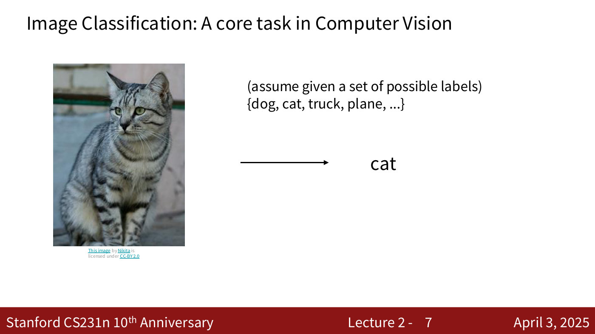

Figure: on the left, a photograph of a grey tabby cat sitting, seen in three-quarter view against a blurred background. Caption under it: "This image by Nikita is licensed under CC-BY 2.0". On the right, the text "(assume given a set of possible labels)" and "{dog, cat, truck, plane, ...}". Below, a black arrow points from the cat image to the word "cat".

## Slide 8 — The Problem: Semantic Gap

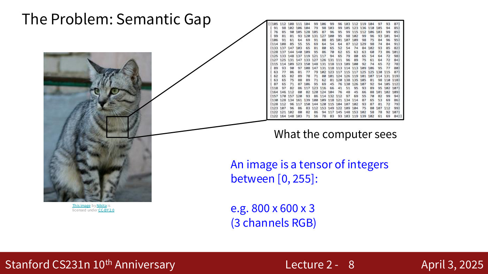

Figure: the same tabby cat photo as slide 7 on the left (caption "This image by Nikita is licensed under CC-BY 2.0"), with a small black square drawn on the cat's neck/chest area. Two black lines connect that square to a large box at upper right that shows a 24 × 16 array of integers printed in NumPy bracket style `[[ … ]]` (pixel values, roughly 41 to 170; first row 105 112 108 111 104 99 106 99 96 103 112 119 104 97 93 87). The array is itself a low-resolution raster, so a few digits are uncertain at any zoom; the full grid is not reproduced here. Label under the box: "What the computer sees".

Blue text: "An image is a tensor of integers between [0, 255]:"

"e.g. 800 x 600 x 3
(3 channels RGB)"

## Slide 9 — Challenges: Viewpoint variation

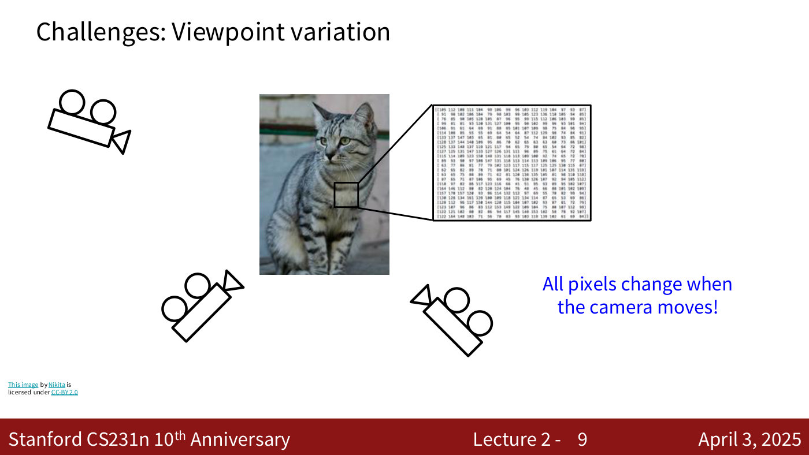

Figure: the same cat photo in the centre with the same black square and enlarged pixel-number matrix at upper right as in slide 8. Three black line-drawn movie-camera icons are placed around the cat (upper left, lower left, lower right), each pointing toward the cat from a different angle. Blue text at right: "All pixels change when the camera moves!" Credit at lower left: "This image by Nikita is licensed under CC-BY 2.0".

## Slide 10 — Challenges: Illumination

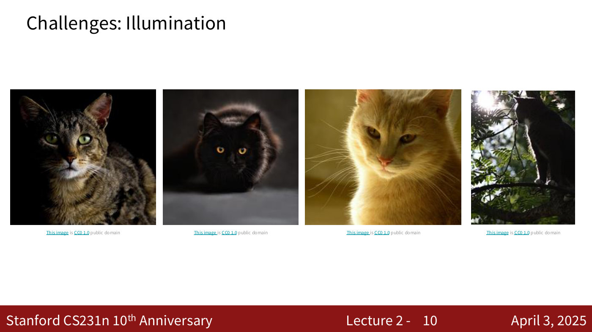

Figure: a row of four cat photographs. (1) A tabby cat with green eyes against a black background, lit from the front/side. (2) A black fluffy cat with orange eyes crouching in dim light on a grey surface. (3) An orange/ginger cat lit warmly from behind, glowing golden. (4) A dark silhouette of a cat on a tree branch against bright sunlight filtering through green leaves. Under each image the credit reads "This image is CC0 1.0 public domain".

## Slide 11 — Challenges: Background Clutter

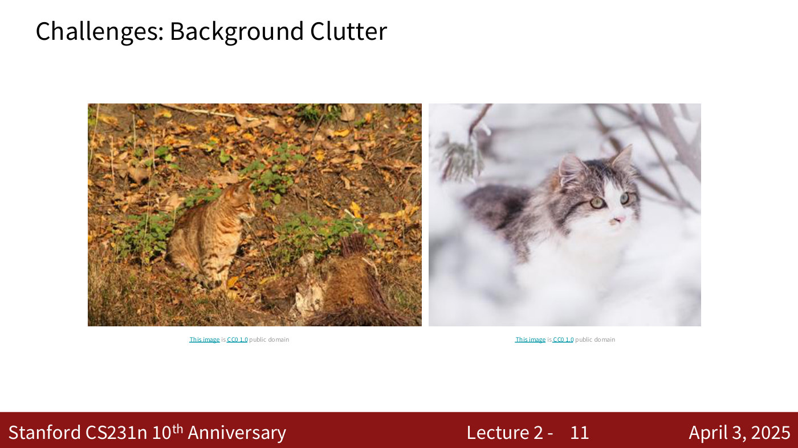

Figure: two photographs side by side. Left: an orange/brown tabby cat sitting among autumn leaves, dirt and green plants, camouflaged against the ground (a second brown furry object lies at lower right). Right: a grey-and-white long-haired cat in a snowy scene with branches, its fur close in colour to the snow. Under each image: "This image is CC0 1.0 public domain".

## Slide 12 — Challenges: Occlusion

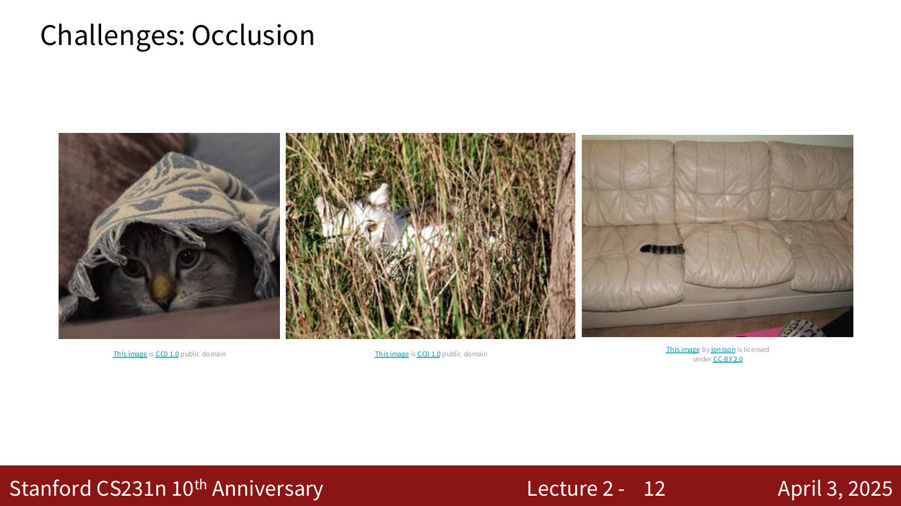

Figure: three photographs side by side. (1) A cat peeking out from under a patterned blanket, only face visible. (2) A white cat mostly hidden in tall dry grass. (3) A beige leather sofa with only a striped cat tail visible between cushions. Credits: first and second "This image is CC0 1.0 public domain"; third "This image by jonsson is licensed under CC-BY 2.0".

## Slide 13 — Challenges: Deformation

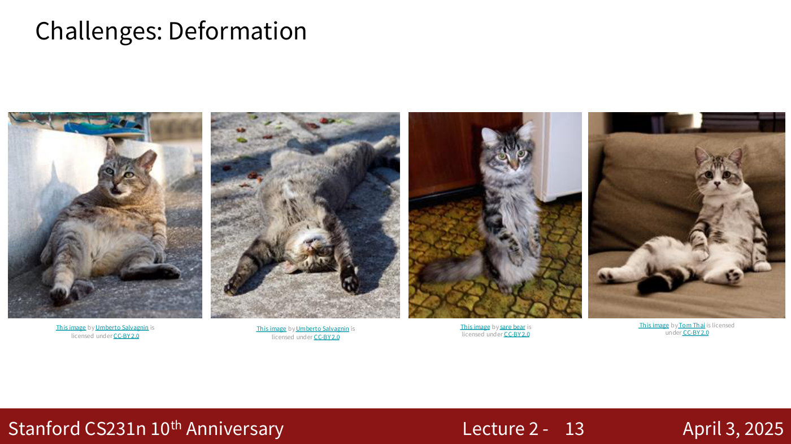

Figure: a row of four photographs of cats in unusual poses. (1) A grey tabby sitting upright and slouched against a wall with legs splayed. (2) A grey cat lying on its back on pavement, stretched out. (3) A fluffy grey cat standing on its hind legs on a patterned green rug. (4) A grey-and-white cat sitting on a sofa with legs spread forward. Credits in order: "This image by Umberto Salvagnin is licensed under CC-BY 2.0"; "This image by Umberto Salvagnin is licensed under CC-BY 2.0"; "This image by sare bear is licensed under CC-BY 2.0"; "This image by Tom Thai is licensed under CC-BY 2.0".

## Slide 14 — Challenges: Intraclass variation

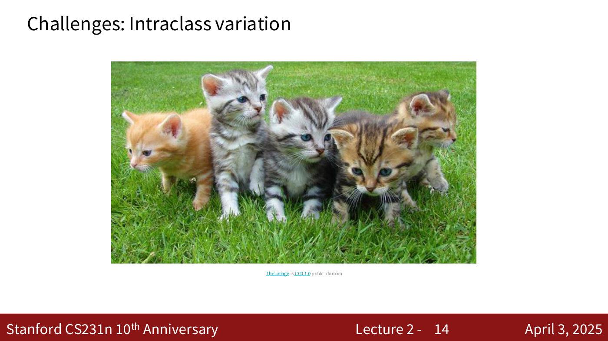

Figure: one photograph of five kittens sitting together on grass: one orange, two grey-and-white tabbies, one brown tabby and one more brown tabby partly behind. Credit: "This image is CC0 1.0 public domain".

## Slide 15 — Challenges: Context

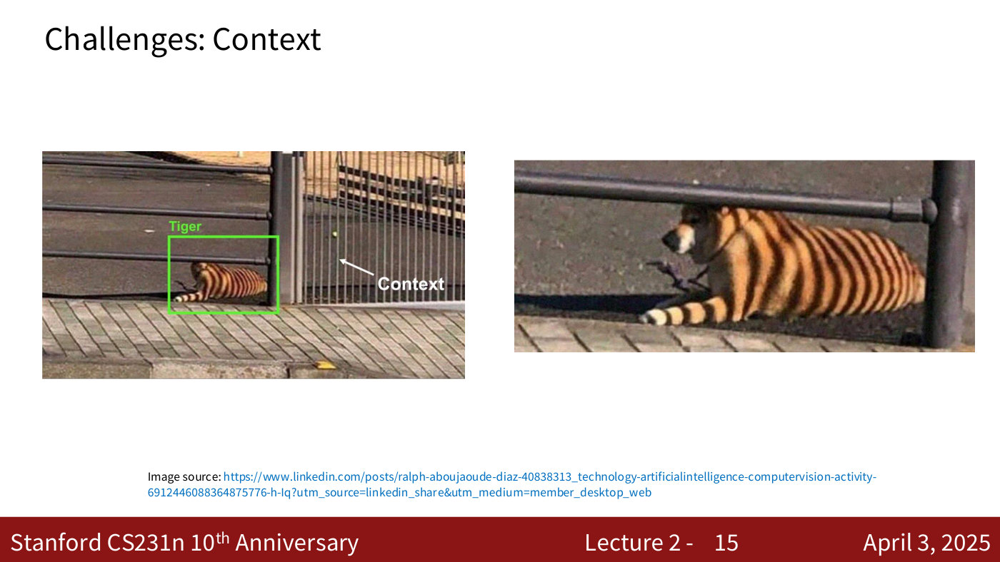

Figure: two photographs. Left: a street scene with a pavement and metal fence/gate bars; an animal lying on the pavement behind a horizontal bar has orange-and-black stripes. A green rectangle labelled "Tiger" surrounds it, and a white arrow labelled "Context" points to the fence area to the right. Right: a close-up of the same animal lying behind a horizontal pole; its head and legs have plain orange-and-white fur, and its body appears striped orange and black where the fence bars cast shadow.

Image source: https://www.linkedin.com/posts/ralph-aboujaoude-diaz-40838313_technology-artificialintelligence-computervision-activity-6912446088364875776-h-Iq?utm_source=linkedin_share&utm_medium=member_desktop_web

## Slide 16 — Modern computer vision algorithms

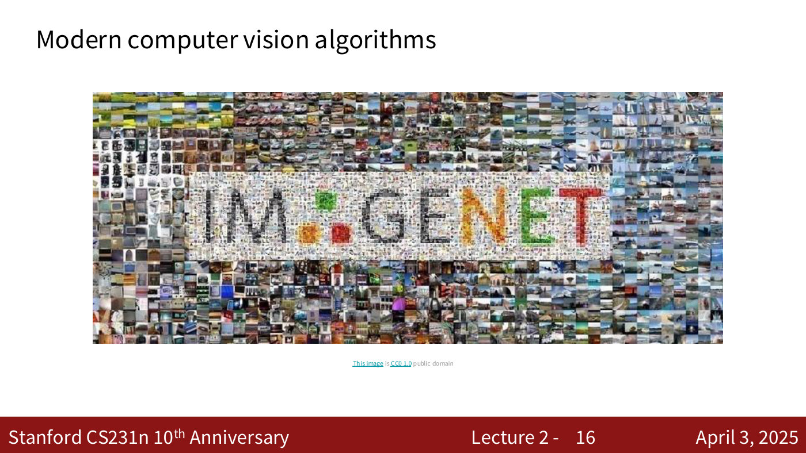

Figure: a wide mosaic of many small thumbnail photographs forming the ImageNet logo in large capitals. It reads "IM", then two coloured dots (green above, red below) in place of the letter "A", then "GE", "N", "E", "T". The letters "IM" and "GE" are dark grey; "N" is orange, "E" is green and "T" is red. Credit: "This image is CC0 1.0 public domain".

## Slide 17 — An image classifier

Code snippet (syntax highlighted):

```
def classify_image(image):
  # Some magic here?
  return class_label
```

Unlike e.g. sorting a list of numbers,

no obvious way to hard-code the algorithm for recognizing a cat, or other classes.

## Slide 18 — Attempts have been made

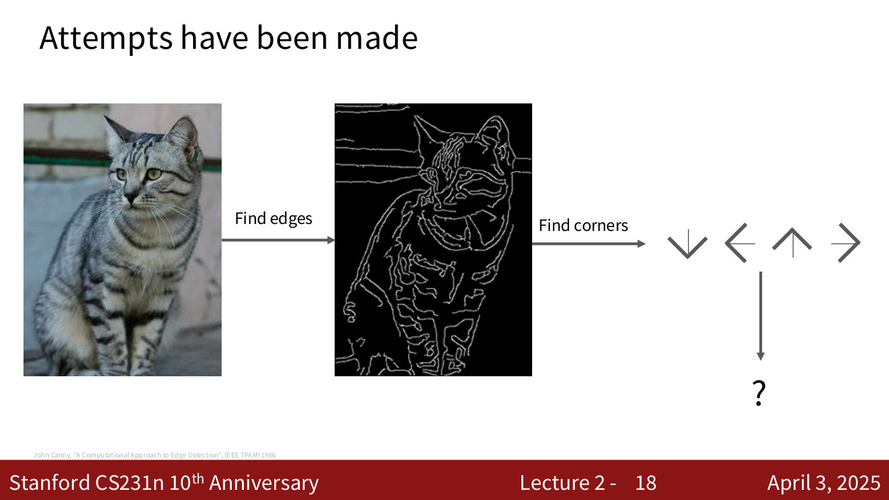

Figure: a three-stage pipeline drawn left to right. Left: the tabby cat photo (same as slide 7). A grey arrow labelled "Find edges" points to a black image showing a white line-drawing of the cat's edges (an edge map). A second grey arrow labelled "Find corners" points to a row of four grey arrowhead/chevron symbols: a down-pointing one, a left-pointing one, an up-pointing one and a right-pointing one. A grey arrow points down from beneath the second symbol (the left-pointing one) to a "?".

Credit (small grey text, lower left): "John Canny, "A Computational Approach to Edge Detection", IEEE TPAMI 1986"

## Slide 19 — Machine Learning: Data-Driven Approach

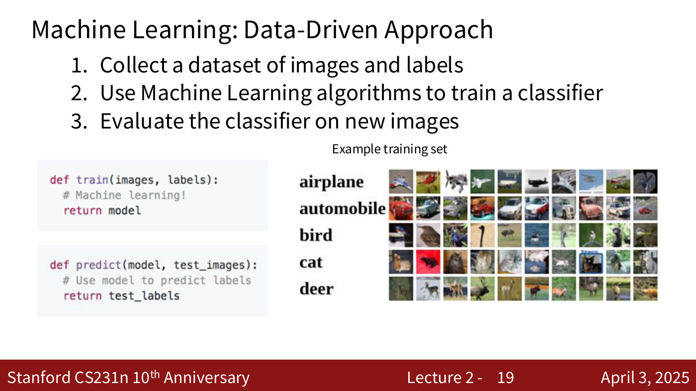

1. Collect a dataset of images and labels
2. Use Machine Learning algorithms to train a classifier
3. Evaluate the classifier on new images

Left, two code snippets:

```
def train(images, labels):
  # Machine learning!
  return model
```

```
def predict(model, test_images):
  # Use model to predict labels
  return test_labels
```

Right, label "Example training set" above a grid of small thumbnail images: 5 rows by 10 columns. Row labels (bold, left of each row): "airplane", "automobile", "bird", "cat", "deer". Each row shows ten small colour photographs of that class (aeroplanes in sky, cars, birds, cats, deer in grass/forest).

## Slide 20 — Nearest Neighbor Classifier

Nearest Neighbor Classifier

## Slide 21 — First classifier: Nearest Neighbor

Left, two code snippets:

```
def train(images, labels):
  # Machine learning!
  return model
```

```
def predict(model, test_images):
  # Use model to predict labels
  return test_labels
```

A grey arrow from the first snippet points to the text "Memorize all data and labels". A grey arrow from the second snippet points to the text "Predict the label of the most similar training image".

## Slide 22 — First classifier: Nearest Neighbor

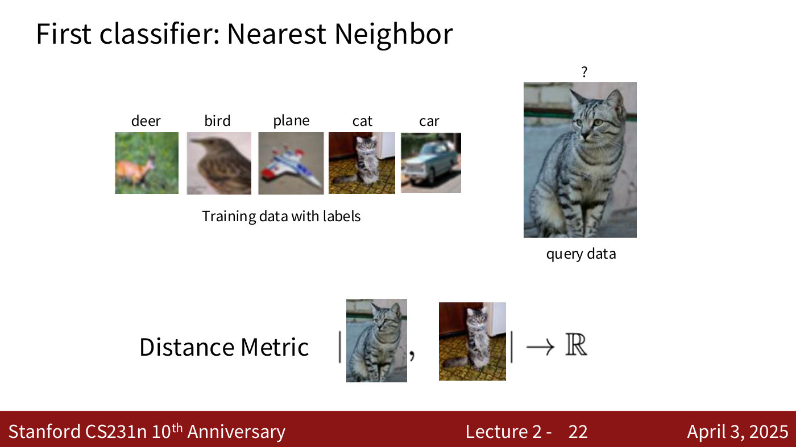

Figure: at upper left, a row of five small training images with labels above them: "deer" (a deer on grass), "bird" (a brown bird), "plane" (a white-and-blue jet), "cat" (a cat sitting on a green patterned rug), "car" (a light blue car). Caption beneath: "Training data with labels". At upper right, a larger photo of the tabby cat (same as slide 7) with "?" above it and caption "query data" beneath.

At the bottom, the text "Distance Metric" followed by a vertical bar, the tabby cat photo, a comma, the small cat-on-rug photo, a vertical bar, an arrow, and the symbol $\mathbb{R}$. That is, a function from a pair of images to a real number: (image 1, image 2) $\rightarrow \mathbb{R}$.

## Slide 23 — Distance Metric to compare images

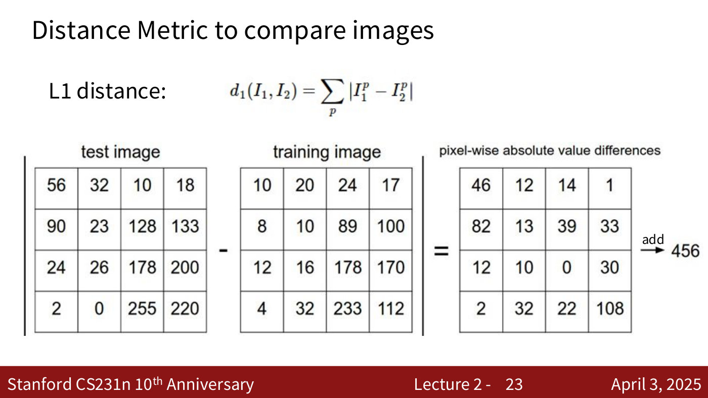

"L1 distance:"

$$d_1(I_1, I_2) = \sum_p \vert I_1^p - I_2^p \vert$$

Figure: three 4x4 grids of integers with operators between them, the whole expression wrapped in vertical bars, ending in an arrow labelled "add" to the number 456.

Grid titled "test image":

| 56 | 32 | 10 | 18 |
| --- | --- | --- | --- |
| 90 | 23 | 128 | 133 |
| 24 | 26 | 178 | 200 |
| 2 | 0 | 255 | 220 |

A minus sign, then grid titled "training image":

| 10 | 20 | 24 | 17 |
| --- | --- | --- | --- |
| 8 | 10 | 89 | 100 |
| 12 | 16 | 178 | 170 |
| 4 | 32 | 233 | 112 |

An equals sign, then grid titled "pixel-wise absolute value differences":

| 46 | 12 | 14 | 1 |
| --- | --- | --- | --- |
| 82 | 13 | 39 | 33 |
| 12 | 10 | 0 | 30 |
| 2 | 32 | 22 | 108 |

An arrow labelled "add" points from this grid to "456".

## Slide 24 — Nearest Neighbor classifier

Right: the heading text "Nearest Neighbor classifier". Left: a code listing:

```
import numpy as np

class NearestNeighbor:
  def __init__(self):
    pass

  def train(self, X, y):
    """ X is N x D where each row is an example. Y is 1-dimension of size N """
    # the nearest neighbor classifier simply remembers all the training data
    self.Xtr = X
    self.ytr = y

  def predict(self, X):
    """ X is N x D where each row is an example we wish to predict label for """
    num_test = X.shape[0]
    # lets make sure that the output type matches the input type
    Ypred = np.zeros(num_test, dtype = self.ytr.dtype)

    # loop over all test rows
    for i in xrange(num_test):
      # find the nearest training image to the i'th test image
      # using the L1 distance (sum of absolute value differences)
      distances = np.sum(np.abs(self.Xtr - X[i,:]), axis = 1)
      min_index = np.argmin(distances) # get the index with smallest distance
      Ypred[i] = self.ytr[min_index] # predict the label of the nearest example

    return Ypred
```

## Slide 25 — Nearest Neighbor classifier

Same as slide 24, plus a red rectangle around the `train` method (from `def train(self, X, y):` through `self.ytr = y`) with the red text "Memorize training data" to its right.

## Slide 26 — Nearest Neighbor classifier

Same as slide 24, plus a red rectangle around the loop in `predict` (from `# loop over all test rows` through the `Ypred[i] = ...` line) with blue text to its right:

"For each test image:
  Find closest train image
  Predict label of nearest image"

## Slide 27 — Nearest Neighbor classifier

Same as slide 24, with text at right:

"Q: With N examples, how fast are training and prediction?"

"Ans: Train O(1),
  predict O(N)"

Red text: "This is bad: we want classifiers that are fast at prediction; slow for training is ok"

## Slide 28 — Nearest Neighbor classifier

Same as slide 24, with text at right:

"Many methods exist for fast / approximate nearest neighbor (beyond the scope of 231N!)"

"A good implementation:"
https://github.com/facebookresearch/faiss

Credit (small text, lower right): "Johnson et al, "Billion-scale similarity search with GPUs", arXiv 2017"

## Slide 29 — What does this look like?

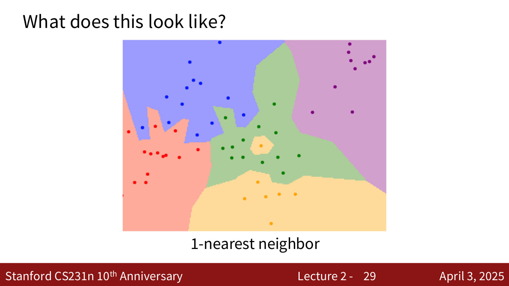

Figure: a 2-D scatter plot with no axes or axis labels, whose background is divided into five coloured regions. Caption below: "1-nearest neighbor". Regions and their points: blue (light blue-violet) region across the top-left with about 11 blue points; purple/mauve region at the top-right with about 8 purple points; red/salmon region at the left with about 11 red points; green region in the centre with about 12 green points; orange/yellow region along the bottom with about 8 orange points. The boundaries are jagged and follow the individual points. A small orange region sits inside the green area around a single orange point near the centre. The green region reaches the top edge in a broad wedge between the blue and purple regions and pushes a lobe left into the blue; red fingers reach up into the blue region at the left.

## Slide 30 — K-Nearest Neighbors

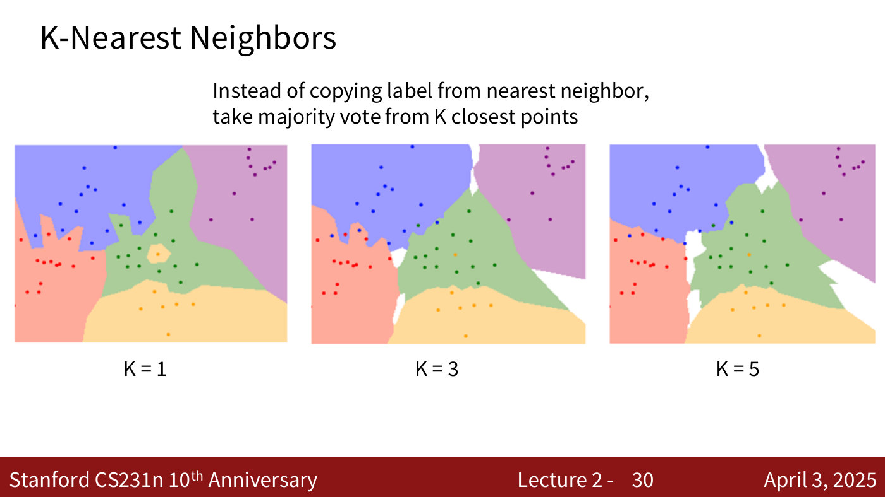

"Instead of copying label from nearest neighbor, take majority vote from K closest points"

Figure: three side-by-side panels, each the same coloured-region scatter plot as slide 29 on the same data (blue top-left, purple top-right, red left, green centre, orange bottom). Captions under them: "K = 1", "K = 3", "K = 5". The K = 1 panel is the jagged map from slide 29 including the small orange island in the green. In the K = 3 panel the boundaries are smoother, the orange island is gone (its single orange training point now sits inside the green region), and white gaps appear: a narrow notch at the top between the blue and purple regions running down to the green apex, a small patch at the blue/red/green junction, a thin strip down the red/green border (mostly near the bottom), and a wide wedge at the lower right between green and purple/orange. In the K = 5 panel the boundaries are smoother still and the white areas are larger: a strip between the red and green regions, the green/purple border, a larger white area at the top between blue, purple and green, and a patch at the blue/red/green junction.

## Slide 31 — K-Nearest Neighbors: Distance Metric

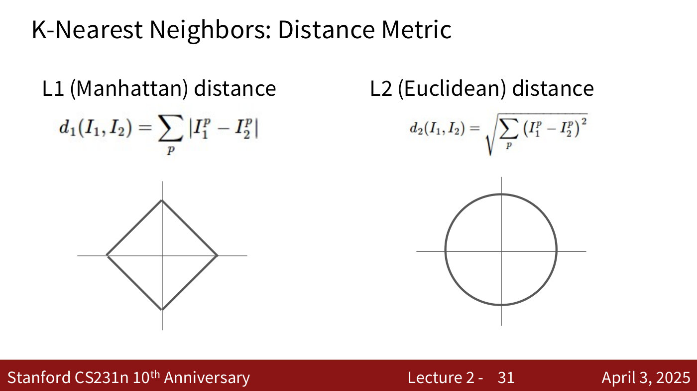

Two columns.

Left heading: "L1 (Manhattan) distance"

$$d_1(I_1, I_2) = \sum_p \vert I_1^p - I_2^p \vert$$

Diagram: thin black horizontal and vertical axes crossing at the centre, with a diamond (square rotated 45 degrees) outline whose four corners touch the axes.

Right heading: "L2 (Euclidean) distance"

$$d_2(I_1, I_2) = \sqrt{\sum_p \left(I_1^p - I_2^p\right)^2}$$

Diagram: thin black horizontal and vertical axes crossing at the centre, with a circle centred at the crossing.

## Slide 33 — K-Nearest Neighbors: Distance Metric - Example

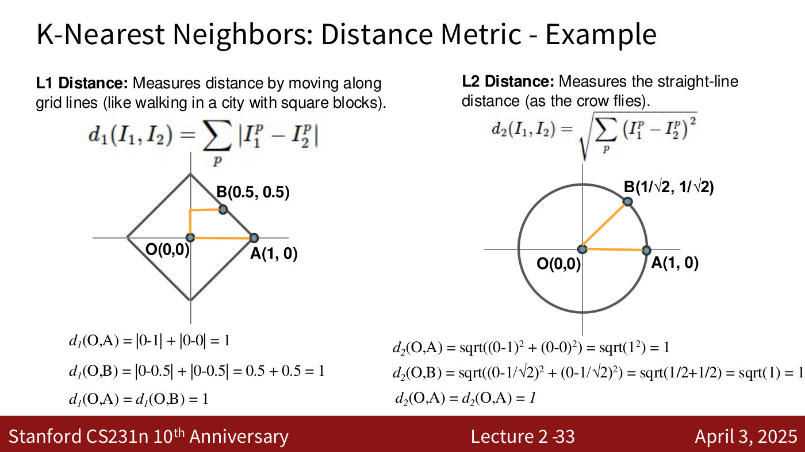

Left column, text: "L1 Distance: Measures distance by moving along grid lines (like walking in a city with square blocks)."

$$d_1(I_1, I_2) = \sum_p \vert I_1^p - I_2^p \vert$$

Diagram: axes with a diamond. Three dots: O(0,0) at the centre, A(1, 0) on the right corner of the diamond, B(0.5, 0.5) on the upper-right edge of the diamond. Orange line segments: one from O horizontally to A; an L-shaped path from O straight up the vertical axis to the height of B, then horizontally right to B.

Under it:

$d_1(O,A) = \vert 0-1 \vert + \vert 0-0 \vert = 1$

$d_1(O,B) = \vert 0-0.5 \vert + \vert 0-0.5 \vert = 0.5 + 0.5 = 1$

$d_1(O,A) = d_1(O,B) = 1$

Right column, text: "L2 Distance: Measures the straight-line distance (as the crow flies)."

$$d_2(I_1, I_2) = \sqrt{\sum_p \left(I_1^p - I_2^p\right)^2}$$

Diagram: axes with a circle. Dots: O(0,0) at the centre, A(1, 0) on the circle at the right, B(1/√2, 1/√2) on the circle at the upper right (label in bold). Orange straight line segments from O to A and from O to B.

Under it:

$d_2(O,A) = \text{sqrt}((0-1)^2 + (0-0)^2) = \text{sqrt}(1^2) = 1$

$d_2(O,B) = \text{sqrt}((0-1/\sqrt{2})^2 + (0-1/\sqrt{2})^2) = \text{sqrt}(1/2+1/2) = \text{sqrt}(1) = 1$

$d_2(O,A) = d_2(O,A) = 1$

## Slide 34 — K-Nearest Neighbors: Distance Metric

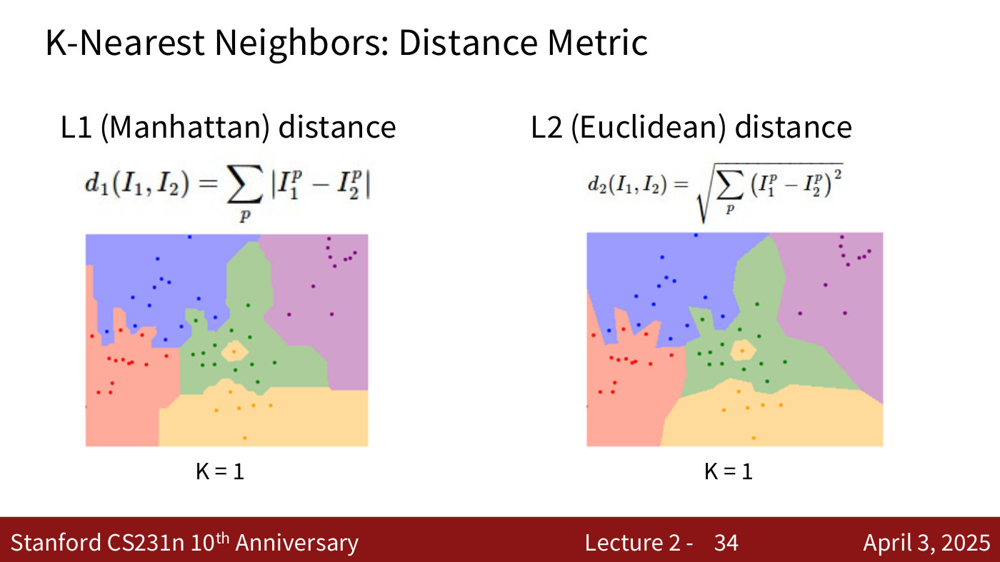

Two columns, same headings and formulas as slide 31.

Left: "L1 (Manhattan) distance", $$d_1(I_1, I_2) = \sum_p \vert I_1^p - I_2^p \vert$$, then a coloured-region scatter plot (same data and colour scheme as slide 29, with a small orange island inside the green region). Caption: "K = 1".

Right: "L2 (Euclidean) distance", $$d_2(I_1, I_2) = \sqrt{\sum_p \left(I_1^p - I_2^p\right)^2}$$, then a coloured-region scatter plot of the same data. Caption: "K = 1". The two maps look similar overall, with small differences in some boundary shapes.

## Slide 35 — K-Nearest Neighbors: try it yourself!

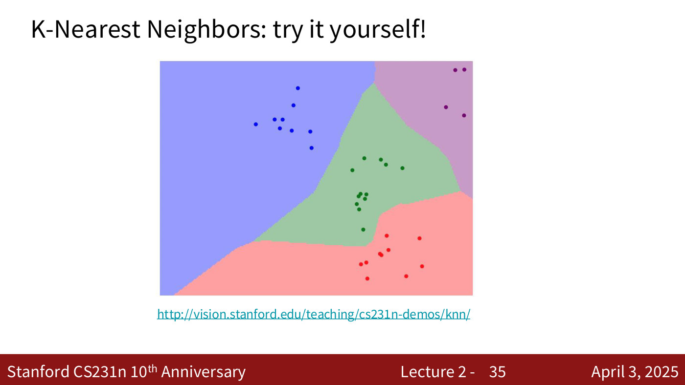

Figure: a coloured-region scatter plot with no axes: a blue region at the upper left with 9 blue points, a purple region at the upper right with 4 purple points, a green region in the centre with about 11 green points, and a red/pink region along the bottom and right with about 10 red points. The boundaries are smoother and more straight than in slide 29.

Link under the figure: http://vision.stanford.edu/teaching/cs231n-demos/knn/
## Slide 36 — Hyperparameters

What is the best value of k to use?
What is the best distance to use?

These are hyperparameters: choices about the algorithms themselves.

Very problem/dataset-dependent.
Must try them all out and see what works best.

## Slide 37 — Setting Hyperparameters

Idea #1: Choose hyperparameters that work best on the training data

Diagram: a single wide light-green bar labelled "train".

## Slide 38 — Setting Hyperparameters

Idea #1: Choose hyperparameters that work best on the training data

Red text at right: "BAD: K = 1 always works perfectly on training data"

Diagram: a single wide light-green bar labelled "train".

## Slide 39 — Setting Hyperparameters

Same as slide 38, plus a second idea below it.

Idea #2: choose hyperparameters that work best on test data

Diagram: a wide bar split into a long light-green section labelled "train" and a short light-red (pink) section at the right labelled "test".

## Slide 40 — Setting Hyperparameters

Same as slide 39, plus red annotations.

Next to Idea #2, in red: "BAD: No idea how algorithm will perform on new data"

Below the train/test bar, in red: "Never do this!"

## Slide 41 — Setting Hyperparameters

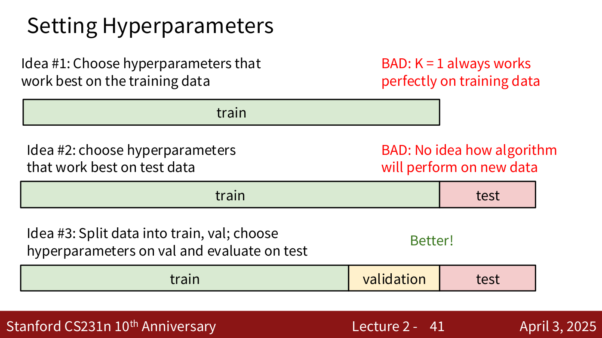

Same as slide 40, plus a third idea below it.

Idea #3: Split data into train, val; choose hyperparameters on val and evaluate on test

Green text at right: "Better!"

Diagram: a wide bar split into three sections: light-green "train" (long), light-yellow "validation", and light-red "test" at the right.

## Slide 42 — Setting Hyperparameters

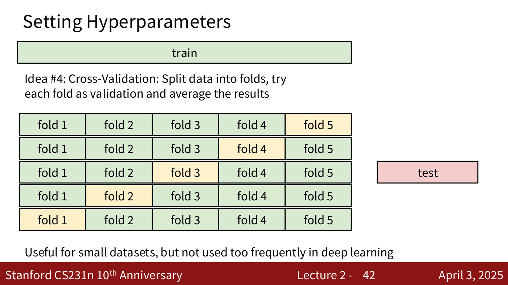

At top: a wide light-green bar labelled "train" (the test bar is shown separately at the right, below).

Idea #4: Cross-Validation: Split data into folds, try each fold as validation and average the results

Diagram: five stacked rows, each divided into five cells labelled "fold 1", "fold 2", "fold 3", "fold 4", "fold 5". In each row one fold is light yellow (the validation fold) and the other four are light green. The yellow fold is fold 5 in the top row, fold 4 in the second row, fold 3 in the third row, fold 2 in the fourth row, and fold 1 in the bottom row. To the right of the stack, vertically centred on the third row, is a separate light-red box labelled "test".

Bottom text: "Useful for small datasets, but not used too frequently in deep learning"

## Slide 43 — Example Dataset: CIFAR10

10 classes
50,000 training images
10,000 testing images

Figure: a grid of CIFAR10 sample images, 10 rows by 10 columns of small thumbnails. Each row has a bold serif label at left, from top to bottom: airplane, automobile, bird, cat, deer, dog, frog, horse, ship, truck. Each row shows ten small colour images of that class.

Small citation line at bottom left: Alex Krizhevsky, "Learning Multiple Layers of Features from Tiny Images", Technical Report, 2009.

## Slide 44 — Example Dataset: CIFAR10

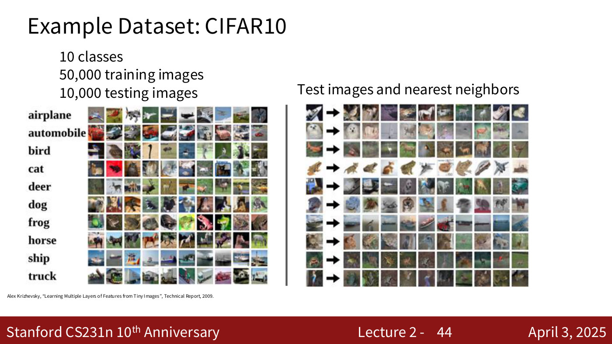

Same as slide 43 (same text, same CIFAR10 class grid at left, same citation), plus a vertical divider line and a second figure on the right.

Right-hand heading: "Test images and nearest neighbors"

Figure: a grid of 10 rows. Each row starts with one test image at far left, followed by a black arrow, followed by a row of 10 small images (its nearest neighbors in the training set, in order). The rows are not labelled. The test images in the first column, top to bottom, are: a spaceship/airplane-like image, a white fluffy dog, a reddish-brown bird or animal on green, a frog on a light background, a dark image, a bluish bird/reptile head, a ship, a cat, a frog, and a blue bird. The neighbor images are small low-resolution thumbnails of varied content; some match the test image's class and many do not.

## Slide 45 — Setting Hyperparameters

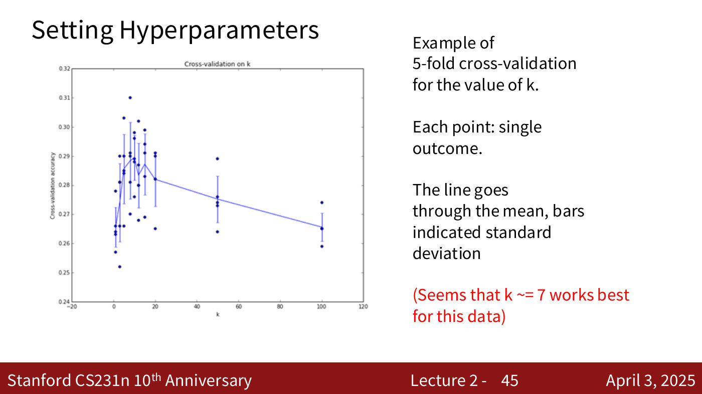

Left: a scatter plot with a line, titled "Cross-validation on k". X-axis label "k", ranging from about -20 to 120 (ticks at -20, 0, 20, 40, 60, 80, 100, 120). Y-axis label "Cross-validation accuracy", ranging from 0.24 to 0.32 (ticks 0.24, 0.25, 0.26, 0.27, 0.28, 0.29, 0.30, 0.31, 0.32).

Two kinds of marks (dark blue dots and a light-blue line with error bars):
- Dark blue dots: several dots at each tested k value (about 5 per k, one per fold). Tested k values are approximately 1, 3, 5, 8, 10, 12, 15, 20, 50 and 100. At k about 1 the dots span roughly 0.257 to 0.278; the lowest dot anywhere is about 0.252 at k about 3; the highest dot is about 0.310 at k about 8; at k = 50 the dots lie roughly 0.264 to 0.289; at k = 100 the dots lie roughly 0.259 to 0.274.
- Light-blue line connecting the mean at each k, with vertical error bars (standard deviation): the mean climbs steeply from about 0.266 at k = 1 through about 0.274 at k = 3 to about 0.286 at k = 5, peaks at about 0.289 at k = 8 and k = 10, dips to about 0.284 at k = 12, is about 0.287 at k = 15 and 0.282 at k = 20, then falls to about 0.275 at k = 50 and 0.266 at k = 100. Some dots overlap, so fewer than five are visible at several k.

Estimated values read from a 600-dpi render (by eye, ±0.002):

| k | dots | mean | error bar |
| --- | --- | --- | --- |
| 1 | .257, .263, .264, .266, .278 | 0.266 | 0.259–0.272 |
| 3 | .252, .266, .281 (two), .290 | 0.274 | 0.261–0.288 |
| 5 | .266, .284, .285, .290, .303 | 0.286 | 0.274–0.297 |
| 8 | .270, .281, .290, .291, .310 | 0.289 | 0.275–0.302 |
| 10 | .276, .288, .289, .296, .298 | 0.289 | 0.282–0.297 |
| 12 | .268, .280, .282, .287, .302 | 0.284 | 0.272–0.295 |
| 15 | .269, .283, .291, .294, .299 | 0.287 | 0.277–0.298 |
| 20 | .265, .282 (two), .290, .291 | 0.282 | 0.273–0.291 |
| 50 | .264, .273, .274, .276, .289 | 0.275 | 0.267–0.283 |
| 100 | .259, .265 (two), .274 | 0.266 | 0.261–0.270 |

Right-hand text:
Example of
5-fold cross-validation
for the value of k.

Each point: single outcome.

The line goes through the mean, bars indicated standard deviation

Red text: "(Seems that k ~= 7 works best for this data)"

## Slide 46 — What does this look like?

Figure: the same nearest-neighbor grid as slide 44, shown larger and centred. 10 rows; in each row a test image at left, a black arrow, then a row of 10 small neighbor thumbnails. There are no highlights.

## Slide 47 — What does this look like?

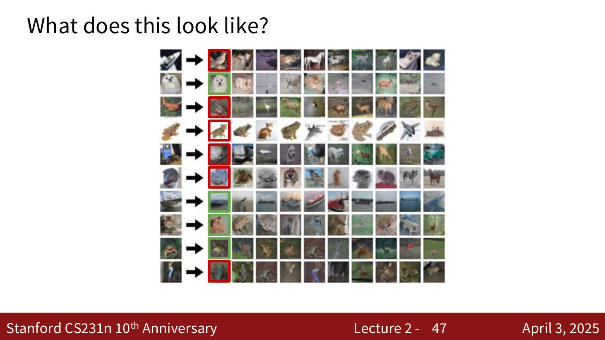

Same as slide 46, plus a coloured outline drawn around the first neighbor (the one immediately right of the arrow) in each row. Rows 1, 3, 4, 5, 6 and 10 are outlined in red; rows 2, 7, 8 and 9 are outlined in green. (No text labels explain the colours.)

## Slide 48 — k-Nearest Neighbor with pixel distance never used.

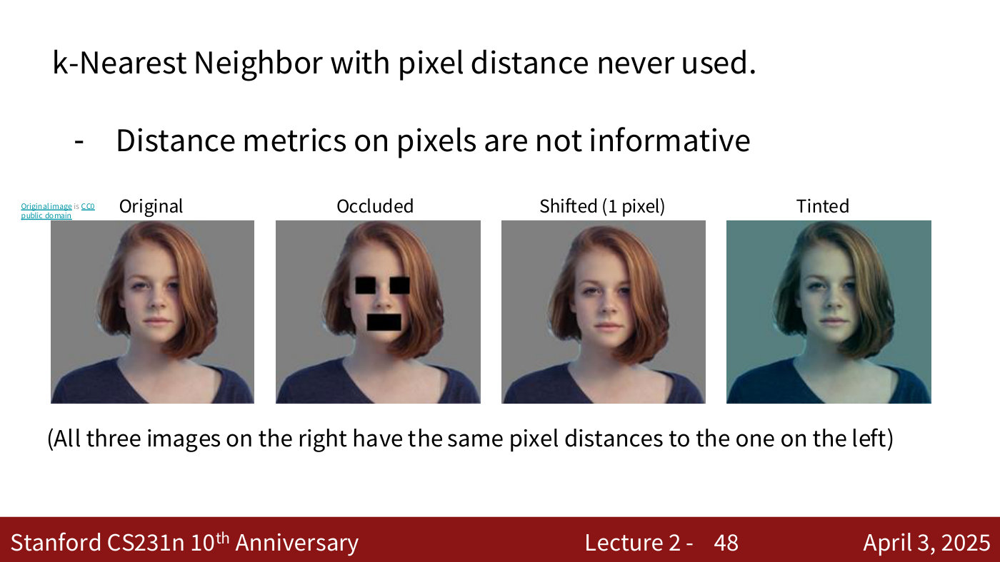

- Distance metrics on pixels are not informative

Small credit line at the left above the first image: "Original image is CC0 public domain" (the words "Original image" and "CC0" are hyperlinks).

Figure: four portrait photographs of the same young woman with shoulder-length reddish-brown hair, wearing a dark navy top, against a grey background, in a row with captions above each:
- "Original": the unmodified photo.
- "Occluded": the same photo with three black rectangles covering both eyes (two small squares) and the mouth area (one wider rectangle).
- "Shifted (1 pixel)": the same photo shifted by one pixel.
- "Tinted": the same photo with a blue-green (teal) colour tint, including the background.

Caption below: "(All three images on the right have the same pixel distances to the one on the left)"

## Slide 50 — K-Nearest Neighbors: Summary

In image classification we start with a training set of images and labels, and must predict labels on the test set

The K-Nearest Neighbors classifier predicts labels based on the **K nearest training examples**

**Distance metric and K are hyperparameters**

Choose hyperparameters using the validation set

Only run on the test set once at the very end!

## Slide 51 — Linear Classifier

(Section title slide; the text "Linear Classifier" is centred on an otherwise blank slide.)

## Slide 52 — Parametric Approach

Diagram, left to right. At left, a small photo of a grey tabby cat with the blue label "Image" above it; below it: "Array of 32x32x3 numbers (3072 numbers total)". A black arrow points from the image to the centre text "f(x,W)" (x in blue, W in red). A black arrow from "f(x,W)" points right to the text "10 numbers giving class scores". Below "f(x,W)" an upward arrow points to it from a large red "W" with red text beneath: "parameters or weights".

## Slide 53 — Parametric Approach: Linear Classifier

Same as slide 52, plus the equation at top centre:

$$f(x,W) = Wx$$

## Slide 54 — Parametric Approach: Linear Classifier

Same as slide 53, plus coloured boxes and dimension labels on the equation $f(x,W) = Wx$. A dark-green box surrounds "f(x,W)" with the green label "10x1" below it. A red box surrounds "W" with the red label "10x3072" below it. A blue box surrounds "x" with the blue label "3072x1" above it.

## Slide 55 — Parametric Approach: Linear Classifier

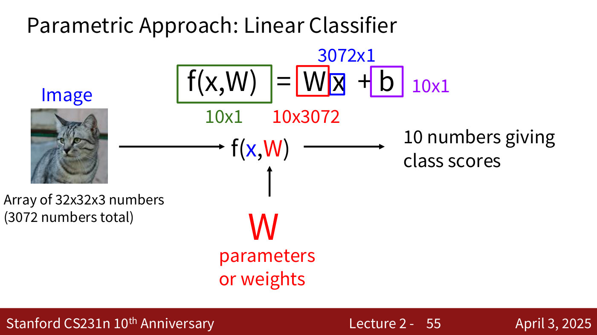

Same as slide 54, with a bias term added to the equation: $f(x,W) = Wx + b$. A purple box surrounds "b" with the purple label "10x1" to its right. The other labels are as on slide 54: "3072x1" (blue, above x), "10x1" (green, below f(x,W)), "10x3072" (red, below W).

## Slide 56 — Neural Network / Linear classifiers

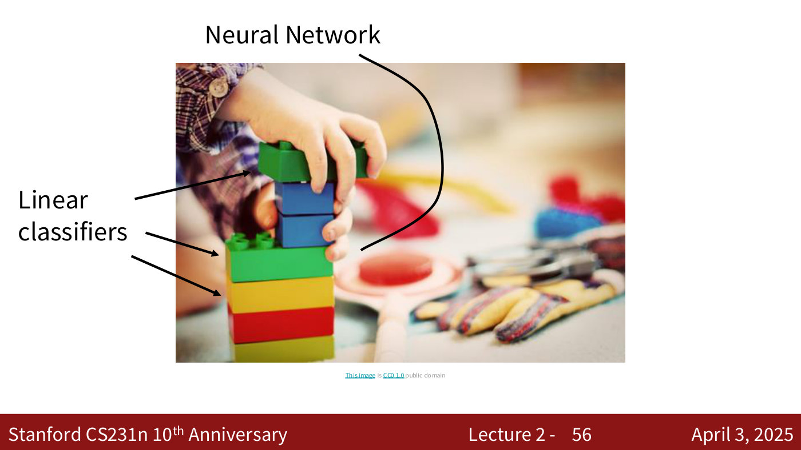

(Untitled apart from the label "Neural Network" at top.)

Figure: a photograph of a child's hand stacking toy building blocks (blue, green, yellow and red blocks) with a glove and toys blurred in the background. Black hand-drawn arrows and labels annotate it: the text "Linear classifiers" at left with three arrows pointing to the individual blocks in the stack (the lower green block, the yellow block, and the red block region at the bottom left), and the text "Neural Network" at top with a long curved black line bracketing the whole stack from above, ending near the lower right side of the stack.

Small credit line below the photo: "This image is CC0 1.0 public domain" (the words "This image" and "CC0 1.0" are hyperlinks).

## Slide 57 — Linear layers

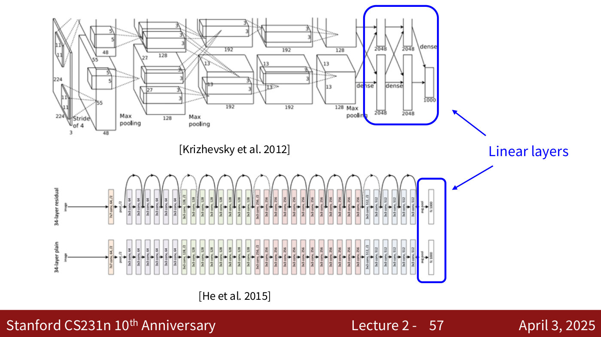

(Untitled.) Two network-architecture diagrams, each with the final fully connected layers outlined in a blue rounded box and labelled in blue "Linear layers" with blue arrows.

Top: the AlexNet-style architecture diagram, shown partly cropped at the top and left; stacked 3D blocks with dimension numbers (224, 11, 55, 5, 48, 27, 128, 13, 3, 192, 128 and so on), arrows labelled "Stride of 4", and "Max pooling" labels. At the right end, the blue box encloses the dense layers: vertical bars labelled 2048 and 2048, "dense" labels, and a final bar labelled 1000. Caption below: "[Krizhevsky et al. 2012]".

Bottom: a long, thin diagram of two networks, labelled at left "34-layer residual" (top row, with curved skip-connection arcs over the layers) and "34-layer plain" (bottom row, without arcs). Each is a row of many narrow coloured boxes (orange, blue-grey, green, pink) labelled with small text such as "3x3 conv, 64", "3x3 conv, 128", "3x3 conv, 256", "3x3 conv, 512". At the right end of both rows, a blue box encloses the final "avg pool" and "fc 1000" boxes. Caption below: "[He et al. 2015]".

## Slide 58 — Recall CIFAR10

Figure: the CIFAR10 sample grid, 10 rows by 10 columns of small thumbnail images, with bold serif row labels at left, top to bottom: airplane, automobile, bird, cat, deer, dog, frog, horse, ship, truck.

Right-hand text:
50,000 training images
   each image is 32x32x3

10,000 test images.

## Slide 59 — Example with an image with 4 pixels, and 3 classes (cat/dog/ship)

(Title as printed: "cat" is coloured orange-brown, "dog" dark purple, "ship" green.)

Figure: at left, a small 2x2-pixel image (a faded cat photo with a 2x2 grid overlaid) labelled below "Input image". The pixel values in the grid are: top-left 56, top-right 231, bottom-left 24, bottom-right 2. A grey arrow runs up from the image, across the top, and down to a tall column vector at the centre-right, labelled above the arrow "Flatten tensors into a vector". The column vector has four cells, top to bottom: 56, 231, 24, 2.

## Slide 60 — Example with an image with 4 pixels, and 3 classes (cat/dog/ship)

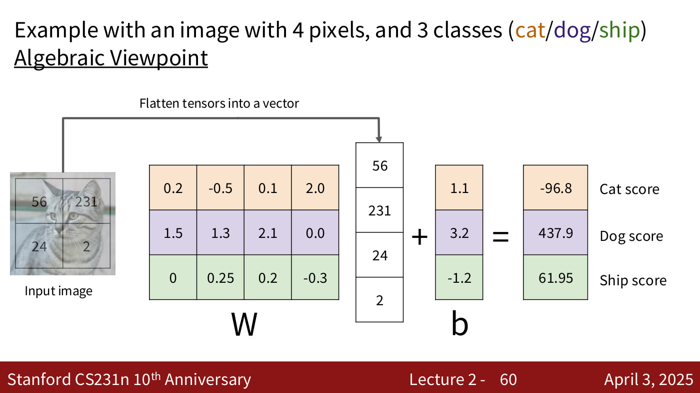

Second line of title, underlined: "Algebraic Viewpoint"

Same as slide 59 (the input image labelled "Input image", the "Flatten tensors into a vector" arrow, the vector 56, 231, 24, 2), plus the weight matrix, bias and score computation. The layout is $W$ times the vector, plus $b$, equals the scores.

Matrix W (3 rows by 4 columns), labelled "W" below. Row 1 (peach background): 0.2, -0.5, 0.1, 2.0. Row 2 (lavender background): 1.5, 1.3, 2.1, 0.0. Row 3 (light green background): 0, 0.25, 0.2, -0.3.

Then the flattened vector (56, 231, 24, 2), then a "+" sign, then the bias column vector labelled "b" below: 1.1 (peach), 3.2 (lavender), -1.2 (green); then an "=" sign, then the result column: -96.8 (peach), 437.9 (lavender), 61.95 (green). Labels to the right of the result cells: "Cat score" (for -96.8), "Dog score" (for 437.9), "Ship score" (for 61.95).

## Slide 61 — Interpreting a Linear Classifier

Left: the CIFAR10 sample grid (10 rows by 10 columns, row labels airplane, automobile, bird, cat, deer, dog, frog, horse, ship, truck).

Right: a diagram. At the top, "Input image" with the 2x2 image (values 56, 231, 24, 2 faintly visible). Three arrows branch down from it into three 2x2 weight boxes, labelled at left "W":
- Peach box: 0.2, -0.5 (top row); 0.1, 2.0 (bottom row).
- Lavender box: 1.5, 1.3 (top row); 2.1, 0.0 (bottom row).
- Green box: 0, .25 (top row); 0.2, -0.3 (bottom row).

Below each, an arrow down to a bias box labelled at left "b": 1.1 (peach), 3.2 (lavender), -1.2 (green). Below each, an arrow down to a score box labelled at left "Score": -96.8 (peach), 437.9 (lavender), 61.95 (green).

## Slide 62 — Interpreting a Linear Classifier: Visual Viewpoint

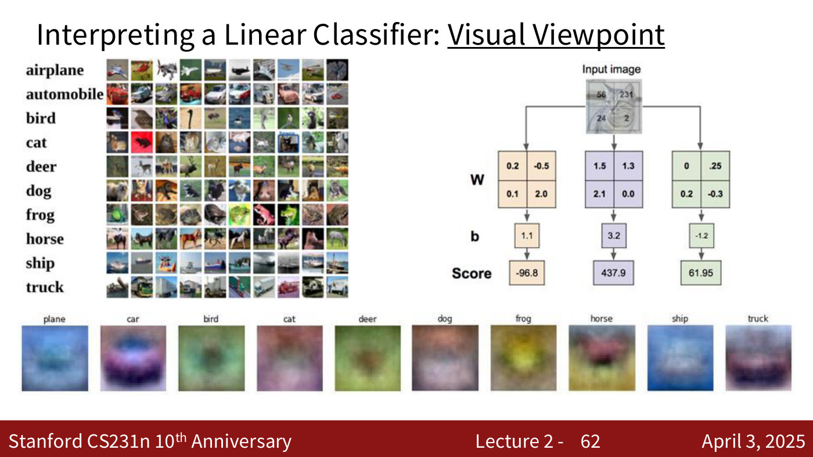

(The words "Visual Viewpoint" are underlined.)

Same as slide 61 (CIFAR10 grid at left and the W/b/Score diagram at right), plus a row of ten blurry, low-detail images along the bottom, each captioned above with a class name: plane, car, bird, cat, deer, dog, frog, horse, ship, truck. These are the learned weight templates for each class visualised as images: the plane image is mostly blue with a lighter centre; car shows a dark blue/purple blob in the centre with a reddish lower part; bird is greenish with a dark centre; cat is pinkish-brown; deer is green with a dark brown centre; dog is greyish-pink; frog is yellow-green with dark areas; horse is brownish with a reddish-pink central shape on a green background; ship is blue with a lighter centre; truck is dark with purple/red tones.

## Slide 63 — Interpreting a Linear Classifier: Geometric Viewpoint

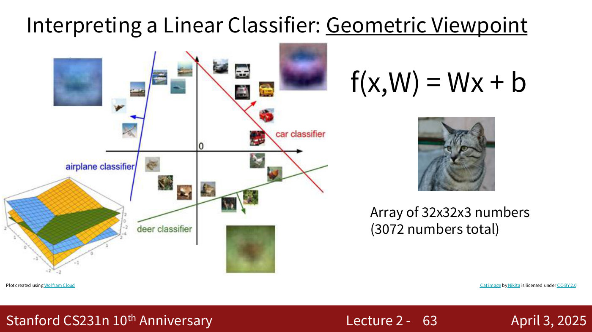

Right, large: $f(x,W) = Wx + b$

Below it: a photo of a grey tabby cat, with text beneath: "Array of 32x32x3 numbers (3072 numbers total)".

Left: a 2D diagram with a black horizontal axis and vertical axis crossing at a point labelled "0". Three straight lines, each with a short arrow perpendicular to it pointing to the side the classifier scores higher, and each labelled in the line's colour:
- A blue near-vertical line labelled "airplane classifier" at the left, with a blue arrow pointing left; small airplane/ship-like images cluster near it at the top (about three clearly to its left, some just to its right); a blurry blue image (the airplane template) sits at the top left.
- A red diagonal line labelled "car classifier", running from the top left-centre down to the right, with a red arrow pointing toward the upper right; car images (a white car, a red car, a fire-truck-like vehicle, others) sit on that side; a blurry blue/purple car template image sits at the top.
- A green nearly horizontal line labelled "deer classifier" at the bottom, with a green arrow pointing downward; deer images lie just below it; a blurry green image (the deer template) sits at the bottom.
Other small images (cats, dogs, a rooster/birds, deer) are scattered around the axes between the lines.

At bottom left, a 3D plot of intersecting planes (yellow/orange, blue and green surfaces) over a grid with numbered axes (around -2 to 2 and -4 to 2). Small credit at bottom left: "Plot created using Wolfram Cloud" (hyperlink on "Wolfram Cloud"). Small credit at bottom right: "Cat image by Nikita is licensed under CC-BY 2.0" (hyperlinks on "Cat image", "Nikita", "CC-BY 2.0").

## Slide 64 — Hard cases for a linear classifier

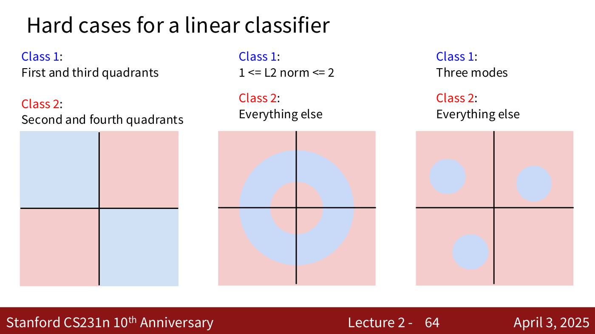

Three panels side by side, each with a class description above a square 2D plot with black horizontal and vertical axes through the centre. Blue regions are Class 1 and pink (light red) regions are Class 2. "Class 1:" is printed in blue and "Class 2:" in red.

Left panel: Class 1: First and third quadrants. Class 2: Second and fourth quadrants. As drawn, the top-left quadrant is light blue, top-right pink, bottom-left pink, and bottom-right light blue.

Middle panel: Class 1: 1 <= L2 norm <= 2. Class 2: Everything else. The plot is pink with a blue ring (annulus) centred on the origin; the inner disc is pink.

Right panel: Class 1: Three modes. Class 2: Everything else. The plot is pink with three small blue circles: one in the upper left quadrant, one in the upper right quadrant, and one in the lower-left quadrant, just left of the vertical axis.

## Slide 65 — Linear Classifier – Choose a good W

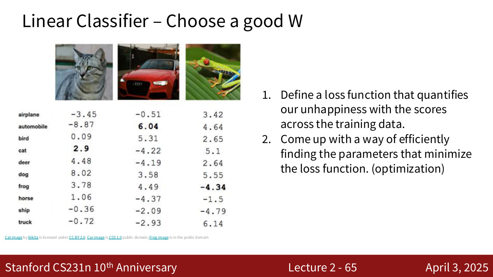

Left: three photos in a row (a grey tabby cat, a red car seen from the front, a green frog with red eyes on a leaf) above a table of class scores with ten class rows labelled at left: airplane, automobile, bird, cat, deer, dog, frog, horse, ship, truck. One score column per image.

| class | cat image | car image | frog image |
| --- | --- | --- | --- |
| airplane | -3.45 | -0.51 | 3.42 |
| automobile | -8.87 | **6.04** | 4.64 |
| bird | 0.09 | 5.31 | 2.65 |
| cat | **2.9** | -4.22 | 5.1 |
| deer | 4.48 | -4.19 | 2.64 |
| dog | 8.02 | 3.58 | 5.55 |
| frog | 3.78 | 4.49 | **-4.34** |
| horse | 1.06 | -4.37 | -1.5 |
| ship | -0.36 | -2.09 | -4.79 |
| truck | -0.72 | -2.93 | 6.14 |

(Bold values on the slide: 2.9 in the cat row for the cat image, 6.04 in the automobile row for the car image, and -4.34 in the frog row for the frog image.)

Right-hand text:
1. Define a loss function that quantifies our unhappiness with the scores across the training data.
2. Come up with a way of efficiently finding the parameters that minimize the loss function. (optimization)

Small credit line at bottom left: "Cat image by Nikita is licensed under CC-BY 2.0; Car image is CC0 1.0 public domain; Frog image is in the public domain" (hyperlinks on "Cat image", "Nikita", "CC-BY 2.0", "Car image", "CC0 1.0", "Frog image").

## Slide 66 — Suppose: 3 training examples, 3 classes (untitled)

Suppose: 3 training examples, 3 classes.
With some W the scores $f(x,W) = Wx$

Three photos in a row (cat, red car, green frog with red eyes), with a score table beneath, one row per class label at left and one column per image:

| class | cat image | car image | frog image |
| --- | --- | --- | --- |
| cat | 3.2 | 1.3 | 2.2 |
| car | 5.1 | 4.9 | 2.5 |
| frog | -1.7 | 2.0 | -3.1 |

## Slide 67 — Suppose: 3 training examples, 3 classes (untitled)

Same as slide 66, plus text at the upper right: "A loss function tells how good our current classifier is"

## Slide 68 — Suppose: 3 training examples, 3 classes (untitled)

Same as slide 67, plus at the right:

Given a dataset of examples

$$\lbrace (x_i, y_i) \rbrace_{i=1}^{N}$$

Where $x_i$ is image and $y_i$ is (integer) label

## Slide 69 — Suppose: 3 training examples, 3 classes (untitled)

Same as slide 68, plus at the bottom right:

Loss over the dataset is a average of loss over examples:

$$L = \frac{1}{N} \sum_i L_i(f(x_i, W), y_i)$$

## Slide 70 — Softmax classifier

(Section title slide; the text "Softmax classifier" at the left of an otherwise blank slide.)
## Slide 71 — Softmax Classifier (Multinomial Logistic Regression)

Want to interpret raw classifier scores as probabilities

Figure: a small photograph of a tabby cat (head and shoulders, looking left) at the upper left. Below it, a column of class labels with raw scores:

| class | score |
| --- | --- |
| cat | 3.2 |
| car | 5.1 |
| frog | -1.7 |

## Slide 72 — Softmax Classifier (Multinomial Logistic Regression)

Same as slide 71, plus two boxed equations and a label.

Want to interpret raw classifier scores as probabilities

$$s = f(x_i; W)$$

$$P(Y = k \vert X = x_i) = \frac{e^{s_k}}{\sum_j e^{s_j}}$$

Label beside the second equation: "Softmax Function"

Cat photo and scores as on slide 71 (cat 3.2, car 5.1, frog -1.7).

## Slide 73 — Softmax Classifier (Multinomial Logistic Regression)

Same as slide 72, plus an "exp" step.

An arrow labelled "exp" points from the score column to a new column, enclosed in a red box, with the red caption above it "Probabilities must be >= 0" and the red caption below it "unnormalized probabilities".

| class | score | after exp (unnormalized probabilities) |
| --- | --- | --- |
| cat | 3.2 | 24.5 |
| car | 5.1 | 164.0 |
| frog | -1.7 | 0.18 |

## Slide 74 — Softmax Classifier (Multinomial Logistic Regression)

Same as slide 73, plus a "normalize" step.

An arrow labelled "normalize" points from the red box to a new column, enclosed in a green box, with the green caption above it "Probabilities must sum to 1" and the green caption below it "probabilities".

| class | score | unnormalized probabilities (exp) | probabilities (normalize) |
| --- | --- | --- | --- |
| cat | 3.2 | 24.5 | 0.13 |
| car | 5.1 | 164.0 | 0.87 |
| frog | -1.7 | 0.18 | 0.00 |

## Slide 75 — Softmax Classifier (Multinomial Logistic Regression)

Same as slide 74, plus a blue box around the raw score column (3.2, 5.1, -1.7) with the blue caption below it: "Unnormalized log-probabilities / logits".

## Slide 76 — Softmax Classifier (Multinomial Logistic Regression)

Same as slide 75, plus a loss equation and a worked loss for the cat class.

$$L_i = -\log P(Y = y_i \vert X = x_i)$$

The first probability in the green column, 0.13 (cat), is highlighted in purple. A short arrow from it points to the purple text: "L_i = -log(0.13) = 2.04" (written as printed, with subscript i on L).

## Slide 77 — Softmax Classifier (Multinomial Logistic Regression)

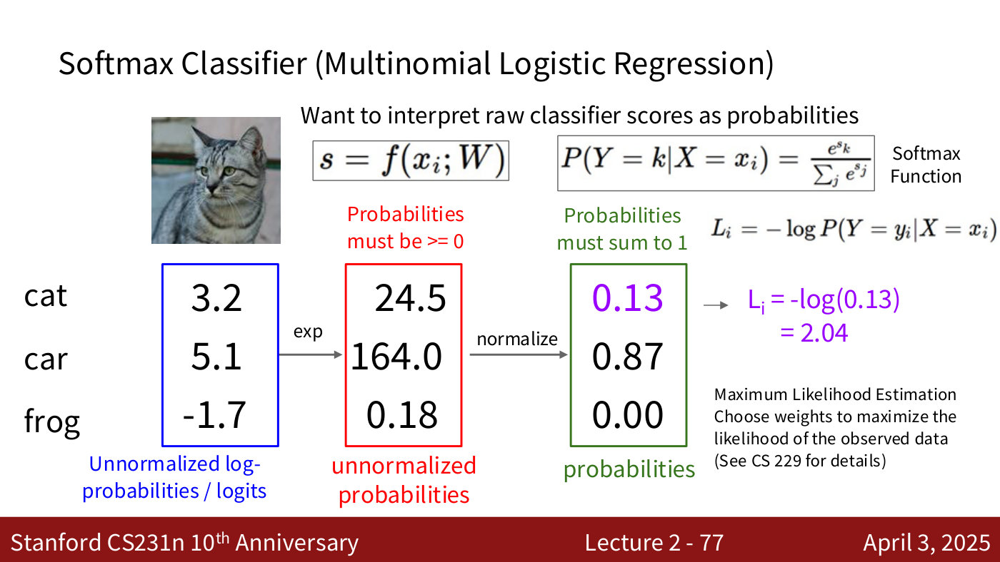

Same as slide 76, plus a note at the lower right in small black text:

"Maximum Likelihood Estimation
Choose weights to maximize the likelihood of the observed data
(See CS 229 for details)"

## Slide 78 — Softmax Classifier (Multinomial Logistic Regression)

Same as slide 76 without the "L_i = -log(0.13) = 2.04" text and without the Maximum Likelihood note, plus a new purple-boxed column at the right.

The loss equation $L_i = -\log P(Y = y_i \vert X = x_i)$ remains at the top right. The green probability column (0.13, 0.87, 0.00) is joined by a two-headed pair of arrows labelled "compare" to a purple-boxed column labelled below in purple "Correct probs":

| class | probabilities | Correct probs |
| --- | --- | --- |
| cat | 0.13 | 1.00 |
| car | 0.87 | 0.00 |
| frog | 0.00 | 0.00 |

(The scores 3.2, 5.1, -1.7 in the blue box, and 24.5, 164.0, 0.18 in the red box, are unchanged, with the same captions and arrows.)

## Slide 79 — Softmax Classifier (Multinomial Logistic Regression)

Same as slide 78, plus a Kullback-Leibler divergence formula placed between the green and purple columns under the "compare" arrows.

Label: "Kullback–Leibler divergence"

$$D_{KL}(P \Vert Q) = \sum_y P(y) \log \frac{P(y)}{Q(y)}$$

In the printed formula, the $P$ is underlined with a short purple bar (matching the purple "Correct probs" column) and the $Q$ is underlined with a short green bar (matching the green "probabilities" column).

## Slide 80 — Softmax Classifier (Multinomial Logistic Regression)

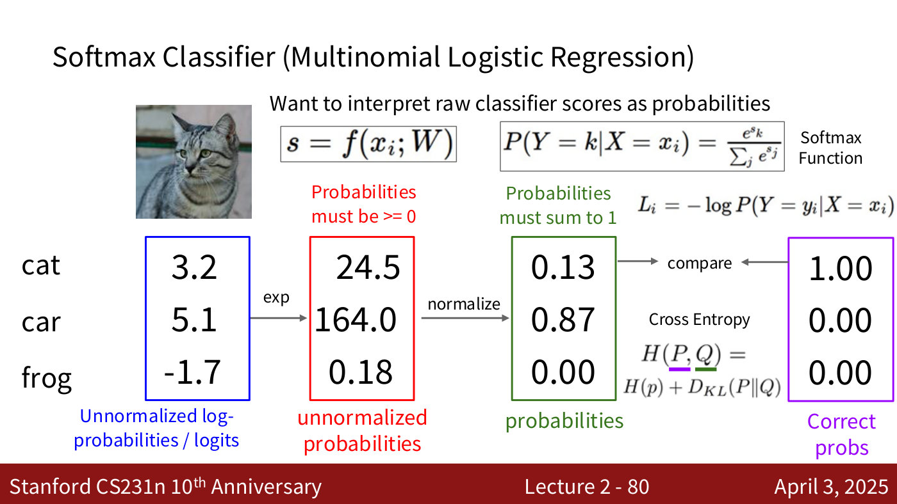

Same as slide 78, plus a cross-entropy formula placed between the green and purple columns under the "compare" arrows.

Label: "Cross Entropy"

$$H(P, Q) = H(p) + D_{KL}(P \Vert Q)$$

(The first "H(p)" is printed with a lowercase p.) As on slide 79, the $P$ in $H(P, Q)$ is underlined with a short purple bar and the $Q$ with a short green bar.

## Slide 81 — Softmax Classifier (Multinomial Logistic Regression)

Want to interpret raw classifier scores as probabilities

$$s = f(x_i; W)$$

$$P(Y = k \vert X = x_i) = \frac{e^{s_k}}{\sum_j e^{s_j}}$$

Label beside the second equation: "Softmax Function"

Maximize probability of correct class

$$L_i = -\log P(Y = y_i \vert X = x_i)$$

Putting it all together:

$$L_i = -\log\left(\frac{e^{s y_i}}{\sum_j e^{s_j}}\right)$$

Cat photo at the upper left, with scores cat 3.2, car 5.1, frog -1.7 below it (no boxes or arrows on this slide).

## Slide 82 — Softmax Classifier (Multinomial Logistic Regression)

Same as slide 81, plus a blue-bordered box in the lower right containing two questions in blue text:

"Q1: What is the min/max possible softmax loss L_i?

Q2: At initialization all s_j will be approximately equal; what is the softmax loss L_i, assuming C classes?"

(Subscripts i and j are printed as subscripts.)

## Slide 83 — Softmax Classifier (Multinomial Logistic Regression)

Same as slide 81, plus a blue-bordered box in the lower right containing, in blue text:

"Q2: At initialization all s will be approximately equal; what is the loss?
A: -log(1/C) = log(C),
If C = 10, then L_i = log(10) ≈ 2.3"

(The Q1 question from slide 82 is no longer shown.)

## Slide 84 — Coming up:

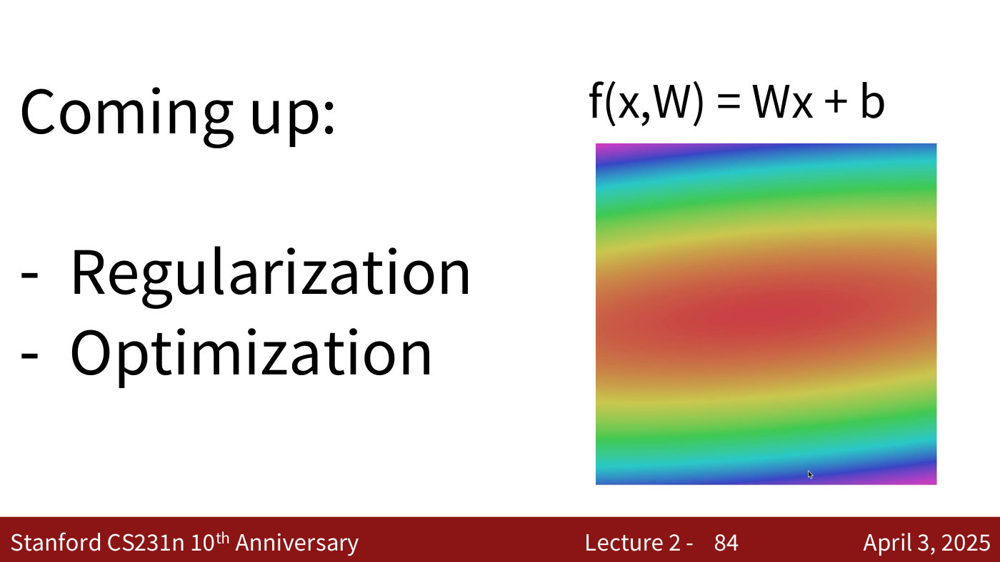

Coming up:

- Regularization
- Optimization

f(x,W) = Wx + b

Figure: a square heat-map style image to the right under the equation, filled with smooth colour bands from the rainbow palette. A red region at the centre (slightly left of centre, elongated horizontally) is surrounded by concentric elongated bands that go orange, yellow, green, cyan and blue moving outward toward the top and bottom edges, with magenta/purple in the top-left and top-right and bottom-right corners. There are no axes, labels or legend. A small mouse-cursor mark is visible near the bottom of the image.

## Slide 85 — Reading Assignment – SVM Loss

Reading Assignment – SVM Loss

(Centred text on an otherwise empty slide.)

## Slide 86 — Multiclass SVM loss (untitled)

Suppose: 3 training examples, 3 classes.
With some W the scores $f(x, W) = Wx$

Figure: three small photographs in a row: a tabby cat, a red car (front view of a red Audi-style sports car), and a green tree frog with red eyes on a green leaf. Below them a score table with one column per image:

| class | cat image | car image | frog image |
| --- | --- | --- | --- |
| cat | 3.2 | 1.3 | 2.2 |
| car | 5.1 | 4.9 | 2.5 |
| frog | -1.7 | 2.0 | -3.1 |

Right side, "Multiclass SVM loss:"

Given an example $(x_i, y_i)$
where $x_i$ is the image and
where $y_i$ is the (integer) label,

and using the shorthand for the scores vector:

$$s = f(x_i, W)$$

the SVM loss has the form:

$$L_i = \sum_{j \neq y_i} \begin{cases} 0 & \text{if } s_{y_i} \geq s_j + 1 \cr s_j - s_{y_i} + 1 & \text{otherwise} \end{cases}$$

$$= \sum_{j \neq y_i} \max(0, s_j - s_{y_i} + 1)$$

## Slide 87 — Interpreting Multiclass SVM loss (untitled)

Same left side as slide 86 (text "Suppose: 3 training examples, 3 classes. With some W the scores $f(x, W) = Wx$", the three photographs, and the same score table: cat 3.2 / 1.3 / 2.2; car 5.1 / 4.9 / 2.5; frog -1.7 / 2.0 / -3.1). The loss definition at the right is the same two-line formula as slide 86 (cases form and max form), but the "Multiclass SVM loss:" text block is replaced by a plot.

Heading: "Interpreting Multiclass SVM loss:"

Figure: a framed box containing empty axes. The vertical axis is labelled "Loss". The horizontal axis is labelled $s_{y_i} - s_j$ with the caption "difference in scores between correct and incorrect class". The axes are drawn as a cross with the vertical axis near the left and the horizontal axis extending to the right; no curve is drawn and there are no tick marks or numbers.

$$L_i = \sum_{j \neq y_i} \begin{cases} 0 & \text{if } s_{y_i} \geq s_j + 1 \cr s_j - s_{y_i} + 1 & \text{otherwise} \end{cases}$$

$$= \sum_{j \neq y_i} \max(0, s_j - s_{y_i} + 1)$$

## Slide 88 — Interpreting Multiclass SVM loss (untitled)

Same as slide 87, plus marks on the plot: a curly brace under the horizontal axis spanning from the vertical axis to the start of a thick blue line, labelled "1", and a thick blue horizontal line lying on the horizontal axis from the point at "1" to the right edge of the plot. (No sloped part of the curve is drawn yet.)

## Slide 89 — Interpreting Multiclass SVM loss (untitled)

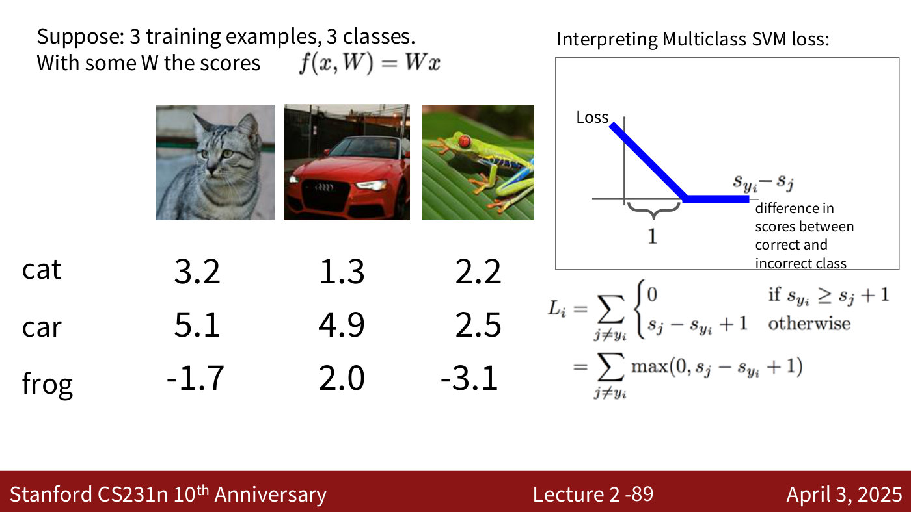

Same as slide 88, plus a thick blue line sloping down from the upper left (at the "Loss" label) in a straight line to the point at "1" on the horizontal axis, where it joins the flat blue segment. The plotted shape is a hinge: a straight descending line that reaches zero loss at difference 1, then stays flat at zero to the right.

## Slide 90 — Multiclass SVM loss (untitled)

Suppose: 3 training examples, 3 classes.
With some W the scores $f(x, W) = Wx$

Three photographs (cat, red car, green frog) and score table as on slide 86 (cat 3.2 / 1.3 / 2.2; car 5.1 / 4.9 / 2.5; frog -1.7 / 2.0 / -3.1). There is no "Losses:" row.

Right side, as on slide 86: "Multiclass SVM loss:", "Given an example $(x_i, y_i)$ where $x_i$ is the image and where $y_i$ is the (integer) label, and using the shorthand for the scores vector: $s = f(x_i, W)$", "the SVM loss has the form:"

The loss is shown only in its max form, enclosed in a blue box:

$$L_i = \sum_{j \neq y_i} \max(0, s_j - s_{y_i} + 1)$$

## Slide 91 — Multiclass SVM loss (untitled)

Same as slide 90, plus: a blue box around the first (cat image) score column, a blue "Losses:" row label with the value 2.9 under that column, and blue working at the right under the formula:

= max(0, 5.1 - 3.2 + 1)
   +max(0, -1.7 - 3.2 + 1)
= max(0, 2.9) + max(0, -3.9)
= 2.9 + 0
= 2.9

## Slide 92 — Multiclass SVM loss (untitled)

Same as slide 91, but the blue box moves to the second (car image) score column (1.3, 4.9, 2.0). "Losses:" row now reads 2.9 (black) and 0 (blue, in the box). Blue working at the right:

= max(0, 1.3 - 4.9 + 1)
   +max(0, 2.0 - 4.9 + 1)
= max(0, -2.6) + max(0, -1.9)
= 0 + 0
= 0

## Slide 93 — Multiclass SVM loss (untitled)

Same as slide 92, but the blue box moves to the third (frog image) score column (2.2, 2.5, -3.1). "Losses:" row reads 2.9, 0 (black) and 12.9 (blue, in the box). Blue working at the right:

= max(0, 2.2 - (-3.1) + 1)
   +max(0, 2.5 - (-3.1) + 1)
= max(0, 6.3) + max(0, 6.6)
= 6.3 + 6.6
= 12.9

## Slide 94 — Multiclass SVM loss (untitled)

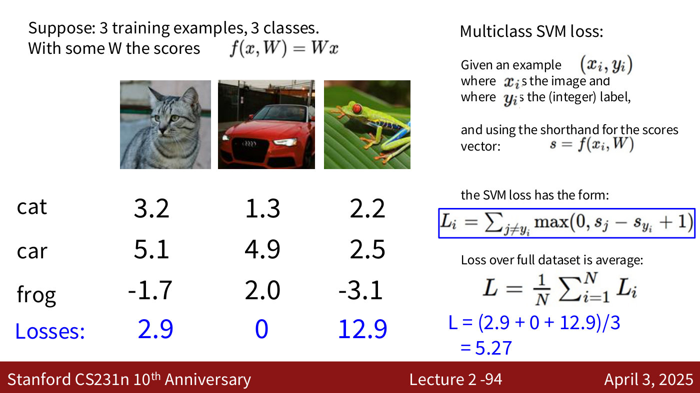

Same as slide 90 (setup, boxed max-form loss) with the "Losses:" row filled in all three columns in blue: 2.9, 0, 12.9. No column box. Under the boxed formula:

Loss over full dataset is average:

$$L = \frac{1}{N} \sum_{i=1}^{N} L_i$$

In blue: "L = (2.9 + 0 + 12.9)/3
= 5.27"

## Slide 95 — Multiclass SVM loss (untitled)

Suppose: 3 training examples, 3 classes.
With some W the scores $f(x, W) = Wx$

Top right: "Multiclass SVM loss:" and, in a blue box, $L_i = \sum_{j \neq y_i} \max(0, s_j - s_{y_i} + 1)$

Figure: only the red car photograph (a darker, more saturated version of the red convertible sports car image) is shown, with its column of scores below it and a blue "Losses:" row:

| class | car image |
| --- | --- |
| cat | 1.3 |
| car | 4.9 |
| frog | 2.0 |
| Losses: | 0 |

Blue questions at the right:

"Q1: What happens to loss if car scores decrease by 0.5 for this training example?

Q2: what is the min/max possible SVM loss L_i?

Q3: At initialization W is small so all s ≈ 0. What is the loss L_i, assuming N examples and C classes?"

## Slide 96 — Multiclass SVM loss (untitled)

Same layout as slide 90 (all three photographs, full score table, the "Multiclass SVM loss:" text block, boxed max-form loss), with the "Losses:" row filled in blue (2.9, 0, 12.9). A large blue question at the right below the formula:

"Q4: What if the sum was over all classes? (including j = y_i)"

## Slide 97 — Multiclass SVM loss (untitled)

Same as slide 96, but the blue question reads:

"Q5: What if we used mean instead of sum?"

## Slide 98 — Multiclass SVM loss (untitled)

Same as slide 96, but the blue question reads "Q6: What if we used" followed by the formula (black):

$$L_i = \sum_{j \neq y_i} \max(0, s_j - s_{y_i} + 1)^2$$

## Slide 99 — Multiclass SVM loss (untitled)

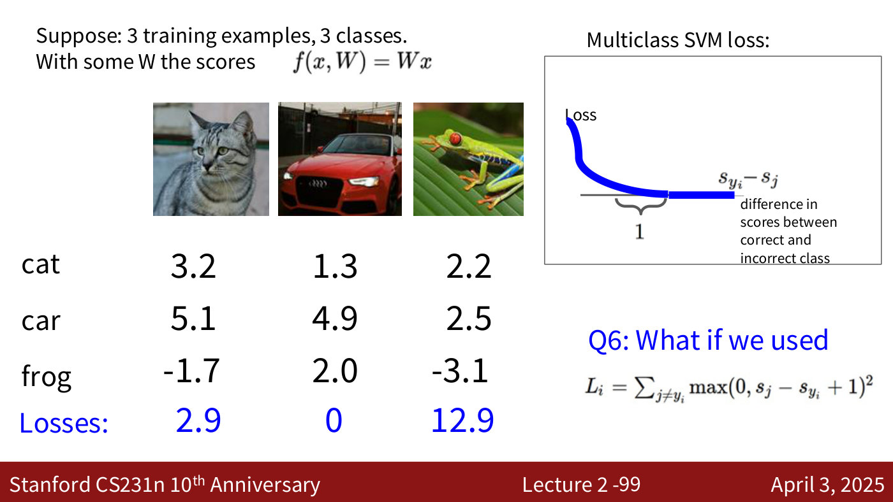

Same left side and Q6 text/formula as slide 98 (three photographs, score table with blue Losses row 2.9, 0, 12.9). The right-side text block and boxed loss are replaced at the top right by the heading "Multiclass SVM loss:" and the plot from slide 87-89 (framed box, vertical axis "Loss", horizontal axis $s_{y_i} - s_j$ with caption "difference in scores between correct and incorrect class", curly brace labelled "1" under the axis from the vertical axis to the point at 1).

The thick blue curve is now smooth: it starts at the top left near the "Loss" label, falls steeply, then bends and flattens gradually as it approaches the horizontal axis, reaching zero at the point marked "1", and continues as a flat blue line at zero to the right. (Compare the straight-line hinge on slide 89: here the descending part is curved, convex, instead of straight.)

"Q6: What if we used" and the squared-hinge formula $L_i = \sum_{j \neq y_i} \max(0, s_j - s_{y_i} + 1)^2$ appear below the plot, as on slide 98.

## Slide 100 — Multiclass SVM Loss: Example code

Multiclass SVM Loss: Example code

$$L_i = \sum_{j \neq y_i} \max(0, s_j - s_{y_i} + 1)$$

Code block (grey rounded box, Python, with `def` and `return` in bold dark red, the number 0 in green):

```
def L_i_vectorized(x, y, W):
  scores = W.dot(x)
  margins = np.maximum(0, scores - scores[y] + 1)
  margins[y] = 0
  loss_i = np.sum(margins)
  return loss_i
```

Green comments to the right of the code, overlapping the box edge:

"# First calculate scores
# Then calculate the margins s_j - s_yi + 1
# only sum j is not y_i, so when j = y_i, set to zero.
# sum across all j"

(Printed as subscripts: s_j and s_yi in the second comment, y_i in the third.)

## Slide 101 — Softmax vs. SVM

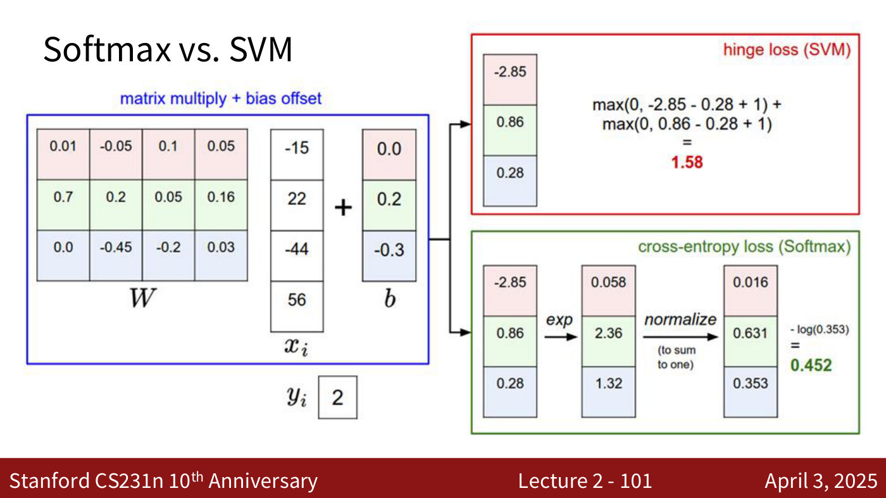

Softmax vs. SVM

Figure: a worked numeric diagram with three coloured row bands (pink for the first class, green for the second, blue for the third).

Left blue-bordered box, label at top "matrix multiply + bias offset":
- Matrix $W$ (3 rows by 4 columns, rows tinted pink, green, blue):

| | | | |
| --- | --- | --- | --- |
| 0.01 | -0.05 | 0.1 | 0.05 |
| 0.7 | 0.2 | 0.05 | 0.16 |
| 0.0 | -0.45 | -0.2 | 0.03 |

- Column vector $x_i$ (4 values): -15, 22, -44, 56
- A "+" sign
- Column vector $b$ (3 values, tinted pink, green, blue): 0.0, 0.2, -0.3

Below the box: $y_i$ followed by a small box containing 2.

Two arrows lead from the blue box to the right. Top arrow to a red-bordered box, label top-right "hinge loss (SVM)". Inside: a score column (tinted pink, green, blue) -2.85, 0.86, 0.28, and the calculation:

max(0, -2.85 - 0.28 + 1) +
max(0, 0.86 - 0.28 + 1)
=
1.58 (in bold red)

Bottom arrow to a green-bordered box, label top-right "cross-entropy loss (Softmax)". Inside, left to right: the score column -2.85, 0.86, 0.28; an arrow labelled "exp" to a column 0.058, 2.36, 1.32; an arrow labelled "normalize (to sum to one)" to a column 0.016, 0.631, 0.353; then "- log(0.353) = 0.452" with 0.452 in bold green.

## Slide 102 — Softmax vs. SVM

Softmax vs. SVM

Two loss formulas side by side, left (softmax) and right (SVM):

$$L_i = -\log\left(\frac{e^{s y_i}}{\sum_j e^{s_j}}\right)$$

$$L_i = \sum_{j \neq y_i} \max(0, s_j - s_{y_i} + 1)$$

## Slide 103 — Softmax vs. SVM

Same as slide 102, plus a horizontal black rule under the two formulas and, below it:

assume scores:
[10, -2, 3]
[10, 9, 9]
[10, -100, -100]
and $y_i = 0$

(The first entry, 10, in each score list is green. The $y_i = 0$ is inside a thin green box.)

In blue at the right: "Q: What is the softmax loss and the SVM loss?"

## Slide 104 — Softmax vs. SVM

Same as slide 103, but the first entry of each score list is 20 (green):

assume scores:
[20, -2, 3]
[20, 9, 9]
[20, -100, -100]
and $y_i = 0$

Blue question: "Q: What is the softmax loss and the SVM loss if I double the correct class score from 10 -> 20?"
