# Lecture 3 — Regularization and Optimization (slide-by-slide)

Text and figures of all 119 pages of [`lecture_3.pdf`](https://cs231n.stanford.edu/slides/2025/lecture_3.pdf), CS231N (Stanford, Spring 2025), April 8, 2025. Cite these as "slide N" using the **printed** slide number (footer, after "Lecture 3 -"). The running footer ("Stanford CS231n 10th Anniversary", "Lecture 3 - N", "April 8, 2025") is on every page and is not repeated below. Equations are written in LaTeX as printed, including the deck's own slips, which are noted where they occur. Slides 102–123 are an appendix titled "Slides from Previous Years".

## Slide numbers vs PDF pages

Not 1:1. PDF pages 1–9 print slides 1–9; PDF page 10 = slide 13 … page 25 = slide 28 (offset +3); PDF page 26 = slide 30 … page 119 = slide 123 (offset +4). Printed numbers 10, 11, 12 and 29 do not exist in the PDF (hidden slides in the source deck).

**What the recording covers.** The recording starts at the recap (slide 5) and ends at 1:08:25 in the "Looking Ahead" material (slides 96–99). The administrative slides 2–4, slides 100–101, and the whole appendix (slides 102–123: Nesterov momentum, AdaGrad, L-BFGS, softmax vs. SVM) are not presented, so this file is the only source for them. See the [transcript](../transcripts/03-regularization-optimization.md) header.

**Animations missing from the PDF.** Slides 60, 61 (its "Gradient Noise" panel), 70, 75 and 109 show a loss heat-map with a legend of optimizers (SGD, SGD+Momentum, RMSProp, Adam, Nesterov) but **no trajectories**: a 600-dpi check confirmed there are none on the page. They were presumably animations in the presented deck; the PDF holds only the background frame, so nothing can be said from the slides about how those optimizers' paths compare.

**Images.** 24 slides are rendered as images, each placed under its heading: 18, 28, 35, 46, 50,
51, 55, 57, 59, 61, 80, 83, 84, 85, 86, 87, 88, 89, 91, 92, 99, 104, 119 and 122. The others have
none, because they are the title (1), administrative text (2–4), section dividers (5, 30, 102),
recaps of lecture 2 figures already rendered with that lecture (6–9), tables, formulas, worked
vectors and code that are transcribed exactly (13–15, 19–26, 33, 34, 36–45, 47, 49, 52, 62–69,
71–74, 76–79, 81, 93, 94, 96, 97, 100, 105–108, 110, 115–117, 120, 121, 123), text (48, 95, 101,
118), build steps whose last step is rendered (16–17 → 18, 27 → 28, 31–32 → 35, 53–54 → 55,
56 and 58 → 57, 82 → 83, 90 → 91 and 92, 98 → 99, 103 → 104), heat-maps whose trajectories are
not in the PDF (60, 70, 75, 109), or AdaGrad slides that repeat slide 53's contour plot with no
trajectory (111–114). Never construct an image path for a slide not listed here.

Companion pages: [wiki page for this lecture](../../wiki/03-regularization-optimization.md) · [transcript](../transcripts/03-regularization-optimization.md)

## Contents

| Slides | Section |
| ------ | ------- |
| 1–4 | Title; administrative (Assignment 1, project proposal and office hours, Ed) |
| 5–13 | Recap from lecture 2: image classification, challenges, k-NN and data splits, the linear classifier, the loss over a dataset |
| 14–26 | Regularization: data loss plus $\lambda R(W)$; the toy example (prefer simpler models); Occam's razor; L2, L1 and elastic net; dropout and other methods; why regularize; which weights L2 prefers |
| 27–28 | Recap: score function, softmax loss, full loss, the computational graph; "How do we find the best W?" |
| 30–48 | Optimization: the valley analogy; random search (15.5% accuracy); following the slope; derivative and gradient; the numerical gradient worked example; the analytic gradient; gradient check |
| 49–52 | Gradient descent; the loss landscape; stochastic (minibatch) gradient descent |
| 53–61 | Problems with SGD: poor conditioning, local minima and saddle points, noisy gradients; momentum as the remedy |
| 62–65 | SGD and SGD + momentum: update rules and code, two equivalent formulations |
| 66–70 | RMSProp |
| 71–75 | Adam: the "almost" form, bias correction, default hyperparameters |
| 76–80 | AdamW: L2 regularization vs. weight decay inside Adam |
| 81–89 | Learning rate: choosing it; step, cosine, linear and inverse-sqrt decay; linear warmup |
| 90–95 | First- and second-order optimization; the Newton step and why it is impractical for deep learning; optimizers in practice |
| 96–101 | Looking ahead: the two-layer neural network; why non-linearity; next time |
| 102–118 | Appendix (slides from previous years): Nesterov momentum, AdaGrad, RMSProp as "leaky AdaGrad", quasi-Newton methods and L-BFGS, optimizers in practice |
| 119–123 | Appendix: softmax vs. SVM worked example; is a W with zero loss unique? |

---

## Slide 1 — Lecture 3: Regularization and Optimization

Lecture 3:
Regularization and Optimization

## Slide 2 — Administrative: Assignment 1

Will release tomorrow, due Wed 4/23 at 11:59pm

Office hours: help with high-level questions only, no code debugging. [No Code Show Policy] (the words "No Code Show Policy" are a hyperlink; its URL is not printed)

## Slide 3 — Administrative: Project proposal + Office Hours

Due Fri 4/25

TA expertise + Office Hours are posted on the webpage. Mix of in-person and zoom.

(http://cs231n.stanford.edu/office_hours.html)

## Slide 4 — Administrative: Ed

Please make sure to check and read all pinned Ed posts.
- CGOE: if you would like to take the midterm on-campus, send us an email: cs231n-staff-spr25@stanford.edu

## Slide 5 — Recap from Last Week

Recap from Last Week (centred section-divider text, nothing else).

## Slide 6 — Image Classification: A core task in Computer Vision

Photo at left: a grey tabby cat sitting, facing slightly left. Credit under the photo: "This image by Nikita is licensed under CC-BY 2.0".

Text at upper right: "(assume given a set of labels) {dog, cat, truck, plane, ...}"

A black arrow points from the photo to a list of labels: "cat" (in black, the selected label), then "dog", "bird", "deer", "truck" in light grey.

## Slide 7 — Recall from last time: Challenges of recognition

Six labelled example images arranged in two rows.

Top row, left to right:
- "Viewpoint": a camera icon with a curved black arrow sweeping around a small cat photo, next to a magnified grid of pixel numbers (the cat image as an array of numbers).
- "Illumination": a cat photographed in dark lighting against a black background. Credit: "This image is CC0 1.0 public domain".
- "Deformation": a cat lying on its back on pavement in a stretched pose. Credit: "This image by Umberto Salvagnin is licensed under CC-BY 2.0".
- "Occlusion": a beige leather sofa with only the striped tail of a cat visible between cushions. Credit: "This image by jonsson is licensed under CC-BY 2.0".

Bottom row:
- "Clutter": a cat camouflaged among orange-brown autumn leaves. Credit: "This image is CC0 1.0 public domain".
- "Intraclass Variation": several kittens of different colours (orange, grey tabby) on grass. Credit: "This image is CC0 1.0 public domain".

## Slide 8 — Recall from last time: data-driven approach, kNN

A collage of four recalled items from lecture 2:
- Left: the CIFAR10 sample grid, 10 rows of small images, row labels airplane, automobile, bird, cat, deer, dog, frog, horse, ship, truck.
- Top right: two decision-region plots titled "1-NN classifier" and "5-NN classifier". Each shows a 2D plane partitioned into coloured regions (blue top-left, purple top-right, red left, green centre, orange bottom) with coloured dots for training points. The 1-NN regions have ragged boundaries with small islands (e.g. a small orange island inside the green region); the 5-NN boundaries are smoother, with some white (unassigned) gaps between regions.
- Bottom left: two horizontal split bars. First bar: "train" (green, about 80% of width) and "test" (pink, about 20%). Second bar: "train" (green, about 60%), "validation" (yellow, about 20%), "test" (pink, about 20%).
- Bottom right: a small scatter plot with line (cross-validation accuracy versus k, the same plot as lecture 2); its text is too small to read.

## Slide 9 — Recall from last time: Linear Classifier

Top left: a diagram. "Image" (cat photo, "Array of 32x32x3 numbers (3072 numbers total)") with an arrow into a box "f(x,W)" (x in blue, W in red); an arrow from red "W" labelled "parameters or weights" points up into f; an arrow out of f reads "10 numbers giving class scores".

Top right, large: $f(x,W) = Wx + b$

Lower part: three columns separated by thin vertical lines, plus two small diagrams at the right.
- "Algebraic Viewpoint": $f(x,W) = Wx$; below it the small worked example of lecture 2 (an input image stretched into a column, matrix W, bias b, giving Cat score, Dog score, Ship score). Entries are too small to read here.
- "Visual Viewpoint": "One template per class"; below it ten blurry template images in two rows of five.
- "Geometric Viewpoint": "Hyperplanes cutting up space"; below it the 2D diagram with lines labelled "airplane classifier", "car classifier", "deer classifier" and scattered images.
- Two small plots at the far right, each a square with pink background and axes crossing at the centre. Left plot: "Class 1: 1 <= L2 norm <= 2" in blue, "Class 2: Everything else" in red; the picture is a blue ring (annulus) around the origin with a pink centre, on a pink background. Right plot: "Class 1: Three modes" in blue, "Class 2: Everything else" in red; the picture shows three blue circles (one upper-left, one upper-right, one lower-left of centre) on pink.

## Slide 13 — (no title) Loss function recap

Left text: "Suppose: 3 training examples, 3 classes. With some W the scores $f(x,W) = Wx$ are:"

Three images in a row: a grey tabby cat, a red car (front view), a green frog with red eyes on a green leaf. Under them, a score table with rows cat, car, frog:

| class | cat image | car image | frog image |
| --- | --- | --- | --- |
| cat | 3.2 | 1.3 | 2.2 |
| car | 5.1 | 4.9 | 2.5 |
| frog | -1.7 | 2.0 | -3.1 |

The correct-class scores (3.2 for the cat image, 4.9 for the car, -3.1 for the frog) are printed in bold.

Right text: "A loss function tells how good our current classifier is"

"Given a dataset of examples"

$$\lbrace (x_i, y_i) \rbrace_ {i=1}^{N}$$

"Where $x_i$ is image and $y_i$ is (integer) label"

"Loss over the dataset is a average of loss over examples:" (text as printed)

$$L = \frac{1}{N} \sum_i L_i(f(x_i, W), y_i)$$

## Slide 14 — Regularization -

$$L(W) = \frac{1}{N} \sum_{i=1}^{N} L_i(f(x_i, W), y_i)$$

A curly brace under the whole sum, labelled: "Data loss: Model predictions should match training data"

## Slide 15 — Regularization

Same as slide 14, plus a term $+\lambda R(W)$ added to the formula:

$$L(W) = \frac{1}{N} \sum_{i=1}^{N} L_i(f(x_i, W), y_i) + \lambda R(W)$$

A second brace under $\lambda R(W)$ labelled: "Regularization: Prevent the model from doing too well on training data". The data-loss brace and label are kept.

## Slide 16 — Regularization intuition: toy example training data

A 2D plot with a horizontal axis labelled "x" (at left end) and a vertical axis labelled "y" (at top), crossing near the middle, no tick labels. Five blue circles are the training points. Approximate positions, left to right: (1) far left near the bottom, just above the x axis; (2) left of the y axis, about mid-height; (3) just right of the y axis, about mid-height (slightly below point 2); (4) right of the y axis, high (the highest point, drawn in a slightly more purple-blue shade); (5) further right, a little lower than point 4. Together the points trend upward from lower left to upper right with some scatter.

## Slide 17 — Regularization intuition: Prefer Simpler Models

Same as slide 16 (same five blue points), plus two curves:
- "f1" (blue label, blue curve): a wiggly high-degree curve passing exactly through all five points. It rises steeply from below the x axis at the far left, peaks above point 2's left, dips down to a trough just left of the y axis (below the straight line), rises through the third and fourth points to a peak above the fourth point, then falls steeply through the fifth point and keeps dropping below the x axis at far right.
- "f2" (green label, green curve): a straight line sloping gently upward from lower left to upper right, passing through the first and fifth points and close to (but not exactly through) the others; the line passes through or very near points 1 and 5 and near points 2 and 3.

## Slide 18 — Regularization: Prefer Simpler Models

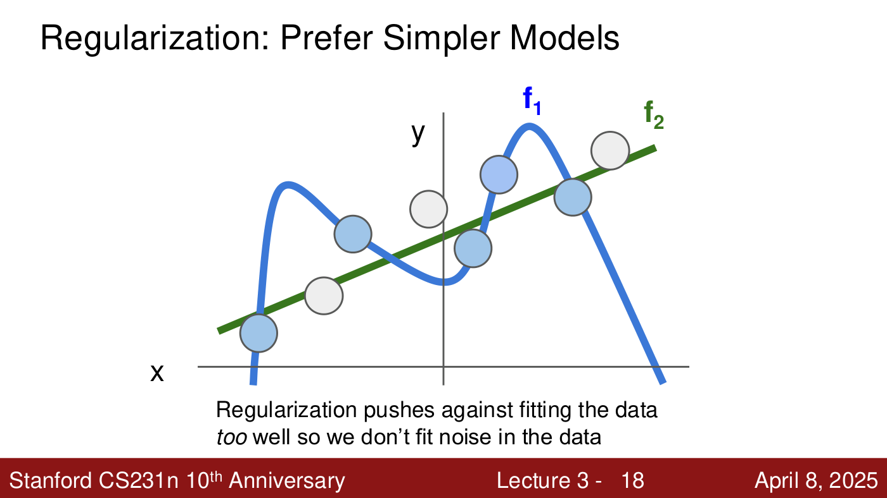

Same as slide 17 (title no longer has "intuition"), plus three light grey/white circles, new data points that were not fitted: one lying on the green line at the upper right beyond point 5, one slightly above the green line near the y axis (left of it, above the blue curve's trough), and one on/near the green line between points 1 and 2 (just below it). They sit near the green line f2 but far from the blue curve f1 in places.

Caption at bottom: "Regularization pushes against fitting the data too well so we don't fit noise in the data"

## Slide 19 — Regularization

Same as slide 15 (formula, data-loss and regularization braces and labels), plus text at the bottom centre: "**Occam's Razor**: Among multiple competing hypotheses, the simplest is the best, William of Ockham 1285-1347"

## Slide 20 — Regularization

Same as slide 15, plus a note at upper right: $\lambda$ "= regularization strength (hyperparameter)"

## Slide 21 — Regularization

Same as slide 20, plus a block at lower left:

Simple examples

L2 regularization: $R(W) = \sum_{k} \sum_{l} W_ {k,l}^{2}$

L1 regularization: $R(W) = \sum_{k} \sum_{l} \lvert W_ {k,l} \rvert$

Elastic net (L1 + L2): $R(W) = \sum_{k} \sum_{l} \beta W_ {k,l}^{2} + \lvert W_ {k,l} \rvert$

## Slide 22 — Regularization

Same as slide 21, with the "L2 regularization:" label underlined, plus a right-hand column headed "More complex:" listing:
- Dropout
- Batch normalization
- Stochastic depth, fractional pooling, etc

## Slide 23 — Regularization

Same as slide 20 (formula, braces, $\lambda$ note), plus a block at the bottom:

Why regularize?
- Express preferences over weights
- Make the model simple so it works on test data
- Improve optimization by adding curvature

## Slide 24 — Regularization: Expressing Preferences

Left, four equations:

$$x = [1, 1, 1, 1]$$

$$w_1 = [1, 0, 0, 0]$$

$$w_2 = [0.25, 0.25, 0.25, 0.25]$$

$$w_1^T x = w_2^T x = 1$$

Right: "L2 Regularization"

$$R(W) = \sum_{k} \sum_{l} W_ {k,l}^{2}$$

In red: "Which of w1 or w2 will the L2 regularizer prefer?"

## Slide 25 — Regularization: Expressing Preferences

Same as slide 24, plus a blue rectangle drawn around the $w_2$ vector $[0.25, 0.25, 0.25, 0.25]$, and blue text under the red question: "L2 regularization likes to "spread out" the weights"

## Slide 26 — Regularization: Expressing Preferences

Same as slide 25, plus red text at the lower right: "Which one would L1 regularization prefer?" (no answer printed on this slide)

## Slide 27 — Recap

- We have some dataset of (x,y)
- We have a score function: $s = f(x; W) = Wx$ (labelled "e.g.")
- We have a loss function:

$$L_i = -\log\left(\frac{e^{s_ {y_i}}}{\sum_j e^{s_j}}\right)$$

with the blue label "Softmax", and

$$L = \frac{1}{N} \sum_{i=1}^{N} L_i + R(W)$$

with the blue label "Full loss".

Diagram at lower right (computational graph): a box "W" and a stacked box of $x_i$ over $y_i$. A green arrow labelled "regularization loss" runs from W along the top and down into a box "L". A red arrow labelled "score function" runs from W (and from $x_i$) into a stack of boxes labelled $f(x_i, W)$; a blue arrow labelled "data loss" runs from $f(x_i, W)$ to L. A second blue arrow runs from $y_i$ along the bottom up into L.

## Slide 28 — Recap

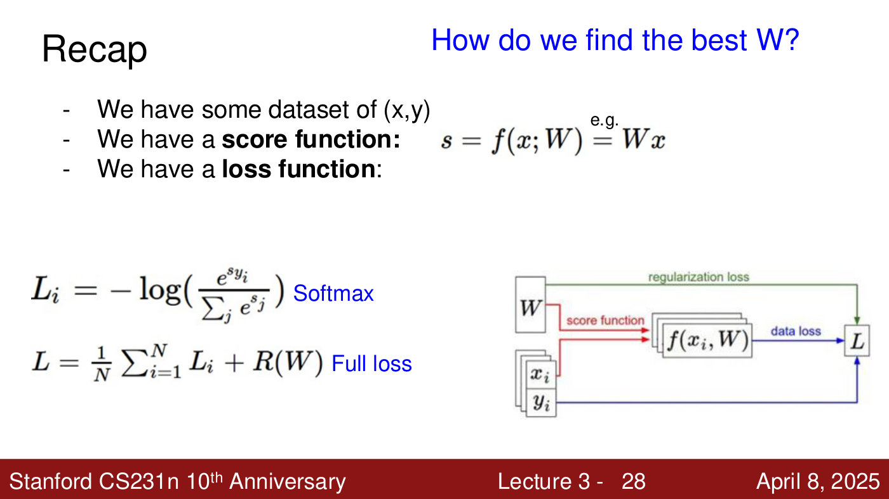

Same as slide 27, plus blue text at the top right: "How do we find the best W?"

## Slide 30 — Optimization

Optimization (section-divider text, nothing else).

## Slide 31 — (no title) mountain valley photo

Full-slide photograph of a green alpine valley seen from a grassy slope: dark conifer trees frame the left and right sides, a green valley with small fields in the middle, mountains with snow-capped peaks in the distance, a blue sky with white clouds. Credit at lower right: "This image is CC0 1.0 public domain".

## Slide 32 — (no title) mountain valley photo with walking man

Same photo as slide 31, plus a cartoon walking man (blue top, light blue trousers) striding on the grassy slope in the lower left, as if walking downhill into the valley. Credit at lower right: "Walking man image is CC0 1.0 public domain".

## Slide 33 — Strategy #1: A first very bad idea solution: Random search

A code listing (light-purple code box, printed as an image) with grey comments:

```python
# assume X_train is the data where each column is an example (e.g. 3073 x 50,000)
# assume Y_train are the labels (e.g. 1D array of 50,000)
# assume the function L evaluates the loss function

bestloss = float("inf") # Python assigns the highest possible float value
for num in xrange(1000):
  W = np.random.randn(10, 3073) * 0.0001 # generate random parameters
  loss = L(X_train, Y_train, W) # get the loss over the entire training set
  if loss < bestloss: # keep track of the best solution
    bestloss = loss
    bestW = W
  print 'in attempt %d the loss was %f, best %f' % (num, loss, bestloss)

# prints:
# in attempt 0 the loss was 9.401632, best 9.401632
# in attempt 1 the loss was 8.959668, best 8.959668
# in attempt 2 the loss was 9.044034, best 8.959668
# in attempt 3 the loss was 9.278948, best 8.959668
# in attempt 4 the loss was 8.857370, best 8.857370
# in attempt 5 the loss was 8.943151, best 8.857370
# in attempt 6 the loss was 8.605604, best 8.605604
# ... (tructated: continues for 1000 lines)
```

(Spelling "tructated" and "xrange" are as printed.)

## Slide 34 — Lets see how well this works on the test set...

```python
# Assume X_test is [3073 x 10000], Y_test [10000 x 1]
scores = Wbest.dot(Xte_cols) # 10 x 10000, the class scores for all test examples
# find the index with max score in each column (the predicted class)
Yte_predict = np.argmax(scores, axis = 0)
# and calculate accuracy (fraction of predictions that are correct)
np.mean(Yte_predict == Yte)
# returns 0.1555
```

Text at lower right: "15.5% accuracy! not bad! (SOTA is ~99.7%)"

*[Ed: the code's printed 0.1555 is 15.55%; the slide's "15.5%" truncates it. Transcribed as printed.]*

## Slide 35 — Strategy #2: Follow the slope

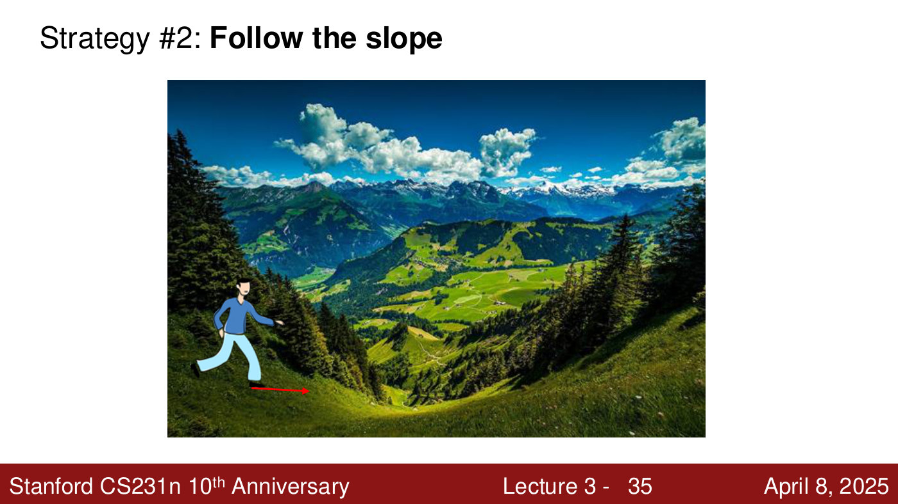

Photo of the same alpine valley as slide 31, with the cartoon walking man at lower left standing on the slope and a short red arrow pointing right from his feet along the ground toward the valley floor (the direction of the slope). No credit line is printed on this slide.

## Slide 36 — Strategy #2: Follow the slope

"In 1-dimension, the derivative of a function:"

$$\frac{df(x)}{dx} = \lim_{h \to 0} \frac{f(x+h) - f(x)}{h}$$

"In multiple dimensions, the gradient is the vector of (partial derivatives) along each dimension"

"The slope in any direction is the dot product of the direction with the gradient
The direction of steepest descent is the negative gradient"

## Slide 37 — (no title) Numerical gradient: start

Three-column layout separated by thin vertical lines. The middle column is empty on this slide.

Left column, black text "current W:" then the vector, one entry per line:

[0.34, -1.11, 0.78, 0.12, 0.55, 2.81, -3.1, -1.5, 0.33,...]

Below it in red: "loss 1.25347"

Right column, blue text "gradient dW:" then the vector, one entry per line, all unknown:

[?, ?, ?, ?, ?, ?, ?, ?, ?,...]

## Slide 38 — (no title) Numerical gradient: perturb first dimension

Same as slide 37, plus a middle column headed "W + h (first dim):" with the vector:

[0.34 + 0.0001, -1.11, 0.78, 0.12, 0.55, 2.81, -3.1, -1.5, 0.33,...]

and below it, in red: "loss 1.25322". The left column (current W, loss 1.25347) and the right column (gradient dW, all "?") are unchanged.

## Slide 39 — (no title) Numerical gradient: first entry computed

Same as slide 38, except the first entry of gradient dW is now "-2.5" (green) instead of "?"; the other entries stay "?". A callout box with an arrow pointing at the -2.5 reads:

"(1.25322 - 1.25347)/0.0001 = -2.5"

(1.25322 and 1.25347 in red, the result in green) and below it a green-outlined box containing the derivative definition

$$\frac{df(x)}{dx} = \lim_{h \to 0} \frac{f(x+h) - f(x)}{h}$$

The callout box covers some of the "?" entries of dW.

## Slide 40 — (no title) Numerical gradient: perturb second dimension

Current W (left column, loss 1.25347) and gradient dW (right column) as on slide 38 but dW's first entry is "-2.5" (black/blue) and the rest "?": dW = [-2.5, ?, ?, ?, ?, ?, ?, ?, ?,...].

Middle column headed "W + h (second dim):" with the vector:

[0.34, -1.11 + 0.0001, 0.78, 0.12, 0.55, 2.81, -3.1, -1.5, 0.33,...]

and below it in red: "loss 1.25353".

## Slide 41 — (no title) Numerical gradient: second entry computed

Same as slide 40 (middle column "W + h (second dim):" with [0.34, -1.11 + 0.0001, 0.78, 0.12, 0.55, 2.81, -3.1, -1.5, 0.33,...], loss 1.25353; left column current W, loss 1.25347), except the second entry of gradient dW is now "0.6" (green): dW = [-2.5, 0.6, ?, ?, ?, ?, ?, ?, ?,...]. A callout box with an arrow pointing at the 0.6 reads:

"(1.25353 - 1.25347)/0.0001 = 0.6"

(1.25353 and 1.25347 in red, the result in green) and below it a green-outlined box containing the derivative definition

$$\frac{df(x)}{dx} = \lim_{h \to 0} \frac{f(x+h) - f(x)}{h}$$

The callout box covers some of the "?" entries of dW.

## Slide 42 — (no title) Numerical gradient: perturb third dimension

Current W (left column) is unchanged: [0.34, -1.11, 0.78, 0.12, 0.55, 2.81, -3.1, -1.5, 0.33,...], loss 1.25347.

Middle column headed "W + h (third dim):" with the vector:

[0.34, -1.11, 0.78 + 0.0001, 0.12, 0.55, 2.81, -3.1, -1.5, 0.33,...]

and below it in red: "loss 1.25347".

Right column "gradient dW:" = [-2.5, 0.6, ?, ?, ?, ?, ?, ?, ?,...]

## Slide 43 — (no title) Numerical gradient: third entry computed

Same as slide 42, except the third entry of gradient dW is now "0" (green): dW = [-2.5, 0.6, 0, ?, ...]. A callout box with an arrow pointing at the 0 reads:

"(1.25347 - 1.25347)/0.0001 = 0"

(the two losses in red, the result in green) and below it a green-outlined box containing the derivative definition

$$\frac{df(x)}{dx} = \lim_{h \to 0} \frac{f(x+h) - f(x)}{h}$$

The callout box covers the remaining "?" entries of dW except the last "?,...]".

## Slide 44 — (no title) Numerical gradient: summary

Same as slide 42 (middle column "W + h (third dim):", loss 1.25347), with dW = [-2.5, 0.6, 0, ?, ...] (third entry "0" in green). The callout box now reads:

Numeric Gradient
- Slow! Need to loop over all dimensions
- Approximate

## Slide 45 — This is silly. The loss is just a function of W:

$$L = \frac{1}{N} \sum_{i=1}^{N} L_i + \sum_k W_k^2$$

$$L_i = \sum_{j \neq y_i} \max(0, s_j - s_{y_i} + 1)$$

$$s = f(x; W) = Wx$$

want $\nabla_W L$

## Slide 46 — This is silly. The loss is just a function of W:

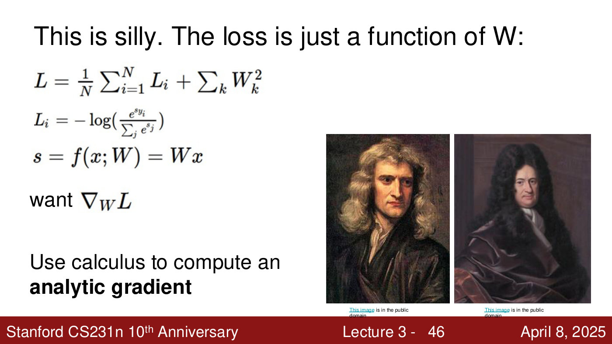

$$L = \frac{1}{N} \sum_{i=1}^{N} L_i + \sum_k W_k^2$$

$$L_i = -\log\left(\frac{e^{s_{y_i}}}{\sum_j e^{s_j}}\right)$$

$$s = f(x; W) = Wx$$

want $\nabla_W L$

Use calculus to compute an analytic gradient

Figure: two painted portraits side by side at lower right, each captioned "This image is in the public domain" (with "This image" as a link). The left portrait is of a man with long, wavy light-brown hair in dark clothing; the right is of a man in a long dark curled wig and a dark purple-brown robe. The slide prints no names.

## Slide 47 — (numerical gradient worked example, continued)

Two columns separated by a thin vertical line, with an arrow between them. Left column, black text, "current W:":

```
[0.34,
-1.11,
0.78,
0.12,
0.55,
2.81,
-3.1,
-1.5,
0.33,…]
```

followed in red text by "loss 1.25347".

Middle, blue text: "dW = ... (some function data and W)" (as printed), with a thin grey arrow pointing from this text to the right column.

Right column, blue text, "gradient dW:":

```
[-2.5,
0.6,
0,
0.2,
0.7,
-0.5,
1.1,
1.3,
-2.1,…]
```

## Slide 48 — In summary:

- Numerical gradient: approximate, slow, easy to write
- Analytic gradient: exact, fast, error-prone

=>

In practice: Always use analytic gradient, but check implementation with numerical gradient. This is called a gradient check.

("In practice:" is underlined.)

## Slide 49 — Gradient Descent

```python
# Vanilla Gradient Descent

while True:
  weights_grad = evaluate_gradient(loss_fun, data, weights)
  weights += - step_size * weights_grad # perform parameter update
```

## Slide 50 — (loss landscape with negative gradient direction)

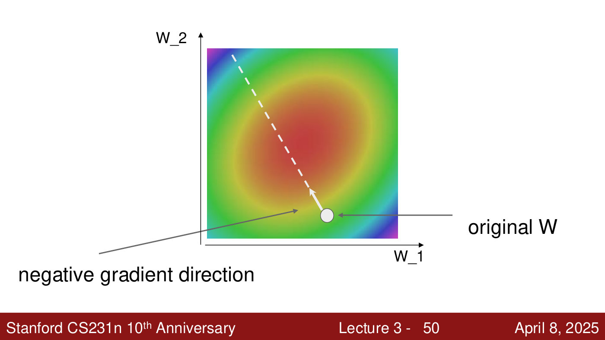

Figure: a square heat-map of the loss as a function of two weights, with axes labelled "W_2" (vertical, arrow up) and "W_1" (horizontal, arrow right). Colours run from red at the centre (a tilted elliptical region, long axis running lower-right to upper-left) through orange, yellow, green and cyan to blue and purple at the corners (upper-left and lower-right). A light grey circle marks the "original W", located lower right of centre (label on the right with an arrow pointing to it). From it a short solid white arrow and then a longer dashed white line run up and to the left, toward the red centre and beyond to the upper-left, labelled "negative gradient direction" (label at lower left with an arrow pointing to the arrow).

## Slide 51 — (loss landscape, elongated)

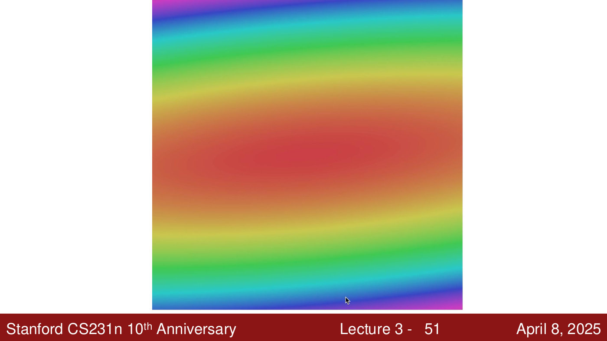

Figure: a colour heat-map of loss with no text, no axes. It is a stack of horizontal bands: red in the centre (a wide horizontal ellipse, long axis horizontal), then orange, yellow, green, cyan, blue above and below, to magenta/purple at the top and bottom edges. The loss thus changes quickly in the vertical direction and slowly in the horizontal one. A mouse cursor is visible at the bottom.

## Slide 52 — Stochastic Gradient Descent (SGD)

$$L(W) = \frac{1}{N} \sum_{i=1}^{N} L_i(x_i, y_i, W) + \lambda R(W)$$

$$\nabla_W L(W) = \frac{1}{N} \sum_{i=1}^{N} \nabla_W L_i(x_i, y_i, W) + \lambda \nabla_W R(W)$$

Full sum expensive when N is large!

Approximate sum using a minibatch of examples
32 / 64 / 128 common

```python
# Vanilla Minibatch Gradient Descent

while True:
  data_batch = sample_training_data(data, 256) # sample 256 examples
  weights_grad = evaluate_gradient(loss_fun, data_batch, weights)
  weights += - step_size * weights_grad # perform parameter update
```

## Slide 53 — Optimization: Problem #1 with SGD

What if loss changes quickly in one direction and slowly in another?
What does gradient descent do?

Figure: contour plot with axes "w1" (horizontal) and "w2" (vertical). Seven nested black ellipses, each very wide horizontally and short vertically (long axis along w1), centred at a smiley-face marker which is the minimum, in the middle of the plot. A red dot (the starting point) sits on the lower-left part of one of the outer ellipses, below and left of the centre. No trajectory yet.

## Slide 54 — Optimization: Problem #1 with SGD

What if loss changes quickly in one direction and slowly in another?
What does gradient descent do?
Very slow progress along shallow dimension, jitter along steep direction (red text)

Same as slide 53, plus a red zig-zag trajectory (one series) from the red start dot at lower left to the smiley minimum. It oscillates up and down across the narrow (w2) direction with large amplitude at first, the swings shrinking as it nears the minimum, while advancing only slowly to the right along w1.

## Slide 55 — Optimization: Problem #1 with SGD

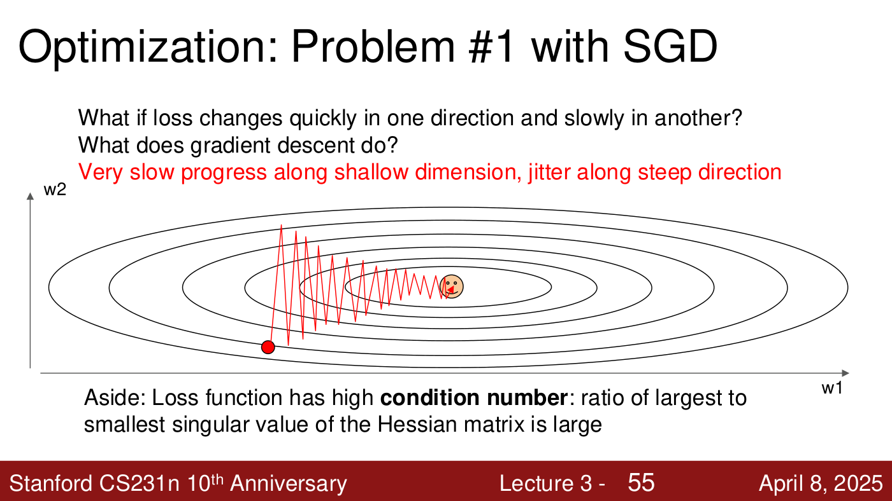

What if loss changes quickly in one direction and slowly in another?
What does gradient descent do?
Very slow progress along shallow dimension, jitter along steep direction

Same as slide 54, plus a line at the bottom:

Aside: Loss function has high condition number: ratio of largest to smallest singular value of the Hessian matrix is large

## Slide 56 — Optimization: Problem #2 with SGD

What if the loss function has a local minima or saddle point?

Figure: axes labelled "loss" (vertical) and "w" (horizontal). Two grey curves, no ticks. Upper curve: starts high at left, falls into a shallow dip (a local minimum) in the middle, rises to a lower hump, then falls off to the right. Lower curve: starts at upper left, curves down and runs nearly flat, then drops in a short vertical step (a flat point with a sudden drop, a saddle-like point) and continues nearly flat to the right.

## Slide 57 — Optimization: Problem #2 with SGD

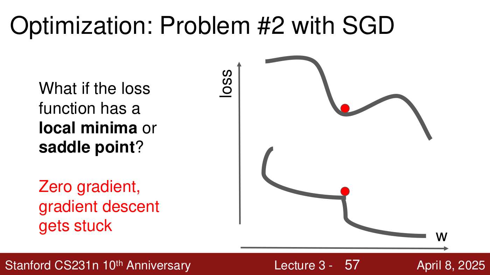

What if the loss function has a local minima or saddle point?

Zero gradient, gradient descent gets stuck (red text)

Same as slide 56, plus a red dot at the bottom of the dip on the upper curve and a red dot at the flat point just before the step on the lower curve.

## Slide 58 — Optimization: Problem #2 with SGD

What if the loss function has a local minima or saddle point?

Saddle points much more common in high dimension (red text)

Dauphin et al, "Identifying and attacking the saddle point problem in high-dimensional non-convex optimization", NIPS 2014

Same two curves and red dots as slide 57, but the "loss" and "w" axes are removed.

## Slide 59 — Optimization: Problem #2 with SGD

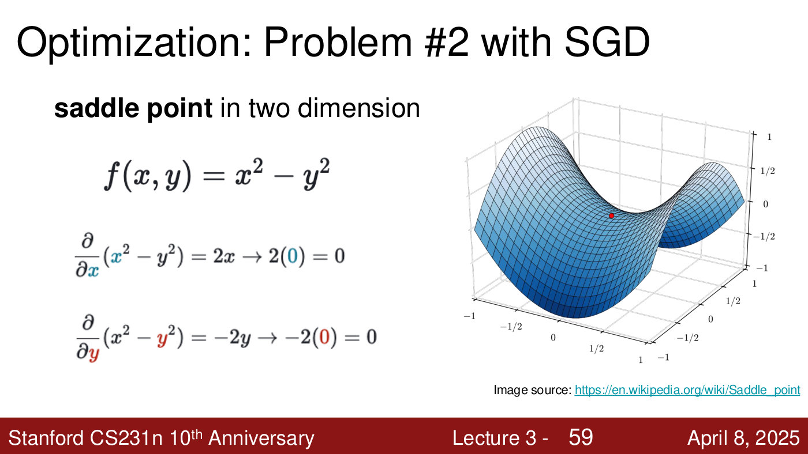

saddle point in two dimension

$$f(x, y) = x^2 - y^2$$

$$\frac{\partial}{\partial x}(x^2 - y^2) = 2x \rightarrow 2(0) = 0$$

$$\frac{\partial}{\partial y}(x^2 - y^2) = -2y \rightarrow -2(0) = 0$$

(In the slide, the $x$ in the first derivative and the 0 in its result are coloured blue-teal; the $y$ in the second derivative and its 0 are coloured red.)

Figure: a 3D blue mesh surface of a saddle, curving up along one horizontal axis (left and right edges high) and down along the other (front and back edges lower), with a small red dot at the centre saddle point. Axes ticks run -1, -1/2, 0, 1/2, 1 on each horizontal axis and the vertical axis is ticked -1, -1/2, 0, 1/2, 1.

Image source: https://en.wikipedia.org/wiki/Saddle_point

## Slide 60 — Optimization: Problem #3 with SGD

Our gradients come from minibatches so they can be noisy!

$$L(W) = \frac{1}{N} \sum_{i=1}^{N} L_i(x_i, y_i, W)$$

$$\nabla_W L(W) = \frac{1}{N} \sum_{i=1}^{N} \nabla_W L_i(x_i, y_i, W)$$

Figure: a square colour heat-map of loss at right, red at the centre, tilted elliptical bands through orange, yellow, green, cyan to blue/purple at the upper-left and lower-right corners (same style as slide 50). No trajectory or axes.

## Slide 61 — SGD + Momentum

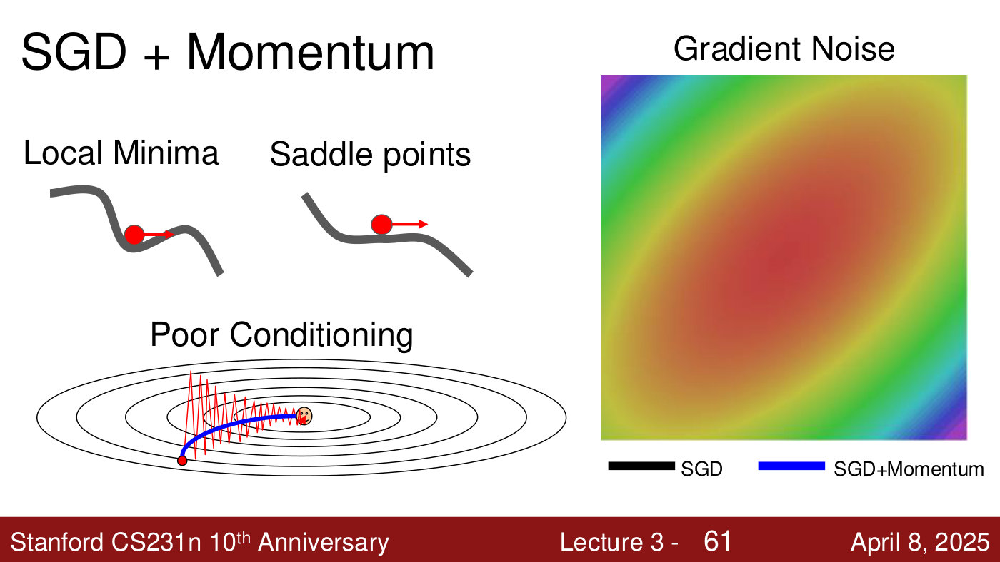

Panel headings and content (a composite slide, four parts):

- "Local Minima": a grey curve with a dip; a red dot sits in the dip with a short red arrow pointing right (momentum carrying it out of the dip).
- "Saddle points": a grey curve that flattens into a saddle; a red dot on it with a short red arrow pointing right.
- "Poor Conditioning": the nested wide horizontal ellipses of slide 53 with a smiley minimum at centre-right. Two trajectories start from a red dot at the lower left: a red zig-zag (SGD) that oscillates vertically with large swings while creeping right, and a smooth blue curve (SGD+Momentum) that arcs up and right directly to the minimum.
- "Gradient Noise" (title above a square heat-map at right): red centre, tilted elliptical bands through orange, yellow, green, cyan to blue/purple at upper-left and lower-right corners. No trajectory is drawn in the slide render. Below it, a legend: a black line labelled "SGD" and a blue line labelled "SGD+Momentum".

## Slide 62 — SGD: the simple two line update code

SGD

$$x_{t+1} = x_t - \alpha \nabla f(x_t)$$

```python
while True:
  dx = compute_gradient(x)
  x -= learning_rate * dx
```

## Slide 63 — SGD + Momentum:

continue moving in the general direction as the previous iterations

SGD (left):

$$x_{t+1} = x_t - \alpha \nabla f(x_t)$$

```python
while True:
  dx = compute_gradient(x)
  x -= learning_rate * dx
```

SGD+Momentum (right):

$$v_{t+1} = \rho v_t + \nabla f(x_t)$$

$$x_{t+1} = x_t - \alpha v_{t+1}$$

- Build up "velocity" as a running mean of gradients
- Rho gives "friction"; typically rho=0.9 or 0.99

Sutskever et al, "On the importance of initialization and momentum in deep learning", ICML 2013

## Slide 64 — SGD + Momentum:

continue moving in the general direction as the previous iterations

Same as slide 63, plus the code for SGD+Momentum under its equations. The bullet now reads "Rho gives "momentum"; typically rho=0.9 or 0.99" (slide 63 said "friction").

```python
vx = 0
while True:
  dx = compute_gradient(x)
  vx = rho * vx + dx
  x -= learning_rate * vx
```

- Build up "velocity" as a running mean of gradients
- Rho gives "momentum"; typically rho=0.9 or 0.99

Sutskever et al, "On the importance of initialization and momentum in deep learning", ICML 2013

## Slide 65 — SGD + Momentum: alternative equivalent formulation

Left, SGD+Momentum:

$$v_{t+1} = \rho v_t - \alpha \nabla f(x_t)$$

$$x_{t+1} = x_t + v_{t+1}$$

```python
vx = 0
while True:
  dx = compute_gradient(x)
  vx = rho * vx - learning_rate * dx
  x += vx
```

Right, SGD+Momentum:

$$v_{t+1} = \rho v_t + \nabla f(x_t)$$

$$x_{t+1} = x_t - \alpha v_{t+1}$$

```python
vx = 0
while True:
  dx = compute_gradient(x)
  vx = rho * vx + dx
  x -= learning_rate * vx
```

You may see SGD+Momentum formulated different ways, but they are equivalent - give same sequence of x

Sutskever et al, "On the importance of initialization and momentum in deep learning", ICML 2013

## Slide 66 — More Complex Optimizers: RMSProp

Top, labelled "SGD + Momentum":

```python
vx = 0
while True:
  dx = compute_gradient(x)
  vx = rho * vx + dx
  x -= learning_rate * vx
```

A downward arrow leads to the code labelled "RMSProp":

```python
grad_squared = 0
while True:
  dx = compute_gradient(x)
  grad_squared = decay_rate * grad_squared + (1 - decay_rate) * dx * dx
  x -= learning_rate * dx / (np.sqrt(grad_squared) + 1e-7)
```

The `grad_squared = ...` line is outlined in a blue box. Red text at right: "Adds element-wise scaling of the gradient based on the historical sum of squares in each dimension (with decay)"

Tieleman and Hinton, 2012

## Slide 67 — More Complex Optimizers: RMSProp

Same as slide 66, with the same two code blocks, except that the blue box is now around the last line (`x -= learning_rate * dx / (np.sqrt(grad_squared) + 1e-7)`), and the red text reads: "Per-parameter learning rates" or "adaptive learning rates"

Tieleman and Hinton, 2012

## Slide 68 — RMSProp

```python
grad_squared = 0
while True:
  dx = compute_gradient(x)
  grad_squared = decay_rate * grad_squared + (1 - decay_rate) * dx * dx
  x -= learning_rate * dx / (np.sqrt(grad_squared) + 1e-7)
```

The expression `(np.sqrt(grad_squared) + 1e-7)` is outlined in a blue box.

Q: What happens with RMSProp? (blue text)

Tieleman and Hinton, 2012

## Slide 69 — RMSProp

Same as slide 68, plus the answer at the right of the question:

Progress along "steep" directions is damped;
progress along "flat" directions is accelerated

Tieleman and Hinton, 2012

## Slide 70 — RMSProp

Figure: a square heat-map of loss at left (red centre, tilted elliptical bands, long axis running lower-left to upper-right, yellow-green to blue/purple at the upper-left and lower-right corners), and a legend at right with three coloured line samples: black "SGD", blue "SGD+Momentum", red "RMSProp". No trajectories are drawn on the heat-map in the render (they appear to be animation builds not captured here).

## Slide 71 — Optimizers: Adam (almost)

```python
first_moment = 0
second_moment = 0
while True:
  dx = compute_gradient(x)
  first_moment = beta1 * first_moment  + (1 - beta1) * dx
  second_moment = beta2 * second_moment + (1 - beta2) * dx * dx
  x -= learning_rate * first_moment / (np.sqrt(second_moment) + 1e-7))
```

(The extra closing parenthesis on the last line is as printed.)

Kingma and Ba, "Adam: A method for stochastic optimization", ICLR 2015

## Slide 72 — Adam (almost)

Same code as slide 71. The `first_moment = ...` line is outlined in a red box, labelled at right in red "Momentum". The `second_moment = ...` line and the `x -= ...` line are together outlined in a blue box, labelled at right in blue "RMSProp".

Sort of like RMSProp with momentum

Q: What happens at first timestep? (blue text)

Kingma and Ba, "Adam: A method for stochastic optimization", ICLR 2015

## Slide 73 — Adam (full form)

```python
first_moment = 0
second_moment = 0
for t in range(1, num_iterations):
  dx = compute_gradient(x)
  first_moment = beta1 * first_moment  + (1 - beta1) * dx
  second_moment = beta2 * second_moment + (1 - beta2) * dx * dx
  first_unbias = first_moment / (1 - beta1 ** t)
  second_unbias = second_moment / (1 - beta2 ** t)
  x -= learning_rate * first_unbias / (np.sqrt(second_unbias) + 1e-7))
```

Coloured boxes: the `first_moment = ...` line in red, labelled "Momentum" (red text); the `second_moment = ...` line in blue; the two `..._unbias` lines together in green, labelled "Bias correction" (green text); the final `x -= ...` line in blue, labelled "AdaGrad / RMSProp" (blue text).

Bias correction for the fact that first and second moment estimates start at zero

Kingma and Ba, "Adam: A method for stochastic optimization", ICLR 2015

## Slide 74 — Adam (full form)

Same as slide 73, plus at lower right: "Adam with beta1 = 0.9, beta2 = 0.999, and learning_rate = 1e-3 or 5e-4 is a great starting point for many models!" (the values "beta1 = 0.9", "beta2 = 0.999" and "learning_rate = 1e-3 or 5e-4" are in red).

Kingma and Ba, "Adam: A method for stochastic optimization", ICLR 2015

## Slide 75 — Adam

Figure: same heat-map as slide 70 (red centre, tilted elliptical bands, long axis lower-left to upper-right) with a legend at right of four coloured line samples: black "SGD", blue "SGD+Momentum", red "RMSProp", purple "Adam". No trajectories are drawn on the heat-map in the render.

## Slide 76 — AdamW: Adam Variant with Weight Decay

Q: How does regularization interact with the optimizer? (e.g., L2) (red text)

```python
first_moment = 0
second_moment = 0
for t in range(1, num_iterations):
  dx = compute_gradient(x)
  first_moment = beta1 * first_moment  + (1 - beta1) * dx
  second_moment = beta2 * second_moment + (1 - beta2) * dx * dx
  first_unbias = first_moment / (1 - beta1 ** t)
  second_unbias = second_moment / (1 - beta2 ** t)
  x -= learning_rate * first_unbias / (np.sqrt(second_unbias) + 1e-7))
```

## Slide 77 — AdamW: Adam Variant with Weight Decay

Same as slide 76 (question now in black text), plus below the code, in blue: "A: It depends!"

## Slide 78 — AdamW: Adam Variant with Weight Decay

Same question and code as slide 76 (no "A:" line). Added: a label "Standard Adam computes L2 here" above the code, with a red arrow pointing down then left to the `dx = compute_gradient(x)` line; red text at right: "Used during moment calculations!"

## Slide 79 — AdamW: Adam Variant with Weight Decay

Same question and code as slide 76. Added: a label "AdamW (Weight Decay) adds term here" below the code with a red arrow pointing up to the end of the final `x -= ...` line; red text at right: "Computed after the moments!" (the slide 78 annotations are absent).

## Slide 80 — AdamW: Adam Variant with Weight Decay

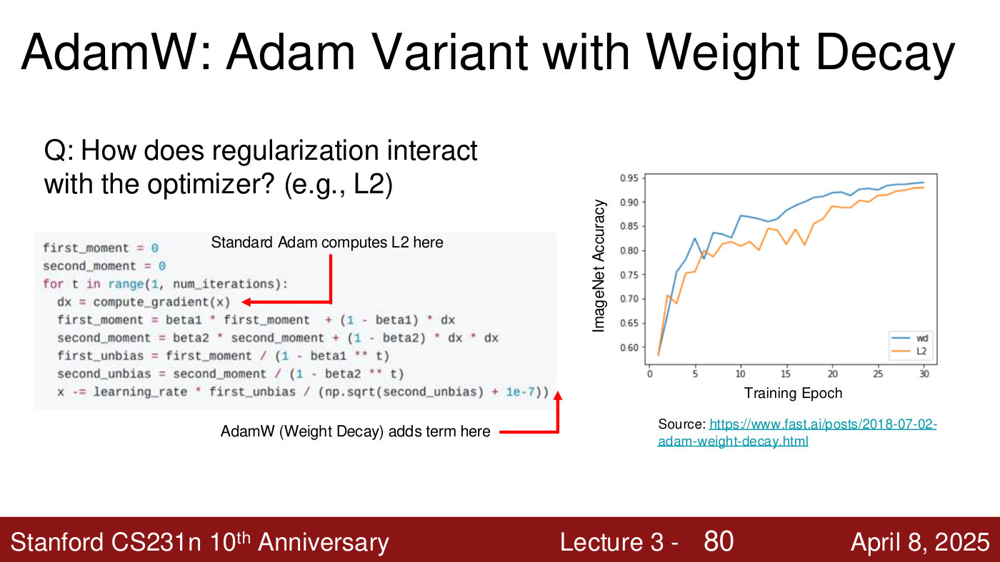

Same question and code as slide 76, with both annotations: "Standard Adam computes L2 here" (arrow to the `dx = compute_gradient(x)` line) and "AdamW (Weight Decay) adds term here" (arrow to the end of the final line).

Chart at right: line chart, x-axis "Training Epoch", ticks 5, 10, 15, 20, 25, 30 (data from epoch 1 to 30); y-axis "ImageNet Accuracy", ticks 0.60 to 0.95 in steps of 0.05. Two series, legend at lower right, both starting at about 0.585 at epoch 1:

- Blue, legend label "wd": about 0.67 at epoch 2, 0.755 at 3, 0.78 at 4, 0.825 at 5, a dip to 0.78 at 6, 0.837 at 7, 0.827 at 9, 0.871 at 10, 0.86 at 13, 0.883 at 15, 0.919 at 20, 0.913 at 22, 0.925 at 25, 0.934 at 26, ending at 0.941 at epoch 30.
- Orange, legend label "L2": about 0.707 at epoch 2, 0.69 at 3, 0.753 at 4, 0.756 at 5, 0.80 at 6, 0.787 at 7, 0.814 at 8, 0.818 at 9, 0.809 at 10, 0.818 at 11, 0.80 at 12, 0.845 at 13, a dip to 0.813 at 15, 0.844 at 16, 0.811 at 17, 0.856 at 18, 0.891 at 20, 0.888 at 22, 0.903 at 23, 0.913 at 25, ending at 0.93 at epoch 30.

The blue "wd" curve lies above the orange "L2" curve for most of training; L2 is higher only at epoch 2 and epoch 6. Values read from a 600-dpi render.

Source: https://www.fast.ai/posts/2018-07-02-adam-weight-decay.html

## Slide 81 — Learning rate schedules

```python
# Vanilla Gradient Descent

while True:
  weights_grad = evaluate_gradient(loss_fun, data, weights)
  weights += - step_size * weights_grad # perform parameter update
```

The `step_size` token is outlined in a red box, with a red arrow down to the label "Learning rate".

## Slide 82 — (learning rate hyperparameter)

SGD, SGD+Momentum, RMSProp, Adam, AdamW all have learning rate as a hyperparameter.

Q: Which one of these learning rates is best to use? (blue text)

Chart (left, in a thin box): x-axis "epoch", y-axis "loss", no tick values. Four curves, each labelled by coloured text beside it, all starting at the same high loss at the left:

- Orange/yellow, "very high learning rate": dips slightly at the start, then rises steeply upward off the top of the chart.
- Blue, "low learning rate": declines steadily and almost linearly, crossing under the green curve partway across and ending above the red curve.
- Green, "high learning rate": drops very quickly, then flattens into a nearly level plateau to the right edge; it crosses the blue curve partway across and ends above both the blue and red curves.
- Red, "good learning rate": declines smoothly and quickly, ending as the lowest curve at the right.

## Slide 83 — (learning rate hyperparameter)

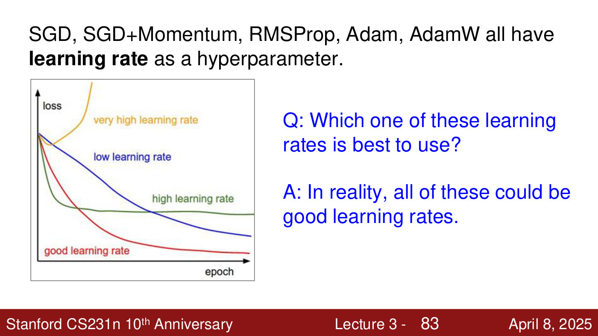

Same as slide 82, plus the answer in blue: "A: In reality, all of these could be good learning rates."

## Slide 84 — Learning rate decays over time

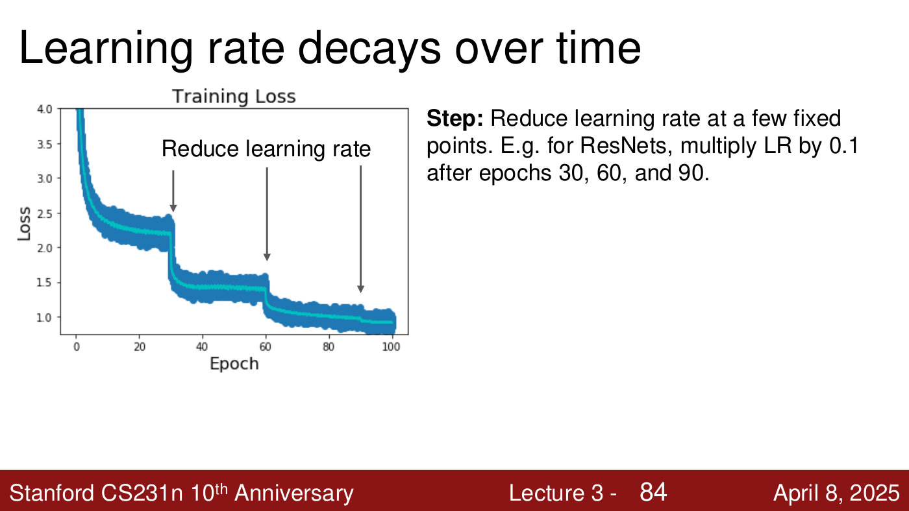

Step: Reduce learning rate at a few fixed points. E.g. for ResNets, multiply LR by 0.1 after epochs 30, 60, and 90.

Chart: titled "Training Loss"; x-axis "Epoch" with ticks 0, 20, 40, 60, 80, 100; y-axis "Loss" with ticks 1.0 to 4.0 in steps of 0.5. One series: a cyan line (smoothed loss) inside a wider dark-blue noisy band. It falls steeply from above 4.0 at epoch 0 to about 2.3 at epoch 10, then drifts to about 2.2 at epoch 30 (band about 2.0–2.45); drops sharply at epoch 30 to about 1.4 and stays flat at about 1.4 (band about 1.25–1.6) until epoch 60; drops again at epoch 60 to about 1.1 and slowly declines to about 0.98 at epoch 90; a small final step at epoch 90 to about 0.92 at epoch 100 (band down to about 0.8). Three black arrows labelled "Reduce learning rate" point at the curve at epochs 30, 60 and 90 (the first arrow at about epoch 30, others at 60 and 90).

## Slide 85 — Learning Rate Decay

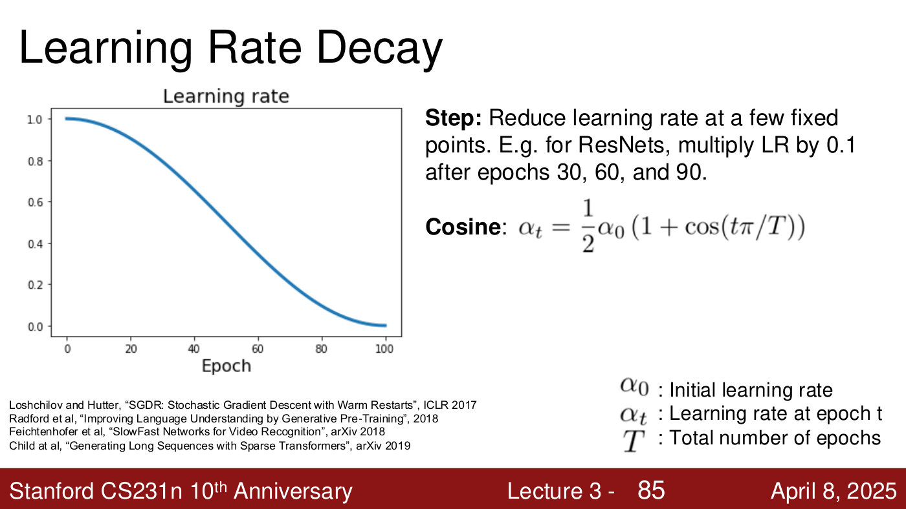

Step: Reduce learning rate at a few fixed points. E.g. for ResNets, multiply LR by 0.1 after epochs 30, 60, and 90.

Cosine: $\alpha_t = \frac{1}{2}\alpha_0\left(1 + \cos(t\pi/T)\right)$

$\alpha_0$ : Initial learning rate
$\alpha_t$ : Learning rate at epoch t
$T$ : Total number of epochs

Figure: a line plot titled "Learning rate". X-axis label "Epoch", ticks 0, 20, 40, 60, 80, 100. Y-axis ticks 0.0, 0.2, 0.4, 0.6, 0.8, 1.0 (no axis label). One blue series: a smooth half-cosine curve starting at 1.0 at epoch 0, flat at first, falling most steeply around epoch 50 (value about 0.5), and flattening out to 0.0 at epoch 100.

Citations (small print, bottom left):
- Loshchilov and Hutter, "SGDR: Stochastic Gradient Descent with Warm Restarts", ICLR 2017
- Radford et al, "Improving Language Understanding by Generative Pre-Training", 2018
- Feichtenhofer et al, "SlowFast Networks for Video Recognition", arXiv 2018
- Child at al, "Generating Long Sequences with Sparse Transformers", arXiv 2019 ("at al" as printed)

## Slide 86 — Learning Rate Decay

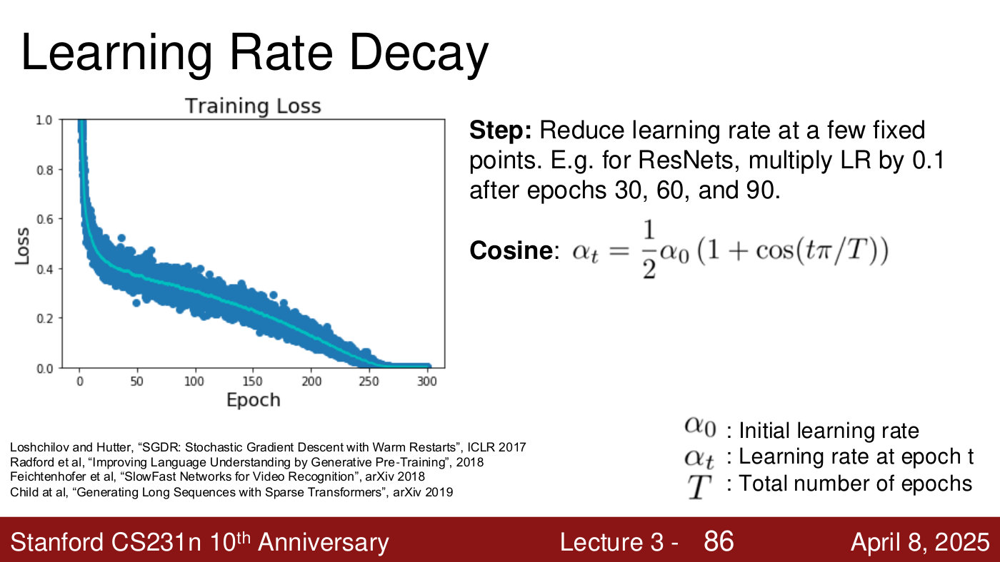

Same text as slide 85 (Step, Cosine formula, symbol definitions, same four citations); only the figure changes.

Figure: a plot titled "Training Loss". X-axis label "Epoch", ticks 0, 50, 100, 150, 200, 250, 300. Y-axis label "Loss", ticks 0.0, 0.2, 0.4, 0.6, 0.8, 1.0 (the curve runs off the top of the axis at the start). Two overlaid items: a dense band of dark-blue dots (per-iteration loss, noisy) and a cyan smooth line through the middle of the band (the mean). The loss drops very steeply from above 1.0 in the first few epochs to about 0.5 by epoch 10, then declines slowly to about 0.35-0.4 around epochs 50-100, continues falling roughly linearly to about 0.1 near epoch 220, and reaches 0.0 at about epoch 250–260, staying at 0.0 until epoch 300. The noise band is about 0.1-0.15 wide in the middle and narrows to nothing as the loss reaches zero.

## Slide 87 — Learning Rate Decay

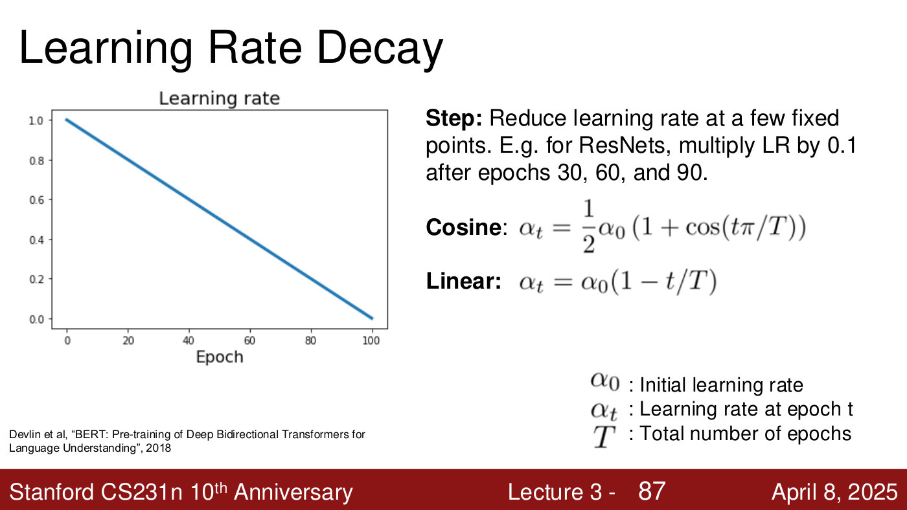

Step: Reduce learning rate at a few fixed points. E.g. for ResNets, multiply LR by 0.1 after epochs 30, 60, and 90.

Cosine: $\alpha_t = \frac{1}{2}\alpha_0\left(1 + \cos(t\pi/T)\right)$

Linear: $\alpha_t = \alpha_0(1 - t/T)$

$\alpha_0$ : Initial learning rate
$\alpha_t$ : Learning rate at epoch t
$T$ : Total number of epochs

Figure: a line plot titled "Learning rate". X-axis label "Epoch", ticks 0, 20, 40, 60, 80, 100. Y-axis ticks 0.0 to 1.0 in steps of 0.2. One blue series: a straight line falling from 1.0 at epoch 0 to 0.0 at epoch 100.

Citation: Devlin et al, "BERT: Pre-training of Deep Bidirectional Transformers for Language Understanding", 2018

## Slide 88 — Learning Rate Decay

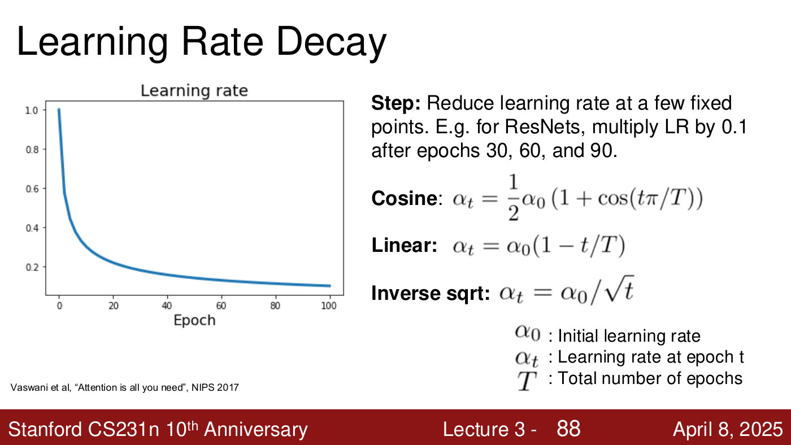

Step: Reduce learning rate at a few fixed points. E.g. for ResNets, multiply LR by 0.1 after epochs 30, 60, and 90.

Cosine: $\alpha_t = \frac{1}{2}\alpha_0\left(1 + \cos(t\pi/T)\right)$

Linear: $\alpha_t = \alpha_0(1 - t/T)$

Inverse sqrt: $\alpha_t = \alpha_0/\sqrt{t}$

$\alpha_0$ : Initial learning rate
$\alpha_t$ : Learning rate at epoch t
$T$ : Total number of epochs

Figure: a line plot titled "Learning rate". X-axis label "Epoch", ticks 0, 20, 40, 60, 80, 100. Y-axis ticks 0.2, 0.4, 0.6, 0.8, 1.0. One blue series: starts at 1.0 at epoch 0, drops sharply to about 0.58 by epoch 2, about 0.45 by epoch 4, about 0.3 by epoch 10, then decays slowly and convexly to about 0.2 at epoch 20 and about 0.1 at epoch 100.

Citation: Vaswani et al, "Attention is all you need", NIPS 2017

## Slide 89 — Learning Rate Decay: Linear Warmup

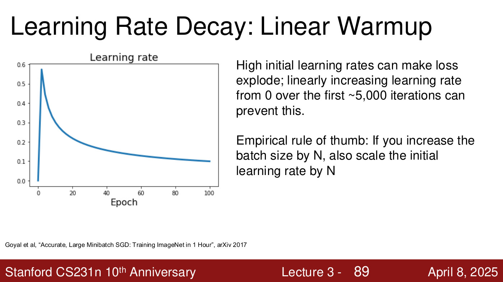

High initial learning rates can make loss explode; linearly increasing learning rate from 0 over the first ~5,000 iterations can prevent this.

Empirical rule of thumb: If you increase the batch size by N, also scale the initial learning rate by N

Figure: a line plot titled "Learning rate". X-axis label "Epoch", ticks 0, 20, 40, 60, 80, 100. Y-axis ticks 0.0, 0.1, 0.2, 0.3, 0.4, 0.5, 0.6. One blue series: starts at 0.0 at epoch 0, rises linearly and steeply to a peak of about 0.58 at epoch about 2, then decays like the inverse-sqrt curve of slide 88 (about 0.45 at epoch 4, about 0.2 at epoch 20) down to about 0.1 at epoch 100.

Citation: Goyal et al, "Accurate, Large Minibatch SGD: Training ImageNet in 1 Hour", arXiv 2017

## Slide 90 — First-Order Optimization

Figure: a one-dimensional loss curve. X-axis labelled "w1", y-axis labelled "Loss" (no tick values). The grey curve has a local minimum on the left, then a high peak, then falls to a long shallow plateau-like valley in the middle, a small bump, then a deep narrow global minimum at the right (lowest point of the curve), then rises steeply. A red dot sits on the curve at the top of the left peak (slightly right of the summit).

## Slide 91 — First-Order Optimization

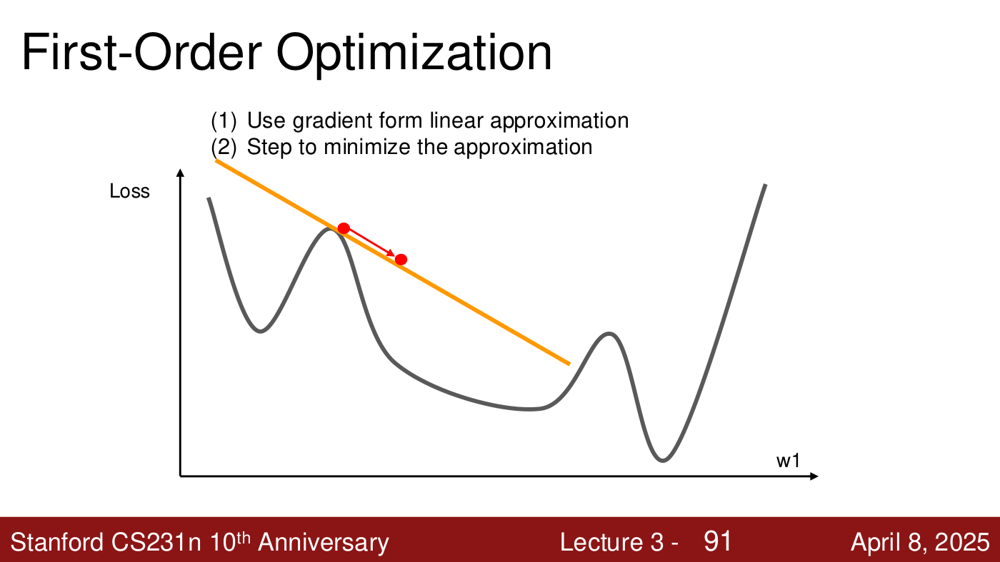

(1) Use gradient form linear approximation (wording as printed)
(2) Step to minimize the approximation

Same as slide 90, plus an orange straight line tangent to the curve at the red dot, sloping downward to the right (extending from upper left to the right of the middle valley). A short red arrow runs from the original red dot along the orange line to a second red dot slightly lower and to the right.

## Slide 92 — Second-Order Optimization

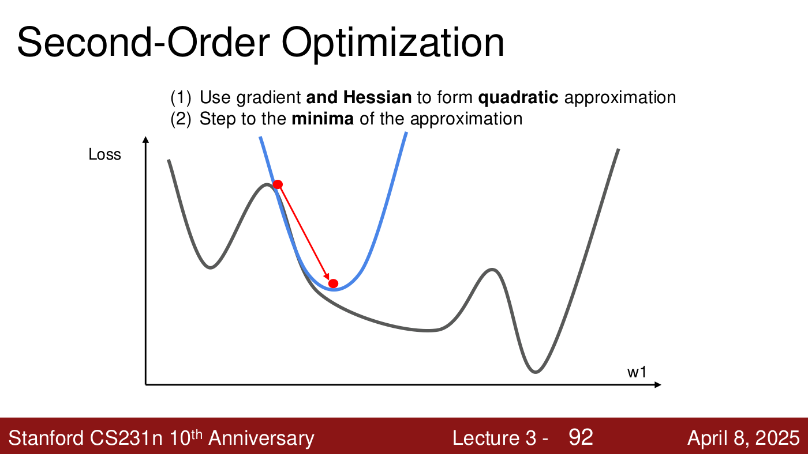

(1) Use gradient and Hessian to form quadratic approximation
(2) Step to the minima of the approximation

Same loss curve and red dot as slide 90, plus a blue parabola (upward-opening) that is tangent to the curve at the red dot and has its minimum at the lower right of the dot, near the left end of the middle valley. A longer red arrow runs from the original red dot straight to the bottom of the blue parabola, where a second red dot is drawn.

## Slide 93 — Second-Order Optimization

second-order Taylor expansion:

$$J(\boldsymbol{\theta}) \approx J(\boldsymbol{\theta}_ 0) + (\boldsymbol{\theta} - \boldsymbol{\theta}_ 0)^\top \nabla_{\boldsymbol{\theta}} J(\boldsymbol{\theta}_ 0) + \frac{1}{2}(\boldsymbol{\theta} - \boldsymbol{\theta}_ 0)^\top \boldsymbol{H}(\boldsymbol{\theta} - \boldsymbol{\theta}_ 0)$$

Solving for the critical point we obtain the Newton parameter update:

$$\boldsymbol{\theta}^\ast = \boldsymbol{\theta}_ 0 - \boldsymbol{H}^{-1}\nabla_{\boldsymbol{\theta}} J(\boldsymbol{\theta}_ 0)$$

Q: Why is this bad for deep learning? (blue text)

(Each equation is printed inside a thin-bordered box.)

## Slide 94 — Second-Order Optimization

Same as slide 93, plus red text to the right of the Newton update equation:

Hessian has O(N^2) elements
Inverting takes O(N^3)
N = (Tens or Hundreds of) Millions

## Slide 95 — In practice:

- Adam(W) is a good default choice in many cases; it often works ok even with constant learning rate
- SGD+Momentum can outperform Adam but may require more tuning of LR and schedule
- If you can afford to do full batch updates then look beyond 1st order optimization (2nd order and beyond)

## Slide 96 — Looking Ahead: How to optimize more complex functions?

(Currently) Linear score function: $f = Wx$

$x \in \mathbb{R}^{D}, W \in \mathbb{R}^{C \times D}$

## Slide 97 — Neural networks: 2 layers

(Currently) Linear score function: $f = Wx$

(Next Class) 2-layer Neural Network $f = W_2 \max(0, W_1 x)$

$x \in \mathbb{R}^{D}, W_1 \in \mathbb{R}^{H \times D}, W_2 \in \mathbb{R}^{C \times H}$

(In practice we will usually add a learnable bias at each layer as well)

## Slide 98 — Why do we want non-linearity?

Figure: a 2-D scatter plot with an x-axis (horizontal, label "x" at left) and y-axis (vertical, label "y" at top) crossing at the centre. About 8 red points cluster near the origin (a small group just around and slightly left/right of the origin, both above and below the x-axis). About 18 blue points form a ring around the red cluster, surrounding it on all sides (above, below, left and right). Caption below: "Cannot separate red and blue points with linear classifier"

## Slide 99 — Why do we want non-linearity?

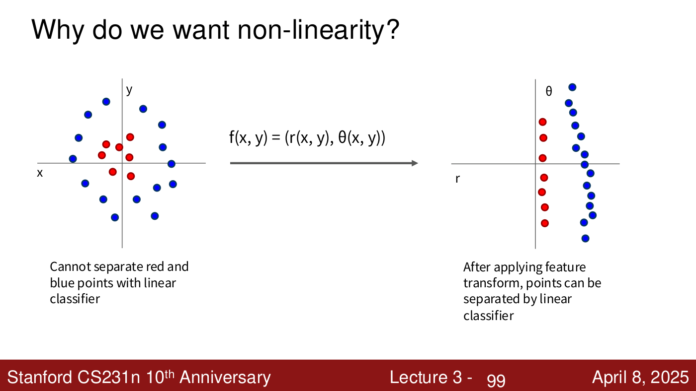

Left: same scatter plot as slide 98 (red cluster at the centre, blue ring around it), with caption "Cannot separate red and blue points with linear classifier".

Middle: a right-pointing arrow labelled "f(x, y) = (r(x, y), θ(x, y))".

Right: a second scatter plot with a horizontal axis labelled "r" (the label sits at the left end, below the axis) and a vertical axis labelled "θ" (the label sits just right of its top), crossing near the left of the plot; the horizontal axis extends well past the points on both sides. The 7 red points lie in a vertical column just right of the θ axis (small positive r), 3 above and 4 below the r axis. The 15 blue points lie in a slightly curved, roughly vertical band to the right of the red column (at larger r), spread from top to bottom. A vertical line would separate the two groups. Caption below: "After applying feature transform, points can be separated by linear classifier"

## Slide 100 — Neural networks: also called fully connected network

(Currently) Linear score function: $f = Wx$

(Next Class) 2-layer Neural Network $f = W_2 \max(0, W_1 x)$

$x \in \mathbb{R}^{D}, W_1 \in \mathbb{R}^{H \times D}, W_2 \in \mathbb{R}^{C \times H}$

"Neural Network" is a very broad term; these are more accurately called "fully-connected networks" or sometimes "multi-layer perceptrons" (MLP)

(In practice we will usually add a learnable bias at each layer as well)

## Slide 101 — Next time:

Introduction to neural networks

Backpropagation (How do you calculate dx for neural nets?)

## Slide 102 — Appendix (Slides from Previous Years)

(Section divider; centred title only.)

## Slide 103 — SGD+Momentum

Momentum update:

Figure: a vector diagram from a red dot (the current point). Three arrows start at the red dot: a green arrow pointing up and to the right labelled "Velocity"; a red horizontal arrow pointing right labelled "Gradient"; and a blue arrow pointing up and to the right (longer, ending at the tip of a pink horizontal segment drawn from the tip of the green arrow) labelled "actual step". The actual step is the sum of the velocity and gradient vectors (the pink segment, parallel to and the same length as the red gradient arrow, is drawn from the velocity tip to the actual-step tip).

Combine gradient at current point with velocity to get step used to update weights

Citations:
- Nesterov, "A method of solving a convex programming problem with convergence rate O(1/k^2)", 1983
- Nesterov, "Introductory lectures on convex optimization: a basic course", 2004
- Sutskever et al, "On the importance of initialization and momentum in deep learning", ICML 2013

## Slide 104 — Nesterov Momentum

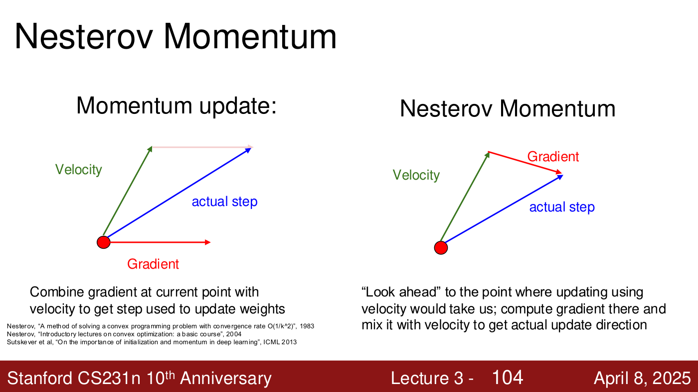

Left (same as slide 103): "Momentum update:" with the Velocity / Gradient / actual step diagram, and caption "Combine gradient at current point with velocity to get step used to update weights".

Right: "Nesterov Momentum". Figure: from a red dot, a green arrow labelled "Velocity" points up and to the right. From the tip of the velocity arrow, a red arrow labelled "Gradient" points right and slightly down. A blue arrow labelled "actual step" runs from the red dot directly to the tip of the gradient arrow. Caption: "Look ahead" to the point where updating using velocity would take us; compute gradient there and mix it with velocity to get actual update direction

Citations: same three as slide 103.

## Slide 105 — Nesterov Momentum

$$v_{t+1} = \rho v_t - \alpha \nabla f(x_t + \rho v_t)$$

$$x_{t+1} = x_t + v_{t+1}$$

(Both equations are printed inside one thin-bordered box.)

Figure: the Nesterov diagram of slide 104 (red dot; green "Velocity" arrow up and to the right; red "Gradient" arrow starting at the velocity tip; blue "actual step" arrow from the red dot to the gradient tip).

"Look ahead" to the point where updating using velocity would take us; compute gradient there and mix it with velocity to get actual update direction

## Slide 106 — Nesterov Momentum

Same as slide 105, plus a blue rectangle around $x_t + \rho v_t$ inside the gradient term of the first equation, and the text at upper right: "Annoying, usually we want update in terms of $x_t, \nabla f(x_t)$".

## Slide 107 — Nesterov Momentum

Same as slide 106, plus: a red rectangle around $x_t$ in the second equation ($x_{t+1} = x_t + v_{t+1}$).

Change of variables $\tilde{x}_ t = x_t + \rho v_t$ and rearrange:

(In the change-of-variables expression, $x_t$ is boxed in red and the whole right-hand side $x_t + \rho v_t$ is boxed in blue.)

Link (bottom left): https://cs231n.github.io/neural-networks-3/

## Slide 108 — Nesterov Momentum

Same as slide 106 (blue box around $x_t + \rho v_t$, "Annoying, usually we want update in terms of $x_t, \nabla f(x_t)$"), plus:

Change of variables $\tilde{x}_ t = x_t + \rho v_t$ and rearrange:

$$v_{t+1} = \rho v_t - \alpha \nabla f(\tilde{x}_ t)$$

$$\tilde{x}_ {t+1} = \tilde{x}_ t - \rho v_t + (1 + \rho) v_{t+1}$$

$$= \tilde{x}_ t + v_{t+1} + \rho (v_{t+1} - v_t)$$

(The three lines are printed in a second thin-bordered box; the third line is aligned under the equals sign of the second.)

Link: https://cs231n.github.io/neural-networks-3/

## Slide 109 — Nesterov Momentum

Figure: a square heat-map of a loss surface (no axes, no tick labels). The colour is red in the centre (the minimum) and changes outward through orange, yellow, green, cyan and blue to purple at the top-left and bottom-right corners, so the level sets are long thin ellipses elongated along the diagonal from lower-left to upper-right, with the loss rising fast in the perpendicular (upper-left / lower-right) direction. A legend on the right lists three line colours: black = "SGD", blue = "SGD+Momentum", green = "Nesterov". No optimizer trajectories are visible in this render of the slide (only the heat-map and the legend).

## Slide 110 — AdaGrad

```python
grad_squared = 0
while True:
  dx = compute_gradient(x)
  grad_squared += dx * dx
  x -= learning_rate * dx / (np.sqrt(grad_squared) + 1e-7)
```

(The line `grad_squared += dx * dx` is outlined in a red box.)

Added element-wise scaling of the gradient based on the historical sum of squares in each dimension (red text)

"Per-parameter learning rates" or "adaptive learning rates" (red text)

Citation: Duchi et al, "Adaptive subgradient methods for online learning and stochastic optimization", JMLR 2011

## Slide 111 — AdaGrad

Same code as slide 110, but the red box now outlines `(np.sqrt(grad_squared) + 1e-7)` in the last line instead of the `grad_squared` line.

Figure: a set of concentric black ellipses (a contour plot of a loss surface), very wide horizontally and short vertically, about six nested ellipses. At the centre is a small smiley face (the minimum). A red dot sits on the outermost-but-one ellipse near the bottom-left, below and left of the centre.

Q: What happens with AdaGrad? (blue text)

## Slide 112 — AdaGrad

Same as slide 111, plus black text to the right of the question: "Progress along "steep" directions is damped; progress along "flat" directions is accelerated"

## Slide 113 — AdaGrad

Same code and contour figure as slide 111 (red box around the denominator, red dot at lower left, smiley at the centre). The question changes to:

Q2: What happens to the step size over long time? (blue text)

## Slide 114 — AdaGrad

Same as slide 113, plus black text to the right of the question: "Decays to zero"

## Slide 115 — RMSProp: "Leaky AdaGrad"

AdaGrad (label), code:

```python
grad_squared = 0
while True:
  dx = compute_gradient(x)
  grad_squared += dx * dx
  x -= learning_rate * dx / (np.sqrt(grad_squared) + 1e-7)
```

(The line `grad_squared += dx * dx` is outlined in a blue box.) A downward arrow points to:

RMSProp (label), code:

```python
grad_squared = 0
while True:
  dx = compute_gradient(x)
  grad_squared = decay_rate * grad_squared + (1 - decay_rate) * dx * dx
  x -= learning_rate * dx / (np.sqrt(grad_squared) + 1e-7)
```

(The `grad_squared = decay_rate * ...` line is outlined in a blue box.)

Citation: Tieleman and Hinton, 2012

## Slide 116 — Second-Order Optimization

$$\boldsymbol{\theta}^\ast = \boldsymbol{\theta}_ 0 - \boldsymbol{H}^{-1}\nabla_{\boldsymbol{\theta}} J(\boldsymbol{\theta}_ 0)$$

(Printed in a thin-bordered box at upper right.)

- Quasi-Newton methods (BGFS most popular) ("BGFS" as printed; the next bullet spells it BFGS): instead of inverting the Hessian (O(n^3)), approximate inverse Hessian with rank 1 updates over time (O(n^2) each).

- L-BFGS (Limited memory BFGS): Does not form/store the full inverse Hessian.

## Slide 117 — L-BFGS

- Usually works very well in full batch, deterministic mode i.e. if you have a single, deterministic f(x) then L-BFGS will probably work very nicely

- Does not transfer very well to mini-batch setting. Gives bad results. Adapting second-order methods to large-scale, stochastic setting is an active area of research.

Citations:
- Le et al, "On optimization methods for deep learning, ICML 2011"
- Ba et al, "Distributed second-order optimization using Kronecker-factored approximations", ICLR 2017

## Slide 118 — In practice:

- Adam is a good default choice in many cases; it often works ok even with constant learning rate
- SGD+Momentum can outperform Adam but may require more tuning of LR and schedule
- If you can afford to do full batch updates then try out L-BFGS (and don't forget to disable all sources of noise)

## Slide 119 — Softmax vs. SVM

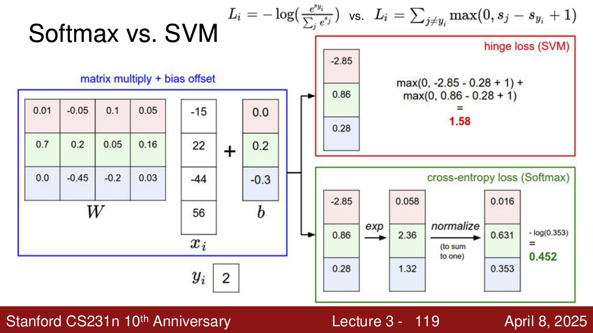

Top of slide: $L_i = -\log\left(\frac{e^{s_{y_i}}}{\sum_j e^{s_j}}\right)$ vs. $L_i = \sum_{j \neq y_i} \max(0, s_j - s_{y_i} + 1)$

Figure: a worked example with a score computation feeding two loss computations.

Left, blue-bordered box "matrix multiply + bias offset": a 3x4 matrix $W$ (rows shaded red/pink, green, blue):
- row 1 (pink): 0.01, -0.05, 0.1, 0.05
- row 2 (green): 0.7, 0.2, 0.05, 0.16
- row 3 (blue): 0.0, -0.45, -0.2, 0.03

multiplied by the column vector $x_i$ = (-15, 22, -44, 56), plus the bias column vector $b$ = (0.0, 0.2, -0.3). Below, $y_i$ with a box containing 2.

Two arrows lead from the score computation to the right, both with the score vector (-2.85, 0.86, 0.28) (rows pink, green, blue):

Top right, red-bordered box "hinge loss (SVM)": the score column -2.85, 0.86, 0.28, then the text
max(0, -2.85 - 0.28 + 1) +
max(0, 0.86 - 0.28 + 1)
=
1.58 (red)

Bottom right, green-bordered box "cross-entropy loss (Softmax)": the score column -2.85, 0.86, 0.28; an arrow labelled "exp" to the column 0.058, 2.36, 1.32; an arrow labelled "normalize (to sum to one)" to the column 0.016, 0.631, 0.353; then "- log(0.353) = 0.452" (0.452 in green).

*[Ed: 0.452 is the base-10 logarithm; the natural logarithm gives about 1.04. Every other value on this slide recomputes exactly. The same slide, with the same value, is lecture 2's slide 101. Transcribed as printed.]*

## Slide 120 — (untitled)

$$f(x, W) = Wx$$

$$L = \frac{1}{N}\sum_{i=1}^{N}\sum_{j \neq y_i} \max\left(0, f(x_i; W)_ j - f(x_i; W)_ {y_i} + 1\right)$$

Q: Suppose that we found a W such that L = 0. Is this W unique? (blue text)

## Slide 121 — (untitled)

Same as slide 120, plus red text under the question:

No! 2W is also has L = 0! (wording as printed)

## Slide 122 — (untitled)

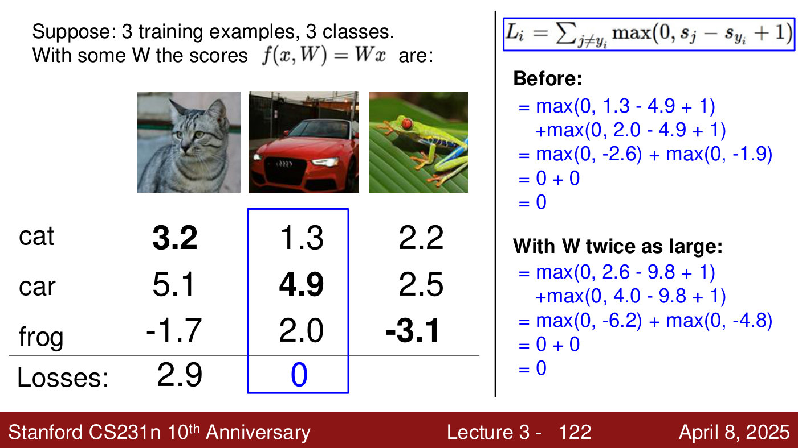

Suppose: 3 training examples, 3 classes. With some W the scores $f(x, W) = Wx$ are:

Top right (blue-bordered box): $L_i = \sum_{j \neq y_i} \max(0, s_j - s_{y_i} + 1)$

Figure and table: three photographs in a row, one above each score column: a grey tabby cat (column 1), a red car (an Audi-style convertible, front view; column 2), and a green tree frog with red eyes on a leaf (column 3). Rows are labelled cat, car, frog. Column 2 (the car image) is outlined in a blue box.

| | image 1 (cat photo) | image 2 (car photo) | image 3 (frog photo) |
| --- | --- | --- | --- |
| cat | 3.2 | 1.3 | 2.2 |
| car | 5.1 | 4.9 | 2.5 |
| frog | -1.7 | 2.0 | -3.1 |
| Losses: | 2.9 | 0 | (blank) |

(The correct-class scores 3.2, 4.9 and -3.1 are printed in bold. The "0" for the car column is printed in blue inside the blue box; the loss entry for column 3 is not printed.)

Right-hand panel (blue text):

Before:
= max(0, 1.3 - 4.9 + 1)
  +max(0, 2.0 - 4.9 + 1)
= max(0, -2.6) + max(0, -1.9)
= 0 + 0
= 0

With W twice as large:
= max(0, 2.6 - 9.8 + 1)
  +max(0, 4.0 - 9.8 + 1)
= max(0, -6.2) + max(0, -4.8)
= 0 + 0
= 0

## Slide 123 — (untitled)

$$f(x, W) = Wx$$

$$L = \frac{1}{N}\sum_{i=1}^{N}\sum_{j \neq y_i} \max\left(0, f(x_i; W)_ j - f(x_i; W)_ {y_i} + 1\right)$$

E.g. Suppose that we found a W such that L = 0. Is this W unique?

No! 2W is also has L = 0! (red)
How do we choose between W and 2W? (red)
