# Lecture 4 — Neural Networks and Backpropagation (slide-by-slide)

Text and figures of all 147 pages of [`lecture_4.pdf`](https://cs231n.stanford.edu/slides/2025/lecture_4.pdf), CS231N (Stanford, Spring 2025), April 10, 2025, presented by Ehsan Adeli (course schedule). Cite these as "slide N" using the **printed** slide number (footer, after "Lecture 4 -"). The running footer ("Stanford CS231n 10th Anniversary", "Lecture 4 - N", "April 10, 2025") is on every page and is not repeated below. Equations are written in LaTeX; figures are described in prose. Values on the computational graphs are given with the colour they are printed in: green for forward values, red for gradients.

## Slide numbers vs PDF pages

Not 1:1. PDF page 1 prints slide 1; PDF page 2 = slide 3 … page 45 = slide 46 (offset +1); page 46 = slide 48 … page 109 = slide 111 (offset +2); page 110 = slide 115 … page 147 = slide 152 (offset +5). Printed numbers 2, 47, 112, 113 and 114 do not exist in the PDF (hidden slides in the source deck); the footer spans either side of each gap sit in the same position and the sequence only increases. PDF page 55 prints no number, because a figure credit sits where the number would be; it is labelled slide 57, the only number between its neighbours 56 and 58. On PDF page 18 (slide 19) a full-page image hides the footer, but the number is in the text layer.

**What the recording covers.** The recording starts on the title slide at 0:05 and moves into the
recap (slides 5–11) at 0:52. The administrative slides 3–4 and the "Today: Deep Learning"
examples (slides 12–21: DALL-E 2, DALL-E 3, GPT-4, Segment Anything, Sora) are never presented or
mentioned, so this file is the only source for them. The recording ends at 1:16:19 with the
summary and the look ahead to convolutional networks (slides 151–152). See the
[transcript](../transcripts/04-neural-networks-backpropagation.md).

**Animation missing from the PDF.** Slide 10 ("Last time: fancy optimizers") shows lecture 3's
loss heat-map with a legend of optimizers (SGD, SGD+Momentum, RMSProp, Adam) but **no paths**: a
check of the page confirmed there are none. It was presumably an animation in the presented deck;
the PDF holds only the background frame.

**Printed slips.** Slide 53 expands the hinge term with a plus sign where a minus belongs, and
slide 143's matrix product y (repeated on slides 144–150) is not the product of the printed x and
w. Both are transcribed as printed, with an `[Ed: …]` line under the slide.

**Images.** 35 slides are rendered as images, each placed under its heading: 13, 14, 15, 16,
17, 18, 19, 20, 21, 26, 30, 33, 34, 41, 42, 43, 46, 48, 49, 54, 55, 56, 57, 74, 80, 96, 100,
104, 105, 116, 130, 137, 142, 150 and 152. The others have none, because they are the title (1),
administrative text (3–4), section dividers and text (5, 12, 22, 58, 59, 120, 151), recaps of
lecture 3 figures already rendered with that lecture (6, 7, 11), an animation frame with no
optimizer paths (10), formulas, code and text transcribed exactly (8, 9, 23, 24, 27, 28, 31, 32,
36–40, 50–53, 115, 117–119, 121–123, 138, 144), build steps whose last step is rendered (25 → 26,
29 → 30, 44–45 → 46, 60–73 → 74, 75–79 → 80, 81–95 → 96, 97–99 → 100, 101–103 → 104, 106–111 →
105, 124–129 and 131 → 130, 132–136 → 137, 139–141 → 142, 143 and 145–149 → 150), or slide 34's
network diagram repeated beside code (35). Never construct an image path for a slide not listed
here.

Companion pages: [wiki page for this lecture](../../wiki/04-neural-networks-backpropagation.md) · [transcript](../transcripts/04-neural-networks-backpropagation.md)

## Contents

| Slides | Section |
| ------ | ------- |
| 1–4 | Title; administrative (project proposal due 4/25, TA expertise; discussion section on backpropagation) |
| 5–11 | Recap: the loss, gradient descent, SGD, last lecture's optimizers and learning-rate schedules |
| 12–21 | "Today: Deep Learning": DALL-E 2, DALL-E 3, GPT-4, Segment Anything, Sora |
| 22–35 | Neural networks: from the linear score function to 2- and 3-layer networks; why non-linearity; hierarchical computation and 100 templates; the activation function and why it matters; activation functions; architectures; a feed-forward pass in code |
| 36–40 | Training a 2-layer network in about 20 lines of numpy |
| 41–42 | Setting the number of layers and their sizes; regularization rather than a smaller network |
| 43–50 | Biological neurons, the artificial neuron, connectivity patterns, and a warning about brain analogies |
| 51–57 | Plugging networks into loss functions; the problem of computing gradients; deriving them on paper (a bad idea); computational graphs; AlexNet, really complex networks, the Neural Turing Machine |
| 58–80 | Backpropagation: the simple example $f(x,y,z) = (x+y)z$; local, upstream and downstream gradients at one node |
| 81–100 | Another example: the sigmoid-of-a-linear-function graph, forward and backward; the sigmoid local gradient |
| 101–104 | Patterns in gradient flow: add, mul, copy and max gates |
| 105–111 | Backprop implementation: "flat" code |
| 115–119 | Modularized implementation: the forward / backward API; PyTorch operators; the PyTorch sigmoid layer |
| 120–123 | Vector derivatives: derivative, gradient, Jacobian |
| 124–138 | Backprop with vectors; the elementwise ReLU example |
| 139–150 | Backprop with matrices (or tensors); the matrix-multiply example |
| 151–152 | Summary; next time: convolutional neural networks |

---

## Slide 1 — Lecture 4: Neural Networks and Backpropagation

Title slide. Text: "Lecture 4: Neural Networks and Backpropagation".

## Slide 3 — Administrative: Project Proposal

Due Fri 4/25

TA expertise is posted on the webpage.

(http://cs231n.stanford.edu/office_hours.html)

## Slide 4 — Administrative: Discussion Section

Discussion section tomorrow

(led by Matthew Jin, With Emily Jin's help):

Backpropagation

## Slide 5 — Recap

Section divider. Text: "Recap".

## Slide 6 — Recap

- We have some dataset of (x,y)
- We have a score function: $s = f(x;W) = Wx$ (labelled "e.g." beside the formula)
- We have a loss function:

Softmax loss, labelled "Softmax":

$$L_i = -\log\left(\frac{e^{s_{y_i}}}{\sum_j e^{s_j}}\right)$$

Full loss, labelled "Full loss":

$$L = \frac{1}{N}\sum_{i=1}^{N} L_i + R(W)$$

SVM/hinge loss, labelled "SVM/hinge Loss (refer to Lecture 2 reading assignment )":

$$L_i = \sum_{j \neq y_i} \begin{cases} 0 & \text{if } s_{y_i} \geq s_j + 1 \cr s_j - s_{y_i} + 1 & \text{otherwise} \end{cases} = \sum_{j \neq y_i} \max(0, s_j - s_{y_i} + 1)$$

Figure (right, middle): a computational-graph diagram of the loss. Inputs at left are a stack of boxes $W$ (top) and stacked boxes $x_i$ and $y_i$ (bottom). A red arrow labelled "score function" goes from $W$ and $x_i$ into a stack of boxes labelled $f(x_i, W)$. A blue arrow labelled "data loss" goes from $f(x_i,W)$ into a box $L$ at the right. A green arrow labelled "regularization loss" goes from $W$ over the top directly into $L$. A blue line from $y_i$ runs along the bottom into $L$ as well.

Figure (bottom right): a hinge-loss plot. The y-axis is labelled "Loss"; the x-axis is labelled $s_{y_i} - s_j$ with the annotation "difference in scores between correct and incorrect class". The blue curve falls linearly from the top left down to the x-axis at a point to the right of the y-axis, then continues flat along the x-axis. A curly brace under the axis between the y-axis and the kink is labelled "1". (The bottom of the plot is partly cut off by the footer.)

## Slide 7 — Finding the best W: Optimize with Gradient Descent

Left figure: a photograph of a mountain landscape (green alpine meadow with trees, snow-capped mountains and clouds) with a cartoon figure of a man in a blue shirt and light-blue trousers walking/running down the slope. It is the "walking down a hill" picture for gradient descent.

Right figure: a loss-surface heat map (colours from red at the centre through yellow, green, cyan and blue to magenta at the edges, on a square with black bars at left and right). A thin black curved path starts near the red centre and curves down toward the lower right (toward the blue/purple region).

Code:

```python
# Vanilla Gradient Descent

while True:
  weights_grad = evaluate_gradient(loss_fun, data, weights)
  weights += - step_size * weights_grad # perform parameter update
```

Credit lines (small print, bottom left): "Landscape image is CC0 1.0 public domain" and "Walking man image is CC0 1.0 public domain" (both with links on "Landscape image", "CC0 1.0", "Walking man image", "CC0 1.0").

## Slide 8 — Gradient descent

$$\frac{df(x)}{dx} = \lim_{h \to 0} \frac{f(x+h) - f(x)}{h}$$

Numerical gradient: slow (frowning face), approximate (frowning face), easy to write (smiling face)

Analytic gradient: fast (smiling face), exact (smiling face), error-prone (frowning face)

In practice: Derive analytic gradient, check your implementation with numerical gradient

## Slide 9 — Stochastic Gradient Descent (SGD)

$$L(W) = \frac{1}{N}\sum_{i=1}^{N} L_i(x_i, y_i, W) + \lambda R(W)$$

$$\nabla_W L(W) = \frac{1}{N}\sum_{i=1}^{N} \nabla_W L_i(x_i, y_i, W) + \lambda \nabla_W R(W)$$

Right-hand text: "Full sum is expensive when N is large!" and "Approximate sum using a minibatch of examples 32 / 64 / 128 / 256".

Code:

```python
# Vanilla Minibatch Gradient Descent

while True:
  data_batch = sample_training_data(data, 256) # sample 256 examples
  weights_grad = evaluate_gradient(loss_fun, data_batch, weights)
  weights += - step_size * weights_grad # perform parameter update
```

## Slide 10 — Last time: fancy optimizers

Figure: a square heat-map loss surface with an elongated diagonal valley (red/orange centre running from lower left to upper right, surrounded by yellow, green, cyan, blue and purple at the corners). No optimizer paths are drawn on the exported page (only the background frame). Legend to the right, four short coloured line segments: black "SGD", blue "SGD+Momentum", red "RMSProp", purple "Adam".

## Slide 11 — Last time: learning rate scheduling

Left figure: a line plot titled "Training Loss". X-axis "Epoch" with ticks 0, 20, 40, 60, 80, 100; y-axis "Loss" with ticks 1.0 to 4.0 in steps of 0.5. One series: a thick noisy blue band with a cyan mean line. The loss starts above 4.0 (off the top of the axis), falls to about 2.2 by epochs 25–30, steps down at epoch 30 to about 1.4, steps down again at epoch 60 to about 1.05 and drifts to about 0.95 by epoch 90, then takes a small step at epoch 90 to about 0.9, flat to epoch 100. Three grey arrows point down at epochs 30, 60 and 90, ending above the curve (at about 2.5, 1.8 and 1.25), and a single label "Reduce learning rate" is printed above and between the first two. The y-axis runs down to about 0.75.

Right text:

Step: Reduce learning rate at a few fixed points. E.g. for ResNets, multiply LR by 0.1 after epochs 30, 60, and 90.

Cosine:

$$\alpha_t = \frac{1}{2}\alpha_0\left(1 + \cos(t\pi/T)\right)$$

Linear:

$$\alpha_t = \alpha_0\left(1 - t/T\right)$$

Inverse sqrt:

$$\alpha_t = \alpha_0/\sqrt{t}$$

Symbol key: $\alpha_0$ : Initial learning rate; $\alpha_t$ : Learning rate at epoch t; $T$ : Total number of epochs

## Slide 12 — Today: Deep Learning

Text: "Today:" and, centred, "Deep Learning".

## Slide 13 — DALL-E 2


Three generated images side by side, each with a caption beneath:

- Left: teddy bears sitting at old computer terminals on the grey surface of the moon, with the moon and black sky behind. Caption: "Teddy bears working on new AI research on the moon in the 1980s."
- Middle: a painting of rabbits in a room with a window; a rabbit in a blue suit stands at a table holding a pointer, with several other rabbits seated around, and a pink rabbit on the table. Caption: "Rabbits attending a college seminar on human anatomy."
- Right: a painting of a blue-teal striped cat with closed eyes in a meditation pose (hand making a mudra) in front of a snowy blue mountain and a glowing halo. Caption: "A wise cat meditating in the Himalayas searching for enlightenment."

Credit: "Image source: Sam Altman, https://openai.com/dall-e-2/, https://twitter.com/sama/status/1511724264629678084"

## Slide 14 — (no title) DALL-E 2 samples and architecture

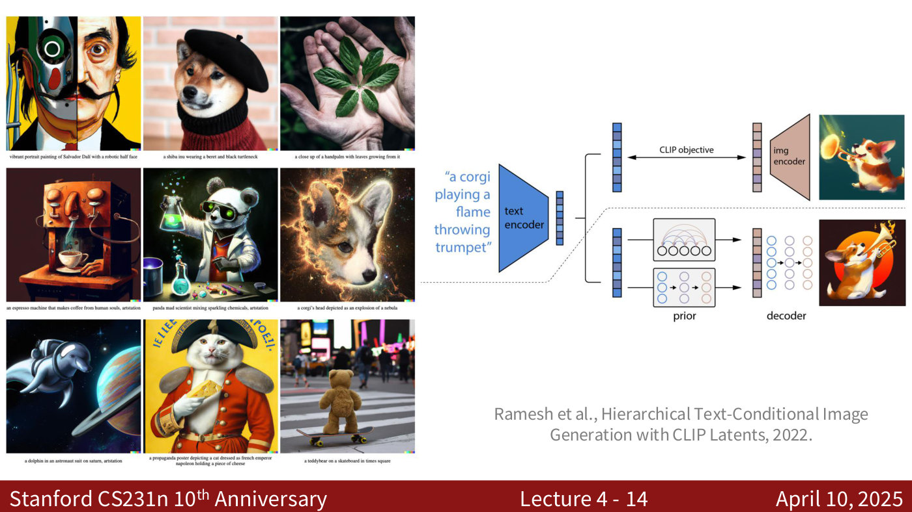

Left: a 3 by 3 grid of generated images, each with a small caption (partly hard to read at slide resolution): a vibrant portrait painting of Salvador Dali with a robotic half face; a shiba inu wearing a beret and black turtleneck; a close-up of a handpalm with leaves growing from it; an espresso machine that makes coffee from human souls, artstation; a panda mad scientist mixing sparkling chemicals, artstation; a corgi's head depicted as an explosion of a nebula; a dolphin in an astronaut suit on saturn, artstation; a propaganda poster depicting a cat dressed as French emperor Napoleon holding a piece of cheese; a teddybear on a skateboard in times square.

Right: an architecture diagram. The prompt "a corgi playing a flame throwing trumpet" (blue text) goes into a blue trapezoid labelled "text encoder", producing a blue column of squares (text embedding). Upper path: that embedding is linked by a double-headed arrow labelled "CLIP objective" to a brown/mauve column of squares (image embedding), which comes from a brown trapezoid labelled "img encoder" that takes in a picture of a corgi playing a trumpet. Lower path (dotted line from the text encoder): the text embedding goes to a "prior" box (shown with a small autoregressive/attention-style graph on top and a diffusion-style network below), producing an image embedding (mauve column), which goes to a "decoder" box (network of circles), producing the output image of a corgi playing a flaming trumpet.

Credit: "Ramesh et al., Hierarchical Text-Conditional Image Generation with CLIP Latents, 2022."

## Slide 15 — DALL-E 3


Left text: "In a fantastical setting, a highly detailed furry humanoid skunk with piercing eyes confidently poses in a medium shot, wearing an animal hide jacket. The artist has masterfully rendered the character in digital art, capturing the intricate details of fur and clothing texture."

Figure: a generated image of an anthropomorphic skunk with black-and-white fur, a large white tail and mane, wearing a black jacket with a fluffy tan fur collar, against a dark grey background.

Credit: "Betker, James, et al. "Improving image generation with better captions." Computer Science. https://cdn.openai.com/papers/dall-e-3.pdf (2023)."

## Slide 16 — DALL-E 3


Left text: "An illustration from a graphic novel. A bustling city street under the shine of a full moon. The sidewalks bustling with pedestrians enjoying the nightlife. At the corner stall, a young woman with fiery red hair, dressed in a signature velvet cloak, is haggling with the grumpy old vendor. The grumpy vendor, a tall, sophisticated man wearing a sharp suit, who sports a noteworthy mustache is animatedly conversing on his steampunk telephone."

Figure: a comic-style illustration of a night city street with a full moon, pedestrians on the sidewalks, a red-haired young woman in a dark red cloak at left facing a vendor at a stall on the right (an older man with a grey moustache, top hat, red bow tie, holding a steampunk telephone, with food on the counter). Four callout captions with leader lines point to parts of the image: "The sidewalks bustling with pedestrians enjoying the nightlife." (to the sidewalk crowd); "A bustling city street under the shine of a full moon." (to the moon); "At the corner stall, a young woman with fiery red hair, dressed in a signature velvet cloak, is haggling with the grumpy old vendor." (to the woman); "The grumpy vendor, a tall, sophisticated man, is wearing a sharp suit, sports a noteworthy moustache and is animatedly conversing on his steampunk telephone." (to the vendor).

Credit: "Betker, James, et al. "Improving image generation with better captions." Computer Science. https://cdn.openai.com/papers/dall-e-3.pdf (2023)."

## Slide 17 — GPT-4

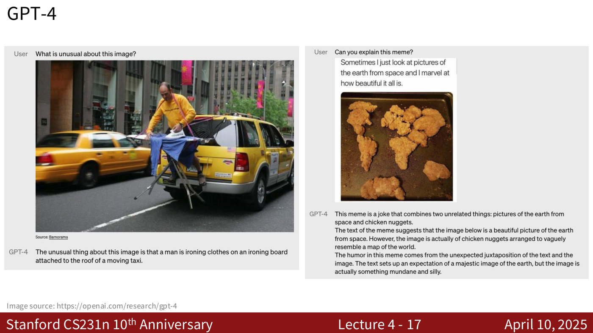

Two screenshots of GPT-4 chat examples.

Left: User: "What is unusual about this image?" The photo shows a man in a yellow shirt standing on an ironing board attached to the back of a yellow SUV taxi, ironing blue clothing, on a city street with another yellow taxi at left (small credit "Source: Barnorama"). GPT-4 answer: "The unusual thing about this image is that a man is ironing clothes on an ironing board attached to the roof of a moving taxi."

Right: User: "Can you explain this meme?" The meme image has the text "Sometimes I just look at pictures of the earth from space and I marvel at how beautiful it all is." above a photo of chicken nuggets on a baking tray arranged roughly like a world map. GPT-4 answer: "This meme is a joke that combines two unrelated things: pictures of the earth from space and chicken nuggets. The text of the meme suggests that the image below is a beautiful picture of the earth from space. However, the image is actually of chicken nuggets arranged to vaguely resemble a map of the world. The humor in this meme comes from the unexpected juxtaposition of the text and the image. The text sets up an expectation of a majestic image of the earth, but the image is actually something mundane and silly."

Credit: "Image source: https://openai.com/research/gpt-4"

## Slide 18 — Segment Anything Model (SAM)

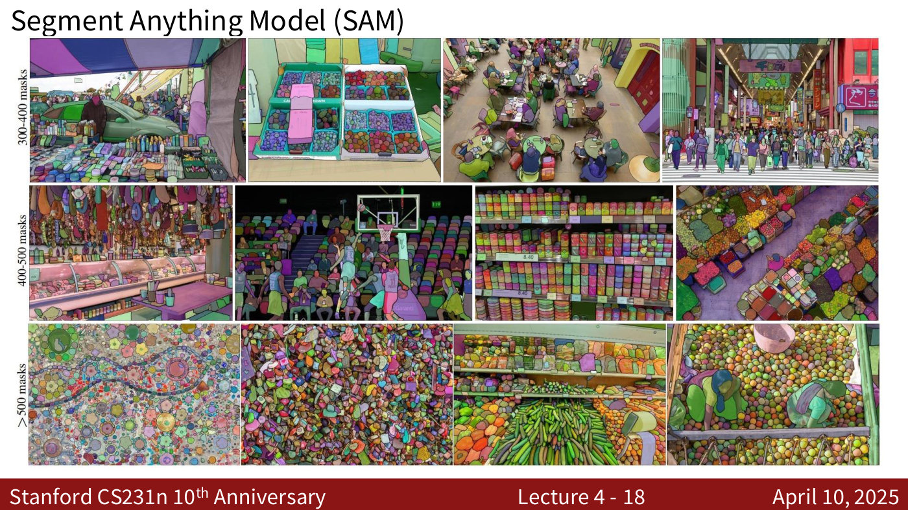

Figure: a 3 by 4 grid of photographs overlaid with coloured segmentation masks (each object region in its own colour). Row labels printed vertically at the left: top row "300-400 masks", middle row "400-500 masks", bottom row ">500 masks". Top row: a market stall with a car and goods; boxes of berries/fruit; an overhead view of café tables with people; a crowded covered shopping street. Middle row: a deli counter with hanging items; a basketball game with a crowd; shelves of jars/cans in a store; a market with fruits and vegetables seen from above. Bottom row: a dense pattern of small round objects; a pile of many small items; a supermarket vegetable display; a heap of round fruits/balls with people. The slide shows that SAM produces masks for scenes ranging from a few hundred to more than 500 segments.

Citation: "Kirillov et al., Segment Anything, 2023"

## Slide 19 — Sora (full-page video frame)


A full-page image covers the whole slide: a frame of a generated video showing a woman in sunglasses, a black leather jacket, a long red dress and black boots, carrying a black handbag, walking down a wet neon-lit Tokyo-style street at night with reflections on the pavement and pedestrians and signs in the background. The page's text layer carries the title "Sora", the footer number 19 and the link https://openai.com/research/video-generation-models-as-world-simulators, but the image is drawn over them, so none of that text is visible on the rendered page.

## Slide 20 — Sora


- Animating Images (generated by DALL-E)
- Video-to-video editing

Top right: two frames of a Shiba Inu dog wearing a black beret and black turtleneck (red sweater collar) against a brick wall, the second frame with the head turned. Caption: "A Shiba Inu dog wearing a beret and black turtleneck."

Bottom: three frames of a red sports car driving on a road, with captions. Left frame: a forest road with pine trees (no caption). Middle: the car on a road with rainbow light streaks, in a rocky setting; caption "put the video in space with a rainbow road". Right: the car on a road among Joshua trees in a desert; caption "change the video setting to be different than a mountain? perhaps joshua tree".

Credit: "https://openai.com/research/video-generation-models-as-world-simulators"

## Slide 21 — Sora

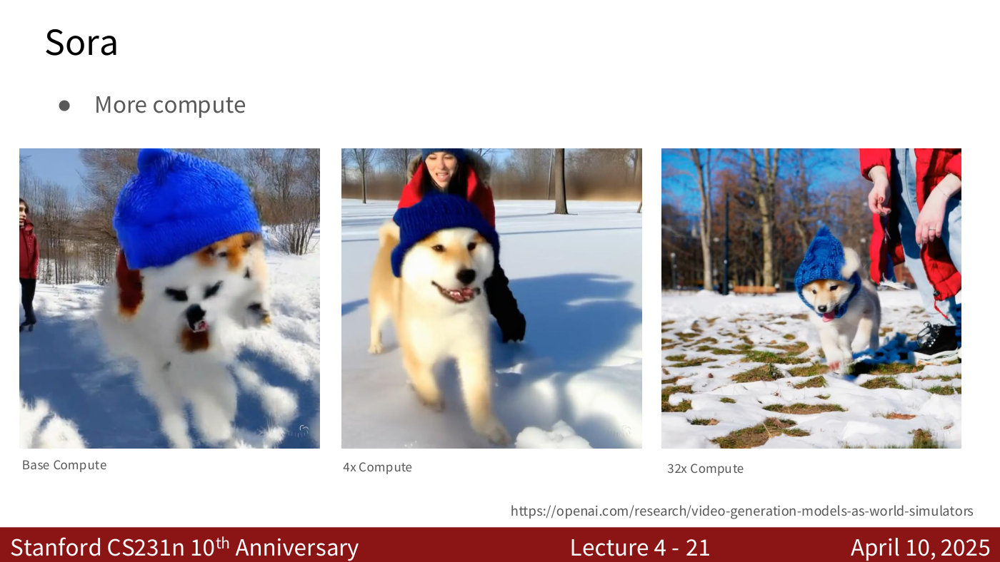

- More compute

Three video frames of a dog in a blue knit hat running in snow with a person in a red coat behind, with captions: left "Base Compute" (a blurry, distorted white and orange dog face with a blue hat), middle "4x Compute" (a clearer Shiba-like dog with a blue hat, a woman behind it), right "32x Compute" (a smaller, sharply rendered puppy in a blue hat running over patchy snow and grass, two people's legs/arms visible).

Credit: "https://openai.com/research/video-generation-models-as-world-simulators"

## Slide 22 — Neural Networks

Section divider. Text: "Neural Networks".

## Slide 23 — Neural networks: the original linear classifier

(Before) Linear score function:

$$f = Wx$$

$$x \in \mathbb{R}^{D},\ W \in \mathbb{R}^{C \times D}$$

## Slide 24 — Neural networks: 2 layers

(Before) Linear score function: $f = Wx$

(Now) 2-layer Neural Network:

$$f = W_2 \max(0, W_1 x)$$

$$x \in \mathbb{R}^{D},\ W_1 \in \mathbb{R}^{H \times D},\ W_2 \in \mathbb{R}^{C \times H}$$

(In practice we will usually add a learnable bias at each layer as well)

## Slide 25 — Why do we want non-linearity?

Figure: a 2-D scatter plot with an x-axis (labelled "x") and y-axis (labelled "y") crossing at the origin. Seven red points are clustered near the origin (just left and right of the y-axis, spanning roughly from slightly below to slightly above the x-axis). Fifteen blue points lie on a ring around the red cluster. The label "x" sits at the lower left of the horizontal axis and "y" at the top right of the vertical axis. Caption: "Cannot separate red and blue points with linear classifier".

## Slide 26 — Why do we want non-linearity?

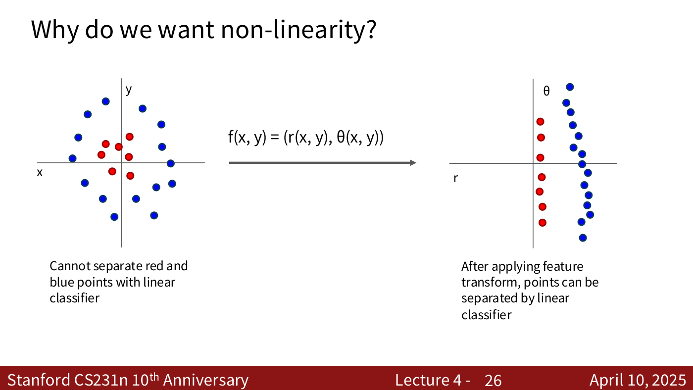

Same left scatter plot as slide 25 (seven red points in the middle, fifteen blue points on a surrounding ring), with caption "Cannot separate red and blue points with linear classifier".

A horizontal arrow points right, labelled "f(x, y) = (r(x, y), θ(x, y))".

Right figure: the same points after the feature transform, plotted with horizontal axis "r" and vertical axis "θ". The seven red points now form a vertical line at small r, just right of the vertical axis; the fifteen blue points form a slightly curved vertical column further right, at larger r. "θ" is printed at the top right of the vertical axis and "r" at the lower left of the horizontal axis. Caption: "After applying feature transform, points can be separated by linear classifier".

## Slide 27 — Neural networks: also called fully connected network

(Before) Linear score function: $f = Wx$

(Now) 2-layer Neural Network: $f = W_2 \max(0, W_1 x)$

$$x \in \mathbb{R}^{D},\ W_1 \in \mathbb{R}^{H \times D},\ W_2 \in \mathbb{R}^{C \times H}$$

"Neural Network" is a very broad term; these are more accurately called "fully-connected networks" or sometimes "multi-layer perceptrons" (MLP)

(In practice we will usually add a learnable bias at each layer as well)

## Slide 28 — Neural networks: 3 layers

(Before) Linear score function: $f = Wx$

(Now) 2-layer Neural Network $f = W_2 \max(0, W_1 x)$ or 3-layer Neural Network:

$$f = W_3 \max(0, W_2 \max(0, W_1 x))$$

$$x \in \mathbb{R}^{D},\ W_1 \in \mathbb{R}^{H_1 \times D},\ W_2 \in \mathbb{R}^{H_2 \times H_1},\ W_3 \in \mathbb{R}^{C \times H_2}$$

(In practice we will usually add a learnable bias at each layer as well)

## Slide 29 — Neural networks: hierarchical computation

(Before) Linear score function: $f = Wx$

(Now) 2-layer Neural Network: $f = W_2 \max(0, W_1 x)$

Figure: a diagram of three grey boxes in a row, drawn as tall rectangles of decreasing height connected by trapezoids. The first, tallest box is labelled "x" with "3072" printed below it; the trapezoid after it is labelled "W1"; the second, medium box is labelled "h" with "100" below it; the trapezoid after it is labelled "W2"; the third, smallest box is labelled "s" with "10" below it.

$$x \in \mathbb{R}^{D},\ W_1 \in \mathbb{R}^{H \times D},\ W_2 \in \mathbb{R}^{C \times H}$$

## Slide 30 — Neural networks: learning 100s of templates

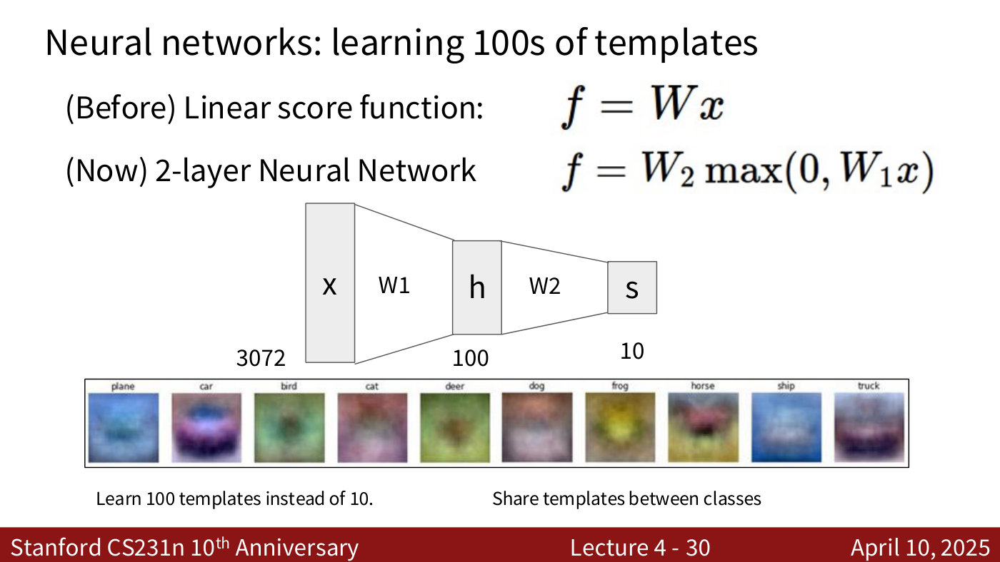

(Before) Linear score function: $f = Wx$

(Now) 2-layer Neural Network: $f = W_2 \max(0, W_1 x)$

Same x (3072) - W1 - h (100) - W2 - s (10) diagram as slide 29.

Below it, a boxed strip of ten small blurry colour images (the learned linear-classifier templates from lecture 2), each with a tiny class label above it, in order: plane (blue), car (blue/purple/pink), bird (green), cat (pinkish), deer (green/brown), dog (grey/pink), frog (yellow/green), horse (brown/red), ship (blue), truck (purple/pink/dark).

Captions under the strip: "Learn 100 templates instead of 10." and "Share templates between classes"

## Slide 31 — Neural networks: why is max operator important?

(Before) Linear score function: $f = Wx$

(Now) 2-layer Neural Network: $f = W_2 \max(0, W_1 x)$, with the term $\max(0, W_1x$ (the "max(0," part) outlined in a blue box.

The function $\max(0, z)$ is called the activation function.

Q: What if we try to build a neural network without one? (printed in red)

$$f = W_2 W_1 x$$

## Slide 32 — Neural networks: why is max operator important?

Same as slide 31 (with the "max(0," portion boxed in blue), with the question now in black text, plus:

$$f = W_2 W_1 x \qquad W_3 = W_2 W_1 \in \mathbb{R}^{C \times H},\ f = W_3 x$$

A: We end up with a linear classifier again!

## Slide 33 — Activation functions

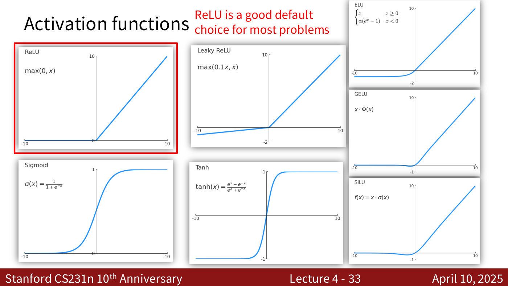

Red text next to the title: "ReLU is a good default choice for most problems". Eight small line plots (each a blue curve, x-axis from -10 to 10), arranged in three columns. The ReLU panel has a red box around it. Each panel title and formula as printed:

- ReLU (red-boxed, top left): $\max(0, x)$. Flat at 0 for negative x, then a straight line rising to 10 at x = 10. Y-axis labelled 10 at top, 0 at bottom.
- Sigmoid (bottom left): $\sigma(x) = \frac{1}{1+e^{-x}}$. S-shaped curve from 0 at left to 1 at right, passing through the middle at the origin. Y-axis labels 1 and 0.
- Leaky ReLU (middle top): $\max(0.1x, x)$. Straight line with a small positive slope for negative x (dipping to about -1 at x = -10; y-axis bottom label -2) and slope 1 for positive x, reaching 10 at x = 10.
- Tanh (middle bottom): $\tanh(x) = \frac{e^{x} - e^{-x}}{e^{x} + e^{-x}}$. S-shaped curve from -1 at left to 1 at right through the origin. Y-axis labels 1 and -1.
- ELU (top right): piecewise definition, $x$ for $x \geq 0$ and $\alpha(e^{x} - 1)$ for $x \lt 0$. Rising straight line with slope 1 for positive x (to 10 at x = 10), and for negative x a curve that flattens out toward a small negative value (y-axis bottom label -2).
- GELU (middle right): $x \cdot \Phi(x)$. Near 0 for negative x with a slight dip below zero just left of the origin, then rising to about 10 at x = 10. Y-axis bottom label -1.
- SiLU (bottom right): $f(x) = x \cdot \sigma(x)$. Near 0 for negative x with a slight dip below zero left of the origin, then rising to about 10 at x = 10. Y-axis bottom label -1.

## Slide 34 — Neural networks: Architectures

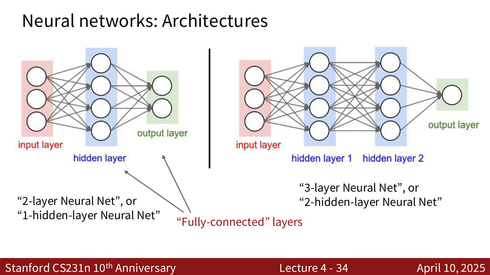

Left diagram: a fully connected network with an input layer (pink column, 3 circles), one hidden layer (blue column, 4 circles) and an output layer (green column, 2 circles). Every circle in a layer is joined by a line to every circle in the next layer. Labels: "input layer", "hidden layer", "output layer". Beneath it, the text ""2-layer Neural Net", or "1-hidden-layer Neural Net"".

Right diagram (separated by a vertical black line): an input layer (3 circles), hidden layer 1 (4 circles), hidden layer 2 (4 circles) and an output layer (1 circle), all fully connected between consecutive layers. Labels: "input layer", "hidden layer 1", "hidden layer 2", "output layer". Beneath it, the text ""3-layer Neural Net", or "2-hidden-layer Neural Net"".

Two grey arrows from the red label ""Fully-connected" layers" point to the left diagram: one to the hidden layer and one to the output layer.

## Slide 35 — Example feed-forward computation of a neural network

Figure: the 3-layer network diagram from slide 34 (input layer of 3 circles, hidden layer 1 of 4 circles, hidden layer 2 of 4 circles, output layer of 1 circle, fully connected).

Code:

```python
# forward-pass of a 3-layer neural network:
f = lambda x: 1.0/(1.0 + np.exp(-x)) # activation function (use sigmoid)
x = np.random.randn(3, 1) # random input vector of three numbers (3x1)
h1 = f(np.dot(W1, x) + b1) # calculate first hidden layer activations (4x1)
h2 = f(np.dot(W2, h1) + b2) # calculate second hidden layer activations (4x1)
out = np.dot(W3, h2) + b3 # output neuron (1x1)
```

## Slide 36 — Full implementation of training a 2-layer Neural Network needs ~20 lines:

Code (line numbers 1 to 20 are printed at the left; blank lines 3, 7, 13, 18 are as shown):

```python
import numpy as np
from numpy.random import randn

N, D_in, H, D_out = 64, 1000, 100, 10
x, y = randn(N, D_in), randn(N, D_out)
w1, w2 = randn(D_in, H), randn(H, D_out)

for t in range(2000):
  h = 1 / (1 + np.exp(-x.dot(w1)))
  y_pred = h.dot(w2)
  loss = np.square(y_pred - y).sum()
  print(t, loss)

  grad_y_pred = 2.0 * (y_pred - y)
  grad_w2 = h.T.dot(grad_y_pred)
  grad_h = grad_y_pred.dot(w2.T)
  grad_w1 = x.T.dot(grad_h * h * (1 - h))

  w1 -= 1e-4 * grad_w1
  w2 -= 1e-4 * grad_w2
```

## Slide 37 — Full implementation of training a 2-layer Neural Network needs ~20 lines:

Same code as slide 36. Lines 4 to 6 (`N, D_in, H, D_out = ...`, `x, y = ...`, `w1, w2 = ...`) are outlined in a red box with a red label to the right: "Define the network".

## Slide 38 — Full implementation of training a 2-layer Neural Network needs ~20 lines:

Same code as slide 36. Label "Define the network" now in black. Lines 8 to 12 (the `for t in range(2000):` loop through `print(t, loss)`) are outlined in a red box with a red label to the right: "Forward pass".

## Slide 39 — Full implementation of training a 2-layer Neural Network needs ~20 lines

Title: "Full implementation of training a 2-layer Neural Network needs ~20 lines:"

Left, a numbered code listing (20 lines, screenshot of an editor):

```python
import numpy as np
from numpy.random import randn

N, D_in, H, D_out = 64, 1000, 100, 10
x, y = randn(N, D_in), randn(N, D_out)
w1, w2 = randn(D_in, H), randn(H, D_out)

for t in range(2000):
  h = 1 / (1 + np.exp(-x.dot(w1)))
  y_pred = h.dot(w2)
  loss = np.square(y_pred - y).sum()
  print(t, loss)

  grad_y_pred = 2.0 * (y_pred - y)
  grad_w2 = h.T.dot(grad_y_pred)
  grad_h = grad_y_pred.dot(w2.T)
  grad_w1 = x.T.dot(grad_h * h * (1 - h))

  w1 -= 1e-4 * grad_w1
  w2 -= 1e-4 * grad_w2
```

Black annotations on the right: "Define the network" (beside lines 4–6), "Forward pass" (beside lines 9–11). A red rectangle outlines lines 14–17, with a red label "Calculate the analytical gradients".

## Slide 40 — Full implementation of training a 2-layer Neural Network needs ~20 lines (gradient descent)

Title: "Full implementation of training a 2-layer Neural Network needs ~20 lines:"

The same 20-line code listing as slide 39 (identical code). Black annotations on the right: "Define the network", "Forward pass", "Calculate the analytical gradients". This time the red rectangle outlines lines 19–20 (`w1 -= 1e-4 * grad_w1` and `w2 -= 1e-4 * grad_w2`) with the red label "Gradient descent".

## Slide 41 — Setting the number of layers and their sizes

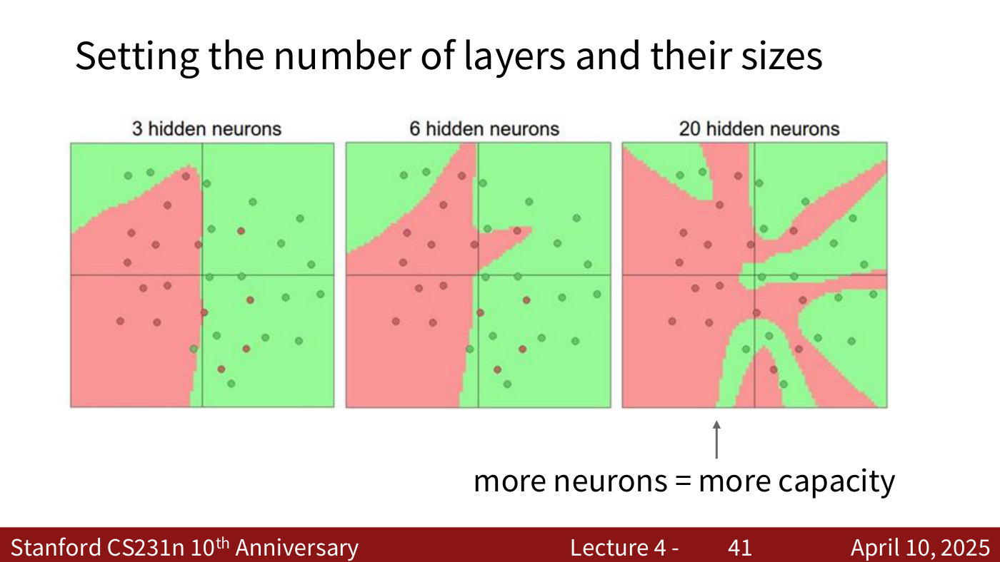

Title: "Setting the number of layers and their sizes"

Three square 2D classification plots side by side, titled "3 hidden neurons", "6 hidden neurons" and "20 hidden neurons". Each has crosshair axes through the centre, a background split into a light red region and a light green region (the decision regions of a trained network), and about 30 small dots (green and red) as data points. Green dots lie mostly in the green regions, red dots in the red regions.
- 3 hidden neurons: a single smooth boundary; the red region is on the left (a roughly vertical band slightly curved at the top) and green on the right, with a large green region also in the upper left, above a sloping red boundary. A few points lie on the wrong side.
- 6 hidden neurons: the red region on the left now has a wedge reaching right at about the middle height and a thin red tongue at the bottom, so the boundary is more curved; green elsewhere, including a large region in the upper left.
- 20 hidden neurons: a highly irregular boundary: red regions with several finger-like branches extending into the green region on the right, and green islands/fingers inside the red region at the bottom, so that nearly every training point is on its own correct side.

A grey arrow points up at the third (20 hidden neurons) plot from the caption text "more neurons = more capacity".

## Slide 42 — Do not use size of neural network as a regularizer

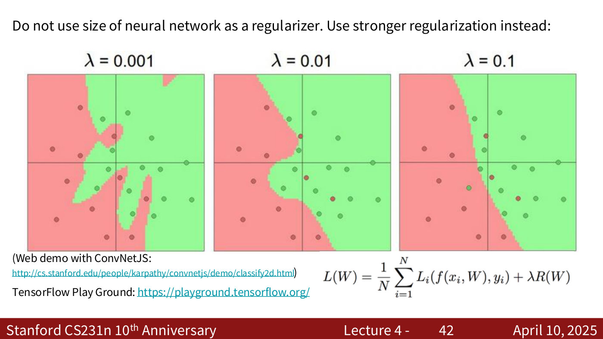

Title: "Do not use size of neural network as a regularizer. Use stronger regularization instead:"

Three square 2D classification plots side by side (same style as slide 41: light red and light green decision regions, crosshair axes, red and green dots), titled $\lambda = 0.001$, $\lambda = 0.01$ and $\lambda = 0.1$.
- $\lambda = 0.001$: very irregular boundary with narrow finger-like green and red protrusions; training points fitted individually.
- $\lambda = 0.01$: a smoother boundary with one large rounded bulge; a few points on the wrong side.
- $\lambda = 0.1$: a nearly straight, smooth diagonal boundary with red on the left and green on the right; several points are misclassified.

Below the plots at the left: "(Web demo with ConvNetJS: http://cs.stanford.edu/people/karpathy/convnetjs/demo/classify2d.html)" and "TensorFlow Play Ground: https://playground.tensorflow.org/" (both hyperlinks). At the bottom right the regularized loss:

$$L(W) = \frac{1}{N}\sum_{i=1}^{N} L_i(f(x_i, W), y_i) + \lambda R(W)$$

## Slide 43 — (no title) neurons photograph

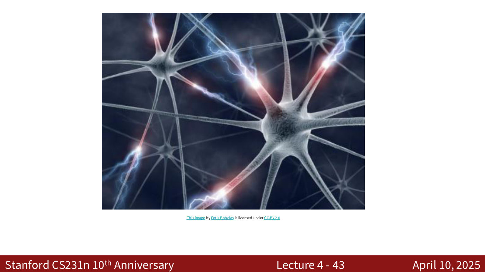

No text. A single picture: a rendered close-up illustration of biological neurons against a dark blue background: several grey-white star-shaped cell bodies with many branching processes crossing the frame, with bright blue and red-orange glowing electrical impulses travelling along some of the fibres. A large neuron sits at centre-right.

Credit under the image: "This image by Fotis Bobolas is licensed under CC-BY 2.0" ("This image" and "Fotis Bobolas" and "CC-BY 2.0" are hyperlinks).

## Slide 44 — (no title) biological neuron diagram

No title. A black-and-white drawing of one neuron, at the left of the slide. Labels: "dendrite" (pointing to one of the thin branching processes at upper left), "cell body" (the dark central blob), "axon" (the long thick fibre running to the right), "presynaptic terminal" (the small branching tips at the right end of the axon). A blue arrow at the top left pointing down toward the cell body is labelled "Impulses carried toward cell body" (blue). A blue arrow under the axon pointing right is labelled "Impulses carried away from cell body" (blue).

Credit under the drawing: "This image by Felipe Perucho is licensed under CC-BY 3.0".

## Slide 45 — (no title) biological neuron and artificial neuron model

The neuron drawing from slide 44, with all its labels and the credit "This image by Felipe Perucho is licensed under CC-BY 3.0", now at the upper left. A black diagonal line runs from the lower left of centre to the upper right, separating it from a diagram of an artificial neuron at the lower right:

- Three inputs come from the left. The top one is a green arrow labelled $x_0$ with the green text "axon from a neuron", entering a red dot labelled $w_0$ with the purple/red label "synapse". From the red dot an orange arrow labelled "dendrite" (and $w_0 x_0$) points down to a big blue circle.
- The second input is a black arrow labelled $w_1 x_1$ into the circle; the third is a black arrow from the lower left labelled $w_2 x_2$ into the circle.
- The blue circle is labelled "cell body" and contains $\sum_i w_i x_i + b$ with a vertical line near the right edge and the letter $f$ (the activation function).
- At the right edge of the circle is a purple dot labelled "activation function" (purple), from which a green arrow runs right labelled "output axon", with the expression $f\left(\sum_i w_i x_i + b\right)$ above it.

## Slide 46 — (no title) sigmoid activation function

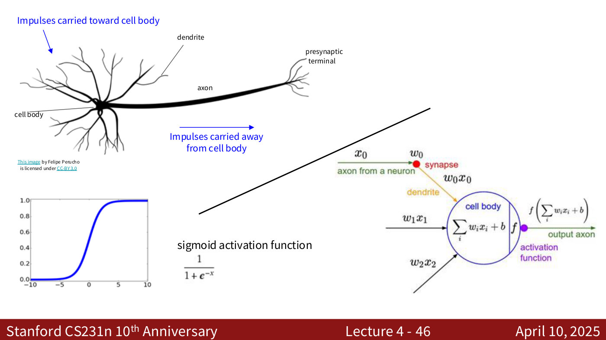

Same slide as slide 45 (biological neuron drawing at upper left, black diagonal line, artificial neuron diagram at the right with $x_0$, $w_0$, $w_0 x_0$, $w_1 x_1$, $w_2 x_2$, $\sum_i w_i x_i + b$, $f$, "synapse", "dendrite", "cell body", "axon from a neuron", "output axon", "activation function", $f\left(\sum_i w_i x_i + b\right)$), with an added plot at the lower left.

The plot: a blue S-shaped curve (one series). The x axis is labelled at -10, -5, 0, 5, 10; the y axis at 0.0, 0.2, 0.4, 0.6, 0.8, 1.0. The curve is near 0.0 for x below about -5, rises through 0.5 at x = 0, and reaches about 1.0 by x of about 5, staying flat at 1.0 to x = 10. Beside it the text "sigmoid activation function" and the formula

$$\frac{1}{1+e^{-x}}$$

## Slide 48 — Biological Neurons: Complex connectivity patterns

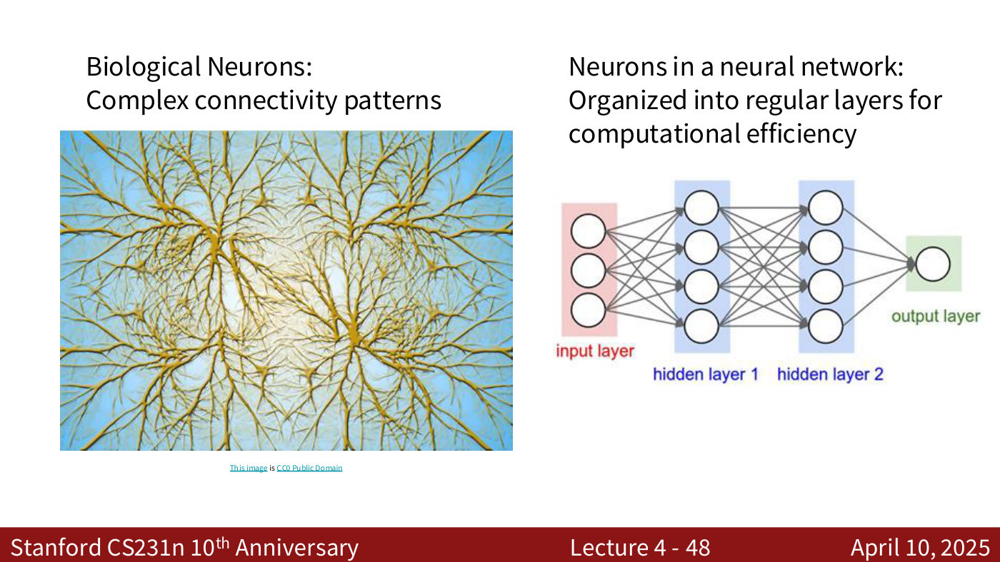

Two columns. Left heading: "Biological Neurons: Complex connectivity patterns", with a picture below: a symmetric golden-yellow illustration of densely branching neurons (tree-like, mirror-symmetric left and right) on a pale blue background. Credit: "This image is CC0 Public Domain".

Right heading: "Neurons in a neural network: Organized into regular layers for computational efficiency", with a diagram of a fully connected network: an input layer (red-shaded box) of 3 circles, hidden layer 1 (blue box) of 4 circles, hidden layer 2 (blue box) of 4 circles and an output layer (green box) of 1 circle. Every circle in one layer is connected by grey lines to every circle in the next layer. Labels beneath: "input layer" (red), "hidden layer 1" (blue), "hidden layer 2" (blue), "output layer" (green).

## Slide 49 — Biological Neurons: Complex connectivity patterns (random connections)

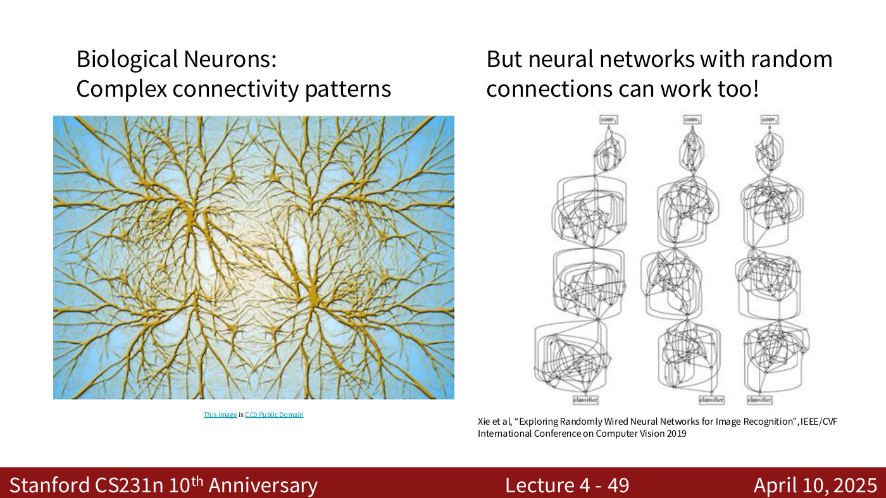

Left: same golden neuron illustration and credit "This image is CC0 Public Domain" as slide 48, with the heading "Biological Neurons: Complex connectivity patterns".

Right heading: "But neural networks with random connections can work too!" Below it a tall diagram showing three side-by-side graphs (columns), each a stack of blocks of densely and irregularly interconnected small nodes, with arrows skipping between and within blocks. Each column starts with a box at the top labelled "conv₁" (small text) and ends with a box at the bottom labelled "classifier". Text is tiny; the three graphs differ in their random wiring.

Citation under it: "Xie et al, “Exploring Randomly Wired Neural Networks for Image Recognition”, IEEE/CVF International Conference on Computer Vision 2019"

## Slide 50 — Be very careful with your brain analogies!

Title: "Be very careful with your brain analogies!"

"Biological Neurons:"
- Many different types
- Dendrites can perform complex non-linear computations
- Synapses are not a single weight but a complex non-linear dynamical system

Citation below: "[Dendritic Computation. London and Hausser]". There is empty space under the bullets (a figure slot with no image in the PDF).

## Slide 51 — Plugging in neural networks with loss functions

Title: "Plugging in neural networks with loss functions"

$$s = f(x; W_1, W_2) = W_2 \max(0, W_1 x)$$ with the blue label "Nonlinear score function"

$$L_i = \sum_{j \neq y_i} \max(0, s_j - s_{y_i} + 1)$$ with the blue label "Hinge Loss on predictions"

$$R(W) = \sum_k W_k^2$$ with the blue label "Regularization"

$$L = \frac{1}{N}\sum_{i=1}^{N} L_i + \lambda R(W_1) + \lambda R(W_2)$$ with the blue label "Total loss: data loss + regularization"

## Slide 52 — Problem: How to compute gradients?

Title: "Problem: How to compute gradients?"

The four equations and four blue labels of slide 51, unchanged ($s = f(x; W_1, W_2) = W_2 \max(0, W_1 x)$ "Nonlinear score function"; $L_i = \sum_{j \neq y_i} \max(0, s_j - s_{y_i} + 1)$ "Hinge Loss on predictions"; $R(W) = \sum_k W_k^2$ "Regularization"; $L = \frac{1}{N}\sum_{i=1}^{N} L_i + \lambda R(W_1) + \lambda R(W_2)$ "Total loss: data loss + regularization"), plus a new line below:

"If we can compute $\frac{\partial L}{\partial W_1}, \frac{\partial L}{\partial W_2}$ then we can learn $W_1$ and $W_2$"

## Slide 53 — (Bad) Idea: Derive ∇_W L on paper

Title: "(Bad) Idea: Derive $\nabla_W L$ on paper"

Left, a chain of equations (as printed):

$$s = f(x; W) = Wx$$

$$L_i = \sum_{j \neq y_i} \max(0, s_j - s_{y_i} + 1)$$

$$= \sum_{j \neq y_i} \max(0, W_{j,:} \cdot x + W_{y_i,:} \cdot x + 1)$$

$$L = \frac{1}{N}\sum_{i=1}^{N} L_i + \lambda \sum_k W_k^2$$

$$= \frac{1}{N}\sum_{i=1}^{N}\sum_{j \neq y_i} \max(0, W_{j,:} \cdot x + W_{y_i,:} \cdot x + 1) + \lambda \sum_k W_k^2$$

$$\nabla_W L = \nabla_W \left( \frac{1}{N}\sum_{i=1}^{N}\sum_{j \neq y_i} \max(0, W_{j,:} \cdot x + W_{y_i,:} \cdot x + 1) + \lambda \sum_k W_k^2 \right)$$

*[Ed: in all three places it expands the hinge term, the slide prints a plus sign between the incorrect-class term and the correct-class term. Substituting the scores into "score of class j minus score of the correct class, plus 1" gives a minus there. Transcribed as printed; the figure audit confirmed the plus in all three occurrences.]*

Red text at right, three problems:
- "Problem: Very tedious: Lots of matrix calculus, need lots of paper"
- "Problem: What if we want to change loss? E.g. use softmax instead of hinge? Need to re-derive everything from scratch!"
- "Problem: Not feasible for very complex models!"

## Slide 54 — Better Idea: Computational graphs + Backpropagation

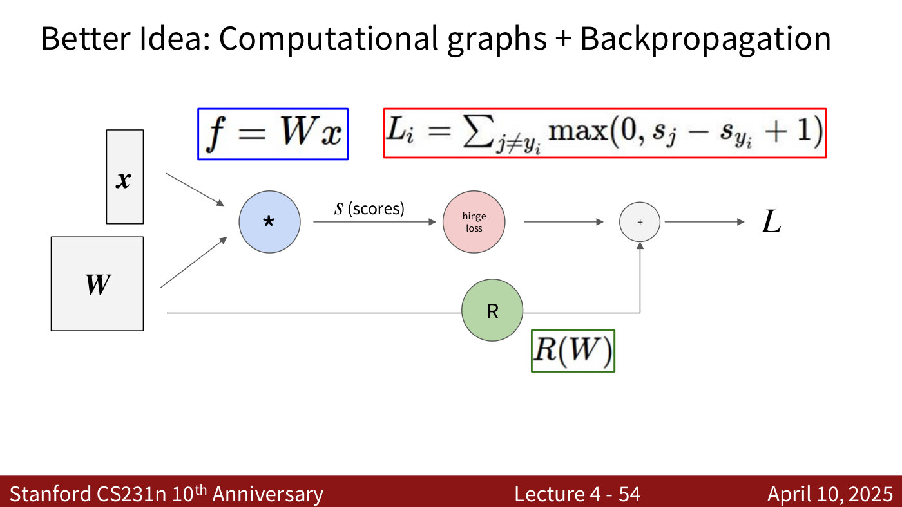

Title: "Better Idea: Computational graphs + Backpropagation"

A computational graph. Two boxed formulas at the top: a blue-bordered box containing $f = Wx$ and a red-bordered box containing $L_i = \sum_{j \neq y_i} \max(0, s_j - s_{y_i} + 1)$. A green-bordered box containing $R(W)$ sits below the lower node.

Nodes and edges: input boxes "x" (small rectangle, upper left) and "W" (larger square, lower left). Arrows from both x and W go to a blue circle labelled "*" . An arrow from "*" labelled "s (scores)" goes to a pink circle labelled "hinge loss". An arrow from "hinge loss" goes to a small grey circle labelled "+". An arrow from "+" goes to the output label "L". A second path: a line from "W" runs right to a green circle labelled "R", and from "R" an arrow goes up to the "+" node. No numeric values are printed.

## Slide 55 — Convolutional network (AlexNet)

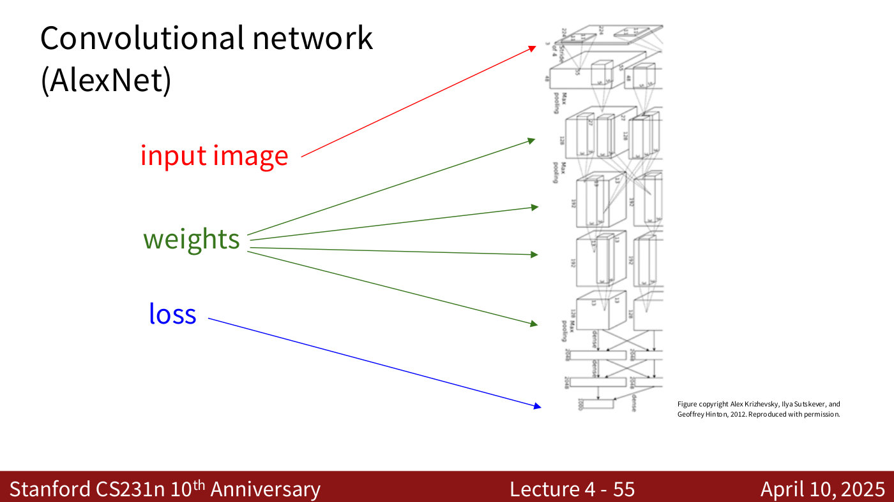

Title: "Convolutional network (AlexNet)"

Left, three coloured labels with arrows: "input image" (red) with a red arrow pointing to the top of the diagram on the right; "weights" (green) with four green arrows pointing to four intermediate blocks of the diagram; "loss" (blue) with a blue arrow pointing to the bottom (final dense layer) of the diagram.

At the right is a cropped, vertical slice of the AlexNet architecture figure: stacks of 3D convolution-feature-map boxes with labelled max-pooling steps ("Max pooling", sizes such as 48, 128, 192, 192, 128, 2048, 2048 in tiny rotated text) and, at the bottom, dense layers. It is cut off on the right side, and most labels are tiny.

Credit: "Figure copyright Alex Krizhevsky, Ilya Sutskever, and Geoffrey Hinton, 2012. Reproduced with permission."

## Slide 56 — Really complex neural networks!!

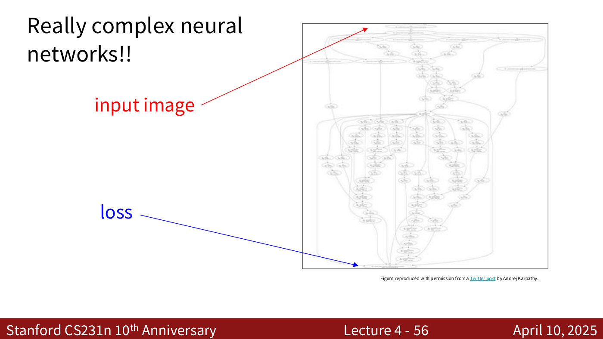

Title: "Really complex neural networks!!"

Left: red label "input image" with a red arrow pointing to the top of the figure at right, and blue label "loss" with a blue arrow pointing to the bottom of the figure. At right, in a thin-bordered rectangle, a very tall, faint grey computational graph: many small ovals/boxes connected by arrows, branching wide at the top (a row of parallel branches), narrowing, then fanning out into a dense mid-section of many parallel chains, and converging into a single chain at the bottom. Node text is too small to read.

Credit: "Figure reproduced with permission from a Twitter post by Andrej Karpathy." (the words "Twitter post" are a hyperlink).

## Slide 57 — Neural Turing Machine

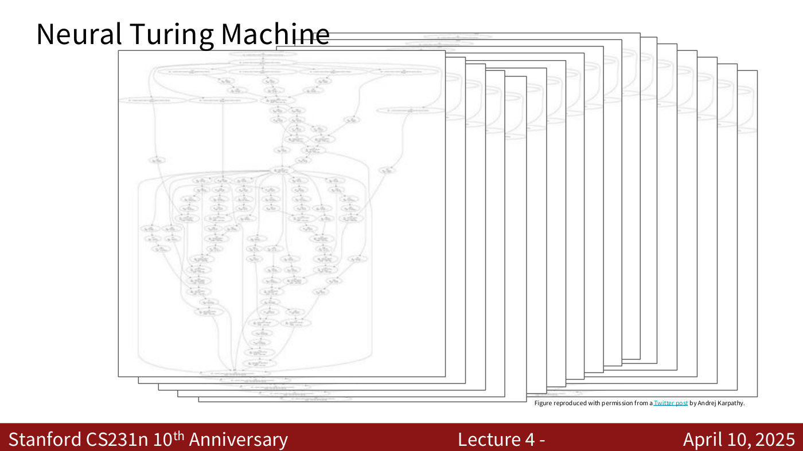

Title: "Neural Turing Machine"

A stack of about a dozen overlapping rectangular frames, cascading to the right and downward like a deck of cards. Each frame holds a very large, faint, grey computational graph (ovals and boxes connected by many arrows, with a wide fan of branches and loops), the same graph as slide 56 but repeated. The graph nodes are too small to read.

Credit at the lower right: "Figure reproduced with permission from a Twitter post by Andrej Karpathy." (the words "Twitter post" are a hyperlink). The footer shows "Lecture 4 -" with no number; the label 57 is inferred from the neighbouring pages (56 and 58).

## Slide 58 — Solution: Backpropagation

Centred section-divider text: "Solution: Backpropagation". Nothing else.

## Slide 59 — Backpropagation: a simple example

Title "Backpropagation: a simple example" and the function:

$$f(x,y,z) = (x+y)z$$

Nothing else (the graph appears on the next slide).

## Slide 60 — Backpropagation: a simple example

$$f(x,y,z) = (x+y)z$$

Graph (boxed at upper right, thin black border): inputs $x$, $y$, $z$ are labelled at the left edge (top to bottom: x, y, z) with horizontal lines running right. The lines for x and y converge on a circle containing "+"; its output line is labelled "q". The q line and the z line converge on a second circle containing "*"; its output line, labelled "f", runs off to the right.

No numbers are printed yet.

## Slide 61 — Backpropagation: a simple example

$$f(x,y,z) = (x+y)z$$

Green text: "e.g. x = -2, y = 5, z = -4"

Graph (boxed at upper right, thin black border): inputs $x$, $y$, $z$ are labelled at the left edge (top to bottom: x, y, z) with horizontal lines running right. The lines for x and y converge on a circle containing "+"; its output line is labelled "q". The q line and the z line converge on a second circle containing "*"; its output line, labelled "f", runs off to the right. Forward values are printed in green next to the labels: x -2, y 5, q 3, z -4, f -12.

## Slide 62 — Backpropagation: a simple example

$$f(x,y,z) = (x+y)z$$

Green text: "e.g. x = -2, y = 5, z = -4"

A red-bordered box containing the local derivatives of the sum node:

$$q = x + y \qquad \frac{\partial q}{\partial x} = 1, \frac{\partial q}{\partial y} = 1$$

The graph is as on slide 61 (Forward values are printed in green next to the labels: x -2, y 5, q 3, z -4, f -12.)

## Slide 63 — Backpropagation: a simple example

$$f(x,y,z) = (x+y)z$$

Green text: "e.g. x = -2, y = 5, z = -4"

Red-bordered box:

$$q = x + y \qquad \frac{\partial q}{\partial x} = 1, \frac{\partial q}{\partial y} = 1$$

Blue-bordered box:

$$f = qz \qquad \frac{\partial f}{\partial q} = z, \frac{\partial f}{\partial z} = q$$

The graph is as on slide 61 (Forward values are printed in green next to the labels: x -2, y 5, q 3, z -4, f -12.)

## Slide 64 — Backpropagation: a simple example

$$f(x,y,z) = (x+y)z$$

Green text: "e.g. x = -2, y = 5, z = -4"

Red-bordered box:

$$q = x + y \qquad \frac{\partial q}{\partial x} = 1, \frac{\partial q}{\partial y} = 1$$

Blue-bordered box:

$$f = qz \qquad \frac{\partial f}{\partial q} = z, \frac{\partial f}{\partial z} = q$$

Black text: "Want:" $\frac{\partial f}{\partial x}, \frac{\partial f}{\partial y}, \frac{\partial f}{\partial z}$

The graph is as on slide 61 (Forward values are printed in green next to the labels: x -2, y 5, q 3, z -4, f -12.)

## Slide 65 — Backpropagation: a simple example

$$f(x,y,z) = (x+y)z$$

Green text: "e.g. x = -2, y = 5, z = -4"

Red-bordered box:

$$q = x + y \qquad \frac{\partial q}{\partial x} = 1, \frac{\partial q}{\partial y} = 1$$

Blue-bordered box:

$$f = qz \qquad \frac{\partial f}{\partial q} = z, \frac{\partial f}{\partial z} = q$$

Black text: "Want:" $\frac{\partial f}{\partial x}, \frac{\partial f}{\partial y}, \frac{\partial f}{\partial z}$

The graph is as on slide 61 (Forward values are printed in green next to the labels: x -2, y 5, q 3, z -4, f -12.) No gradients printed yet. A magenta box below the graph, at the right, contains $\frac{\partial f}{\partial f}$, with a magenta arrow pointing up to the output line f of the graph.

## Slide 66 — Backpropagation: a simple example

$$f(x,y,z) = (x+y)z$$

Green text: "e.g. x = -2, y = 5, z = -4"

Red-bordered box:

$$q = x + y \qquad \frac{\partial q}{\partial x} = 1, \frac{\partial q}{\partial y} = 1$$

Blue-bordered box:

$$f = qz \qquad \frac{\partial f}{\partial q} = z, \frac{\partial f}{\partial z} = q$$

Black text: "Want:" $\frac{\partial f}{\partial x}, \frac{\partial f}{\partial y}, \frac{\partial f}{\partial z}$

The graph is as on slide 61 (Forward values are printed in green next to the labels: x -2, y 5, q 3, z -4, f -12.) Gradients are printed in red under the forward values. New: red "1" under f -12 (at the output line). The magenta box $\frac{\partial f}{\partial f}$ with its arrow to the output line remains.

## Slide 67 — Backpropagation: a simple example

$$f(x,y,z) = (x+y)z$$

Green text: "e.g. x = -2, y = 5, z = -4"

Red-bordered box:

$$q = x + y \qquad \frac{\partial q}{\partial x} = 1, \frac{\partial q}{\partial y} = 1$$

Blue-bordered box:

$$f = qz \qquad \frac{\partial f}{\partial q} = z, \frac{\partial f}{\partial z} = q$$

Black text: "Want:" $\frac{\partial f}{\partial x}, \frac{\partial f}{\partial y}, \frac{\partial f}{\partial z}$

The graph is as on slide 61 (Forward values are printed in green next to the labels: x -2, y 5, q 3, z -4, f -12.) Red "1" under f. The magenta box now contains $\frac{\partial f}{\partial z}$, with a magenta arrow pointing to the z input line, at its left end.

## Slide 68 — Backpropagation: a simple example

$$f(x,y,z) = (x+y)z$$

Green text: "e.g. x = -2, y = 5, z = -4"

Red-bordered box:

$$q = x + y \qquad \frac{\partial q}{\partial x} = 1, \frac{\partial q}{\partial y} = 1$$

Blue-bordered box:

$$f = qz \qquad \frac{\partial f}{\partial q} = z, \frac{\partial f}{\partial z} = q$$

Black text: "Want:" $\frac{\partial f}{\partial x}, \frac{\partial f}{\partial y}, \frac{\partial f}{\partial z}$

The graph is as on slide 61 (Forward values are printed in green next to the labels: x -2, y 5, q 3, z -4, f -12.) Red "1" under f. New: red "3" under z -4. The magenta box $\frac{\partial f}{\partial z}$ with its arrow to the z input remains.

## Slide 69 — Backpropagation: a simple example

$$f(x,y,z) = (x+y)z$$

Green text: "e.g. x = -2, y = 5, z = -4"

Red-bordered box:

$$q = x + y \qquad \frac{\partial q}{\partial x} = 1, \frac{\partial q}{\partial y} = 1$$

Blue-bordered box:

$$f = qz \qquad \frac{\partial f}{\partial q} = z, \frac{\partial f}{\partial z} = q$$

Black text: "Want:" $\frac{\partial f}{\partial x}, \frac{\partial f}{\partial y}, \frac{\partial f}{\partial z}$

The graph is as on slide 61 (Forward values are printed in green next to the labels: x -2, y 5, q 3, z -4, f -12.) Red "1" under f and red "3" under z -4. The magenta box now contains $\frac{\partial f}{\partial q}$, with a magenta arrow pointing to the q line (between the + node and the * node).

## Slide 70 — Backpropagation: a simple example

$$f(x,y,z) = (x+y)z$$

Green text: "e.g. x = -2, y = 5, z = -4"

Red-bordered box:

$$q = x + y \qquad \frac{\partial q}{\partial x} = 1, \frac{\partial q}{\partial y} = 1$$

Blue-bordered box:

$$f = qz \qquad \frac{\partial f}{\partial q} = z, \frac{\partial f}{\partial z} = q$$

Black text: "Want:" $\frac{\partial f}{\partial x}, \frac{\partial f}{\partial y}, \frac{\partial f}{\partial z}$

The graph is as on slide 61 (Forward values are printed in green next to the labels: x -2, y 5, q 3, z -4, f -12.) Red "1" under f, red "3" under z, and new: red "-4" under q 3. The magenta box $\frac{\partial f}{\partial q}$ with its arrow to the q line remains.

## Slide 71 — Backpropagation: a simple example

$$f(x,y,z) = (x+y)z$$

Green text: "e.g. x = -2, y = 5, z = -4"

Red-bordered box:

$$q = x + y \qquad \frac{\partial q}{\partial x} = 1, \frac{\partial q}{\partial y} = 1$$

Blue-bordered box:

$$f = qz \qquad \frac{\partial f}{\partial q} = z, \frac{\partial f}{\partial z} = q$$

Black text: "Want:" $\frac{\partial f}{\partial x}, \frac{\partial f}{\partial y}, \frac{\partial f}{\partial z}$

The graph is as on slide 61 (Forward values are printed in green next to the labels: x -2, y 5, q 3, z -4, f -12.) Red gradients printed: 1 under f, 3 under z, -4 under q. The magenta box now contains $\frac{\partial f}{\partial y}$, with a magenta arrow pointing to the y input line.

A green-bordered box labelled "Chain rule:" (green) contains
$$\frac{\partial f}{\partial y} = \frac{\partial f}{\partial q}\frac{\partial q}{\partial y}$$
Below the box two red labels with red arrows: "Upstream gradient" (arrow to $\frac{\partial f}{\partial q}$) and "Local gradient" (arrow to $\frac{\partial q}{\partial y}$).

## Slide 72 — Backpropagation: a simple example

$$f(x,y,z) = (x+y)z$$

Green text: "e.g. x = -2, y = 5, z = -4"

Red-bordered box:

$$q = x + y \qquad \frac{\partial q}{\partial x} = 1, \frac{\partial q}{\partial y} = 1$$

Blue-bordered box:

$$f = qz \qquad \frac{\partial f}{\partial q} = z, \frac{\partial f}{\partial z} = q$$

Black text: "Want:" $\frac{\partial f}{\partial x}, \frac{\partial f}{\partial y}, \frac{\partial f}{\partial z}$

The graph is as on slide 61 (Forward values are printed in green next to the labels: x -2, y 5, q 3, z -4, f -12.) Red gradients printed: 1 under f, 3 under z, -4 under q, and new: red "-4" under y 5. The magenta box $\frac{\partial f}{\partial y}$ with its arrow to the y input remains.

A green-bordered box labelled "Chain rule:" (green) contains
$$\frac{\partial f}{\partial y} = \frac{\partial f}{\partial q}\frac{\partial q}{\partial y}$$
Below the box two red labels with red arrows: "Upstream gradient" (arrow to $\frac{\partial f}{\partial q}$) and "Local gradient" (arrow to $\frac{\partial q}{\partial y}$).

## Slide 73 — Backpropagation: a simple example

$$f(x,y,z) = (x+y)z$$

Green text: "e.g. x = -2, y = 5, z = -4"

Red-bordered box:

$$q = x + y \qquad \frac{\partial q}{\partial x} = 1, \frac{\partial q}{\partial y} = 1$$

Blue-bordered box:

$$f = qz \qquad \frac{\partial f}{\partial q} = z, \frac{\partial f}{\partial z} = q$$

Black text: "Want:" $\frac{\partial f}{\partial x}, \frac{\partial f}{\partial y}, \frac{\partial f}{\partial z}$

The graph is as on slide 61 (Forward values are printed in green next to the labels: x -2, y 5, q 3, z -4, f -12.) Red gradients printed: 1 under f, 3 under z, -4 under q, -4 under y. The magenta box now contains $\frac{\partial f}{\partial x}$, with a magenta arrow pointing to the x input line.

A green-bordered box labelled "Chain rule:" (green) contains
$$\frac{\partial f}{\partial x} = \frac{\partial f}{\partial q}\frac{\partial q}{\partial x}$$
Below the box two red labels with red arrows: "Upstream gradient" (arrow to $\frac{\partial f}{\partial q}$) and "Local gradient" (arrow to $\frac{\partial q}{\partial x}$).

## Slide 74 — Backpropagation: a simple example

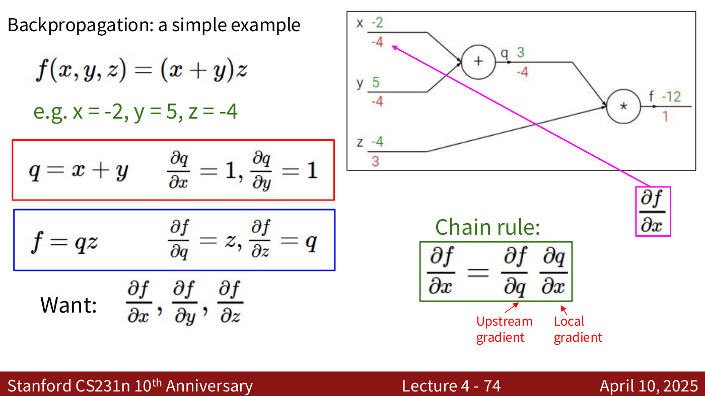

$$f(x,y,z) = (x+y)z$$

Green text: "e.g. x = -2, y = 5, z = -4"

Red-bordered box:

$$q = x + y \qquad \frac{\partial q}{\partial x} = 1, \frac{\partial q}{\partial y} = 1$$

Blue-bordered box:

$$f = qz \qquad \frac{\partial f}{\partial q} = z, \frac{\partial f}{\partial z} = q$$

Black text: "Want:" $\frac{\partial f}{\partial x}, \frac{\partial f}{\partial y}, \frac{\partial f}{\partial z}$

The graph is as on slide 61 (Forward values are printed in green next to the labels: x -2, y 5, q 3, z -4, f -12.) Red gradients printed: 1 under f, 3 under z, -4 under q, -4 under y, and new: red "-4" under x -2. The magenta box $\frac{\partial f}{\partial x}$ with its arrow to the x input remains.

A green-bordered box labelled "Chain rule:" (green) contains
$$\frac{\partial f}{\partial x} = \frac{\partial f}{\partial q}\frac{\partial q}{\partial x}$$
Below the box two red labels with red arrows: "Upstream gradient" (arrow to $\frac{\partial f}{\partial q}$) and "Local gradient" (arrow to $\frac{\partial q}{\partial x}$).

## Slide 75 — (no title) generic node

No title. A single node (large light-grey circle containing the letter "f") with two green arrows entering from the left and one leaving at the right. The upper incoming arrow is labelled $x$ and the lower one $y$ (each in a green-bordered box); the outgoing arrow is labelled $z$ (green-bordered box).

## Slide 76 — (no title) generic node with local gradients

No title. The same node as slide 75 (green arrows $x$ and $y$ in, $z$ out). New: inside the circle, in red-bordered boxes, $\frac{\partial z}{\partial x}$ (near the entering $x$ arrow) and $\frac{\partial z}{\partial y}$ (near the entering $y$ arrow), and the red text "local gradient" above them.

## Slide 77 — Backpropagation at a single node: local and upstream gradients

A single node, drawn as a large light-grey circle labelled "f" in the centre. Two green arrows enter the circle from the left, one from the upper left labelled $x$ (green boxed) and one from the lower left labelled $y$ (green boxed). One green arrow leaves the circle to the right, labelled $z$ (green boxed). Inside the circle, near its left edge, are two red boxed terms: $\frac{\partial z}{\partial x}$ (upper) and $\frac{\partial z}{\partial y}$ (lower), with the red quote-marked label "local gradient" above them. On the right, beside the outgoing green arrow, a red arrow points back into the circle (right to left), labelled with the red boxed $\frac{\partial L}{\partial z}$, and below it the red text "Upstream gradient".

## Slide 78 — Backpropagation at a single node: downstream gradient for x

Same node as slide 77 (circle "f", inputs $x$ and $y$, output $z$, local gradients $\frac{\partial z}{\partial x}$ and $\frac{\partial z}{\partial y}$, upstream gradient $\frac{\partial L}{\partial z}$ on a red arrow into the node from the right). A new red arrow now runs back out of the node along the $x$ input (pointing away from the circle, towards the upper left), labelled with a red boxed

$$\frac{\partial L}{\partial x} = \frac{\partial L}{\partial z}\frac{\partial z}{\partial x}$$

and the red text "Downstream gradients" to its lower left. Nothing is drawn yet on the $y$ input's gradient.

## Slide 79 — Backpropagation at a single node: downstream gradient for y

Same as slide 78, with the second downstream gradient added: a red arrow runs back out along the $y$ input (towards the lower left), labelled with a red boxed

$$\frac{\partial L}{\partial y} = \frac{\partial L}{\partial z}\frac{\partial z}{\partial y}$$

The $x$ line still carries $\frac{\partial L}{\partial x} = \frac{\partial L}{\partial z}\frac{\partial z}{\partial x}$ and the red label "Downstream gradients"; the "local gradient" and "Upstream gradient" labels remain.

## Slide 80 — Backpropagation at a single node, with neighbouring nodes

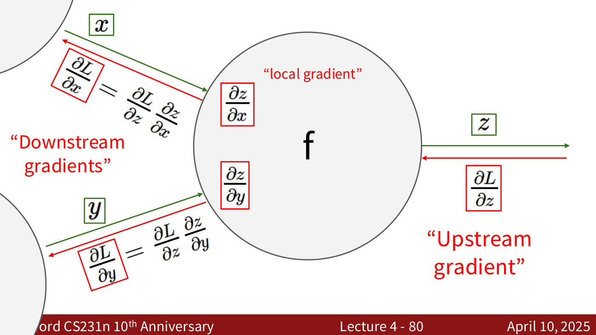

Identical to slide 79, except that two further large grey circles are partly visible at the left edge of the slide: one at the upper left (where the $x$ arrow comes from) and one at the lower left (where the $y$ arrow comes from). They represent the preceding nodes of the graph that produce $x$ and $y$ and receive the downstream gradients. The footer on this page is partly covered by the lower circle (the text "Stanford CS231n 10th Anniversary" is clipped). All labels and equations are as on slide 79.

## Slide 81 — Another example: sigmoid computational graph (empty)

Title: "Another example:" with the formula

$$f(w,x) = \frac{1}{1+e^{-(w_0 x_0 + w_1 x_1 + w_2)}}$$

Below, a computational graph drawn left to right, with no numbers yet. Inputs on the left, top to bottom: $w0$, $x0$, $w1$, $x1$, $w2$. $w0$ and $x0$ both feed a circle labelled "\*" (multiply). $w1$ and $x1$ both feed a second "\*" circle. The outputs of the two "\*" nodes feed a "+" node. The output of that "+" node and $w2$ (a long line from lower left) feed a second "+" node. A chain of single-input nodes follows, joined by arrows: "\*-1", then "exp", then "+1", then "1/x", whose output arrow leaves to the right (the result of the function).

## Slide 82 — Another example: input values

Same graph and formula as slide 81. The forward-pass input values are now printed in green next to each input line: $w0 = 2.00$, $x0 = -1.00$, $w1 = -3.00$, $x1 = -2.00$, $w2 = -3.00$.

## Slide 83 — Another example: forward pass

Same graph. Inputs as on slide 82 (green: $w0$ 2.00, $x0$ -1.00, $w1$ -3.00, $x1$ -2.00, $w2$ -3.00). Forward values now printed in green on the edges leaving each node, left to right: first "\*" (w0, x0) output -2.00; second "\*" (w1, x1) output 6.00; first "+" output 4.00; second "+" (adding w2) output 1.00; "\*-1" output -1.00; "exp" output 0.37; "+1" output 1.37; "1/x" output 0.73 (the final output).

## Slide 84 — Another example: local derivatives of the building blocks

Same graph with the same green forward values as slide 83. Below the graph, a table of four derivative rules in two columns separated by a vertical black bar:

Left column:

$$f(x) = e^{x} \quad\rightarrow\quad \frac{df}{dx} = e^{x}$$

$$f_a(x) = ax \quad\rightarrow\quad \frac{df}{dx} = a$$

Right column:

$$f(x) = \frac{1}{x} \quad\rightarrow\quad \frac{df}{dx} = -1/x^{2}$$

$$f_c(x) = c + x \quad\rightarrow\quad \frac{df}{dx} = 1$$

## Slide 85 — Another example: backward pass, start at the output

Same graph and rules as slide 84. A red rectangle highlights the final "1/x" node (its input 1.37 and output 0.73) and a red rectangle highlights the rule $f(x)=\frac{1}{x} \rightarrow \frac{df}{dx} = -1/x^{2}$. The gradient at the output is printed in red under the output value: $1.00$ (below 0.73).

## Slide 86 — Another example: gradient through 1/x

Same graph. The "1/x" node is highlighted. Red gradients: $1.00$ under the output 0.73, and now $-0.53$ under the input 1.37. Above the graph, an annotated calculation with the labels "Upstream gradient" (arrow to the first factor) and "Local gradient" (arrow to the second factor):

$$(1.00)\left(\frac{-1}{1.37^{2}}\right) = -0.53$$

The rule $f(x) = \frac{1}{x}$ is still highlighted in red.

## Slide 87 — Another example: the +1 node

Same graph. The red highlight moves to the "+1" node (input 0.37, output 1.37 with red gradient -0.53 under 1.37) and to the rule $f_c(x) = c + x \rightarrow \frac{df}{dx} = 1$. Red gradients so far: 1.00 (output), -0.53 (under 1.37). The gradient on the input side of "+1" (under 0.37) is not yet filled in.

## Slide 88 — Another example: gradient through +1

Same graph. Red gradient -0.53 now also appears under 0.37 (the input of "+1"). Annotated calculation, with "Upstream gradient" and "Local gradient" labels:

$$(-0.53)(1) = -0.53$$

The rule $f_c(x) = c + x \rightarrow \frac{df}{dx} = 1$ is highlighted.

## Slide 89 — Another example: the exp node

Same graph. The red highlight moves to the "exp" node (input -1.00, output 0.37 with red -0.53 under it) and to the rule $f(x) = e^{x} \rightarrow \frac{df}{dx} = e^{x}$. The gradient under the input -1.00 is not yet filled in.

## Slide 90 — Another example: gradient through exp

Same graph. Red -0.20 now appears under the input -1.00 of "exp". Annotated calculation, with "Upstream gradient" and "Local gradient" labels:

$$(-0.53)(e^{-1}) = -0.20$$

The rule $f(x) = e^{x}$ is highlighted.

## Slide 91 — Another example: the \*-1 node

Same graph. The red highlight moves to the "\*-1" node (input 1.00, output -1.00 with red -0.20 under it) and to the rule $f_a(x) = ax \rightarrow \frac{df}{dx} = a$. The gradient under the input 1.00 is not yet filled in.

## Slide 92 — Another example: gradient through \*-1

Same graph. Red 0.20 now appears under the input 1.00 of "\*-1". Annotated calculation, with "Upstream gradient" and "Local gradient" labels:

$$(-0.20)(-1) = 0.20$$

The rule $f_a(x) = ax$ is highlighted.

## Slide 93 — Another example: the second + node

Same graph. Red rectangles highlight the second "+" node (inputs 4.00 and the line from $w2$, output 1.00 with red 0.20 under it) and the input $w2 = -3.00$. The red gradients so far are: 1.00, -0.53, -0.53, -0.20, 0.20 (under the "+" output 1.00 and onward). The gradients on the two inputs of this "+" (under 4.00 and under $w2$) are not yet filled in. The four derivative rules are shown unhighlighted.

## Slide 94 — Another example: gradients through an addition

Same graph. Red 0.20 now appears under 4.00 (the first "+" output, an input to the second "+") and under $w2 = -3.00$. Text at upper right:

[upstream gradient] x [local gradient]
[0.2] x [1] = 0.2
[0.2] x [1] = 0.2 (both inputs!)

(the first line in black, the other two in red.) Red rectangles highlight the second "+" and $w2$.

## Slide 95 — Another example: the first + node and the second \*

Same graph. A red rectangle highlights the first "\*" node (inputs $w0 = 2.00$ and $x0 = -1.00$, output -2.00). Red gradients now also printed: 0.20 under -2.00, 0.20 under 6.00 and 0.20 under 4.00 (the gradient of 0.20 passes unchanged through the first "+" to both of its inputs). The gradients at $w0$ and $x0$ are not yet filled in. Red values along the main chain: 0.20 (second + output 1.00), -0.20 (under -1.00), -0.53 (under 0.37), -0.53 (under 1.37), 1.00 (under 0.73); $w2$ has 0.20.

## Slide 96 — Another example: gradients through a multiply

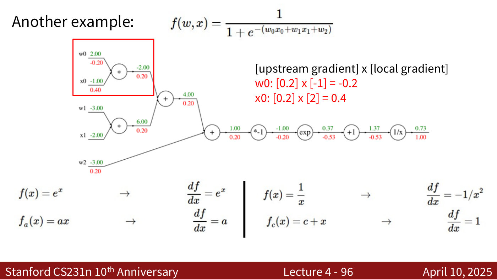

Same title formula, graph and derivative-rules table as slide 84 (the four rules shown unhighlighted at the bottom). A red rectangle encloses the first "\*" node together with its inputs $w0$ and $x0$. Red gradients now at those inputs: $w0$ has -0.20 (under 2.00) and $x0$ has 0.40 (under -1.00). Text at upper right:

[upstream gradient] x [local gradient]
w0: [0.2] x [-1] = -0.2
x0: [0.2] x [2] = 0.4

(first line black, the others red.) The other red gradients are as on slide 95: 0.20 under -2.00, 6.00, 4.00 and 1.00 and at $w2$; -0.20 under -1.00; -0.53 under 0.37 and under 1.37; 1.00 under the output 0.73. The inputs $w1$ ($-3.00$) and $x1$ ($-2.00$) have no gradient printed on this slide (they first appear on slide 105).

## Slide 97 — Another example: the sigmoid sub-graph

Title "Another example:" with the formula $f(w,x) = \frac{1}{1+e^{-(w_0 x_0 + w_1 x_1 + w_2)}}$. The full graph is shown with all forward values (green) and gradients (red). Forward values, green: inputs $w0$ 2.00, $x0$ -1.00, $w1$ -3.00, $x1$ -2.00, $w2$ -3.00; first "\*" output -2.00; second "\*" output 6.00; first "+" output 4.00; second "+" output 1.00; "\*-1" output -1.00; "exp" output 0.37; "+1" output 1.37; "1/x" output 0.73. Gradients, red: $w0$ -0.20, $x0$ 0.40, $w2$ 0.20; -2.00 edge 0.20; 6.00 edge 0.20; 4.00 edge 0.20; 1.00 edge 0.20; -1.00 edge -0.20; 0.37 edge -0.53; 1.37 edge -0.53; output 0.73 edge 1.00. The gradients at $w1$ and $x1$ are not printed on this slide.

A blue rectangle encloses the last four nodes ("\*-1", "exp", "+1", "1/x") with the blue label "Sigmoid". A blue note and boxed formula on the upper right: "Sigmoid function" with

$$\sigma(x) = \frac{1}{1+e^{-x}}$$

A further blue note at the upper right reads: "Computational graph representation may not be unique. Choose one where local gradients at each node can be easily expressed!"

## Slide 98 — Another example: the sigmoid local gradient

Same slide as 97, with an added line at the bottom, "Sigmoid local gradient:" (blue), followed by

$$\frac{d\sigma(x)}{dx} = \frac{e^{-x}}{(1+e^{-x})^{2}} = \left(\frac{1+e^{-x}-1}{1+e^{-x}}\right)\left(\frac{1}{1+e^{-x}}\right) = (1-\sigma(x))\thinspace \sigma(x)$$

## Slide 99 — Another example: using the sigmoid local gradient (in terms of e)

Same as slide 98. Two boxes are added on the graph: a green box around the 1.00 forward value entering the "Sigmoid" block (the input of "\*-1"), and a red box around the output gradient 1.00 (under 0.73). Text below the Sigmoid box:

[upstream gradient] x [local gradient] (the words "upstream gradient" in red)
[1.00] x [(1 - 1/(1+e^-1)) (1/(1+e^-1))] = 0.2

(the "1.00" in red, the two occurrences of "1/(1+e^-1)" in green, the result "0.2" in red; "-1" is printed as a superscript on e). The sigmoid local gradient formula from slide 98 stays at the bottom.

## Slide 100 — Another example: using the sigmoid local gradient (in terms of the output)

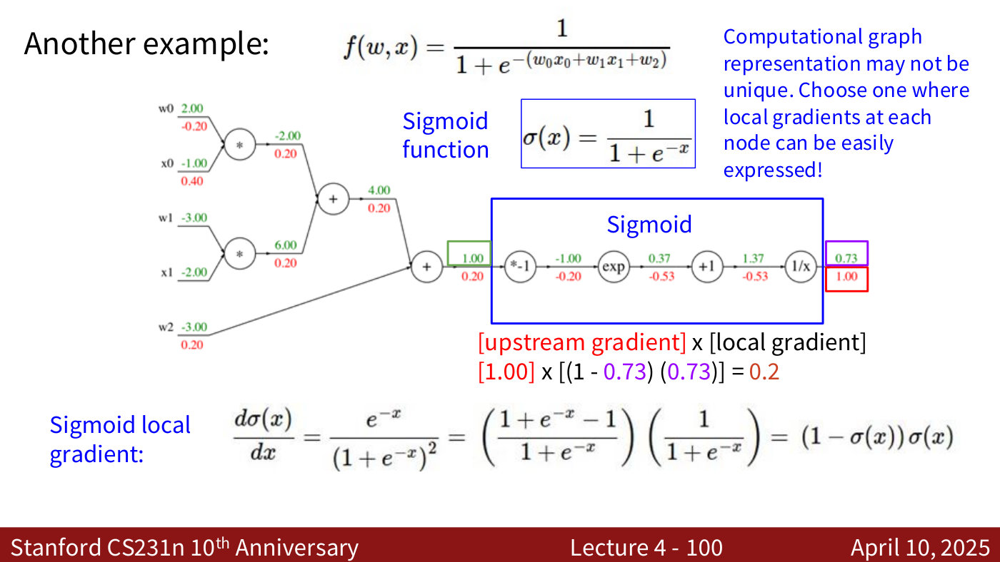

Same as slide 99, with a purple box added around the output value 0.73 and the calculation rewritten using it:

[upstream gradient] x [local gradient] (the words "upstream gradient" in red)
[1.00] x [(1 - 0.73) (0.73)] = 0.2

(the "1.00" in red, both "0.73" in purple, "0.2" in red). The green box around 1.00 and red box around the output gradient 1.00 remain.

## Slide 101 — Patterns in gradient flow: add gate

Title "Patterns in gradient flow". One diagram, labelled "add gate: gradient distributor": a circle "+" with two inputs from the upper left and lower left and one output to the right. Forward values in green and gradients in red: top input 3 (green) with 2 (red) below it; bottom input 4 (green) with 2 (red) below it; output 7 (green) with 2 (red) below it. The gradient 2 arriving at the output is passed unchanged to both inputs.

## Slide 102 — Patterns in gradient flow: mul gate

Same title. The add gate from slide 101 on the left (inputs 3 / 2 and 4 / 2, output 7 / 2). New on the right, labelled "mul gate: "swap multiplier"": a circle "×" with two inputs and one output. Top input 2 (green) with "5\*3=15" (red); bottom input 3 (green) with "2\*5=10" (red); output 6 (green) with 5 (red). Each input's gradient is the output gradient multiplied by the other input's value.

## Slide 103 — Patterns in gradient flow: copy gate

Same title. Add gate (upper left) and mul gate (upper right) as on slide 102. New at lower left, labelled "copy gate: gradient adder": an empty circle with one input from the left and two outputs to the right (upper and lower). Input: 7 (green) with "4+2=6" (red) below it. Upper output: 7 (green) with 4 (red). Lower output: 7 (green) with 2 (red). The input gradient is the sum of the two output gradients. (Printed as "4+2=6"; the arithmetic is correct.)

## Slide 104 — Patterns in gradient flow: max gate

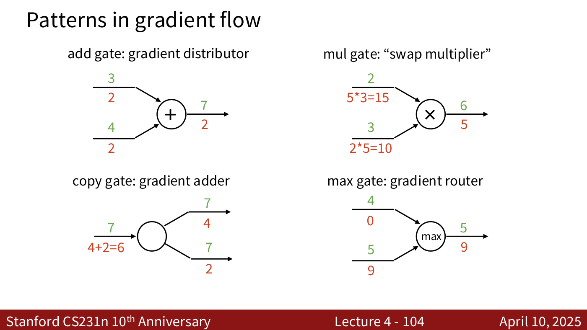

Same title. Add, mul and copy gates as on slide 103. New at lower right, labelled "max gate: gradient router": a circle "max" with two inputs and one output. Top input 4 (green) with 0 (red); bottom input 5 (green) with 9 (red); output 5 (green) with 9 (red). The whole output gradient goes to the input that was larger; the other input gets 0.

## Slide 105 — Backprop Implementation: "Flat" code

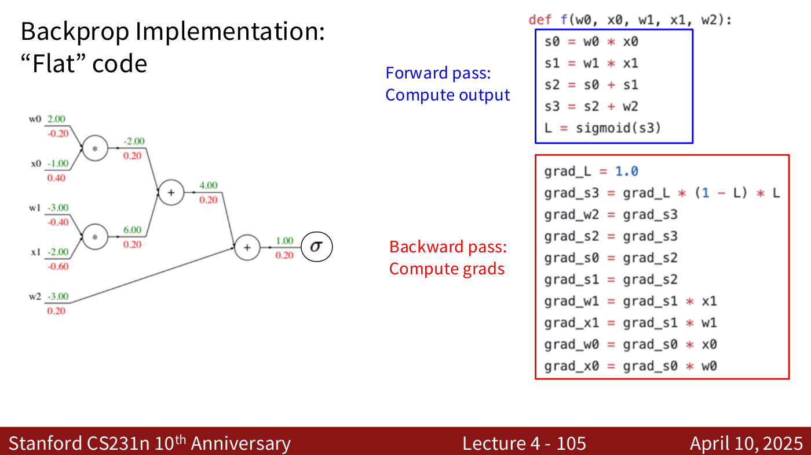

Title: "Backprop Implementation: "Flat" code". Left: a computational graph, with green forward values and red gradients. Inputs: $w0$ 2.00 (red -0.20), $x0$ -1.00 (red 0.40), $w1$ -3.00 (red -0.40), $x1$ -2.00 (red -0.60), $w2$ -3.00 (red 0.20). Nodes: "\*" on ($w0$, $x0$) with output -2.00 (red 0.20); "\*" on ($w1$, $x1$) with output 6.00 (red 0.20); "+" on those two with output 4.00 (red 0.20); "+" on that and $w2$ with output 1.00 (red 0.20); then a circle labelled $\sigma$ (the final sigmoid node, no output value printed).

Right: code. A blue box labelled (blue text) "Forward pass: Compute output" encloses the forward statements; a red box labelled (red text) "Backward pass: Compute grads" encloses the backward statements.

```python
def f(w0, x0, w1, x1, w2):
  s0 = w0 * x0
  s1 = w1 * x1
  s2 = s0 + s1
  s3 = s2 + w2
  L = sigmoid(s3)

  grad_L = 1.0
  grad_s3 = grad_L * (1 - L) * L
  grad_w2 = grad_s3
  grad_s2 = grad_s3
  grad_s0 = grad_s2
  grad_s1 = grad_s2
  grad_w1 = grad_s1 * x1
  grad_x1 = grad_s1 * w1
  grad_w0 = grad_s0 * x0
  grad_x0 = grad_s0 * w0
```

## Slide 106 — Backprop Implementation: base case

Same as slide 105, but only the forward pass keeps its blue box; a red box with the label "Base case" highlights the line `grad_L = 1.0`, and a small empty red box is drawn to the right of the $\sigma$ node on the graph (the output, where the gradient 1.0 starts). The code is as on slide 105.

## Slide 107 — Backprop Implementation: sigmoid

Same as slide 105. The red label "Sigmoid" marks a red box around the forward line `L = sigmoid(s3)` and a red box around the backward line `grad_s3 = grad_L * (1 - L) * L`; on the graph, a red box encloses the 1.00 / 0.20 values and the $\sigma$ node.

## Slide 108 — Backprop Implementation: add gate (s3)

Same as slide 105. The red label "Add gate" marks a red box around the forward line `s3 = s2 + w2` and a red box around the backward lines `grad_w2 = grad_s3` and `grad_s2 = grad_s3`. On the graph, a red outline encloses the second "+" node with its two inputs (the 4.00 / 0.20 edge and the $w2$ -3.00 / 0.20 input).

## Slide 109 — Backprop Implementation: add gate (s2)

Same as slide 105. The red label "Add gate" marks a red box around the forward line `s2 = s0 + s1` and a red box around `grad_s0 = grad_s2` and `grad_s1 = grad_s2`. On the graph, a red box encloses the first "+" node with its two input edges (-2.00 / 0.20 and 6.00 / 0.20) and its output 4.00 / 0.20.

## Slide 110 — Backprop Implementation: multiply gate (s1)

Same as slide 105. The red label "Multiply gate" marks a red box around the forward line `s1 = w1 * x1` and a red box around `grad_w1 = grad_s1 * x1` and `grad_x1 = grad_s1 * w1`. On the graph, a red box encloses $w1$ (-3.00 / -0.40), $x1$ (-2.00 / -0.60) and the "\*" node.

## Slide 111 — Backprop Implementation: multiply gate (s0)

Same as slide 105. The red label "Multiply gate" marks a red box around the forward line `s0 = w0 * x0` and a red box around `grad_w0 = grad_s0 * x0` and `grad_x0 = grad_s0 * w0`. On the graph, a red box encloses $w0$ (2.00 / -0.20), $x0$ (-1.00 / 0.40) and the "\*" node.

## Slide 115 — Modularized implementation: forward / backward API

Title: "Modularized implementation: forward / backward API". Subtitle: "Gate / Node / Function object: Actual PyTorch code". Left: a node circle labelled "\*" with inputs $x$ (upper left) and $y$ (lower left) and output $z$ to the right; caption "(x,y,z are scalars)". Right: a boxed code listing:

```python
class Multiply(torch.autograd.Function):
  @staticmethod
  def forward(ctx, x, y):
    ctx.save_for_backward(x, y)
    z = x * y
    return z
  @staticmethod
  def backward(ctx, grad_z):
    x, y = ctx.saved_tensors
    grad_x = y * grad_z   # dz/dx * dL/dz
    grad_y = x * grad_z   # dz/dy * dL/dz
    return grad_x, grad_y
```

Red annotations to the right: an arrow from "Need to cache some values for use in backward" to the `ctx.save_for_backward(x, y)` line; an arrow from "Upstream gradient" to the `def backward(ctx, grad_z):` line; and "Multiply upstream and local gradients" beside the `grad_x` / `grad_y` lines.

## Slide 116 — Example: PyTorch operators

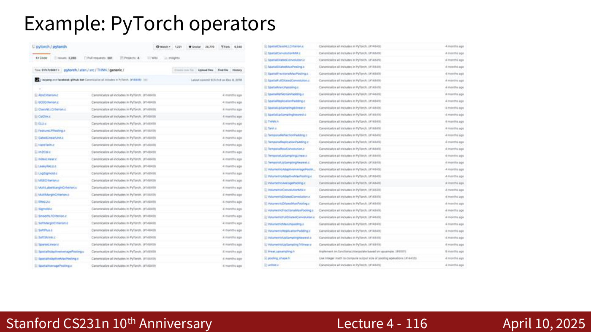

Title: "Example: PyTorch operators". Two side-by-side screenshots of a GitHub file listing in the pytorch/pytorch repository, path `pytorch / aten / src / THNN / generic /` (the page header shows "pytorch / pytorch", Watch 1,221, Unstar 26,770, Fork 6,340, a branch selector and a commit line by "ezyang and facebook-github-bot" with the message "Canonicalize all includes in PyTorch.", latest commit dated Dec 8, 2018). The left screenshot lists C source files in alphabetical order, beginning AbsCriterion.c, BCECriterion.c, ClassNLLCriterion.c, Col2Im.c, ELU.c, FeatureLPPooling.c, GatedLinearUnit.c, HardTanh.c, Im2Col.c, IndexLinear.c, LeakyReLU.c, LogSigmoid.c, MSECriterion.c, MultiLabelMarginCriterion.c, MultiMarginCriterion.c, RReLU.c, Sigmoid.c, SmoothL1Criterion.c, SoftMarginCriterion.c, SoftPlus.c, SoftShrink.c, SparseLinear.c, SpatialAdaptiveAveragePooling.c, and so on. The right screenshot continues the listing (Spatial..., Temporal..., Volumetric... convolution and pooling files, Tanh.c, THNN.h, and others, ending with lines such as linear_upsampling.h, pooling_shape.h and unfold.c). Almost every row's commit message reads "Canonicalize all includes in PyTorch. (#14849)", with the age "4 months ago"; near the end of the right-hand column, linear_upsampling.h reads "Implement nn.functional.interpolate based on upsample. (#…)" (number illegible), "9 months ago", and pooling_shape.h "Use integer math to compute output size of pooling operations (#14405)". The text is small; the file names above are those that could be read, and the later ones in the right-hand column are only partly legible.


## Slide 117 — PyTorch sigmoid layer

A screenshot of a C source file (27 numbered lines, small monospaced text) from PyTorch's THNN library, with a hyperlink "Source" at bottom right (https://github.com/pytorch/pytorch/blob/517c7c98610402e2746586c78987c64c28e024aa/aten/src/THNN/generic/Sigmoid.c). The file reads:

```c
#ifndef TH_GENERIC_FILE
#define TH_GENERIC_FILE "THNN/generic/Sigmoid.c"
#else

void THNN_(Sigmoid_updateOutput)(
          THNNState *state,
          THTensor *input,
          THTensor *output)
{
  THTensor_(sigmoid)(output, input);
}

void THNN_(Sigmoid_updateGradInput)(
          THNNState *state,
          THTensor *gradOutput,
          THTensor *gradInput,
          THTensor *output)
{
  THNN_CHECK_NELEMENT(output, gradOutput);
  THTensor_(resizeAs)(gradInput, output);
  TH_TENSOR_APPLY3(scalar_t, gradInput, scalar_t, gradOutput, scalar_t, output,
    scalar_t z = *output_data;
    *gradInput_data = *gradOutput_data * (1. - z) * z;
  );
}

#endif
```

On this slide, lines 5–11 (the `Sigmoid_updateOutput` function) are outlined in a blue box. To the right is a blue label "Forward" above a blue-outlined box containing the formula

$$\sigma(x) = \frac{1}{1 + e^{-x}}$$

with an arrow from the formula pointing left at the blue-boxed function.

## Slide 118 — PyTorch sigmoid layer

Same as slide 117 (code screenshot with the `Sigmoid_updateOutput` function boxed in blue, the blue "Forward" label and the formula $\sigma(x) = \frac{1}{1 + e^{-x}}$ with an arrow to the boxed function), plus a second, smaller code screenshot at upper right (a C++ `sigmoid_kernel`, from PyTorch's `UnaryOpsKernel.cpp`):

```cpp
static void sigmoid_kernel(TensorIterator& iter) {
  AT_DISPATCH_FLOATING_TYPES(iter.dtype(), "sigmoid_cpu", [&]() {
    unary_kernel_vec(
        iter,
        [=](scalar_t a) -> scalar_t { return (1 / (1 + std::exp((-a)))); },
        [=](Vec256<scalar_t> a) {
          a = Vec256<scalar_t>((scalar_t)(0)) - a;
          a = a.exp();
          a = Vec256<scalar_t>((scalar_t)(1)) + a;
          a = a.reciprocal();
          return a;
        });
  });
}
```

The scalar lambda's `return (1 / (1 + std::exp((-a))));` is outlined in a blue box within the screenshot. Black text beside it reads "Forward actually defined" followed by the hyperlink "elsewhere" (https://github.com/pytorch/pytorch/blob/82b570528db0a43fc04bb90f5d4538c01e4a5582/aten/src/ATen/native/cpu/UnaryOpsKernel.cpp) and "...". Below, a large blue-boxed zoomed copy of the line, in red/monospaced text: `return (1 / (1 + std::exp((-a))));`. "Source" link at bottom right as on slide 117.

## Slide 119 — PyTorch sigmoid layer

Same as slide 118 (both code screenshots, the blue-boxed Forward function and formula, "Forward actually defined elsewhere..." text with link) except that the zoomed blue-boxed `return (1 / (1 + std::exp((-a))));` line is gone and the `Sigmoid_updateGradInput` function (lines 13–25 of the left screenshot) is now outlined in a red box. At lower right is a red label "Backward" above a red-outlined box containing the formula

$$(1 - \sigma(x))\thinspace \sigma(x)$$

with an arrow pointing left at the red-boxed function. (In the code, the backward line is `*gradInput_data = *gradOutput_data * (1. - z) * z;`.)

## Slide 120 — (no title) Backprop with scalars so far; vector-valued functions?

Text-only slide. Text:

"So far: backprop with scalars

What about vector-valued functions?"

## Slide 121 — Recap: Vector derivatives

Heading "Scalar to Scalar" (one column on the left). Formula $x \in \mathbb{R}, y \in \mathbb{R}$. Label "Regular derivative:". Formula

$$\frac{\partial y}{\partial x} \in \mathbb{R}$$

Text: "If x changes by a small amount, how much will y change?"

## Slide 122 — Recap: Vector derivatives

Adds a second column to slide 121. Left column unchanged (Scalar to Scalar). Right column heading "Vector to Scalar", formula $x \in \mathbb{R}^N, y \in \mathbb{R}$, label "Derivative is Gradient:", formula

$$\frac{\partial y}{\partial x} \in \mathbb{R}^N \qquad \left(\frac{\partial y}{\partial x}\right)_ {n} = \frac{\partial y}{\partial x_n}$$

Text: "For each element of x, if it changes by a small amount then how much will y change?"

## Slide 123 — Recap: Vector derivatives

Adds a third column. Columns, left to right:

- "Scalar to Scalar": $x \in \mathbb{R}, y \in \mathbb{R}$; "Regular derivative:"; $\frac{\partial y}{\partial x} \in \mathbb{R}$; "If x changes by a small amount, how much will y change?"
- "Vector to Scalar": $x \in \mathbb{R}^N, y \in \mathbb{R}$; "Derivative is Gradient:"; $\frac{\partial y}{\partial x} \in \mathbb{R}^N$, $\left(\frac{\partial y}{\partial x}\right)_ {n} = \frac{\partial y}{\partial x_n}$; "For each element of x, if it changes by a small amount then how much will y change?"
- "Vector to Vector": $x \in \mathbb{R}^N, y \in \mathbb{R}^M$; "Derivative is Jacobian:"; $\frac{\partial y}{\partial x} \in \mathbb{R}^{N \times M}$, $\left(\frac{\partial y}{\partial x}\right)_ {n,m} = \frac{\partial y_m}{\partial x_n}$; "For each element of x, if it changes by a small amount then how much will each element of y change?"

## Slide 124 — Backprop with Vectors

A single circular node labelled "f". Two green arrows enter it from the left, from inputs x (upper left, in a green-outlined box) and y (lower left, in a green-outlined box). One green arrow leaves it to the right toward z (green-outlined box above the arrow, at right). A blue-outlined box at upper right reads "Loss L still a scalar!".

## Slide 125 — Backprop with Vectors

Same graph as slide 124 (node f, inputs x and y, output z, "Loss L still a scalar!" box). New blue-outlined labels give dimensions: "D_x" beside x, "D_y" beside y, and "D_z" beside z (written $D_x$, $D_y$, $D_z$).

## Slide 126 — Backprop with Vectors

Same as slide 125, plus a red arrow pointing left (backwards) along the output edge from the right toward f, labelled below by a red-outlined box containing $\frac{\partial L}{\partial z}$ and the red text "“Upstream gradient”".

## Slide 127 — Backprop with Vectors

Same as slide 126. The $\frac{\partial L}{\partial z}$ box is now red-outlined inside a blue-outlined box that also contains the blue label "D_z". Below the red "“Upstream gradient”" label, blue text reads: "For each element of z, how much does it influence L?"

## Slide 128 — Backprop with Vectors

Same as slide 127 plus the backward pass through f. Inside the circle f, above and below the "f", are two red-outlined boxes labelled "local gradients" (red text above the circle): $\frac{\partial z}{\partial x}$ and $\frac{\partial z}{\partial y}$. Red arrows point left from f toward x and toward y. Beside the upper red arrow (toward x), in a red box:

$$\frac{\partial L}{\partial x} = \frac{\partial z}{\partial x}\frac{\partial L}{\partial z}$$

and beside the lower red arrow (toward y), in a red box:

$$\frac{\partial L}{\partial y} = \frac{\partial z}{\partial y}\frac{\partial L}{\partial z}$$

Red text at left: "“Downstream gradients”".

## Slide 129 — Backprop with Vectors

Same as slide 128, with blue annotations on the local gradients: next to $\frac{\partial z}{\partial x}$ "[D_x x D_z]" and next to $\frac{\partial z}{\partial y}$ "[D_y x D_z]" (that is $[D_x \times D_z]$ and $[D_y \times D_z]$), and blue text "Jacobian matrices" below them inside the circle. Other labels unchanged.

## Slide 130 — Backprop with Vectors

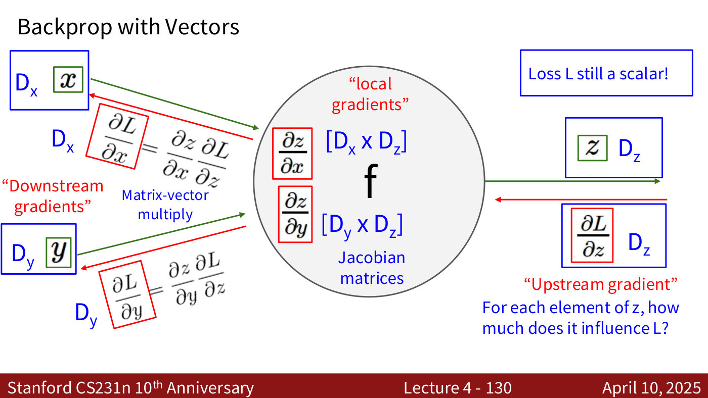

Same as slide 129, plus blue dimension labels "D_x" beside the $\frac{\partial L}{\partial x}$ box and "D_y" beside the $\frac{\partial L}{\partial y}$ box, and blue text "Matrix-vector multiply" under the upper downstream-gradient equation.

## Slide 131 — (no title) Gradients of variables wrt loss have same dims as the original variable

Red heading text: "Gradients of variables wrt loss have same dims as the original variable". Graph: node f, input boxes x (labelled blue "D_x") and y ("D_y") with green arrows into f, output z ("D_z") with green arrow out. Beside x a red-outlined $\frac{\partial L}{\partial x}$ (tilted), blue label "D_x"; beside y a red-outlined $\frac{\partial L}{\partial y}$, blue label "D_y". At the right, the upstream gradient box $\frac{\partial L}{\partial z}$ with "D_z", red "“Upstream gradient”" and blue "For each element of z, how much does it influence L?". "Loss L still a scalar!" box at upper right. The local-gradient boxes and the equations of slide 128 are removed.

## Slide 132 — Backprop with Vectors

Elementwise ReLU example. A grey box reads "f(x) = max(0,x) (elementwise)". Left label "4D input x:" with four green values, one per row, each with an arrow into the box: [ 1 ], [ -2 ], [ 3 ], [ -1 ]. Right label "4D output z:" with four green values with arrows out of the box: [ 1 ], [ 0 ], [ 3 ], [ 0 ].

## Slide 133 — Backprop with Vectors

Same as slide 132, plus below the output a label "4D dL/dz:" with four red values, each with a red arrow pointing left: [ 4 ], [ -1 ], [ 5 ], [ 9 ]. Red text at right: "Upstream gradient".

## Slide 134 — Backprop with Vectors

Same as slide 133, plus at the lower middle a label "Jacobian dz/dx" with a 4x4 matrix. Red arrows point left from the 4D dL/dz column toward the Jacobian, and from the "Upstream gradient" label into the dL/dz column. Entries as printed (black = 1 on the diagonal where the input was positive; grey = 0 elsewhere):

```
[ 1 0 0 0 ]
[ 0 0 0 0 ]
[ 0 0 1 0 ]
[ 0 0 0 0 ]
```

The "1" in row 1 and "1" in row 3 are black; the diagonal "0" in rows 2 and 4 is black too (all four diagonal entries are black), and all off-diagonal zeros are grey.

## Slide 135 — Backprop with Vectors

Same as slide 134, with the label "[dz/dx] [dL/dz]" over two side-by-side blocks: the Jacobian matrix as on slide 134 (rows [1 0 0 0], [0 0 0 0], [0 0 1 0], [0 0 0 0]) followed by the column vector [ 4 ], [ -1 ], [ 5 ], [ 9 ] in black, showing the matrix-vector product. The red 4D dL/dz column with "Upstream gradient" and the red arrows remain at the right.

## Slide 136 — Backprop with Vectors

Same as slide 135, plus on the left a label "4D dL/dx:" with four red values, each with a red arrow pointing left from the product: [ 4 ], [ 0 ], [ 5 ], [ 0 ].

## Slide 137 — Backprop with Vectors

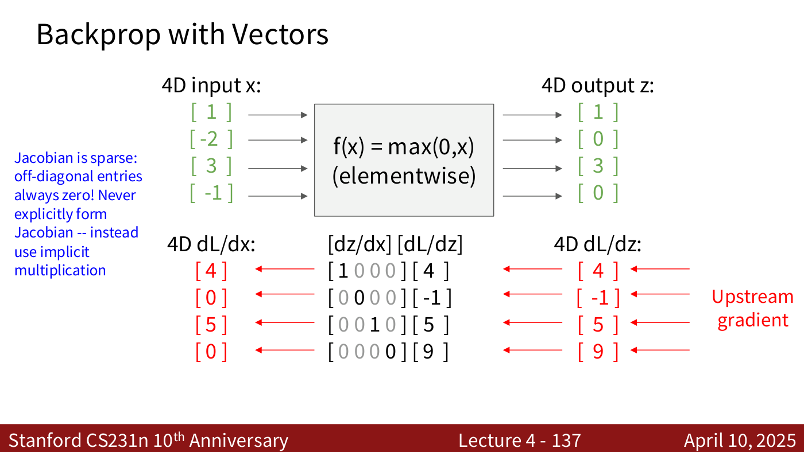

Same as slide 136 (ReLU example with the Jacobian-times-upstream product and results), plus blue text at left: "Jacobian is sparse: off-diagonal entries always zero! Never explicitly form Jacobian -- instead use implicit multiplication".

## Slide 138 — Backprop with Vectors

Same as slide 137 (same input, output, upstream gradient [4, -1, 5, 9] and result dL/dx [4, 0, 5, 0], same blue note), but the matrix-vector product in the middle is replaced by a formula, with short red arrows pointing from it to the dL/dx column and from the dL/dz column to it:

$$\left(\frac{\partial L}{\partial x}\right)_ {i} = \begin{cases} \left(\frac{\partial L}{\partial z}\right)_ {i} & \text{if } x_i > 0 \cr 0 & \text{otherwise} \end{cases}$$

The label "[dz/dx] [dL/dz]" remains above it.

## Slide 139 — Backprop with Matrices (or Tensors)

Same graph as the vector slides: node f with inputs x and y (green arrows in) and output z (green arrow out), now with shapes: x is $[D_x \times M_x]$, y is $[D_y \times M_y]$, z is $[D_z \times M_z]$ (blue). Blue text "Matrix-vector multiply" sits near the arrow from y; blue text "Jacobian matrices" inside the bottom of the circle. Blue-outlined box at top right "Loss L still a scalar!" and blue text under it "dL/dx always has the same shape as x!".

## Slide 140 — Backprop with Matrices (or Tensors)

Same as slide 139, plus red backward arrows and boxes. Upstream: a red arrow pointing left along the output edge and a red-outlined $\frac{\partial L}{\partial z}$ with blue shape $[D_z \times M_z]$, red text "“Upstream gradient”" and blue text "For each element of z, how much does it influence L?". Downstream: red left-pointing arrow toward x with the equation

$$\frac{\partial L}{\partial x} = \frac{\partial z}{\partial x}\frac{\partial L}{\partial z}$$

(the $\frac{\partial L}{\partial x}$ term red-boxed) and shape $[D_x \times M_x]$; red arrow toward y with

$$\frac{\partial L}{\partial y} = \frac{\partial z}{\partial y}\frac{\partial L}{\partial z}$$

and shape $[D_y \times M_y]$. Red text "“Downstream gradients”" at left.

## Slide 141 — Backprop with Matrices (or Tensors)

Same as slide 140, plus inside the circle, red-outlined local-gradient boxes $\frac{\partial z}{\partial x}$ (upper) and $\frac{\partial z}{\partial y}$ (lower) under red text "“local gradients”". New blue text at the bottom: "For each element of y, how much does it influence each element of z?".

## Slide 142 — Backprop with Matrices (or Tensors)

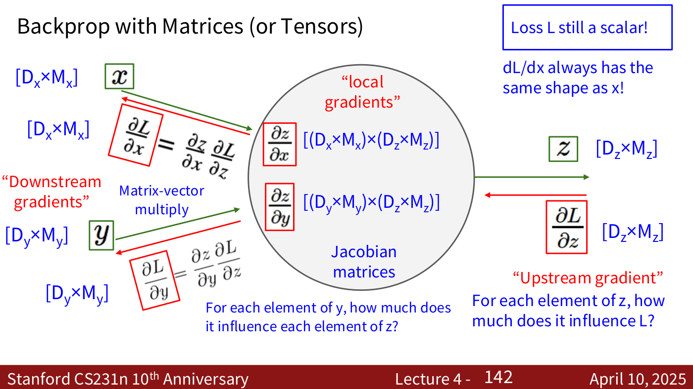

Same as slide 141, plus blue shapes beside the local gradients: $\frac{\partial z}{\partial x}$ is $[(D_x \times M_x) \times (D_z \times M_z)]$ and $\frac{\partial z}{\partial y}$ is $[(D_y \times M_y) \times (D_z \times M_z)]$.

## Slide 143 — Backprop with Matrices

Matrix-multiply example with numbers. A grey box reads "Matrix Multiply" with the formula

$$y_{n,m} = \sum_{d} x_{n,d}\thinspace  w_{d,m}$$

Inputs (green, arrows into the box): "x: [N×D]" =

```
[  2  1 -3 ]
[ -3  4  2 ]
```

and "w: [D×M]" =

```
[ 3  2  1 -1 ]
[ 2  1  3  2 ]
[ 3  2  1 -2 ]
```

Output (green, arrow out): "y: [N×M]" =

```
[ 13  9 -2 -6 ]
[  5  2 17  1 ]
```

Upstream gradient (red, red arrow pointing left into the box): "dL/dy: [N×M]" =

```
[  2  3 -3  9 ]
[ -8  1  4  6 ]
```

Text at bottom: "Also see derivation in the course notes:" with link http://cs231n.stanford.edu/handouts/linear-backprop.pdf.

*[Ed: the printed y is not the product of the printed x and w. Recomputing the product xw from the printed matrices gives y = [[-1, -1, 2, 6], [5, 2, 11, 7]]; only the first two entries of the second row match the printed [5, 2, 17, 1]. Slides 144–150 repeat the same printed y. The slides use the matrices only to point at entries (which row of y one element of x affects, which entry of w links them), and those relations hold whatever the values. Transcribed as printed; the figure audit confirmed the plus in all three occurrences.]*

## Slide 144 — Backprop with Matrices

Same as slide 143 (same x, w, y and dL/dy values), without the course-notes link. Below the box: "Jacobians:", "dy/dx: [(N×D)×(N×M)]", "dy/dw: [(D×M)×(N×M)]". Then: "For a neural net we may have N=64, D=M=4096 / Each Jacobian takes ~256 GB of memory! / Must work with them implicitly!"

*[Ed: with N = 64 and D = M = 4096, each Jacobian has (64 × 4096)² ≈ 6.9 × 10¹⁰ entries; at 4 bytes per entry that is exactly 256 GiB, matching the slide.]*

## Slide 145 — Backprop with Matrices

Same layout and numbers as slide 143. The entry "1" of x (row 1, column 2) is outlined in a blue box. Black text below the box: "Q: What parts of y are affected by one element of x?" No answer yet on this slide.

## Slide 146 — Backprop with Matrices

Same as slide 145. Additionally: the first row of y [13 9 -2 -6] is outlined in blue, and the first row of dL/dy [2 3 -3 9] is outlined in blue. The text continues: "A: $x_{n,d}$ affects the whole row $y_{n,\cdot}$" (the $x_{n,d}$ blue-boxed). Below, the formula

$$\frac{\partial L}{\partial x_{n,d}} = \sum_{m} \frac{\partial L}{\partial y_{n,m}} \frac{\partial y_{n,m}}{\partial x_{n,d}}$$

## Slide 147 — Backprop with Matrices

Same as slide 146, plus the entry -2 in the first row of y (row 1, column 3) is outlined in purple. New text at right: "Q: How much does $x_{n,d}$ affect $y_{n,m}$?" with $x_{n,d}$ in a blue box and $y_{n,m}$ in a purple box. No answer yet.

## Slide 148 — Backprop with Matrices

Same as slide 147, plus the entry 3 in row 2, column 3 of w (row $d$, column $m$) is outlined in orange. Answer: "A: $w_{d,m}$" (orange box). The formula extends to

$$\frac{\partial L}{\partial x_{n,d}} = \sum_{m} \frac{\partial L}{\partial y_{n,m}} \frac{\partial y_{n,m}}{\partial x_{n,d}} = \sum_{m} \frac{\partial L}{\partial y_{n,m}}\thinspace  w_{d,m}$$

At lower right is a small picture titled "mul gate: “swap multiplier”": a multiply node with inputs 2 and 3 (green, upper arrow carries 2, lower carries 3), output 6 (green, top) with 5 (red) beneath it, and red gradients 5*3=15 under the first input and 2*5=10 under the second input (printed "5*3=15" and "2*5=10"). It recalls the multiplication gate from earlier in the lecture.

## Slide 149 — Backprop with Matrices

Same as slide 148 (including the two-line formula), without the mul gate picture. Adds at lower left, above a boxed formula, the shape labels "[N×D] [N×M] [M×D]" and the boxed result

$$\frac{\partial L}{\partial x} = \left(\frac{\partial L}{\partial y}\right) w^{T}$$

## Slide 150 — Backprop with Matrices

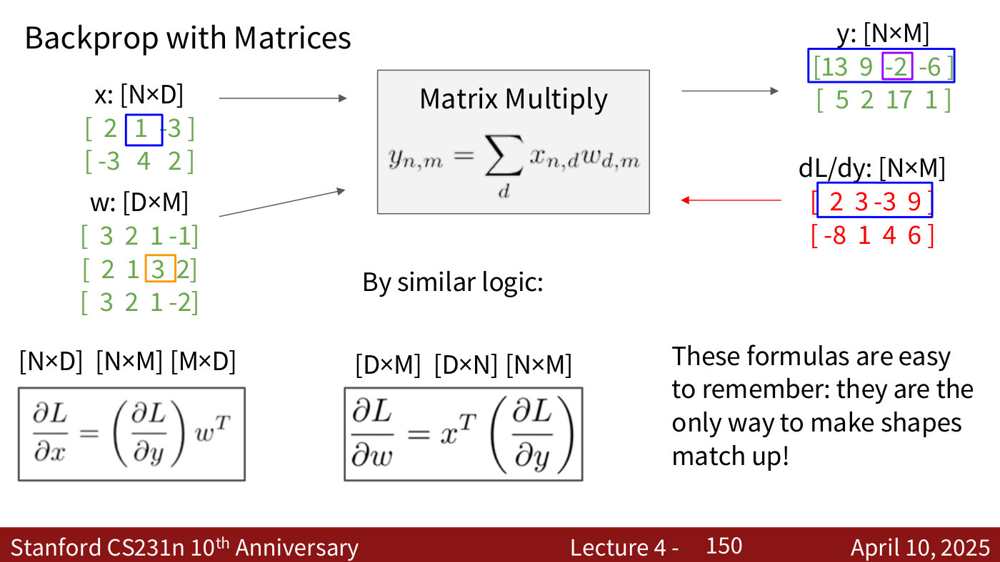

Same numbers and highlights as slide 149. Text "By similar logic:" appears under the matrix box. The left boxed formula from slide 149 (shapes "[N×D] [N×M] [M×D]") remains and a second boxed formula is added with shapes "[D×M] [D×N] [N×M]":

$$\frac{\partial L}{\partial w} = x^{T}\left(\frac{\partial L}{\partial y}\right)$$

Text at right: "These formulas are easy to remember: they are the only way to make shapes match up!"

## Slide 151 — Summary for today:

- (Fully-connected) Neural Networks are stacks of linear functions and nonlinear activation functions; they have much more representational power than linear classifiers
- backpropagation = recursive application of the chain rule along a computational graph to compute the gradients of all inputs/parameters/intermediates
- implementations maintain a graph structure, where the nodes implement the forward() / backward() API
- forward: compute result of an operation and save any intermediates needed for gradient computation in memory
- backward: apply the chain rule to compute the gradient of the loss function with respect to the inputs

## Slide 152 — Next Time: Convolutional Neural Networks!

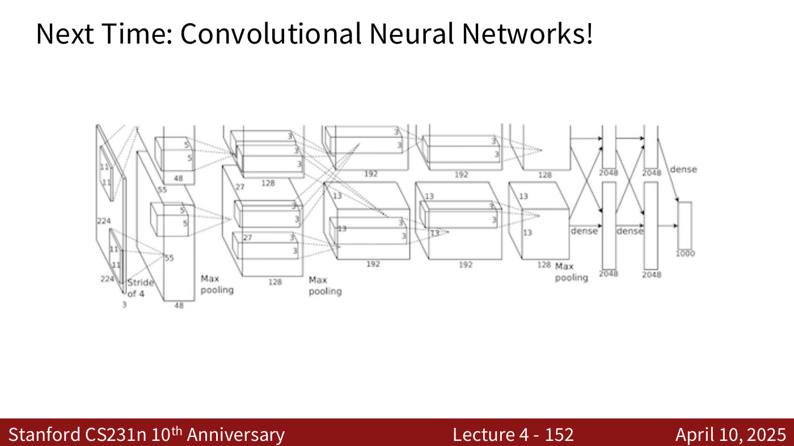

A diagram of a convolutional network: the AlexNet-style architecture figure, cropped at the top (the upper part is cut off). From left to right: a 224 x 224 x 3 input image with 11 x 11 filters ("Stride of 4"), a 55 x 55 x 48 first-layer volume (two parallel tracks, upper and lower), "Max pooling", a 27 x 27 x 128 volume with 5 x 5 filters, "Max pooling", 13 x 13 x 192 volumes with 3 x 3 filters (three conv stages with 192, 192 and 128 channels), "Max pooling", then "dense" layers of 2048, 2048 units (two parallel tracks with crossing connections) and a final "dense" layer of 1000 units. Dashed lines show the connectivity between layers. No credit line is printed.
