# Lecture 5 — Image Classification with CNNs (slide-by-slide)

Text and figures of all 141 pages of [`lecture_5.pdf`](https://cs231n.stanford.edu/slides/2025/lecture_5.pdf), CS231N (Stanford, Spring 2025), April 15, 2025, presented by Justin Johnson (course schedule; he introduces himself in the recording). Cite these as "slide N" using the **printed** slide number (footer, after "Lecture 5 -"). The running footer ("Stanford CS231n 10th Anniversary", "Lecture 5 - N", "April 15, 2025") is on every page and is not repeated below. Equations are written in LaTeX; figures are described in prose.

## Slide numbers vs PDF pages

1:1. Every one of the 141 pages prints its number in the footer, and PDF page N is slide N throughout; there are no hidden slides.

**What the recording covers.** The recording opens at 0:05 on the lecturer's introduction
(slide 4); the administrative slides 2–3 are never presented. It then follows the deck in order
through the summary and the look ahead to CNN architectures (slides 107–108), ending at 1:07:34.
The appendix of "Slides from Previous Years" (slides 109–141: the older convolution and pooling
summaries, 1x1 convolutions, the neuron view of a convolution layer, the ConvNetJS demo, the
deep-learning recipe and the history from the Mark I Perceptron to the Neocognitron) is never
presented, so this file is the only source for it. See the
[transcript](../transcripts/05-image-classification-cnns.md).

**Animation missing from the PDF.** Slide 8 ("Recap: Optimization") shows lecture 3's loss
heat-map with a legend of optimizers (SGD, SGD+Momentum, RMSProp, Adam) but no paths: the PDF
holds only the background frame of what was an animation in lecture 3.

**Printed slips.** Four, each transcribed as printed with an `[Ed: …]` line under the slide:
slide 6's ship score omits the bias (the same slip as lecture 2, slide 60); slide 101's two cube
labels are swapped (64 x 112 x 112 over the larger cube, 64 x 224 x 224 over the smaller);
slide 124 says "Conv layer needs 2 hyperparameters" under the heading "Pooling layer: summary";
and slide 129 prints the softmax loss with minus signs in the exponents.

**Images.** 53 slides are rendered as images, each placed under its heading: 18, 20, 21, 22, 23,
24, 25, 26, 28, 31, 34, 35, 36, 37, 38, 41, 47, 50, 51, 55, 57, 60, 61, 62, 65, 67, 68, 69, 75,
79, 80, 81, 87, 97, 98, 101, 102, 106, 108, 114, 117, 118, 120, 127, 133, 134, 135, 136, 137,
138, 139, 140 and 141. The others have none, because they are the title (1), administrative text
(2–3), the lecturer's career timeline (4), the course outline (5, 15, 16), recaps of lecture 2–4
figures (6, 7, 9–14, 19, 66, 128–131), an animation frame with no optimizer paths (8), section
dividers (42, 109), text, formulas, code and documentation screenshots transcribed exactly (94,
95, 103, 111, 112, 115, 124, 125, 132), the worked example's two unlabelled slabs (88–93), build
steps whose last step is rendered (17 → 18, 27 → 28, 29–30 → 31, 39–40 → 41, 46 → 47, 48–49 →
50, 52–54 → 55, 56 → 57, 58–59 → 60, 63–64 → 65, 71–74 and 76–77 → 75, 78 → 79, 82–83 → 81,
84–86 → 87, 104–105 → 106, 113 → 114), or repeats of a figure rendered elsewhere in the deck (32,
33 → 31; 43–45, 99, 100, 107, 110 → 18; 70 → 65; 96 → 97–98; 116 → 51; 119 → 47; 121 → 101;
122–123 → 102; 126 → 120). Never construct an image path for a slide not listed here.

Companion pages: [wiki page for this lecture](../../wiki/05-image-classification-cnns.md) · [transcript](../transcripts/05-image-classification-cnns.md)

## Contents

| Slides | Section |
| ------ | ------- |
| 1–5 | Title; administrative (Assignment 1 due 4/23; project proposal due 4/25); "Hi I'm Justin"; the course's four parts |
| 6–14 | Recap: linear classifiers (algebraic, visual, geometric), the loss, optimization, what linear classifiers cannot do, 2-layer networks, computational graphs, backprop with vectors and matrices |
| 15–18 | The course's four parts; today: convolution and pooling layers beside the fully connected layer and activation function |
| 19–26 | Image classification on pixels vs. on image features: colour histogram, histogram of oriented gradients, bag of words; feature extraction vs. end-to-end ConvNets |
| 27–32 | The problem with fully connected networks (spatial structure destroyed); the convolutional network: convolution and pooling, then fully connected layers, trained end to end |
| 33–41 | History: LeCun et al. 1998, AlexNet 2012; ~2012–2020: ConvNets dominate (detection, segmentation, captioning, text-to-image, the ConvNetJS demo); 2021–present: transformers |
| 42–47 | Section divider; today's operators; recap of the fully connected layer |
| 48–62 | The convolution layer: filters span the input's depth, one output is a dot product plus bias, sliding to an activation map, several filters and a bias vector, batches, general shapes |
| 63–69 | A ConvNet stacks convolutions with activation functions; what convolution filters learn |
| 70–79 | Spatial dimensions: output size $W - K + 1$, padding, "same" padding |
| 80–83 | Receptive fields |
| 84–87 | Strided convolution and the general output-size formula |
| 88–93 | Worked example: output size, number of parameters, number of multiply-adds |
| 94–98 | Convolution summary and common settings; PyTorch `Conv2d`; 1D and 3D convolution |
| 99–103 | Pooling layers, max pooling, pooling summary |
| 104–106 | Translation equivariance of convolution and pooling |
| 107–108 | Summary; next time: CNN architectures |
| 109–141 | Appendix (slides from previous years): convolution-layer summary and common settings; 1x1 convolutions; PyTorch; the neuron view of a convolution layer; ConvNet activations; pooling and max pooling; summary of architectures; the ConvNetJS CIFAR-10 demo; the deep-learning recipe; a history from the Mark I Perceptron and Adaline to Rumelhart et al., Hinton and Salakhutdinov, the first strong results, Hubel and Wiesel, topographic mapping, hierarchical organization and the Neocognitron |

---

## Slide 1 — Lecture 5: Image Classification with CNNs

Title slide. Text: "Lecture 5: Image Classification with CNNs".

## Slide 2 — Administrative: Assignment 1

Assignment 1 Due **Wednesday 4/23** at 11:59pm

- K-Nearest Neighbor
- Linear classifiers: SVM, Softmax
- Two-layer neural network
- Image features

## Slide 3 — Administrative: Project Proposal

Due Fri 4/25

TA expertise is posted on the webpage.

http://cs231n.stanford.edu/office_hours.html

## Slide 4 — Hi I'm Justin

A timeline figure (no photograph) with a horizontal axis from 2010 to about 2028 (labelled ticks 2010, 2015, 2020, 2025; one tick per year, the last at 2026). Above the axis are coloured bars:

- A dark red bar labelled "Stanford, PhD", spanning roughly late 2012 to mid-2018.
- A blue bar labelled "Facebook AI Research", spanning roughly mid-2018 to the start of 2024.
- A dark navy bar labelled "University of Michigan" (yellow text), spanning roughly mid-2019 to mid-2025.
- A light purple bar labelled "World Labs", spanning roughly early 2024 to mid-2026.

On the axis, small dark red marks at 2015, 2016, 2017, 2018, 2019 and small navy marks at about 2019.7, 2020.6 and 2022.6 mark teaching years. Text under the axis: "I taught CS231N at Stanford from 2015-2018" (under the 2015 mark) and "I taught the same course at Michigan 2019-2022" (under the 2020 mark).

## Slide 5 — CS231n: Deep Learning for Computer Vision

A list of four bullets; the first is in black with an orange right-pointing arrow beside it, the other three are greyed out:

- Deep Learning Basics (Lecture 2 – 4) (highlighted, arrow)
- Perceiving and Understanding the Visual World (Lecture 5 – 12) (grey)
- Generative and Interactive Visual Intelligence (Lecture 13 – 16) (grey)
- Human-Centered Applications and Implications (Lecture 17 – 18) (grey)

## Slide 6 — Recap: Image Classification with Linear Classifier

Top left: a small diagram. A cat image labelled "Image" (caption "Array of 32x32x3 numbers (3072 numbers total)") with an arrow to "f(x,W)" and then an arrow to "10 numbers giving class scores". A red "W" with caption "parameters or weights" has an arrow up into f(x,W). Top right, large: $f(x,W) = Wx + b$.

Three columns, separated by thin vertical lines:

- "Algebraic Viewpoint" with $f(x,W) = Wx$ and a worked-example figure. The figure shows an input image (a 2x2 grid of pixel values 56, 231, 24, 2, labelled "Input image") with an arrow labelled "Stretch pixels into column" to a column vector [56, 231, 24, 2]. The weight matrix W (labelled "W") is 3x4, rows coloured orange (cat), purple (dog), green (ship):
  - Row 1: 0.2, -0.5, 0.1, 2.0
  - Row 2: 1.5, 1.3, 2.1, 0.0
  - Row 3: 0, 0.25, 0.2, -0.3

  Then "+" the bias vector b (labelled "b") = [1.1, 3.2, -1.2], then "=" the scores: Cat score -96.8, Dog score 437.9, Ship score 61.95.
- "Visual Viewpoint" with text "One template per class" and a figure of ten learned template images in two rows of five, titled plane, car, bird, cat, deer (top row) and dog, frog, horse, ship, truck (bottom row); blurry colour blobs (plane and ship bluish, frog yellowish, car with a dark purple shape, etc.).
- "Geometric Viewpoint" with text "Hyperplanes cutting up space" and a figure of a 2D plane with small scattered images and several lines labelled "airplane classifier", "car classifier" and "deer classifier", plus a small 3D rendering of three intersecting coloured planes in the lower left.

*[Ed: printed ship score 61.95; computed 60.75 because 0(56) + 0.25(231) + 0.2(24) + (−0.3)(2) = 57.75 + 4.8 − 0.6 = 61.95 before the bias, and adding b = −1.2 gives 60.75. The printed 61.95 omits the bias term; it is the same slip as lecture 2, slide 60, whose figure this recap reuses. Cat (−97.9 + 1.1 = −96.8) and dog (434.7 + 3.2 = 437.9) check out.]*

## Slide 7 — Recap: Loss Function

- We have some dataset of (x,y)
- We have a score function:
- We have a loss function:

Right of the bullets: $s = f(x;W) = Wx$

Softmax loss, labelled "Softmax" (blue):

$$L_i = -\log\left(\frac{e^{s_{y_i}}}{\sum_j e^{s_j}}\right)$$

Full loss, labelled "Full loss" (blue):

$$L = \frac{1}{N}\sum_{i=1}^{N} L_i + R(W)$$

Figure (right, bottom): a computational-graph diagram of the loss. Inputs at left are a box $W$ (top) and stacked boxes $x_i$ and $y_i$ (bottom). A red arrow labelled "score function" goes from $W$ and $x_i$ into a stack of boxes labelled $f(x_i, W)$. A blue arrow labelled "data loss" goes from $f(x_i,W)$ into a box $L$ at the right. A green arrow labelled "regularization loss" goes from $W$ over the top into $L$. A blue line from $y_i$ runs along the bottom into $L$.

## Slide 8 — Recap: Optimization

A loss-surface heat map (a square, colours from red at the centre through orange, yellow, green and cyan to blue and purple at the corners; the contours are elongated ellipses tilted along the diagonal from lower left to upper right). No optimizer paths are drawn. Legend at right with four coloured line samples:

- black: SGD
- blue: SGD+Momentum
- red: RMSProp
- purple: Adam

## Slide 9 — Problem: Linear Classifiers are not very powerful

Two columns.

- Left, "Visual Viewpoint": the ten class-template images (two rows of five: plane, car, bird, cat, deer; dog, frog, horse, ship, truck). Caption: "Linear classifiers learn one template per class".
- Right, "Geometric Viewpoint": a 2D scatter plot with x and y axes. Red points are clustered near the origin; blue points surround them in a ring. Caption: "Linear classifiers can only draw linear decision boundaries".

## Slide 10 — Last time: Neural Networks

Linear score function: $f = Wx$

2-layer Neural Network: $f = W_2 \max(0, W_1 x)$

Diagram: a tall grey box "x" (labelled 3072 below), a trapezoid labelled "W1" narrowing to a shorter grey box "h" (labelled 100), a trapezoid labelled "W2" narrowing to a small grey box "s" (labelled 10). Below the diagram: a strip of the ten class template images (plane, car, bird, cat, deer, dog, frog, horse, ship, truck).

## Slide 11 — Last time: Computation Graph

Top: a blue-boxed $f = Wx$ and a red-boxed $L_i = \sum_{j \neq y_i} \max(0, s_j - s_{y_i} + 1)$. A green-boxed $R(W)$ lower down.

Graph: a tall box "x" and a square box "W" at left both with arrows into a blue circle "\*". An arrow labelled "s (scores)" goes from "\*" to a pink circle "hinge loss", then an arrow to a small circle "+", then an arrow to "L". From "W" a line runs along the bottom through a green circle "R" and up into the "+" circle.

## Slide 12 — Last time: Backpropagation

A single node, a large grey circle labelled "f", with the title overlapping its upper-left corner. Green arrows (forward) and red arrows (backward):

- Input $x$ (green box) enters f from upper left; a red arrow returns, labelled with the red-boxed $\frac{\partial L}{\partial x} = \frac{\partial L}{\partial z}\frac{\partial z}{\partial x}$.
- Input $y$ (green box) enters f from lower left; a red arrow returns, labelled with the red-boxed $\frac{\partial L}{\partial y} = \frac{\partial L}{\partial z}\frac{\partial z}{\partial y}$.
- Output $z$ (green box) leaves f to the right; a red arrow comes in labelled with red-boxed $\frac{\partial L}{\partial z}$.
- Inside the circle, red-boxed $\frac{\partial z}{\partial x}$ and $\frac{\partial z}{\partial y}$ with the red label "local gradient".
- Red labels: "Downstream gradients" (left), "Upstream gradient" (right).
Partial grey circles at upper-left and lower-left stand for the neighbouring nodes.

## Slide 13 — Backprop with Vectors

Same node diagram as slide 12 (large grey circle "f", green forward arrows, red backward arrows), now with dimensions in blue:

- Top-left blue box: $D_x$ next to green-boxed $x$ (so $x$ has dimension $D_x$); the red-boxed downstream gradient $\frac{\partial L}{\partial x} = \frac{\partial z}{\partial x}\frac{\partial L}{\partial z}$ is labelled $D_x$.
- Lower-left blue box: $D_y$ next to green-boxed $y$; the red-boxed $\frac{\partial L}{\partial y} = \frac{\partial z}{\partial y}\frac{\partial L}{\partial z}$ is labelled $D_y$.
- Inside the circle: red-boxed $\frac{\partial z}{\partial x}$ with $[D_x \times D_z]$ and red-boxed $\frac{\partial z}{\partial y}$ with $[D_y \times D_z]$; red label "“local gradients”" above; blue label "Jacobian matrices" below.
- Right: green-boxed $z$ with $D_z$ in a blue box; red-boxed $\frac{\partial L}{\partial z}$ with $D_z$ in a blue box; red label "“Upstream gradient”"; blue text "For each element of z, how much does it influence L?"
- Left: red label "“Downstream gradients”"; blue label "Matrix-vector multiply".
- Top right blue box: "Loss L still a scalar!"

## Slide 14 — Backprop with Matrices (or Tensors)

Same diagram with matrix shapes in blue:

- $x$ is $[D_x \times M_x]$; the downstream gradient $\frac{\partial L}{\partial x} = \frac{\partial z}{\partial x}\frac{\partial L}{\partial z}$ is $[D_x \times M_x]$.
- $y$ is $[D_y \times M_y]$; the downstream gradient $\frac{\partial L}{\partial y} = \frac{\partial z}{\partial y}\frac{\partial L}{\partial z}$ is $[D_y \times M_y]$.
- Local gradients inside the circle: $\frac{\partial z}{\partial x}$ is $[(D_x \times M_x) \times (D_z \times M_z)]$ and $\frac{\partial z}{\partial y}$ is $[(D_y \times M_y) \times (D_z \times M_z)]$; red label "“local gradients”"; blue label "Jacobian matrices".
- $z$ is $[D_z \times M_z]$; upstream gradient $\frac{\partial L}{\partial z}$ is $[D_z \times M_z]$; red label "“Upstream gradient”".
- Blue text: "For each element of y, how much does it influence each element of z?" (below the circle) and "For each element of z, how much does it influence L?" (right).
- Left: red "“Downstream gradients”", blue "Matrix-vector multiply".
- Top right: blue box "Loss L still a scalar!" and below it "dL/dx always has the same shape as x!"

## Slide 15 — CS231n: Deep Learning for Computer Vision

As slide 5: the four-item outline with the arrow on the first item, "Deep Learning Basics (Lecture 2 – 4)" in black, the other three greyed out.

## Slide 16 — CS231n: Deep Learning for Computer Vision

As slide 5, but the orange arrow and black text are now on the second item, "Perceiving and Understanding the Visual World (Lecture 5 – 12)"; the first item "Deep Learning Basics (Lecture 2 – 4)" is black without arrow, and "Generative and Interactive Visual Intelligence (Lecture 13 – 16)" and "Human-Centered Applications and Implications (Lecture 17 – 18)" are greyed out.

## Slide 17 — Today: Convolutional Networks

Two column headings: "Fully-Connected Layer" and "Activation Function". Row label at left: "We have already seen these".

- Under "Fully-Connected Layer": the x → h → s diagram (a tall grey box "x", a trapezoid, a medium grey box "h", a trapezoid, a small grey box "s"; no sizes printed).
- Under "Activation Function": a ReLU plot, axes from −10 to 10 on both x and y (tick labels "−10", "0", "10" on x and "10" on y); a blue line flat at 0 for negative x, then rising linearly with slope 1 for x > 0.

## Slide 18 — Today: Convolutional Networks

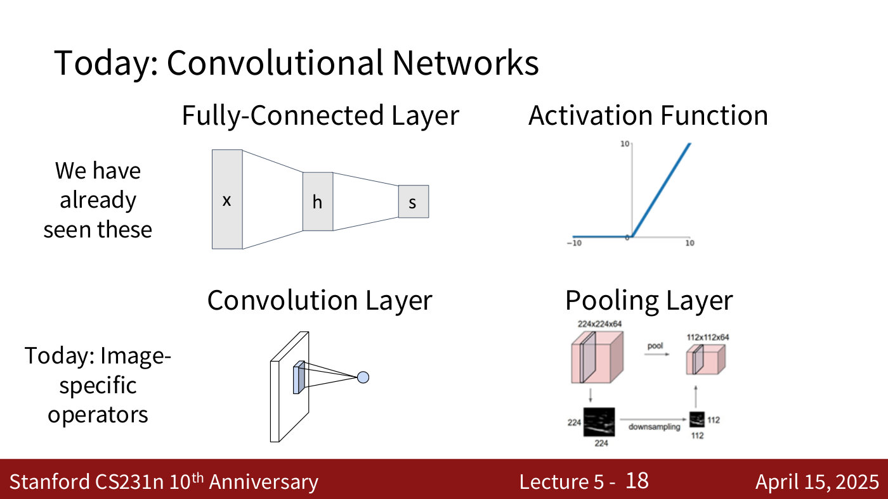

As slide 17, plus a second row labelled "Today: Image-specific operators" with two new headings:

- "Convolution Layer": a small diagram of a flat slab (a tall square image plane drawn in perspective) with a small shaded blue patch on it, with two lines from the patch converging to a single blue circle at the right.
- "Pooling Layer": a diagram showing a pink 3D block labelled "224x224x64" with an arrow labelled "pool" to a smaller pink block labelled "112x112x64"; below, a 224 x 224 black-and-white image (labelled "224" on both sides) with an arrow labelled "downsampling" to a smaller image labelled "112" on both sides; vertical arrows connect the blocks and images.

## Slide 19 — Image Classification: A core task in Computer Vision

Left: a photograph of a grey tabby cat sitting, looking to the left of the frame. Credit line under it: "This image by Nikita is licensed under CC-BY 2.0".

Right: text "(assume given a set of labels)" and "{dog, cat, truck, plane, ...}". An arrow points from the image to a vertical list of labels: "cat" (black), then "dog", "bird", "deer", "truck" (grey).

## Slide 20 — Pixel space

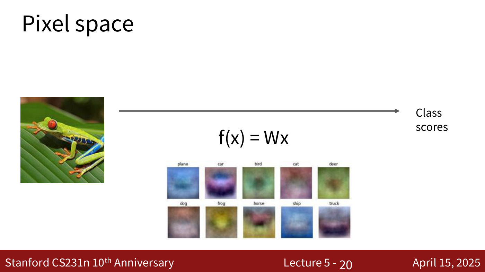

Left: a photograph of a green tree frog with red eyes, blue and orange legs, on a green leaf. A long arrow points right to the text "Class scores". Above the middle of the arrow region and below the arrow: $f(x) = Wx$. Below that, the ten class template images (two rows of five: plane, car, bird, cat, deer; dog, frog, horse, ship, truck).

## Slide 21 — Image features

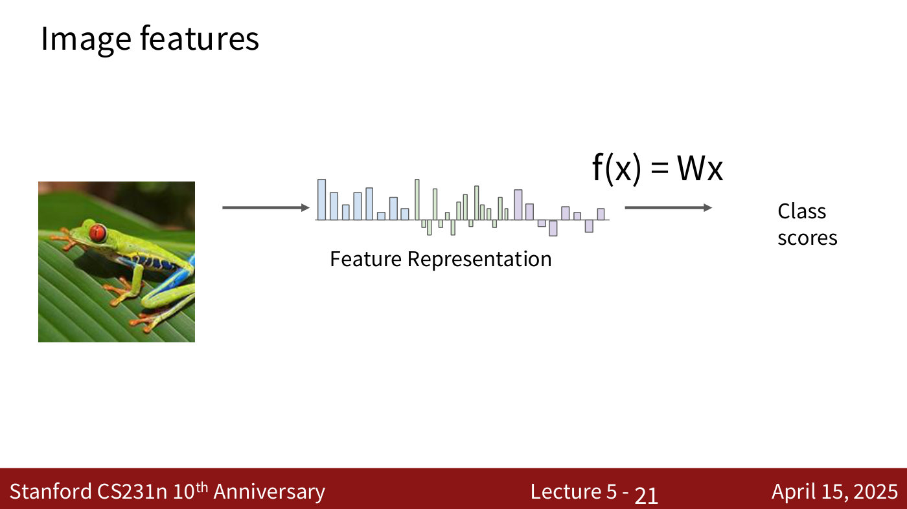

Left: the same frog photograph. An arrow points to a bar chart labelled "Feature Representation": a row of thin vertical bars above and below a baseline (positive and negative values), coloured light blue, light green, and light purple in three groups. A second arrow labelled $f(x) = Wx$ above it points right to "Class scores".

## Slide 22 — Example: Color Histogram

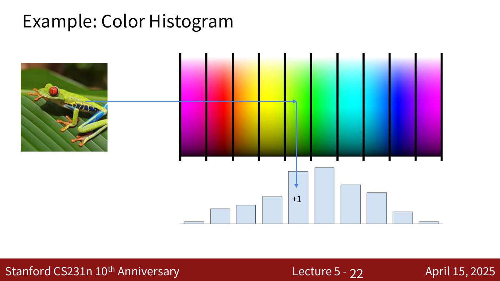

Left: the frog photograph. A blue line runs from a point on the frog's blue-green body rightward into a wide colour-spectrum rectangle, divided by thick black vertical lines into 10 hue bins (magenta, red, orange/yellow, yellow, yellow-green, green, cyan, light blue, blue, magenta; each fading to white at the top and black at the bottom). At the fifth (yellow-green) bin the line turns down, with an arrow ending at the fifth bar of a 10-bar histogram below, marked "+1". The histogram bars (light blue, black outline), left to right, have approximate relative heights: very small, small-medium, medium, medium-large, large (fifth, the one with +1), tallest (sixth), medium, medium-large, small-medium, very small.

## Slide 23 — Example: Histogram of Oriented Gradients (HoG)

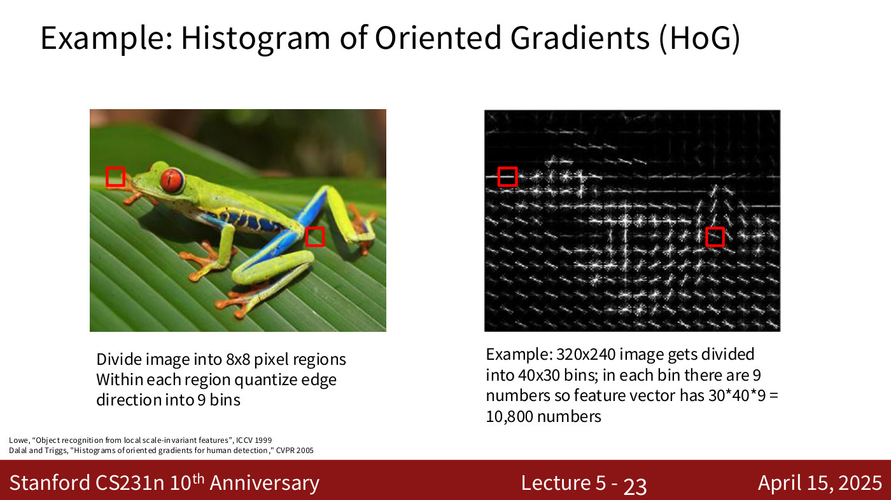

Left: a photograph of the green tree frog on a leaf with two small red squares drawn on it (one near the left foot at the leaf edge, one on the blue leg). Caption: "Divide image into 8x8 pixel regions" / "Within each region quantize edge direction into 9 bins".

Right: a black image of small white oriented-edge glyphs in a grid, outlining the frog's shape, with the same two red squares at the corresponding positions. Caption: "Example: 320x240 image gets divided into 40x30 bins; in each bin there are 9 numbers so feature vector has 30\*40\*9 = 10,800 numbers".

Bottom-left references: "Lowe, “Object recognition from local scale-invariant features”, ICCV 1999" and "Dalal and Triggs, “Histograms of oriented gradients for human detection,” CVPR 2005".

(Check: 320/8 = 40, 240/8 = 30, 30·40·9 = 10,800; matches.)

## Slide 24 — Example: Bag of Words

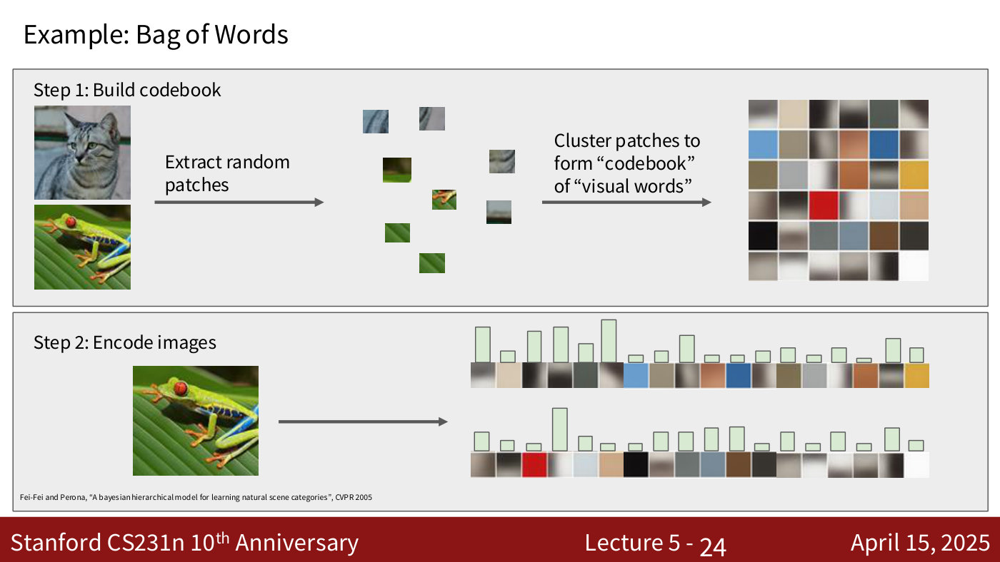

Two grey panels.

Step 1: Build codebook. A photograph of the cat and one of the frog at left. Arrow labelled "Extract random patches" to a scatter of eight small image patches (greys and greens). Arrow labelled "Cluster patches to form “codebook” of “visual words”" to a 6x6-ish grid of small blurry colour/texture swatches (the codebook; includes a blue, a tan, a red, a brown, a dark navy, a yellow-ochre swatch and several grey/black/white ones).

Step 2: Encode images. The frog photograph at left with an arrow to two rows of bar charts (green bars with a codebook swatch beneath each bar): the histogram of how often each visual word occurs. The top row has 18 bars and the bottom row has 18 bars; heights vary (in the top row bars 1, 3, 4, 6 and 9 are tall and 5 and 10 short; in the bottom row the fourth bar is the tallest).

Bottom-left reference: "Fei-Fei and Perona, “A bayesian hierarchical model for learning natural scene categories”, CVPR 2005"

## Slide 25 — Image Features

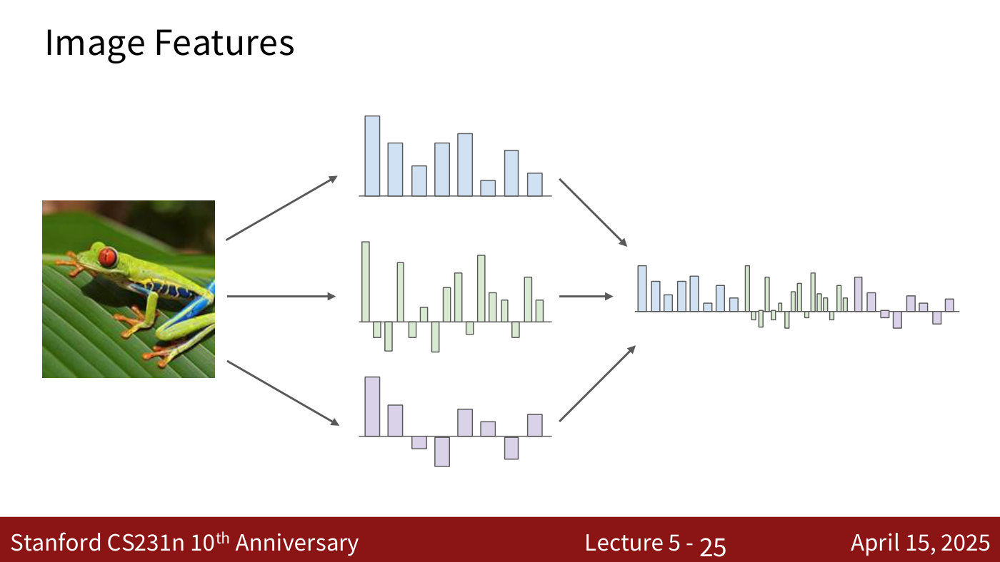

Left: the frog photograph. Three arrows fan out from it to three separate bar charts stacked vertically in the middle: a top chart of nine light-blue bars (all positive), a middle chart of light-green bars (positive and negative values around a baseline), and a bottom chart of light-purple bars (positive and negative). Three arrows (from the top, middle and bottom charts) converge on a single long bar chart at right, which is the concatenation of the three: the blue bars first, then the green, then the purple (this is the same "Feature Representation" chart as slide 21).

## Slide 26 — Image features vs. ConvNets

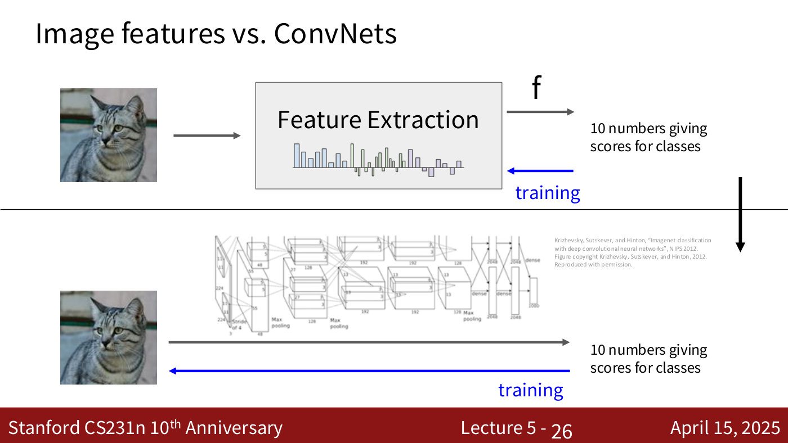

Two halves separated by a horizontal black line, with a black downward arrow at the right of the line.

Top half: a cat photograph at left, an arrow to a grey box labelled "Feature Extraction" (containing the feature bar chart), then an arrow labelled "f" to the text "10 numbers giving scores for classes". A blue arrow pointing back (right to left) underneath is labelled "training" in blue.

Bottom half: the same cat photograph, a long arrow to the right to "10 numbers giving scores for classes", with the whole span covering a faint network-architecture diagram (the AlexNet figure: stacked convolution blocks with dimensions such as 224, 55, 27, 13, 192, 128, "Stride of 4", "Max pooling", "dense", 2048, 1000). A blue arrow going right to left underneath is labelled "training" in blue.

Credit text (small, beside the network diagram): "Krizhevsky, Sutskever, and Hinton, “Imagenet classification with deep convolutional neural networks”, NIPS 2012. Figure copyright Krizhevsky, Sutskever, and Hinton, 2012. Reproduced with permission."

## Slide 27 — Last Time: Neural Networks

As slide 10 (linear score function $f = Wx$; 2-layer Neural Network $f = W_2 \max(0, W_1 x)$; the x → W1 → h → W2 → s diagram with 3072, 100 and 10 labelled beneath; the ten class templates strip), plus a label "32x32x3" at the left of the "3072" label.

## Slide 28 — Last Time: Neural Networks

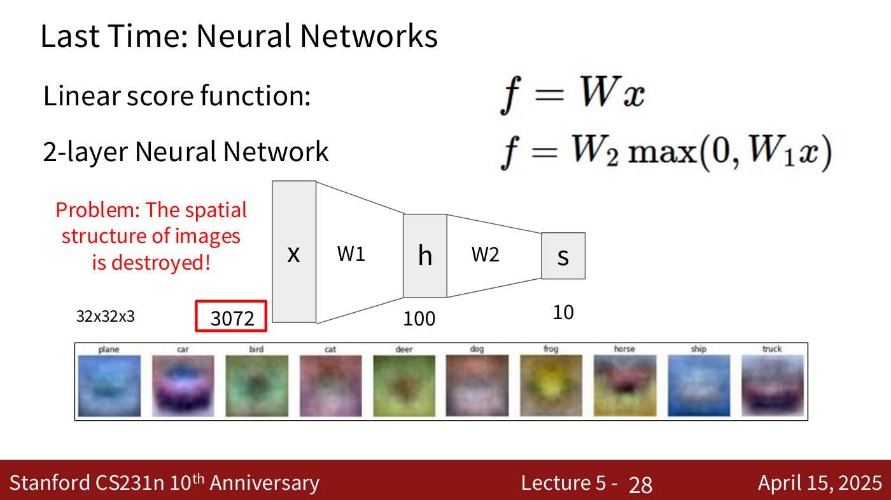

As slide 27, plus a red text "Problem: The spatial structure of images is destroyed!" at the left of the x box, and a red rectangle drawn around the "3072" label (the "32x32x3" label remains at the left of it).

## Slide 29 — Next: Convolutional Neural Networks

A diagram of a convolutional network (labelled as an illustration of the LeCun et al. 1998 network). At far left is a grey square labelled "Input" containing a large black cursive letter "K". A small square patch on the "K" is connected by lines to a patch on the first stack of three green square "Image Maps" (labelled "Image Maps"); the arrow label "Convolutions" points to this connection. Next comes a stack of smaller orange/pink and green squares reached via another patch connection, with the arrow label "Subsampling" beneath. The pattern repeats through progressively smaller green and orange stacks, with small patch squares linking successive stacks. At right, the last small maps connect into three outline slabs/trapezoids (a funnel of lines) ending at "Output"; the arrow label "Fully Connected" points to them.

Small credit text bottom-left: "Illustration of LeCun et al. 1998 from CS231n 2017 Lecture 1"

## Slide 30 — Next: Convolutional Neural Networks

As slide 29, plus a text at top: "**Convolution** and **pooling** operators extract features while respecting 2D image structure", with a curly brace spanning the image-map stacks (from "Image Maps" to the last small maps).

## Slide 31 — Next: Convolutional Neural Networks

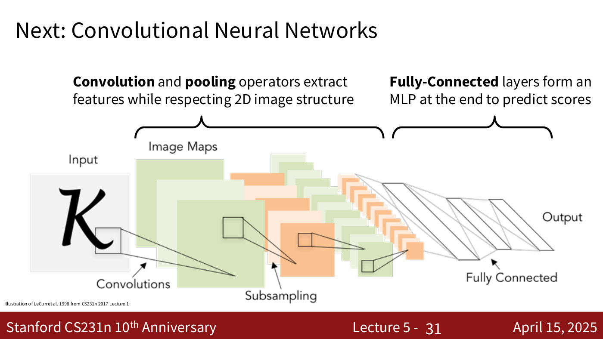

As slide 30, plus a second text at top right: "**Fully-Connected** layers form an MLP at the end to predict scores", with a second curly brace over the fully connected section (the slabs ending at "Output").

## Slide 32 — Next: Convolutional Neural Networks

As slide 29 (the diagram without the braces), with the top text replaced by "Trained end-to-end with backprop + gradient descent" and two long horizontal arrows above the diagram: a black arrow pointing right and a blue arrow pointing left.

## Slide 33 — A bit of history:

Heading: "A bit of history:" / "Gradient-based learning applied to document recognition" / "[LeCun, Bottou, Bengio, Haffner 1998]". Below, the same network diagram as slide 29 (Input "K", Image Maps, Convolutions, Subsampling, Fully Connected, Output), without the credit line.

## Slide 34 — A bit of history:

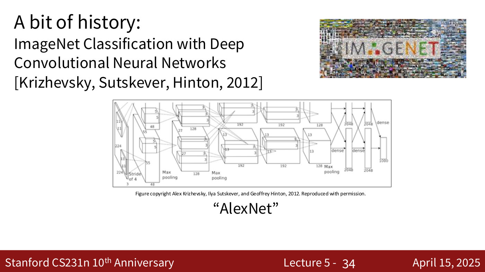

Heading: "A bit of history:" / "ImageNet Classification with Deep Convolutional Neural Networks" / "[Krizhevsky, Sutskever, Hinton, 2012]".

Top right: an "IMAGENET" logo, a mosaic of many small photographs forming the letters. Centre: a line-drawing network architecture figure with a border: input "224" and "3", "Stride of 4", "11", "11"; "55" / "5" / "5"; stacked blocks with "48", "128", "27", "13", "192", "192", "128", "3", "Max pooling" (three times), then "dense" boxes "2048", "2048" and a final column "1000". Credit line under it: "Figure copyright Alex Krizhevsky, Ilya Sutskever, and Geoffrey Hinton, 2012. Reproduced with permission." Beneath: "“AlexNet”".

## Slide 35 — ~2012 – 2020: ConvNets dominate all vision tasks

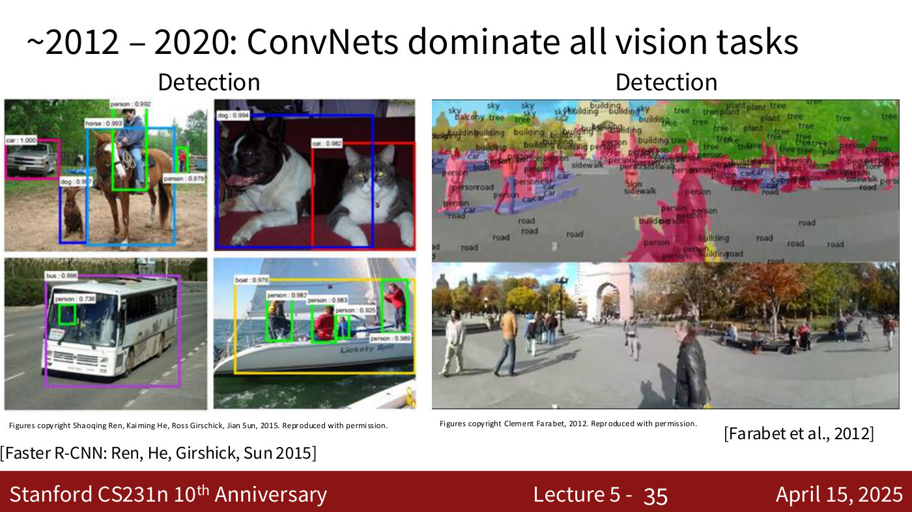

Two sub-headings, both "Detection".

Left: a 2x2 grid of photographs with detection bounding boxes and confidence labels: top left, a man on a horse with a dog and a car (labels "person : 0.992", "horse : 0.993", "car : 1.000", "dog : 0.997", "person : 0.979"; boxes in several colours); top right, a dog and a cat with boxes ("dog : 0.994", "cat : 0.982"); bottom left, a white bus with a person box ("bus : 0.996", "person : 0.736"); bottom right, a sailboat "Lickety Split" with several people ("boat : 0.970", "person : 0.98x" (last digit blurry in the embedded raster: 0.982 or 0.987), "person : 0.983", "person : 0.925", "person : 0.989"); the scene also shows "sign" and "boat" text. Credit: "Figures copyright Shaoqing Ren, Kaiming He, Ross Girschick, Jian Sun, 2015. Reproduced with permission." and label "[Faster R-CNN: Ren, He, Girshick, Sun 2015]".

Right: two stacked images of a street scene in a park (people walking, trees, an arch). The top is the same scene with every region labelled by class text overlaid (sky, building, tree, plant, person, road, sidewalk, car, balcony) and colour overlays (red regions on people, green on trees, grey on road, blue on cars). The bottom is the plain photograph. Credit: "Figures copyright Clement Farabet, 2012. Reproduced with permission." and label "[Farabet et al., 2012]".

## Slide 36 — ~2012 – 2020: ConvNets dominate all vision tasks

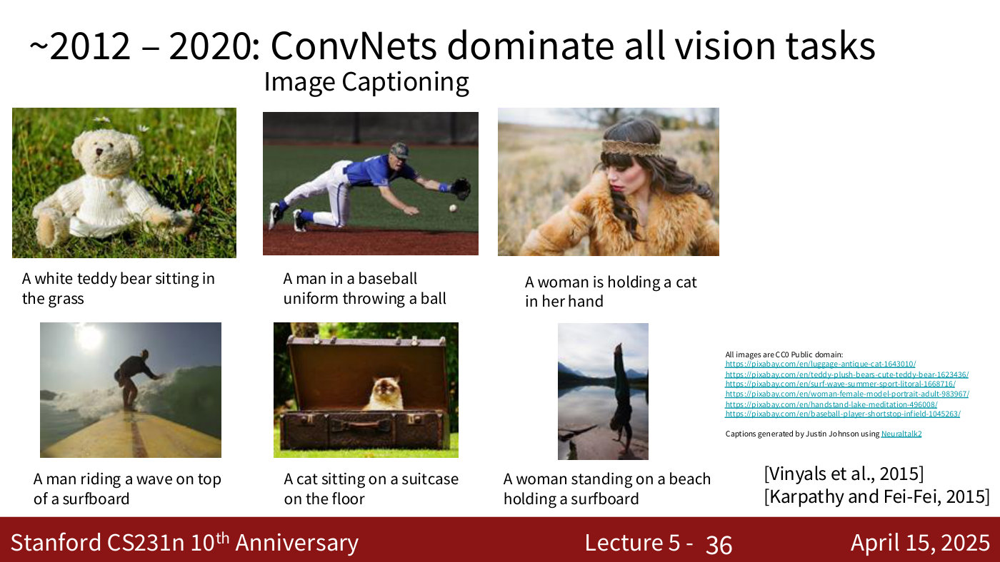

Sub-heading "Image Captioning". A 2x3 grid of photographs, each with a caption beneath:

- A teddy bear in white knitted clothing on grass: "A white teddy bear sitting in the grass"
- A baseball player in blue diving for a ball on a field: "A man in a baseball uniform throwing a ball"
- A woman in a fur coat with a headband in a field: "A woman is holding a cat in her hand"
- A silhouetted surfer on a surfboard on a wave with a bright sun: "A man riding a wave on top of a surfboard"
- A cat sitting inside an open suitcase on grass: "A cat sitting on a suitcase on the floor"
- A person doing a handstand at a lake with mountains behind: "A woman standing on a beach holding a surfboard"

Right-hand citations: "[Vinyals et al., 2015]" and "[Karpathy and Fei-Fei, 2015]".

Small credit text (right): "All images are CC0 Public domain:" followed by the URLs
https://pixabay.com/en/luggage-antique-cat-1643010/
https://pixabay.com/en/teddy-plush-bears-cute-teddy-bear-1623436/
https://pixabay.com/en/surf-wave-summer-sport-litoral-1668716/
https://pixabay.com/en/woman-female-model-portrait-adult-983967/
https://pixabay.com/en/handstand-lake-meditation-496008/
https://pixabay.com/en/baseball-player-shortstop-infield-1045263/
and "Captions generated by Justin Johnson using Neuraltalk2"

## Slide 37 — ~2012 – 2020: ConvNets dominate all vision tasks

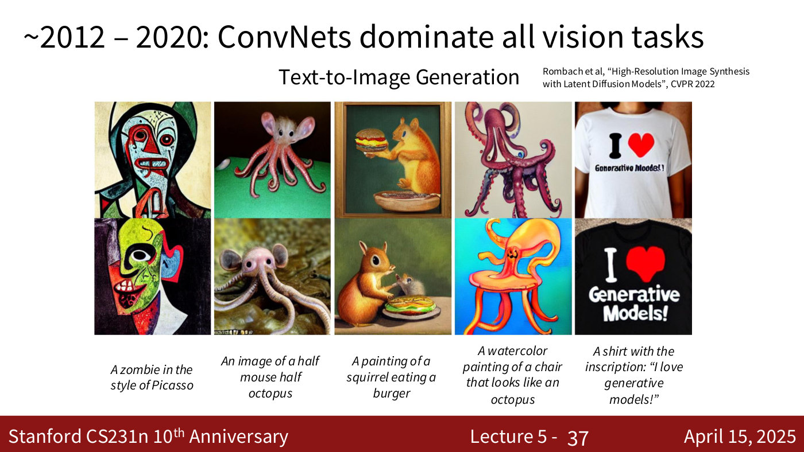

Subtitle: "Text-to-Image Generation". Small citation at top right: "Rombach et al, "High-Resolution Image Synthesis with Latent Diffusion Models", CVPR 2022".

Figure: a grid of generated images, 2 rows by 5 columns, each column a pair of images with a caption below it. Captions, left to right: "A zombie in the style of Picasso" (two Picasso-style cubist faces, the top one with a green hat and blue-red face, the lower one multicoloured with a black background); "An image of a half mouse half octopus" (two pinkish creatures with a mouse head and tentacles, one on a green surface, one on a brown leafy ground); "A painting of a squirrel eating a burger" (two paintings of an orange-brown squirrel with a hamburger, the top in a gilded frame); "A watercolor painting of a chair that looks like an octopus" (top: a purple octopus on a beige background; bottom: an orange-yellow chair with tentacle-like legs on a blue background); "A shirt with the inscription: "I love generative models!"" (two T-shirts, white at top and black below, printed with "I" and a red heart and the words "Generative Models!").

## Slide 38 — ~2012 – 2020: ConvNets dominate all vision tasks

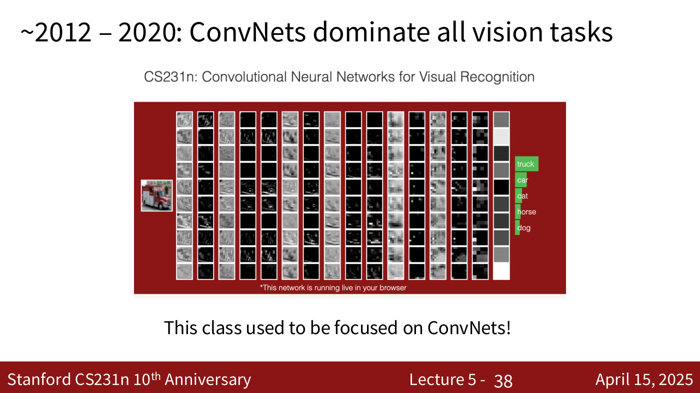

Screenshot with the title "CS231n: Convolutional Neural Networks for Visual Recognition" above it: a dark-red panel showing a live ConvNet demo. At left is a small input photo of a red fire truck. To its right are about 16 columns of small greyscale feature-map thumbnails (about 10 rows each), many black or sparse; the last column consists of greyscale blocks. At the far right is a green bar chart of class scores with labels from top to bottom: "truck" (longest bar), "car", "cat", "horse", "dog" (shorter bars). Text at the bottom of the panel: "*This network is running live in your browser".

Caption below: "This class used to be focused on ConvNets!"

## Slide 39 — 2021 - Present: Transformers have taken over

Left column heading: "2017: Transformers for language tasks". Below it is a diagram of the Transformer encoder-decoder architecture (small text): bottom-left stack "Inputs" -> "Input Embedding" -> "Positional Encoding" (sine-wave symbol with a plus) -> a block labelled "Nx" containing "Multi-Head Attention", "Add & Norm", "Feed Forward", "Add & Norm"; bottom-right stack "Outputs (shifted right)" -> "Output Embedding" -> "Positional Encoding" -> a block labelled "Nx" containing "Masked Multi-Head Attention", "Add & Norm", "Multi-Head Attention", "Add & Norm", "Feed Forward", "Add & Norm"; then "Linear", "Softmax", "Output Probabilities" at the top. An arrow from the encoder goes into the decoder's second attention block.

Citation under the diagram: "Vaswani et al, "Attention is all you need", NeurIPS 2017".

## Slide 40 — 2021 - Present: Transformers have taken over

As slide 39, plus a second column on the right headed "2021: Transformers for vision tasks". It holds a diagram of the Vision Transformer (ViT): at the bottom left, a 3x3 grid of image patches taken from a photograph of a building, with an arrow to a row of 9 patches in order; these feed a bar labelled "Linear Projection of Flattened Patches"; above it a row of numbered tokens "0*", "1", "2", "3", "4", "5", "6", "7", "8", "9" (the label "Patch + Position Embedding" at left, with the footnote "* Extra learnable [class] embedding"); above that a box "Transformer Encoder", then a box "MLP Head", then an output box "Class" listing "Bird, Ball, Car, ...". Title of the diagram: "Vision Transformer (ViT)". To the right, a dashed separator and a second diagram titled "Transformer Encoder": from the bottom "Embedded Patches" -> "Norm" -> "Multi-Head Attention" -> plus (residual) -> "Norm" -> "MLP" -> plus (residual), with a "L x" repeat marker.

Citation under it: "Dosovitskiy et al, "An Image is Worth 16x16 Words: Transformers for Image Recognition at Scale", ICLR 2021".

## Slide 41 — 2021 - Present: Transformers have taken over

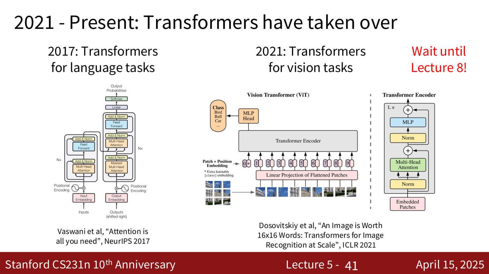

As slide 40, plus red text at the top right: "Wait until Lecture 8!"

## Slide 42 — Convolutional Neural Networks

Section divider. Text: "Convolutional Neural Networks".

## Slide 43 — Today: Convolutional Networks

Two column headings: "Fully-Connected Layer" and "Activation Function". At left a row label: "We have already seen these". Under the first heading: a diagram of three grey boxes of decreasing height connected by thin lines, labelled "x" (tallest), "h" (middle) and "s" (smallest). Under the second heading: a plot of a ReLU function (a blue curve flat at 0 for negative inputs, then rising linearly), with x-axis ticks "-10" and "10" and y-axis tick "10".

## Slide 44 — Today: Convolutional Networks

As slide 43, plus a second row labelled "Today: Image-specific operators" with two column headings and figures. "Convolution Layer": a diagram of a flat slab (image) with a small blue square patch on it, with lines from the patch converging to a single circle (blue) at the right. "Pooling Layer": a diagram with a pink 3D block labelled "224x224x64" and an arrow labelled "pool" to a smaller pink block labelled "112x112x64"; below, a greyscale image labelled "224" by "224" with an arrow labelled "downsampling" to a smaller greyscale image labelled "112" by "112".

## Slide 45 — Today: Convolutional Networks

As slide 44, except that the "Pooling Layer" heading and its figure are greyed out (faded), leaving the Convolution Layer in focus.

## Slide 46 — Recap: Fully Connected Layer

Text: "32x32x3 image -> stretch to 3072 x 1".

Diagram: a flat pink 3D bar labelled "input" above, with "1" at its left and "3072" below it; an arrow to the middle text $Wx$ with "10 x 3072 weights" below it; an arrow to a flat light-blue 3D bar labelled "activation" above, with "1" at its left and "10" below, with a small circle drawn at the bar's left end.

## Slide 47 — Fully Connected Layer

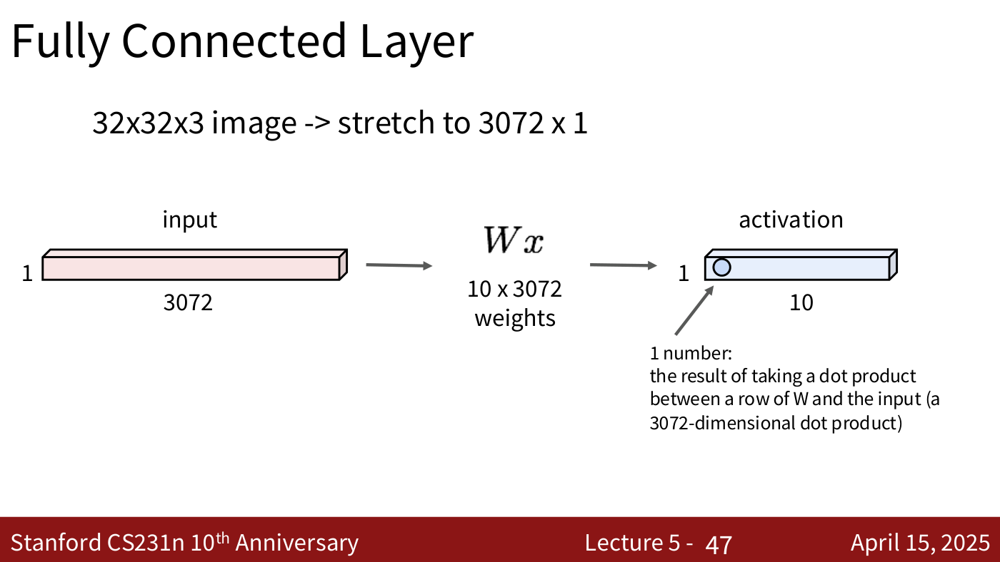

As slide 46 (titled "Fully Connected Layer", without "Recap:"), plus an arrow from the small circle in the activation bar to the annotation: "1 number: the result of taking a dot product between a row of W and the input (a 3072-dimensional dot product)".

## Slide 48 — Convolution Layer

Text: "32x32x3 image -> preserve spatial structure".

Figure: a 3D slab (pink) representing the image, with dimension labels: "32" beside the vertical edge, labelled "height" (blue text); "32" along the bottom edge, labelled "width" (blue text); "3" at the front edge, labelled "depth" (blue text).

## Slide 49 — Convolution Layer

Heading text "32x32x3 image" above a pink 3D slab labelled "32" (height side), "32" (width side) and "3" (depth). To its right, heading "5x5x3 filter" above a small light-blue 3D block (the filter). Text at right: "Convolve the filter with the image i.e. "slide over the image spatially, computing dot products"".

## Slide 50 — Convolution Layer

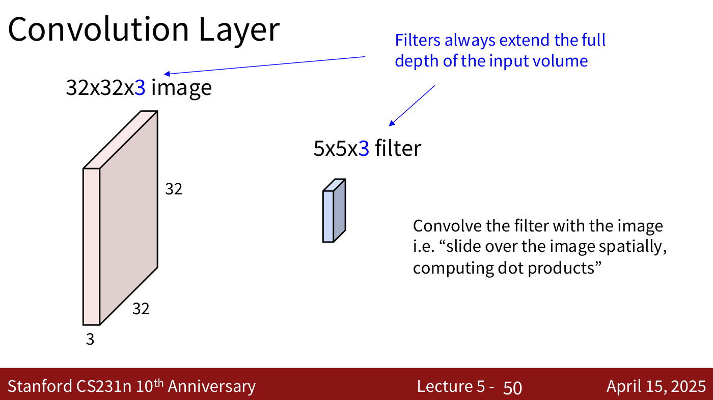

As slide 49, plus blue text at the top right: "Filters always extend the full depth of the input volume", with two blue arrows pointing to the blue-coloured "3" in "32x32x3 image" and the blue-coloured "3" in "5x5x3 filter" (those two digits are recoloured blue).

## Slide 51 — Convolution Layer

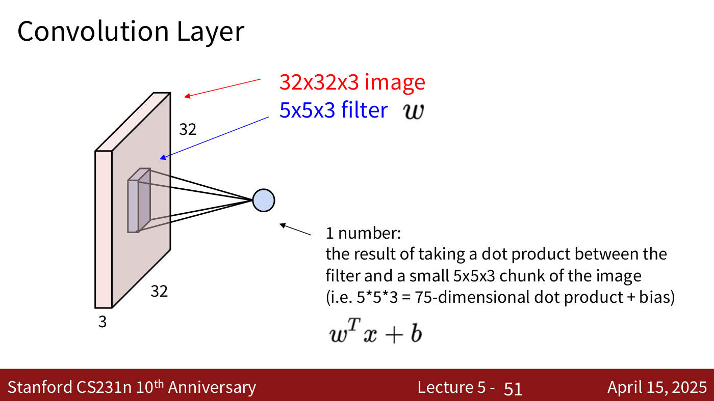

Figure: the pink image slab (labels "32", "32", "3") with a small grey-blue filter block drawn on its surface; thin lines run from the filter block to a single light-blue circle at the right. Red text "32x32x3 image" with a red arrow to the slab; blue text "5x5x3 filter" followed by the bold symbol $w$, with a blue arrow to the filter block. An arrow from the circle points to the annotation: "1 number: the result of taking a dot product between the filter and a small 5x5x3 chunk of the image (i.e. 5\*5\*3 = 75-dimensional dot product + bias)". Below it the formula:

$$w^T x + b$$

## Slide 52 — Convolution Layer

The image slab (labels "32", "32", "3") with a filter block drawn at the top-left corner of the image surface; lines from it converge to one light-blue circle at the right. No text other than the dimension labels.

## Slide 53 — Convolution Layer

As slide 52, but the filter block has slid one position to the right and a second light-blue circle appears (two circles, slightly offset), each connected to its filter position.

## Slide 54 — Convolution Layer

As slide 53, with a third filter position along the top row and a third circle (three circles in a diagonal stack).

## Slide 55 — Convolution Layer

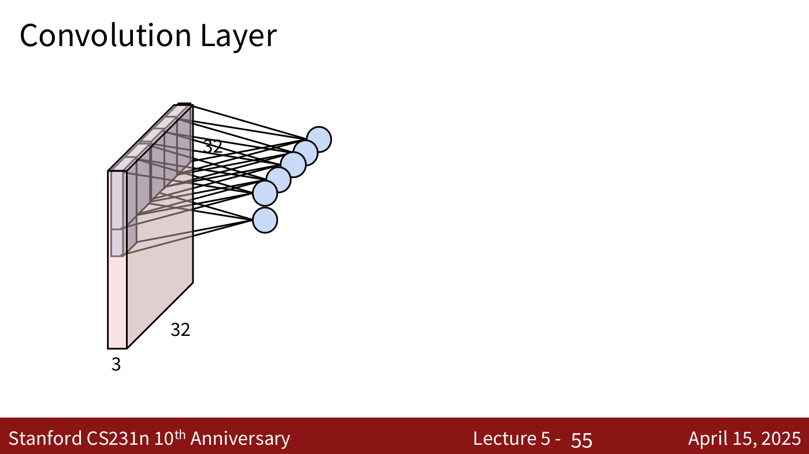

As slide 54, with the filter positions continuing across the whole top row of the image and five circles stacked in a diagonal column, each connected by lines to its own filter position.

## Slide 56 — Convolution Layer

Left: the image slab (labels "32", "32", "3") with one filter block on it connected to one circle; red text "32x32x3 image" with red arrow to the slab and blue text "5x5x3 filter" with blue arrow to the filter. A grey arrow to the right is labelled "convolve (slide) over all spatial locations". Right: blue text "activation map" above a thin blue slab with dimension labels "28" (height), "28" (width) and "1" (depth).

## Slide 57 — Convolution Layer

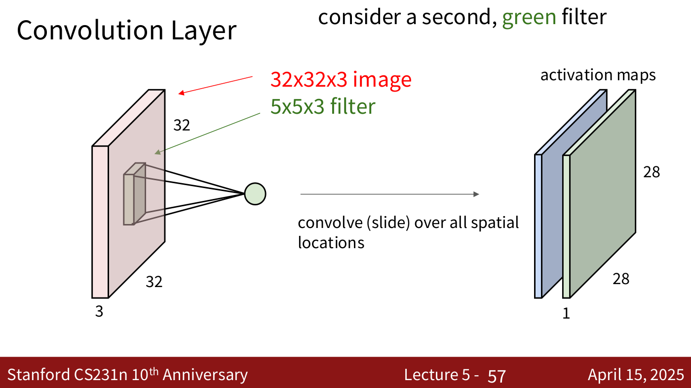

As slide 56, plus text at the top: "consider a second, green filter" (the word "green" in green). The filter text and the circle are now green ("5x5x3 filter" in green, green-tinted filter block and circle). On the right the heading becomes "activation maps" and there are two slabs: the blue one and, in front of it, a green one, both labelled "28", "28" and "1".

## Slide 58 — Convolution Layer

Left: red text "3x32x32 image" above the pink slab (labels "32", "32", "3"). Centre: a box "Convolution Layer"; text above it "Consider 6 filters, each 3x5x5"; below it an upward arrow from a row of six coloured filter blocks (blue, green, red/pink, yellow, purple, tan) labelled "6x3x5x5 filters". An arrow runs from the image to the box and from the box to the right. Right: text "6 activation maps, each 1x28x28" above a stack of six coloured slabs (blue, green, pink, yellow, purple, tan) and below it "Stack activations to get a 6x28x28 output image!". Small credit at the bottom left: "Slide inspiration: Justin Johnson".

## Slide 59 — Convolution Layer

As slide 58, plus text above the Convolution Layer box: "Also 6-dim bias vector:" with a row of six small coloured squares (blue, green, pink, yellow, purple, tan) and a downward arrow into the box. Credit "Slide inspiration: Justin Johnson" retained.

## Slide 60 — Convolution Layer

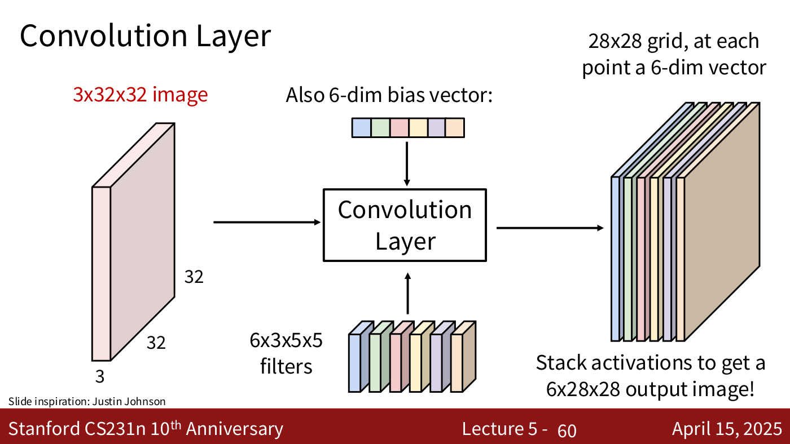

As slide 59, except the text above the output stack changes from "6 activation maps, each 1x28x28" to "28x28 grid, at each point a 6-dim vector". The rest (including "Stack activations to get a 6x28x28 output image!" and "Slide inspiration: Justin Johnson") is unchanged.

## Slide 61 — Convolution Layer

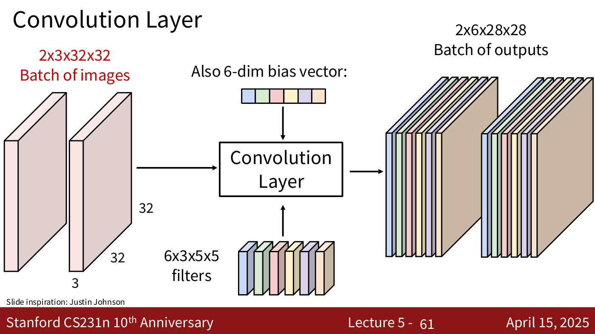

Left: red text "2x3x32x32 Batch of images" above two pink slabs side by side (labels "32", "32", "3" on the second). Centre: box "Convolution Layer" with an arrow in from the images; text "Also 6-dim bias vector:" above it with a row of six small coloured squares and a downward arrow; below it an upward arrow from six coloured filter blocks labelled "6x3x5x5 filters". Right: text "2x6x28x28 Batch of outputs" above two stacks, each of six coloured slabs (blue, green, pink, yellow, purple, tan). Credit bottom left: "Slide inspiration: Justin Johnson".

## Slide 62 — Convolution Layer

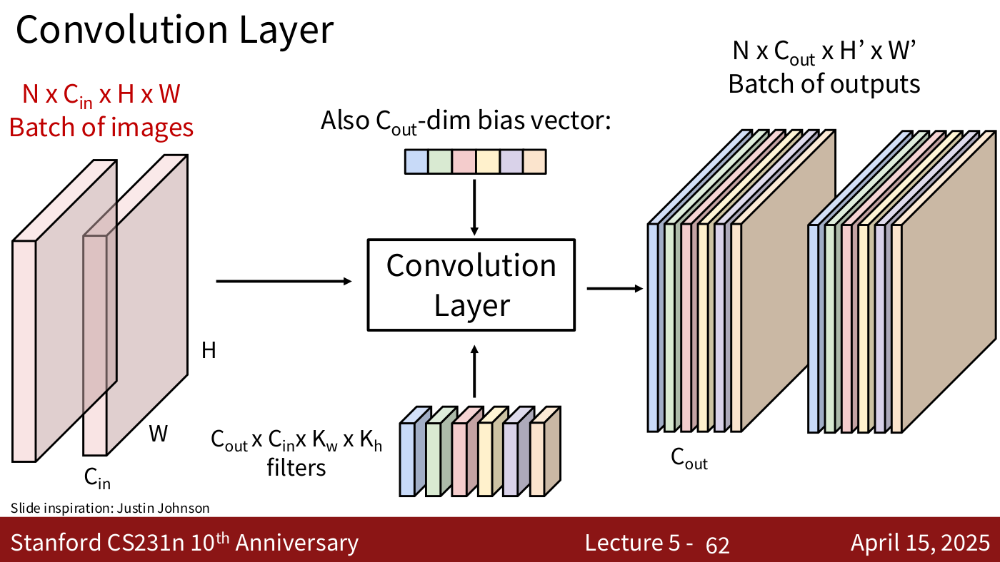

The same layout as slide 61 with symbolic sizes. Left: red text "N x C_in x H x W Batch of images" (C_in is subscripted) above two pink slabs; the second slab is labelled "H" (vertical), "W" (depth direction) and $C_{in}$ below. Centre: "Also $C_{out}$-dim bias vector:" above the row of six coloured squares; box "Convolution Layer"; below it the filter blocks labelled $C_{out}$ x $C_{in}$ x $K_w$ x $K_h$ "filters" (printed in that order, $K_w$ before $K_h$; slide 94 writes $K_H$ x $K_W$). Right: "N x $C_{out}$ x H' x W' Batch of outputs" above two stacks of six coloured slabs, with $C_{out}$ labelled under the first stack. Credit bottom left: "Slide inspiration: Justin Johnson".

## Slide 63 — A ConvNet is a neural network with Conv layers

Left: pink slab with labels "32", "32", "3". An arrow labelled "CONV" with blue text beneath "e.g. 6 5x5x3 filters" leads to a blue slab labelled "28", "28", "6".

## Slide 64 — A ConvNet is a neural network with Conv layers

As slide 63, plus a second arrow labelled "CONV" with green text "e.g. 10 5x5x6 filters" leading to a light-green slab labelled "24", "24", "10"; then a third arrow labelled "CONV" leading to "...." (ellipsis).

## Slide 65 — A ConvNet is a neural network with Conv layers with activation functions!

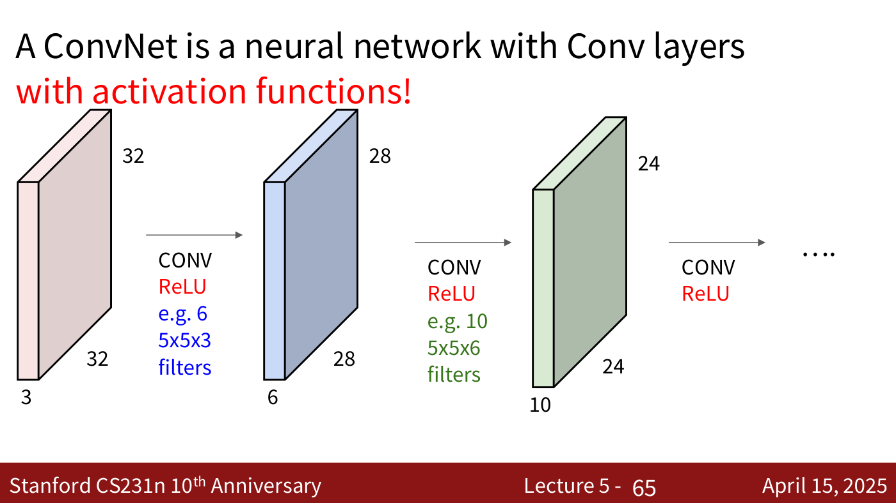

Title is extended by a second line in red: "with activation functions!". As slide 64, plus the word "ReLU" in red under each "CONV" label (all three arrows): first arrow reads "CONV", "ReLU", "e.g. 6 5x5x3 filters"; second reads "CONV", "ReLU", "e.g. 10 5x5x6 filters"; third reads "CONV", "ReLU". Volumes as in slide 64 (32x32x3, 28x28x6, 24x24x10).

## Slide 66 — What do Conv filters learn?

Left: pink slab (labels "32", "32", "3") followed by boxes "Conv" and "ReLU" connected by arrows into a blue slab (labels "28", "28"). Right: heading "Linear classifier: One template per class" above a 2x5 grid of small blurry colour images (the learned linear-classifier templates), labelled in order, top row: "plane", "car", "bird", "cat", "deer"; bottom row: "dog", "frog", "horse", "ship", "truck".

## Slide 67 — What do Conv filters learn?

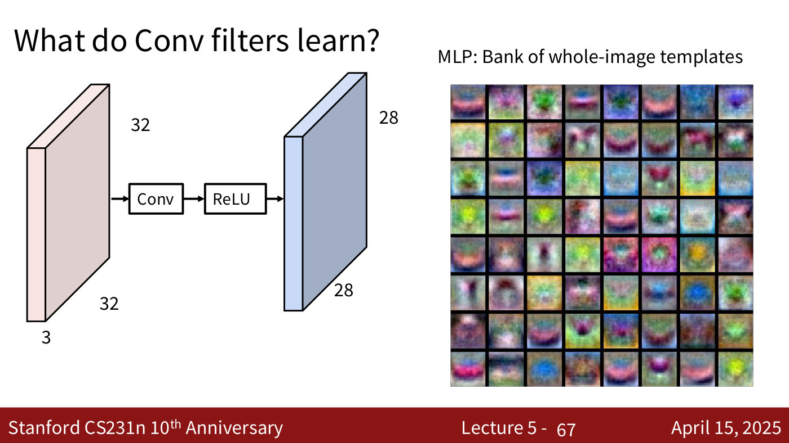

As slide 66, but the right side now reads "MLP: Bank of whole-image templates" above an 8x8 grid (64 tiles) of small blurry colour template images, unlabelled.

## Slide 68 — What do Conv filters learn?

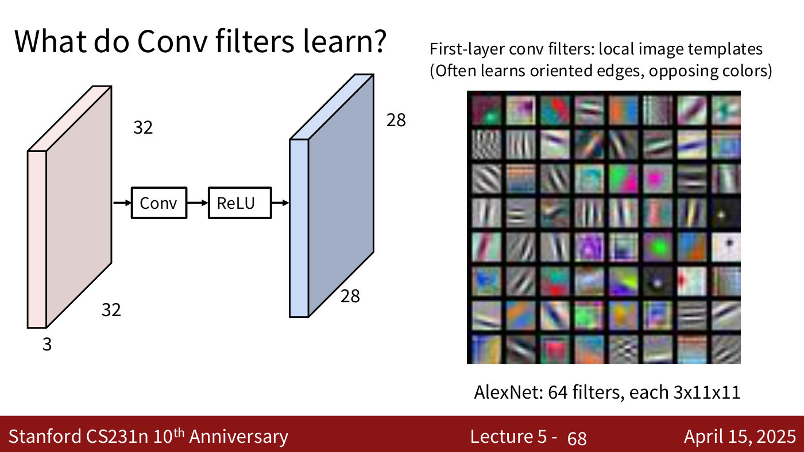

As slide 66 on the left. Right: text "First-layer conv filters: local image templates (Often learns oriented edges, opposing colors)" above an 8x8 grid (64 tiles) of small colour/greyscale filter images showing oriented edge/stripe patterns and some colour blobs. Caption below: "AlexNet: 64 filters, each 3x11x11".

## Slide 69 — What do Conv filters learn?

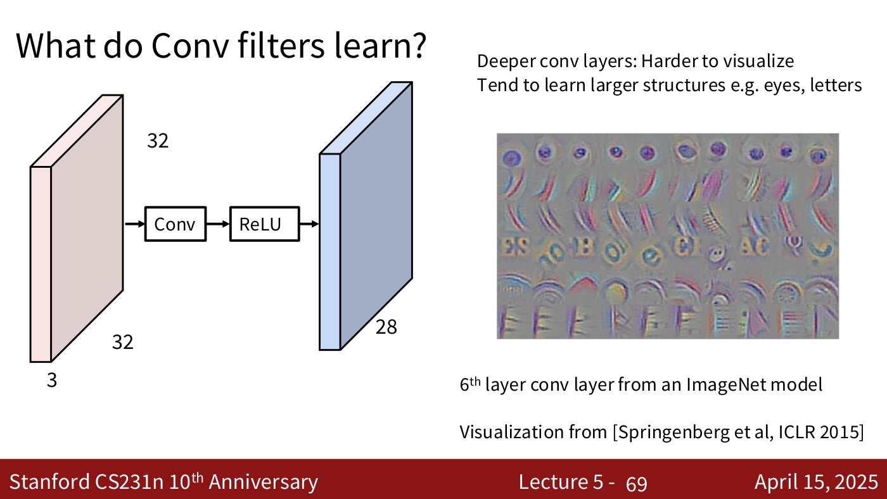

As slide 66 on the left. Right: text "Deeper conv layers: Harder to visualize Tend to learn larger structures e.g. eyes, letters" above a grey-background mosaic (10 columns by 6 rows) of visualization patches (circular eye-like shapes at the top, curved arcs and strokes, rows of letter-like shapes such as "ES", "B", "E", and striped patterns at the bottom). Below: "6th layer conv layer from an ImageNet model" and "Visualization from [Springenberg et al, ICLR 2015]".

## Slide 70 — Convolution: Spatial Dimensions

Left: pink slab (labels "32", "32", "3"), boxes "Conv" and "ReLU" connected by arrows, into a blue slab (labels "28", "28"). An arrow from below points up into the "Conv" box from green text: $W_1$: "6x3x5x5" and $b_1$: "6".

## Slide 71 — Convolution: Spatial Dimensions

Text at top right: "Input: 7x7" and "Filter: 3x3". Figure: a 7x7 grid of squares (labelled "7" at the left and "7" below) in which the top-left 3x3 block is filled green and the rest are white.

## Slide 72 — Convolution: Spatial Dimensions

Left figure: a 7x7 grid of white cells, with the label "7" to the left of the grid and "7" below it. A 3x3 block of cells coloured green occupies rows 1–3 and columns 2–4 (the filter position shifted one cell right of the top-left corner; the leftmost column is white).

Right text: "Input: 7x7", "Filter: 3x3".

## Slide 73 — Convolution: Spatial Dimensions

As slide 72, but the green 3x3 block is at rows 1–3, columns 3–5 (shifted one more cell right). Text unchanged: "Input: 7x7", "Filter: 3x3".

## Slide 74 — Convolution: Spatial Dimensions

As slide 72, but the green 3x3 block is at rows 1–3, columns 4–6. Text unchanged: "Input: 7x7", "Filter: 3x3".

## Slide 75 — Convolution: Spatial Dimensions

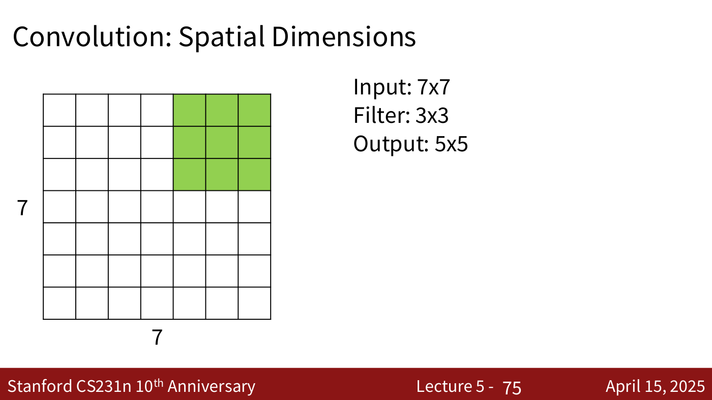

As slide 72, but the green 3x3 block is at rows 1–3, columns 5–7 (the rightmost position in the top row). Text: "Input: 7x7", "Filter: 3x3", and a new line "Output: 5x5".

## Slide 76 — Convolution: Spatial Dimensions

As slide 75 (green block at top-right, rows 1–3, columns 5–7), with the text "Input: 7x7", "Filter: 3x3", "Output: 5x5". Added below it, a general formula:

"In general"
"Input: W"
"Filter: K"
"Output: W – K + 1"

## Slide 77 — Convolution: Spatial Dimensions

As slide 76, plus a red text block at the upper right beside the 7x7 / 3x3 / 5x5 lines: "Problem: Feature maps shrink with each layer!" ("Problem" is underlined).

## Slide 78 — Convolution: Spatial Dimensions

The grid is now a 9x9 grid: the 7x7 input is surrounded by a one-cell border of grey cells, each containing "0" (zero padding). The inner 7x7 cells are white and empty; the border cells (top row, bottom row, left column, right column) are grey and each print "0". No green filter block, and the "7" labels are removed.

Right text: "Input: 7x7", "Filter: 3x3", "Output: 5x5" with the red text "Problem: Feature maps shrink with each layer!" ("Problem" underlined) beside them.

Green text block below the red one: "Solution: Add **padding** around the input before sliding the filter" ("Solution" underlined, "padding" in bold).

General formula, lower right:

"In general"
"Input: W"
"Filter: K"
"Padding: P"
"Output: W – K + 1 + 2P"

## Slide 79 — Convolution: Spatial Dimensions

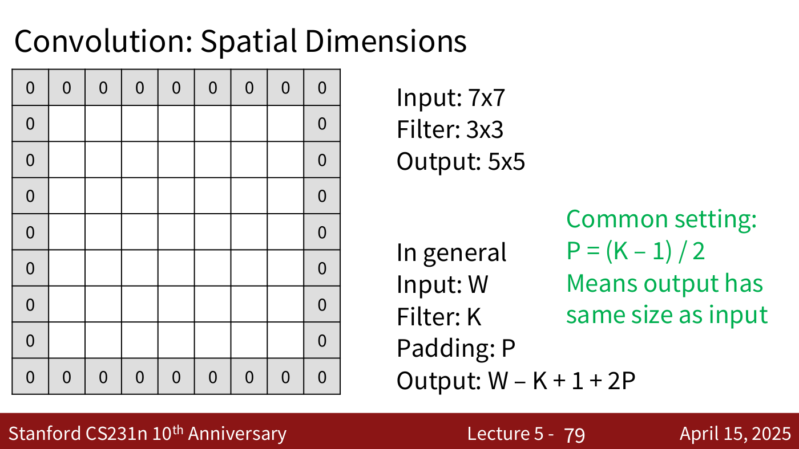

Same 9x9 zero-padded grid as slide 78. Text: "Input: 7x7", "Filter: 3x3", "Output: 5x5" (the red Problem and green Solution blocks are removed). The general formula block is unchanged ("In general / Input: W / Filter: K / Padding: P / Output: W – K + 1 + 2P"). Added in green at the right: "Common setting: P = (K – 1) / 2 Means output has same size as input".

## Slide 80 — Receptive Fields

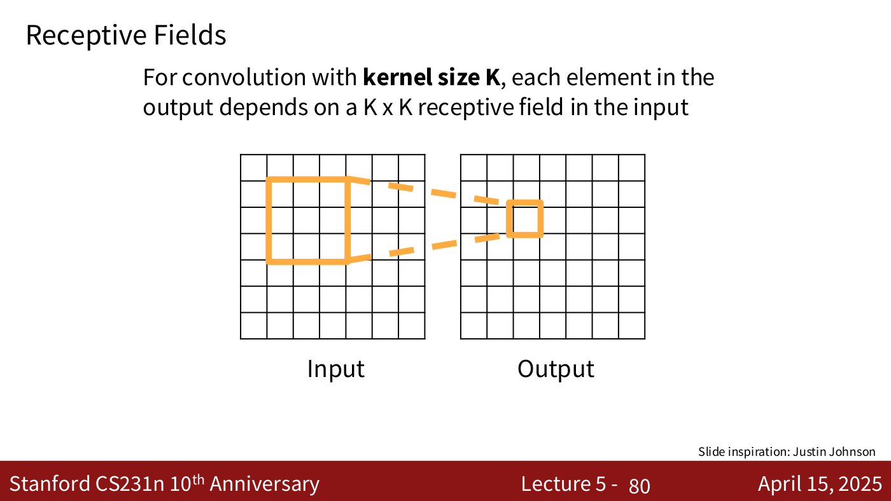

Text: "For convolution with **kernel size K**, each element in the output depends on a K x K receptive field in the input" ("kernel size K" in bold).

Figure: two 7x7 grids side by side, labelled "Input" (left) and "Output" (right). On the input grid an orange 3x3 square is drawn (rows 2–4, columns 2–4 approximately). On the output grid a small orange square marks a single cell (row 3, column 3 approximately). Two orange dashed lines run from the input square's top-right and bottom-right corners to the single output cell, showing that the one output cell depends on the 3x3 input region.

Credit line, bottom right: "Slide inspiration: Justin Johnson".

## Slide 81 — Receptive Fields

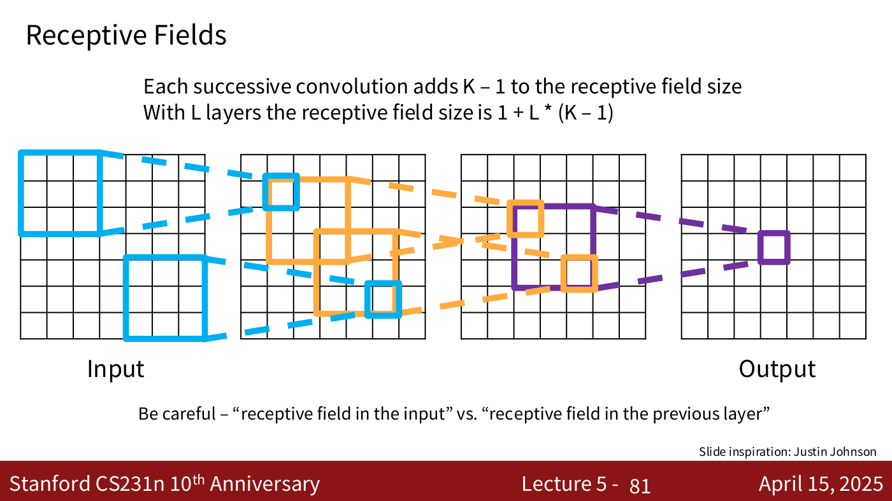

Text: "Each successive convolution adds K – 1 to the receptive field size" and "With L layers the receptive field size is 1 + L * (K – 1)".

Figure: four 7x7 grids in a row, labelled "Input" (leftmost) and "Output" (rightmost); the two middle grids are unlabelled intermediate layers. Two blue 3x3 squares on the input grid, not overlapping (rows 1–3, columns 1–3 and rows 5–7, columns 5–7), are connected by blue dashed lines to two single blue cells in the second grid (row 2, column 2 and row 6, column 6: the centre cell of each blue square). In the second grid two orange 3x3 squares overlapping at one cell (rows 2–4, columns 2–4 and rows 4–6, columns 4–6) are connected by orange dashed lines to two single orange cells in the third grid (about row 3, column 3 and row 5, column 5). In the third grid a purple 3x3 square (rows 3–5, columns 3–5), containing those two orange cells, is connected by purple dashed lines to a single purple cell in the output grid (about row 4, column 4). The figure shows how one output cell depends on a growing region traced back through each layer.

Bottom text: "Be careful – “receptive field in the input” vs. “receptive field in the previous layer”".

Credit line, bottom right: "Slide inspiration: Justin Johnson".

## Slide 82 — Receptive Fields

As slide 81, plus a red text line at the bottom centre: "Problem: For large images we need many layers for each output to “see” the whole image image" (the doubled word "image image" is printed as shown). The "Be careful…" line from slide 81 is removed.

## Slide 83 — Receptive Fields

As slide 82, plus a green text line below the red one: "Solution: Downsample inside the network".

## Slide 84 — Strided Convolution

Title: "Strided Convolution" ("Strided" underlined).

Left figure: a 7x7 grid of white cells with the label "7" above it and "7" to its right. A green 3x3 block fills rows 1–3, columns 1–3 (top-left corner).

Right text: "Input: 7x7", "Filter: 3x3", "Stride: 2".

## Slide 85 — Strided Convolution

As slide 84, but the green 3x3 block is at rows 1–3, columns 3–5 (moved two cells to the right). Text unchanged: "Input: 7x7", "Filter: 3x3", "Stride: 2".

## Slide 86 — Strided Convolution

As slide 84, but the green 3x3 block is at rows 1–3, columns 5–7 (top-right). Text: "Input: 7x7", "Filter: 3x3", "Stride: 2", and a new line "Output: 3x3".

## Slide 87 — Strided Convolution

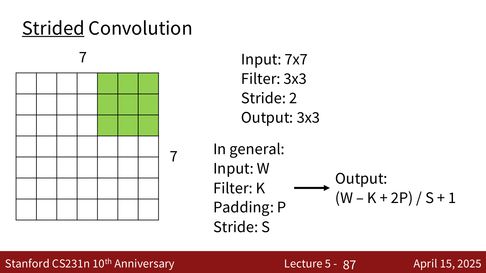

As slide 86 (green block at top-right), with "Input: 7x7", "Filter: 3x3", "Stride: 2", "Output: 3x3". Added at lower right:

"In general:"
"Input: W"
"Filter: K"
"Padding: P"
"Stride: S"

with a black arrow pointing right to "Output:" and "(W – K + 2P) / S + 1".

## Slide 88 — Convolution Example

Left text:

"Input volume: 3 x 32 x 32"
"10 5x5 filters with stride 1, pad 2"
"Output volume size: ?"

Right figure: two thin 3D slabs drawn side by side. The left slab is pink/light red (the input volume); the right slab is blue (the output volume). A thin grey arrow points from the left slab to the right slab. No dimensions are printed on the slabs.

## Slide 89 — Convolution Example

As slide 88, with the answer filled in and numbers colour-coded: "Input volume: 3 x **32** x **32**" (32s in light blue), "**10** **5**x**5** filters with stride **1**, pad **2**" (10 in dark red, 5x5 in green, stride 1 in yellow, pad 2 in purple), then "Output volume size: **10** x **32** x **32**" and "**32** = (**32**+2\***2**-**5**)/**1**+1" (colour-matched to the numbers above).

Check: (32 + 2·2 − 5)/1 + 1 = 32; matches.

## Slide 90 — Convolution Example

Same slabs figure as slide 88. Text:

"Input volume: 3 x 32 x 32"
"10 5x5 filters with stride 1, pad 2"
"Output volume size: 10 x 32 x 32"
"Number of learnable parameters: ?"

## Slide 91 — Convolution Example

As slide 90, with colour-coding and the answer: "Number of learnable parameters: 760". Added lines:

"Parameters per filter: 3\*5\*5 + 1 (for bias) = 76" (3 in yellow, 5\*5 in green, 76 in purple)
"10 filters, so total is 10 \* 76 = 760" (10 in dark red, 76 in purple)

Check: 3·5·5 + 1 = 76; 10 · 76 = 760; matches.

## Slide 92 — Convolution Example

Same slabs figure. Text:

"Input volume: 3 x 32 x 32"
"10 5x5 filters with stride 1, pad 2"
"Output volume size: 10 x 32 x 32"
"Number of learnable parameters: 760"
"Number of multiply-add operations?"

## Slide 93 — Convolution Example

As slide 92, with the answer and working (colour-coded; the 3 is dark red, "5x5" green, "10 x 32 x 32" and "10\*32\*32" light blue):

"Number of multiply-add operations: **768,000**"
"10\*32\*32 = 10,240 outputs"
"Each output is the inner product of two 3x5x5 tensors (75 elems)"
"Total = 75\*10240 = **768K**"

Check: 10·32·32 = 10,240; 75 · 10,240 = 768,000; matches.

## Slide 94 — Convolution Summary

Left column (black text):

"**Input**: C_in x H x W"
"**Hyperparameters**:"
"- **Kernel size**: K_H x K_W"
"- **Number filters**: C_out"
"- **Padding**: P"
"- **Stride**: S"
"**Weight matrix**: C_out x C_in x K_H x K_W giving C_out filters of size C_in x K_H x K_W"
"**Bias vector**: C_out"
"**Output size**: C_out x H' x W' where:"
"- H' = (H – K + 2P) / S + 1"
"- W' = (W – K + 2P) / S + 1"

(Subscripts in the original: C_in, C_out, K_H, K_W.)

Right column (green text), "Common settings:":

"K_H = K_W (Small square filters)"
"P = (K – 1) / 2 (”Same” padding)"
"C_in, C_out = 32, 64, 128, 256 (powers of 2)"
"K = 3, P = 1, S = 1 (3x3 conv)"
"K = 5, P = 2, S = 1 (5x5 conv)"
"K = 1, P = 0, S = 1 (1x1 conv)"
"K = 3, P = 1, S = 2 (Downsample by 2)"

## Slide 95 — PyTorch Convolution Layer

A screenshot of the PyTorch documentation for `torch.nn.Conv2d`, with a red rule at its top. Signature line: "CLASS torch.nn.Conv2d(in_channels, out_channels, kernel_size, stride=1, padding=0, dilation=1, groups=1, bias=True, padding_mode='zeros', device=None, dtype=None) [SOURCE]".

Description text: "Applies a 2D convolution over an input signal composed of several input planes." and "In the simplest case, the output value of the layer with input size $(N, C_{\text{in}}, H, W)$ and output $(N, C_{\text{out}}, H_{\text{out}}, W_{\text{out}})$ can be precisely described as:"

$$\text{out}(N_i, C_{\text{out}_ j}) = \text{bias}(C_{\text{out}_ j}) + \sum_ {k=0}^{C_{\text{in}}-1} \text{weight}(C_{\text{out}_ j}, k) \star \text{input}(N_i, k)$$

Below the screenshot, in black: "We didn’t talk about groups or dilation…"

## Slide 96 — Other Types of Convolution

Subtitle: "So far: 2D Convolution".

Figure: a thin pink 3D slab (the input volume) with the labels "C_in" at its bottom-left, "H" on its right edge and "W" along its bottom-right depth edge. A small purple/grey box (the filter, spanning the full depth of the slab) sits on the slab and three black lines run from it to a single light-blue circle (one output value) at the right.

Text beside the figure: "Input: C_in x H x W", "Weights: C_out x C_in x K x K".

## Slide 97 — Other Types of Convolution

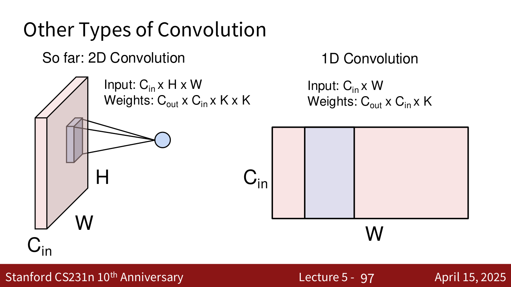

As slide 96 (left side: "So far: 2D Convolution", with the same slab figure and the same "Input: C_in x H x W / Weights: C_out x C_in x K x K" text), plus a new right-hand panel titled "1D Convolution".

Right panel text: "Input: C_in x W", "Weights: C_out x C_in x K".

Right panel figure: a wide pink rectangle labelled "C_in" on its left side (the vertical extent) and "W" below it (the horizontal extent). A vertical lavender/blue band spanning the full height of the rectangle marks the filter position, near the left of the rectangle; it covers K columns of W.

## Slide 98 — Other Types of Convolution

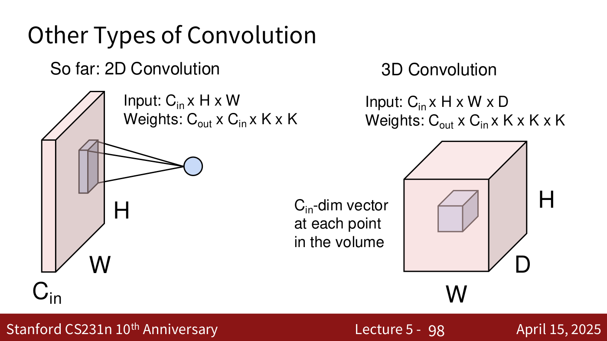

As slide 96 (left side unchanged), with the right-hand panel now titled "3D Convolution".

Right panel text: "Input: C_in x H x W x D", "Weights: C_out x C_in x K x K x K".

Right panel figure: a pink cube labelled "H" on its right edge, "D" along its lower right depth edge and "W" along its bottom. A small lavender cube sits inside the front face of the cube, representing the filter. Left of the cube, text: "C_in-dim vector at each point in the volume".

## Slide 99 — Convolutional Networks

A 2x2 layout of four layer types, with row labels at the left.

Row 1 (label "We have already seen these"): "Fully-Connected Layer" with a diagram of three grey boxes of decreasing height labelled "x", "h", "s" joined by lines; and "Activation Function" with a plot of a ReLU-shaped blue curve (flat at 0 for negative inputs, then rising linearly), x-axis ticks "-10", "0", "10", y-axis ticks "10" at the top.

Row 2 (label "Today: Image-specific operators"): "Convolution Layer" with the thin-slab filter-to-circle diagram from slide 96 (shown in full colour), and "Pooling Layer", greyed out (faded), with a faded version of the pooling diagram (224x224x64 pool to 112x112x64, with 224 and 112 downsampling images).

## Slide 100 — Convolutional Networks

As slide 99, but the emphasis is swapped: "Convolution Layer" and its diagram are faded grey, and "Pooling Layer" is now in full colour, showing the pooling diagram with legible labels: a cube "224x224x64" and an arrow "pool" to a smaller cube "112x112x64"; below, a dark image labelled "224" (both sides) with an arrow "downsampling" to a small image labelled "112" (both sides), with vertical arrows joining each image to its cube.

## Slide 101 — Pooling Layers: Another way to downsample

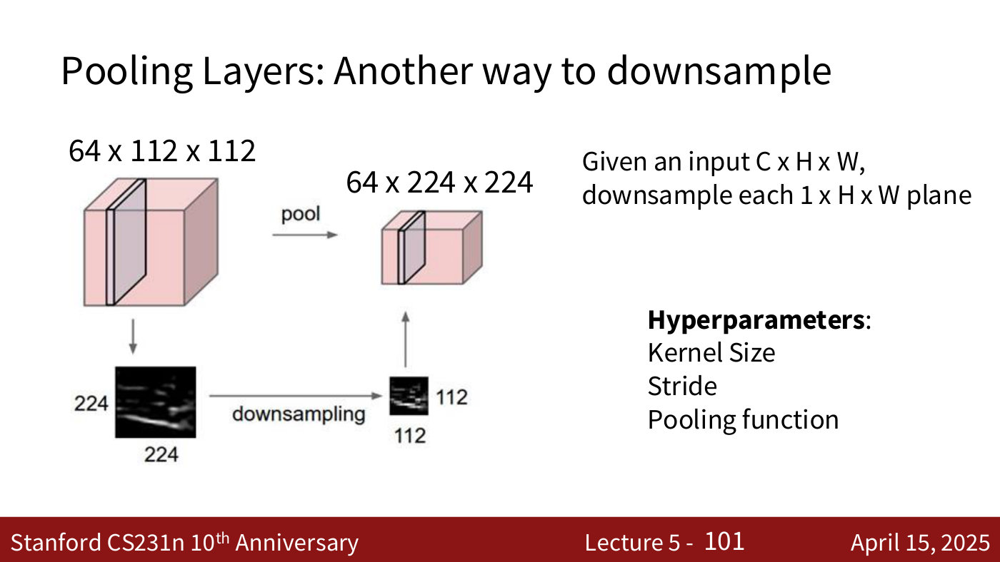

Left figure: a large pink cube labelled above it "64 x 112 x 112", with one slice highlighted (a thin vertical lavender plane). A grey arrow labelled "pool" goes right to a smaller pink cube with a highlighted slice, labelled above it "64 x 224 x 224". A down arrow from the large cube leads to a dark image (labelled "224" at left and "224" below) and a right arrow labelled "downsampling" leads from it to a small dark image (labelled "112" at right and "112" below); an up arrow from the small image leads to the small cube.

Right text: "Given an input C x H x W, downsample each 1 x H x W plane".

"**Hyperparameters**:" followed by "Kernel Size", "Stride", "Pooling function".

*[Ed: printed "64 x 112 x 112" over the larger (left) cube and "64 x 224 x 224" over the smaller (right) cube, which is the reverse of the pool/downsampling direction shown by the 224 to 112 images in the same figure; the two labels are swapped (confirmed by the figure audit). Slides 18, 44, 100, 107 and 121 label the same figure the right way round, 224x224x64 pooling to 112x112x64. Printed values kept as shown.]*

## Slide 102 — Pooling Layers: Another way to downsample

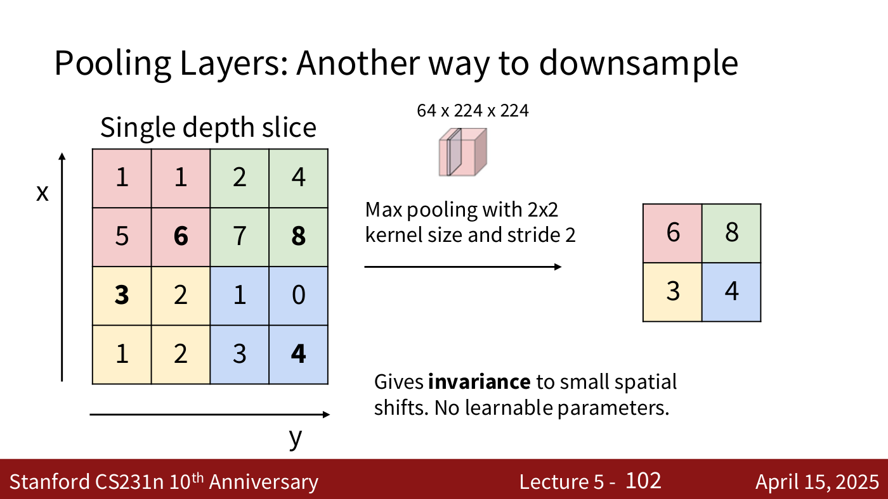

Left: label "Single depth slice" above a 4x4 grid; an axis arrow labelled "x" points up on the left of the grid and an axis arrow labelled "y" points right below it. The grid is coloured in four 2x2 quadrants. Values (rows top to bottom):

| | col 1 | col 2 | col 3 | col 4 |
| --- | --- | --- | --- | --- |
| row 1 | 1 | 1 | 2 | 4 |
| row 2 | 5 | **6** | 7 | **8** |
| row 3 | **3** | 2 | 1 | 0 |
| row 4 | 1 | 2 | 3 | **4** |

Top-left quadrant is red/pink, top-right is green, bottom-left is yellow, bottom-right is blue. The maximum of each quadrant (6, 8, 3, 4) is printed in bold.

Above the middle, a small cube icon labelled "64 x 224 x 224". Text with a right-pointing arrow: "Max pooling with 2x2 kernel size and stride 2".

Right: a 2x2 grid with the same quadrant colours: top-left 6 (pink), top-right 8 (green), bottom-left 3 (yellow), bottom-right 4 (blue).

Text bottom right: "Gives **invariance** to small spatial shifts. No learnable parameters."

Check: max of {1,1,5,6} = 6; {2,4,7,8} = 8; {3,2,1,2} = 3; {1,0,3,4} = 4; matches the printed output.

## Slide 103 — Pooling Summary

Left column (black text):

"**Input**: C x H x W"
"**Hyperparameters**:"
"- **Kernel size**: K"
"- **Stride**: S"
"- **Pooling function**: max, avg"
"**Output size**: C x H' x W' where:"
"- H' = (H – K) / S + 1"
"- W' = (W – K) / S + 1"
"**No learnable parameters**"

Right (green): "Common setting: max, K=2, S=2 => Gives 2x downsampling".

## Slide 104 — Convolution and Pooling: Translation Equivariance

Photograph: a red-eyed green tree frog on a green leaf, shown at top left, labelled "H x W x C" above it. A black arrow labelled "Conv or Pool" points right to a 3D cube (grey outline) at the top right labelled "H' x W' x C'" above it; the front face of the cube shows a faded copy of the frog image. A down arrow labelled "Translate" points from this cube to a second cube below it, whose front face shows the frog image shifted (moved up and to the left relative to the first cube).

## Slide 105 — Convolution and Pooling: Translation Equivariance

As slide 104, plus the bottom-left path: below the original frog image, a down arrow labelled "Translate" leads to a second frog photograph (the same frog shifted up and left within the frame). A black arrow labelled "Conv or Pool" leads from this shifted photograph to the lower cube. Centre text: "Conv(Translate(X)) = Translate(Conv(X))". The figure is now a commutative square: top row "Conv or Pool" from the original image to the top cube; left column "Translate" from original to shifted image; right column "Translate" from top cube to lower cube; bottom row "Conv or Pool" from shifted image to lower cube.

## Slide 106 — Convolution and Pooling: Translation Equivariance

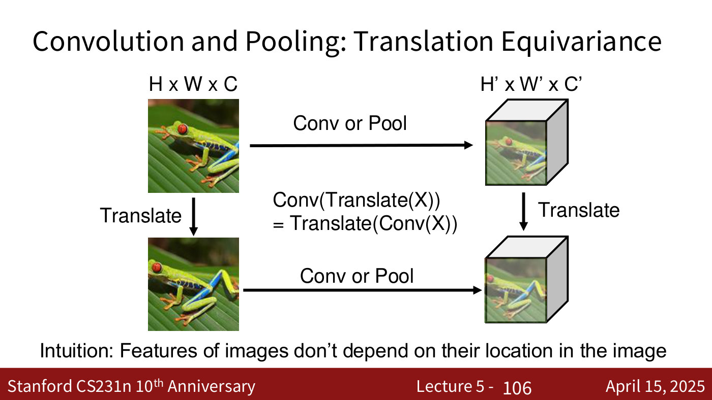

As slide 105, plus a line at the bottom: "Intuition: Features of images don’t depend on their location in the image".

## Slide 107 — Summary: Convolutional Networks

Four labelled panels in a 2x2 grid.

Top left, "Fully-Connected Layer": a diagram of three grey rectangles joined by lines that taper: a tall box labelled "x", a shorter box labelled "h", and a small box labelled "s".

Top right, "Activation Function": a plot of a ReLU-shaped blue curve, flat along zero from x = -10 to 0, then rising linearly to the top right. Axis ticks printed: -10 and 10 on the x-axis, 10 on the y-axis, 0 at the origin.

Bottom left, "Convolution Layer": a tall flat slab (the input volume) with a small blue filter patch on its face, and lines from the patch converging to a single blue circle (one neuron) on the right.

Bottom right, "Pooling Layer": a small diagram. A pink 3D block labelled "224x224x64" with an arrow labelled "pool" to a smaller pink block labelled "112x112x64". Below, a grey image labelled "224" (both sides) with an arrow labelled "downsampling" to a smaller image labelled "112" (both sides).

## Slide 108 — Next time: CNN Architectures

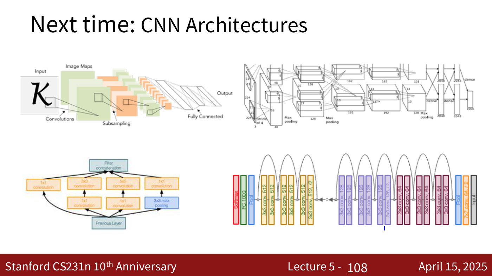

Four architecture diagrams, no other text.

Top left: the network diagram of slides 29–33. A box labelled "Input" holds a letter "K"; labels "Image Maps", "Convolutions", "Subsampling", "Fully Connected" and "Output" mark a chain of feature-map stacks (green, then orange) narrowing to fully connected layers.

Top right: the two-column network figure of slide 34 ("AlexNet"), with 3D blocks. Printed numbers include 224, 55, 48, 128, 27, 192, 13, 2048, 1000 and "dense"; labels "Stride of 4" and "Max pooling" appear.

Bottom left: a module diagram (unnamed on the slide). At the bottom a box "Previous Layer" feeds, via arrows, a "1x1 convolution" that feeds a "3x3 convolution", another "1x1 convolution" that feeds a "5x5 convolution", a "3x3 max pooling" that feeds a "1x1 convolution", and a direct "1x1 convolution". All four branches go into a top box "Filter concatenation".

Bottom right: a deep network (unnamed on the slide) drawn as a horizontal chain of vertical coloured boxes with curved skip arcs over pairs of boxes. From the right, "Input" (grey), "7x7 conv, 64 / 2" (orange), "Pool" (blue), then dark-pink (maroon) boxes "3x3 conv, 64", then purple boxes "3x3 conv, 128" (the last with "/ 2"), a "..." gap, then yellow boxes "3x3 conv, 512" (the last with "/ 2"), then "Pool", "FC 1000" (green) and "Softmax" (red) at the left end.

## Slide 109 — (no title) Appendix divider

Section divider. Text: "Appendix (Slides from Previous Years)".

## Slide 110 — Today: Convolutional Networks

Same four-panel layout as slide 107: "Fully-Connected Layer" (boxes x, h, s), "Activation Function" (ReLU plot with ticks -10, 10, 10, 0), "Convolution Layer" (slab, filter patch, one neuron), and "Pooling Layer" (224x224x64 to 112x112x64, "pool", "downsampling", 224, 112) with the pooling panel greyed out/faded.

Left-margin annotations: beside the top row, "We have already seen these"; beside the bottom row, "Today: Image-specific operators".

## Slide 111 — Convolution layer: summary

Let's assume input is $W_1 \times H_1 \times C$

Conv layer needs 4 hyperparameters:
- Number of filters K
- The filter size F
- The stride S
- The zero padding P

This will produce an output of $W_2 \times H_2 \times K$ where:
- $W_2 = (W_1 - F + 2P)/S + 1$
- $H_2 = (H_1 - F + 2P)/S + 1$

Number of parameters: $F^2 C K$ and K biases

## Slide 112 — Convolution layer: summary

As slide 111 (same text), plus a red box at top right titled "Common settings:" containing:

K = (powers of 2, e.g. 32, 64, 128, 512)
- F = 3, S = 1, P = 1
- F = 5, S = 1, P = 2
- F = 5, S = 2, P = ? (whatever fits)
- F = 1, S = 1, P = 0

## Slide 113 — (btw, 1x1 convolution layers make perfect sense)

Title: "(btw, 1x1 convolution layers make perfect sense)".

Left: a 3D block (light blue) with dimensions printed 64 (width, bottom), 56 (depth, bottom right) and 56 (height, right). Middle: an arrow labelled "1x1 CONV with 32 filters", and below in blue "(each filter has size 1x1x64, and performs a 64-dimensional dot product)". Right: a thinner 3D block with dimensions 32 (width), 56 (depth) and 56 (height).

## Slide 114 — (btw, 1x1 convolution layers make perfect sense)

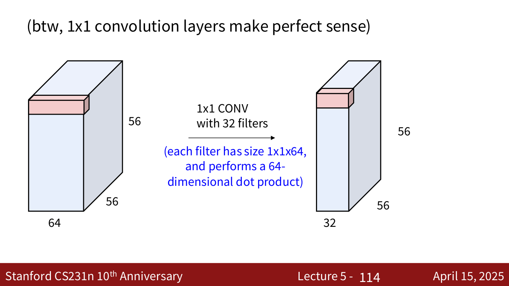

As slide 113, plus a pink horizontal strip highlighted across the top of the left block (a single row of positions through the full depth) and a corresponding pink strip across the top of the right block.

## Slide 115 — Example: CONV layer in PyTorch

Left: title "Example: CONV layer in PyTorch". Lower left: "Conv layer needs 4 hyperparameters:" with the list "- Number of filters K", "- The filter size F", "- The stride S", "- The zero padding P".

Right: a screenshot of the PyTorch documentation page "Conv2d". It shows the class signature `torch.nn.Conv2d(in_channels, out_channels, kernel_size, stride=1, padding=0, dilation=1, groups=1, bias=True)` with a "[SOURCE]" link. Text: "Applies a 2D convolution over an input signal composed of several input planes. In the simplest case, the output value of the layer with input size (N, C_in, H, W) and output (N, C_out, H_out, W_out) can be precisely described as:" followed by the formula out(N_i, C_out_j) = bias(C_out_j) + sum over k = 0 to C_in - 1 of weight(C_out_j, k) star input(N_i, k), "where star is the valid 2D cross-correlation operator, N is a batch size, C denotes a number of channels, H is a height of input planes in pixels, and W is width in pixels." Then bullets for stride, padding, dilation and groups (with sub-bullets for groups=1, groups=2 and groups=in_channels), and a closing note that kernel_size, stride, padding, dilation can each be a single int or a tuple of two ints (height, width). The screenshot text is small and blurry in places; the above is what is legible at slide resolution.

Credit line (bottom right, small print): "PyTorch is licensed under BSD 3-clause."

## Slide 116 — The brain/neuron view of CONV Layer

Left: a pink image slab with dimensions printed 32 (top), 32 (bottom) and 3 (left side). A small darker filter box sits on its face; lines from the filter converge to a single light-blue circle (a neuron) to the right. A red arrow from the text "32x32x3 image" (red) points to the slab; a blue arrow from "5x5x3 filter" (blue) points to the filter box. A black arrow from the circle points to the text: "1 number: the result of taking a dot product between the filter and this part of the image (i.e. 5\*5\*3 = 75-dimensional dot product)".

## Slide 117 — The brain/neuron view of CONV Layer

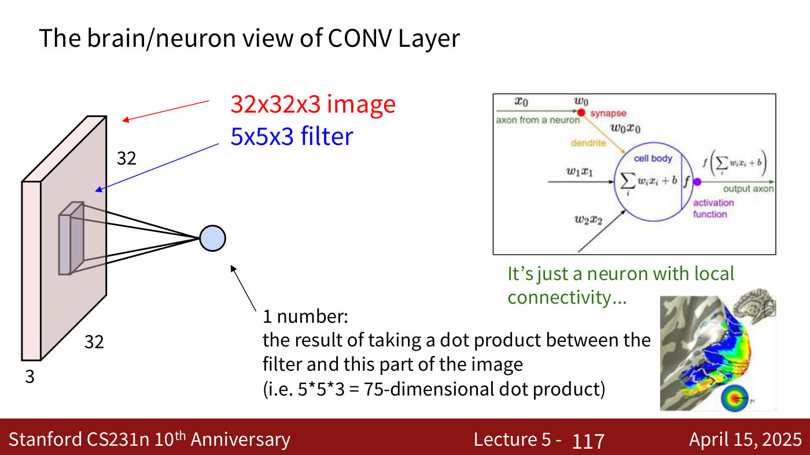

As slide 116, plus on the right: a diagram of a biological neuron model (boxed) with labels "x0", "w0", "axon from a neuron", "synapse", "w0x0", "dendrite", "w1x1", "w2x2", "cell body", "sum_i w_i x_i + b", "f", "activation function", "f(sum_i w_i x_i + b)", "output axon". Below it, in green: "It's just a neuron with local connectivity...". At bottom right, a small picture of a brain cortex surface map with a red/yellow/blue colour overlay and a circular target-like icon at its lower right.

## Slide 118 — The brain/neuron view of CONV Layer

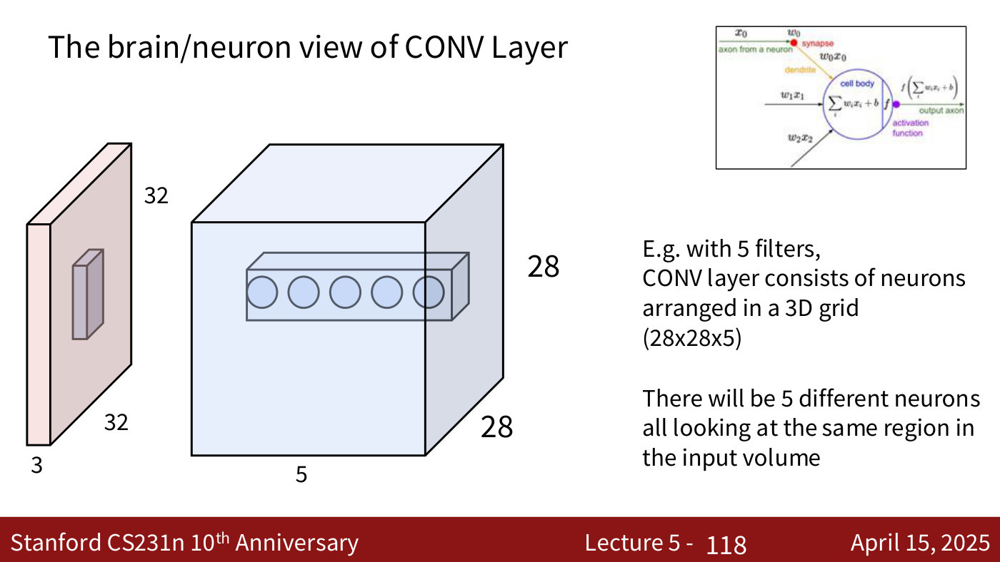

Left: the 32x32x3 image slab as before (labels 32, 32, 3) with a small filter box on it. Middle: a large light-blue 3D block with dimensions 28 (height, right), 28 (depth, bottom right) and 5 (width, bottom); on its front face a horizontal row of five light-blue circles inside a box (five neurons stacked along the depth). Top right: the small neuron diagram from slide 117, shrunk.

Right text: "E.g. with 5 filters, CONV layer consists of neurons arranged in a 3D grid (28x28x5)

There will be 5 different neurons all looking at the same region in the input volume"

## Slide 119 — Reminder: Fully Connected Layer

Text: "32x32x3 image -> stretch to 3072 x 1". In blue at top right: "Each neuron looks at the full input volume".

Diagram, left to right. A pink flat bar labelled "input", with "1" at its left and "3072" beneath. An arrow to the text $Wx$ with "10 x 3072 weights" beneath. An arrow to a light-blue flat bar labelled "activation", with "1" at its left and "10" beneath; a small circle sits at the left end of the bar. A blue arrow from the circle points to the blue text: "1 number: the result of taking a dot product between a row of W and the input (a 3072-dimensional dot product)".

## Slide 120 — (no title) ConvNet activations pipeline for a car image

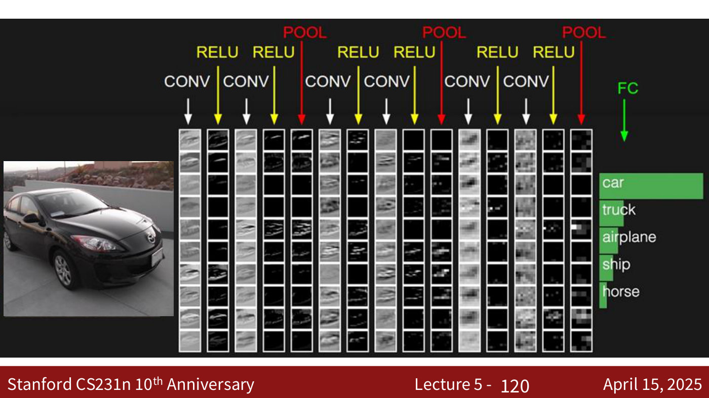

Full-slide figure on a dark background, no title. At left, a photograph of a black hatchback car on a paved lot. To its right is a chain of 15 columns of small grey/black activation-map thumbnails (10 rows each). Above the columns, arrows with labels in order: "CONV" (white), "RELU" (yellow), "CONV" (white), "RELU" (yellow), "POOL" (red), "CONV", "RELU", "CONV", "RELU", "POOL", "CONV", "RELU", "CONV", "RELU", "POOL". An arrow labelled "FC" (green) points down to a bar chart at the right with class labels and green bars: "car" (longest, largest), "truck" (short), "airplane" (shorter), "ship" (shorter), "horse" (shortest). The bars show car as the highest score by far.

## Slide 121 — Pooling layer

Title "Pooling layer" with two bullets:
- makes the representations smaller and more manageable
- operates over each activation map independently

Diagram: a pink 3D block labelled "224x224x64" with one slice highlighted, an arrow labelled "pool" to a smaller pink block labelled "112x112x64" with a highlighted slice. Below, a downward arrow from the left block to a black-and-white activation image labelled "224" (left) and "224" (below), an arrow labelled "downsampling" to a smaller image labelled "112" (right) and "112" (below), and an upward arrow from it to the right block.

## Slide 122 — MAX POOLING

Title "MAX POOLING". Left: "Single depth slice", a 4x4 grid with an "x" axis arrow pointing up on the left and a "y" axis arrow pointing right below. Grid values by row (top to bottom), coloured by 2x2 block (top-left pink, top-right green, bottom-left yellow, bottom-right blue):

| 1 | 1 | 2 | 4 |
| --- | --- | --- | --- |
| 5 | 6 | 7 | 8 |
| 3 | 2 | 1 | 0 |
| 1 | 2 | 3 | 4 |

Arrow labelled "max pool with 2x2 filters and stride 2" to a 2x2 grid: top row 6 (pink), 8 (green); bottom row 3 (yellow), 4 (blue).

## Slide 123 — MAX POOLING

As slide 122, plus two bullets below the arrow: "No learnable parameters" and "Introduces spatial invariance".

## Slide 124 — Pooling layer: summary

Let's assume input is $W_1 \times H_1 \times C$

Conv layer needs 2 hyperparameters:
- The spatial extent F
- The stride S

This will produce an output of $W_2 \times H_2 \times C$ where:
- $W_2 = (W_1 - F)/S + 1$
- $H_2 = (H_1 - F)/S + 1$

Number of parameters: 0

*[Ed: "Conv layer needs 2 hyperparameters" is printed under the heading "Pooling layer: summary" (confirmed by the figure audit); the list that follows, spatial extent and stride, is the pooling layer's. Printed wording kept.]*

## Slide 125 — Summary

- ConvNets stack CONV,POOL,FC layers
- Trend towards smaller filters and deeper architectures
- Trend towards getting rid of POOL/FC layers (just CONV)
- Historically architectures looked like

[(CONV-RELU)\*N-POOL?]\*M-(FC-RELU)\*K,SOFTMAX

where N is usually up to ~5, M is large, 0 <= K <= 2.
- But recent advances such as ResNet/GoogLeNet have challenged this paradigm

## Slide 126 — Fully Connected Layer (FC layer)

Title "Fully Connected Layer (FC layer)" with one bullet: "Contains neurons that connect to the entire input volume, as in ordinary Neural Networks".

Figure: the same car/ConvNet activation pipeline as slide 120 (car photograph at left; CONV, RELU, POOL columns labelled in the same order, FC arrow, bar chart with car, truck, airplane, ship, horse), shown smaller on a dark panel.

## Slide 127 — [ConvNetJS demo: training on CIFAR-10]

![Slide 127 — [ConvNetJS demo: training on CIFAR-10]](../images/05-image-classification-cnns/slide-127.jpg)

Title "[ConvNetJS demo: training on CIFAR-10]". Two screenshots of a web page.

Left screenshot, "ConvNetJS CIFAR-10 demo", section "Description": "This demo trains a Convolutional Neural Network on the CIFAR-10 dataset in your browser, with nothing but Javascript. The state of the art on this dataset is about 90% accuracy and human performance is at about 94% (not perfect as the dataset can be a bit ambiguous). I used this python script to parse the original files (python version) into batches of images that can be easily loaded into page DOM with img tags.

This dataset is more difficult and it takes longer to train a network. Data augmentation includes random flipping and random image shifts by up to 2px horizontally and vertically.

By default, in this demo we're using Adadelta which is one of per-parameter adaptive step size methods, so we don't have to worry about changing learning rates or momentum over time. However, I still included the text fields for changing these if you'd like to play around with SGD+Momentum trainer.

Report questions/bugs/suggestions to @karpathy."

Right screenshot, "Network Visualization". An "input (32x32x3)" box (white): "max activation: 0.34313, min: -0.49608; max gradient: 0.04754, min: -0.0368", with "Activations:" showing two small images. A pink "conv (32x32x16)" box: "filter size 5x5x3, stride 1; max activation: 1.42613, min: -1.28123; max gradient: 0.03521, min: -0.03962; parameters: 16x5x5x3+16 = 1216", with "Activations:" a grid of 16 grey thumbnails (7, 7, 2 per row), "Activation Gradients:" a grid of 16 noisy grey thumbnails, and "Weights:" and "Weight Gradients:" rows of tiny coloured filter images.

URL at the bottom: http://cs.stanford.edu/people/karpathy/convnetjs/demo/cifar10.html

## Slide 128 — Deep Learning Overview

Left, a numbered list: "1. Encode your problem as y = f(x) where x and y are grids of numbers. Get a dataset of (x, y) pairs."

Right, heading "Image Classification". Underlined labels "Image: x" and "Scores: y". A photograph of a tabby cat with an arrow to the text "Scores for each class". Beneath: "[32 x 32 x 3]" under the image and "[10]" under the scores.

## Slide 129 — Deep Learning Overview

Left list as slide 128, plus: "2. Define a **loss function** L(y_pred, y_gt) that measures the correctness of predictions with a single number".

Right, heading "Softmax Loss". Text: "s: vector of n scores", "y: int in [0, n)". Formula as printed:

$$L(s, y) = -\log\left(\frac{e^{-s_y}}{\sum_i e^{-s_i}}\right)$$

Text: "Scores for **y** should be **+inf**" (y in blue, +inf in blue). Small bar chart labelled "s" with five bars around a horizontal zero line: a short red bar above the line, a tall blue bar above the line (the correct class), and three red bars below the line (of differing depths). Below: "Others should be **-inf**" (-inf in red).

*[Ed: the printed exponents carry minus signs, e to the minus s_y over the sum of e to the minus s_i (confirmed in a 600 dpi crop by the figure audit), while the slide's own caption says scores for y should go to +inf. With the minus signs the loss would be lowest when s_y goes to -inf. The softmax loss on slide 7 of this deck, and in lecture 2, has no minus signs in the exponents. Printed form kept.]*

## Slide 130 — Deep Learning Overview

Left list as slide 129, plus: "3. Define a **computational graph** that predicts y from x using learnable weights w".

Right, heading "Linear Classifiers". Formula as printed:

$$f(x, w, b) = Wx + b$$

Below, a small diagram: an image of a cat labelled "Image" with the note "Array of **32x32x3** numbers (3072 numbers total)"; an arrow to "f(**x**, **W**)" (x in blue, W in red); an arrow from "W" (red, with "parameters or weights") pointing up into f; an arrow to the right labelled "**10** numbers giving class scores".

## Slide 131 — Deep Learning Overview

As slide 130 (identical content: items 1 to 3 on the left, "Linear Classifiers", $f(x, w, b) = Wx + b$ and the image / f(x, W) / "10 numbers giving class scores" diagram on the right).

## Slide 132 — Deep Learning Overview

Numbered list, full width, no figure:
1. Encode your problem as y = f(x) where x and y are grids of numbers. Get a dataset of (x, y) pairs.
2. Define a **loss function** L(y_pred, y_gt) that measures the correctness of predictions with a single number
3. Define a **computational graph** that predicts y from x using learnable weights w
4. Compute gradients dL/dw using **backpropagation**
5. Find w that minimizes the loss using **optimization algorithms**

## Slide 133 — A bit of history...

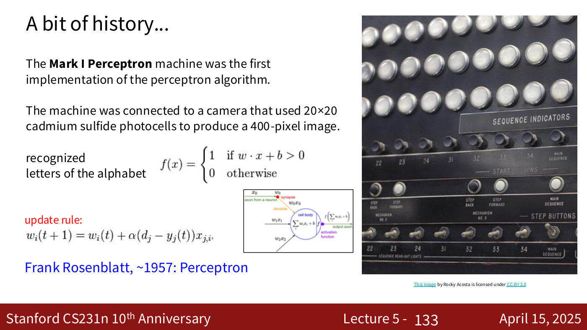

Left text: "The **Mark I Perceptron** machine was the first implementation of the perceptron algorithm.

The machine was connected to a camera that used 20×20 cadmium sulfide photocells to produce a 400-pixel image.

recognized letters of the alphabet"

Formula beside "recognized letters of the alphabet":

$$f(x) = \begin{cases} 1 & \text{if } w \cdot x + b > 0 \cr 0 & \text{otherwise} \end{cases}$$

A boxed neuron diagram (same as slide 117: x0, w0, synapse, dendrite, cell body, activation function, output axon). In red: "update rule:" followed by

$$w_i(t+1) = w_i(t) + \alpha (d_j - y_j(t)) x_{j,i}$$

In blue: "Frank Rosenblatt, ~1957: Perceptron".

Right: a photograph of the Mark I Perceptron control panel, a dark panel with rows of round white indicator lamps, a plate labelled "SEQUENCE INDICATORS", rows of numbered small switches (22, 23, 24, 31, 32, 33, 34), "START BUTTONS", "STEP BACK", "STEP FORWARD", "MAIN SEQUENCE", "MECHANISM NO 3", "STEP BUTTONS" and "SEQUENCE READ-OUT LIGHTS".

Credit line: "This image by Rocky Acosta is licensed under CC-BY 3.0"

## Slide 134 — A bit of history...

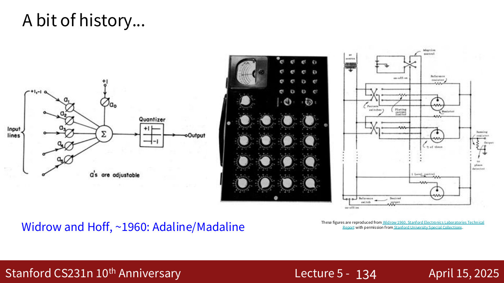

Blue text bottom left: "Widrow and Hoff, ~1960: Adaline/Madaline".

Left figure: a circuit-style diagram. A brace labelled "Input lines" (with "+1, -1" at the top) over five input lines, each passing through an adjustable element labelled $a_1$ to $a_5$ (the slide shows them as a1, a2, a3, a4, a5 with a slanted-arrow symbol), plus a bias input "+1" with element $a_0$ at the top; all go into a summation circle "Σ", then a box labelled "Quantizer" with "+1" and "-1", then an arrow to "Output". Caption under it: "a's are adjustable".

Middle: a photograph of a black hardware unit with a meter at the top left, a few small sockets at the top and a 4-column by 4-row grid of round knobs.

Right: a hand-drawn electrical schematic with resistors and transistors, labelled in small print with words such as "Adaption control", "Reference resistor", "Pattern switches", "Plating current limiter", "Memistor", "Summing resistor", "Output", "Reference switch", "Desired output", "Level control". Text is tiny.

Credit line: "These figures are reproduced from Widrow 1960, Stanford Electronics Laboratories Technical Report with permission from Stanford University Special Collections."

## Slide 135 — A bit of history...

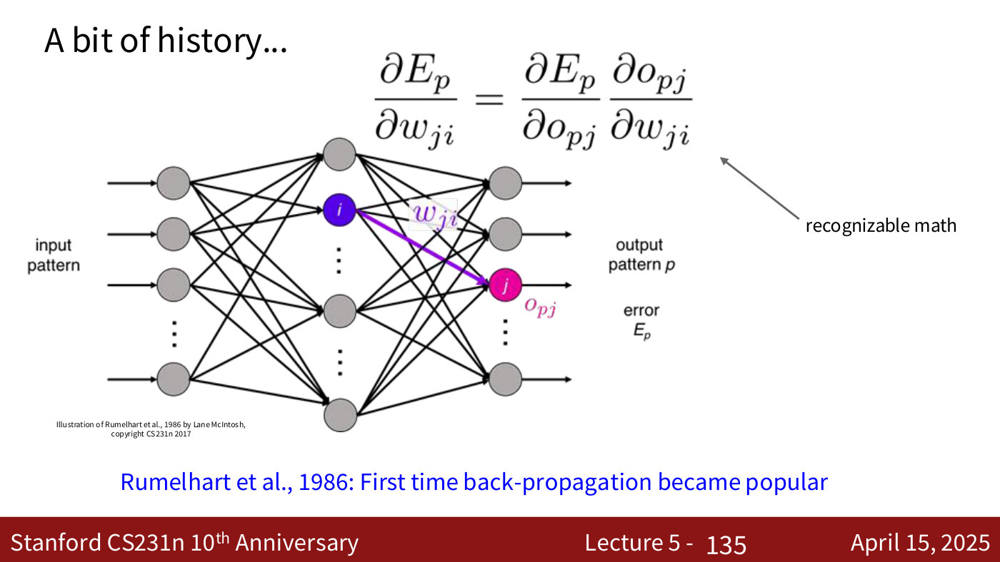

Top: the equation

$$\frac{\partial E_p}{\partial w_{ji}} = \frac{\partial E_p}{\partial o_{pj}} \frac{\partial o_{pj}}{\partial w_{ji}}$$

with a grey arrow from the right pointing at it labelled "recognizable math".

Figure: a three-layer network drawing. Left, a column of grey nodes labelled "input pattern" with arrows entering. A middle column of grey nodes (with vertical ellipses), one node highlighted in blue-violet and marked "i". A right column of grey nodes, one node highlighted in magenta and marked "j". A purple arrow from node i to node j is labelled $w_{ji}$, and the magenta node is labelled $o_{pj}$. Fully connected black lines join adjacent layers. To the right of the output column, "output pattern p" and "error $E_p$".

Blue text at bottom: "Rumelhart et al., 1986: First time back-propagation became popular".

Credit line: "Illustration of Rumelhart et al., 1986 by Lane McIntosh, copyright CS231n 2017"

## Slide 136 — A bit of history...

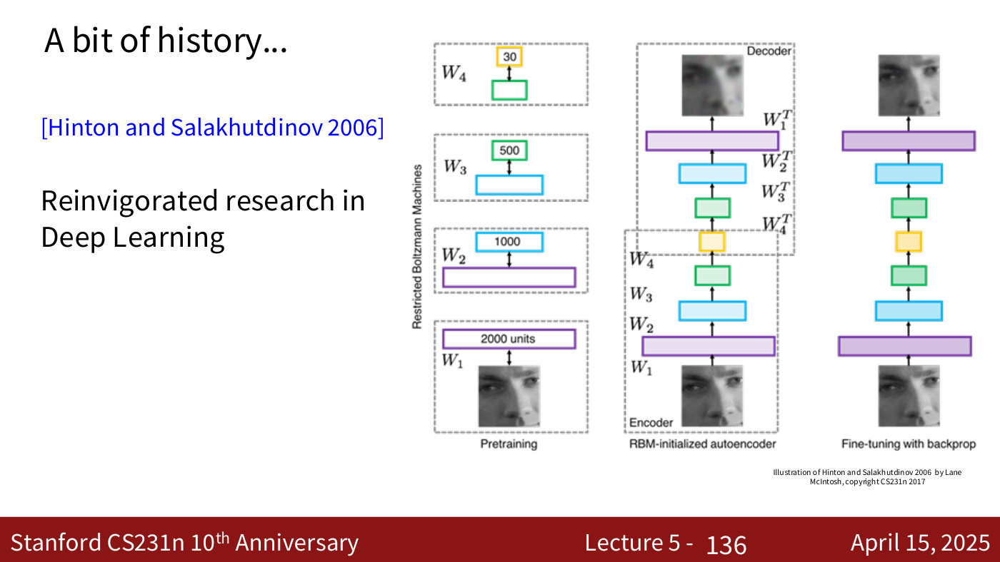

Left: "[Hinton and Salakhutdinov 2006]" (blue), then "Reinvigorated research in Deep Learning".

Right figure, three dashed panels side by side. Left panel column, labelled "Restricted Boltzmann Machines" (rotated) and "Pretraining": four stacked dashed boxes from bottom to top, each holding a pair of layers joined by a weight: face image and purple bar "2000 units" ($W_1$); purple and blue bar "1000" ($W_2$); blue and green bar "500" ($W_3$); green and yellow bar "30" ($W_4$). Middle panel, "RBM-initialized autoencoder": one column read bottom to top. The "Encoder" half rises from a face image through purple, blue, green and yellow bars ($W_1$ to $W_4$); the "Decoder" half continues upward through green, blue and purple bars ($W_4^T$ at the bottom of the decoder up to $W_1^T$) and ends in a reconstructed face image at the top. Right panel, "Fine-tuning with backprop": the same stack of coloured bars with a face image at the bottom and top.

Credit line: "Illustration of Hinton and Salakhutdinov 2006 by Lane McIntosh, copyright CS231n 2017"

## Slide 137 — First strong results

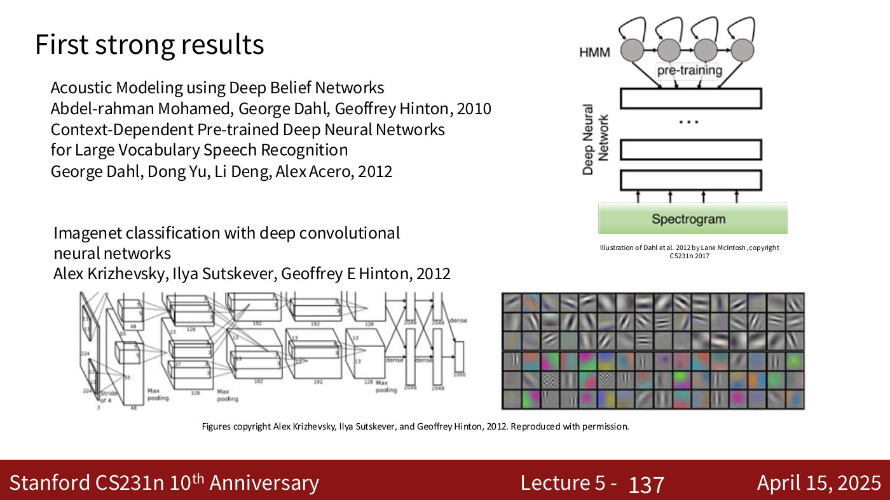

Left text, two groups:

"Acoustic Modeling using Deep Belief Networks
Abdel-rahman Mohamed, George Dahl, Geoffrey Hinton, 2010
Context-Dependent Pre-trained Deep Neural Networks for Large Vocabulary Speech Recognition
George Dahl, Dong Yu, Li Deng, Alex Acero, 2012"

"Imagenet classification with deep convolutional neural networks
Alex Krizhevsky, Ilya Sutskever, Geoffrey E Hinton, 2012"

Top right figure: a speech-recognition diagram. A green bar labelled "Spectrogram" at the bottom, arrows up through stacked white rectangles with "..." (labelled "Deep Neural Network" at left), up to a row of grey circles labelled "HMM" with self-loop arrows and a label "pre-training" among arrows between them. Caption: "Illustration of Dahl et al. 2012 by Lane McIntosh, copyright CS231n 2017".

Bottom left: a large two-stream convolutional network diagram (3D blocks with numbers 224, 55, 48, 128, 27, 192, 13, 2048, "dense", "Stride of 4", "Max pooling"). Bottom right: a grid of 6 rows by 16 columns of small learned filter images, the top three rows greyscale oriented edge patterns, the lower three rows coloured blobs and edges.

Credit line: "Figures copyright Alex Krizhevsky, Ilya Sutskever, and Geoffrey Hinton, 2012. Reproduced with permission."

## Slide 138 — A bit of history:

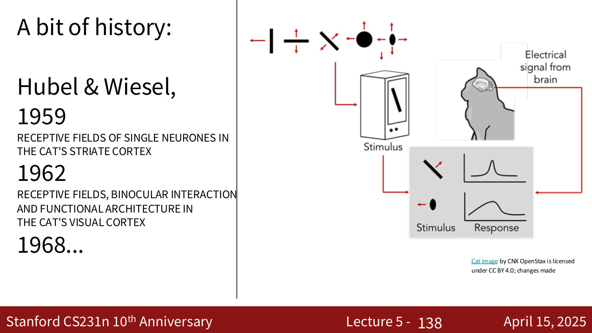

Left text: "Hubel & Wiesel," then "1959" with "RECEPTIVE FIELDS OF SINGLE NEURONES IN THE CAT'S STRIATE CORTEX", then "1962" with "RECEPTIVE FIELDS, BINOCULAR INTERACTION AND FUNCTIONAL ARCHITECTURE IN THE CAT'S VISUAL CORTEX", then "1968...". A thin vertical black line separates the text from the figure.

Right figure: a row of black stimuli at the top (a vertical bar, a horizontal bar, a diagonal bar, a filled circle, a small ellipse) each with red arrows indicating movement direction. A red arrow leads to a screen box showing a slanted bar, labelled "Stimulus". A grey cat silhouette at the upper right with a lit area on its brain, labelled "Electrical signal from brain" with a red line going down to a grey panel. The panel shows, top row, a diagonal-bar stimulus with a plot of a sharp peaked response curve; bottom row, a small ellipse stimulus with an arrow and a plot of a broad humped response curve; panel labels "Stimulus" and "Response".

Credit line: "Cat image by CNX OpenStax is licensed under CC BY 4.0; changes made" ("Cat image" is a link).

## Slide 139 — A bit of history

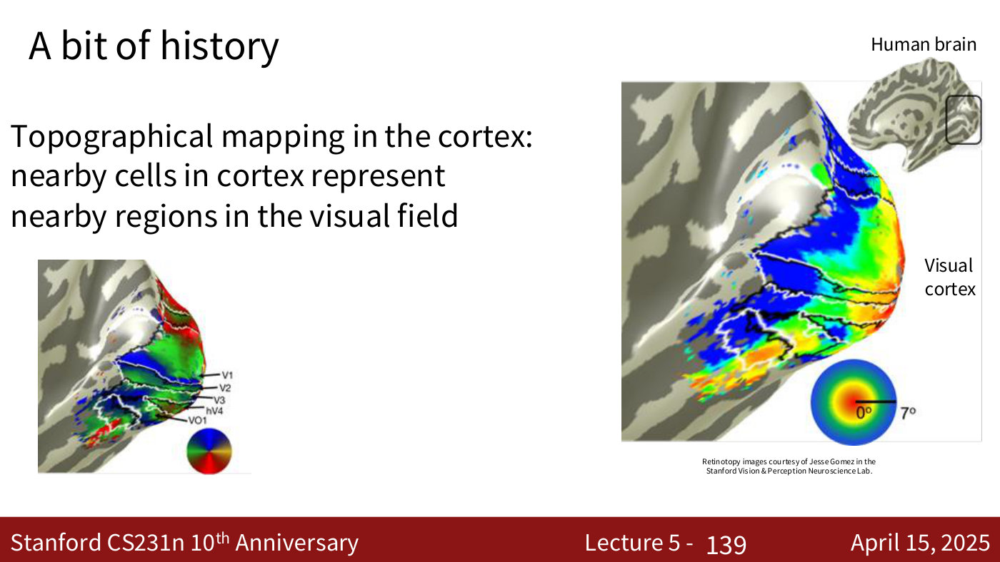

Left text: "Topographical mapping in the cortex: nearby cells in cortex represent nearby regions in the visual field".

Bottom left: a small brain-surface image with coloured regions (green, red, blue) marked with labels "V1", "V2", "V3", "hV4", "VO1" and a colour wheel (blue, green, red, yellow segments). Right: a larger retinotopy map of a visual cortex surface in blue, green, yellow, orange and red, with white outlines of areas, and a circular colour key showing red at the centre labelled "0°" and blue at the edge labelled "7°". At top right a small human brain image with a rectangle marked, labelled "Human brain", and the label "Visual cortex" beside the map.

Credit line: "Retinotopy images courtesy of Jesse Gomez in the Stanford Vision & Perception Neuroscience Lab."

## Slide 140 — Hierarchical organization

Left figure: a grey square labelled "Visual stimulus" (rotated) with a black diagonal bar, and a concentric-circle receptive field (a "+" centre and "-" ring) with two grey lines running to the first column of the network. Labels: "Retinal ganglion cell receptive fields" over a column of three grey circles (with vertical dots; the middle one darker), and "LGN and V1 simple cells" over a second column of circles (with vertical dots; the bottom one darker), with lines from the first column converging onto the darker circle of the second, and lines from the second column leading to "..." on the right. Below the first column, four overlapping concentric circles (with "+" and "-") with a grey arrow to a set of elongated overlapping ellipses with "+" and "-" markings.

Right text:
"**Simple cells:** Response to light orientation"
"**Complex cells:** Response to light orientation and movement"
"**Hypercomplex cells:** response to movement with an end point"

Two grey squares at the bottom right: left shows a long diagonal black bar crossing the whole square, labelled "No response"; right shows a shorter diagonal bar that ends inside the square, labelled "Response (end point)".

Credit line: "Illustration of hierarchical organization in early visual pathways by Lane McIntosh, copyright CS231n 2017"

## Slide 141 — A bit of history:

Left text: "Neocognitron [Fukushima 1980]". Below, small text: "“sandwich” architecture (SCSCSC…)" with letters S in red and C in blue, then in red "simple cells: modifiable parameters", then in blue "complex cells: perform pooling".

Right figure: a left-to-right chain of seven grey rectangular planes of decreasing size (a small input square at the far left, then a large plane, then progressively smaller ones). A cone-shaped connection leaves a circle on the input and reaches a point on the second plane. Two parallel strands of nodes (one upper, one lower) connect through small squares on each successive plane, with crossing lines between the strands on the later planes, ending at the last thin plane.

