# Lecture 6 — Training CNNs and CNN Architectures (slide-by-slide)

Text and figures of all 97 pages of [`lecture_6.pdf`](https://cs231n.stanford.edu/slides/2025/lecture_6.pdf), CS231N (Stanford, Spring 2025), April 17, 2025, presented by Zane Durante (he introduces himself at the start of the recording). The catalog lists this lecture as "CNN Architectures"; the title slide reads "Training CNNs and CNN Architectures". Cite these as "slide N" using the **printed** slide number (footer, after "Lecture 6 -"). The running footer ("Stanford CS231n 10th Anniversary", "Lecture 6 - N", "April 17, 2025") is on every page and is not repeated below. Equations are written in LaTeX; figures are described in prose.

## Slide numbers vs PDF pages

1:1. Every one of the 97 pages prints its number in the footer, and PDF page N is slide N throughout; there are no hidden slides.

**What the recording covers.** The recording opens at 0:05 with the lecturer introducing himself
and the two halves of the lecture (slide 3); the course-logistics slide (2) is never presented.
It then follows the deck in order to the summary (slides 96–97), ending at 1:10:50. Two places
depart from the slides: at 51:34, in the middle of data augmentation, a student question takes
the lecturer back to weight initialization (slide 65); and at 1:05:27–1:06:59 he answers
questions about LoRA and about ResNet's paired convolutions, which no slide shows. See the
[transcript](../transcripts/06-training-cnns-architectures.md).

**Unlabelled axes.** The ILSVRC winners chart (slides 32–34 and 44) prints no y-axis title, and
the accuracy curves (slides 90–93) and the plain-network error curves (slides 46–47) print no tick
values. Where the lecture or another slide says what an axis measures, the wiki page says so and
cites it; this file describes only what is printed.

**Printed oddities.** Four, each transcribed as printed with an `[Ed: …]` line under the slide:
slide 11's LayerNorm annotation says "Statistics calculated per batch" although the shape it
points at (N x 1) gives one mean and one standard deviation per sample; slide 35's VGG16 and
VGG19 stacks draw 15 and 17 weight layers, not 16 and 19 (two "3x3 conv, 256" boxes each);
slide 57's ResNet stack labels its last group "3x3 conv, 64" where slides 53–56 print 512; and
slides 78–79 point to "Lecture 13" for more on visualising features, which in the Spring 2025
schedule is lecture 9's topic. No worked arithmetic in the deck is wrong: the receptive field
(slides 37–42), the parameter count (43), the dropout masks (17), the pooling outputs (7), the
recap's 28x28 maps (6) and the test-time crop count (73) all check.

**Images.** 33 slides are rendered as images, each placed under its heading: 8, 12, 15, 16, 24,
26, 27, 28, 32, 35, 41, 47, 49, 52, 54, 55, 57, 61, 63, 65, 71, 72, 73, 74, 75, 78, 79, 82, 85,
90, 92, 93 and 95. The others have none, because they are the title (1), course logistics (2),
the lecture overview (3–5, 20, 31, 58, 66, 68, 76, 87), recaps of lecture 5 figures whose values
are transcribed (6, 7), the weight-initialization divider (59), text, equations and code
transcribed exactly (10, 11, 17, 18, 19, 45, 48, 60, 62, 64, 67, 69, 70, 77, 86, 88, 89, 94, 96,
97), build steps whose last step is rendered (9, 13, 14, 21, 22 → 8; 23 → 24; 25 → 26; 29–30 →
28; 33, 34, 44 → 32; 37–40 → 41; 46 → 47; 50–51 → 52; 80–81 → 82; 83–84 → 85; 91 → 92), or
repeats of a rendered figure with new text that is transcribed (36, 42, 43 → 35; 53, 56 → 54–55).
Never construct an image path for a slide not listed here.

Companion pages: [wiki page for this lecture](../../wiki/06-training-cnns-architectures.md) · [transcript](../transcripts/06-training-cnns-architectures.md)

## Contents

| Slides | Section |
| ------ | ------- |
| 1–2 | Title; course logistics (Assignment 1 due 4/23; project proposal due 4/25) |
| 3–5 | Lecture overview: how to build CNNs, how to train CNNs |
| 6–7 | Recap: the convolution layer and the pooling layer (max and average pooling) |
| 8–13 | Components of CNNs; normalization layers: LayerNorm (10–11); batch, layer, instance and group norm (12) |
| 14–19 | Dropout: the idea, redundant representations, the ensemble view, test-time scaling, code |
| 20–30 | Activation functions: sigmoid and its small gradients, ReLU, GELU, the activation zoo, where activations go |
| 31–34 | CNN architectures; the ILSVRC winners chart (error and depth by year) |
| 35–43 | Case study: VGGNet (small filters, the receptive field of three 3x3 layers, parameter count) |
| 44–57 | Case study: ResNet (the plain-network degradation, residual blocks, the full architecture) |
| 58–65 | Weight initialization: too small, too large, Kaiming / MSRA |
| 66–67 | Data preprocessing: per-channel mean and std |
| 68–75 | Data augmentation: the regularization pattern, flips, random crops and scales, test-time augmentation, colour jitter, cutout |
| 76–86 | Transfer learning: features of a pretrained network, freezing vs. finetuning, the four-case table, model zoos |
| 87–95 | Choosing hyperparameters: the seven steps, accuracy curves, random vs. grid search |
| 96–97 | Summary of the eight topics |

## Slide 1 — Lecture 6: Training CNNs and CNN Architectures

Title slide. Text: "Lecture 6: Training CNNs and CNN Architectures".

## Slide 2 — Course Logistics

- Assignment 1 is due **next Wednesday** (4/23) at 11:59PM!
- Project proposal deadline is due on **Friday next week** (4/25)

("next Wednesday" and "Friday next week" are in bold red.)

## Slide 3 — Lecture Overview – Two Broad Sets of Topics

Two groups, each with a large label on the left and a curly brace to a four-line list on the right. The top group is highlighted (label in red, list in black); the bottom group is greyed out.

- "How to build CNNs?" (red): Layers in CNNs; Activation Functions; CNN Architectures; Weight Initialization
- "How to train CNNs?" (grey): Data Preprocessing; Data augmentation; Transfer Learning; Hyperparameter Selection

## Slide 4 — Lecture Overview – Two Broad Sets of Topics

Same layout as slide 3, with the highlight switched: "How to build CNNs?" and its list (Layers in CNNs; Activation Functions; CNN Architectures; Weight Initialization) are greyed out, and "How to train CNNs?" (red) with its list (Data Preprocessing; Data augmentation; Transfer Learning; Hyperparameter Selection) is in black.

## Slide 5 — Lecture Overview – Two Broad Sets of Topics

Same as slide 3 (top group highlighted: "How to build CNNs?" in red; bottom group greyed out), plus the first list item "Layers in CNNs" is in red, the other three items (Activation Functions; CNN Architectures; Weight Initialization) in black.

## Slide 6 — Recap: Convolution Layer

A diagram, left to right.

- Left: a 3D slab (pink) labelled "3x32x32 image", with edge labels 3 (depth), 32 and 32.
- Centre: a box labelled "Convolution Layer". An arrow from the image enters it from the left. From above, an arrow from a row of six small coloured cells (blue, green, pink, yellow, purple, orange) captioned "Don't forget bias terms!" points down into the box. From below, an arrow from six small coloured 3D slabs (blue, green, pink, yellow, purple, orange), captioned "6x3x5x5 filters", points up into the box.
- Right: an arrow leaves the box to a stack of six coloured slices (blue, green, pink, yellow, purple, orange) forming a 3D block, captioned above "6 activation maps, each 1x28x28" and below "Stack activations to get a 6x28x28 output image!". A red bold label "Activation Function!" sits at the upper right with an arrow pointing right labelled "(ReLU)".

Credit (bottom left, small): "Slide inspiration: Justin Johnson".

(Check: 32 - 5 + 1 = 28; six filters give 6 maps of 28x28; matches.)

## Slide 7 — Recap: Pooling Layer

Left: a 4x4 grid titled "Single depth slice", with an upward arrow on the left labelled "x" and a rightward arrow below labelled "y". Cells are coloured by 2x2 block. Values by row (top to bottom):

| 1 | 1 | 2 | 4 |
| --- | --- | --- | --- |
| 5 | 6 | 7 | 8 |
| 3 | 2 | 1 | 0 |
| 1 | 2 | 3 | 4 |

Top-left block pink, top-right green, bottom-left yellow, bottom-right blue. An arrow to the right is labelled "pool with 2x2 filters and stride 2".

Right: two 2x2 outputs, with the same block colours.

- "Max Pooling": 6, 8 (top row); 3, 4 (bottom row).
- "Average Pooling": 3.25, 5.25 (top row); 2, 2 (bottom row).

(Check: max of 1,1,5,6 = 6; 2,4,7,8 = 8; 3,2,1,2 = 3; 1,0,3,4 = 4. Averages 14/4 = 3.25; 21/4 = 5.25; 8/4 = 2; 8/4 = 2; matches.)

## Slide 8 — Components of CNNs

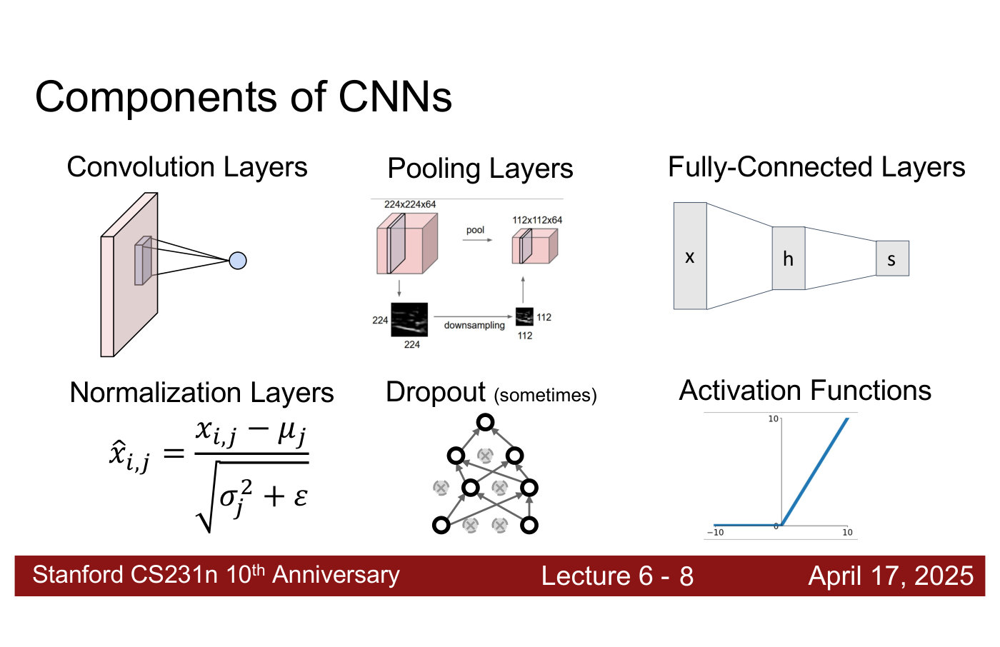

A 2x3 grid of six components, each with a heading and a small figure.

- "Convolution Layers": a pink 3D slab with a small purple patch on its surface, with lines from the patch converging to a single light-blue circle on the right.
- "Pooling Layers": a figure showing a 224x224x64 pink volume, an arrow labelled "pool" to a 112x112x64 volume; below, a dark 224 by 224 image with an arrow labelled "downsampling" to a small 112 by 112 image (labels 224, 224, 112, 112).
- "Fully-Connected Layers": three grey boxes "x", "h", "s" of decreasing height joined by trapezoids.
- "Normalization Layers": the equation $\hat{x}_ {i,j} = \dfrac{x_{i,j} - \mu_j}{\sqrt{\sigma_j^2 + \varepsilon}}$
- "Dropout (sometimes)": a small neural network drawing with circles and arrows, some circles greyed out with an x.
- "Activation Functions": a plot of a ReLU-shaped blue curve, x axis from -10 to 10, y axis labelled up to 10; flat at 0 for negative x, then rising linearly.

## Slide 9 — Components of CNNs

Same as slide 8, plus a red rectangle highlighting the "Normalization Layers" cell (title and equation $\hat{x}_ {i,j} = \dfrac{x_{i,j} - \mu_j}{\sqrt{\sigma_j^2 + \varepsilon}}$).

## Slide 10 — Example Normalization Layer: LayerNorm

**High-level Idea: Learn parameters that let us scale / shift the input data** ("scale / shift" in red)

1. Normalize input data
2. Scale / shift using learned parameters

Citation (bottom): "Ba, Kiros, and Hinton, "Layer Normalization", arXiv 2016"

## Slide 11 — Example Normalization Layer: LayerNorm

Same heading text and list as slide 10 ("High-level Idea: Learn parameters that let us scale / shift the input data"; 1. Normalize input data; 2. Scale / shift using learned parameters), plus a block of monospace text at the lower right:

- "x: N x D"
- A blue rectangle labelled "Normalize" encloses the line $\mu, \sigma$: N x 1; a red arrow points down from the "D" of the x line into this box. To its left, the annotation "Statistics calculated per batch" with an arrow pointing at the box.
- $\gamma, \beta$: 1 x D, with the left annotation "Learned parameters applied to each sample" and an arrow pointing at it.
- $y = \gamma(x-\mu)/\sigma+\beta$

Citation (bottom): "Ba, Kiros, and Hinton, "Layer Normalization", arXiv 2016"

*[Ed: the annotation says "per batch", but the line it points at gives the statistics' shape as N x 1: one mean and one standard deviation for each of the N samples, computed over that sample's D values, which is how the lecturer describes LayerNorm (0:04:45–0:05:31). The layer whose statistics are computed across the batch is batch norm (slide 12). The page prints the shapes with a multiplication sign; this file writes x.]*

## Slide 12 — Other Normalization Layers

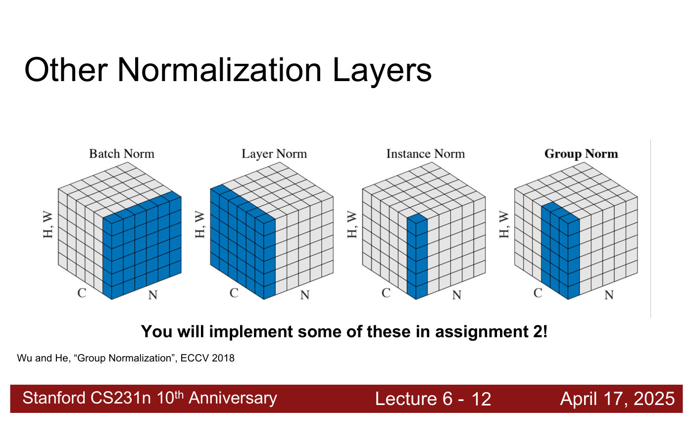

A figure of four 3D cubes side by side, titled (left to right) "Batch Norm", "Layer Norm", "Instance Norm" and "Group Norm" (Group Norm in bold). Each cube is a grid with axes labelled "H, W" (vertical), "C" (depth, toward the lower left) and "N" (horizontal, toward the lower right). Grey cells are not selected; blue cells are the set over which statistics are computed.

- Batch Norm: the blue region is one slice at a single C position, spanning all of N and all of H, W.
- Layer Norm: the blue region is a single N position, spanning all of C and all of H, W.
- Instance Norm: the blue region is a single C position at a single N position, spanning all of H, W (one thin column).
- Group Norm: the blue region is a single N position, spanning a group of three adjacent C positions and all of H, W.

Bold text below the figure: "You will implement some of these in assignment 2!"

Citation (bottom left): "Wu and He, "Group Normalization", ECCV 2018"

## Slide 13 — Components of CNNs

Same as slide 9 (the six-component grid, with a red rectangle around "Normalization Layers" and its equation $\hat{x}_ {i,j} = \dfrac{x_{i,j} - \mu_j}{\sqrt{\sigma_j^2 + \varepsilon}}$).

## Slide 14 — Components of CNNs

Same six-component grid as slide 8, with the red rectangle now around the "Dropout (sometimes)" cell (the small network drawing with some circles greyed out and crossed).

## Slide 15 — Regularization: Dropout

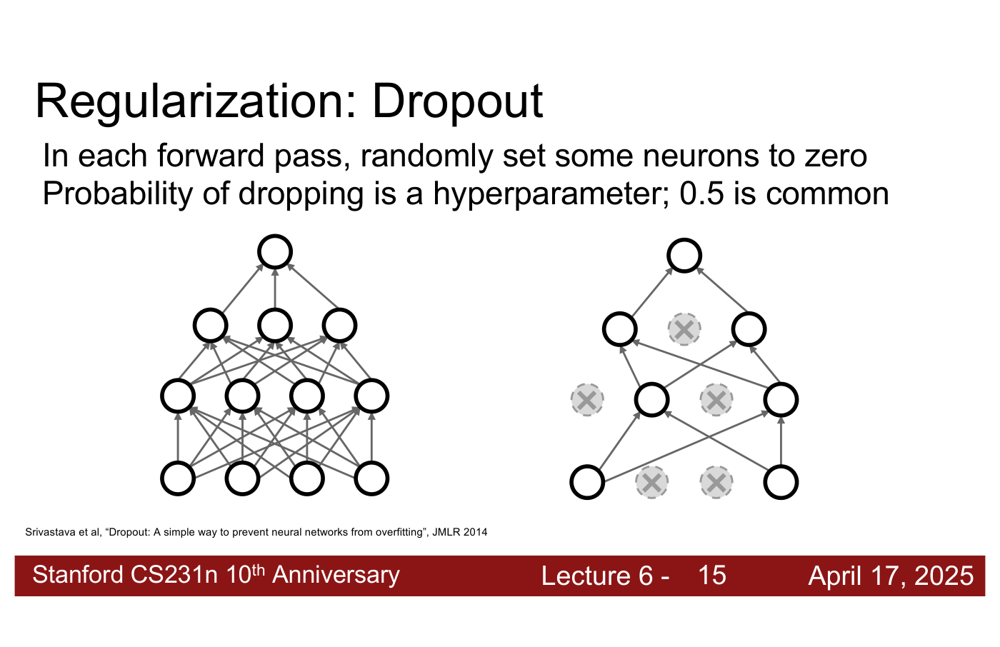

- In each forward pass, randomly set some neurons to zero
- Probability of dropping is a hyperparameter; 0.5 is common

Figure: two small feed-forward network drawings side by side. Left: a full network with 4 input circles at the bottom, 4 circles in the next layer, 3 circles in the next, and 1 output circle at the top; every circle in one layer is joined by an upward arrow to every circle in the next layer. Right: the same network after dropout; the dropped neurons are drawn as light grey dashed circles with an x. Dropped: 1 of the 3 circles in the third layer (the middle one), 2 of the 4 in the second layer (the first and third), and 2 of the 4 inputs (the middle two). Only arrows between the remaining (black) circles are drawn. The remaining circles are: 2 inputs (first and fourth), 2 in the second layer (second and fourth), 2 in the third layer (first and third) and the output.

Citation (bottom): "Srivastava et al, "Dropout: A simple way to prevent neural networks from overfitting", JMLR 2014"

## Slide 16 — Regularization: Dropout

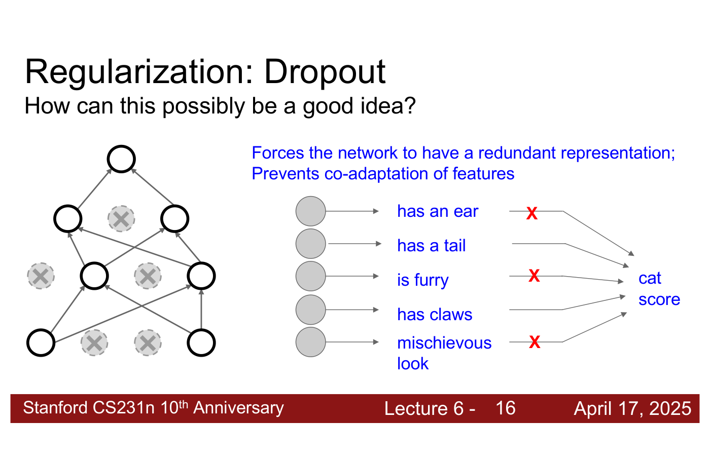

Subtitle: "How can this possibly be a good idea?"

Left: the dropped-out network drawing from slide 15 (right panel), larger.

Right, blue text: "Forces the network to have a redundant representation; Prevents co-adaptation of features"

Below it, a diagram: five grey circles stacked vertically, each with an arrow to a feature label, in order: "has an ear", "has a tail", "is furry", "has claws", "mischievous look". Each feature label has a line leading to a common target on the right labelled "cat score" (the five lines converge on it with arrowheads). Three of the lines ("has an ear", "is furry", "mischievous look") are crossed out by a red "X"; the lines from "has a tail" and "has claws" are not crossed out.

## Slide 17 — Regularization: Dropout

Subtitle: "How can this possibly be a good idea?"

Left: the dropped-out network drawing, as on slide 16.

Right, blue text:

Another interpretation:

Dropout is training a large **ensemble** of models (that share parameters).

Each binary mask is one model

An FC layer with 4096 units has $2^{4096} \sim 10^{1233}$ possible masks! Only $\sim 10^{82}$ atoms in the universe...

(Check: 4096 x log10(2) = 4096 x 0.30103 = 1233.0, so 2^4096 is about 10^1233; matches.)

## Slide 18 — Dropout: Test time

Code block (Python, as printed):

```python
def predict(X):
  # ensembled forward pass
  H1 = np.maximum(0, np.dot(W1, X) + b1) * p # NOTE: scale the activations
  H2 = np.maximum(0, np.dot(W2, H1) + b2) * p # NOTE: scale the activations
  out = np.dot(W3, H2) + b3
```

Text below:

At test time all neurons are active always
=> We must scale the activations so that for each neuron:
<u>output at test time</u> = <u>expected output at training time</u>

("output at test time" and "expected output at training time" are underlined.)

## Slide 19 — Dropout Summary

Code block (left, Python, as printed):

```python
""" Vanilla Dropout: Not recommended implementation (see notes below) """

p = 0.5 # probability of keeping a unit active. higher = less dropout

def train_step(X):
  """ X contains the data """

  # forward pass for example 3-layer neural network
  H1 = np.maximum(0, np.dot(W1, X) + b1)
  U1 = np.random.rand(*H1.shape) < p # first dropout mask
  H1 *= U1 # drop!
  H2 = np.maximum(0, np.dot(W2, H1) + b2)
  U2 = np.random.rand(*H2.shape) < p # second dropout mask
  H2 *= U2 # drop!
  out = np.dot(W3, H2) + b3

  # backward pass: compute gradients... (not shown)
  # perform parameter update... (not shown)

def predict(X):
  # ensembled forward pass
  H1 = np.maximum(0, np.dot(W1, X) + b1) * p # NOTE: scale the activations
  H2 = np.maximum(0, np.dot(W2, H1) + b2) * p # NOTE: scale the activations
  out = np.dot(W3, H2) + b3
```

Title at upper right: "Dropout Summary". Two red rectangles enclose the lines "U1 = ... / H1 *= U1 # drop!" and "U2 = ... / H2 *= U2 # drop!" (the second rectangle slightly overlaps the H2 line above it), with red text to the right: "drop in train time". A blue rectangle encloses the "* p # NOTE: scale the activations" ends of the two lines in predict, with red text "scale at test time".

## Slide 20 — Lecture Overview – Two Broad Sets of Topics

Same as slide 3 (top group "How to build CNNs?" highlighted, bottom group greyed out), with "Activation Functions" in red and the other three items (Layers in CNNs; CNN Architectures; Weight Initialization) in black.

## Slide 21 — Components of CNNs

Same six-component grid as slide 8, with a red rectangle around the "Activation Functions" cell (title and the ReLU-shaped plot).

## Slide 22 — Components of CNNs

Same grid as slide 21 (red rectangle around "Activation Functions"), but the "Normalization Layers" and "Dropout (sometimes)" cells are faded to near-transparent, and over them is large text: "Goal: Introduce non-linearities to our model!" ("non-linearities" in red, the rest in bold black).

## Slide 23 — Activation Functions

Title and formula: "Activation Functions", $\sigma(x) = 1/(1 + e^{-x})$

Left: a plot of one blue curve, labelled "Sigmoid" below it. The x axis runs from -10 to 10 and the y axis is marked 0 and 1. The curve is an S shape: near 0 for x below about -5, rising through about 0.5 at x = 0, and levelling near 1 for x above about 5.

Right:

- Squashes numbers to range [0,1]
- Historically popular since they have nice interpretation as a saturating "firing rate" of a neuron

Key problem:

(red) Many layers of sigmoids -> smaller and smaller gradients.

(bold red) Q: In which regions does sigmoid have a small gradient?

No answer is printed on this slide (slide 24 follows).

## Slide 24 — Activation Functions

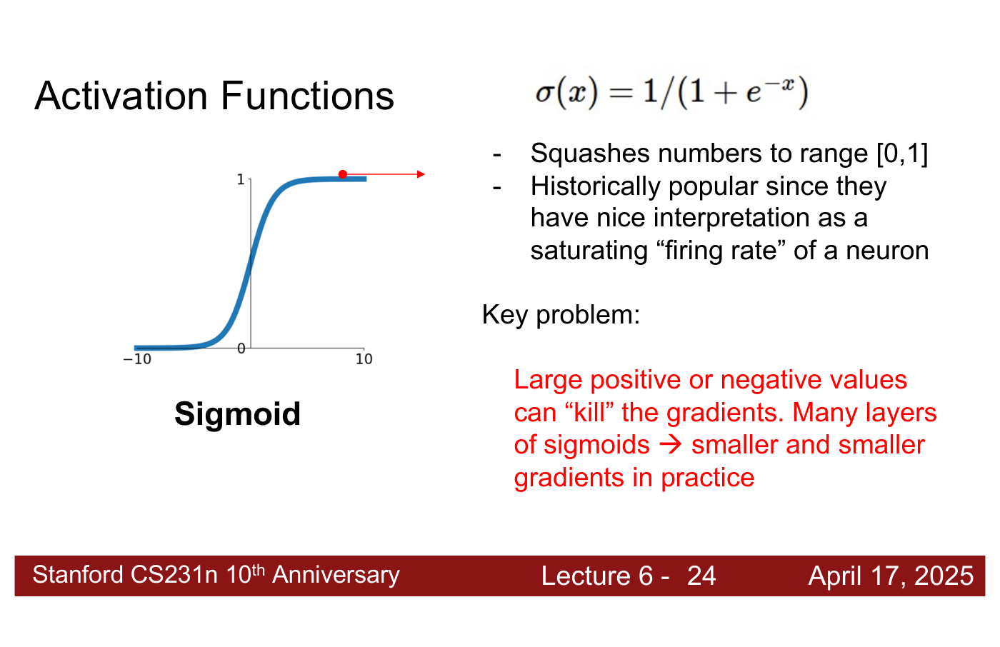

Same as slide 23 (sigmoid formula, plot, the two bullets, "Key problem:"), with these changes. On the plot a red dot sits on the flat top of the curve at about x = 8 with a red arrow pointing right along the curve. The red text now reads: "Large positive or negative values can "kill" the gradients. Many layers of sigmoids -> smaller and smaller gradients in practice". The question from slide 23 is removed.

## Slide 25 — Activation Functions

Left: a plot of a blue ReLU curve (x axis -10 to 10, y axis marked 0 and 10; flat at 0 for x below 0, then rising linearly, reaching 10 at x = 10). Label below: "ReLU" (bold), "(Rectified Linear Unit)".

Right:

- Computes **f(x) = max(0,x)**

In green:

- Does not saturate (in +region)
- Very computationally efficient
- Converges much faster than sigmoid in practice (e.g. 6x)

Citation (blue, lower right): "[Krizhevsky et al., 2012]"

## Slide 26 — Activation Functions

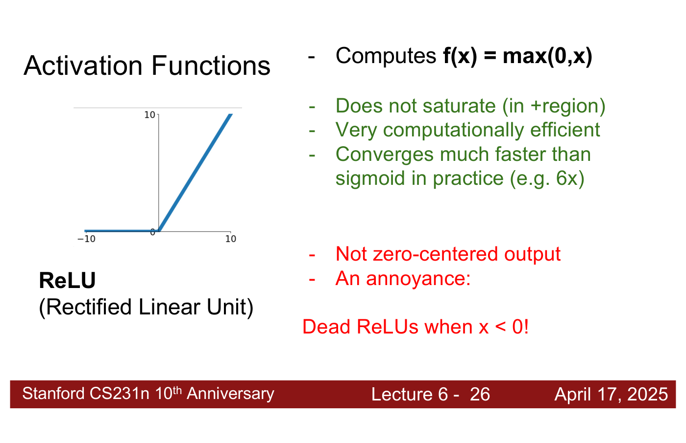

Same as slide 25 (ReLU plot, label, f(x) = max(0,x), the three green bullets), without the citation, plus in red:

- Not zero-centered output
- An annoyance:

Dead ReLUs when x < 0!

## Slide 27 — Activation Functions

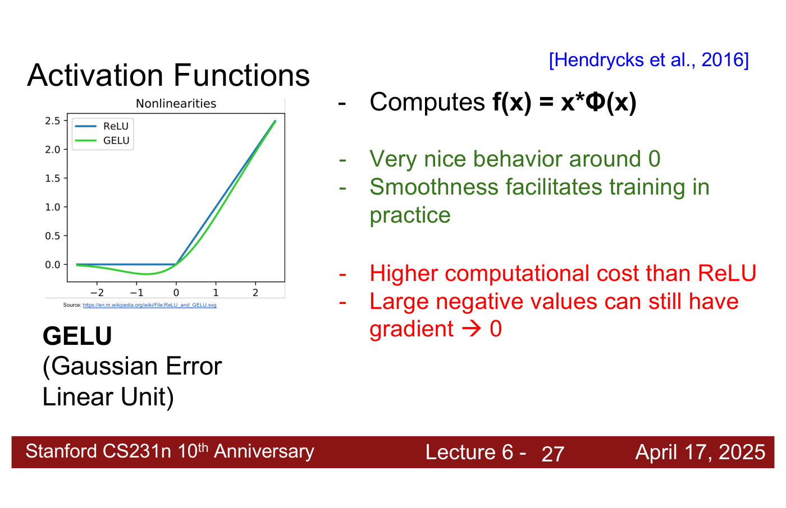

Citation (blue, upper right): "[Hendrycks et al., 2016]"

Left: a chart titled "Nonlinearities" with two series (2 series), x axis from about -2.5 to 2.5 (ticks -2, -1, 0, 1, 2), y axis ticks 0.0 to 2.5 in steps of 0.5, with a legend "ReLU" (blue) and "GELU" (green).

- ReLU (blue): 0.0 for x below 0, then a straight line y = x, reaching about 2.5 at x = 2.5.
- GELU (green): a smooth curve that dips slightly below zero for negative x (minimum about -0.17 near x = -0.75, about -0.05 at x = -2), passes through 0 at x = 0, lies just under the ReLU line for positive x (about 0.84 at x = 1, about 1.95 at x = 2), and meets it at about 2.5 at x = 2.5. (Values read approximately from the plot.)

Small credit under the chart: "Source: https://en.m.wikipedia.org/wiki/File:ReLU_and_GELU.svg"

Label below: "GELU" (bold), "(Gaussian Error Linear Unit)".

Right:

- Computes **f(x) = x\*Φ(x)**

In green:

- Very nice behavior around 0
- Smoothness facilitates training in practice

In red:

- Higher computational cost than ReLU
- Large negative values can still have gradient -> 0

## Slide 28 — Activation Function Zoo

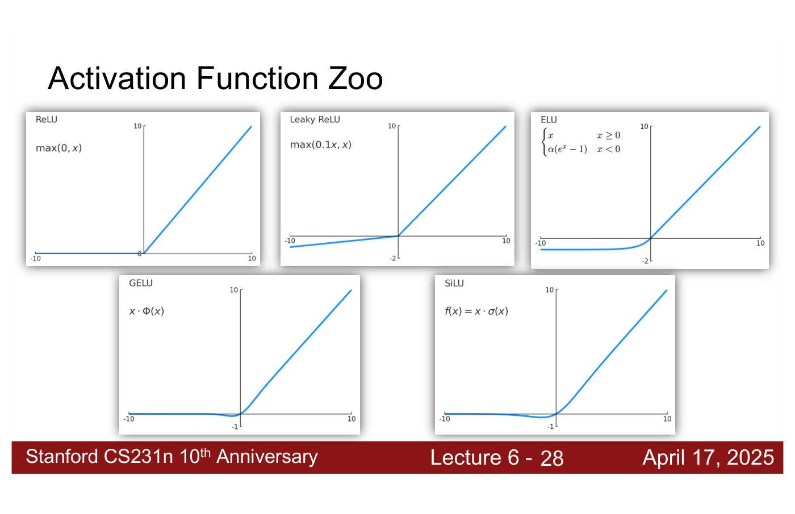

Five small plots, three in the top row and two in the bottom row, each a single blue curve on axes from -10 to 10 with the upper y limit labelled 10. Five series in total, one per panel.

- "ReLU", formula $\max(0, x)$: y axis marks 0 and 10; flat at 0 for x < 0, then a straight line rising to 10 at x = 10.
- "Leaky ReLU", formula $\max(0.1x, x)$: y axis marks -2 and 10; a shallow line with slope 0.1 on the negative side (about -1 at x = -10), then a straight line y = x on the positive side.
- "ELU", formula printed as a piecewise definition: $x$ for $x \geq 0$ and $\alpha(e^x - 1)$ for $x \lt 0$: y axis marks -2 and 10; the negative side flattens to a constant near -1 (about -1 to -2 on the scale shown), the positive side is the line y = x.
- "GELU", formula $x \cdot \Phi(x)$: y axis marks -1 and 10; near 0 for negative x with a very small dip below zero near x = -1 (about -0.17), then rising along y = x.
- "SiLU", formula $f(x) = x \cdot \sigma(x)$: y axis marks -1 and 10; near 0 for negative x with a small dip below zero (about -0.28 near x = -1.3), then rising along y = x.

## Slide 29 — Activation Function Zoo

Same as slide 28, but the top row (ReLU, Leaky ReLU, ELU) is faded out and the GELU and SiLU plots in the bottom row remain. Over the faded top row, red bold text: "Q: Where are activations used in CNNs?"

No answer is printed on this slide (slide 30 follows).

## Slide 30 — Activation Function Zoo

Same as slide 29, with the answer added in blue bold text below the question:

"Q: Where are activations used in CNNs?" (red)

"A: Generally placed after linear operators (feedforward/linear layer, convolutional layer, etc.)" (blue)

## Slide 31 — Lecture Overview – Two Broad Sets of Topics

Same as slide 3 (top group "How to build CNNs?" highlighted, bottom group greyed out), with "CNN Architectures" in red and the other three items (Layers in CNNs; Activation Functions; Weight Initialization) in black.

## Slide 32 — ImageNet Large Scale Visual Recognition Challenge (ILSVRC) winners

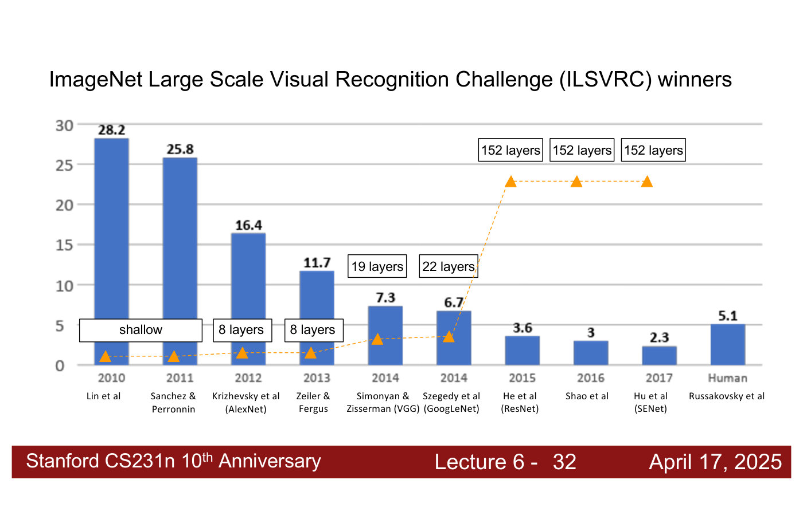

A bar chart with an overlaid dashed line. The y axis is unlabelled, with gridlines at 0, 5, 10, 15, 20, 25, 30 (the slide does not say what the y axis measures). The x axis has ten categories, each labelled with a year and an author line. Two series: (1) ten blue bars with a printed value above each, and (2) an orange dashed line with triangle markers, one marker per year for the nine years 2010 to 2017 (the "Human" bar has no marker), whose height is not tied to the y axis but is annotated by white boxes giving the number of layers.

Blue bars (label; printed value):

- 2010, Lin et al: 28.2
- 2011, Sanchez & Perronnin: 25.8
- 2012, Krizhevsky et al (AlexNet): 16.4
- 2013, Zeiler & Fergus: 11.7
- 2014, Simonyan & Zisserman (VGG): 7.3
- 2014, Szegedy et al (GoogLeNet): 6.7
- 2015, He et al (ResNet): 3.6
- 2016, Shao et al: 3
- 2017, Hu et al (SENet): 2.3
- Human, Russakovsky et al: 5.1

Orange triangle series with its white annotation boxes:

- 2010: triangle near 1, box "shallow" (the box spans the 2010 and 2011 columns)
- 2011: triangle near 1 (covered by the same "shallow" box)
- 2012: triangle near 1.5, box "8 layers"
- 2013: triangle near 1.5, box "8 layers"
- 2014 (VGG): triangle near 3, box "19 layers"
- 2014 (GoogLeNet): triangle near 3.5, box "22 layers"
- 2015: triangle at about 23, box "152 layers"
- 2016: triangle at about 23, box "152 layers"
- 2017: triangle at about 23, box "152 layers"

The dashed line stays low from 2010 to 2014, then rises steeply from the 2014 GoogLeNet triangle to the 2015 triangle and runs flat across 2016 and 2017. The "19 layers" and "22 layers" boxes sit at about y = 10–12, well above their triangles; the three "152 layers" boxes sit at about y = 27, just above theirs.

## Slide 33 — ImageNet Large Scale Visual Recognition Challenge (ILSVRC) winners

Same chart as slide 32, plus a red rectangle around the 2012 column (the 16.4 bar, its "8 layers" box and its label "Krizhevsky et al (AlexNet)").

## Slide 34 — ImageNet Large Scale Visual Recognition Challenge (ILSVRC) winners

Title: "ImageNet Large Scale Visual Recognition Challenge (ILSVRC) winners".

Bar chart with one series of blue bars (10 bars), plus an overlaid second series of orange triangles joined by a dashed orange line (layer count, annotated by boxed labels). The y-axis has gridlines at 0, 5, 10, 15, 20, 25, 30 and no axis title. The x-axis has a year label and an author label under each bar. Printed bar values and labels:

- 2010, "Lin et al": 28.2
- 2011, "Sanchez & Perronnin": 25.8
- 2012, "Krizhevsky et al (AlexNet)": 16.4
- 2013, "Zeiler & Fergus": 11.7
- 2014, "Simonyan & Zisserman (VGG)": 7.3
- 2014, "Szegedy et al (GoogLeNet)": 6.7
- 2015, "He et al (ResNet)": 3.6
- 2016, "Shao et al": 3
- 2017, "Hu et al (SENet)": 2.3
- "Human", "Russakovsky et al": 5.1

Orange triangle series (second series, 9 points, one per challenge year; none for Human), each with a boxed label; triangle heights read against the same y-axis, approximate:

- 2010: boxed label "shallow", triangle at about 1
- 2011: no separate box (the "shallow" box spans 2010 and 2011), triangle at about 1
- 2012: "8 layers", triangle at about 1.5
- 2013: "8 layers", triangle at about 1.5
- 2014 (VGG): "19 layers", triangle at about 3.3
- 2014 (GoogLeNet): "22 layers", triangle at about 3.5
- 2015: "152 layers", triangle at about 23
- 2016: "152 layers", triangle at about 23
- 2017: "152 layers", triangle at about 23

A red rectangle outlines the 2014 Simonyan & Zisserman (VGG) bar together with its "19 layers" label. The slide gives no axis title and does not say what the bar values measure.

## Slide 35 — Case Study: VGGNet

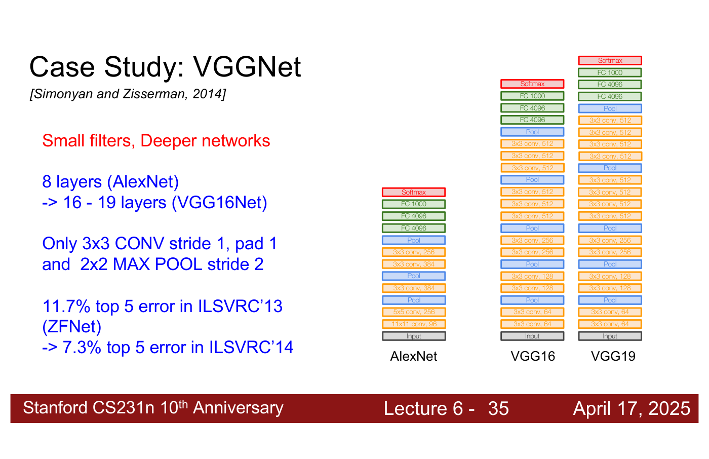

Title "Case Study: VGGNet", citation "[Simonyan and Zisserman, 2014]".

Left text (first line red, the rest blue):

- Small filters, Deeper networks
- 8 layers (AlexNet) -> 16 - 19 layers (VGG16Net)
- Only 3x3 CONV stride 1, pad 1 and 2x2 MAX POOL stride 2
- 11.7% top 5 error in ILSVRC'13 (ZFNet) -> 7.3% top 5 error in ILSVRC'14

Right: three vertical stacks of coloured layer boxes, drawn bottom (input) to top (softmax), labelled underneath "AlexNet", "VGG16", "VGG19". Orange boxes are conv layers, blue are Pool, green are FC, red is Softmax, grey is Input.

- AlexNet (bottom to top): Input; 11x11 conv, 96; 5x5 conv, 256; Pool; 3x3 conv, 384; Pool; 3x3 conv, 384; 3x3 conv, 256; Pool; FC 4096; FC 4096; FC 1000; Softmax.
- VGG16 (bottom to top): Input; 3x3 conv, 64; 3x3 conv, 64; Pool; 3x3 conv, 128; 3x3 conv, 128; Pool; 3x3 conv, 256; 3x3 conv, 256; Pool; 3x3 conv, 512; 3x3 conv, 512; 3x3 conv, 512; Pool; 3x3 conv, 512; 3x3 conv, 512; 3x3 conv, 512; Pool; FC 4096; FC 4096; FC 1000; Softmax (22 boxes).
- VGG19 (bottom to top): Input; 3x3 conv, 64; 3x3 conv, 64; Pool; 3x3 conv, 128; 3x3 conv, 128; Pool; 3x3 conv, 256; 3x3 conv, 256; Pool; 3x3 conv, 512 (four boxes); Pool; 3x3 conv, 512 (four boxes); Pool; FC 4096; FC 4096; FC 1000; Softmax (26 boxes).

*[Ed: the drawn stacks do not add up to their names. Counting weight layers (conv and FC boxes): AlexNet 5 + 3 = 8, as the text says; VGG16 12 + 3 = 15; VGG19 14 + 3 = 17. Both VGG stacks draw two "3x3 conv, 256" boxes. Checked on the 600 dpi render and on this slide's 1400px image. The same stacks recur on slides 36 and 42–43.]*

## Slide 36 — Case Study: VGGNet

Title "Case Study: VGGNet", citation "[Simonyan and Zisserman, 2014]".

Text (red): "Q: Why use smaller filters? (3x3 conv)". No answer is printed on this slide.

Right: the same AlexNet, VGG16 and VGG19 layer stacks as slide 35.

## Slide 37 — Case Study: VGGNet

Title "Case Study: VGGNet", citation "[Simonyan and Zisserman, 2014]".

Text (red): "Q: What is the effective receptive field of three 3x3 conv (stride 1) layers?"

Diagram: four 8x8 grids of cells in a row, labelled above "Input", "A1", "A2", "A3". Grey arrows below connect them left to right, labelled "Conv1 (3x3)" (Input to A1, curved arrow), "Conv2 (3x3)" (A1 to A2) and "Conv3 (3x3)" (A2 to A3). In this first step a red 3x3 square is drawn on grid A2 with red lines converging to a single red cell on A3 (one A3 cell looks at a 3x3 region of A2).

Right: VGG16 and VGG19 stacks only (labelled "VGG16", "VGG19"), as on slide 35.

## Slide 38 — Case Study: VGGNet

Same as slide 37, plus orange boxes: two overlapping orange 3x3 squares on grid A1 (offset diagonally), each with orange lines converging to a corner cell of the red 3x3 square on A2 (the top-right and bottom-right corner cells of the red square), showing the A1 region seen by those A2 cells.

Text: "Q: What is the effective receptive field of three 3x3 conv (stride 1) layers?"

## Slide 39 — Case Study: VGGNet

Same as slide 38, plus a blue square on grid A1 enclosing the union of the two orange 3x3 squares (a 5x5 region of A1).

Text: "Q: What is the effective receptive field of three 3x3 conv (stride 1) layers?"

## Slide 40 — Case Study: VGGNet

Same as slide 39, plus two purple 3x3 squares on the Input grid (one at the top-left corner, one lower and to the right), each with purple lines converging to a small purple cell in the corner of the blue 5x5 region on A1 (the top-left and bottom-right cells of that region).

Text: "Q: What is the effective receptive field of three 3x3 conv (stride 1) layers?"

## Slide 41 — Case Study: VGGNet

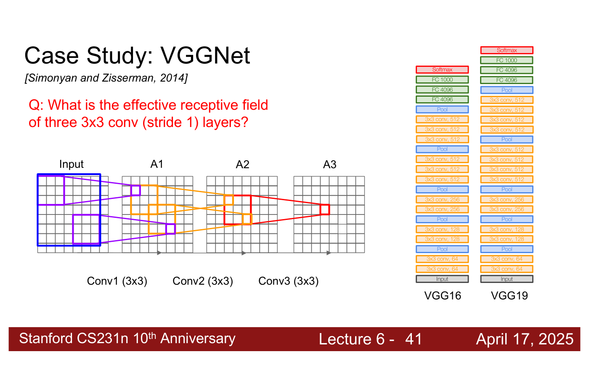

Same as slide 40, plus a blue square on the Input grid enclosing the union of the two purple 3x3 squares (a 7x7 region of the Input); the blue 5x5 square on A1 is not drawn on this slide. The final picture: a single red cell on A3 and a red 3x3 square on A2; two orange 3x3 squares on A1; two purple 3x3 squares and the blue 7x7 square on the Input. All four grids are 8x8 cells.

Text: "Q: What is the effective receptive field of three 3x3 conv (stride 1) layers?"

## Slide 42 — Case Study: VGGNet

Title "Case Study: VGGNet", citation "[Simonyan and Zisserman, 2014]".

Text:

- (red) "Q: Why use smaller filters? (3x3 conv)"
- (blue) "Stack of three 3x3 conv (stride 1) layers has same **effective receptive field** as one 7x7 conv layer"
- (red) "[7x7]"

Right: AlexNet, VGG16 and VGG19 stacks as on slide 35.

## Slide 43 — Case Study: VGGNet

Title "Case Study: VGGNet", citation "[Simonyan and Zisserman, 2014]".

Text:

- (red) "Q: Why use smaller filters? (3x3 conv)"
- (blue) "Stack of three 3x3 conv (stride 1) layers has same **effective receptive field** as one 7x7 conv layer"
- (blue) "But deeper, more non-linearities"
- (blue) "And fewer parameters: 3 \* (3²C²) vs. 7²C² for C channels per layer"

(Check: three 3x3 layers give $3 \cdot 9C^2 = 27C^2$ parameters versus $49C^2$ for one 7x7 layer, ignoring biases; matches. The 7x7 receptive field follows from 1 + 3\*2 = 7; matches.)

Right: AlexNet, VGG16 and VGG19 stacks as on slide 35.

## Slide 44 — ImageNet Large Scale Visual Recognition Challenge (ILSVRC) winners

Same chart as slide 34 (same 10 blue bars with values 28.2, 25.8, 16.4, 11.7, 7.3, 6.7, 3.6, 3, 2.3, 5.1 and the same orange triangle series with boxed labels "shallow", "8 layers", "8 layers", "19 layers", "22 layers", "152 layers" x3), except that the red rectangle around the VGG bar is gone. Instead, a red rectangle encloses the last three challenge years (2015 He et al (ResNet), 2016 Shao et al, 2017 Hu et al (SENet)) including their "152 layers" labels and author labels, with a red label above it, "“Revolution of Depth”", and a red arrow from that label to the rectangle.

## Slide 45 — Case Study: ResNet

Title "Case Study: ResNet", citation "[He et al., 2015]".

Text: "What happens when we continue stacking deeper layers on a “plain” convolutional neural network?" No answer or figure on this slide.

## Slide 46 — Case Study: ResNet

Title "Case Study: ResNet", citation "[He et al., 2015]".

Text: "What happens when we continue stacking deeper layers on a “plain” convolutional neural network?"

Two line plots side by side, each with two curves and no numeric tick values on either axis.

- Left plot: y-axis "Test error", x-axis "Iterations". Two curves: a red curve labelled "56-layer", starting higher, flat, dropping in a step partway across, then flattening and ending slightly rising, always above the blue curve; and a light-blue curve labelled "20-layer", starting lower, with a similar step drop, ending below the red curve.
- Right plot: y-axis "Training error", x-axis "Iterations". Two curves: red "56-layer" and light-blue "20-layer". The blue curve decreases smoothly, steps down around the middle and then flattens near the bottom; the red curve starts higher, steps down at a later point and ends at a clearly higher value than the blue one. The 56-layer curve is above the 20-layer curve throughout.

## Slide 47 — Case Study: ResNet

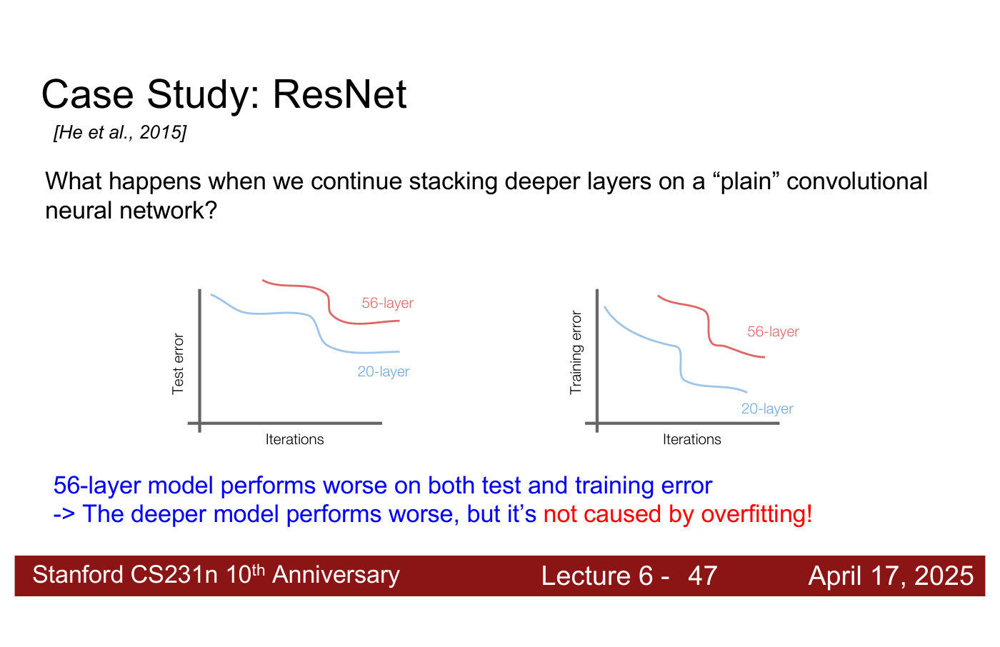

Same as slide 46 (same two plots), plus text beneath, blue with the final words in red:

"56-layer model performs worse on both test and training error
-> The deeper model performs worse, but it’s not caused by overfitting!" ("not caused by overfitting!" is printed in red.)

## Slide 48 — Case Study: ResNet

Title "Case Study: ResNet", citation "[He et al., 2015]".

Text:

- "Fact: Deep models have more representation power (more parameters) than shallower models."
- "Hypothesis: the problem is an *optimization* problem, **deeper models are harder to optimize**" ("optimization" is italic; "deeper models are harder to optimize" is bold.)

## Slide 49 — Case Study: ResNet

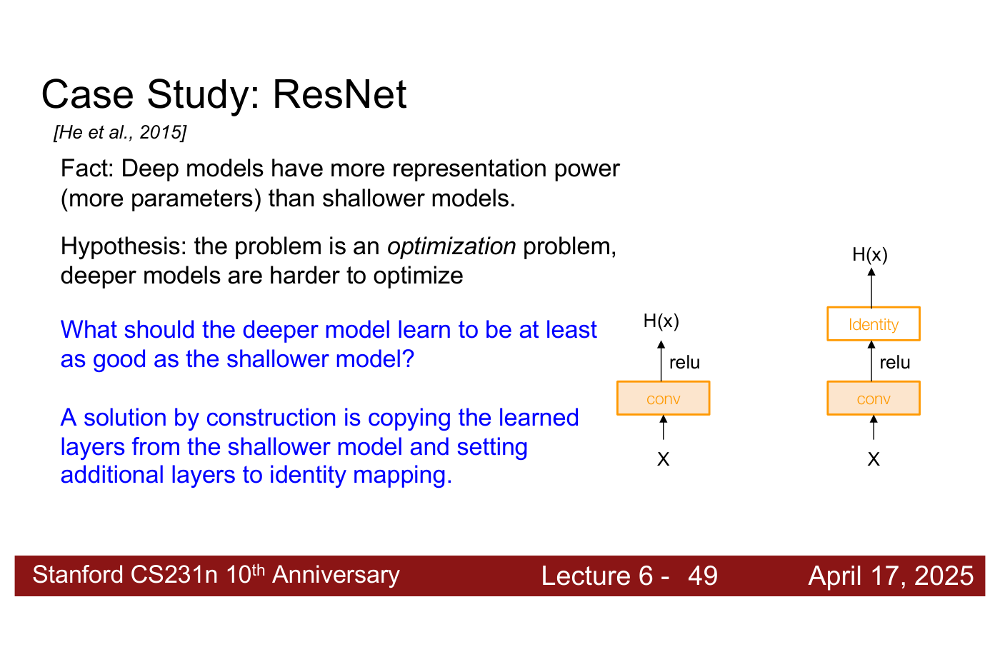

Title "Case Study: ResNet", citation "[He et al., 2015]".

Text (black, then blue):

- "Fact: Deep models have more representation power (more parameters) than shallower models."
- "Hypothesis: the problem is an *optimization* problem, deeper models are harder to optimize"
- (blue) "What should the deeper model learn to be at least as good as the shallower model?"
- (blue) "A solution by construction is copying the learned layers from the shallower model and setting additional layers to identity mapping."

Right: two small vertical diagrams. Left diagram, bottom to top: "X" with an arrow up into an orange box "conv", an arrow labelled "relu" up to "H(x)". Right diagram, bottom to top: "X", arrow into orange box "conv", arrow labelled "relu" into an orange box "Identity", arrow up to "H(x)".

## Slide 50 — Case Study: ResNet

Title "Case Study: ResNet", citation "[He et al., 2015]".

Text: "Solution: Use network layers to fit a residual mapping instead of directly trying to fit a desired underlying mapping"

Diagram, bottom to top: "X" (caption "“Plain” layers" under it), arrow up into an orange box "conv", an arrow labelled "relu" into a second orange box "conv", an arrow up to "H(x)".

## Slide 51 — Case Study: ResNet

Title "Case Study: ResNet", citation "[He et al., 2015]".

Text: "Solution: Use network layers to fit a residual mapping instead of directly trying to fit a desired underlying mapping"

Left diagram: the "Plain" layers diagram from slide 50 (X, conv, relu, conv, H(x), caption "“Plain” layers").

Middle diagram, captioned "Residual block", bottom to top: "X" at an open circle; an arrow up into an orange box "conv"; an arrow labelled "relu" into a second orange box "conv" (the pair is labelled "F(x)" at the left); an arrow up into a circled plus sign (labelled "H(x) = F(x) + x" at its left); an arrow labelled "relu" leaves the plus upward. A curved black arrow from the open circle at X goes around the right side of the two conv boxes into the plus sign, labelled "X identity".

Blue text at upper right: "Identity mapping: H(x) = x if F(x) = 0".

## Slide 52 — Case Study: ResNet

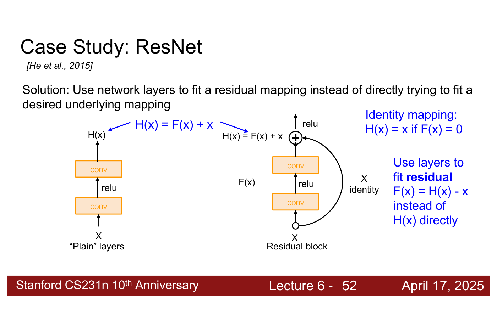

Same as slide 51, plus: blue text "H(x) = F(x) + x" at the top centre with two blue arrows, one pointing to the "H(x)" output of the plain-layers diagram and one to the "H(x) = F(x) + x" label on the residual block; and blue text at the lower right: "Use layers to fit **residual** F(x) = H(x) - x instead of H(x) directly" ("residual" in bold).

## Slide 53 — Case Study: ResNet

Title "Case Study: ResNet", citation "[He et al., 2015]".

Blue text at left: "Full ResNet architecture:" followed by two dash items: "Stack residual blocks"; "Every residual block has two 3x3 conv layers".

Centre diagram, a larger residual block, bottom to top: "X" at an open circle (caption "Residual block"); arrow into an orange box "3x3 conv"; an arrow labelled "relu" into an orange box "3x3 conv" (the pair labelled "F(x)"); arrow into a circled plus (labelled "F(x) + x"); arrow labelled "relu" upward. A curved black arrow from X around the right into the plus, labelled "X identity". A blue bracket at the right of this block spans the height of the stack of layers drawn at the far right, with a blue line pointing into the stack.

Far right: a vertical architecture stack, bottom to top, with curved skip arrows (grey) over each pair of 3x3 conv boxes: Input (grey); "7x7 conv, 64, / 2" (orange); Pool (blue); three pairs of "3x3 conv, 64" (six boxes, dark red outline); then "3x3 conv, 128, / 2" and "3x3 conv, 128" (first pair) followed by two further pairs of "3x3 conv, 128" (six boxes in all, purple); a vertical dotted line "..." showing omitted layers; then (yellow) "3x3 conv, 512, / 2", "3x3 conv, 512", followed by two further pairs of "3x3 conv, 512" (six boxes in all); Pool (blue); FC 1000 (green); Softmax (red).

## Slide 54 — Case Study: ResNet

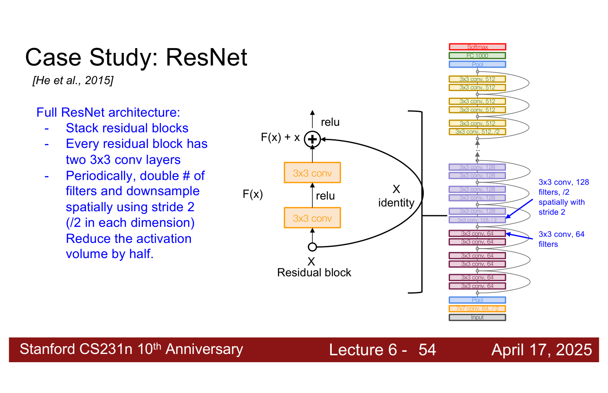

Title "Case Study: ResNet", citation "[He et al., 2015]".

Blue text at left: "Full ResNet architecture:" followed by dash items:

- Stack residual blocks
- Every residual block has two 3x3 conv layers
- Periodically, double # of filters and downsample spatially using stride 2 (/2 in each dimension)
- Reduce the activation volume by half.

(The last line, "Reduce the activation volume by half.", is printed as a continuation of the third item with no dash of its own.)

Figures: same as slide 53 (the 3x3 conv residual block "F(x) + x" with "X identity" skip, and the full-network stack at the right with a bracket), plus two blue annotations with arrows at the right of the stack: "3x3 conv, 128 filters, /2 spatially with stride 2" pointing at the "3x3 conv, 128, / 2" box, and "3x3 conv, 64 filters" pointing at the lowest-but-three 64-filter box (the first "3x3 conv, 64" above the Pool).

## Slide 55 — Case Study: ResNet

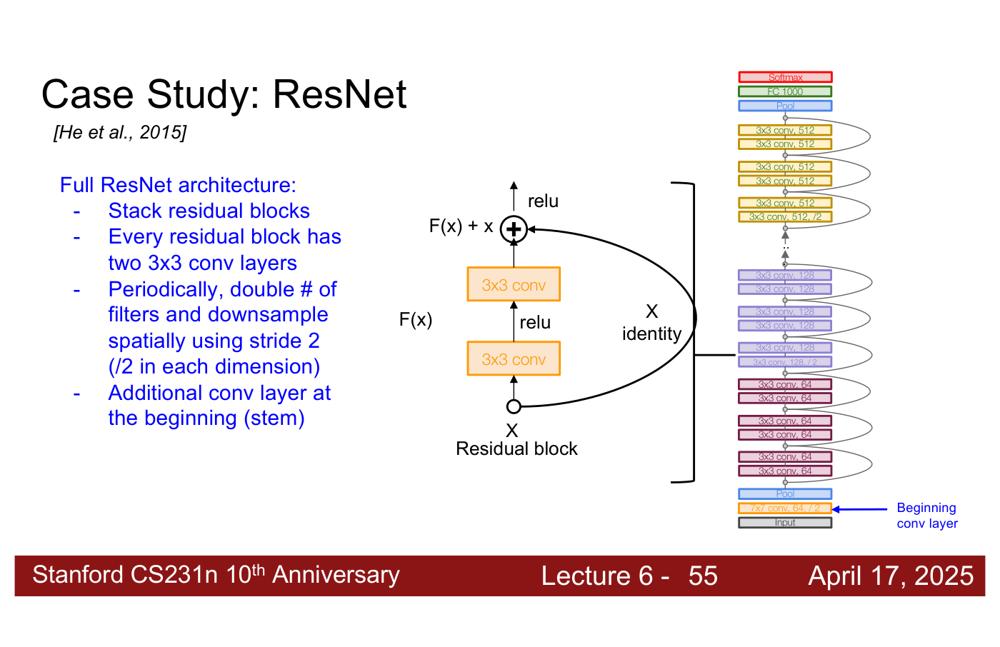

Same as slide 53 (residual block and full-network stack), with blue text at left:

"Full ResNet architecture:"

- Stack residual blocks
- Every residual block has two 3x3 conv layers
- Periodically, double # of filters and downsample spatially using stride 2 (/2 in each dimension)
- Additional conv layer at the beginning (stem)

A blue annotation "Beginning conv layer" with an arrow points to the "7x7 conv, 64, / 2" box at the bottom of the stack.

## Slide 56 — Case Study: ResNet

Title "Case Study: ResNet", citation "[He et al., 2015]".

Blue text with a blue arrow pointing to the dotted gap in the middle of the stack: "Total depths of 18, 34, 50, 101, or 152 layers for ImageNet".

Figure: the full-network ResNet stack alone (bottom to top): Input; "7x7 conv, 64, / 2"; Pool; three pairs of "3x3 conv, 64"; "3x3 conv, 128, / 2" and "3x3 conv, 128" followed by two further pairs of "3x3 conv, 128"; a dotted gap ("..."); "3x3 conv, 512, / 2" and "3x3 conv, 512" followed by two further pairs of "3x3 conv, 512"; Pool; FC 1000; Softmax; grey curved skip arrows over each pair of conv boxes.

## Slide 57 — Case Study: ResNet

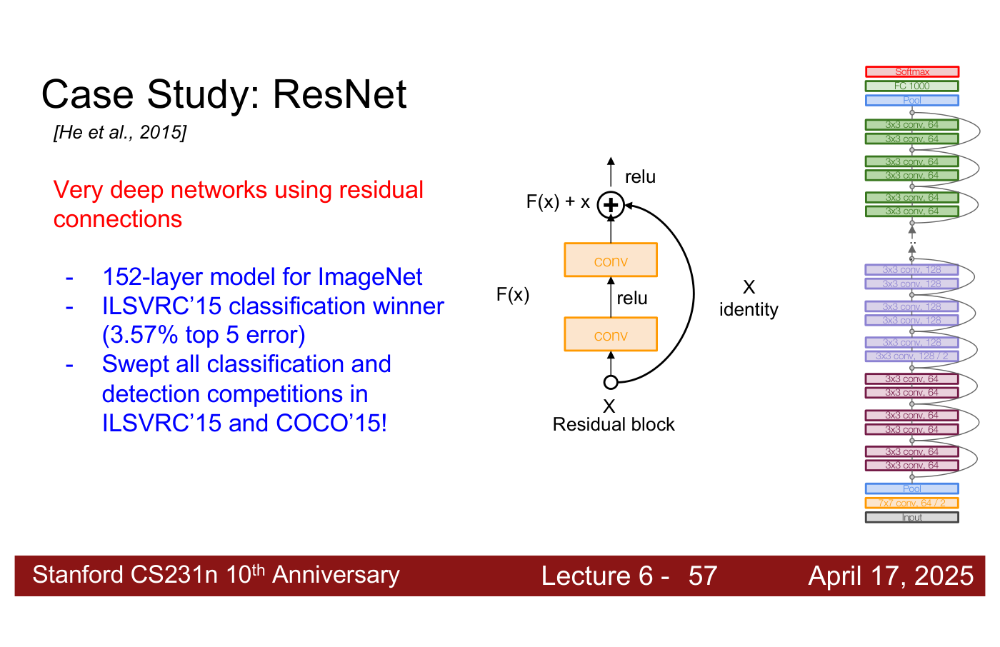

Title "Case Study: ResNet", citation "[He et al., 2015]".

Text: (red) "Very deep networks using residual connections". Then blue dash items:

- 152-layer model for ImageNet
- ILSVRC’15 classification winner (3.57% top 5 error)
- Swept all classification and detection competitions in ILSVRC’15 and COCO’15!

Centre: the residual block diagram, bottom to top: "X" at an open circle (caption "Residual block"); orange box "conv"; arrow labelled "relu" into orange box "conv" (pair labelled "F(x)"); circled plus labelled "F(x) + x"; arrow labelled "relu" upward; curved skip arrow from X to the plus labelled "X identity".

Right: a ResNet stack (bottom to top): Input; "7x7 conv, 64 / 2"; Pool; three pairs of "3x3 conv, 64"; "3x3 conv, 128 / 2" with "3x3 conv, 128" then two more pairs of "3x3 conv, 128"; a dotted gap; then (green boxes) three pairs of "3x3 conv, 64" at the top; Pool; FC 1000; Softmax; curved skip arrows over each pair.

*[Ed: the top group's six green boxes are printed "3x3 conv, 64", the first group's label; slides 53–56 label the same group "3x3 conv, 512". Confirmed on a 600 dpi crop and in the text layer.]*

## Slide 58 — Lecture Overview – Two Broad Sets of Topics

Title "Lecture Overview – Two Broad Sets of Topics".

Two groups, each a heading with a brace and four items:

- "How to build CNNs?" (red, highlighted) with items: "Layers in CNNs", "Activation Functions", "CNN Architectures" (black) and "Weight Initialization" (red, the current topic).
- "How to train CNNs?" (greyed out) with items (grey): "Data Preprocessing", "Data augmentation", "Transfer Learning", "Hyperparameter Selection".

## Slide 59 — How to initialize weights in neural network layers?

Divider slide. Centred text: "How to initialize weights in neural network layers?"

## Slide 60 — Weight Initialization Case: Values too small

Title "Weight Initialization Case: Values too small".

Code listing (Python, on a light grey panel):

```python
dims = [4096] * 7
hs = []
x = np.random.randn(16, dims[0])
# Forward pass with ReLU activation
for Din, Dout in zip(dims[:-1], dims[1:]):
    W = 0.01 * np.random.randn(Din, Dout)  # Small weight init
    x = np.maximum(0, x.dot(W))  # ReLU activation
    hs.append(x)
```

Blue annotation at lower right: "Forward pass for a 6-layer net with hidden size 4096".

## Slide 61 — Weight Initialization Case: Values too small

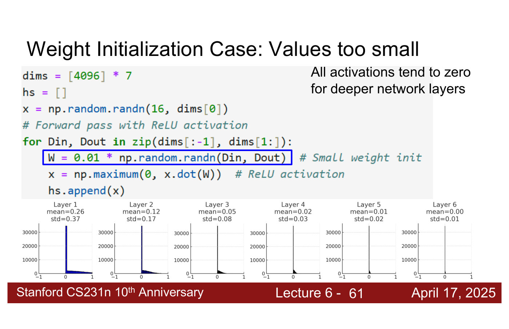

Same code listing as slide 60, with a blue rectangle around the line `W = 0.01 * np.random.randn(Din, Dout)`. Black text at upper right: "All activations tend to zero for deeper network layers".

Below the code, a row of 6 histogram panels (activation histograms for hidden layers 1 to 6). Each panel has x-axis from -1 to 1 (ticks -1, 0, 1) and y-axis ticks 0, 10000, 20000, 30000. The panel titles give the printed mean and std:

- Layer 1: mean=0.26, std=0.37. A tall spike at 0 reaching the top of the axis (about 35000, blue bars), then a low plateau of about 2000 declining slowly toward about 1000 at x=1.
- Layer 2: mean=0.12, std=0.17. A spike at 0 reaching about 35000 (blue), then a low tail of about 2000 decaying to near 0 by x about 0.7.
- Layer 3: mean=0.05, std=0.08. A very narrow spike at 0 (black), with a short tail of about 2000 decaying by x about 0.3.
- Layer 4: mean=0.02, std=0.03. A narrower spike at 0 with a tiny tail (decays by x about 0.15).
- Layer 5: mean=0.01, std=0.02. A thin spike at 0, tail barely visible.
- Layer 6: mean=0.00, std=0.01. A thin spike at 0 only.

All distributions lie on x of 0 or above (ReLU outputs); the mass concentrates ever closer to 0 with depth.

## Slide 62 — Weight Initialization Case: Values too large

Title "Weight Initialization Case: Values too large".

Code listing:

```python
dims = [4096] * 7
hs = []
x = np.random.randn(16, dims[0])
# Forward pass with ReLU activation
for Din, Dout in zip(dims[:-1], dims[1:]):
    W = 0.05 * np.random.randn(Din, Dout)  # Small weight init
    x = np.maximum(0, x.dot(W))  # ReLU activation
    hs.append(x)
```

A blue rectangle surrounds the `W = 0.05 * ...` line. Blue text to its upper right: "Increase std of initial weights from 0.01 to 0.05". (The code comment still reads "# Small weight init", as printed.) No histograms on this slide.

## Slide 63 — Weight Initialization Case: Values too large

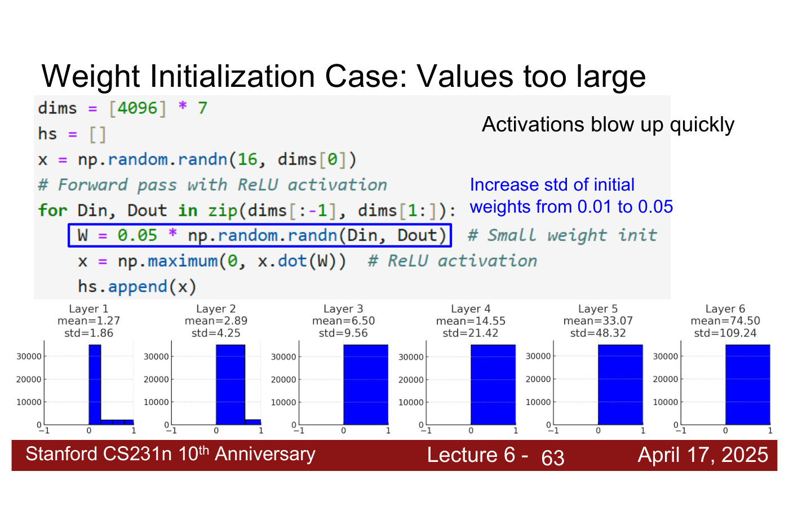

Same code and blue annotation as slide 62 (the `W = 0.05 * ...` line boxed, "Increase std of initial weights from 0.01 to 0.05"), plus black text at upper right "Activations blow up quickly" and a row of 6 blue histogram panels (layers 1 to 6). Each panel has x-axis from -1 to 1 (ticks -1, 0, 1) and y-axis ticks 0, 10000, 20000, 30000 (bars reach about 35000 at the top). Titles give the printed mean and std:

- Layer 1: mean=1.27, std=1.86. A wide bar from 0 to about 0.25 reaching about 35000, then three bars of about 2000 out to x=1.
- Layer 2: mean=2.89, std=4.25. A bar from 0 to about 0.6 at about 35000, then one bar of about 2000 out to x=1.
- Layer 3: mean=6.50, std=9.56. A single block from 0 to 1 at about 35000, filling the plotted range.
- Layer 4: mean=14.55, std=21.42. Same: a full block from 0 to 1 at about 35000.
- Layer 5: mean=33.07, std=48.32. Same.
- Layer 6: mean=74.50, std=109.24. Same.

(Computed from the printed values, not printed on the slide: each layer's mean and std are about 2.2–2.3 times the previous layer's.)

## Slide 64 — How to fix this? Depends on the size of the layer

Title "How to fix this? Depends on the size of the layer".

Code listing (no comments):

```python
dims = [4096] * 7
hs = []
x = np.random.randn(16, dims[0])
for Din, Dout in zip(dims[:-1], dims[1:]):
    W = np.random.randn(Din, Dout) * np.sqrt(2/Din)
    x = np.maximum(0, x.dot(W))
    hs.append(x)
```

A blue rectangle surrounds the `W = ...` line.

Small print at lower left: He et al, “Delving Deep into Rectifiers: Surpassing Human-Level Performance on ImageNet Classification”, ICCV 2015

## Slide 65 — One solution: Kaiming / MSRA Initialization

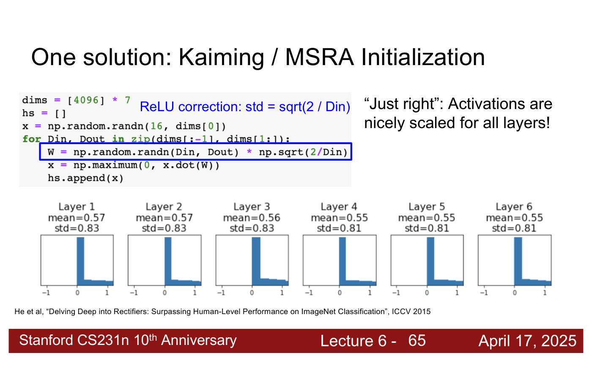

Title "One solution: Kaiming / MSRA Initialization".

Same code listing as slide 64 with the `W = np.random.randn(Din, Dout) * np.sqrt(2/Din)` line boxed in blue. Blue text at the right of the code: "ReLU correction: std = sqrt(2 / Din)". Black text at upper right: "“Just right”: Activations are nicely scaled for all layers!"

Below, a row of 6 histogram panels (layers 1 to 6), each with x-axis from -1 to 1 (ticks -1, 0, 1), no y-axis ticks, blue bars. In every panel there is a tall bar from 0 to about 0.25 reaching nearly the top of the plot, followed by a low, nearly flat tail (about a tenth of the height) out to x=1. Printed titles:

- Layer 1: mean=0.57, std=0.83
- Layer 2: mean=0.57, std=0.83
- Layer 3: mean=0.56, std=0.83
- Layer 4: mean=0.55, std=0.81
- Layer 5: mean=0.55, std=0.81
- Layer 6: mean=0.55, std=0.81

The six histograms look nearly identical.

Small print at lower left: He et al, “Delving Deep into Rectifiers: Surpassing Human-Level Performance on ImageNet Classification”, ICCV 2015

## Slide 66 — Lecture Overview – Two Broad Sets of Topics

Title "Lecture Overview – Two Broad Sets of Topics".

Same layout as slide 58 with the highlighting swapped. "How to build CNNs?" and its items "Layers in CNNs", "Activation Functions", "CNN Architectures", "Weight Initialization" are greyed out. "How to train CNNs?" (black, bold) is highlighted, with items "Data Preprocessing" (red, the current topic), "Data augmentation", "Transfer Learning" and "Hyperparameter Selection" (black).

## Slide 67 — TLDR for Image Normalization

Title: "**TLDR for Image Normalization:** center and scale for each channel"

- Subtract per-channel mean and Divide by per-channel std (grey text: "(almost all modern models)")
  - (blue text: "(stats along each channel = 3 numbers)")
- Requires pre-computing means and std for each pixel channel (given your dataset)

Code line (monospace, syntax-coloured, on a light grey strip):

```
norm_pixel[i,j,c] = (pixel[i,j,c] - np.mean(pixel[:,:,c])) / np.std(pixel[:,:,c])
```

## Slide 68 — Lecture Overview – Two Broad Sets of Topics

Overview diagram with two rows, each a bold label with a curly brace pointing to a four-item list.

- "How to build CNNs?" (greyed out) with brace to: Layers in CNNs; Activation Functions; CNN Architectures; Weight Initialization (all greyed out).
- "How to train CNNs?" (black, bold) with brace to: Data Preprocessing; **Data augmentation** (highlighted in red); Transfer Learning; Hyperparameter Selection (the other three in black).

## Slide 69 — Regularization: A common pattern

**Training**: Add some kind of randomness

$$y = f_{W}(x, z)$$

**Testing:** Average out randomness (sometimes approximate)

$$y = f(x) = E_{z}\left[f(x,z)\right] = \int p(z) f(x,z) \thinspace dz$$

(The two equations are images on the slide; $z$ is not defined in text on this slide.)

## Slide 70 — Regularization: A common pattern

Same as slide 69 (left column: Training: Add some kind of randomness, $y = f_{W}(x, z)$; Testing: Average out randomness (sometimes approximate), $y = f(x) = E_{z}\left[f(x,z)\right] = \int p(z) f(x,z) \thinspace dz$), plus a right-hand column:

**Example**: Dropout

**Training**: Randomly drop activations

**Testing**: Use all activations and average values with p

## Slide 71 — Regularization: Data Augmentation

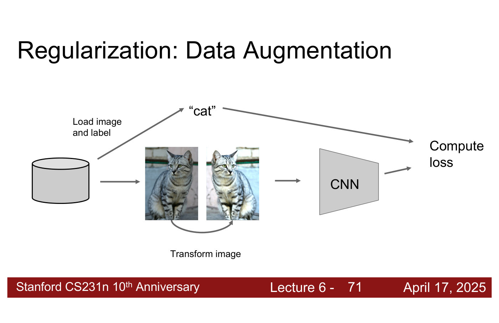

A pipeline diagram, left to right:

- A grey database cylinder at left. An arrow labelled "Load image and label" goes up and to the right to the text "cat" (in quotes), then a long arrow from "cat" goes down-right to the text "Compute loss" at the far right.
- A second arrow from the cylinder goes right to a pair of photographs: an upright photo of a grey tabby cat looking to the right of the frame, next to its horizontally mirrored copy (cat looking left). A curved arrow below, from the left photo to the right photo, is labelled "Transform image".
- An arrow from the photos goes to a grey trapezoid labelled "CNN" (wider on the left, narrower on the right), and an arrow from the CNN goes to "Compute loss".

## Slide 72 — Data Augmentation: Horizontal Flips

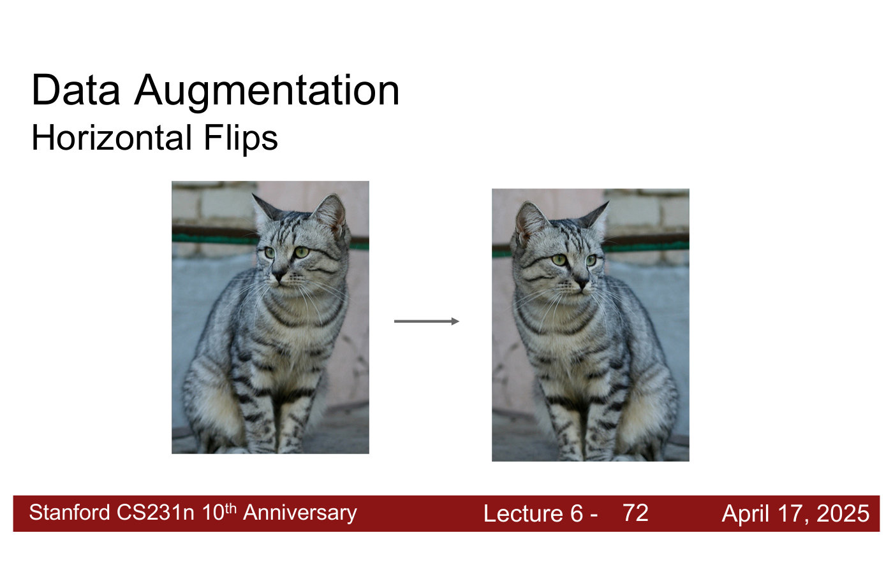

Title "Data Augmentation", subtitle "Horizontal Flips".

Figure: a photo of a grey tabby cat (sitting, head turned toward the right of the frame, brick wall and green rail behind) on the left, an arrow pointing right, and on the right the same photo mirrored left-to-right (cat now facing left of the frame).

## Slide 73 — Data Augmentation: Random crops and scales

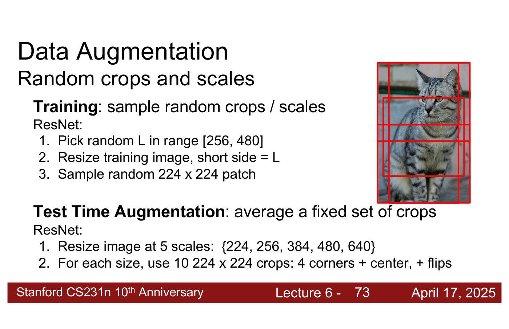

Title "Data Augmentation", subtitle "Random crops and scales".

**Training**: sample random crops / scales

ResNet:

1. Pick random L in range [256, 480]
2. Resize training image, short side = L
3. Sample random 224 x 224 patch

**Test Time Augmentation**: average a fixed set of crops

ResNet:

1. Resize image at 5 scales: {224, 256, 384, 480, 640}
2. For each size, use 10 224 x 224 crops: 4 corners + center, + flips

Figure (top right): the cat photo with four red rectangles drawn on it as example crop windows: one around the whole photo, a tall narrow one inset from the left and right edges, a medium one spanning roughly the middle third of the photo's height (about 36–77%), and a full-width horizontal strip near the middle.

(Check: 4 corners + center = 5 crops, doubled by flips = 10 crops per scale; matches the printed "10".)

## Slide 74 — Data Augmentation: Color Jitter

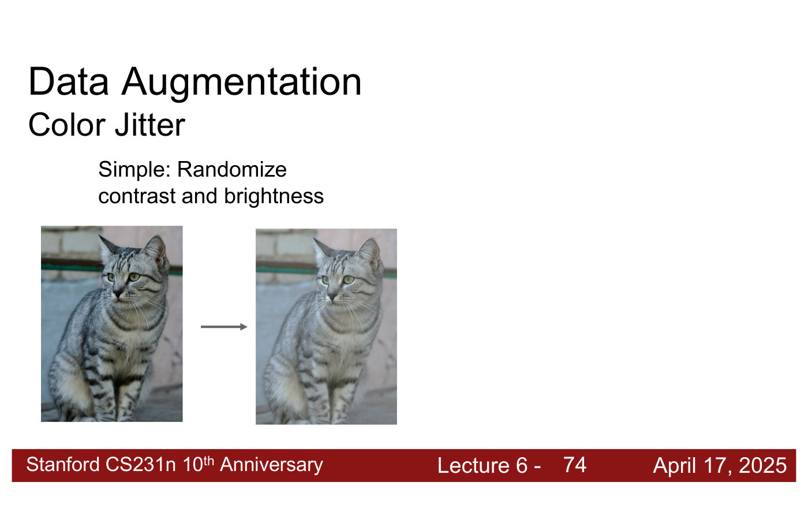

Title "Data Augmentation", subtitle "Color Jitter".

Text: "Simple: Randomize contrast and brightness"

Figure: the cat photo (original, saturated colours, higher contrast) at left, an arrow pointing right, and the same photo at right with visibly lower contrast and a washed-out, lighter look.

## Slide 75 — Regularization: Cutout

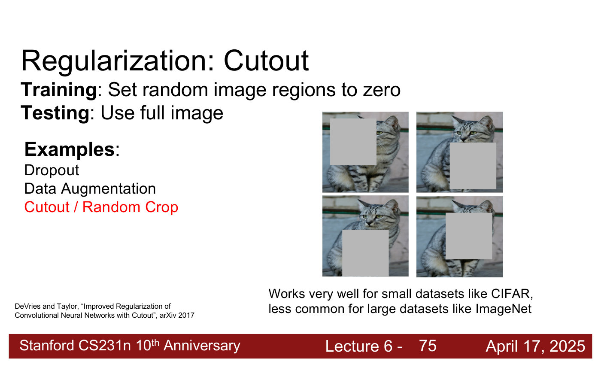

**Training**: Set random image regions to zero

**Testing**: Use full image

**Examples**:

Dropout

Data Augmentation

Cutout / Random Crop (in red)

Figure (right): a 2x2 grid of four differently zoomed square crops of the cat photo, each with a grey square occluding part of it: top-left, in the upper left over the cat's body; top-right, below the chin over the chest; bottom-left, flush with the bottom edge at lower centre-right; bottom-right, at centre-lower.

Caption under the grid: "Works very well for small datasets like CIFAR, less common for large datasets like ImageNet"

Credit (small print, bottom left): DeVries and Taylor, "Improved Regularization of Convolutional Neural Networks with Cutout", arXiv 2017

## Slide 76 — Lecture Overview – Two Broad Sets of Topics

Same overview diagram as slide 68 ("How to build CNNs?" greyed out with Layers in CNNs; Activation Functions; CNN Architectures; Weight Initialization; "How to train CNNs?" with Data Preprocessing; Data augmentation; Transfer Learning; Hyperparameter Selection), but now **Transfer Learning** is highlighted in red and "Data augmentation" is black.

## Slide 77 — What if you don't have a lot of data?

Text-only slide: "What if you don't have a lot of data? Can you still train CNNs?" ("don't have a lot of data" is in red.) No answer is printed on this slide.

## Slide 78 — Transfer Learning with CNNs

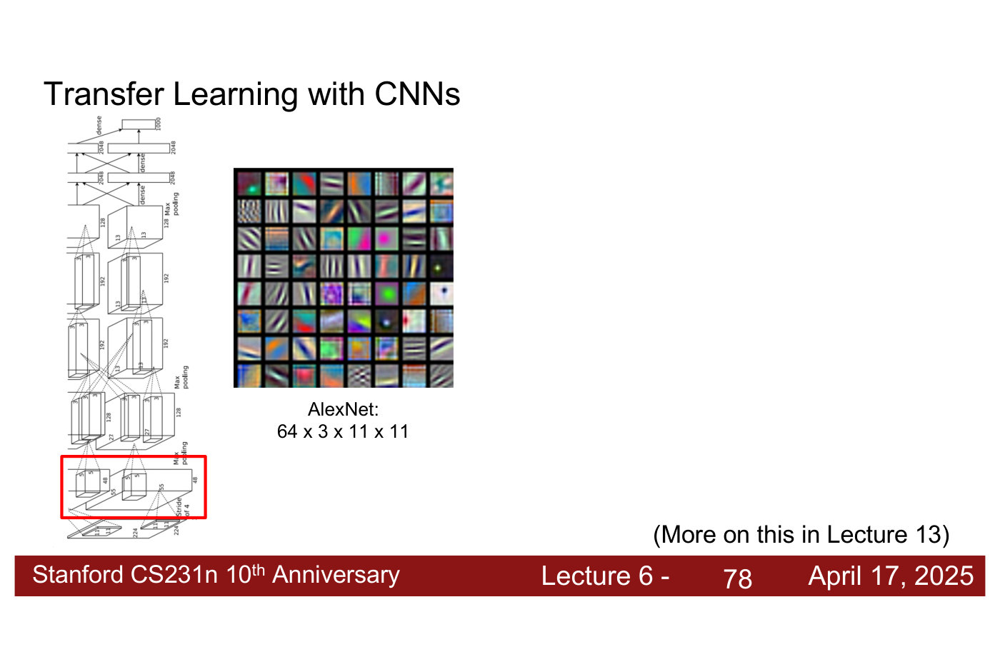

Title "Transfer Learning with CNNs".

Left: a tall, narrow hand-drawn style diagram of a two-column (two-stream) convolutional network drawn as 3D boxes, in which small numerals are printed along the boxes (for example 224, 55, 48, 27, 128, 13, 192, 2048, 1000, with labels "Stride of 4", "Max pooling", "dense"). A red box encloses the first stage's output, the 55 / 55 / 48 feature maps with their 5x5 filters, together with the "Stride of 4" and "Max pooling" labels; the 224 input plane with its 11x11 window sits just below the box, outside it.

Middle: an 8-column by 8-row grid (the last column and the last row partly cropped) of small square filter visualizations (oriented edges, colour blobs, and gratings in many colours on grey). Caption below: "AlexNet: 64 x 3 x 11 x 11".

Bottom right: "(More on this in Lecture 13)".

*[Ed: printed "Lecture 13" here and on slide 79. In the Spring 2025 schedule lecture 13 is Generative Models 1; visualizing is part of lecture 9 (Object Detection, Image Segmentation, Visualizing).]*

## Slide 79 — Transfer Learning with CNNs

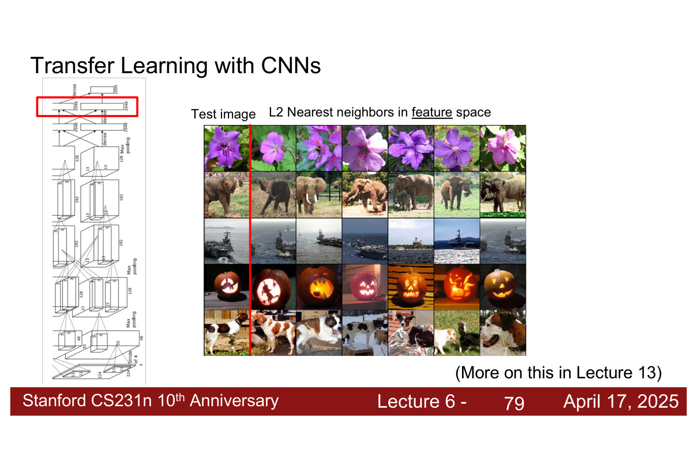

Title "Transfer Learning with CNNs".

Left: the same tall network diagram as slide 78, now with a red box around the upper pair of 2048-wide dense layers, directly below the 1000-way output; the second 2048 pair, labelled "dense", is outside the box.

Right: a grid of images, 5 rows by 7 columns. Column header text above: "Test image" (over the first column, which is separated from the rest by a vertical red line) and "L2 Nearest neighbors in feature space" ("feature" underlined) over the other six columns. Each row is one test image followed by its six nearest neighbours:

- Row 1: purple flowers.
- Row 2: elephants.
- Row 3: ships on water (grey warships/aircraft carriers).
- Row 4: lit jack-o'-lantern pumpkins.
- Row 5: dogs (mainly white with brown/black patches).

Bottom right: "(More on this in Lecture 13)".

## Slide 80 — Transfer Learning with CNNs

Credits (top right, small print): "Donahue et al, "DeCAF: A Deep Convolutional Activation Feature for Generic Visual Recognition", ICML 2014" and "Razavian et al, "CNN Features Off-the-Shelf: An Astounding Baseline for Recognition", CVPR Workshops 2014".

Title "Transfer Learning with CNNs"; step text: "1. Train on Imagenet (or internet scale data)"

A vertical stack of boxes, listed top to bottom (green boxes are fully connected, orange boxes are conv/pool, blue is the input):

- FC-1000 (green)
- FC-4096 (green)
- FC-4096 (green)
- MaxPool (orange)
- Conv-512
- Conv-512
- MaxPool
- Conv-512
- Conv-512
- MaxPool
- Conv-256
- Conv-256
- MaxPool
- Conv-128
- Conv-128
- MaxPool
- Conv-64
- Conv-64
- Image (blue)

## Slide 81 — Transfer Learning with CNNs

Same credits as slide 80 (Donahue et al, DeCAF, ICML 2014; Razavian et al, CNN Features Off-the-Shelf, CVPR Workshops 2014).

Same as slide 80 (the stack under "1. Train on Imagenet", FC-1000 at top, Image at the bottom), plus a second stack under "2. Small Dataset (C classes)". The second stack has the same boxes and order, except that the top box is "FC-C" (instead of FC-1000), outlined in a red rectangle with a red arrow from the red text "Reinitialize this and train". All the remaining boxes (FC-4096, FC-4096, MaxPool, Conv-512 ... Conv-64, Image) are covered by a blue curly brace labelled in blue "Freeze these from pretrained model".

## Slide 82 — Transfer Learning with CNNs

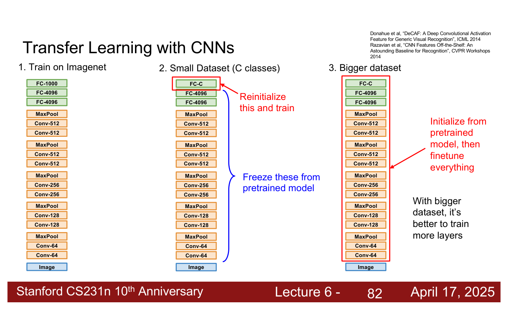

Same credits as slide 80.

Same as slide 81, plus a third stack headed "3. Bigger dataset". Its boxes are: FC-C, FC-4096, FC-4096, MaxPool, Conv-512, Conv-512, MaxPool, Conv-512, Conv-512, MaxPool, Conv-256, Conv-256, MaxPool, Conv-128, Conv-128, MaxPool, Conv-64, Conv-64, Image. The whole stack except the Image box is enclosed in one red rectangle, with a red arrow from red text "Initialize from pretrained model, then finetune everything". Black text below: "With bigger dataset, it's better to train more layers".

## Slide 83 — (no title) Transfer learning decision table, blank

Left: the same stack of boxes (FC-1000, FC-4096, FC-4096, MaxPool, Conv-512 x2, MaxPool, Conv-512 x2, MaxPool, Conv-256 x2, MaxPool, Conv-128 x2, MaxPool, Conv-64 x2, Image). Two grey arrows from text on the middle: "More specific" with an arrow pointing up toward the FC layers at the top, and "More generic" with an arrow pointing down toward the lower conv layers.

Right: a 2x2 table with row and column headers; every cell contains only "?" (no answers printed on this slide):

| | very similar dataset | very different dataset |
| --- | --- | --- |
| very little data | ? | ? |
| quite a lot of data | ? | ? |

## Slide 84 — (no title) Transfer learning decision table, partly filled

Same as slide 83, with the left-hand column's cells filled:

| | very similar dataset | very different dataset |
| --- | --- | --- |
| very little data | Use Linear Classifier on final layer | ? |
| quite a lot of data | Finetune all model layers | ? |

(Same layer stack and "More specific" / "More generic" arrows as slide 83.)

## Slide 85 — (no title) Transfer learning decision table, complete

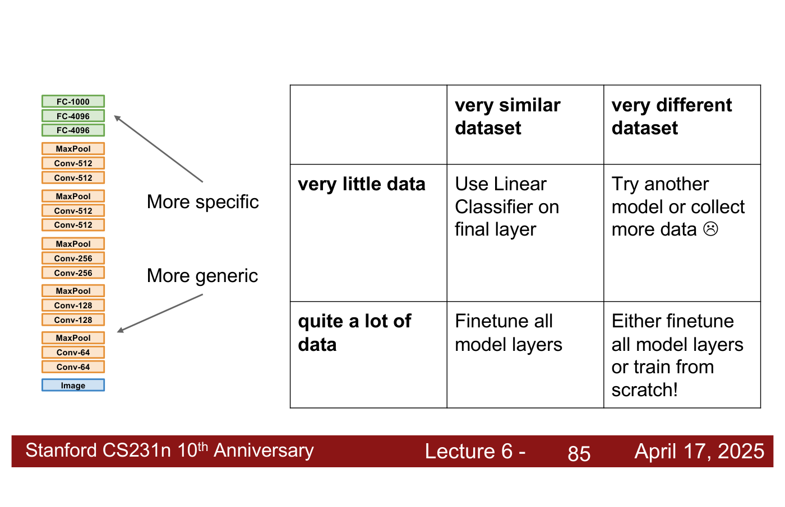

Same as slide 84, with the "very different dataset" cells filled:

| | very similar dataset | very different dataset |
| --- | --- | --- |
| very little data | Use Linear Classifier on final layer | Try another model or collect more data (followed by a sad-face emoticon) |
| quite a lot of data | Finetune all model layers | Either finetune all model layers or train from scratch! |

(Same layer stack and "More specific" / "More generic" arrows as slide 83.)

## Slide 86 — Takeaway for your projects and beyond

**Takeaway for your projects and beyond:**

Have some dataset of interest but it has < ~1M images?

1. Find a very large dataset that has similar data, train a big model there
2. Transfer learn to your dataset

Deep learning frameworks provide a "Model Zoo" of pretrained models so you don't need to train your own

PyTorch: https://github.com/pytorch/vision

Huggingface: https://github.com/huggingface/pytorch-image-models

## Slide 87 — Lecture Overview – Two Broad Sets of Topics

Same overview diagram as slide 68 ("How to build CNNs?" greyed out with Layers in CNNs; Activation Functions; CNN Architectures; Weight Initialization; "How to train CNNs?" with Data Preprocessing; Data augmentation; Transfer Learning; Hyperparameter Selection), but now **Hyperparameter Selection** is highlighted in red and the other three are black.

## Slide 88 — Choosing Hyperparameters

**Step 1**: Check initial loss

**Step 2**: Overfit a small sample

**Step 3**: Find LR that makes loss go down (this text in red)

Use the architecture from the previous step, use all training data, turn on small weight decay, find a learning rate that makes the loss drop significantly within ~100 iterations

Good learning rates to try: 1e-1, 1e-2, 1e-3, 1e-4, 1e-5

## Slide 89 — Choosing Hyperparameters

**Step 1**: Check initial loss

**Step 2**: Overfit a small sample

**Step 3**: Find LR that makes loss go down

**Step 4**: Coarse grid of hyperparams, train for ~1-5 epochs

**Step 5**: Refine grid, train longer

**Step 6**: Look at loss and accuracy curves (next slides) ("Look at loss and accuracy curves" in red)

## Slide 90 — (no title) Accuracy curves: still going up

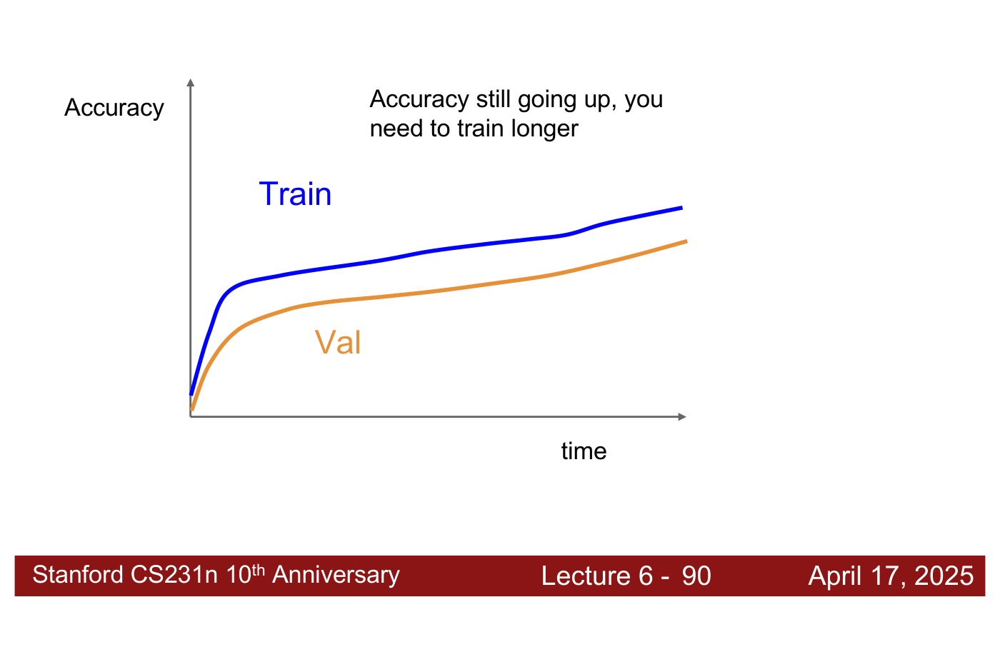

A line chart. Vertical axis label "Accuracy" (arrow up, no numeric ticks); horizontal axis label "time" (arrow right, no numeric ticks). Two series (2 curves):

- Train (blue, labelled "Train"): starts low on the vertical axis, rises steeply, bends to a slow, steady rise, ending highest (about two thirds of the way up the plotted area).
- Val (orange, labelled "Val"): starts at about zero, follows the same shape below the blue curve, with a visible constant gap below Train, also still rising at the right edge.

Annotation text: "Accuracy still going up, you need to train longer"

## Slide 91 — (no title) Accuracy curves: question

Same axes as slide 90 ("Accuracy" vs "time", no ticks). Two series:

- Train (blue): same rising curve as slide 90, still rising at the right edge.
- Val (orange): rises early, peaks at roughly one third of the way along the time axis, then declines gradually to the right edge, ending lower than its peak and well below Train.

Text in red bold: "Q: What is happening here?" (no answer is printed on this slide; slide 92 supplies the annotation).

## Slide 92 — (no title) Accuracy curves: overfitting

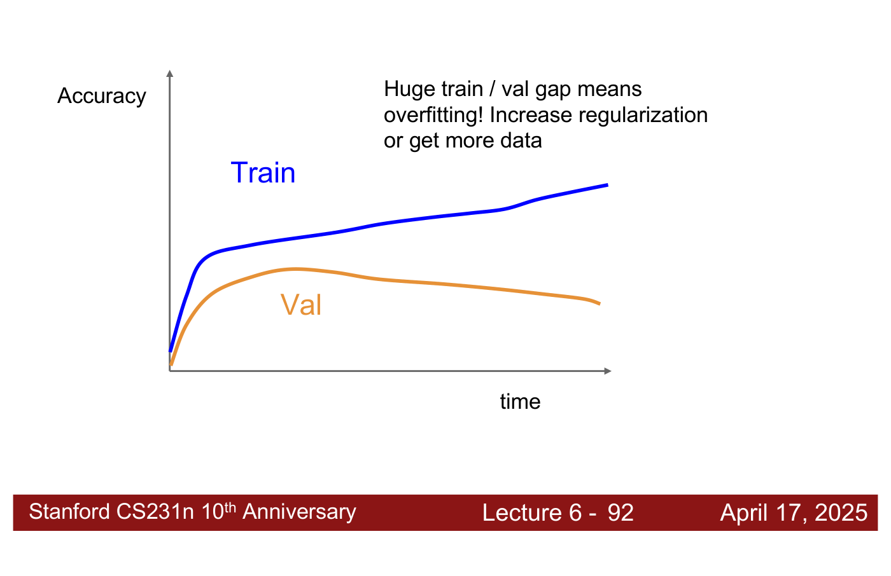

Same chart as slide 91 (blue Train curve rising; orange Val curve peaking early then declining). Annotation text: "Huge train / val gap means overfitting! Increase regularization or get more data"

## Slide 93 — (no title) Accuracy curves: underfitting

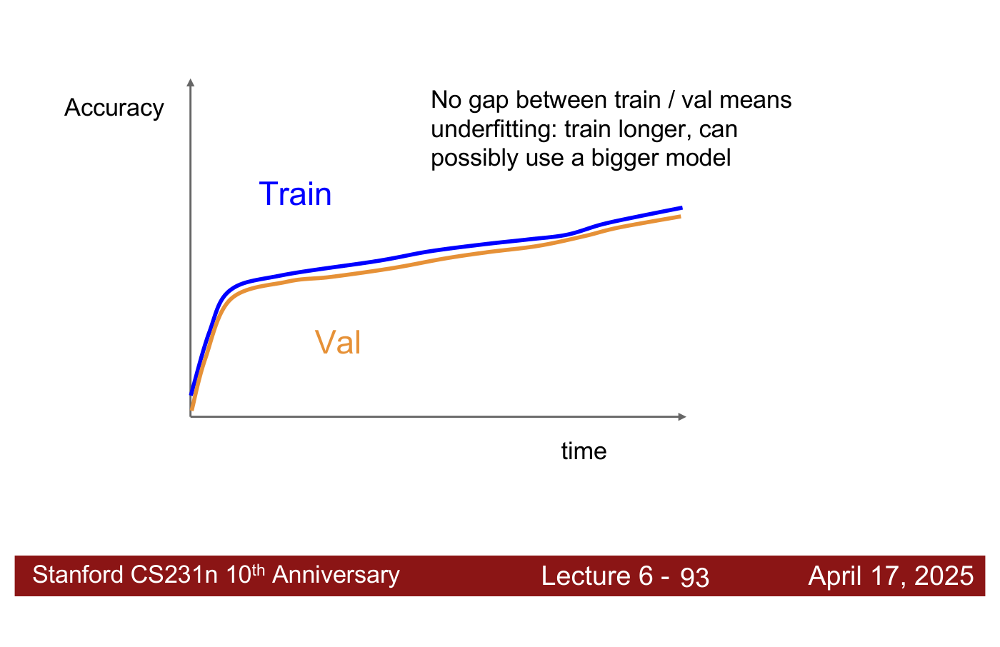

Same axes. Two series: Train (blue) rising steadily with a small bump near the right; Val (orange) tracking just below it throughout with almost no gap, both still rising at the right edge. Annotation text: "No gap between train / val means underfitting: train longer, can possibly use a bigger model"

## Slide 94 — Choosing Hyperparameters

**Step 1**: Check initial loss

**Step 2**: Overfit a small sample

**Step 3**: Find LR that makes loss go down

**Step 4**: Coarse grid, train for ~1-5 epochs

**Step 5**: Refine grid, train longer

**Step 6**: Look at loss and accuracy curves

**Step 7**: GOTO step 5 (red)

(Note: Step 4 here reads "Coarse grid, train for ~1-5 epochs"; on slide 89 it reads "Coarse grid of hyperparams, train for ~1-5 epochs".)

## Slide 95 — Random Search vs. Grid Search

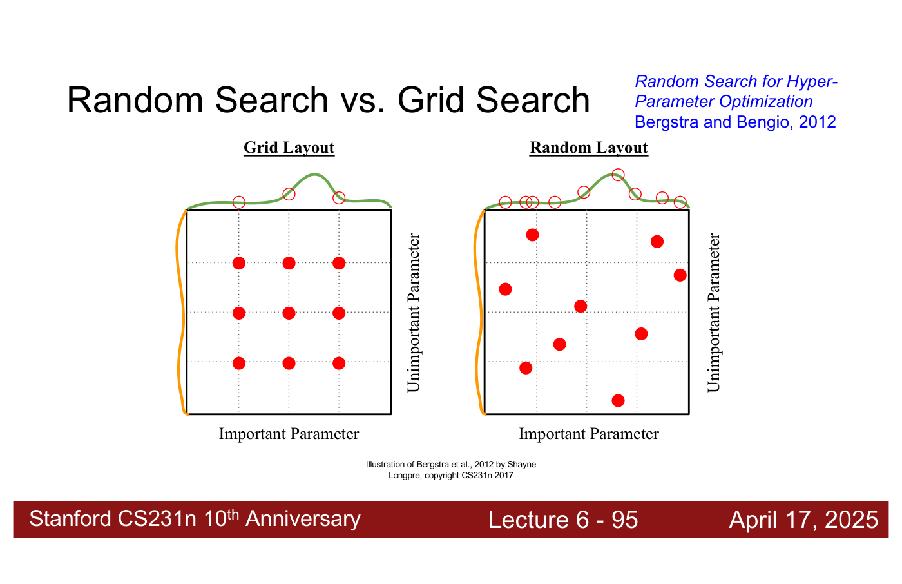

Citation (top right, blue italic): "Random Search for Hyper-Parameter Optimization", Bergstra and Bengio, 2012

Two side-by-side square plots, each with the x-axis label "Important Parameter" and the y-axis label (rotated, on the right of the square) "Unimportant Parameter". Above each square is a green curve (the function of the important parameter, with one bump) and to the left of each square an orange curve (nearly flat, slightly wavy: the function of the unimportant parameter).

- "Grid Layout" (left, underlined): 9 solid red dots arranged in a regular 3x3 grid (3 distinct x-positions, 3 distinct y-positions), with dotted guide lines. On the green curve above, only 3 hollow red circles are drawn (one per distinct x-position): one on the flat left part, one on the rising flank and one on the falling flank of the bump; none is at its peak.
- "Random Layout" (right, underlined): 9 solid red dots scattered irregularly with all-different x-positions and y-positions (faint dotted 3x3 guide lines are drawn here too). On the green curve above, 9 hollow red circles are drawn at the 9 distinct x-positions, one of them at the peak of the bump and others spread across the curve.

Credit (small print, below): "Illustration of Bergstra et al., 2012 by Shayne Longpre, copyright CS231n 2017"

## Slide 96 — Summary

"We reviewed 8 topics at a high level:"

1. Layers in CNNs (Conv, FC, Norm, Dropout)
2. Activation Functions in NNs (ReLU, GELU, etc.)
3. CNN Architectures (VGG, ResNets)
4. Weight Initialization (Maintain Activation Distribution)

## Slide 97 — Summary

"We reviewed 8 topics at a high level:"

5. Data Preprocessing (subtract mean, divide std)
6. Data augmentation (cropping, jitter)
7. Transfer Learning (train on ImageNet first)
8. Hyperparameter (Checking Losses + Random Search)
