# Lecture 7 — Recurrent Neural Networks (slide-by-slide)

Text and figures of all 124 pages of [`lecture_7.pdf`](https://cs231n.stanford.edu/slides/2025/lecture_7.pdf), CS231N (Stanford, Spring 2025), April 22, 2025. Cite these as "slide N" using the **printed** slide number (footer, after "Lecture 7 -"). The running footer ("Stanford CS231n 10th Anniversary", "Lecture 7 - N", "April 22, 2025") is on every page and is not repeated below. Equations are written in LaTeX; figures are described in prose.

## Slide numbers vs PDF pages

The deck prints numbers 1–133 on 124 pages. Nine printed numbers are absent — **19, 20, 52, 53, 71, 72, 73, 100 and 103** — because those slides were hidden in the source deck and never exported, so the offset between printed number and PDF page grows through the deck. PDF page 118 prints no number; it sits between pages printing 126 and 128, so it is slide 127 (inferred, but unambiguous).

| PDF pages | Printed slides | Offset |
| --- | --- | --- |
| 1–18 | 1–18 | 0 |
| 19–49 | 21–51 | +2 |
| 50–66 | 54–70 | +4 |
| 67–92 | 74–99 | +7 |
| 93–94 | 101–102 | +8 |
| 95–124 | 104–133 | +9 |

**What the recording covers.** The recording opens at 0:05 with two clarifications of lecture 6
(slides 3–10) and never presents the course-logistics slide (2). It then follows the deck in order
to the summary and "next time" (132–133), ending shortly after 1:11:03. The min-char-rnn listing
(67) is mentioned only as "112 lines of Python", and the name "Elman RNN" (28) is never spoken.
The lecturer gives the colour code of the interpretable-cell figures (77–83), which the slides do
not print: the models use tanh, and "minus one means it's visualized as red here and very close to
one would be blue" (≈45:39). See the [transcript](../transcripts/07-recurrent-neural-networks.md).

**Printed slips, transcribed as printed with `[Ed:]` lines.** Slide 65's softmax row is wrong in
its first two columns against the scores beneath it (printed (.03, .84, .00, .13) and
(.25, .20, .50, .05); the scores give about (.04, .13, .00, .84) and (.25, .20, .06, .50)); the
lecturer acknowledges it ("This is incorrect, actually", ≈38:42; "imagine the probabilities are
correct here", ≈43:21). Slide 66's matrix ends rows 2 and 3 in $w_{14}$. Slide 106 writes the
input weights as $W_{xh}$ and then $W_{hx}$. Slide 110's chain has a lowercase
$\partial h_t / \partial h_{t-1}$ where it means the step from $T$. Slide 116's clipping code
computes the squared norm and calls it the norm. Slide 129 labels ResNet's last stage
"3x3 conv, 64", as lecture 6's slide 57 does. The hand-built RNN (29–38) and slide 65's third and
fourth softmax columns recompute exactly.

**Images.** 43 slides are rendered as images, each placed under its heading: 7, 12, 18, 22, 26,
28, 42, 45, 47, 50, 51, 54, 57, 58, 61, 65, 66, 68, 74, 76, 77, 78, 79, 80, 81, 82, 83, 85, 96,
97, 98, 99, 101, 102, 104, 108, 113, 116, 124, 125, 126, 130 and 131. The others have none,
because they are the title (1), course logistics (2), overview, recap and text slides (3, 11, 13,
84, 128, 132, 133), a recap of lecture 6's dropout figure (4), text, equations and code
transcribed exactly (5, 6, 24, 25, 27, 29–38, 105, 118, 119), the code listing (67, summarised;
the gist URL is printed), generated text transcribed exactly (69, 70, 75), build steps whose last
step is rendered (8–10 → 7; 14–17 → 18; 21 → 22; 23 → 26; 39–41 → 42; 43–44 → 45; 46 → 47;
48–49 → 50; 55–56 → 57; 59–60 → 61; 62–64 → 65; 86 → 85; 87–95 → 96; 106–107 → 108; 109–112 →
113; 114–115 → 116; 120–123 → 124; 127, 129 → 130), or a repeat of a rendered figure with new
text that is transcribed (117 → 116). Never construct an image path for a slide not listed here.

Companion pages: [wiki page for this lecture](../../wiki/07-recurrent-neural-networks.md) · [transcript](../transcripts/07-recurrent-neural-networks.md)

## Sections

| Slides | Section |
| --- | --- |
| 1–2 | Title; course logistics |
| 3–10 | Clarifications from last time: dropout's test-time scaling; can normalization fix bad weight initialization? |
| 11–13 | Recap of training non-recurrent networks; plan for the lecture |
| 14–18 | Process sequences: one to one, one to many, many to one, many to many |
| 21–28 | The recurrent neural network: internal state, unrolling, $h_t = f_W(h_{t-1}, x_t)$, the vanilla (Elman) RNN |
| 29–38 | A hand-built RNN that detects repeated 1s |
| 39–51 | RNN computational graphs: many to many, many to one, one to many |
| 54–58 | Backpropagation through time; truncated backpropagation through time |
| 59–66 | Character-level language model: training, sampling, embedding layer |
| 67–76 | min-char-rnn; generated Shakespeare and other text; generated C code; code-generation tools |
| 77–83 | Searching for interpretable cells |
| 84 | RNN tradeoffs |
| 85–102 | Image captioning (CNN + RNN), example results and failure cases; visual question answering; visual dialog; visual language navigation |
| 104 | Multilayer RNNs |
| 105–117 | Vanilla RNN gradient flow: vanishing and exploding gradients, gradient clipping |
| 118–130 | Long Short Term Memory (LSTM): gates, cell state, gradient flow; ResNet and Highway Networks |
| 131 | Modern RNNs (state space models, RWKV, Mamba) |
| 132–133 | Summary; next time |

## Slide 1 — Lecture 7: Recurrent Neural Networks

Title slide. Text: "Lecture 7:" / "Recurrent Neural Networks".

## Slide 2 — Course Logistics

- Assignment 1 is due **tomorrow** (4/23) at 11:59PM!
- Project proposal deadline is due this **Friday** (4/25)

("tomorrow" and "Friday" are in bold red.)

## Slide 3 — Clarifications from Last Time

- Dropout, how to scale probabilities at test-time
- Question in class about normalization vs weight initialization

## Slide 4 — Regularization: Dropout

Text: "In each forward pass, randomly set some neurons to zero" / "Probability of dropping is a hyperparameter; 0.5 is common".

Figure: two small fully connected networks side by side, drawn as circles (neurons) with grey arrows pointing upward. Left network: 4 input neurons at the bottom, a hidden layer of 4 neurons, a second hidden layer of 3 neurons, and 1 output neuron at the top, every neuron connected to every neuron in the layer above (12 neurons in total). Right network: the same layout with some neurons dropped, drawn as light grey dashed circles with a grey "x" and with no arrows attached: in the input layer the 2nd and 3rd of the 4 neurons are dropped (the outer two stay), in the first hidden layer the 1st and 3rd of 4 are dropped (the 2nd and 4th stay), in the second hidden layer the middle neuron of 3 is dropped, and the output neuron stays. Only the remaining neurons keep their connections.

Credit line: Srivastava et al, "Dropout: A simple way to prevent neural networks from overfitting", JMLR 2014

## Slide 5 — Dropout: Test time

Code listing:

```python
def predict(X):
  # ensembled forward pass
  H1 = np.maximum(0, np.dot(W1, X) + b1) * p # NOTE: scale the activations
  H2 = np.maximum(0, np.dot(W2, H1) + b2) * p # NOTE: scale the activations
  out = np.dot(W3, H2) + b3
```

Text below the code:

At test time all neurons are active always

=> We must scale the activations so that for each neuron:

<u>output at test time</u> = <u>expected output at training time</u>

(the last line is underlined in two parts: "output at test time" and "expected output at training time").

## Slide 6 — Dropout Summary

Title "Dropout Summary" at the top right. Code listing on the left:

```python
""" Vanilla Dropout: Not recommended implementation (see notes below) """

p = 0.5 # probability of keeping a unit active. higher = less dropout

def train_step(X):
  """ X contains the data """

  # forward pass for example 3-layer neural network
  H1 = np.maximum(0, np.dot(W1, X) + b1)
  U1 = np.random.rand(*H1.shape) < p # first dropout mask
  H1 *= U1 # drop!
  H2 = np.maximum(0, np.dot(W2, H1) + b2)
  U2 = np.random.rand(*H2.shape) < p # second dropout mask
  H2 *= U2 # drop!
  out = np.dot(W3, H2) + b3

  # backward pass: compute gradients... (not shown)
  # perform parameter update... (not shown)

def predict(X):
  # ensembled forward pass
  H1 = np.maximum(0, np.dot(W1, X) + b1) * p # NOTE: scale the activations
  H2 = np.maximum(0, np.dot(W2, H1) + b2) * p # NOTE: scale the activations
  out = np.dot(W3, H2) + b3
```

Annotations: two red rectangles surround the two mask-and-drop pairs of lines in `train_step` (the `U1 = ...` / `H1 *= U1` lines and the `U2 = ...` / `H2 *= U2` lines), with the red label "drop in train time" to their right. A blue rectangle surrounds the "* p # NOTE: scale the activations" ends of the two lines in `predict`, with the red label "scale at test time" to its right.

## Slide 7 — Question in class: can normalization resolve the issues that arise with having weights initialized incorrectly?

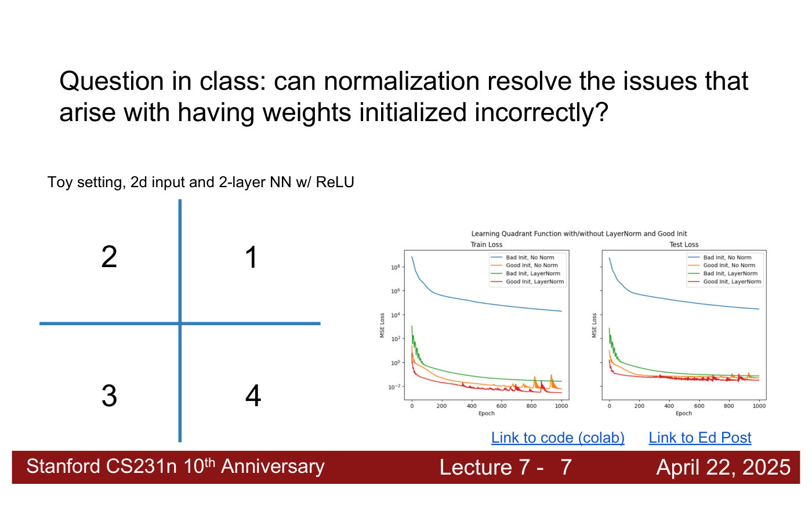

Title text: "Question in class: can normalization resolve the issues that arise with having weights initialized incorrectly?"

Sub-label: "Toy setting, 2d input and 2-layer NN w/ ReLU".

Left figure: a plane divided by a blue horizontal axis and a blue vertical axis into four quadrants, numbered in black: 1 at upper right, 2 at upper left, 3 at lower left, 4 at lower right.

Right figure: a Matplotlib chart titled "Learning Quadrant Function with/without LayerNorm and Good Init", made of two side-by-side panels, "Train Loss" (left) and "Test Loss" (right). Both panels have the $y$ axis "MSE Loss" on a log scale with tick labels $10^{-2}$, $10^{0}$, $10^{2}$, $10^{4}$, $10^{6}$, $10^{8}$ (the test panel has the ticks but no numeric labels), and the $x$ axis "Epoch" from 0 to 1000 with ticks at 0, 200, 400, 600, 800, 1000. Each panel has four series; the legend reads "Bad Init, No Norm" (blue), "Good Init, No Norm" (orange), "Bad Init, LayerNorm" (green), "Good Init, LayerNorm" (red). Approximate values, read off the plot:

- Blue, Bad Init, No Norm: starts above $10^{8}$ (about $5 \times 10^{8}$) at epoch 0 and falls smoothly to about $2 \times 10^{4}$ (train) and about $3 \times 10^{4}$ (test) at epoch 1000.
- Orange, Good Init, No Norm: starts at about 20 (train panel) at epoch 0, falls to about $10^{-1}$ by epoch 200 and to about $10^{-2}$ by epoch 1000, with two orange spikes near epochs 820 and 950 (train panel) and small spikes near epochs 900 to 1000 (test panel).
- Green, Bad Init, LayerNorm: starts at about $10^{3}$, falls steeply with jitter to about 1 by epoch 100, then more slowly to about $3 \times 10^{-2}$ (train) and about $8 \times 10^{-2}$ (test) at epoch 1000.
- Red, Good Init, LayerNorm: starts at about 5 (train panel), drops to about $10^{-1}$ within the first 50 epochs, and ends at about $3 \times 10^{-3}$ (train) and about $3 \times 10^{-2}$ (test), with small downward-then-upward blips between epochs 600 and 900 and a noisy band in the test panel.

Below the chart, two blue underlined hyperlinks: "Link to code (colab)" and "Link to Ed Post" (the link targets are not printed).

## Slide 8 — Question in class: can normalization resolve the issues that arise with having weights initialized incorrectly?

Same as slide 7, plus a dark red bold label "Significant reduction in error!" above the chart, and a dark red downward arrow in each panel running from the blue Bad Init, No Norm curve (at about epoch 730 in the train panel, about epoch 770 in the test panel) down to the green Bad Init, LayerNorm curve.

## Slide 9 — Question in class: can normalization resolve the issues that arise with having weights initialized incorrectly?

Same as slide 7, plus a blue bold label above the chart: "Performance gap still exists, does not resolve issues entirely, still optimization issues". A small blue curly brace at the right edge of each panel (at epoch 1000) spans the vertical gap between the Bad Init, LayerNorm (green) end value and the Good Init, LayerNorm (red) end value.

## Slide 10 — Question in class: can normalization resolve the issues that arise with having weights initialized incorrectly?

Same as slide 7, plus a blue bold label above the chart: "Normalization may not always make sense! In this case, easy to see why it's helpful (LayerNorm does not change quadrant of inputs)".

## Slide 11 — Training Non-Recurrent Neural Networks

1. **One time setup:** activation functions, preprocessing, weight initialization, normalization, transfer learning
2. **Training dynamics:** babysitting the learning process, parameter updates, hyperparameter optimization
3. **Evaluation:** validation performance, test-time augmentation

## Slide 12 — Evaluate models and tune hyperparameters

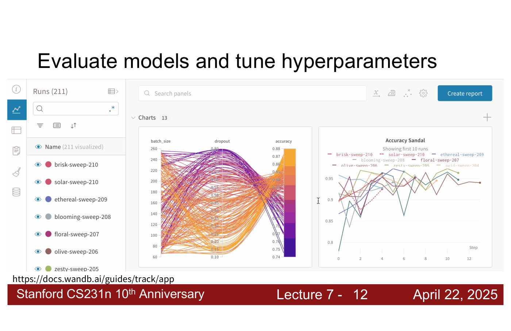

A screenshot of a Weights & Biases (wandb) experiment-tracking page. Left sidebar: a vertical icon strip, then a "Runs (211)" panel with a search box and a list headed "Name (211 visualized)", each row with an eye icon and a coloured dot: brisk-sweep-210 (red/pink), solar-sweep-210 (red/pink), ethereal-sweep-209 (blue), blooming-sweep-208 (grey), floral-sweep-207 (magenta), olive-sweep-206 (brown), zesty-sweep-205 (green, cut off at the bottom). Top bar: a "Search panels" box and a blue "Create report" button; below it a "Charts 13" header.

Two chart panels: (1) a parallel-coordinates plot with three vertical axes, "batch_size" (60 to 260), "dropout" (0.10 to 0.80) and "accuracy" (0.74 to 0.88), with many lines (one per run) coloured by accuracy using a purple (low) to orange (high) scale; (2) a line chart titled "Accuracy Sandal", "Showing first 10 runs", with a legend of sweep run names (brisk-sweep-210, solar-sweep-210, ethereal-sweep-209, blooming-sweep-208, floral-sweep-207, olive-sweep-206, zesty-sweep-205, avid-sweep-204), $y$ axis from 0.8 to 0.95 and above (ticks 0.8, 0.85, 0.9, 0.95) and $x$ axis "Step" with ticks 0 to 12; the jagged accuracy lines of the runs mostly rise from about 0.8 to 0.9 and then fluctuate around 0.9 to 0.97.

Credit line: https://docs.wandb.ai/guides/track/app

## Slide 13 — Rest of Today's Lecture

- Discuss sequence modeling (assumed fixed-length inputs so far)
- Simple models commonly used before the era of transformers
  - RNNs and some variants
- Relation to modern state-space models (e.g. Mamba)

## Slide 14 — "Vanilla" Neural Network

Figure: one small diagram on a light grey rounded background, labelled "one to one" above it. Three boxes stacked vertically: a pink box at the bottom (input), a green box in the middle, and a blue box at the top (output). A red arrow points up from the pink box to the green box, and a blue arrow points up from the green box to the blue box. A grey arrow from the label "Vanilla Neural Networks" (lower centre) points to this diagram.

## Slide 15 — Recurrent Neural Networks: Process Sequences

Same as slide 14 (the "one to one" diagram is kept at the left), plus a second diagram labelled "one to many" on a light grey background. It has 1 pink box at the bottom left, 3 green boxes in a row in the middle, and 3 blue boxes in a row at the top (7 boxes in all). A red arrow goes up from the pink box to the first green box; green arrows point right from the first green box to the second and from the second to the third; a blue arrow points up from each green box to the blue box above it.

A grey arrow points to the "one to many" diagram from the text: "e.g. Image Captioning" / "image -> sequence of words".

## Slide 16 — Recurrent Neural Networks: Process Sequences

Same as slide 15 (the "one to one" and "one to many" diagrams), plus a third diagram labelled "many to one". It has 3 pink boxes at the bottom, 3 green boxes in a row in the middle, and a single blue box at the top right above the third green box (7 boxes in all). A red arrow goes up from each pink box to the green box above it, green arrows point right from the first green box to the second and from the second to the third, and one blue arrow goes up from the third green box to the blue box.

A grey arrow points to the "many to one" diagram from the text: "e.g. action prediction" / "sequence of video frames -> action class".

## Slide 17 — Recurrent Neural Networks: Process Sequences

Same as slide 16 (the "one to one", "one to many" and "many to one" diagrams), plus a fourth, wider diagram labelled "many to many". It has 3 pink boxes at the bottom left, 5 green boxes in a row in the middle, and 3 blue boxes at the top right above the 3rd, 4th and 5th green boxes (11 boxes in all). A red arrow goes up from each pink box to the first, second and third green boxes; green arrows point right between each neighbouring pair of green boxes (4 green arrows); a blue arrow goes up from each of the 3rd, 4th and 5th green boxes to the blue box above it. The first two green boxes have no output.

A grey arrow points to the "many to many" diagram from the text: "E.g. Video Captioning" / "Sequence of video frames -> caption".

## Slide 18 — Recurrent Neural Networks: Process Sequences

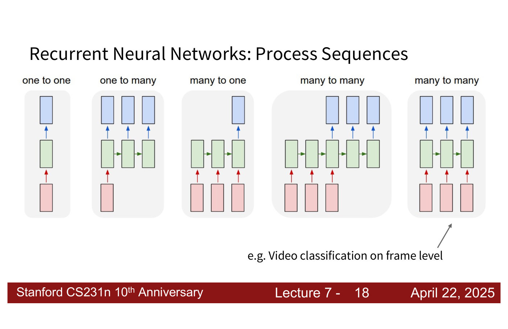

Same as slide 17 (four diagrams kept), plus a fifth diagram at the right, also labelled "many to many". It has 3 pink boxes at the bottom, 3 green boxes in a row in the middle and 3 blue boxes at the top (9 boxes in all). A red arrow goes up from each pink box to the green box above it; green arrows point right from the first green box to the second and from the second to the third; a blue arrow goes up from each green box to the blue box above it, so there is one output per input step.

A grey arrow points to this fifth diagram from the text: "e.g. Video classification on frame level".

## Slide 21 — Recurrent Neural Network

Figure: a vertical stack of three boxes. A pink box labelled "x" at the bottom, a dark green box labelled "RNN" (white text) in the middle, and a blue box labelled "y" at the top. A black arrow points up from x to RNN and another points up from RNN to y. A black curved arrow leaves the right side of the RNN box and loops back into the right side of the same box (a self-loop, the recurrence).

## Slide 22 — Recurrent Neural Network

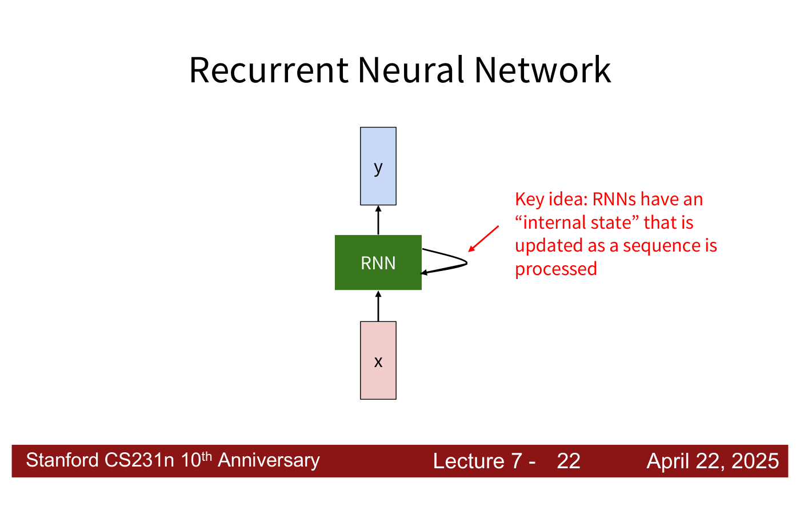

Same as slide 21, plus a red annotation to the right of the loop, with a red arrow pointing at the self-loop: "Key idea: RNNs have an "internal state" that is updated as a sequence is processed".

## Slide 23 — Unrolled RNN

Figure: the RNN of slide 21 unrolled over time, drawn as a row of 4 dark green boxes labelled "RNN" with an ellipsis "..." between the third and the fourth (so the drawing shows 4 RNN boxes: three at time steps 1, 2, 3 and a last one at time step t). Above each RNN box a blue output box with a black arrow pointing up from the RNN: $y_1$, $y_2$, $y_3$, $y_t$. Below each RNN box a pink input box with a black arrow pointing up into the RNN: $x_1$, $x_2$, $x_3$, $x_t$. A black horizontal arrow runs from each RNN box to the next one on its right (RNN 1 to RNN 2, RNN 2 to RNN 3, RNN 3 to the "..."); there is no arrow drawn from the "..." into the last RNN box. 12 coloured boxes in total (4 RNN, 4 $y$, 4 $x$). In this slide the arrows between RNN boxes carry no label.

## Slide 24 — RNN hidden state update

Text: "We can process a sequence of vectors x by applying a recurrence formula at every time step:"

$$h_t = f_W(h_{t-1}, x_t)$$

The formula is drawn with each part in a coloured box and a matching coloured label beneath it: $h_t$ in a blue box, labelled "new state" (blue); $f_W$ in a purple box, labelled "some function with parameters W" (purple, with a thin purple line from the box to the label); $h_{t-1}$ in a green box, labelled "old state" (green); $x_t$ in a red box, labelled "input vector at some time step" (red).

At the right, the small RNN diagram of slide 21 (pink "x" box, green "RNN" box with its self-loop, blue "y" box, arrows upward).

## Slide 25 — RNN output generation

Text: "We can process a sequence of vectors x by applying a recurrence formula at every time step:"

$$y_t = f_{W_{hy}}(h_t)$$

Coloured boxes and labels: $y_t$ in a green box, labelled "output" (green); $f_{W_{hy}}$ in a purple box, labelled "another function with parameters $W_{hy}$" (purple, with a thin purple line from the box to the label); $h_t$ in a blue box, labelled "new state" (blue).

At the right, the small RNN diagram of slide 21.

## Slide 26 — Recurrent Neural Network

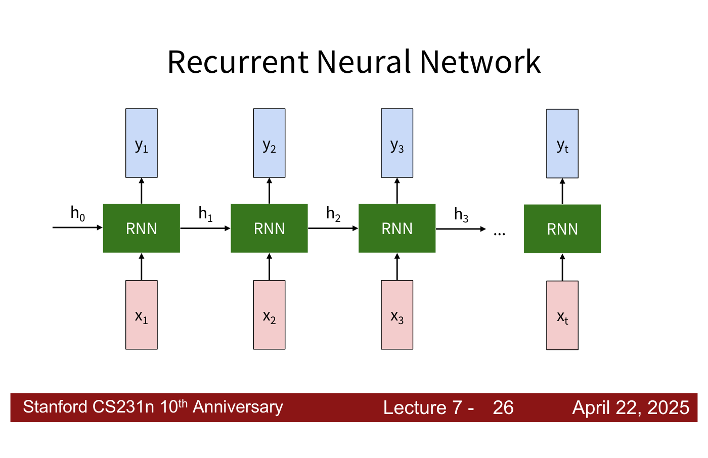

Same unrolled drawing as slide 23 (4 RNN boxes with an ellipsis between the 3rd and the last; $y_1$, $y_2$, $y_3$, $y_t$ above; $x_1$, $x_2$, $x_3$, $x_t$ below), plus labels on the horizontal arrows: an arrow labelled $h_0$ enters the first RNN box from the left, and the arrows leaving the RNN boxes to the right are labelled $h_1$ (RNN 1 to RNN 2), $h_2$ (RNN 2 to RNN 3) and $h_3$ (RNN 3 to the "..."). The drawing shows no arrow into the last RNN box from the "...".

## Slide 27 — Recurrent Neural Network

Text: "We can process a sequence of vectors x by applying a recurrence formula at every time step:"

$$h_t = f_W(h_{t-1}, x_t)$$

Red text: "Notice: the same function and the same set of parameters are used at every time step."

At the right, the small RNN diagram of slide 21.

## Slide 28 — (Vanilla) Recurrent Neural Network

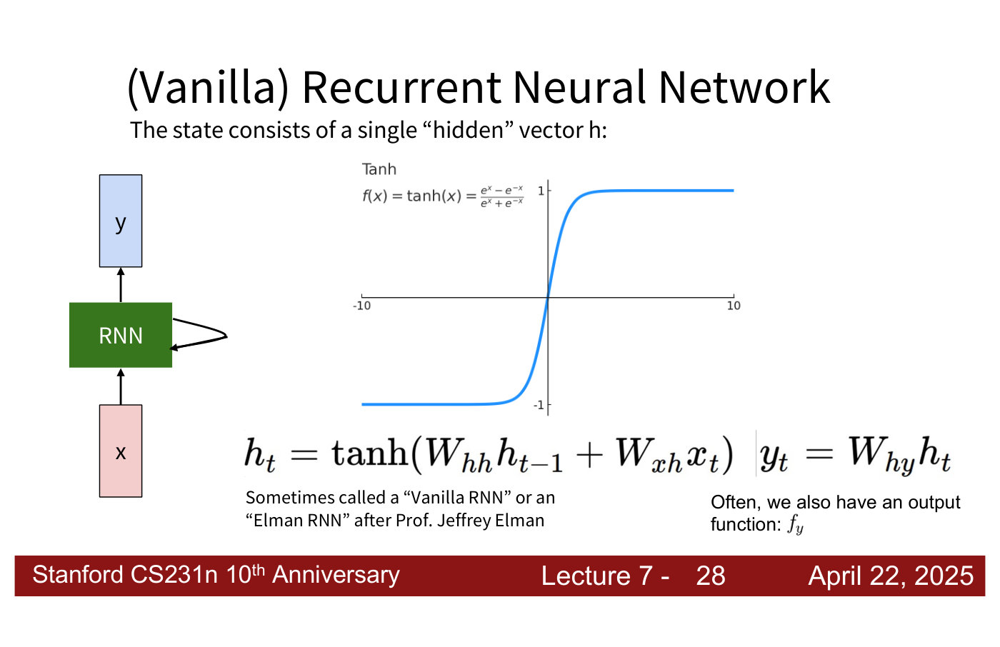

Text: "The state consists of a single "hidden" vector h:"

Left: the small RNN diagram (pink "x" box, green "RNN" box with its self-loop, blue "y" box).

Centre: a plot of the tanh function titled "Tanh", with the formula $f(x) = \tanh(x) = \frac{e^x - e^{-x}}{e^x + e^{-x}}$ printed at its upper left. The blue S-shaped curve runs between $-1$ and $1$ (the $y$ axis is marked at 1 and -1), with the $x$ axis running from -10 to 10. The curve is flat near $-1$ for $x$ below about $-3$, rises steeply through the origin, and is flat near $1$ for $x$ above about $3$.

Equations printed across the bottom:

$$h_t = \tanh(W_{hh} h_{t-1} + W_{xh} x_t)$$

$$y_t = W_{hy} h_t$$

Caption under the first equation: "Sometimes called a "Vanilla RNN" or an "Elman RNN" after Prof. Jeffrey Elman". Caption under the second equation: "Often, we also have an output function: $f_y$".

## Slide 29 — Vanilla(-ish) RNN: Concrete Example

Subtitle: "Manually creating a recurrent network for detecting repeated 1s".

Left: the small RNN diagram (pink "x", green "RNN" with self-loop, blue "y").

Centre: two columns of digits headed "X" and "Y", with an arrow labelled "RNN" from the first X row to the first Y row. The nine rows, as printed (X -> Y):

| Row | X | Y |
| --- | --- | --- |
| 1 | 0 | 0 |
| 2 | 1 | 0 |
| 3 | 0 | 0 |
| 4 | 1 | 0 |
| 5 | **1** | **1** |
| 6 | **1** | **1** |
| 7 | 0 | 0 |
| 8 | 1 | 0 |
| 9 | **1** | **1** |

(Rows 5, 6 and 9 are printed in bold.)

Right: the text "“Many to many” sequence modeling task", then

$$h_t = f_W(h_{t-1}, x_t)$$

$$y_t = f_y(W_{hy} h_t)$$

then bold black text "How could we create an RNN to do this?" and bold red text: "Q: What information should be captured in the "hidden" state?" (The slide prints a question here; the answer is on the next slide.)

## Slide 30 — Vanilla(-ish) RNN: Concrete Example

Same as slide 29, except that the bold red text at the bottom right now reads: "A: Previous input and current value for x" in place of the question.

## Slide 31 — Vanilla(-ish) RNN: Concrete Example

Same as slide 29 without the question text: the X and Y columns and the equations $h_t = f_W(h_{t-1}, x_t)$ and $y_t = f_y(W_{hy} h_t)$. Added:

- a note between the table and the equations: "Set $f_W$ and $f_y$ to both be ReLU for simplicity".
- a displayed vector equation, printed as

$$h_t = \begin{pmatrix} \text{Current} \cr \text{Previous} \cr 1 \end{pmatrix}$$

   that is, the hidden state is a column vector of three entries: the current input, the previous input, and a constant 1. A small note to its right: "Initialize h_0 to (0, 0, 1)".

## Slide 32 — Vanilla(-ish) RNN: Concrete Example

Subtitle: "Manually creating a recurrent network for detecting repeated 1s".

Left, a code listing:

```python
w_xh = np.array([[1], [0], [0]])

w_hh = np.array([[0, 0, 0],
                 [1, 0, 0],
                 [0, 0, 1]])

w_yh = np.array([1, 1, -1])

x_seq = [0, 1, 0, 1, 1, 1, 0, 1, 1]

h_t_prev = np.array([[0], [0], [1]])

for t, x in enumerate(x_seq):
    h_t = relu(w_hh @ h_t_prev + (w_xh @ x))
    y_t = relu(w_yh @ h_t)
    h_t_prev = h_t
```

Footnote under the code: "* Code is missing parts, for full code see here" ("here" is a blue underlined hyperlink; the target is not printed).

Right, equations:

$$h_t = ReLU(W_{hh} h_{t-1} + W_{xh} x_t)$$

$$y_t = ReLU(W_{hy} h_t)$$

and, at the far right, the vector

$$h_t = \begin{pmatrix} \text{Current} \cr \text{Previous} \cr 1 \end{pmatrix}$$

Below the equations, the same X to Y table as slide 29 (arrow labelled "RNN"): X = 0, 1, 0, 1, 1, 1, 0, 1, 1 and Y = 0, 0, 0, 0, 1, 1, 0, 0, 1, with rows 5, 6 and 9 in bold.

Check (not printed on the slide): recomputing the listing with $h_0 = (0,0,1)$ gives $y$ = 0, 0, 0, 0, 1, 1, 0, 0, 1, matching the printed Y column; no slip.

## Slide 33 — Vanilla(-ish) RNN: Concrete Example

Same as slide 32 (same code listing, equations, vector and X to Y table), plus red annotations: a red rectangle around the `w_xh = np.array([[1], [0], [0]])` line of the code, a red rectangle around the $W_{xh} x_t$ term of the first equation, and a red rectangle around "Current" in the vector. Red bold text between the code and the table: "Right hand term" / "x=0 → [0, 0, 0]" / "X=1 → [1, 0, 0]" (arrows as printed; the second line uses a capital "X").

## Slide 34 — Vanilla(-ish) RNN: Concrete Example

Subtitle: "Manually creating a recurrent network for detecting repeated 1s". Footnote: "\* Code is missing parts, for full code see here" ("here" is a blue hyperlink).

Left, a code listing (light-grey background):

```
w_xh = np.array([[1], [0], [0]])

w_hh = np.array([[0, 0, 0],
                 [1, 0, 0],
                 [0, 0, 1]])

w_yh = np.array([1, 1, -1])

x_seq = [0, 1, 0, 1, 1, 1, 0, 1, 1]

h_t_prev = np.array([[0], [0], [1]])

for t, x in enumerate(x_seq):
    h_t = relu(w_hh @ h_t_prev + (w_xh @ x))
    y_t = relu(w_yh @ h_t)
    h_t_prev = h_t
```

Centre-right, two equations:

$$h_t = \mathrm{ReLU}(W_{hh} h_{t-1} + W_{xh} x_t)$$

$$y_t = \mathrm{ReLU}(W_{hy} h_t)$$

Far right, the hidden state is written as a 3-entry column vector with a large bracket: $h_t$ = (Current, Previous, 1), the three entries stacked top to bottom as words.

Bottom right, a table-like drawing: a column "X" and a column "Y" joined by an arrow labelled "RNN". The X column reads 0, 1, 0, 1, 1, 1, 0, 1, 1 and the Y column reads 0, 0, 0, 0, 1, 1, 0, 0, 1. In both columns the 5th, 6th and 9th entries are in bold (X = 1, 1, 1; Y = 1, 1, 1).

Red highlighting on this step: a red box around the first row `[0, 0, 0],` of `w_hh`, a red box around $W_{hh} h_{t-1}$ in the first equation, and a red box around "Current" in the hidden-state vector. Red annotation: "0 for top row of left term (only use value from right term)".

## Slide 35 — Vanilla(-ish) RNN: Concrete Example

Same as slide 34 (same code, equations, hidden-state vector and X/Y columns), but the red highlighting moves: a red box around the second row `[1, 0, 0],` of `w_hh`, the same red box around $W_{hh} h_{t-1}$, and a red box around "Previous" in the hidden-state vector. The earlier "Current" box and annotation are gone. Red annotation: "Copy over “current” value from previous hidden state to be “previous”".

## Slide 36 — Vanilla(-ish) RNN: Concrete Example

Same as slide 34, but the red highlighting moves: a red box around the third row `[0, 0, 1]])` of `w_hh`, the same red box around $W_{hh} h_{t-1}$, and a red box around the "1" in the hidden-state vector. Red annotation: "Keep 1 on the bottom (helpful for output)".

## Slide 37 — Vanilla(-ish) RNN: Concrete Example

Same as slide 34, but the red highlighting moves: a red box around `[1, 1, -1]` in the `w_yh` line, a red box around the whole second equation $\mathrm{ReLU}(W_{hy} h_t)$ (the right-hand side of $y_t = \ldots$), and a red box around both "Previous" and "1" together with "Current" (that is, around all three entries of the hidden-state vector, drawn as one box). Red annotation: "Max(Current + Previous – 1, 0)".

## Slide 38 — Vanilla(-ish) RNN: Concrete Example

Same as slide 34, with no red boxes. Red annotation: "And it just works! But how do we find the Ws in practice?"

Worked check (the example is the lecture's own; no arithmetic is printed on the slide beyond the X/Y columns). Take $h_t$ = (Current, Previous, 1), starting from $h_0$ = (0, 0, 1). Each step sets Current to $x_t$, Previous to the old Current, and keeps the 1, and $y_t = \max(\text{Current} + \text{Previous} - 1, 0)$. Running $x$ = 0, 1, 0, 1, 1, 1, 0, 1, 1 gives $y$ = 0, 0, 0, 0, 1, 1, 0, 0, 1, which matches the printed Y column.

## Slide 39 — RNN: Computational Graph

Diagram, first step of a build. Five boxes: a green box labelled h₀ on the left, a grey box labelled f_W in the middle with arrows from h₀ into it and from it to a green box h₁ on the right, and a pink box x₁ below f_W with an arrow pointing up into f_W. Total: 2 green hidden-state boxes, 1 grey f_W box, 1 pink input box.

## Slide 40 — RNN: Computational Graph

Same as slide 39, plus a second f_W box (grey) to the right of h₁, fed by an arrow from h₁ and by a pink box x₂ below it, with an arrow out to a new green box h₂. Now 3 green boxes (h₀, h₁, h₂), 2 grey f_W boxes, 2 pink inputs (x₁, x₂).

## Slide 41 — RNN: Computational Graph

Same as slide 40, plus a third f_W box (grey) fed by h₂ and a pink box x₃, with an arrow out to a green box h₃. After h₃ an arrow leads to an ellipsis ("• • •") and then an arrow to a final green box h_T. Drawn boxes: 5 green (h₀, h₁, h₂, h₃, h_T), 3 grey f_W, 3 pink (x₁, x₂, x₃).

## Slide 42 — RNN: Computational Graph

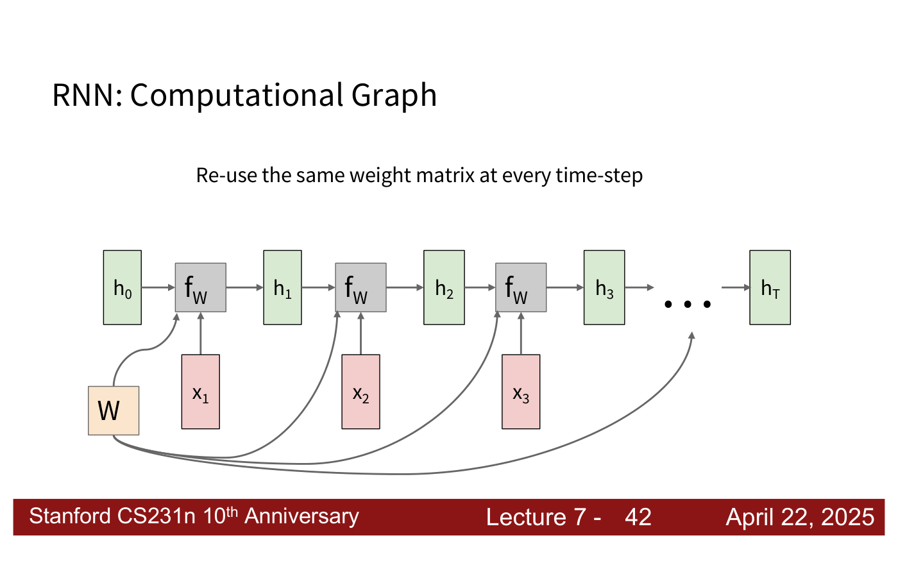

Same as slide 41, plus a caption "Re-use the same weight matrix at every time-step" and a light orange box labelled W at the lower left. Curved arrows lead from W to each of the three f_W boxes and a fourth curved arrow to the position of the ellipsis, indicating the same W is used at every step.

## Slide 43 — RNN: Computational Graph: Many to Many

Same as slide 42 (title changed), plus a blue output box above each hidden state after h₀: y₁ above h₁, y₂ above h₂, y₃ above h₃ and y_T above h_T, each with an arrow pointing up from its hidden state. 4 blue output boxes drawn.

## Slide 44 — RNN: Computational Graph: Many to Many

Same as slide 43, plus a lavender loss box to the right of each output, each with an arrow from its y: y₁ → L₁, y₂ → L₂, y₃ → L₃, y_T → L_T. 4 loss boxes drawn.

## Slide 45 — RNN: Computational Graph: Many to Many

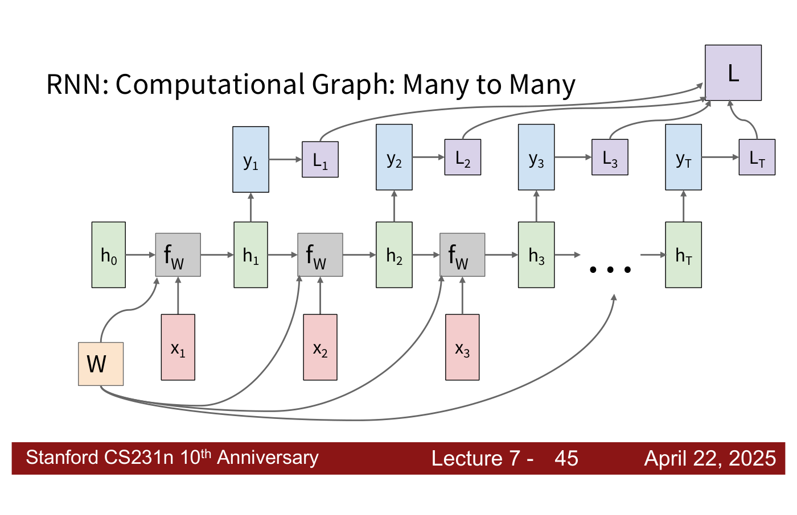

Same as slide 44, plus a single larger lavender box labelled L at the top right, with curved arrows into it from each of L₁, L₂, L₃ and L_T (the total loss combines the per-step losses).

## Slide 46 — RNN: Computational Graph: Many to One

Same unrolled graph as slide 42 (h₀, f_W boxes with x₁, x₂, x₃, hidden states h₁, h₂, h₃, ellipsis, h_T, and W with curved arrows to each f_W), but only one output: a single blue box labelled y above h_T, with an arrow up from h_T. No per-step outputs or losses.

## Slide 47 — RNN: Computational Graph: Many to One

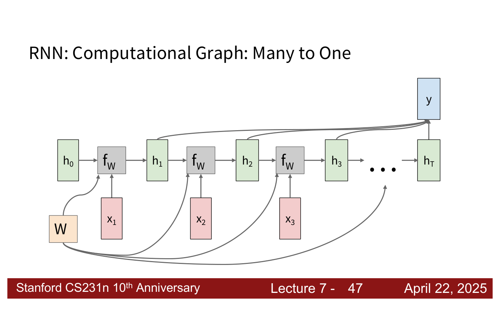

Same as slide 46, plus curved arrows from the tops of h₁, h₂ and h₃ going over to y, so that y receives arrows from h₁, h₂, h₃ and h_T (the other three arrows are drawn only from h₁, h₂, h₃; the ellipsis has no arrow of its own).

## Slide 48 — RNN: Computational Graph: One to Many

Unrolled graph with a single input. Green h₀, then three grey f_W boxes and green h₁, h₂, h₃, an ellipsis and h_T, as before. Only the first f_W has an input box, a pink box labelled x (no subscript) below it with an arrow up into f_W. The second and third f_W boxes have no input box below them. W (light orange) has curved arrows to the three drawn f_W boxes and to the ellipsis position. Each hidden state h₁, h₂, h₃, h_T has a blue output box above it with an upward arrow: y₁, y₂, y₃, y_T.

## Slide 49 — RNN: Computational Graph: One to Many

Same as slide 48, plus pink boxes labelled "?" below the second and third f_W (each with an arrow up into f_W) and one more "?" pink box below h_T with an arrow up into h_T. The first input is still "x". So the slide asks what the inputs to the later steps should be; no answer is printed on this slide.

## Slide 50 — RNN: Computational Graph: One to Many

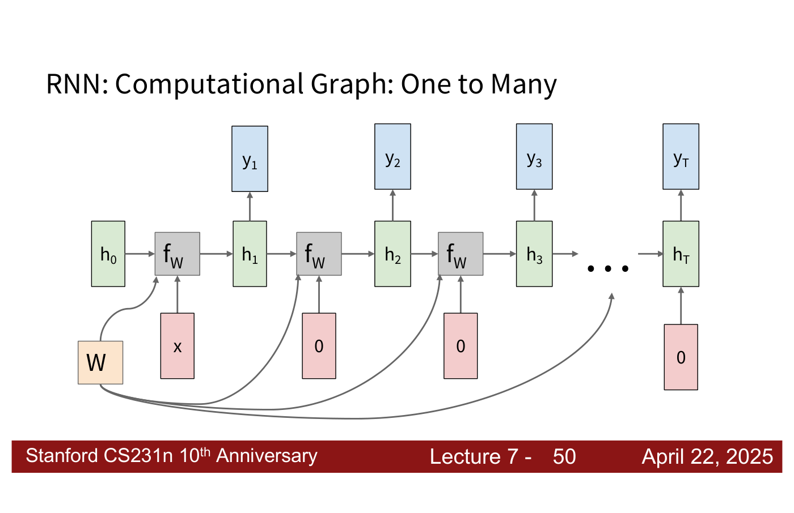

Same as slide 49, with the "?" inputs replaced by zeros: the first input is still the pink box "x", and the pink boxes below the second and third f_W and below h_T (arrow up into h_T) are labelled "0". Everything else as in slide 49: h₀, three f_W boxes, h₁, h₂, h₃, an ellipsis, h_T (5 green hidden-state boxes), blue outputs y₁, y₂, y₃, y_T above h₁, h₂, h₃, h_T, and W with curved arrows to each f_W and to the ellipsis position.

## Slide 51 — RNN: Computational Graph: One to Many

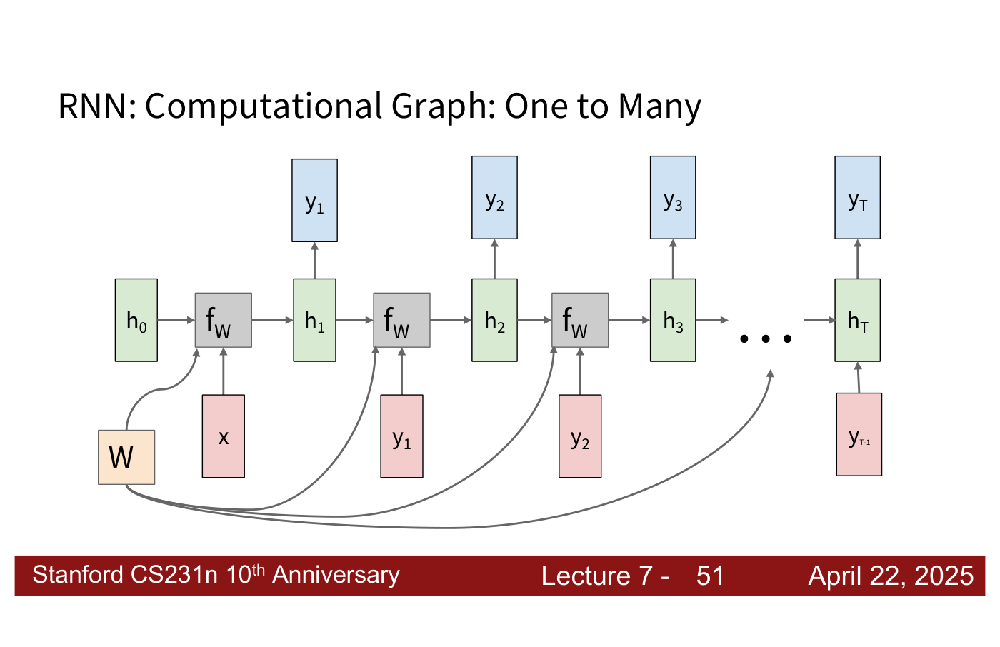

Same as slide 50, but the later input boxes are now labelled with outputs: the first input is still "x"; the pink box below the second f_W reads y₁, the one below the third f_W reads y₂, and the one below h_T (arrow up into h_T) reads y_{T-1} (the subscript "T-1" is printed in very small type). No arrows are drawn from the y output boxes to these input boxes; only the labels indicate it. The rest is unchanged.

## Slide 54 — Backpropagation through time

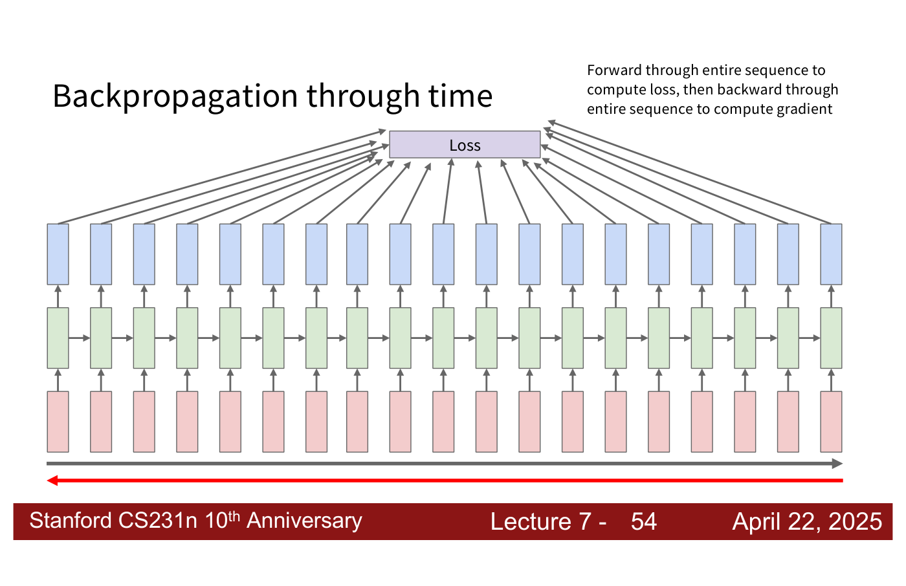

Text at top right: "Forward through entire sequence to compute loss, then backward through entire sequence to compute gradient".

Diagram: a wide unrolled RNN drawn as 19 columns, each column made of three stacked boxes joined by upward arrows: a pink box at the bottom (input), a green box in the middle (hidden state), a blue box at the top (output). Horizontal arrows join each green box to the next green box on its right (18 arrows). A single lavender box labelled "Loss" sits above the middle of the row, and an arrow runs from the top of each of the 19 blue boxes up to the Loss box. Along the bottom there are two long horizontal arrows spanning the full width: a grey arrow pointing right (forward pass) and, below it, a red arrow pointing left (backward pass).

## Slide 55 — Truncated Backpropagation through time

Text on the right: "Run forward and backward through chunks of the sequence instead of whole sequence".

Diagram: the same style of column (pink input, green hidden state, blue output, with arrows between green boxes), but only 7 columns on the left side of the slide. A lavender "Loss" box above them receives an arrow from each of the 7 blue boxes. Below, a grey arrow pointing right and a red arrow pointing left span just these 7 columns.

## Slide 56 — Truncated Backpropagation through time

Text on the right: "Carry hidden states forward in time forever, but only backpropagate for some smaller number of steps".

Diagram: 13 columns (pink input, green hidden state, blue output; green boxes joined left to right). An arrow leaves the last green box to the right, continuing off the chain. A light-grey rectangle encloses the last 6 columns (columns 8 to 13). The "Loss" box sits above the grey rectangle and receives arrows from the 6 blue boxes inside it only; the first 7 blue boxes have no arrows to the loss. Bottom: a grey right-pointing arrow under the first 7 columns, a second grey right-pointing arrow under the 6 boxed columns, and a red left-pointing arrow under the 6 boxed columns only.

## Slide 57 — Truncated Backpropagation through time

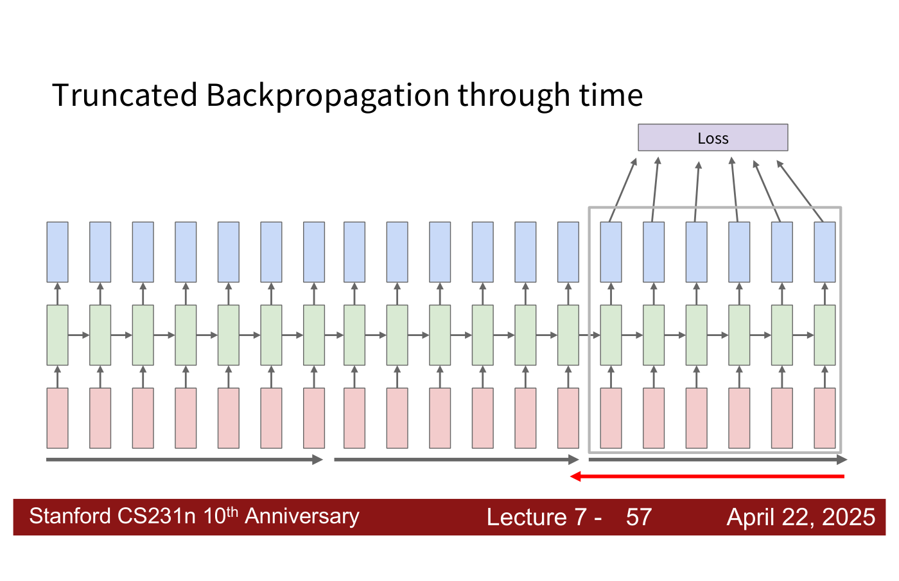

Same as slide 56 with a longer chain: 19 columns. The light-grey rectangle encloses the last 6 columns (columns 14 to 19) and the "Loss" box above it receives arrows from those 6 blue boxes only. Bottom: three grey right-pointing arrows (under columns 1 to 7, columns 8 to 13, and the 6 boxed columns 14 to 19) and one red left-pointing arrow under the 6 boxed columns. No text other than the title and "Loss".

## Slide 58 — Truncated BPTT: Single Output

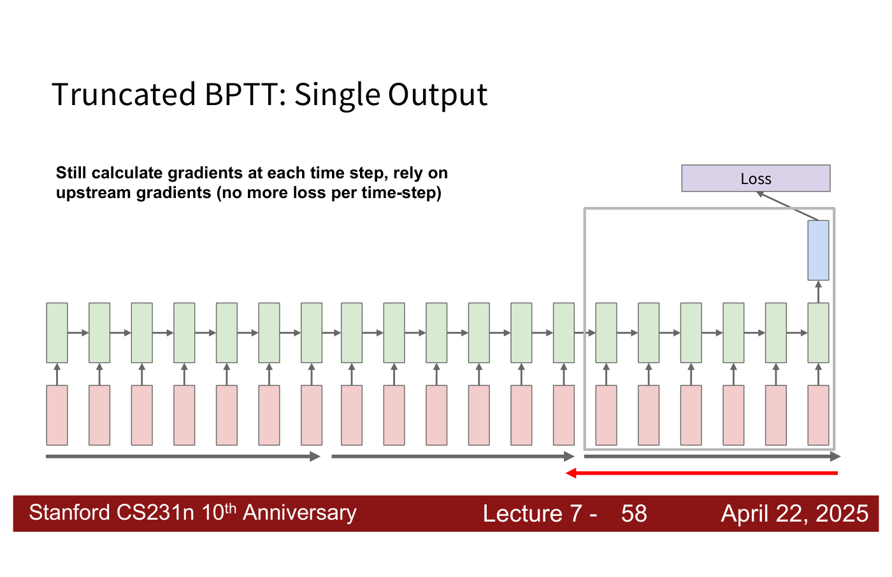

Text at upper left, bold: "Still calculate gradients at each time step, rely on upstream gradients (no more loss per time-step)".

Diagram: the 19-column chain of slide 57, but with only pink input boxes and green hidden-state boxes in the columns (19 pink, 19 green, joined as before). Only the last column has a blue output box (1 blue box), with an arrow from it up to a lavender "Loss" box at upper right. The light-grey rectangle again encloses the last 6 columns, and the blue output box above them. Bottom: three grey right-pointing arrows (columns 1 to 7, 8 to 13, 14 to 19) and a red left-pointing arrow under the 6 boxed columns.

## Slide 59 — A more practical example: Character-level Language Model

Text at left: "A more practical example: Character-level **Language Model**" (the words "Language Model" bold), "Vocabulary: [h,e,l,o]", "Example training sequence: “hello”".

Figure at lower right on a light-grey rounded panel: four pink one-hot input vectors side by side, labelled at the left "input layer" (red text), with the row label "input chars:" beneath and the characters “h”, “e”, “l”, “l” under the four vectors. The vectors, top to bottom, are (1, 0, 0, 0) for “h”, (0, 1, 0, 0) for “e”, (0, 0, 1, 0) for “l” and (0, 0, 1, 0) for the second “l”. The upper part of the slide is empty.

## Slide 60 — A more practical example: Character-level Language Model

Same left text as slide 59. At upper right, inside a black-outlined box, the equation:

$$h_t = \tanh(W_{hh} h_{t-1} + W_{xh} x_t)$$

The figure of slide 59 gains a row of green hidden-layer vectors above the input layer (label "hidden layer" in green), each fed by a red upward arrow from the input vector below; the arrow into the last hidden vector is labelled "W_xh" (red). Green horizontal arrows join the hidden vectors left to right; the arrow between the third and fourth is labelled "W_hh" (green). Hidden vectors, top to bottom, left to right: (0.3, -0.1, 0.9), (1.0, 0.3, 0.1), (0.1, -0.5, -0.3), (-0.3, 0.9, 0.7). Input vectors and characters as on slide 59.

## Slide 61 — A more practical example: Character-level Language Model

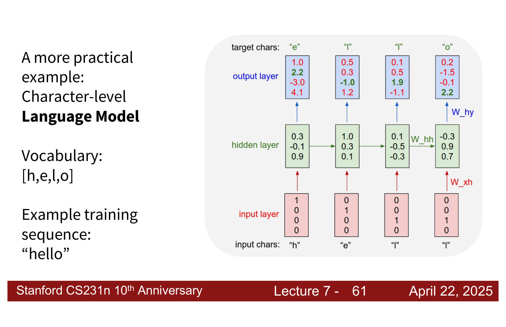

Same left text as slide 59 and the same figure as slide 60, plus an output layer (label "output layer" in blue) of four blue vectors above the hidden layer, each fed by a blue upward arrow from its hidden vector; the last of these arrows is labelled "W_hy" (blue). A row "target chars:" (the label in black, the characters in green) above the output vectors reads “e”, “l”, “l”, “o”. In each output vector one entry is printed in bold green and the other three in red.

Printed values, top to bottom, left to right (bold green entry marked with an asterisk):

| Column | Input char | Hidden layer | Output layer | Target char |
| --- | --- | --- | --- | --- |
| 1 | “h” (1, 0, 0, 0) | (0.3, -0.1, 0.9) | (1.0, 2.2\*, -3.0, 4.1) | “e” |
| 2 | “e” (0, 1, 0, 0) | (1.0, 0.3, 0.1) | (0.5, 0.3, -1.0\*, 1.2) | “l” |
| 3 | “l” (0, 0, 1, 0) | (0.1, -0.5, -0.3) | (0.1, 0.5, 1.9\*, -1.1) | “l” |
| 4 | “l” (0, 0, 1, 0) | (-0.3, 0.9, 0.7) | (0.2, -1.5, -0.1, 2.2\*) | “o” |

Labels W_xh (red), W_hh (green) and W_hy (blue) are printed as on slides 60 and above. The slide does not say in words why the entries are bold green; each bold entry sits at the position of that column's target character in the vocabulary order h, e, l, o.

## Slide 62 — Example: Character-level Language Model Sampling

Text at left: "Example: Character-level Language Model **Sampling**" (the word "Sampling" bold), "Vocabulary: [h,e,l,o]", and "**At test-time** sample characters one at a time, feed back to model" (the words "At test-time" bold).

Figure at right, a single column cropped at the right edge: from bottom to top, a pink input vector (1, 0, 0, 0) labelled "input layer" with input char “h”; a red arrow up to a green hidden vector (0.3, -0.1, 0.9) labelled "hidden layer" (a green line leaves it to the right, cut off by the crop); a blue arrow up to a blue output vector (1.0, 2.2, -3.0, 4.1) labelled "output layer" (2.2 in bold green, the others red); a grey arrow up to an orange "Softmax" vector (.03, .84, .00, .13); and a grey arrow up to the word "Sample" with the sampled character “e (the closing quote is clipped in the image).

## Slide 63 — Example: Character-level Language Model Sampling

Same as slide 62 (the text is no longer bold), plus a large curved grey arrow that runs from the sampled “e” at the top, down the right side of the first column, and into a second pink input vector (0, 1, 0, 0) with input char “e” at the bottom right. Only that input vector is added; nothing is drawn above it yet.

## Slide 64 — Example: Character-level Language Model Sampling

Same as slide 63, plus the second column filled in: green hidden vector (1.0, 0.3, 0.1) with a green arrow from the first hidden vector into it; blue output vector (0.5, 0.3, -1.0, 1.2) with -1.0 in bold green; orange softmax vector (.25, .20, .50, .05); and sampled character “l” at the top.

## Slide 65 — Example: Character-level Language Model Sampling

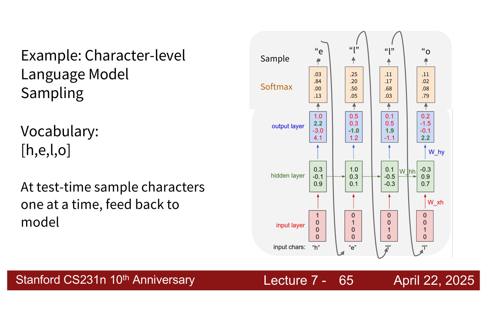

Same as slide 64, with all four columns present. Columns, left to right:

| Column | Input char (vector) | Hidden layer | Output layer | Softmax | Sample |
| --- | --- | --- | --- | --- | --- |
| 1 | “h” (1, 0, 0, 0) | (0.3, -0.1, 0.9) | (1.0, 2.2, -3.0, 4.1) | (.03, .84, .00, .13) | “e |
| 2 | “e” (0, 1, 0, 0) | (1.0, 0.3, 0.1) | (0.5, 0.3, -1.0, 1.2) | (.25, .20, .50, .05) | “l” |
| 3 | “l” (0, 0, 1, 0) | (0.1, -0.5, -0.3) | (0.1, 0.5, 1.9, -1.1) | (.11, .17, .68, .03) | “l” |
| 4 | “l” (0, 0, 1, 0) | (-0.3, 0.9, 0.7) | (0.2, -1.5, -0.1, 2.2) | (.11, .02, .08, .79) | “o |

In the output layer the bold green entries are 2.2, -1.0, 1.9 and 2.2 (as on slide 61). Three curved grey arrows run from each of the first three sampled characters (“e”, “l”, “l”) down to the input of the next column. Labels W_xh, W_hh and W_hy are printed at the right.

*[Ed: printed softmax of column 1 is (.03, .84, .00, .13); recomputing softmax of the printed output scores (1.0, 2.2, -3.0, 4.1) gives about (.04, .13, .00, .84), because 4.1 is the largest score and gets most of the probability mass. The printed .84 and .13 are on the wrong entries (and .03 would round to .04).]*

*[Ed: printed softmax of column 2 is (.25, .20, .50, .05); recomputing from (0.5, 0.3, -1.0, 1.2) gives about (.25, .20, .06, .50), so the printed .50 and .05 are on the wrong entries (the exact third value is about .055).]*

Columns 3 and 4 recompute correctly: (0.1, 0.5, 1.9, -1.1) gives about (.11, .17, .68, .03) and (0.2, -1.5, -0.1, 2.2) gives about (.11, .02, .08, .79).

## Slide 66 — Example: Character-level Language Model Sampling

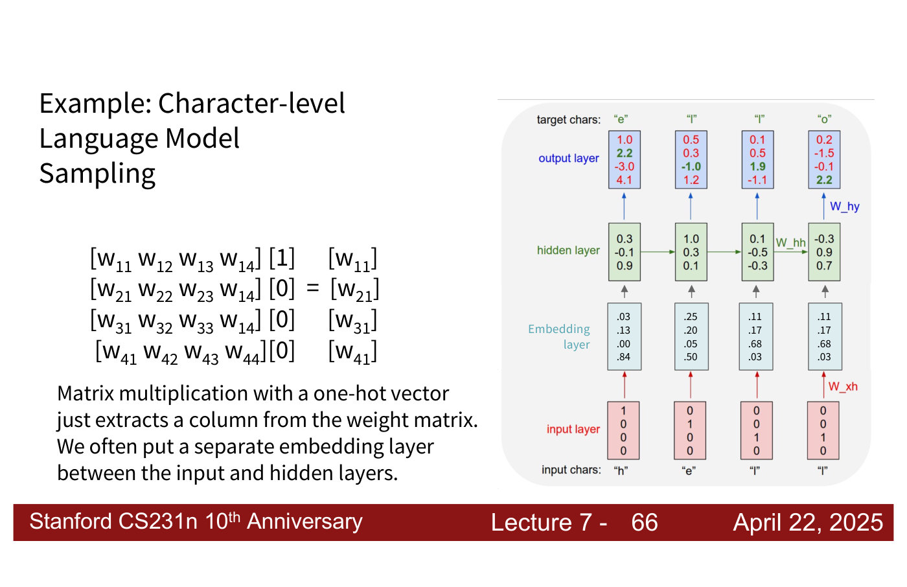

Text at left (title, not bold): "Example: Character-level Language Model Sampling". Below it, an equation printed as plain text with four rows:

```
[w11 w12 w13 w14] [1]     [w11]
[w21 w22 w23 w14] [0]  =  [w21]
[w31 w32 w33 w14] [0]     [w31]
[w41 w42 w43 w44] [0]     [w41]
```

(subscripts are printed as subscripts, e.g. $w_{11}$). Caption beneath: "Matrix multiplication with a one-hot vector just extracts a column from the weight matrix. We often put a separate embedding layer between the input and hidden layers."

*[Ed: rows 2 and 3 of the printed matrix end in w14 (row 2 reads w21 w22 w23 w14, row 3 w31 w32 w33 w14); by the pattern of rows 1 and 4 these last entries would be w24 and w34. The product printed on the right, w11, w21, w31, w41, is the first column of the matrix, as the caption says.]*

Figure at right, a four-column RNN on a light-grey rounded panel, from bottom to top: pink input one-hot vectors (label "input layer", input chars “h”, “e”, “l”, “l”: (1, 0, 0, 0), (0, 1, 0, 0), (0, 0, 1, 0), (0, 0, 1, 0)); red arrows (the last labelled "W_xh") up to a new light-blue "Embedding layer" row with vectors (.03, .13, .00, .84), (.25, .20, .05, .50), (.11, .17, .68, .03), (.11, .17, .68, .03); grey arrows up to the green hidden layer (0.3, -0.1, 0.9), (1.0, 0.3, 0.1), (0.1, -0.5, -0.3), (-0.3, 0.9, 0.7) joined by green arrows (the last labelled "W_hh"); blue arrows (the last labelled "W_hy") up to the blue output layer (1.0, 2.2, -3.0, 4.1), (0.5, 0.3, -1.0, 1.2), (0.1, 0.5, 1.9, -1.1), (0.2, -1.5, -0.1, 2.2) with the same bold green entries as slide 61 (2.2, -1.0, 1.9, 2.2); and above them "target chars:" “e”, “l”, “l”, “o”. This figure has no softmax row and no sample row. The third and fourth embedding vectors are identical; both inputs are “l”.

## Slide 67 — min-char-rnn.py gist: 112 lines of Python

Title text: "min-char-rnn.py gist: 112 lines of Python". Link text: "(https://gist.github.com/karpathy/d4dee566867f8291f086)".

The slide is a screenshot of a 112-line Python 2 listing in two columns (lines 1–61 on the left, 63–112 on the right), very small at slide size but legible when zoomed in. Its docstring reads "Minimal character-level Vanilla RNN model. Written by Andrej Karpathy (@karpathy) BSD License" and it begins with `import numpy as np`. The listing, in order: data I/O (reads `input.txt`, builds `chars`, `data_size`, `vocab_size`, `char_to_ix` and `ix_to_char`); hyperparameters (`hidden_size = 100` "size of hidden layer of neurons", `seq_length = 25` "number of steps to unroll the RNN for", `learning_rate = 1e-1`); model parameters `Wxh`, `Whh`, `Why` (random normal times 0.01) and biases `bh`, `by`; a function `lossFun(inputs, targets, hprev)` with a forward pass (one-hot `xs[t]`, `hs[t] = np.tanh(np.dot(Wxh, xs[t]) + np.dot(Whh, hs[t-1]) + bh)`, `ys[t] = np.dot(Why, hs[t]) + by`, softmax probabilities `ps[t]`, cross-entropy `loss += -np.log(ps[t][targets[t],0])`), a backward pass through time (gradients `dWxh`, `dWhh`, `dWhy`, `dbh`, `dby`, `dhnext`, backprop through tanh with `dhraw = (1 - hs[t] * hs[t]) * dh`) and gradient clipping `np.clip(dparam, -5, 5, out=dparam)  # clip to mitigate exploding gradients`; a function `sample(h, seed_ix, n)` that samples a sequence of integers from the model; and a main `while True:` loop that sweeps the data `seq_length` characters at a time, resets the RNN memory at the start of the data, samples text every 100 iterations, computes the loss and gradient, prints progress, and performs an Adagrad update (`mem += dparam * dparam`; `param += -learning_rate * dparam / np.sqrt(mem + 1e-8)`). This is a summary of the listing, not a line-by-line copy; the values and lines quoted were checked on 600 dpi crops.

## Slide 68 — Training on Shakespeare's Sonnets (untitled)

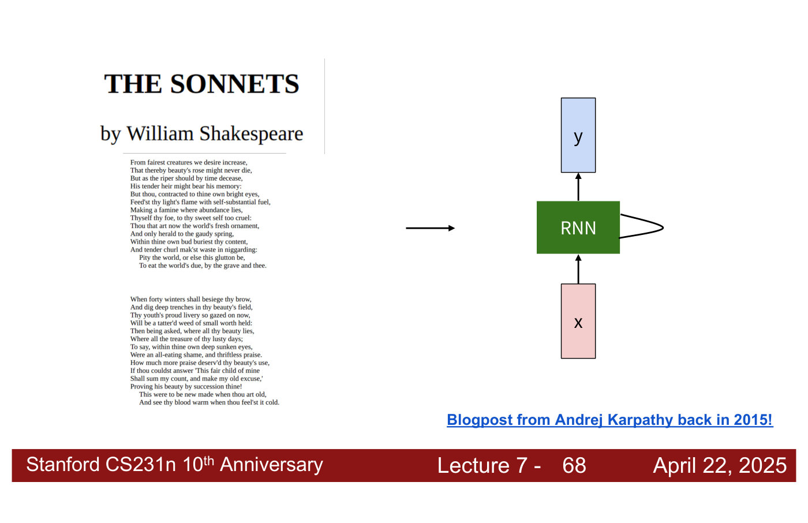

No title. Left: a page image titled "THE SONNETS by William Shakespeare", showing the text of two sonnets (the first begins "From fairest creatures we desire increase," and the second "When forty winters shall besiege thy brow,"). A right-pointing arrow leads from the text to a diagram on the right: a vertical stack of a pink box labelled "x" at the bottom, an arrow up to a green box labelled "RNN" (with a curved arrow looping out of its right side and back into it, the recurrence), and an arrow up to a light-blue box labelled "y" at the top. Bottom right, a blue underlined link: "Blogpost from Andrej Karpathy back in 2015!".

## Slide 69 — Generated text as training proceeds (untitled)

No title. Four text samples in monospace boxes, stacked, connected by down arrows labelled "train more". A label "at first:" sits at the left of the first box.

Box 1 ("at first:"):

```
tyntd-iafhatawiaoihrdemot  lytdws  e ,tfti, astai f ogoh eoase rrranbyne 'nhthnee e
plia tklrgd t o idoe ns,smtt   h ne etie h,hregtrs nigtike,aoaenns lng
```

Box 2 (after "train more"):

```
"Tmont thithey" fomesscerliund
Keushey. Thom here
sheulke, anmerenith ol sivh I lalterthend Bleipile shuwy fil on aseterlome
coaniogennc Phe lism thond hon at. MeiDimorotion in ther thize."
```

Box 3 (after "train more"):

```
Aftair fall unsuch that the hall for Prince Velzonski's that me of
her hearly, and behs to so arwage fiving were to it beloge, pavu say falling misfort
how, and Gogition is so overelical and ofter.
```

Box 4 (after "train more"):

```
"Why do what that day," replied Natasha, and wishing to himself the fact the
princess, Princess Mary was easier, fed in had oftened him.
Pierre aking his soul came to the packs and drove up his father-in-law women.
```

## Slide 70 — Generated Shakespeare-style text (untitled)

No title. Two monospace text boxes side by side, generated text in the style of a play script (the slide gives no caption).

Left box:

```
PANDARUS:
Alas, I think he shall be come approached and the day
When little srain would be attain'd into being never fed,
And who is but a chain and subjects of his death,
I should not sleep.

Second Senator:
They are away this miseries, produced upon my soul,
Breaking and strongly should be buried, when I perish
The earth and thoughts of many states.

DUKE VINCENTIO:
Well, your wit is in the care of side and that.

Second Lord:
They would be ruled after this chamber, and
my fair nues begun out of the fact, to be conveyed,
Whose noble souls I'll have the heart of the wars.

Clown:
Come, sir, I will make did behold your worship.

VIOLA:
I'll drink it.
```

Right box:

```
VIOLA:
Why, Salisbury must find his flesh and thought
That which I am not aps, not a man and in fire,
To show the reining of the raven and the wars
To grace my hand reproach within, and not a fair are hand,
That Caesar and my goodly father's world;
When I was heaven of presence and our fleets,
We spare with hours, but cut thy council I am great,
Murdered and by thy master's ready there
My power to give thee but so much as hell:
Some service in the noble bondman here,
Would show him to her wine.

KING LEAR:
O, if you were a feeble sight, the courtesy of your law,
Your sight and several breath, will wear the gods
With his heads, and my hands are wonder'd at the deeds,
So drop upon your lordship's head, and your opinion
Shall be against your honour.
```

## Slide 74 — Linux kernel source on GitHub (untitled)


No title. A screenshot of a GitHub web page for the repository "torvalds / linux", description "Linux kernel source tree". The header shows Watch 3,711, Star 23,054, Fork 9,141; the stats bar reads "520,037 commits", "1 branch", "420 releases", "5,039 contributors". The branch is "master". The latest commit banner reads "Merge branch 'drm-fixes' of git://people.freedesktop.org/~airlied/linux", "torvalds authored 9 hours ago", "latest commit 4b1706927d". A file listing shows directories Documentation, arch, block, crypto, drivers, firmware, fs, include, init (and a cut-off "ipc") with commit messages and ages (for example "6 days ago", "a day ago", "9 hours ago", "2 months ago"). The right-hand sidebar lists Code, Pull requests (74), Pulse, Graphs, an "HTTPS clone URL" box, "You can clone with HTTPS, SSH, or Subversion.", "Clone in Desktop" and "Download ZIP". The logged-in user shown at top right is "karpathy".

## Slide 75 — Generated C code

Text on the right: "Generated C code". Left, a code listing on a light-lavender background (syntax-coloured):

```c
static void do_command(struct seq_file *m, void *v)
{
  int column = 32 << (cmd[2] & 0x80);
  if (state)
    cmd = (int)(int_state ^ (in_8(&ch->ch_flags) & Cmd) ? 2 : 1);
  else
    seq = 1;
  for (i = 0; i < 16; i++) {
    if (k & (1 << 1))
      pipe = (in_use & UMXTHREAD_UNCCA) +
        ((count & 0x00000000ffffff8) & 0x000000f) << 8;
    if (count == 0)
      sub(pid, ppc_md.kexec_handle, 0x20000000);
    pipe_set_bytes(i, 0);
  }
  /* Free our user pages pointer to place camera if all dash */
  subsystem_info = &of_changes[PAGE_SIZE];
  rek_controls(offset, idx, &soffset);
  /* Now we want to deliberately put it to device */
  control_check_polarity(&context, val, 0);
  for (i = 0; i < COUNTER; i++)
    seq_puts(s, "policy ");
}
```

## Slide 76 — OpenAI Codex, GitHub Copilot, Cursor IDE

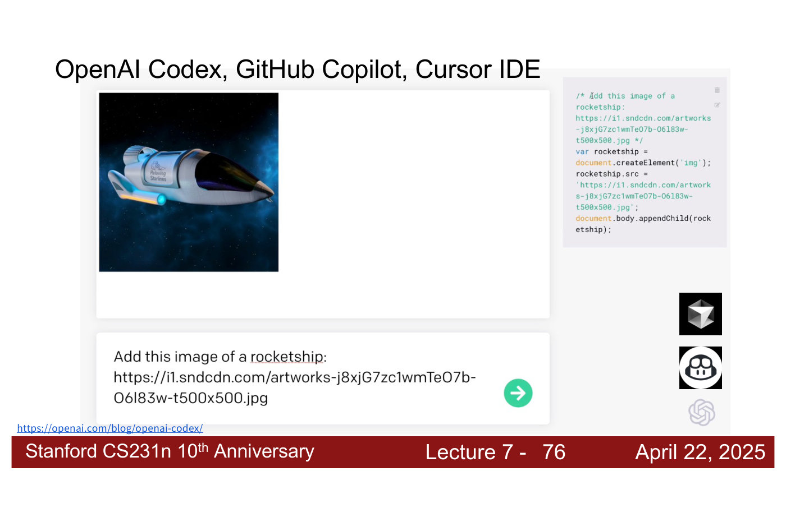

Title: "OpenAI Codex, GitHub Copilot, Cursor IDE". A screenshot of a code-generation demo. On the left, a white panel contains a photograph of a silver and white rocketship with blue engine glow against a starry blue space background (the hull has a faint logo reading "Relaxing Starlines"). Below it, a prompt box with text "Add this image of a rocketship: https://i1.sndcdn.com/artworks-j8xjG7zc1wmTeO7b-O6l83w-t500x500.jpg" and a green circular arrow (submit) button. On the right, a grey code panel with generated JavaScript:

```
/* Add this image of a rocketship: https://i1.sndcdn.com/artworks-j8xjG7zc1wmTeO7b-O6l83w-t500x500.jpg */
var rocketship = document.createElement('img');
rocketship.src = 'https://i1.sndcdn.com/artworks-j8xjG7zc1wmTeO7b-O6l83w-t500x500.jpg';
document.body.appendChild(rocketship);
```

Three small logo icons at the lower right (a grey cube, a robot-face icon in a white circle, and a grey OpenAI-style swirl). Bottom-left link: "https://openai.com/blog/openai-codex/".

## Slide 77 — Searching for interpretable cells

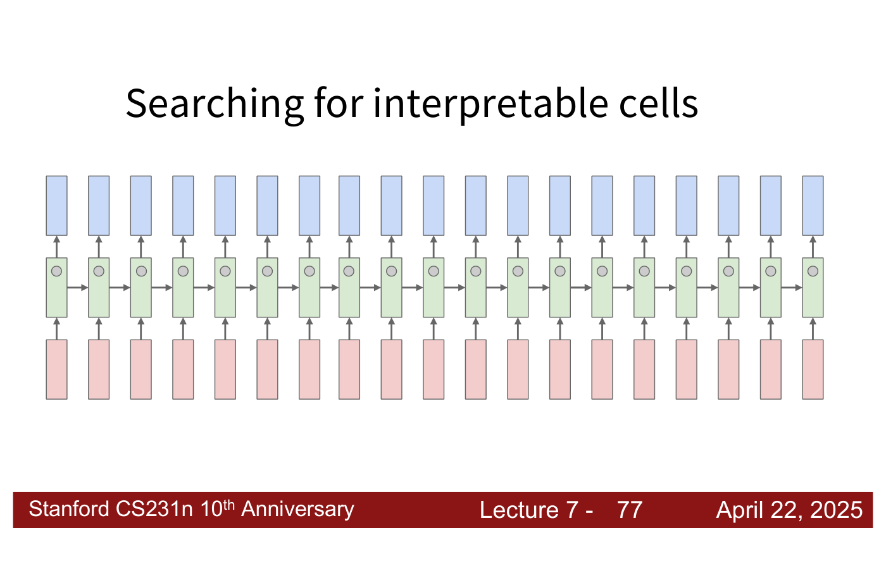

Title: "Searching for interpretable cells". A diagram of an unrolled RNN with 19 time steps side by side. Each step is a vertical column: a pink box at the bottom (input), an arrow up to a light-green box in the middle containing a small grey circle in its upper part, and an arrow up to a light-blue box at the top (output). Horizontal arrows connect each green box to the next green box on its right (18 arrows). No labels are printed.

## Slide 78 — Searching for interpretable cells

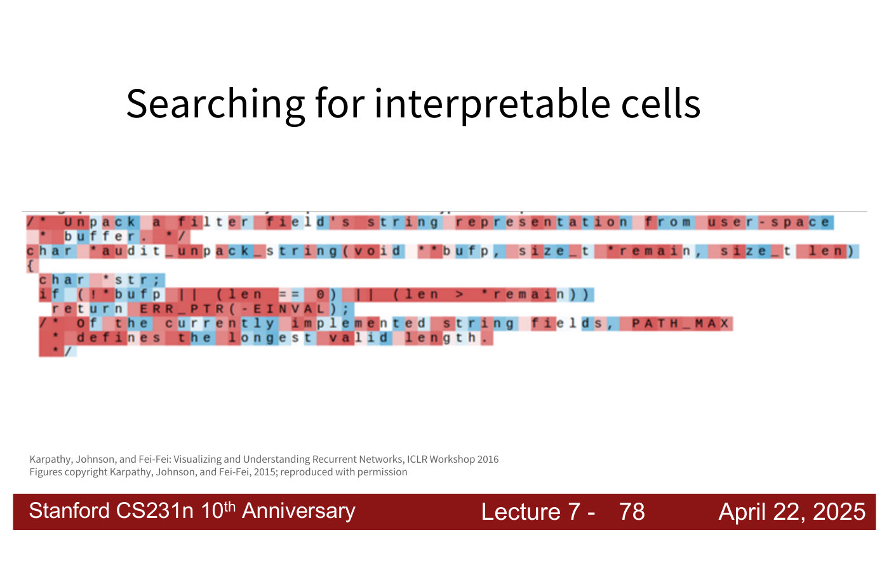

Title: "Searching for interpretable cells". A figure showing C source code (about 11 lines, the top of the image slightly cut off) in monospace, each character shaded with a red or blue background of varying intensity (white or near-white for neutral). The slide itself does not say what the colours encode. The visible text:

```
/* Unpack a filter field's string representation from user-space
 * buffer. */
char *audit_unpack_string(void **bufp, size_t *remain, size_t len)
{
  char *str;
  if (!*bufp || (len == 0) || (len > *remain))
    return ERR_PTR(-EINVAL);
  /* Of the currently implemented string fields, PATH_MAX
   * defines the longest valid length.
   */
```

Comment text and the condition inside the `if` are mostly shaded red; much of the declaration line and the `return` line are shaded blue; no per-character values are printed. Credit lines at the bottom: "Karpathy, Johnson, and Fei-Fei: Visualizing and Understanding Recurrent Networks, ICLR Workshop 2016" and "Figures copyright Karpathy, Johnson, and Fei-Fei, 2015; reproduced with permission".

## Slide 79 — Searching for interpretable cells (quote detection cell)

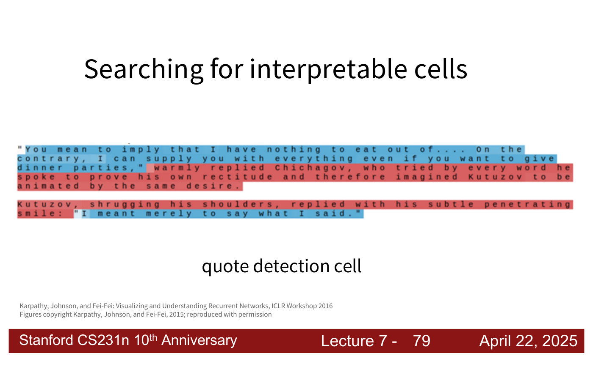

Title: "Searching for interpretable cells". Figure: a passage of text, each character shaded red or blue. Visible text:

"You mean to imply that I have nothing to eat out of.... On the contrary, I can supply you with everything even if you want to give dinner parties," warmly replied Chichagov, who tried by every word he spoke to prove his own rectitude and therefore imagined Kutuzov to be animated by the same desire.

Kutuzov, shrugging his shoulders, replied with his subtle penetrating smile: "I meant merely to say what I said."

The text inside quotation marks (from the opening quote to "dinner parties," and from the opening quote before "I meant" to the end) is shaded blue; the narration between the quotes ("warmly replied Chichagov, ... same desire." and "Kutuzov, shrugging ... smile:") is shaded red. Caption below the figure: "quote detection cell". Credit lines: "Karpathy, Johnson, and Fei-Fei: Visualizing and Understanding Recurrent Networks, ICLR Workshop 2016" and "Figures copyright Karpathy, Johnson, and Fei-Fei, 2015; reproduced with permission".

## Slide 80 — Searching for interpretable cells (line length tracking cell)

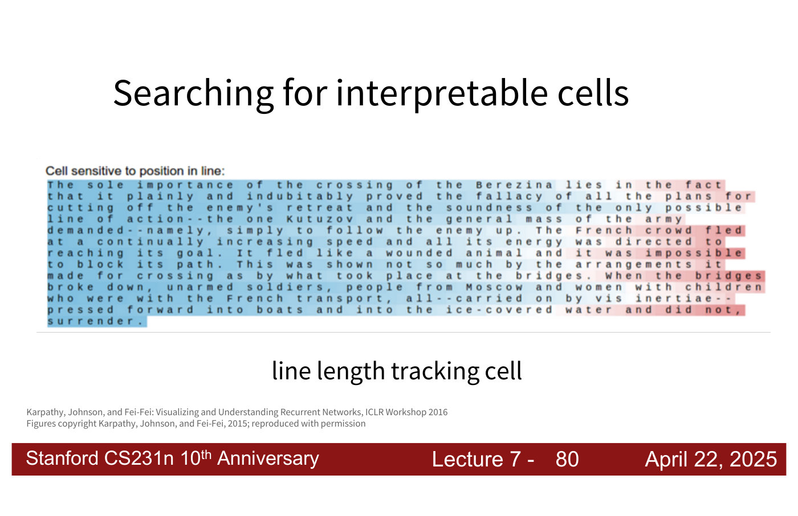

Title: "Searching for interpretable cells". Figure label (small, top): "Cell sensitive to position in line:". Below it, a 12-line wrapped paragraph of text (monospace, widely spaced), each character shaded. Text:

The sole importance of the crossing of the Berezina lies in the fact that it plainly and indubitably proved the fallacy of all the plans for cutting off the enemy's retreat and the soundness of the only possible line of action--the one Kutuzov and the general mass of the army demanded--namely, simply to follow the enemy up. The French crowd fled at a continually increasing speed and all its energy was directed to reaching its goal. It fled like a wounded animal and it was impossible to block its path. This was shown not so much by the arrangements it made for crossing as by what took place at the bridges. When the bridges broke down, unarmed soldiers, people from Moscow and women with children who were with the French transport, all--carried on by vis inertiae--pressed forward into boats and into the ice-covered water and did not, surrender.

Shading: at the start of each line the characters are strongly blue, fading through white in the middle of the line to red at the end of each line (the red is strongest at the right end), so the colour follows horizontal position within the line. Caption below: "line length tracking cell". Credit lines: "Karpathy, Johnson, and Fei-Fei: Visualizing and Understanding Recurrent Networks, ICLR Workshop 2016" and "Figures copyright Karpathy, Johnson, and Fei-Fei, 2015; reproduced with permission".

## Slide 81 — Searching for interpretable cells (if statement cell)

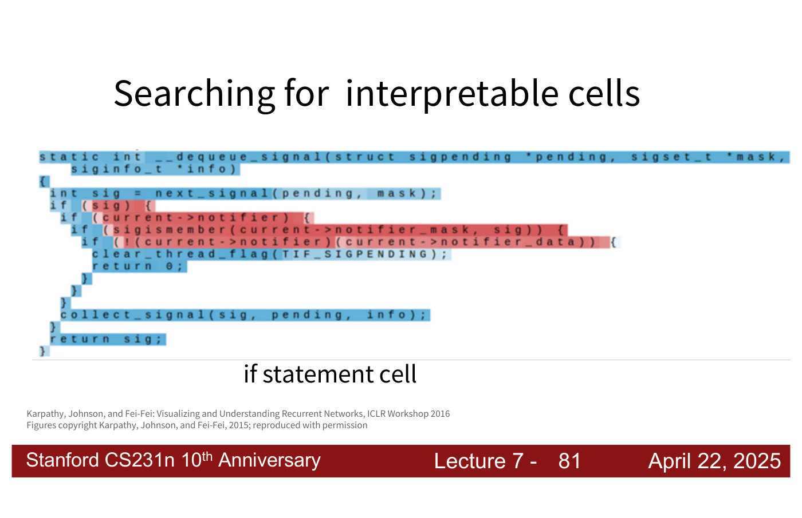

Title: "Searching for interpretable cells". Figure: C code with red/blue character shading:

```c
static int __dequeue_signal(struct sigpending *pending, sigset_t *mask,
    siginfo_t *info)
{
  int sig = next_signal(pending, mask);
  if (sig) {
    if (current->notifier) {
      if (sigismember(current->notifier_mask, sig)) {
        if (!(current->notifier)(current->notifier_data)) {
          clear_thread_flag(TIF_SIGPENDING);
          return 0;
        }
      }
    }
    collect_signal(sig, pending, info);
  }
  return sig;
}
```

The conditions inside the `if (...)` parentheses (for example `(sig) {`, `(current->notifier) {`, `(sigismember(current->notifier_mask, sig)) {`, `(!(current->notifier)(current->notifier_data)) {`) are shaded red; most of the rest of the code is shaded blue. Caption below: "if statement cell". Credit lines: "Karpathy, Johnson, and Fei-Fei: Visualizing and Understanding Recurrent Networks, ICLR Workshop 2016" and "Figures copyright Karpathy, Johnson, and Fei-Fei, 2015; reproduced with permission".

## Slide 82 — Searching for interpretable cells (quote/comment cell)

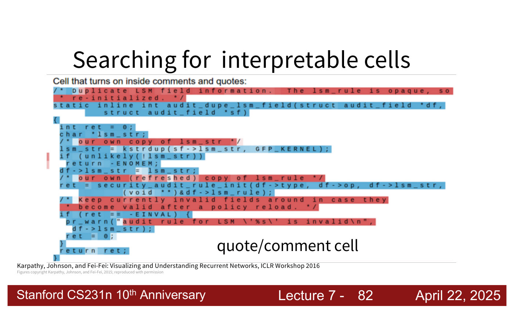

Title: "Searching for interpretable cells". Figure label (small, top): "Cell that turns on inside comments and quotes:". C code with shading:

```c
/* Duplicate LSM field information. The lsm_rule is opaque, so
 * re-initialized. */
static inline int audit_dupe_lsm_field(struct audit_field *df,
        struct audit_field *sf)
{
  int ret = 0;
  char *lsm_str;
  /* our own copy of lsm_str */
  lsm_str = kstrdup(sf->lsm_str, GFP_KERNEL);
  if (unlikely(!lsm_str))
    return -ENOMEM;
  df->lsm_str = lsm_str;
  /* our own (refreshed) copy of lsm_rule */
  ret = security_audit_rule_init(df->type, df->op, df->lsm_str,
        (void **)&df->lsm_rule);
  /* Keep currently invalid fields around in case they
   * become valid after a policy reload. */
  if (ret == -EINVAL) {
    pr_warn("audit rule for LSM \'%s\' is invalid\n",
      df->lsm_str);
    ret = 0;
  }
  return ret;
}
```

Comment text (`/* ... */` blocks) and the string literal in `pr_warn` are shaded red; the code outside comments and quotes is shaded blue. Caption (inside the figure, lower right): "quote/comment cell". Credit lines: "Karpathy, Johnson, and Fei-Fei: Visualizing and Understanding Recurrent Networks, ICLR Workshop 2016" and "Figures copyright Karpathy, Johnson, and Fei-Fei, 2015; reproduced with permission" (this second line is printed in much smaller type than on the other slides).

## Slide 83 — Searching for interpretable cells (code depth cell)

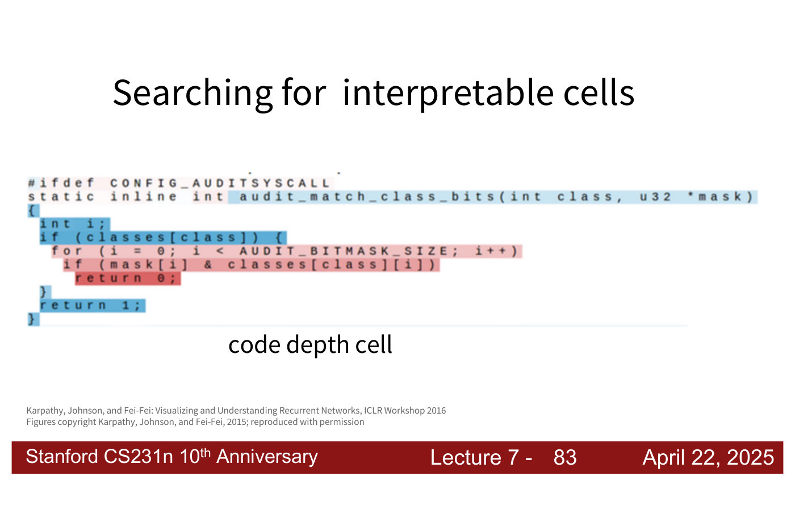

Title: "Searching for interpretable cells". Figure: C code with shading:

```c
#ifdef CONFIG_AUDITSYSCALL
static inline int audit_match_class_bits(int class, u32 *mask)
{
  int i;
  if (classes[class]) {
    for (i = 0; i < AUDIT_BITMASK_SIZE; i++)
      if (mask[i] & classes[class][i])
        return 0;
  }
  return 1;
}
```

Shading: the `#ifdef` line is faint pink, the function signature light blue; `int i;` and `if (classes[class]) {` are strong blue, the `for` line is light red, the inner `if` line is a little stronger red, and `return 0;` is the strongest red; the closing `}` and `return 1;` are blue. The darker the red, the deeper the nesting. Caption below: "code depth cell". Credit lines: "Karpathy, Johnson, and Fei-Fei: Visualizing and Understanding Recurrent Networks, ICLR Workshop 2016" and "Figures copyright Karpathy, Johnson, and Fei-Fei, 2015; reproduced with permission".

## Slide 84 — RNN tradeoffs

Title: "RNN tradeoffs".

RNN Advantages:
- Can process any length of the input (no context length)
- Computation for step *t* can (in theory) use information from many steps back
- Model size does not increase for longer input
- The same weights are applied on every timestep, so there is symmetry in how inputs are processed.

RNN Disadvantages:
- Recurrent computation is slow
- In practice, difficult to access information from many steps back

## Slide 85 — Image Captioning

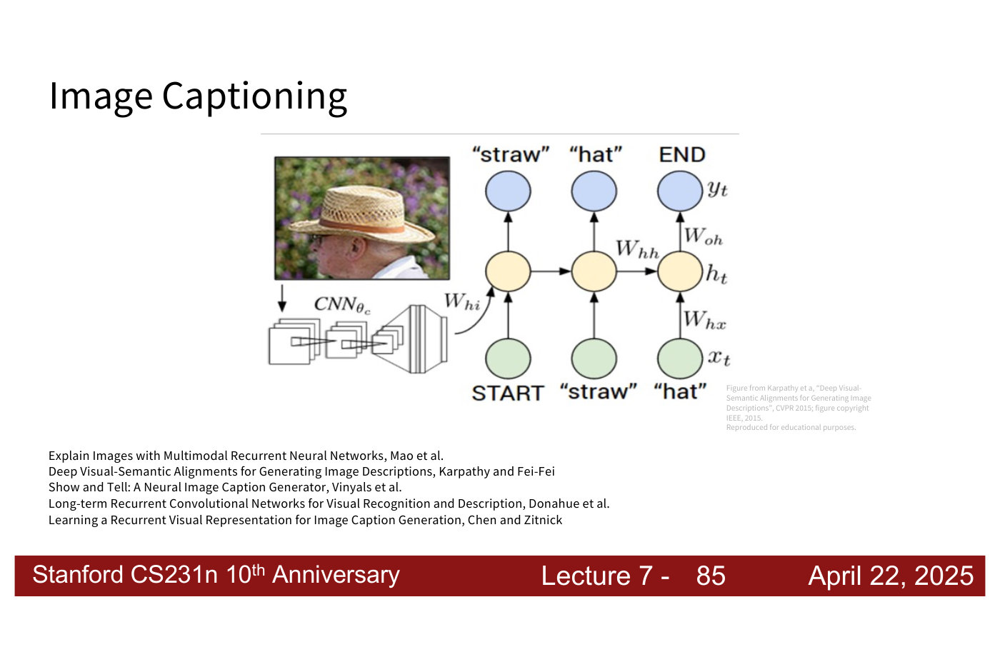

Title: "Image Captioning". Figure: a photograph at upper left of an older man in profile wearing a straw hat with an orange band, in front of purple flowers. A down arrow leads from the photograph to a drawn CNN labelled $\mathrm{CNN}_ {\theta_c}$ (printed as CNN with subscript theta c): three stacked convolution-feature-map blocks narrowing into a trapezoid. An arrow labelled $W_{hi}$ (printed W with subscript hi) curves from the CNN to the first hidden node of an unrolled RNN with 3 time steps. Each time step has three circles in a column: a green input circle at the bottom, a yellow hidden circle in the middle, and a blue output circle at the top. The inputs, left to right, are labelled "START", "straw", "hat"; the outputs above them are labelled "straw", "hat", "END". Horizontal arrows connect the three yellow hidden circles, the first two labelled with nothing and the label $W_{hh}$ (W with subscript hh) printed above the arrow between the second and third. Labels at the right-most step: $y_t$ (output), $W_{oh}$ (between hidden and output), $h_t$ (hidden), $W_{hx}$ (between input and hidden), $x_t$ (input). Small grey credit text beside the figure: "Figure from Karpathy et a, "Deep Visual-Semantic Alignments for Generating Image Descriptions", CVPR 2015; figure copyright IEEE, 2015. Reproduced for educational purposes."

Reference list at the bottom:
- Explain Images with Multimodal Recurrent Neural Networks, Mao et al.
- Deep Visual-Semantic Alignments for Generating Image Descriptions, Karpathy and Fei-Fei
- Show and Tell: A Neural Image Caption Generator, Vinyals et al.
- Long-term Recurrent Convolutional Networks for Visual Recognition and Description, Donahue et al.
- Learning a Recurrent Visual Representation for Image Caption Generation, Chen and Zitnick

## Slide 86 — Recurrent Neural Network / Convolutional Neural Network

Text labels: "Recurrent Neural Network" (green, above) and "Convolutional Neural Network" (red, below). The slide reuses the image-captioning figure of slide 85 (photograph of a man in a straw hat, the CNN drawing, and the 3-step RNN with inputs START, "straw", "hat" and outputs "straw", "hat", END, with weights $W_{hi}$, $W_{hh}$, $W_{oh}$, $W_{hx}$ and labels $x_t$, $h_t$, $y_t$). A red rectangle outlines the CNN drawing (bottom left) and a green rectangle outlines the three-step RNN (right); the red label "Convolutional Neural Network" sits below the red box and the green label "Recurrent Neural Network" above the green box.

## Slide 87 — Test image

A photograph at upper right: the back of a person in a wide-brimmed straw hat, seen from behind and above the bare shoulders, facing dark rippled water. Blue text to its right: "test image". Under the photograph, small text: "This image is CC0 public domain" (both "This image" and "CC0 public domain" are hyperlinks). The rest of the slide is blank.

## Slide 88 — Test image fed to a CNN (layer stack)

Same photograph and "test image" label as slide 87, now with a blue arrow from the photograph pointing left to the top of a vertical stack of boxes at the left edge of the slide, drawn top to bottom. The stack has 20 boxes: a blue box "image"; then conv-64, conv-64, maxpool; conv-128, conv-128, maxpool; conv-256, conv-256, maxpool; conv-512, conv-512, maxpool; conv-512, conv-512, maxpool (orange boxes, in five groups of two conv boxes plus one maxpool, so 10 conv boxes and 5 maxpool boxes in all); then green boxes FC-4096, FC-4096, FC-1000, softmax. Counting the drawn boxes: 10 conv + 3 FC = 13 weight layers, plus 5 maxpool, 1 softmax and the image box. The slide gives no network name.

## Slide 89 — Remove the last layers of the CNN

Same as slide 88, plus: the last two boxes of the stack (FC-1000 and softmax) are greyed out, enclosed in a red rectangle with a pink fill and crossed by a large red "X". No text explains this; the remaining stack ends with FC-4096, FC-4096.

## Slide 90 — Start of the RNN (x0)

Same as slide 88 with the FC-1000 and softmax boxes removed (the stack now ends with FC-4096, FC-4096). New element: a single grey box near the bottom centre labelled "x0 <START>".

## Slide 91 — Image feature enters the RNN through W_ih

Same as slide 90, plus: above the "x0 <START>" box, an arrow goes up to a grey box "h0", and an arrow from h0 up to a grey box "y0". A thick magenta arrow curves from the last FC-4096 box of the CNN stack into the "h0" box, labelled "Wih" in black. On the right, text:

before:

$h = \tanh(W_{xh} \ast x + W_{hh} \ast h)$

now:

$h = \tanh(W_{xh} \ast x + W_{hh} \ast h + W_{ih} \ast v)$

where the added term "+ W_ih * v" is printed in magenta. The slide does not define $v$ in words; given the arrow, it is the output of the last FC-4096 layer.

## Slide 92 — Sample the first word

Same as slide 91 (the arrow from the CNN into h0 is now black, and the "before / now" equations are gone), plus: a blue curved arrow from the "y0" box down to a new grey box labelled "straw" placed to the right of "x0 <START>" in the input row, with blue text "sample!" beside the arrow.

## Slide 93 — Second time step

Same as slide 92, plus: an arrow from the "straw" input box up to a new grey box "h1", an arrow from h1 up to a new grey box "y1", and a horizontal arrow from h0 to h1. The blue "sample!" arrow and text are gone.

## Slide 94 — Sample the second word

Same as slide 93, plus: a blue curved arrow from "y1" down to a new grey input box labelled "hat" to the right of "straw", with blue text "sample!".

## Slide 95 — Third time step

Same as slide 94, plus: an arrow from the "hat" input box up to a new grey box "h2", an arrow from h2 up to a new grey box "y2", and a horizontal arrow from h1 to h2. The blue "sample!" arrow and text are gone. The unrolled RNN now has 3 time steps (x0 <START>, "straw", "hat" inputs; h0, h1, h2 hidden; y0, y1, y2 outputs).

## Slide 96 — Sample the END token

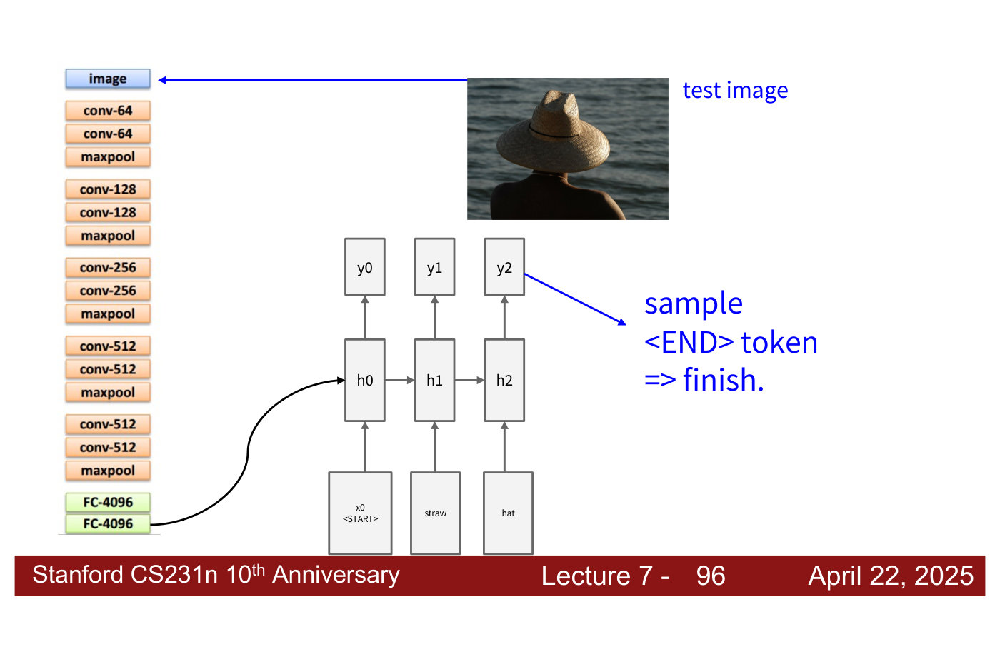

Same as slide 95, plus: a blue arrow from "y2" pointing right-down toward blue text "sample <END> token => finish."

## Slide 97 — Image Captioning: Example Results

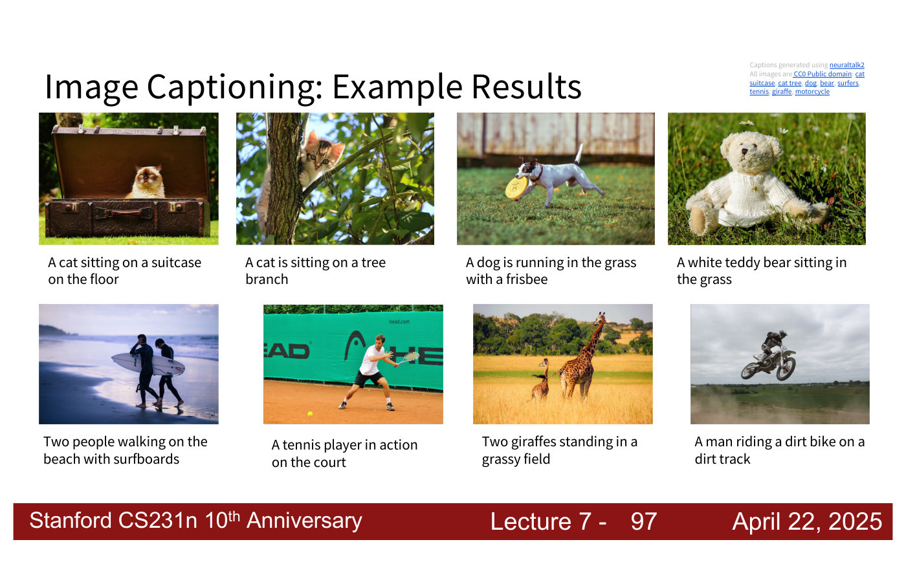

Title: "Image Captioning: Example Results". Small grey text at top right: "Captions generated using neuraltalk2. All images are CC0 Public domain: cat suitcase, cat tree, dog, bear, surfers, tennis, giraffe, motorcycle" (the neuraltalk2 link and each image name are hyperlinks). Eight photographs in two rows of four, each with its caption below. Reading order, top row then bottom row:

1. Photograph of a cat sitting inside an open vintage suitcase on grass. Caption: "A cat sitting on a suitcase on the floor"
2. Photograph of a kitten climbing on a tree branch among leaves. Caption: "A cat is sitting on a tree branch"
3. Photograph of a white and dark dog running on grass with a yellow frisbee in its mouth. Caption: "A dog is running in the grass with a frisbee"
4. Photograph of a white teddy bear in a knitted sweater sitting in grass. Caption: "A white teddy bear sitting in the grass"
5. Photograph of two people in wetsuits walking along a beach carrying a surfboard. Caption: "Two people walking on the beach with surfboards"
6. Photograph of a tennis player in white shirt hitting a forehand on a clay court in front of a green "HEAD" banner. Caption: "A tennis player in action on the court"
7. Photograph of an adult giraffe and a young giraffe in tall dry grass. Caption: "Two giraffes standing in a grassy field"
8. Photograph of a rider on a dirt bike in mid-air above a field, with dust below. Caption: "A man riding a dirt bike on a dirt track"

## Slide 98 — Image Captioning: Failure Cases


Title: "Image Captioning: Failure Cases". Small grey text at top right: "Captions generated using neuraltalk2. All images are CC0 Public domain: fur coat, handstand, spider web, baseball" (hyperlinked). Five photographs, each with its caption:

1. Left, top: photograph of a woman with a beaded headband and bangs wearing a tan fur coat, looking down, in a dry field. Caption: "A woman is holding a cat in her hand"
2. Left, bottom: photograph of a hand holding a smartphone above an open laptop on a wooden desk. Caption: "A person holding a computer mouse on a desk"
3. Centre: portrait photograph of a person doing a handstand on a rock at the edge of a mountain lake. Caption: "A woman standing on a beach holding a surfboard"
4. Right, top: photograph of a spider web on a tree branch. Caption: "A bird is perched on a tree branch"
5. Right, bottom: photograph of a baseball player in a blue uniform diving to catch a ball with a glove. Caption: "A man in a baseball uniform throwing a ball"

The slide does not say in words what is wrong with each caption; the heading only says these are failure cases.

## Slide 99 — Visual Question Answering (VQA)

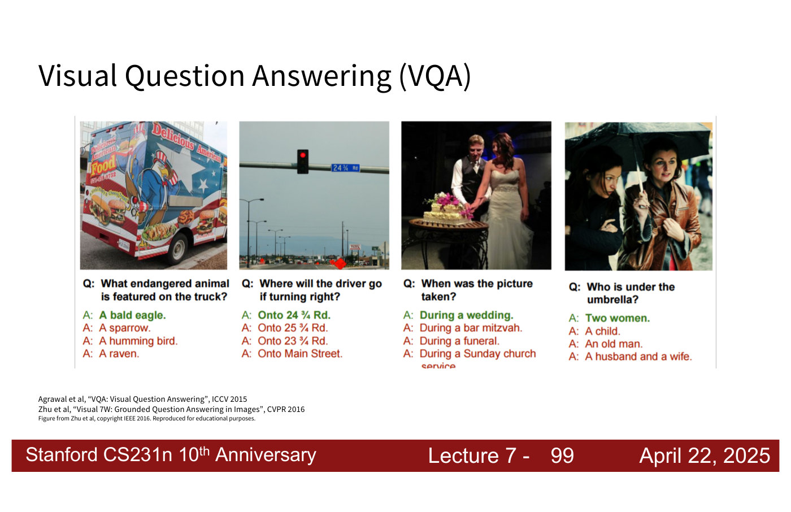

Title: "Visual Question Answering (VQA)". A figure of four photographs, each with a question and four candidate answers (in the figure the first answer in each set is printed in bold green and the other three in red).

1. Photograph of a food truck painted with an American flag and an eagle ("Delicious American Food"). "Q: What endangered animal is featured on the truck?" Answers: "A: A bald eagle." (green) / "A: A sparrow." / "A: A humming bird." / "A: A raven."
2. Photograph of a red traffic light and a street sign reading "24 3/4 Rd" over a road. "Q: Where will the driver go if turning right?" Answers: "A: Onto 24 ¾ Rd." (green) / "A: Onto 25 ¾ Rd." / "A: Onto 23 ¾ Rd." / "A: Onto Main Street."
3. Photograph of a bride and groom cutting a cake. "Q: When was the picture taken?" Answers: "A: During a wedding." (green) / "A: During a bar mitzvah." / "A: During a funeral." / "A: During a Sunday church service." (the last line is cut off at the bottom of the figure)
4. Photograph of two women under an umbrella in the rain. "Q: Who is under the umbrella?" Answers: "A: Two women." (green) / "A: A child." / "A: An old man." / "A: A husband and a wife."

Credit lines at bottom: "Agrawal et al, "VQA: Visual Question Answering", ICCV 2015"; "Zhu et al, "Visual 7W: Grounded Question Answering in Images", CVPR 2016"; "Figure from Zhu et al, copyright IEEE 2016. Reproduced for educational purposes."

## Slide 101 — Visual Dialog: Conversations about images


Title: "Visual Dialog: Conversations about images". A screenshot of a chat interface headed "Visual Dialog" (dark blue banner). At upper left of the chat, a photograph of a tabby cat drinking from a white and red mug on a table with magazines and other items. A dark speech bubble at upper right: "A cat drinking water out of a coffee mug." Below, the dialog alternates between questions in blue bubbles on the right and answers in grey bubbles on the left (each answer has a small robot-face icon):

- Q (blue): "What color is the mug?" A (grey): "White and red"
- Q: "Are there any pictures on it?" A: "No, something is there can't tell what it is"
- Q: "Is the mug and cat on a table?" A: "Yes, they are"
- Q: "Are there other items on the table?" A: "Yes, magazines, books, toaster and basket, and a plate"

At the bottom is an input bar with a reload icon, a camera icon, the placeholder "Start typing question here ..." and a send arrow. Credit lines at lower left: "Das et al, "Visual Dialog", CVPR 2017" and "Figures from Das et al, copyright IEEE 2017. Reproduced with permission."


## Slide 102 — Visual Language Navigation: Go to the living room

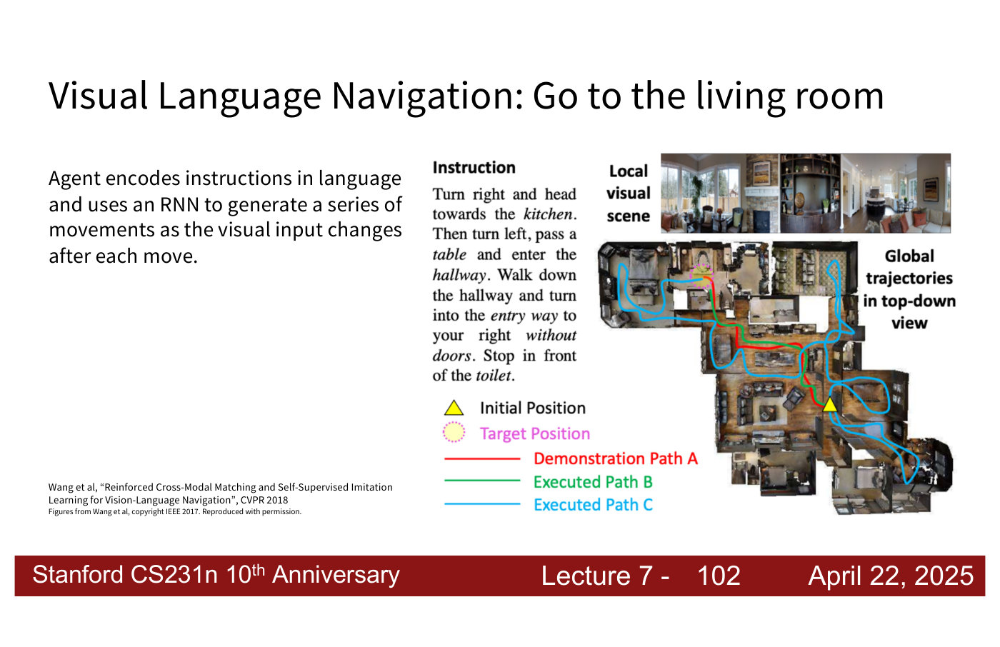

Text: "Agent encodes instructions in language and uses an RNN to generate a series of movements as the visual input changes after each move."

Citation: "Wang et al, "Reinforced Cross-Modal Matching and Self-Supervised Imitation Learning for Vision-Language Navigation", CVPR 2018". Credit line: "Figures from Wang et al, copyright IEEE 2017. Reproduced with permission."

Figure (from the paper): at the left, a block headed "Instruction" reads, in serif type with some words italic: "Turn right and head towards the *kitchen*. Then turn left, pass a *table* and enter the *hallway*. Walk down the hallway and turn into the *entry way* to your right *without doors*. Stop in front of the *toilet*." Below it is a legend: a yellow triangle "Initial Position", a dotted pink-outlined yellow circle "Target Position", a red line "Demonstration Path A", a green line "Executed Path B", a blue line "Executed Path C". At the top right is a strip of four panorama-style photographs of house interiors labelled "Local visual scene". Below it is a top-down rendering of a house floor plan labelled "Global trajectories in top-down view", with the yellow triangle at the lower right, the pink target circle at the upper left, a red path and a green path running fairly directly from the triangle to the target, and a long blue path that wanders through several rooms (looping around, going to the lower right corner and back) before reaching the target area.

## Slide 104 — Multilayer RNNs

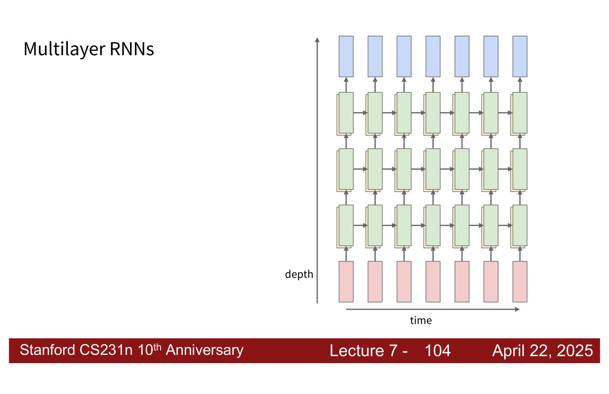

Title only, plus a diagram. No other text besides the axis labels "depth" (vertical axis, arrow pointing up, at the left of the diagram) and "time" (horizontal axis, arrow pointing right, under the diagram).

Diagram: a grid of 7 time steps (columns) by 3 stacked recurrent layers (rows). From bottom to top: a row of 7 pink rectangles (inputs), three rows of 7 green rectangles each (the three RNN layers, 21 green boxes in total; each green box has a pale yellow box peeking out behind its left edge), and a row of 7 blue rectangles (outputs). Grey arrows point upward from each pink input to the green box above it, upward from each green box to the green box in the layer above, and upward from the top green box to the blue output. Within each layer, horizontal grey arrows point right from each green box to its neighbour at the next time step (6 per row, 18 in total).

## Slide 105 — RNN Variants: Long Short Term Memory (LSTM)

Citation: "Hochreiter and Schmidhuber, "Long Short Term Memory", Neural Computation 1997".

Two boxed equations side by side. Left, labelled "Vanilla RNN":

$$h_t = \tanh\left(W \begin{pmatrix} h_{t-1} \cr x_t \end{pmatrix}\right)$$

Right, labelled "LSTM":

$$\begin{pmatrix} i \cr f \cr o \cr g \end{pmatrix} = \begin{pmatrix} \sigma \cr \sigma \cr \sigma \cr \tanh \end{pmatrix} W \begin{pmatrix} h_{t-1} \cr x_t \end{pmatrix}$$

$$c_t = f \odot c_{t-1} + i \odot g$$

$$h_t = o \odot \tanh(c_t)$$

## Slide 106 — Vanilla RNN Gradient Flow

Citations (top right): "Bengio et al, "Learning long-term dependencies with gradient descent is difficult", IEEE Transactions on Neural Networks, 1994" and "Pascanu et al, "On the difficulty of training recurrent neural networks", ICML 2013".

Diagram: a rounded green box containing, left to right, the label "W" with a grey arrow into a grey circle (the multiplication node), then a grey arrow to "tanh". Below the circle is a "stack" node with a grey arrow up into the circle. Outside the box, "h<sub>t-1</sub>" enters from the left with an arrow into "stack", and "x<sub>t</sub>" enters from below with an arrow up into "stack". From the tanh output, one line splits: one branch goes up and out of the box to "y<sub>t</sub>", the other goes right to "h<sub>t</sub>". All arrows are grey (forward pass only).

Equations at the right:

$$h_t = \tanh(W_{hh} h_{t-1} + W_{xh} x_t)$$

$$= \tanh\left( \begin{pmatrix} W_{hh} & W_{hx} \end{pmatrix} \begin{pmatrix} h_{t-1} \cr x_t \end{pmatrix}\right)$$

$$= \tanh\left( W \begin{pmatrix} h_{t-1} \cr x_t \end{pmatrix}\right)$$

*[Ed: the slide prints W_xh in the first line and W_hx in the second, for the same input weights; transcribed as printed.]*

## Slide 107 — Vanilla RNN Gradient Flow

Same as slide 106 (same citations, diagram and equations), plus red text above the cell: "Backpropagation from h<sub>t</sub> to h<sub>t-1</sub> multiplies by W (actually W<sub>hh</sub><sup>T</sup>)", and red arrows drawn over the cell showing the backward path: from h<sub>t</sub> a red line goes left and up into the tanh node (arrow pointing up at tanh), then red arrows run left from tanh through the grey circle (pointing toward W, above and into the circle), then down from the circle into "stack", and from stack a red arrow runs left out of the box to h<sub>t-1</sub>.

## Slide 108 — Vanilla RNN Gradient Flow

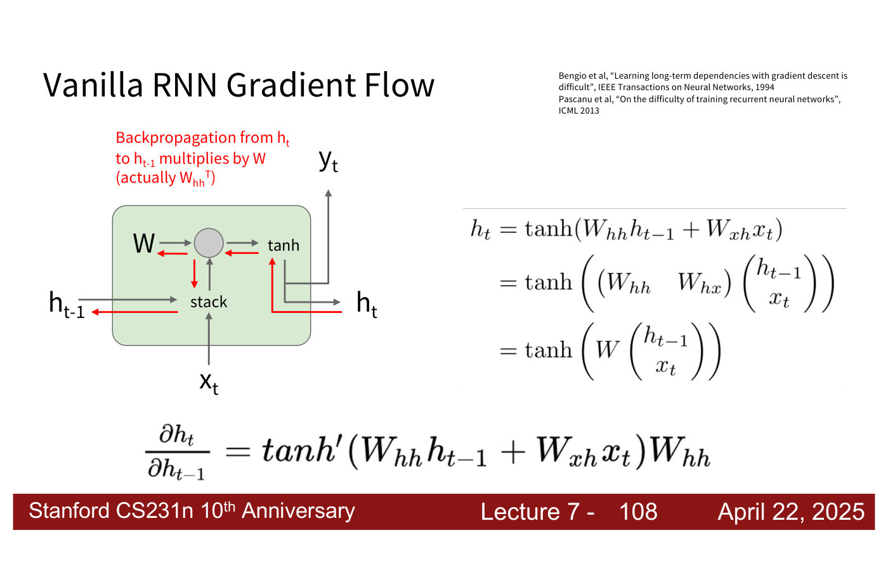

Same as slide 107, plus a displayed equation along the bottom:

$$\frac{\partial h_t}{\partial h_{t-1}} = \tanh'(W_{hh} h_{t-1} + W_{xh} x_t) W_{hh}$$

(The slide prints "tanh'" in italic type.)

## Slide 109 — Vanilla RNN Gradient Flow

Same citations. The title is followed by a chain of 4 copies of the vanilla RNN cell (4 green boxes side by side), each with W, grey circle, tanh, stack and its own inputs and outputs: inputs x<sub>1</sub>, x<sub>2</sub>, x<sub>3</sub>, x<sub>4</sub> below each cell, outputs y<sub>1</sub>, y<sub>2</sub>, y<sub>3</sub>, y<sub>4</sub> above, and hidden states h<sub>0</sub> (entering the first cell), h<sub>1</sub>, h<sub>2</sub>, h<sub>3</sub> (between cells) and h<sub>4</sub> (leaving the last). Red backward-gradient arrows run in each cell as on slide 107, and the red arrows also run from each cell's h output back to the previous cell's h input (right to left across the whole chain, from h<sub>4</sub> back to h<sub>0</sub>); a red line also comes down from each y output into the tanh branch. Equation below the chain:

$$\frac{\partial L}{\partial W} = \sum_{t=1}^{T} \frac{\partial L_t}{\partial W}$$

## Slide 110 — Vanilla RNN Gradient Flow

Same as slide 109, plus the subtitle "Gradients over multiple time steps:" under the title, a large red curved arrow from a red circle around y<sub>4</sub> (top right) sweeping left to a red circle around the "W" of the first cell, and a second equation:

$$\frac{\partial L_T}{\partial W} = \frac{\partial L_T}{\partial h_T} \frac{\partial h_t}{\partial h_{t-1}} \cdots \frac{\partial h_1}{\partial W}$$

*[Ed: the second factor is printed with a lowercase t; in this chain, which starts at step T, it stands for the derivative of h(T) with respect to h(T−1). Slide 111's product form, over t = 2 to T, writes the general factor.]*

## Slide 111 — Vanilla RNN Gradient Flow

Same as slide 110, with the second equation extended:

$$\frac{\partial L_T}{\partial W} = \frac{\partial L_T}{\partial h_T} \frac{\partial h_t}{\partial h_{t-1}} \cdots \frac{\partial h_1}{\partial W} = \frac{\partial L_T}{\partial h_T} \left( \prod_{t=2}^{T} \frac{\partial h_t}{\partial h_{t-1}} \right) \frac{\partial h_1}{\partial W}$$

## Slide 112 — Vanilla RNN Gradient Flow

Same as slide 111, plus: the factor $\frac{\partial h_t}{\partial h_{t-1}}$ inside the product is boxed in red, and a red-boxed copy of the slide 108 equation sits to the right of the sum formula:

$$\frac{\partial h_t}{\partial h_{t-1}} = \tanh'(W_{hh} h_{t-1} + W_{xh} x_t) W_{hh}$$

## Slide 113 — Vanilla RNN Gradient Flow

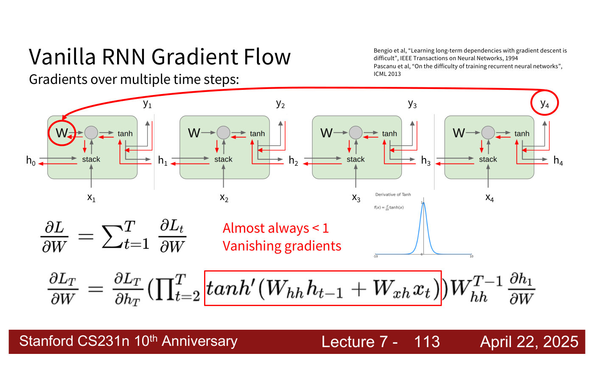

Same chain and first equation as slide 112. The second equation now has the Jacobian factors expanded, with the $\tanh'$ factor boxed in red:

$$\frac{\partial L_T}{\partial W} = \frac{\partial L_T}{\partial h_T} \left( \prod_{t=2}^{T} \tanh'(W_{hh} h_{t-1} + W_{xh} x_t) \right) W_{hh}^{T-1} \frac{\partial h_1}{\partial W}$$

Red text beside the sum formula: "Almost always < 1" and "Vanishing gradients". At the right, a small blue line chart titled "Derivative of Tanh", with the legend "f(x) = d/dx tanh(x)", x axis from -10 to 10 (tick labels -10 and 10, and 0 at the centre), y axis labelled at 1 (top) and 0. One series: a narrow bell-shaped curve peaking at 1 at x = 0 and falling to about 0 within a few units either side.

## Slide 114 — Vanilla RNN Gradient Flow

Same chain as slide 110 and the same sum formula $\frac{\partial L}{\partial W} = \sum_{t=1}^{T} \frac{\partial L_t}{\partial W}$ alone, with the text "What if we assumed no non-linearity?" at its right. The second equation is not shown.

## Slide 115 — Vanilla RNN Gradient Flow

Same chain and sum formula as slide 114. The text "What if we assumed no non-linearity?" is now centred just under the chain. A second equation, with $W_{hh}^{T-1}$ boxed in red:

$$\frac{\partial L_T}{\partial W} = \frac{\partial L_T}{\partial h_T} W_{hh}^{T-1} \frac{\partial h_1}{\partial W}$$

Red text at the right: "Largest singular value > 1: Exploding gradients" and, below it, "Largest singular value < 1: Vanishing gradients".

## Slide 116 — Vanilla RNN Gradient Flow

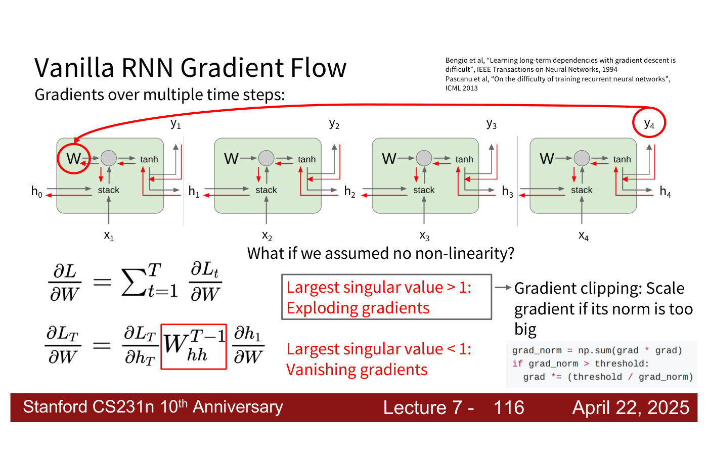

Same as slide 115, plus: the "Largest singular value > 1: Exploding gradients" text is outlined in a grey box with a grey arrow to the black text "Gradient clipping: Scale gradient if its norm is too big", and a code snippet below it:

```
grad_norm = np.sum(grad * grad)
if grad_norm > threshold:
  grad *= (threshold / grad_norm)
```

*[Ed: as printed, `grad_norm` is the sum of the squared entries, the squared L2 norm, with no square root; the text says to scale the gradient "if its norm is too big", and scaling by threshold over the norm itself would leave the clipped gradient with norm equal to the threshold.]*

## Slide 117 — Vanilla RNN Gradient Flow

Same as slide 115, plus: the "Largest singular value < 1: Vanishing gradients" text is outlined in a grey box with a grey arrow to the black text "Change RNN architecture". (There is no gradient-clipping text or code on this page.)

## Slide 118 — Long Short Term Memory (LSTM) – A Historical Note

Same content as slide 105 with a different title. Citation: "Hochreiter and Schmidhuber, "Long Short Term Memory", Neural Computation 1997". Left, "Vanilla RNN":

$$h_t = \tanh\left(W \begin{pmatrix} h_{t-1} \cr x_t \end{pmatrix}\right)$$

Right, "LSTM":

$$\begin{pmatrix} i \cr f \cr o \cr g \end{pmatrix} = \begin{pmatrix} \sigma \cr \sigma \cr \sigma \cr \tanh \end{pmatrix} W \begin{pmatrix} h_{t-1} \cr x_t \end{pmatrix}$$

$$c_t = f \odot c_{t-1} + i \odot g$$

$$h_t = o \odot \tanh(c_t)$$

## Slide 119 — Long Short Term Memory (LSTM)

Citation: "Hochreiter and Schmidhuber, "Long Short Term Memory", Neural Computation 1997".

Same two boxed equations as slide 118 (left "Vanilla RNN", right "LSTM"):

$$h_t = \tanh\left(W \begin{pmatrix} h_{t-1} \cr x_t \end{pmatrix}\right)$$

$$\begin{pmatrix} i \cr f \cr o \cr g \end{pmatrix} = \begin{pmatrix} \sigma \cr \sigma \cr \sigma \cr \tanh \end{pmatrix} W \begin{pmatrix} h_{t-1} \cr x_t \end{pmatrix}$$

$$c_t = f \odot c_{t-1} + i \odot g$$

$$h_t = o \odot \tanh(c_t)$$

Added blue annotations with arrows pointing at the right-hand box: "Four gates", with an arrow to the stacked vector $(i, f, o, g)$; "Cell state", with an arrow to the $c_t$ line; and "Hidden state", with an arrow to the $h_t$ line.

## Slide 120 — Long Short Term Memory (LSTM)

Subtitle: "[Hochreiter et al., 1997]".

Diagram, left to right. A large light-grey rectangle labelled "W" with the size label "4h x 2h" beneath it. To its right two small stacked boxes: a pink box "x" on top, with red text "vector from below (x)" above it, and a green box "h" below it, with green text "vector from before (h)" under it. A grey arrow points right to a tall, narrow light-grey rectangle labelled "4h" beneath. To its right four stacked white boxes, from top to bottom "sigmoid", "sigmoid", "sigmoid", "tanh", each with a grey arrow pointing right to a small coloured box: "i" (blue-grey), "f" (light yellow), "o" (light orange) and "g" (pink-mauve). These four small boxes carry the size label "4*h" beneath them. The drawing shows the four gate vectors being produced from the stacked $(x, h)$ input by one $4h \times 2h$ matrix, a $4h$ result split into four parts of size $h$, three passed through sigmoid and the last through tanh.

## Slide 121 — Long Short Term Memory (LSTM)

Same diagram as slide 120, plus: a red-boxed line of text at the top right, "g: Gate gate (?), How much to write to cell" (the words "Gate gate" underlined), and at the lower right a copy of the LSTM equations (the gate-vector equation, then $c_t = f \odot c_{t-1} + i \odot g$ and $h_t = o \odot \tanh(c_t)$ below it) with the gate-vector equation inside a blue box, a red box around the "tanh" entry, and a red box around $g$ in the $c_t$ equation.

## Slide 122 — Long Short Term Memory (LSTM)

Same as slide 121, plus a new red-boxed line at the top, above the "g:" line (which is now unboxed): "i: Input gate, whether to write to cell" (the words "Input gate" underlined). In the equation copy the red boxes now surround the first (top) $\sigma$ and the $i$ in $c_t = f \odot c_{t-1} + i \odot g$.

## Slide 123 — Long Short Term Memory (LSTM)

Same as slide 122, plus a second line below the "i:" line: "f: Forget gate, Whether to erase cell" (the words "Forget gate" underlined), now the one in a red box. In the equation copy the red boxes surround the second $\sigma$ and the $f$ in the $c_t$ equation.

## Slide 124 — Long Short Term Memory (LSTM)

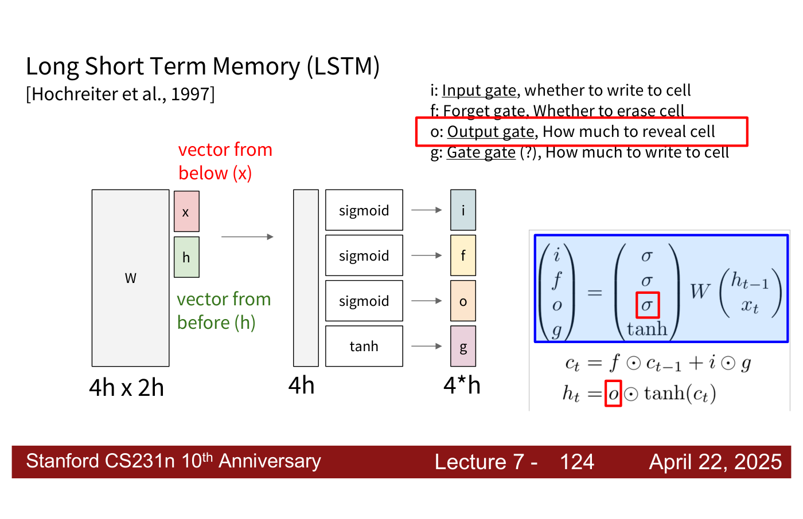

Same as slide 123, plus a third line "o: Output gate, How much to reveal cell" (the words "Output gate" underlined), now the one in a red box, placed between the "f:" line and the "g:" line. The four definitions now read, top to bottom: "i: Input gate, whether to write to cell", "f: Forget gate, Whether to erase cell", "o: Output gate, How much to reveal cell", "g: Gate gate (?), How much to write to cell". In the equation copy the red boxes surround the third $\sigma$ and the $o$ in $h_t = o \odot \tanh(c_t)$.

## Slide 125 — Long Short Term Memory (LSTM)

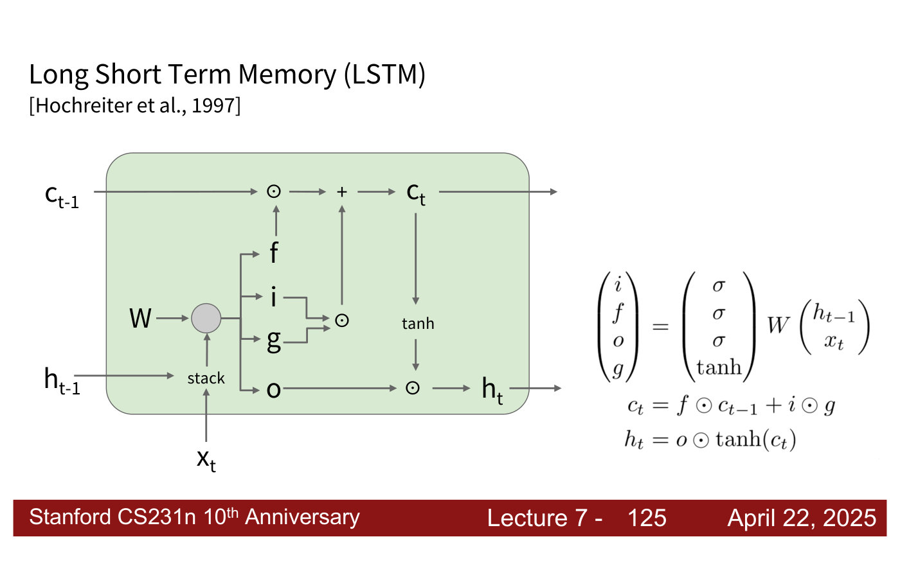

Subtitle: "[Hochreiter et al., 1997]".

Diagram: one large rounded green box (the LSTM cell). Outside the box on the left are the inputs "c<sub>t-1</sub>" (top), "h<sub>t-1</sub>" (middle) and "W" (feeding the circle); "x<sub>t</sub>" enters from below. On the right, arrows leave from the cell-state line (top) and from "h<sub>t</sub>" (bottom).

Inside the box, node by node (3 circled-dot multiplication nodes, 1 plus node, 1 tanh, 1 grey circle, 1 stack node, four gate labels f, i, g, o):

- Top line: an arrow runs from c<sub>t-1</sub> to a first $\odot$, then to a "+" node, then to "c<sub>t</sub>", and on out of the box to the right.
- The gate labels sit in a column: f, i, g, o (top to bottom). h<sub>t-1</sub> and x<sub>t</sub> both feed the "stack" node by grey arrows; an arrow from stack goes up into a grey circle, which also receives an arrow from "W". From the circle a bracket-shaped line splits into four arrows, one into each of f, i, g and o.
- f has an arrow up into the first $\odot$ (the one on the cell-state line), so f multiplies c<sub>t-1</sub>.
- i and g each have an arrow into a second $\odot$ (the middle one); an arrow from this second $\odot$ goes up into the "+" node.
- c<sub>t</sub> has an arrow down to "tanh", and an arrow from tanh down to a third $\odot$ (bottom right).
- o has an arrow right into that third $\odot$, whose output arrow goes to "h<sub>t</sub>" and out of the box to the right.

At the right, the LSTM equations (not boxed):

$$\begin{pmatrix} i \cr f \cr o \cr g \end{pmatrix} = \begin{pmatrix} \sigma \cr \sigma \cr \sigma \cr \tanh \end{pmatrix} W \begin{pmatrix} h_{t-1} \cr x_t \end{pmatrix}$$

$$c_t = f \odot c_{t-1} + i \odot g$$

$$h_t = o \odot \tanh(c_t)$$

## Slide 126 — Long Short Term Memory (LSTM): Gradient Flow

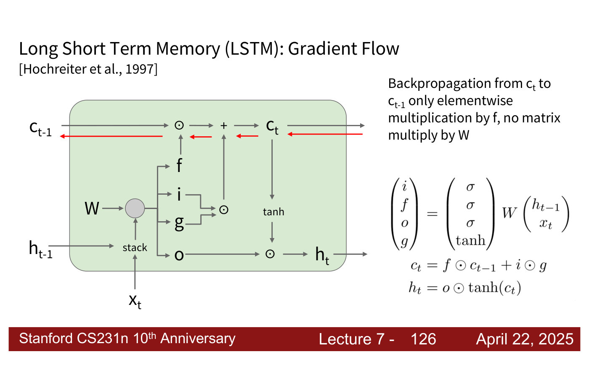

Subtitle: "[Hochreiter et al., 1997]". Same cell diagram and equations as slide 125, plus text at the top right: "Backpropagation from c<sub>t</sub> to c<sub>t-1</sub> only elementwise multiplication by f, no matrix multiply by W". Four red arrow segments pointing left run just below the top (cell-state) line: one entering the cell from the right edge toward c<sub>t</sub>, one between c<sub>t</sub> and the "+" node, one between "+" and the first $\odot$, and one from the first $\odot$ out of the left edge toward c<sub>t-1</sub>. The red path does not pass through W, the stack node or any of the gates' matrix multiply.

## Slide 127 — Long Short Term Memory (LSTM): Gradient Flow

*(This page prints no slide number; 127 is inferred from its neighbours.)*

Subtitle: "[Hochreiter et al., 1997]". The page footer reads "Lecture 7 -" with the number missing.

Large red text: "Uninterrupted gradient flow!", with a long red arrow pointing left under it, spanning the full width. Below is a chain of 3 LSTM cells (3 green boxes side by side), each drawn as on slide 125 (labels W, grey circle, stack, f, i, g, o, three $\odot$ nodes, "+", "c", "tanh", "h<sub>t</sub>") at smaller size. The cell-state line connects them: c<sub>0</sub> enters the first cell from the left, c<sub>1</sub> sits between the first and second cells, c<sub>2</sub> between the second and third, and c<sub>3</sub> leaves the third cell at the right. In every cell, red arrows pointing left run along the cell-state line (as on slide 126) so that a continuous red path leads from c<sub>3</sub> back to c<sub>0</sub>.

## Slide 128 — Do LSTMs solve the vanishing gradient problem?

Text, verbatim:

"The LSTM architecture makes it easier for the RNN to preserve information over many timesteps"

- "e.g. if the f = 1 and the i = 0, then the information of that cell is preserved indefinitely."
- "By contrast, it's harder for vanilla RNN to learn a recurrent weight matrix Wh that preserves info in hidden state"

"LSTM doesn't guarantee that there is no vanishing/exploding gradient, but it does provide an easier way for the model to learn long-distance dependencies"

## Slide 129 — Long Short Term Memory (LSTM): Gradient Flow

Same as slide 127 (the "Uninterrupted gradient flow!" red text and arrow, and the chain of 3 LSTM cells with c<sub>0</sub> to c<sub>3</sub> and red backward arrows on the cell-state line; the chain is drawn slightly higher), plus a second long red left-pointing arrow below the chain, and under it a diagram of a deep residual network with the text "Similar to ResNet!" at the left.

ResNet diagram (a standard residual-network figure, boxes drawn as tall narrow vertical rectangles with rotated labels, left to right): a grey box "Input"; an orange box "7x7 conv, 64 / 2"; a blue box "Pool"; 6 maroon boxes each "3x3 conv, 64"; 6 purple boxes "3x3 conv, 128" (the first is "3x3 conv, 128 / 2"); an ellipsis "..." with an arrow; 6 green boxes each "3x3 conv, 64"; a blue box "Pool"; a green box "FC 1000"; and a red box "Softmax". Each group of 6 convolution boxes (maroon, purple, green) has 3 curved skip-connection arcs, each arc jumping over a pair of adjacent boxes, so 9 arcs in total. Small grey dots on the line mark where the arcs start and end.

*[Ed: the last group is labelled "3x3 conv, 64" here, as in the same figure on lecture 6, slide 57, where the slides before it label ResNet's last stage 512.]*

## Slide 130 — Long Short Term Memory (LSTM): Gradient Flow

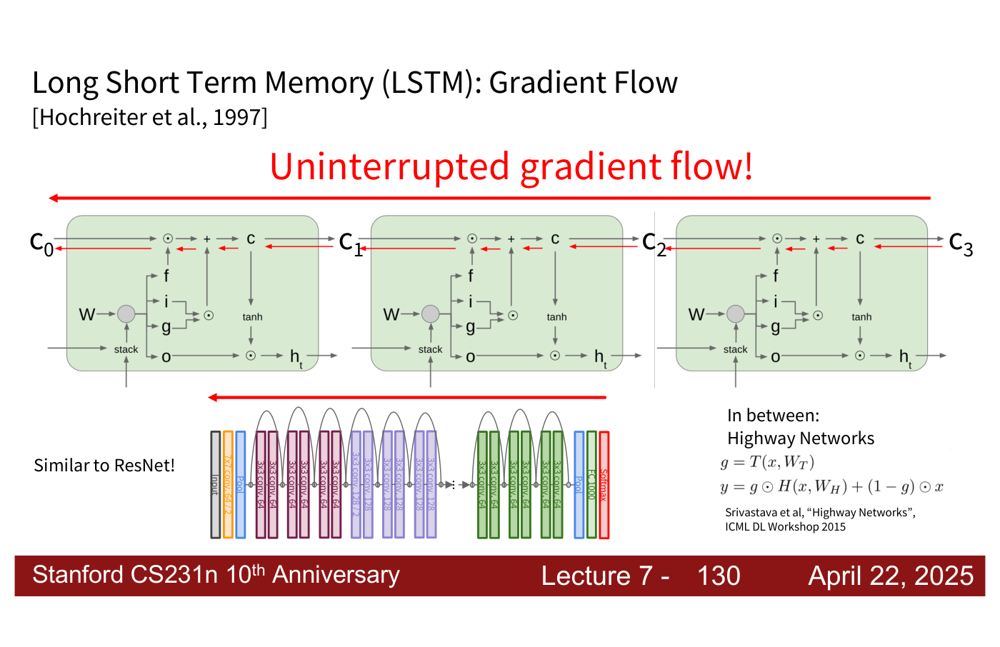

Same as slide 129, plus text at the right under the chain: "In between: Highway Networks" and the equations

$$g = T(x, W_T)$$

$$y = g \odot H(x, W_H) + (1 - g) \odot x$$

with the citation "Srivastava et al, "Highway Networks", ICML DL Workshop 2015".

## Slide 131 — Modern RNNs

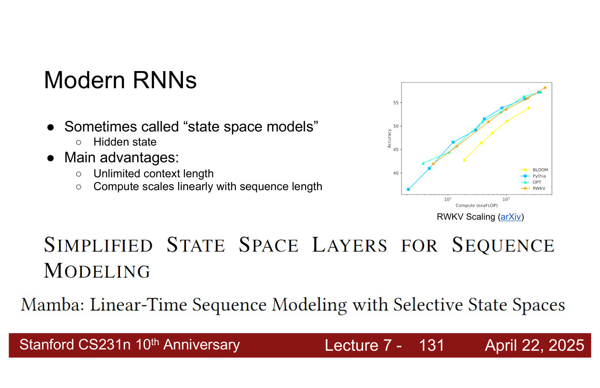

Text:

- "Sometimes called "state space models""
  - "Hidden state"
- "Main advantages:"
  - "Unlimited context length"
  - "Compute scales linearly with sequence length"

Chart at the upper right, captioned "RWKV Scaling (arXiv)" (the word "arXiv" is a hyperlink). Line chart with markers; x axis "Compute (exaFLOP)" on a log scale with labelled ticks $10^2$ and $10^3$ (data span roughly 20 to 5000); y axis "Accuracy" with ticks 40, 45, 50, 55 (data span roughly 36 to 58). Four series, listed in the legend as BLOOM, Pythia, OPT and RWKV. Values below are read off the plot and approximate:

- BLOOM (yellow, circle markers): 5 points, from about 42.8 at about 190 exaFLOP, through about 46.4 at about 370, 48.5 at about 580 and 51 at about 1000, to about 53.8 at about 2400. It lies below the other three throughout.
- Pythia (blue, square markers): 8 points, from about 36.5 at about 22 exaFLOP, 41 at about 50, 46.5 at about 120, 49.2 at about 300, 51.5 at about 400, 53.8 at about 850, 55.8 at about 2100, up to about 57.2 at about 3600.
- OPT (teal, triangle markers): from about 42 at about 40 exaFLOP, 44.4 at about 100, 50.8 at about 400, 53 at about 800, 56.3 at about 2000, up to about 57.2 at about 3800.
- RWKV (orange, star markers): from about 41.9 at about 55 exaFLOP, 45.6 at about 140, 50.8 at about 500, 53.5 at about 1000, 55.8 at about 2200, up to about 58.2 at about 5000.

Pythia, OPT and RWKV track each other closely; BLOOM is the lowest curve.

Below the chart, two paper titles shown as screenshots of their title text: "Simplified State Space Layers for Sequence Modeling" (small-caps serif) and "Mamba: Linear-Time Sequence Modeling with Selective State Spaces". No authors or citations are printed.

## Slide 132 — Summary

Text, verbatim:

- "RNNs allow a lot of flexibility in architecture design"
- "Vanilla RNNs are simple but don't work very well"
- "More complex variants (e.g. LSTMs, Mamba) can introduce ways to selectively pass information forward"
- "Backward flow of gradients in RNN can explode or vanish. Exploding is controlled with gradient clipping. Backpropagation through time is often needed."
- "Better/simpler architectures are a hot topic of current research, as well as new paradigms for reasoning over sequences"

## Slide 133 — Next time: Attention and Transformers

Text only: "Next time: Attention and Transformers".
