# Lecture 8 — Attention and Transformers (slide-by-slide)

Text and figures of all 122 pages of [`lecture_8.pdf`](https://cs231n.stanford.edu/slides/2025/lecture_8.pdf), CS231N (Stanford, Spring 2025), April 24, 2025. Cite these as "slide N" using the **printed** slide number (footer, after "Lecture 8 -"). The running footer ("Stanford CS231n 10th Anniversary", "Lecture 8 - N", "April 24, 2025") is on every page and is not repeated below. Equations are written in LaTeX; figures are described in prose.

The deck reveals its diagrams one element at a time, so most slides are build steps of the slide before and are written "Same as slide N, plus …". The full drawing is under the last slide of each build.

## Slide numbers vs PDF pages

The deck prints numbers 1–122 on 122 pages, one number per page, so the printed number and the PDF page number are the same throughout.

**What the recording covers.** The recording opens at 0:04 with the recap (slides 3–5) and never
presents the administrative slide (2). It follows the deck in order through sequence-to-sequence
models, attention, the general attention layer, cross-attention, self-attention, masking and
multi-headed attention, the comparison of three ways of processing sequences (79–83), the
Transformer block (84–93) and vision transformers (100–109), and ends at 1:06:08 with the
summary and "next time" (121–122). Four parts are not walked through. The matrix-shape and
memory slides (68–78) are covered only by the lecturer's summary that self-attention is four
matrix multiplies (≈56:07) and his remark on its quadratic cost (≈59:58). The GPT-2 and GPT-3
entries (94–95) are not mentioned. The language-modelling slides (96–99) are covered by one
sentence ("as we've already seen", ≈1:04:36) and the masking passage (≈54:33). The "Tweaking
Transformers" slides (110–120: pre-norm, RMSNorm, SwiGLU, mixture of experts) are left "as extra
reading" (≈1:05:22), so this file is the only source for them. See the
[transcript](../transcripts/08-attention-transformers.md).

**Two drawings of the attention grids.** The pasted-in figure on slides 4 and 121 puts key 1's
row of the similarity and attention grids at the bottom; the drawn diagrams of slides 43–61 put it
at the top, with $K_1$ and $V_1$ uppermost. In both, the grid entry $E_{i,j}$ sits in query $i$'s
column and key $j$'s row.

**Printed slips, transcribed as printed with `[Ed:]` lines.** Slide 62's faded output line reads
Y = AX where slides 47–61 print Y = AV (slide 63 repeats it). From slide 66 on, the multi-head
similarity keeps the single-head $\sqrt{D_Q}$, although $D_Q$ is not among that slide's inputs
and each head's queries have dimension $D_H$. Slide 77's "1.192 TB" for 64 heads of
$100{,}000 \times 100{,}000$ attention weights is the 1,192 GiB that 2-byte values give, so its units are
mixed (1.28 TB in decimal units). Slide 82 prints O(N) memory for self-attention, which slide 78
gives only with Flash Attention; slides 76–77 say $O(N^2)$. Slide 111 prints "identify function".
Slide 113's RMSNorm averages over "N" entries of a vector whose shape it gives as D. Worked values
that recompute: the example attention weights on slides 18 and 22 each sum to 1; slide 104's
$16 \times 16 \times 3$ patch flattens to 768 values; and slide 115's SwiGLU with $H = 8D/3$ has
$3DH = 8D^2$ weights, the same as the classic MLP's $D \cdot 4D + 4D \cdot D$.

**Images.** 23 slides are rendered as images, each placed under its heading: 5, 11, 19, 22, 23,
24, 27, 29, 35, 46, 47, 57, 59, 61, 66, 82, 91, 95, 99, 109, 111, 112 and 120. The others have
none, because they are the title (1), the administrative slide (2), a recap of lecture 7's
figure (3; lecture 7, slide 18), title-only and text slides (79, 122), text and equations
transcribed exactly (68–78), build steps whose last step is rendered (4 → 5; 6–10, 12 → 11;
13–18 → 19; 20–21 → 22; 25–26 → 27; 30–34 → 35; 41–45 → 46; 52–56 → 57; 58 → 59; 60 → 61;
62–65 → 66; 80–81 → 82; 84–90 → 91; 92–94 → 95; 96–98 → 99; 100–108 → 109), or a rendered
figure repeated with new text or equations that are transcribed (28, the diagram of 22 recoloured;
36–40 → 35; 48–51 → 47; 67 → 66; 83, slide 82 under a title box; 110 → 111; 113–119 → 120; 121,
the two figures of slide 5). Never construct an image path for a slide not listed here.

Companion pages: [wiki page for this lecture](../../wiki/08-attention-transformers.md) · [transcript](../transcripts/08-attention-transformers.md)

## Slide 1 — Lecture 8: Attention and Transformers

Title slide. Text: "Lecture 8:" / "Attention and Transformers".

## Slide 2 — Administrative

- Assignment 2 released yesterday (4/23)
- Project proposals are due tomorrow (4/25)

## Slide 3 — Last Time: Recurrent Neural Networks

Figure: five small panels in a row, each a light grey rounded box, showing RNN input/output patterns. Each panel has a title and stacks boxes bottom to top: pink input boxes (bottom), green hidden-state boxes (middle) and blue output boxes (top). Red arrows run from each pink box up to a green box; blue arrows run from green boxes up to blue boxes; dark green arrows run left to right between neighbouring green boxes.

- "one to one": 1 pink, 1 green, 1 blue box in a column.
- "one to many": 1 pink input at the bottom left; 3 green boxes in a row linked left to right (the pink feeds the first); 3 blue outputs above, one per green box.
- "many to one": 3 pink inputs, 3 green boxes linked left to right, 1 blue output above the last green box only.
- "many to many" (first, wider panel): 3 pink inputs feeding the first 3 of 5 green boxes linked left to right; 3 blue outputs above the last 3 green boxes (the 3rd, 4th and 5th).
- "many to many" (second): 3 pink inputs, 3 green boxes linked left to right, 3 blue outputs, one per green box.

## Slide 4 — Today: Attention + Transformers

Two columns of text, each above a figure.

Left: "**Attention**: A new primitive that operates on sets of vectors". Figure: a self-attention diagram. Bottom row: 3 blue boxes $X_1$, $X_2$, $X_3$; above them 3 green boxes $Q_1$, $Q_2$, $Q_3$. Orange arrows run from the $X$ boxes around the left to 3 orange boxes $K_1$, $K_2$, $K_3$ (stacked vertically at the left), and purple arrows run from the $X$ boxes to 3 purple boxes $V_1$, $V_2$, $V_3$ (stacked at the far left above the $K$ boxes). A grey grid of $E$ boxes, 3 rows by 3 columns (rows $E_{1,1}$, $E_{2,1}$, $E_{3,1}$ / $E_{1,2}$, $E_{2,2}$, $E_{3,2}$ / $E_{1,3}$, $E_{2,3}$, $E_{3,3}$ from bottom to top), sits above the $Q$ boxes, with arrows from each $K$ into its row. (This pasted figure, repeated on slide 121, draws key 1's row at the bottom of each grid; the diagrams drawn on slides 43–61 put it at the top.) A white box "Softmax($\uparrow$)" sits above it, then a grey 3 by 3 grid of $A$ boxes (bottom row $A_{1,1}$, $A_{2,1}$, $A_{3,1}$; middle $A_{1,2}$, $A_{2,2}$, $A_{3,2}$; top $A_{1,3}$, $A_{2,3}$, $A_{3,3}$) with each $V$ arrow entering its row. Above that a white box "Product($\rightarrow$),  Sum($\uparrow$)", and at the top 3 yellow output boxes $Y_1$, $Y_2$, $Y_3$.

Right: "**Transformer**: A neural network architecture that uses attention everywhere". Figure: two identical grey blocks stacked vertically, each (bottom to top) a blue input strip with arrows, a green "Self-Attention" box, a $\oplus$ residual node, an orange "Layer Normalization" box, a row of 4 purple "MLP" boxes, another $\oplus$ node, and a top orange "Layer Normalization" box; residual skip lines wrap around the Self-Attention and the MLP row. Arrows lead from the top of the lower block into the upper block and out the top.

## Slide 5 — Today: Attention + Transformers

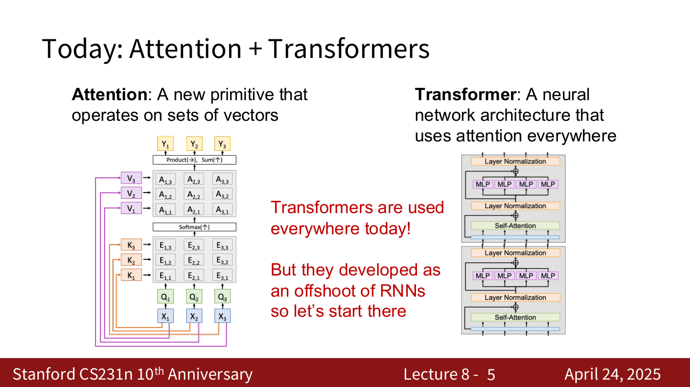

Same as slide 4, plus red text in the middle between the two figures: "Transformers are used everywhere today!" and, as a second paragraph, "But they developed as an offshoot of RNNs so let's start there".

## Slide 6 — Sequence to Sequence with RNNs: Encoder - Decoder

Text: "**Input**: Sequence $x_1, \dots x_T$" / "**Output**: Sequence $y_1, \dots, y_{T'}$". Right side, bold: "A motivating example for today's discussion – machine translation! English $\rightarrow$ Italian". "**Encoder:** $h_t = f_W(x_t, h_{t-1})$".

Figure: 4 blue boxes $h_1$, $h_2$, $h_3$, $h_4$ in a row, joined by black arrows pointing left to right ($h_1 \to h_2 \to h_3 \to h_4$). Beneath each, an arrow points up from an orange box $x_1$, $x_2$, $x_3$, $x_4$ to the corresponding $h$. Words under the $x$ boxes: "we", "see", "the", "sky".

Credit line: Sutskever et al, "Sequence to sequence learning with neural networks", NeurIPS 2014

## Slide 7 — Sequence to Sequence with RNNs

Same as slide 6 (title is now "Sequence to Sequence with RNNs"; the English to Italian motivating-example text is removed), plus text: "From final hidden state predict:" / "**Initial decoder state** $s_0$" / "**Context vector** c (often $c=h_T$)". Figure additions: a blue-green box $s_0$ at the right of $h_4$ (not connected), and a purple box $c$ below it, with a black arrow from $h_4$ going right then down into $c$.

Credit line: Sutskever et al, "Sequence to sequence learning with neural networks", NeurIPS 2014

## Slide 8 — Sequence to Sequence with RNNs

Same as slide 7, plus text at the top right: "**Decoder:** $s_t = g_U(y_{t-1}, s_{t-1}, c)$". Figure additions: a teal box $s_1$ to the right of $s_0$ with an arrow $s_0 \to s_1$; a red box $y_0$ below $s_1$ labelled "[START]" with an arrow up into $s_1$; an arrow from $c$ going right and up into $s_1$; a red box $y_1$ above $s_1$ with an arrow up from $s_1$, and the word "vediamo" printed above $y_1$.

Credit line: Sutskever et al, "Sequence to sequence learning with neural networks", NeurIPS 2014

## Slide 9 — Sequence to Sequence with RNNs

Same as slide 8, plus a second decoder step: teal box $s_2$ right of $s_1$ with arrow $s_1 \to s_2$; red box $y_1$ below $s_2$ (input) labelled "vediamo", with an arrow up into $s_2$; the line from $c$ also continues right into $s_2$; red box $y_2$ above $s_2$ with the word "il" above it.

Credit line: Sutskever et al, "Sequence to sequence learning with neural networks", NeurIPS 2014

## Slide 10 — Sequence to Sequence with RNNs

Same as slide 9, plus two more decoder steps, giving four decoder states $s_1$ to $s_4$ in a row (arrows $s_1 \to s_2 \to s_3 \to s_4$). Decoder inputs (bottom red boxes) are $y_0$ "[START]", $y_1$ "vediamo", $y_2$ "il", $y_3$ "cielo". Decoder outputs (top red boxes) are $y_1$ "vediamo", $y_2$ "il", $y_3$ "cielo", $y_4$ "[STOP]". The context vector $c$ line runs along to every decoder state $s_1$ to $s_4$.

Credit line: Sutskever et al, "Sequence to sequence learning with neural networks", NeurIPS 2014

## Slide 11 — Sequence to Sequence with RNNs

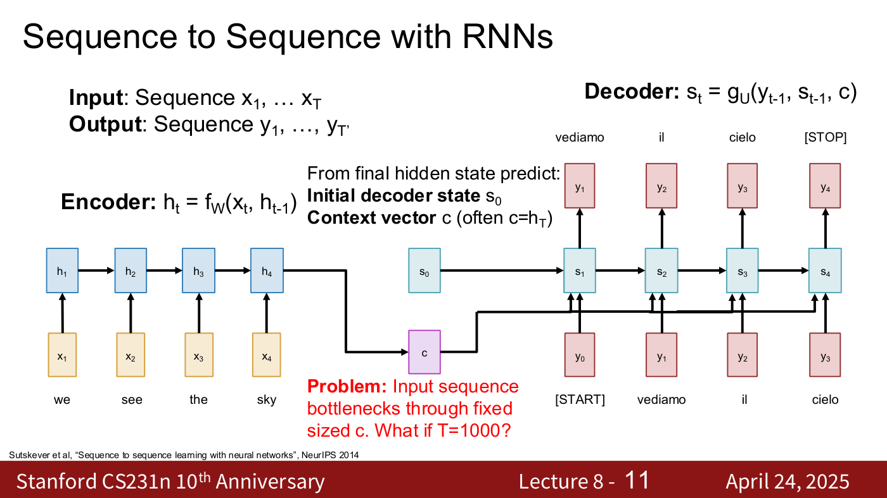

Same as slide 10, plus red text below the context vector $c$: "**Problem:** Input sequence bottlenecks through fixed sized c. What if T=1000?" ("Problem:" in bold).

Credit line: Sutskever et al, "Sequence to sequence learning with neural networks", NeurIPS 2014

## Slide 12 — Sequence to Sequence with RNNs

Same as slide 10, plus green text below the context vector $c$ (replacing the red "Problem" text of slide 11): "**Solution**: Look back at the whole input sequence on each step of the output" ("Solution" in bold).

Credit line: Sutskever et al, "Sequence to sequence learning with neural networks", NeurIPS 2014

## Slide 13 — Sequence to Sequence with RNNs and Attention

Title: "Sequence to Sequence with RNNs and " followed by "Attention" in red. Text: "**Input**: Sequence $x_1, \dots x_T$" / "**Output**: Sequence $y_1, \dots, y_{T'}$". "**Encoder:** $h_t = f_W(x_t, h_{t-1})$". Beside it: "From final hidden state:" / "**Initial decoder state** $s_0$".

Figure: the encoder as on slide 6 (4 blue boxes $h_1$ to $h_4$ linked left to right by arrows, each fed from below by an orange box $x_1$ to $x_4$, words "we", "see", "the", "sky"), plus a single blue-green box $s_0$ to the right, unconnected.

Credit line: Bahdanau et al, "Neural machine translation by jointly learning to align and translate", ICLR 2015

## Slide 14 — Sequence to Sequence with RNNs and Attention

Text at the top right: "Compute (scalar) **alignment scores**" / $e_{t,i} = f_{att}(s_{t-1}, h_i)$   ($f_{att}$ is a Linear Layer). Also "From final hidden state:" / "**Initial decoder state** $s_0$". (The Input/Output/Encoder lines of slide 13 are no longer shown.)

Figure: same encoder and $s_0$ as slide 13, plus a row of 4 green boxes $e_{11}$, $e_{12}$, $e_{13}$, $e_{14}$ above $h_1$ to $h_4$. A black line runs from $s_0$ leftwards along a horizontal line above the $h$ boxes, with arrows going up into each of the 4 $e$ boxes; each $h_i$ also has an arrow up into its $e_{1i}$.

Credit line: Bahdanau et al, "Neural machine translation by jointly learning to align and translate", ICLR 2015

## Slide 15 — Sequence to Sequence with RNNs and Attention

Same as slide 14, plus a white box labelled "softmax" spanning above the 4 $e$ boxes, and above it a row of 4 green boxes $a_{11}$, $a_{12}$, $a_{13}$, $a_{14}$ (arrows from the $e$ boxes up through softmax to the $a$ boxes). New text on the right: "Normalize alignment scores to get **attention weights**" / $0 \lt a_{t,i} \lt 1$, $\sum_i a_{t,i} = 1$.

Credit line: Bahdanau et al, "Neural machine translation by jointly learning to align and translate", ICLR 2015

## Slide 16 — Sequence to Sequence with RNNs and Attention

Same as slide 15, plus: above each of the 4 $a$ boxes a grey "x" multiplication symbol (4 in all); curved arrows from each $h_i$ up into the corresponding multiplication node, and arrows from each $a_{1i}$ up into it. A black line runs from the multiplication nodes across the top of the figure to the right and down into a white box "+" (a sum), and an arrow from "+" down into a purple box $c_1$ (the context vector). The word "vediamo" is printed in small type below the alignment-scores text. New text on the right: "Compute context vector as **weighted sum of hidden states**" (the bold part is dark red) / $c_t = \sum_i a_{t,i} h_i$.

Credit line: Bahdanau et al, "Neural machine translation by jointly learning to align and translate", ICLR 2015

## Slide 17 — Sequence to Sequence with RNNs and Attention

Same as slide 16, plus decoder elements: a teal box $s_1$ to the right with an arrow from $s_0$ (curved line from $s_0$ passing over "+") into $s_1$; a pink box $y_0$ labelled "[START]" below, next to the purple $c_1$, both with arrows up into $s_1$; a red box $y_1$ above $s_1$ with an arrow up from $s_1$ and the word "vediamo" above it. New text: "Compute **context vector** as weighted sum of hidden states" (now "context vector" is bold black) / $c_t = \sum_i a_{t,i} h_i$ / "Use context vector in decoder: $s_t = g_U(y_{t-1}, s_{t-1}, c_t)$" / $g_U$ is an RNN unit (e.g. LSTM, GRU).

Credit line: Bahdanau et al, "Neural machine translation by jointly learning to align and translate", ICLR 2015

## Slide 18 — Sequence to Sequence with RNNs and Attention

Same as slide 17 except the line about $g_U$ ("is an RNN unit (e.g. LSTM, GRU)") is removed, plus a text block under the encoder: "**Intuition**: Context vector <u>attends</u> to the relevant part of the input sequence" / "*"vediamo" = "we see"*" / "so maybe $a_{11}=a_{12}=0.45$, $a_{13}=a_{14}=0.05$" ("attends" underlined).

Credit line: Bahdanau et al, "Neural machine translation by jointly learning to align and translate", ICLR 2015

## Slide 19 — Sequence to Sequence with RNNs and Attention

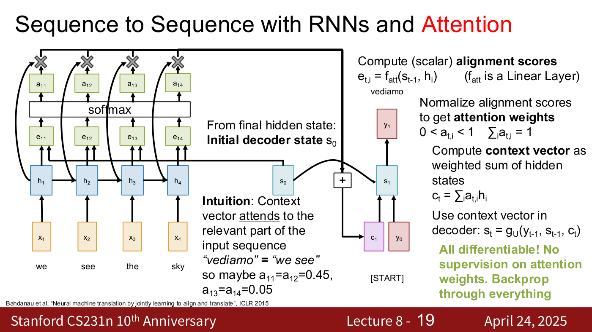

Same as slide 18, plus green bold text at the lower right: "All differentiable! No supervision on attention weights. Backprop through everything".

Credit line: Bahdanau et al, "Neural machine translation by jointly learning to align and translate", ICLR 2015

## Slide 20 — Sequence to Sequence with RNNs and Attention

Same figure layout as slide 19 but now showing the second step: the alignment scores and attention weights are relabelled $e_{21}$ to $e_{24}$ and $a_{21}$ to $a_{24}$ (4 each, with the softmax box and the 4 multiplication nodes). The decoder shows $s_1$ with its input boxes $c_1$ and $y_0$ ("[START]") and output $y_1$ ("vediamo"). A new black line runs from the left side of $s_1$ back leftwards to the row of $e_{2i}$ boxes, feeding each of them. The "+" box now sits up and to the left of $s_1$: it is fed from above by the line from the 4 multiplication nodes, and its output runs right and then down into a new purple box $c_2$ placed to the right of $y_0$. The $s_0$ box keeps its horizontal arrow into $s_1$, and an arrow drops from that line into the top of $c_1$. Text at the top right: "Repeat: Use $s_1$ to compute new context vector $c_2$" / "Compute new alignment scores $e_{2,i}$ and attention weights $a_{2,i}$". The explanatory text blocks of slide 19 are removed.

Credit line: Bahdanau et al, "Neural machine translation by jointly learning to align and translate", ICLR 2015

## Slide 21 — Sequence to Sequence with RNNs and Attention

Same as slide 20, plus the second decoder step: a teal box $s_2$ right of $s_1$ (arrow $s_1 \to s_2$); inputs to $s_2$ are the purple $c_2$ and a pink $y_1$ labelled "vediamo" (below), and its output is a red box $y_2$ labelled "il" above. The earlier text block "Compute new alignment scores ..." is replaced by "Use context vector in decoder: $s_t = g_U(y_{t-1}, s_{t-1}, c_t)$" on the right; "Repeat: Use $s_1$ to compute new context vector $c_2$" remains at the top right.

Credit line: Bahdanau et al, "Neural machine translation by jointly learning to align and translate", ICLR 2015

## Slide 22 — Sequence to Sequence with RNNs and Attention

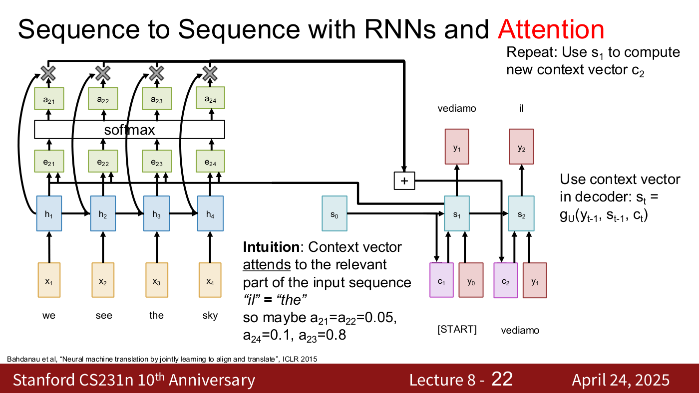

Same as slide 21, plus a text block under the encoder: "**Intuition**: Context vector <u>attends</u> to the relevant part of the input sequence" / "*"il" = "the"*" / "so maybe $a_{21}=a_{22}=0.05$, $a_{24}=0.1$, $a_{23}=0.8$" ("attends" underlined).

Credit line: Bahdanau et al, "Neural machine translation by jointly learning to align and translate", ICLR 2015

## Slide 23 — Sequence to Sequence with RNNs and Attention

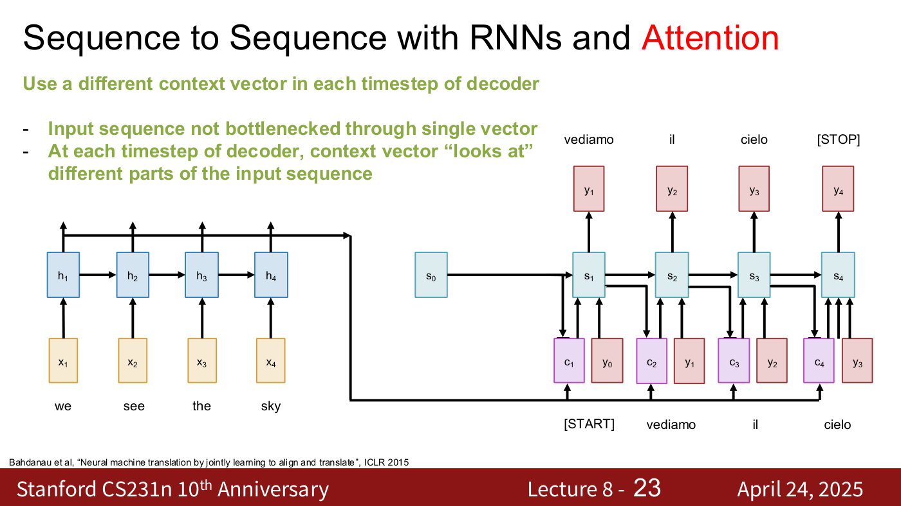

Green bold text at the top left: "Use a different context vector in each timestep of decoder" followed by two dash items: "Input sequence not bottlenecked through single vector" / "At each timestep of decoder, context vector "looks at" different parts of the input sequence".

Figure: the encoder with the 4 blue boxes $h_1$ to $h_4$ and orange inputs $x_1$ to $x_4$ ("we", "see", "the", "sky"); the attention machinery (e, a, softmax, multiplication nodes) is collapsed away: arrows from the $h$ boxes go up and then run along a single line right, then down and along the bottom, with arrows up into each of 4 purple context boxes $c_1$, $c_2$, $c_3$, $c_4$. The decoder has 4 teal states $s_0$ (plus) $s_1$ to $s_4$ linked left to right. Under each $s_i$ are two input boxes: a purple $c_i$ and a pink $y_{i-1}$ ($y_0$ to $y_3$), with the words "[START]", "vediamo", "il", "cielo" underneath. Above each $s_i$ a red output box $y_1$ to $y_4$ with words "vediamo", "il", "cielo", "[STOP]" above. Count: 4 context vectors, 4 decoder states, 4 outputs.

Credit line: Bahdanau et al, "Neural machine translation by jointly learning to align and translate", ICLR 2015

## Slide 24 — Sequence to Sequence with RNNs and Attention

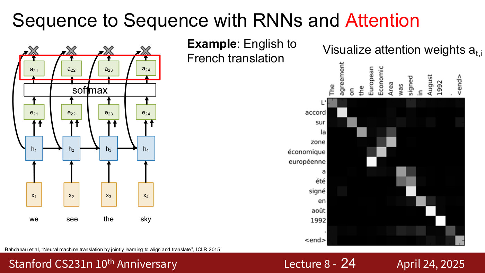

Text: "**Example**: English to French translation" (centre) and "Visualize attention weights $a_{t,i}$" (right).

Left figure: the attention diagram of slide 21 reduced to the encoder and the second-step attention machinery only (4 $h$ boxes with inputs "we", "see", "the", "sky"; 4 $e$ boxes $e_{21}$ to $e_{24}$; "softmax"; 4 $a$ boxes $a_{21}$ to $a_{24}$; 4 multiplication nodes), with a red rectangle drawn around the row of $a$ boxes $a_{21}$ to $a_{24}$.

Right figure: a grayscale heatmap (attention matrix) with columns labelled across the top (rotated text) by the English input words: "The", "agreement", "on", "the", "European", "Economic", "Area", "was", "signed", "in", "August", "1992", ".", "<end>" (14 columns), and rows labelled down the left by the French output words: "L'", "accord", "sur", "la", "zone", "économique", "européenne", "a", "été", "signé", "en", "août", "1992", ".", "<end>" (15 rows). Cells are black for near-zero weight and brighter grey/white for larger weight. Approximate bright cells: "L'" with "The" (grey) and slightly "agreement"; "accord" with "agreement" (white); "sur" with "on"; "la" with "the" (grey); "zone" with "Area" (light grey) and "European"/"Economic" (dim); "économique" with "Economic" (light grey) and "European" (dark grey); "européenne" with "European" (white); "a" with "was" (grey) and "signed"; "été" with "was"/"signed" (grey); "signé" with "signed" (white); "en" with "in" (grey) and "August"; "août" with "August" (white); "1992" with "1992" (white); "." with "." (grey); "<end>" with "<end>" (grey). The bright cells form a mostly diagonal line, with the "la zone économique européenne" block running anti-diagonally.

Credit line: Bahdanau et al, "Neural machine translation by jointly learning to align and translate", ICLR 2015

## Slide 25 — Sequence to Sequence with RNNs and Attention

Same as slide 24, except the left figure is removed and replaced by text: "**Input**: "The agreement on the European Economic Area was signed in August 1992."" / "**Output**: "L'accord sur la zone économique européenne a été signé en août 1992."". The heatmap and the "Example: English to French translation" and "Visualize attention weights $a_{t,i}$" labels are unchanged.

Credit line: Bahdanau et al, "Neural machine translation by jointly learning to align and translate", ICLR 2015

## Slide 26 — Sequence to Sequence with RNNs and Attention

Same as slide 25, plus colour highlights. In the input text, "The agreement on the" is bold blue and "August 1992." is bold purple; in the output, "L'accord sur la" is bold blue and "en août 1992." is bold purple. On the heatmap: a blue rectangle around the top-left column labels "The agreement on the" and another blue rectangle around the top-left 4 by 4 block of cells (rows "L'", "accord", "sur", "la"), with blue text at the left "Diagonal attention means words correspond in order"; a purple rectangle around the column labels "August 1992 . <end>" at upper right, a purple rectangle around the row labels "en août 1992 . <end>" at the bottom left, and a purple rectangle around the bottom-right block of cells (5 rows, "en" to "<end>", by 4 columns, "August" to "<end>"), with purple text at the lower left "Diagonal attention means words correspond in order".

Credit line: Bahdanau et al, "Neural machine translation by jointly learning to align and translate", ICLR 2015

## Slide 27 — Sequence to Sequence with RNNs and Attention

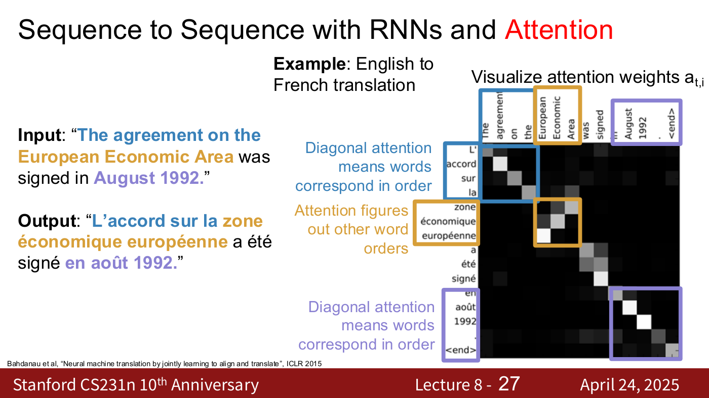

Same as slide 26, plus an orange/gold highlight: in the input text "European Economic Area" is bold gold, in the output "zone économique européenne" is bold gold. On the heatmap, a gold rectangle surrounds the column labels "European Economic Area", another surrounds the row labels "zone économique européenne", and a third surrounds the 3 by 3 block of cells for rows "zone", "économique", "européenne" against columns "European", "Economic", "Area"; gold text at the left says "Attention figures out other word orders".

Credit line: Bahdanau et al, "Neural machine translation by jointly learning to align and translate", ICLR 2015

## Slide 28 — Sequence to Sequence with RNNs and Attention

Text at the upper right: "There's a general operator hiding here:". Figure: the full attention seq2seq diagram. Encoder: 4 light-teal input boxes $x_1$ to $x_4$ ("we", "see", "the", "sky"), 4 blue $h_1$ to $h_4$, 4 grey $e_{21}$ to $e_{24}$ boxes, softmax box, 4 grey $a_{21}$ to $a_{24}$ boxes, 4 multiplication nodes, "+" box, as in slide 21. Decoder: 5 light-green boxes $s_0$, $s_1$, $s_2$, $s_3$, $s_4$; 4 pink-orange (peach) context boxes $c_1$ to $c_4$ and 4 pink boxes $y_0$ to $y_3$ ("[START]", "vediamo", "il", "cielo"); 4 pink output boxes $y_1$ to $y_4$ ("vediamo", "il", "cielo", "[STOP]"). The colours differ from slide 23: inputs are light teal, hidden states blue, $e$ and $a$ grey, decoder states light green, context vectors peach.

## Slide 29 — Sequence to Sequence with RNNs and Attention

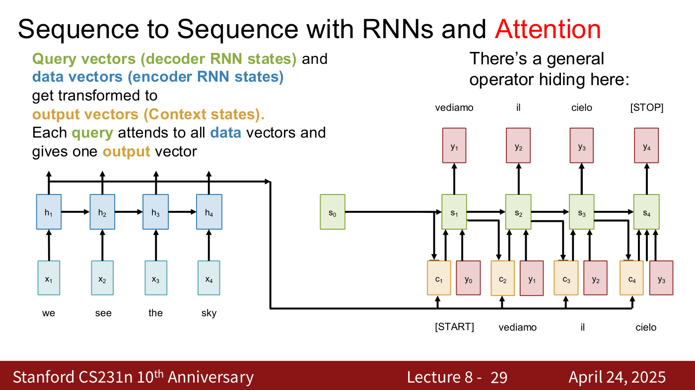

Same figure as slide 23's collapsed layout, with the colours of slide 28 (light-teal $x$ boxes, blue $h$ boxes, light-green $s_0$ to $s_4$, peach $c_1$ to $c_4$, pink $y$ boxes), and the e/a/softmax machinery hidden. Text at the top left: "**Query vectors (decoder RNN states)**" (bold green, "Query vectors" and the parenthesis) " and " "**data vectors (encoder RNN states)**" (bold blue) " get transformed to " "**output vectors (Context states).**" (bold gold) / "Each **query** attends to all **data** vectors and gives one **output** vector" (with "query" in green, "data" in blue, "output" in gold). "There's a general operator hiding here:" remains at the upper right.

## Slide 30 — Attention Layer

Title "Attention Layer". Text at the left: "<u>Inputs</u>:" / "**Query vector**: **q** $[D_Q]$" (the bold "q" in green).

Figure (right, smaller): the single-step attention diagram: 4 light-teal $x_1$ to $x_4$ ("we", "see", "the", "sky"), 4 blue $h_1$ to $h_4$, 4 grey $e_{11}$ to $e_{14}$, a "softmax" box, 4 grey $a_{11}$ to $a_{14}$, 4 multiplication nodes at the top, a line over to a "+" box and down into a peach box $c_1$ at the right. A light-green box $s_0$ with an arrow into the $e$ row. A red rectangle highlights $s_0$.

## Slide 31 — Attention Layer

Same as slide 30, plus a second input line: "**Data vectors**: **X** $[N_X \times D_X]$" (the bold "X" in blue; printed as "N_X x D_X"). The red rectangle now highlights the row of 4 blue $h$ boxes $h_1$ to $h_4$ instead of $s_0$.

## Slide 32 — Attention Layer

Left text: "Inputs:" (underlined) / "Query vector: **q** $[D_Q]$" (q in green) / "Data vectors: **X** $[N_X \times D_X]$" (X in blue). Below: "Computation:" (underlined) / "Similarities: e $[N_X]$  $e_i = f_{att}(\mathbf{q}, \mathbf{X_i})$" (q green, $X_i$ blue).

Figure (right): the RNN-with-attention diagram. Bottom row, 4 light-teal boxes $x_1$, $x_2$, $x_3$, $x_4$ with the words "we", "see", "the", "sky" beneath them. Above each is a blue box $h_1$ to $h_4$ (4 boxes), with an arrow from each $x_i$ to $h_i$ and arrows between neighbouring $h$ boxes. To the right of $h_4$ is a green box $s_0$. Above the $h$ row is a row of 4 grey boxes $e_{11}$, $e_{12}$, $e_{13}$, $e_{14}$; each receives arrows from the corresponding $h_i$ and a line from $s_0$ (a horizontal line from $s_0$ running left under the $e$ row with arrows up into each $e$). Above that a wide box labelled "softmax", above it a row of 4 grey boxes $a_{11}$ to $a_{14}$, and above each a small circled multiplication sign "x". Curved arrows run from each $h_i$ up to the multiplication sign of the same column. From the multiplication signs a line runs along the top to the right and down to a circled "+" box, and from there down to an orange box $c_1$ (far right).

Highlight: a red rectangle surrounds the row of four $e$ boxes ($e_{11}$ to $e_{14}$).

## Slide 33 — Attention Layer

Same as slide 32, plus a new computation line: "Attention weights: a = softmax(e)  $[N_X]$". The red rectangle now surrounds the softmax box and the row of $a_{11}$ to $a_{14}$ boxes instead of the $e$ row.

## Slide 34 — Attention Layer

Same as slide 33, plus a new computation line: "Output vector: **y** = $\sum_i a_i \mathbf{X_i}$  $[D_X]$" (y orange, $X_i$ blue). The red rectangle now surrounds the orange box $c_1$ at the right.

## Slide 35 — Attention Layer

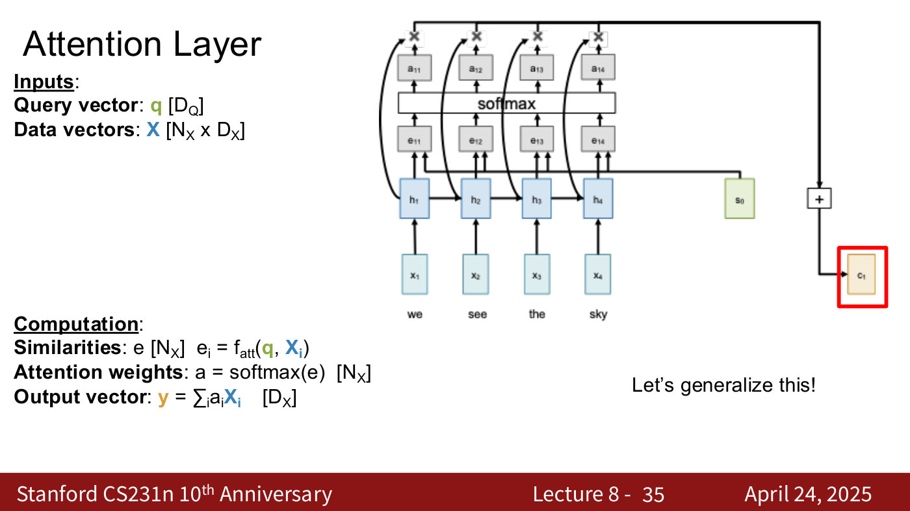

Same as slide 34 (red rectangle still around $c_1$), plus the text "Let's generalize this!" at lower right.

## Slide 36 — Attention Layer

Same figure as slide 32 (no red box in the figure). Changes to the left text: the query is now "Query vector: **q** $[D_X]$" (the dimension is printed $D_X$, not $D_Q$). The similarity line is now "Similarities: e $[N_X]$  $e_i$ = **q** · $\mathbf{X_i}$", with a red rectangle around $e_i$ = q · $X_i$. Attention weights and output vector lines as in slide 34. Right side: heading "Changes" (bold) with one bullet: "Use dot product for similarity".

## Slide 37 — Attention Layer

Same as slide 36, except the similarity is now $e_i$ = **q** · $\mathbf{X_i}$ / $\sqrt{D_X}$ (red rectangle around it). "Changes" bullet is now "Use **scaled** dot product for similarity" ("scaled" in bold red).

## Slide 38 — Attention Layer

Same as slide 37, plus an explanatory text block at the upper left (below the inputs, above "Computation"): "Large similarities will cause softmax to saturate and give vanishing gradients" / "Recall a · b = |a||b| cos(angle)" / "Suppose that a and b are constant vectors of dimension D" / "Then $|a| = (\sum_i a^2)^{1/2} = a\sqrt{D}$".

## Slide 39 — Attention Layer

Same figure as slide 32. Left text changes: "Query vector: **Q** $[N_Q \times D_Q]$" (red rectangle around "Q $[N_Q \times D_Q]$"), "Data vectors: **X** $[N_X \times D_X]$". Computation block:

Similarities: E = $\mathbf{Q}\mathbf{X}^T$ / $\sqrt{D_X}$  $[N_Q \times N_X]$

$E_{ij}$ = $\mathbf{Q_i} \cdot \mathbf{X_j}$ / $\sqrt{D_X}$

Attention weights: A = softmax(E, dim=1)  $[N_Q \times N_X]$

Output vector: **Y** = A**X**  $[N_Q \times D_X]$

$\mathbf{Y_i} = \sum_j A_{ij} \mathbf{X_j}$

"Changes" bullets: "Use scaled dot product for similarity" / "Multiple **query** vectors" ("query" in green bold).

## Slide 40 — Attention Layer

Same figure as slide 32. Inputs now four lines: "Query vector: **Q** $[N_Q \times D_Q]$", "Data vectors: **X** $[N_X \times D_X]$", "Key matrix: $\mathbf{W_K}$ $[D_X \times D_Q]$" (orange), "Value matrix: $\mathbf{W_V}$ $[D_X \times D_V]$" (purple). Computation:

Keys: **K** = $\mathbf{X}\mathbf{W_K}$  $[N_X \times D_Q]$

Values: **V** = $\mathbf{X}\mathbf{W_V}$  $[N_X \times D_V]$

Similarities: E = $\mathbf{Q}\mathbf{K}^T$ / $\sqrt{D_Q}$  $[N_Q \times N_X]$

$E_{ij}$ = $\mathbf{Q_i} \cdot \mathbf{K_j}$ / $\sqrt{D_Q}$

Attention weights: A = softmax(E, dim=1)  $[N_Q \times N_X]$

Output vector: **Y** = A**V**  $[N_Q \times D_V]$

$\mathbf{Y_i} = \sum_j A_{ij} \mathbf{V_j}$

"Changes" bullets: "Use scaled dot product for similarity" / "Multiple **query** vectors" / "Separate **key** and **value**" ("key" orange, "value" purple).

## Slide 41 — Attention Layer

The RNN figure is gone. The left text of slide 40 is shown, but only the first two input lines ("Query vector: **Q** $[N_Q \times D_Q]$", "Data vectors: **X** $[N_X \times D_X]$") are at full strength; the key matrix, value matrix and the whole Computation block are faded to near-invisible (same text as slide 40).

Figure (lower right): a vertical stack of 3 blue boxes labelled $X_1$, $X_2$, $X_3$ (top to bottom), and a horizontal row of 4 green boxes labelled $Q_1$, $Q_2$, $Q_3$, $Q_4$ (left to right) at the bottom right. No arrows or other elements yet.

## Slide 42 — Attention Layer

Left text as slide 40 (four inputs; Computation block), but only the first two computation lines ("Keys: **K** = $\mathbf{X}\mathbf{W_K}$  $[N_X \times D_Q]$" and "Values: **V** = $\mathbf{X}\mathbf{W_V}$  $[N_X \times D_V]$") are at full strength; the Similarities, Attention weights and Output vector lines are faded.

Figure (right): 3 blue boxes $X_1$, $X_2$, $X_3$ stacked vertically (top to bottom). Each has an arrow pointing right to an orange box $K_1$, $K_2$, $K_3$ (3 key boxes). Each $X_i$ also has a black line leaving its left side, going up and over (elbow connectors at three different x positions) and ending with an arrow into a purple box $V_1$, $V_2$, $V_3$ (3 value boxes) stacked above the $K$ boxes ($X_1$ to $V_1$, $X_2$ to $V_2$, $X_3$ to $V_3$). Below, a row of 4 green boxes $Q_1$, $Q_2$, $Q_3$, $Q_4$ as on slide 41.

## Slide 43 — Attention Layer

Same as slide 42, plus the Similarities lines are now at full strength ("Similarities: E = $\mathbf{Q}\mathbf{K}^T$ / $\sqrt{D_Q}$  $[N_Q \times N_X]$" and $E_{ij}$ = $\mathbf{Q_i} \cdot \mathbf{K_j}$ / $\sqrt{D_Q}$); Attention weights and Output vector lines remain faded. Figure: a grey rounded panel to the right of the $K$ boxes containing a $3 \times 4$ grid of small boxes (3 rows, 4 columns) of similarities. Top row: $E_{1,1}$, $E_{2,1}$, $E_{3,1}$, $E_{4,1}$; middle row: $E_{1,2}$, $E_{2,2}$, $E_{3,2}$, $E_{4,2}$; bottom row: $E_{1,3}$, $E_{2,3}$, $E_{3,3}$, $E_{4,3}$. The first subscript is the query (column), the second the key (row). Arrows from each $K_j$ (from $K_1$ at the top to $K_3$ at the bottom) point right into row $j$ of the grid; arrows from each $Q_i$ point up into column $i$.

## Slide 44 — Attention Layer

Same as slide 43, plus the Attention weights line at full strength ("Attention weights: A = softmax(E, dim=1)  $[N_Q \times N_X]$"); the Output vector lines remain faded. Figure: above the $E$ grid, a second grey panel with a $3 \times 4$ grid of attention weights, in the same layout (top row first): row 1 $A_{1,1}$, $A_{2,1}$, $A_{3,1}$, $A_{4,1}$; row 2 $A_{1,2}$, $A_{2,2}$, $A_{3,2}$, $A_{4,2}$; row 3 $A_{1,3}$, $A_{2,3}$, $A_{3,3}$, $A_{4,3}$. Between the two panels the label "Softmax(" up-arrow ")". Top-right text: "Softmax normalizes each column: each **query** predicts a distribution over the **keys**" ("query" green, "keys" orange). The $V$ boxes sit at the left of the $A$ panel (their connector lines unchanged).

## Slide 45 — Attention Layer

Same as slide 44, plus the Output vector lines at full strength ("Output vector: **Y** = A**V**  $[N_Q \times D_V]$", $\mathbf{Y_i} = \sum_j A_{ij}\mathbf{V_j}$). Figure: above the $A$ panel an arrow leads up into a white box labelled "Product(" right-arrow "),   Sum(" up-arrow ")", and above it 4 orange boxes $Y_1$, $Y_2$, $Y_3$, $Y_4$ each with an arrow up from the box. The $V_j$ boxes feed the $A$ panel's rows (arrows from $V_1$, $V_2$, $V_3$ point right into the rows of the $A$ panel). Top text: "Each **output** is a linear combination of all **values**, weighted by attention weights" ("output" orange, "values" purple).

## Slide 46 — Cross-Attention Layer

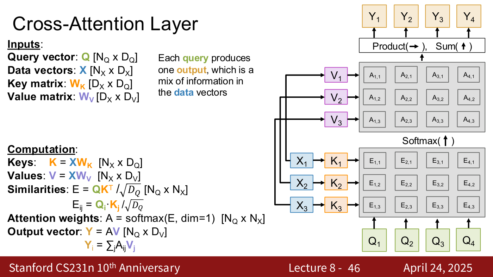

Title changes to "Cross-Attention Layer". Same as slide 45, plus the text block (between the left text and the figure): "Each **query** produces one **output**, which is a mix of information in the **data** vectors" ("query" green, "output" orange, "data" blue). The figure is otherwise unchanged.

## Slide 47 — Self-Attention Layer

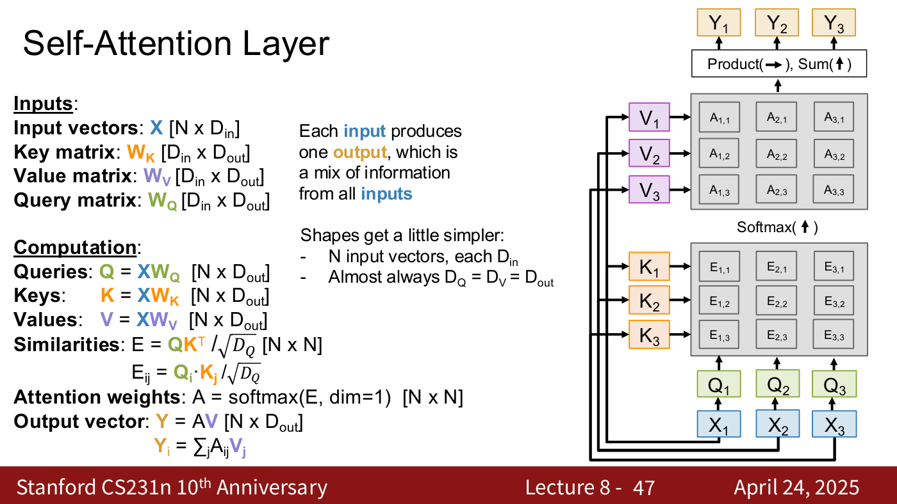

Title "Self-Attention Layer". Left text:

Inputs:

Input vectors: **X** $[N \times D_{in}]$

Key matrix: $\mathbf{W_K}$ $[D_{in} \times D_{out}]$

Value matrix: $\mathbf{W_V}$ $[D_{in} \times D_{out}]$

Query matrix: $\mathbf{W_Q}$ $[D_{in} \times D_{out}]$

Computation:

Queries: **Q** = $\mathbf{X}\mathbf{W_Q}$  $[N \times D_{out}]$

Keys: **K** = $\mathbf{X}\mathbf{W_K}$  $[N \times D_{out}]$

Values: **V** = $\mathbf{X}\mathbf{W_V}$  $[N \times D_{out}]$

Similarities: E = $\mathbf{Q}\mathbf{K}^T$ / $\sqrt{D_Q}$  $[N \times N]$

$E_{ij}$ = $\mathbf{Q_i} \cdot \mathbf{K_j}$ / $\sqrt{D_Q}$

Attention weights: A = softmax(E, dim=1)  $[N \times N]$

Output vector: **Y** = A**V**  $[N \times D_{out}]$

$\mathbf{Y_i} = \sum_j A_{ij}\mathbf{V_j}$

Centre text: "Each **input** produces one **output**, which is a mix of information from all **inputs**" ("input" blue, "output" orange, "inputs" blue). Then: "Shapes get a little simpler:" / "- N input vectors, each $D_{in}$" / "- Almost always $D_Q$ = $D_V$ = $D_{out}$".

Figure (right), redrawn with 3 elements per row instead of 3 plus 4: at the bottom a row of 3 blue boxes $X_1$, $X_2$, $X_3$; above each an arrow up to a green box $Q_1$, $Q_2$, $Q_3$ (3 query boxes). A $3 \times 3$ grey panel of similarities (top row $E_{1,1}$, $E_{2,1}$, $E_{3,1}$; middle row $E_{1,2}$, $E_{2,2}$, $E_{3,2}$; bottom row $E_{1,3}$, $E_{2,3}$, $E_{3,3}$; $K_1$ at the top to $K_3$ at the bottom) above the $Q$ row, with arrows from each $Q_i$ up into column $i$. To its left a column of orange boxes $K_1$, $K_2$, $K_3$ with arrows into the rows of the panel, and further above purple boxes $V_1$, $V_2$, $V_3$. Long black elbow connectors run from each $X_i$ out to the left and up, ending in arrows into $K_i$ and $V_i$ (each $X_i$ feeds a $Q_i$, a $K_i$ and a $V_i$). Label between panels: "Softmax(" up-arrow ")". Above is the $3 \times 3$ grey panel of attention weights ($A_{1,1}$, $A_{2,1}$, $A_{3,1}$ / $A_{1,2}$, $A_{2,2}$, $A_{3,2}$ / $A_{1,3}$, $A_{2,3}$, $A_{3,3}$), then a white box "Product(" right-arrow "), Sum(" up-arrow ")", then 3 orange output boxes $Y_1$, $Y_2$, $Y_3$ at the top.

## Slide 48 — Self-Attention Layer

Left text and centre text "Each input produces one output, which is a mix of information from all inputs" as slide 47; in the Computation block only Queries, Keys, Values lines are at full strength, the Similarities, Attention weights and Output vector lines are faded. The shapes note of slide 47 is gone.

Figure: the bottom of the slide 47 figure only: 3 blue boxes $X_1$ to $X_3$, each with an arrow up to green $Q_1$ to $Q_3$; orange $K_1$ to $K_3$ and purple $V_1$ to $V_3$ boxes stacked above at the left, fed by the long elbow connectors from the $X_i$. No similarity panel. Text at upper right: "From each **input**: compute a **query**, **key**, and **value** vector" ("input" blue, "query" green, "key" orange, "value" purple). Middle right: "Often fused to one matmul:" then $[\mathbf{Q} \thinspace \mathbf{K} \thinspace \mathbf{V}] = \mathbf{X} [\mathbf{W_Q} \thinspace \mathbf{W_K} \thinspace \mathbf{W_V}]$ and, in smaller text, "[N x 3Dout] = [N x Din] [Din x 3Dout]" (as printed).

## Slide 49 — Self-Attention Layer

Same as slide 48, except the Similarities lines are now at full strength; the Attention weights and Output vector lines stay faded. Figure: the $3 \times 3$ grey panel of $E$ values ($E_{1,1}$, $E_{2,1}$, $E_{3,1}$ / $E_{1,2}$, $E_{2,2}$, $E_{3,2}$ / $E_{1,3}$, $E_{2,3}$, $E_{3,3}$) appears to the right of the $K$ boxes, with arrows from $K_j$ into row $j$ and from $Q_i$ up into column $i$. The "From each input..." and "Often fused" texts are replaced by: "Compute similarity between each **query** and each **key**" ("query" green, "key" orange).

## Slide 50 — Self-Attention Layer

Same as slide 49, plus the Attention weights line at full strength (Output vector lines faded). Figure: above the $E$ panel, a "Softmax(" up-arrow ")" label and a second $3 \times 3$ grey panel of $A$ values ($A_{1,1}$, $A_{2,1}$, $A_{3,1}$ / $A_{1,2}$, $A_{2,2}$, $A_{3,2}$ / $A_{1,3}$, $A_{2,3}$, $A_{3,3}$). Text at top right: "Normalize over each column: each **query** computes a distribution over **keys**" ("query" green, "keys" orange).

## Slide 51 — Self-Attention Layer

Same as slide 50, plus the Output vector lines at full strength. Figure: above the $A$ panel, an arrow up into the white box "Product(" right-arrow "), Sum(" up-arrow ")" and 3 orange boxes $Y_1$, $Y_2$, $Y_3$ at the top. Text at top left of the figure: "Compute **output** vectors as linear combinations of **value** vectors" ("output" orange, "value" purple). The slide now equals the full diagram of slide 47 without the "Shapes get a little simpler" note.

## Slide 52 — Self-Attention Layer

Same left text as slide 47 (inputs and full Computation block, all at full strength). The centre notes of slide 47 are replaced by the single line "Consider permuting **inputs**:" ("inputs" blue). Figure: the same diagram as slide 51 but with the labels removed from every box except the bottom row, and the inputs permuted: the bottom row of blue boxes reads $X_3$, $X_1$, $X_2$ (left to right). The 3 green query boxes, 3 orange key boxes, 3 purple value boxes, the $3 \times 3$ $E$ panel, the $3 \times 3$ $A$ panel and the 3 orange output boxes are all drawn empty (unlabelled), with the Softmax and Product/Sum boxes as before.

## Slide 53 — Self-Attention Layer

Same as slide 52, plus the text "**Queries**, **keys**, and **values** will be the same but permuted" ("Queries" green, "keys" orange, "values" purple). The query boxes are now labelled $Q_3$, $Q_1$, $Q_2$, the key boxes (top to bottom) $K_3$, $K_1$, $K_2$ and the value boxes $V_3$, $V_1$, $V_2$. The grids and output boxes are still empty.

## Slide 54 — Self-Attention Layer

Same as slide 53, plus the text "Similarities are the same but permuted". The $E$ panel is now labelled: row 1 $E_{3,3}$, $E_{1,3}$, $E_{2,3}$; row 2 $E_{3,1}$, $E_{1,1}$, $E_{2,1}$; row 3 $E_{3,2}$, $E_{1,2}$, $E_{2,2}$. The $A$ panel and outputs are still empty.

## Slide 55 — Self-Attention Layer

Same as slide 54, plus the text "Attention weights are the same but permuted". The $A$ panel is now labelled: row 1 $A_{3,3}$, $A_{1,3}$, $A_{2,3}$; row 2 $A_{3,1}$, $A_{1,1}$, $A_{2,1}$; row 3 $A_{3,2}$, $A_{1,2}$, $A_{2,2}$. Output boxes still empty.

## Slide 56 — Self-Attention Layer

Same as slide 55, plus the text "**Outputs** are the same but permuted" ("Outputs" orange). The output boxes are now labelled $Y_3$, $Y_1$, $Y_2$.

## Slide 57 — Self-Attention Layer

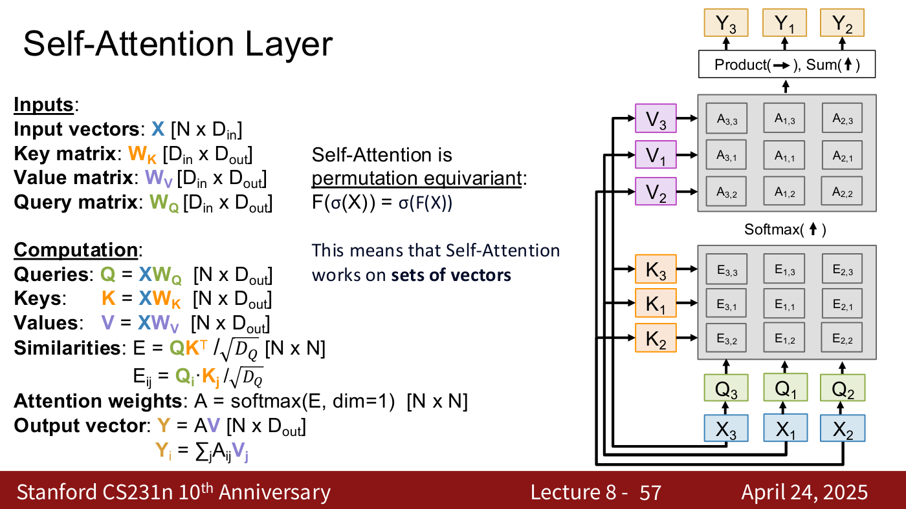

Same figure as slide 56 (permuted labels throughout, outputs $Y_3$, $Y_1$, $Y_2$). The permutation notes are replaced by: "Self-Attention is <u>permutation equivariant</u>:" (the phrase "permutation equivariant" is underlined) / "F(σ(X)) = σ(F(X))" / "This means that Self-Attention works on **sets of vectors**" (bold, dark blue).

## Slide 58 — Self-Attention Layer

Figure: the un-permuted diagram as in slide 51 (bottom row $X_1$, $X_2$, $X_3$; queries $Q_1$ to $Q_3$; keys $K_1$ to $K_3$; values $V_1$ to $V_3$; $E$ and $A$ panels in the order of slide 47; outputs $Y_1$, $Y_2$, $Y_3$), but the long elbow connectors from the $X_i$ to the $K$ and $V$ boxes are not drawn on this slide. Text: "**Problem**: Self-Attention does not know the order of the sequence" ("Problem" bold dark red, the sentence dark red).

## Slide 59 — Self-Attention Layer

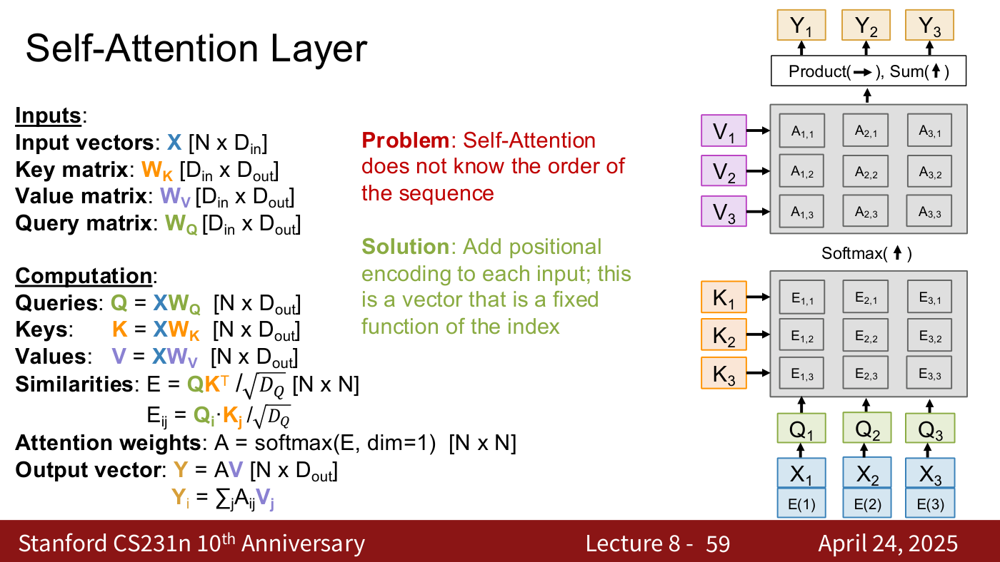

Same as slide 58, plus the text "**Solution**: Add positional encoding to each input; this is a vector that is a fixed function of the index" (green). In the figure, each blue $X_i$ box now has a second blue box attached directly beneath it labelled $E(1)$, $E(2)$, $E(3)$ (under $X_1$, $X_2$, $X_3$ respectively).

## Slide 60 — Masked Self-Attention Layer

Title: "**Masked** Self-Attention Layer" ("Masked" in red), subtitle "Don't let vectors "look ahead" in the sequence". Left text as slide 47 (inputs and computation). Centre text: "Override similarities with -inf; this controls which inputs each vector is allowed to look at." Figure: same as slide 58 (no $E(i)$ boxes under the $X_i$, no long connectors) except that in the $E$ panel the entries below the diagonal are replaced by red $-\infty$: row 1: $E_{1,1}$, $E_{2,1}$, $E_{3,1}$; row 2: $-\infty$, $E_{2,2}$, $E_{3,2}$; row 3: $-\infty$, $-\infty$, $E_{3,3}$. In the $A$ panel the same positions show a red "0": row 1: $A_{1,1}$, $A_{2,1}$, $A_{3,1}$; row 2: 0, $A_{2,2}$, $A_{3,2}$; row 3: 0, 0, $A_{3,3}$. Outputs $Y_1$, $Y_2$, $Y_3$ at the top; bottom row $X_1$, $X_2$, $X_3$.

## Slide 61 — Masked Self-Attention Layer

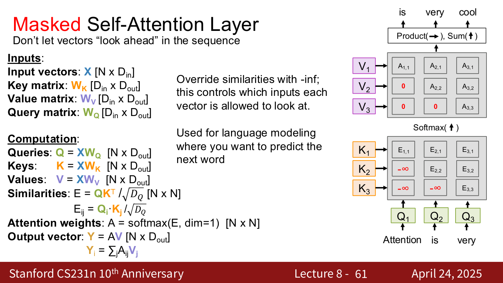

Same as slide 60, plus the text "Used for language modeling where you want to predict the next word". In the figure the blue $X_i$ boxes are replaced by the words "Attention", "is", "very" under $Q_1$, $Q_2$, $Q_3$ (arrows up into the Q boxes), and the output boxes by the words "is", "very", "cool" above the Product/Sum box (arrows up to each word). The $-\infty$ and 0 masks are as on slide 60.

## Slide 62 — Multiheaded Self-Attention Layer

Title: "**Multiheaded** Self-Attention Layer" ("Multiheaded" in red), subtitle "Run H copies of Self-Attention in parallel". The entire left text of slide 47 (Inputs and Computation blocks) is shown faded to near-invisible; it is the same text, except that the output line reads "Output vector: **Y** = A**X**  $[N \times D_{out}]$" (as printed). Figure: only 3 small blue boxes $X_1$, $X_2$, $X_3$ in a row at the lower right.

*[Ed: this faded output line is printed Y = AX where slides 47 to 61 print Y = AV; the printed value is kept here. Slide 63 repeats it.]*

## Slide 63 — Multiheaded Self-Attention Layer

Title "Multiheaded Self-Attention Layer" ("Multiheaded" in red), subtitle "Run H copies of Self-Attention in parallel".

The single-head summary from the previous slides is shown faded (light grey) down the left side. Inputs: "Input vectors: X $[N \times D_{in}]$", "Key matrix: $W_K$ $[D_{in} \times D_{out}]$", "Value matrix: $W_V$ $[D_{in} \times D_{out}]$", "Query matrix: $W_Q$ $[D_{in} \times D_{out}]$". Computation: "Queries: Q = $XW_Q$ $[N \times D_{out}]$", "Keys: K = $XW_K$ $[N \times D_{out}]$", "Values: V = $XW_V$ $[N \times D_{out}]$", "Similarities: E = $QK^T / \sqrt{D_Q}$ $[N \times N]$", $E_{ij} = Q_i \cdot K_j / \sqrt{D_Q}$, "Attention weights: A = softmax(E, dim=1) $[N \times N]$", "Output vector: Y = AX $[N \times D_{out}]$" (as on slide 62), $Y_i = \sum_j A_{ij} V_j$.

Text at the middle right: "H = 3 independent self-attention layers (called heads), each with their own weights".

Figure: three copies, side by side, of the small self-attention diagram from earlier slides (each has input boxes $X_1, X_2, X_3$ at the bottom, query boxes $Q$, key boxes $K$ on the left, value boxes $V$ on the left, a grid of similarity entries with a softmax, a product/sum row and output boxes $Y_1, Y_2, Y_3$ at the top; the details are too small to read at this size). Below the three copies are three blue boxes labelled $X_1$, $X_2$, $X_3$ (one set of inputs shared by all heads).

## Slide 64 — Multiheaded Self-Attention Layer

Same as slide 63, plus: text "Stack up the H independent outputs for each input X" above the "H = 3 ..." text, and above the three diagrams three orange stacks, each of three boxes: the first stack $Y_{1,1}$, $Y_{1,2}$, $Y_{1,3}$; the second $Y_{2,1}$, $Y_{2,2}$, $Y_{2,3}$; the third $Y_{3,1}$, $Y_{3,2}$, $Y_{3,3}$ (top to bottom within each stack; one stack per input position, the second index running over the heads; the stacks sit above the three head diagrams).

## Slide 65 — Multiheaded Self-Attention Layer

Same as slide 64, plus: text "Output projection fuses data from each head" at the top, and above each orange stack a dark-red box ($O_1$ above the first stack, $O_2$ above the second, $O_3$ above the third) with a black arrow pointing up from the stack into the box (3 arrows).

## Slide 66 — Multiheaded Self-Attention Layer

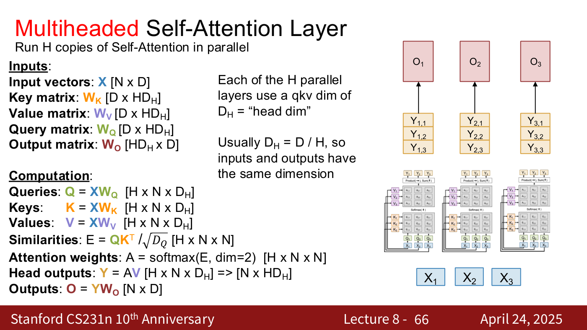

Title and subtitle as slide 63. The faded left-hand text is replaced by the full-colour multihead summary (symbols are colour coded: X blue, $W_K$ and K orange, $W_V$ and V purple, $W_Q$ and Q green, E and A grey, Y gold, $W_O$ and O dark red):

Inputs: "Input vectors: X $[N \times D]$", "Key matrix: $W_K$ $[D \times HD_H]$", "Value matrix: $W_V$ $[D \times HD_H]$", "Query matrix: $W_Q$ $[D \times HD_H]$", "Output matrix: $W_O$ $[HD_H \times D]$".

Computation: "Queries: Q = $XW_Q$ $[H \times N \times D_H]$", "Keys: K = $XW_K$ $[H \times N \times D_H]$", "Values: V = $XW_V$ $[H \times N \times D_H]$", "Similarities: E = $QK^T / \sqrt{D_Q}$ $[H \times N \times N]$", "Attention weights: A = softmax(E, dim=2) $[H \times N \times N]$", "Head outputs: Y = AV $[H \times N \times D_H]$ => $[N \times HD_H]$", "Outputs: O = $YW_O$ $[N \times D]$".

Middle text: "Each of the H parallel layers use a qkv dim of $D_H$ = "head dim"" and "Usually $D_H$ = D / H, so inputs and outputs have the same dimension".

*[Ed: the similarity line keeps the square root of D_Q from the single-head slides, but D_Q is not among this slide's inputs; each head's queries have dimension D_H, the head dim. The same line is repeated on slides 67 to 78. Printed as is.]*

Figure at the right: same as slide 65 (three head diagrams, three orange $Y$ stacks, three dark-red boxes $O_1, O_2, O_3$ with arrows, blue boxes $X_1, X_2, X_3$), but the explanatory captions "Output projection fuses...", "Stack up...", "H = 3 independent..." are removed.

## Slide 67 — Multiheaded Self-Attention Layer

Same as slide 66, except the middle text is replaced by: "In practice, compute all H heads in parallel using batched matrix multiply operations." and "Used everywhere in practice."

## Slide 68 — Self-Attention is Four Matrix Multiplies!

Title "Self-Attention is Four Matrix Multiplies!". Left column is the same colour-coded summary as slide 66 (Inputs: X $[N \times D]$, $W_K$ $[D \times HD_H]$, $W_V$ $[D \times HD_H]$, $W_Q$ $[D \times HD_H]$, $W_O$ $[HD_H \times D]$; Computation: Q, K, V each $[H \times N \times D_H]$, E = $QK^T / \sqrt{D_Q}$ $[H \times N \times N]$, A = softmax(E, dim=2) $[H \times N \times N]$, Y = AV $[H \times N \times D_H]$ => $[N \times HD_H]$, O = $YW_O$ $[N \times D]$). No figure.

## Slide 69 — Self-Attention is Four Matrix Multiplies!

Same as slide 68, plus a red rectangle around the three lines Queries, Keys, Values, and a numbered list at the right:

1. QKV Projection (underlined): $[N \times D]$ $[D \times 3HD_H]$ => $[N \times 3HD_H]$ and "Split and reshape to get Q, K, V each of shape $[H \times N \times D_H]$".

## Slide 70 — Self-Attention is Four Matrix Multiplies!

Same as slide 69, except the red rectangle is now around the Similarities line only. The list adds:

2. QK Similarity (underlined): $[H \times N \times D_H]$ $[H \times D_H \times N]$ => $[H \times N \times N]$.

## Slide 71 — Self-Attention is Four Matrix Multiplies!

Same as slide 70, except the red rectangle is now around the Head outputs line. The list adds:

3. V-Weighting (underlined): $[H \times N \times N]$ $[H \times N \times D_H]$ => $[H \times N \times D_H]$ and "Reshape to $[N \times HD_H]$".

## Slide 72 — Self-Attention is Four Matrix Multiplies!

Same as slide 71, except the red rectangle is now around the Outputs line. The list adds:

4. Output Projection (underlined): $[N \times HD_H]$ $[HD_H \times D]$ => $[N \times D]$.

## Slide 73 — Self-Attention is Four Matrix Multiplies!

Same as slide 72, except the red rectangle is gone. Adds at the lower right, in small black text: "Q: How much compute does this take as the number of vectors N increases?" ("compute" underlined).

## Slide 74 — Self-Attention is Four Matrix Multiplies!

Same as slide 73, plus: a red rectangle around list items 2 (QK Similarity) and 3 (V-Weighting, including "Reshape to $[N \times HD_H]$"), and a new line under the question: "A: O($N^2$)" (the "A:" in bold).

## Slide 75 — Self-Attention is Four Matrix Multiplies!

Same as slide 72 (no red rectangle, no answer), except the question reads "Q: How much memory does this take as the number of vectors N increases?" ("memory" underlined).

## Slide 76 — Self-Attention is Four Matrix Multiplies!

Same as slide 75, plus: a red rectangle around list items 2 and 3 (as on slide 74), and the answer "A: O($N^2$)" printed in red under the question.

## Slide 77 — Self-Attention is Four Matrix Multiplies!

Same as slide 76, plus red text at the top right: "If N=100K, H=64 then HxNxN attention weights take 1.192 TB! GPUs don't have that much memory..."

*[Ed: the slide does not say how many bytes each weight takes. 64 times 100,000 times 100,000 is 640 billion weights; at 2 bytes each (16-bit numbers) that is 1.28 trillion bytes, which is 1,192 GiB, or 1.28 TB in decimal units (1.16 TiB in binary units). The printed 1.192 TB is the GiB count divided by 1,000, so its units are mixed and it is about 7% under the decimal figure. The printed value is kept; the 2-byte assumption is the editor's, not printed.]*

## Slide 78 — Self-Attention is Four Matrix Multiplies!

Same as slide 77, except the memory question now has the answer "A: O(N) with Flash Attention" (replacing "A: O($N^2$)" in red; printed in black). Adds green text in the upper middle, between the left column and the list: "Flash Attention algorithm computes 2+3 at the same time without storing the full attention matrix!" and "Makes large N possible". The red "If N=100K..." note remains. Credit line at the bottom right: "Dao et al, "FlashAttention: Fast and Memory-Efficient Exact Attention with IO-Awareness", 2022".

## Slide 79 — Three Ways of Processing Sequences

Title "Three Ways of Processing Sequences". The rest of the slide is blank.

## Slide 80 — Three Ways of Processing Sequences

Same title. One column at the left, headed "Recurrent Neural Network". Figure: a row of 4 blue boxes at the bottom labelled $x_1$, $x_2$, $x_3$, $x_4$; above each, an orange box labelled $y_1$, $y_2$, $y_3$, $y_4$; a black arrow points up from each $x_i$ to its $y_i$ (4 vertical arrows), and horizontal black arrows connect the orange boxes left to right ($y_1 \to y_2 \to y_3 \to y_4$, 3 arrows).

Below: "Works on **1D ordered sequences**" (bold phrase). Green: "(+) Theoretically good at long sequences: O(N) compute and memory for a sequence of length N". Red: "(-) Not parallelizable. Need to compute hidden states sequentially".

## Slide 81 — Three Ways of Processing Sequences

Same as slide 80, plus a second column headed "Convolution". Figure: 4 blue boxes $x_1$ to $x_4$ and 4 orange boxes $y_1$ to $y_4$ above them, with no horizontal arrows between orange boxes. Each $x_i$ has a vertical arrow up to its $y_i$ (4 arrows), and between neighbouring columns there is a black "X" of two crossing diagonal arrows (3 crosses, between columns 1-2, 2-3, 3-4; 10 arrows in all), so each $y_i$ also receives arrows from the neighbouring inputs: $y_1$ from $x_1$ and $x_2$, $y_2$ from $x_1$, $x_2$ and $x_3$, $y_3$ from $x_2$, $x_3$ and $x_4$, $y_4$ from $x_3$ and $x_4$.

Below: "Works on **N-dimensional grids**". Red: "(-) Bad for long sequences: need to stack many layers to build up large receptive fields". Green: "(+) Parallelizable, outputs can be computed in parallel".

## Slide 82 — Three Ways of Processing Sequences

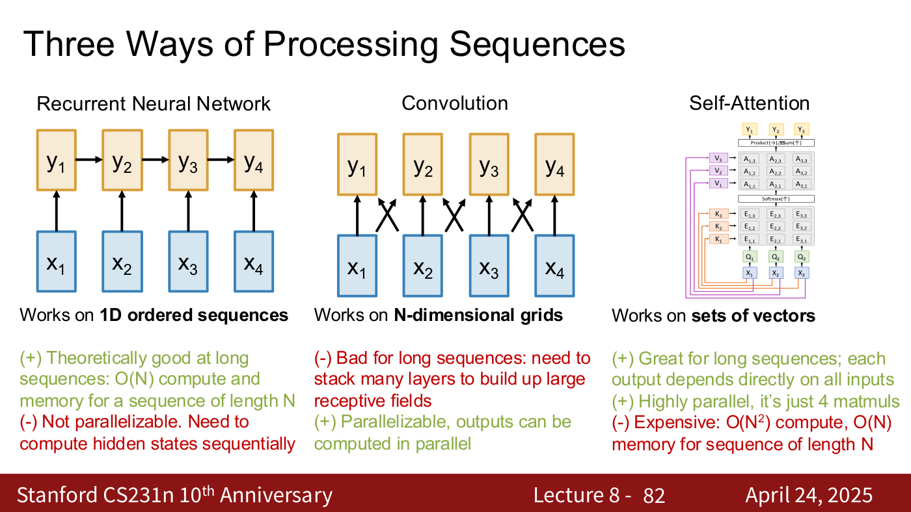

Same as slide 81, plus a third column headed "Self-Attention". Figure: the small self-attention diagram from earlier slides (inputs $X_1, X_2, X_3$ at the bottom, query boxes $Q_1, Q_2, Q_3$, key boxes $K_1, K_2, K_3$ and value boxes $V_1, V_2, V_3$ on the left, grids of $E_{i,j}$ and $A_{i,j}$ entries with a softmax row, a product/sum row and outputs $Y_1, Y_2, Y_3$ at the top; entries are too small to read here).

Below: "Works on **sets of vectors**". Green: "(+) Great for long sequences; each output depends directly on all inputs". Green: "(+) Highly parallel, it's just 4 matmuls". Red: "(-) Expensive: O($N^2$) compute, O(N) memory for sequence of length N".

*[Ed: this slide prints O(N) memory for self-attention, while slides 75 to 78 give O(N squared) memory for the attention weights, reduced to O(N) with Flash Attention. The slide does not say it assumes Flash Attention.]*

## Slide 83 — Attention is All You Need

Same background as slide 82 (title "Three Ways of Processing Sequences" and the three columns, partly covered), with a large white rectangle with a thin dark border drawn over the middle of the slide. Inside it, large text: "Attention is All You Need", and below it smaller: "Vaswani et al, NeurIPS 2017". The text of the columns peeks out above and below the rectangle (column headings "Recurrent Neural Network", "Convolution", "Self-Attention", and the bottom lines "(-) Not parallelizable. Need to compute hidden states sequentially", "(+) Parallelizable, outputs can be computed in parallel", "(+) Highly parallel, it's just 4 matmuls", "(-) Expensive: O($N^2$) compute, O(N) memory for sequence of length N").

## Slide 84 — The Transformer

Title "The Transformer". Left text: "Transformer Block" (bold, underlined), "Input: Set of vectors x" ("Input" bold).

Figure: at the bottom right, 4 blue boxes labelled $x_1$, $x_2$, $x_3$, $x_4$. Nothing else drawn yet.

Credit line at the bottom left: "Vaswani et al, "Attention is all you need," NeurIPS 2017" (repeated on slides 84 to 92).

## Slide 85 — The Transformer

Same as slide 84, plus: above the 4 input boxes, 4 black arrows pointing up into a thin, wide, light blue horizontal bar; above that bar, 4 more arrows pointing up into a wide light green box labelled "Self-Attention". Text to the left: "All vectors interact through (multiheaded) Self-Attention".

## Slide 86 — The Transformer

Same as slide 85, plus: a residual connection drawn as a black line that leaves the left end of the light blue bar, runs up the left side and across above the Self-Attention box, and ends at a circled plus symbol above the Self-Attention box; an arrow from the Self-Attention box also goes up into the circled plus. Label to the left: "Residual connection".

## Slide 87 — The Transformer

Same as slide 86, plus: above the circled plus, a wide orange box labelled "Layer Normalization", with text to its left "Layer normalization normalizes all vectors". At the top right, the recall text:

"Recall **Layer Normalization**:" (bold phrase)
"Given $h_1$, ..., $h_N$ (Shape: D)"
"scale: $\gamma$ (Shape: D)"
"shift: $\beta$ (Shape: D)"
$\mu_i = (\sum_j h_{i,j})/D$ (scalar)
$\sigma_i = (\sum_j (h_{i,j} - \mu_i)^2 / D)^{1/2}$ (scalar)
$z_i = (h_i - \mu_i) / \sigma_i$
$y_i = \gamma \ast z_i + \beta$
"Ba et al, 2016"

## Slide 88 — The Transformer

Same as slide 87 (the layer normalization recall text is removed), plus: above the Layer Normalization box, a single black arrow splits into 4 arrows that each point up into one of 4 purple boxes in a row labelled "MLP", "MLP", "MLP", "MLP". Text to the left: "MLP independently on each vector". Text at the top right: "Usually a two-layer MLP; classic setup is D => 4D => D" and "Also sometimes called FFN (Feed-Forward Network)".

## Slide 89 — The Transformer

Same as slide 88, plus: a second residual connection, a black line that leaves the stem below the 4 MLP boxes (the arrow coming out of the first Layer Normalization), runs up the left side, and ends at a second circled plus above the MLP row; arrows from the 4 MLP boxes go up into the circled plus. Label: "Residual connection" (top left of the diagram). The top-right "Usually a two-layer MLP..." text is removed.

## Slide 90 — The Transformer

Same as slide 89, plus: above the second circled plus, a wide orange box labelled "Layer Normalization", with text to its left "Another Layer Norm"; above it 4 arrows pointing up into 4 orange boxes labelled $y_1$, $y_2$, $y_3$, $y_4$. This is the full block: 4 inputs $x_1$ to $x_4$, light blue bar, Self-Attention, residual plus, Layer Normalization, 4 MLP boxes, residual plus, Layer Normalization, 4 outputs $y_1$ to $y_4$.

## Slide 91 — The Transformer

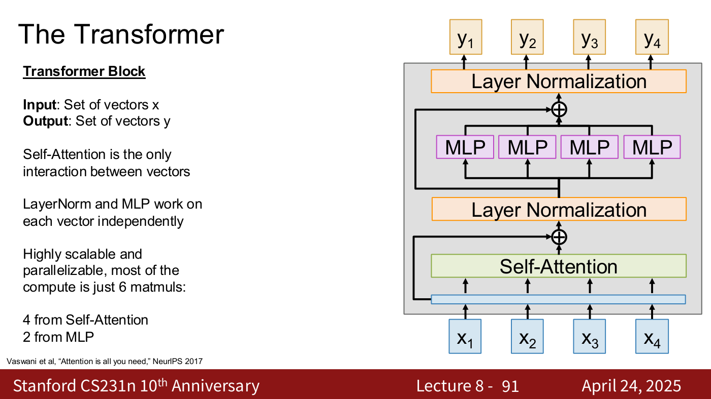

Same diagram as slide 90, now enclosed in a large light grey rectangle (from just above the light blue bar to just below the top Layer Normalization; the input and output boxes are outside it), and with the side annotations removed. Left text:

"Transformer Block" (bold, underlined)
"Input: Set of vectors x"
"Output: Set of vectors y"
"Self-Attention is the only interaction between vectors"
"LayerNorm and MLP work on each vector independently"
"Highly scalable and parallelizable, most of the compute is just 6 matmuls:"
"4 from Self-Attention"
"2 from MLP"

## Slide 92 — The Transformer

Same left text as slide 91. At the right, the grey-boxed block diagram is shown three times, stacked vertically and touching (each copy contains, bottom to top: light blue bar, Self-Attention, circled plus with residual line, Layer Normalization, 4 MLP boxes, circled plus with residual line, Layer Normalization; arrows between copies). Text in the middle: "A **Transformer** is just a stack of identical Transformer blocks!" (bold word) and "They have not changed much since 2017... but have gotten a lot bigger".

## Slide 93 — The Transformer

Left column, printed text:

**Transformer Block** (underlined heading)

**Input**: Set of vectors x
**Output**: Set of vectors y

Self-Attention is the only interaction between vectors

LayerNorm and MLP work on each vector independently

Highly scalable and parallelizable, most of the compute is just 6 matmuls:

4 from Self-Attention
2 from MLP

Middle column: "A **Transformer** is just a stack of identical Transformer blocks!" / "They have not changed much since 2017… but have gotten a lot bigger" / "<u>Original</u>: [Vaswani et al, 2017]" / "12 blocks, D=1024, H=16, N=512" / "213M params".

Figure (right): three identical Transformer blocks stacked vertically, each a grey rounded box. Each block, bottom to top: a light blue bar at the bottom (the input vectors), arrows upward into a green box "Self-Attention", a residual line from the input bypassing it to a circled plus, then an orange box "Layer Normalization", arrows up to a row of 4 purple boxes each labelled "MLP", a residual bypass to a second circled plus, and an orange box "Layer Normalization" at the top, with arrows leaving upward (4 arrows per level). Block output feeds the block above. In each block the first residual line runs from the left end of the light blue bar to the first circled plus; the second leaves the stem above the lower Layer Normalization (below the split into the MLPs) and enters the second circled plus from the left.

Credit line: Vaswani et al, "Attention is all you need," NeurIPS 2017

## Slide 94 — The Transformer

Same as slide 93, plus a new entry below the "Original" entry in the middle column: "<u>GPT-2</u>: [Radford et al, 2019]" / "48 blocks, D=1600, H=25, N=1024" / "1.5B params".

## Slide 95 — The Transformer

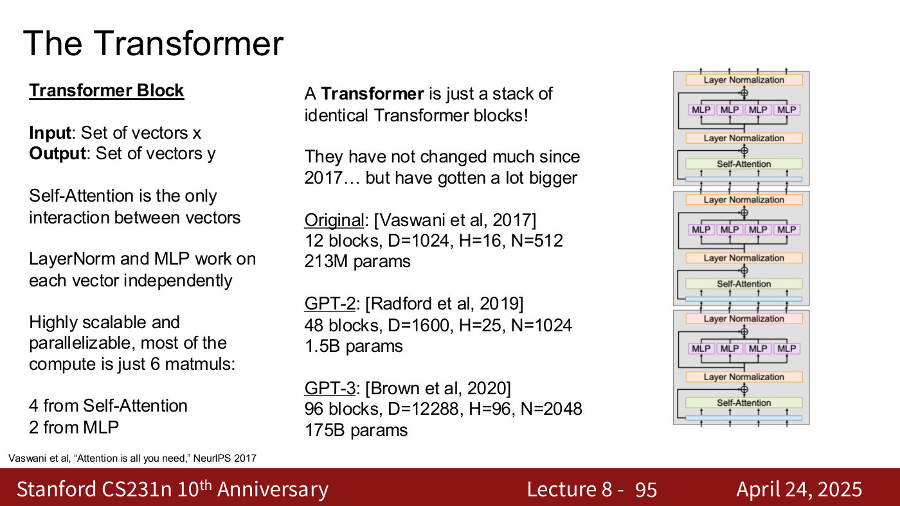

Same as slide 94, plus a new entry below the GPT-2 entry: "<u>GPT-3</u>: [Brown et al, 2020]" / "96 blocks, D=12288, H=96, N=2048" / "175B params".

## Slide 96 — Transformers for Language Modeling (LLM)

Text: "Learn an <u>embedding matrix</u> at the start of the model to convert words into vectors." / "Given vocab size V and model dimension D, it's a lookup table of shape [V x D]".

Figure (right): a stack of 2 Transformer blocks (each as on slide 93: Self-Attention, MLP row of 4, two Layer Normalization boxes, residual circled plusses, grey background; 4 arrows per level). Below the bottom block is a white box "Embedding Matrix [V x D]". Beneath it, 4 arrows point up into the box from the input words "Attention", "is", "all", "you". There is no output on top yet (arrows leave the top block with no label).

## Slide 97 — Transformers for Language Modeling (LLM)

Same as slide 96, plus a new paragraph: "Use masked attention inside each transformer block so each token can only see the ones before it".

## Slide 98 — Transformers for Language Modeling (LLM)

Same as slide 97, plus a new paragraph: "At the end, learn a <u>projection matrix</u> of shape [D x V] to project each D-dim vector to a V-dim vector of scores for each element of the vocabulary." In the figure, a white box "Projection Matrix [D x V]" is added above the top block, with 4 arrows from the block into it and 4 output arrows leaving upward labelled "is", "all", "you", "need" (the input words shifted by one, ending with the new word "need").

## Slide 99 — Transformers for Language Modeling (LLM)

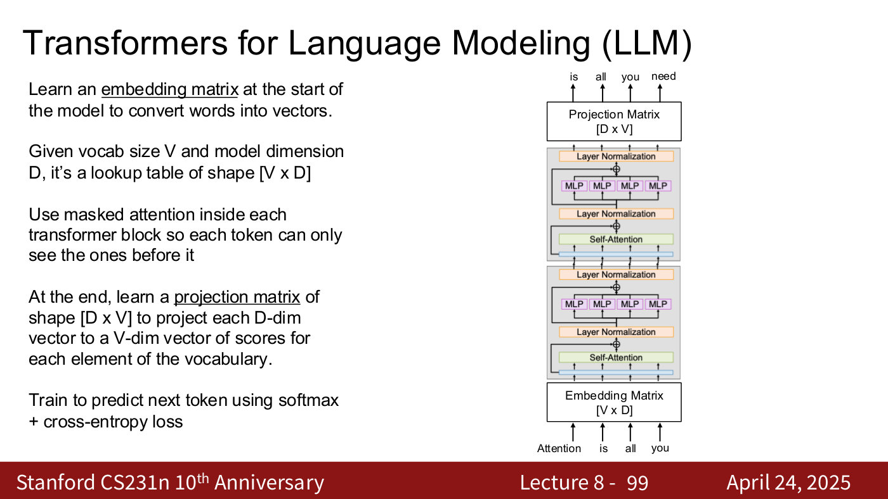

Same as slide 98, plus a new paragraph: "Train to predict next token using softmax + cross-entropy loss".

## Slide 100 — Vision Transformers (ViT)

Figure: a photo of a cat's face (a tabby with green eyes, looking at the camera, against a grey background). Caption below: "Input image:" / "e.g. 224x224x3".

Credit line: Dosovitskiy et al, "An Image is Worth 16x16 Words: Transformers for Image Recognition at Scale", ICLR 2021

## Slide 101 — Vision Transformers (ViT)

Same as slide 100, plus a vertical column of 9 small square image patches to the right of the photo, cropped from the cat image (top to bottom: an ear tip against the background; fur and the base of an ear; an ear; an eye and the edge of an ear; both eyes; fur and cheek; the bed with a little fur; nose and muzzle; whiskers and the bed). Caption below the column: "Break into patches" / "e.g. 16x16x3".

## Slide 102 — Vision Transformers (ViT)

Same as slide 101, plus: from each of the 9 patches a black arrow points right to a light blue horizontal rectangle (9 rectangles, one per patch, stacked in a column). Caption below: "Flatten and apply a linear transform 768 => D".

## Slide 103 — Vision Transformers (ViT)

Same as slide 102, plus text at the right: "**Q**: Any other way to describe this operation?"

## Slide 104 — Vision Transformers (ViT)

Same as slide 103, plus the answer below the question: "**A**: 16x16 conv with stride 16, 3 input channels, D output channels".

## Slide 105 — Vision Transformers (ViT)

Same as slide 102 (the Q/A text of slides 103–104 is gone), plus: a large black curly brace to the right of the 9 light blue rectangles spanning all 9; from its point a black line runs right, then down, then right and up with an arrowhead into the bottom of a stack of 2 Transformer blocks (as on slide 96, grey boxes with Self-Attention, 4 MLP boxes, two Layer Normalization boxes, residual plusses) drawn at the right. Caption below the stack: "D-dim vector per patch are the input vectors to the Transformer".

## Slide 106 — Vision Transformers (ViT)

Same as slide 105, plus text to the right of the Transformer stack: "Use positional encoding to tell the transformer the 2D position of each patch".

## Slide 107 — Vision Transformers (ViT)

Same as slide 106, plus text above the positional-encoding text: "Don't use any masking; each image patch can look at all other image patches".

## Slide 108 — Vision Transformers (ViT)

Same as slide 107, plus text at the top right above the others: "Transformer gives an output vector per patch".

## Slide 109 — Vision Transformers (ViT)

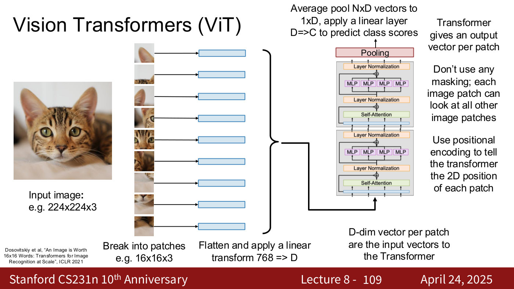

Same as slide 108, plus a red-bordered pink box "Pooling" on top of the Transformer stack (4 arrows from the top block into it and one arrow out of its top), and text above it: "Average pool NxD vectors to 1xD, apply a linear layer D=>C to predict class scores".

## Slide 110 — Tweaking Transformers

Text: "The Transformer architecture has not changed much since 2017." / "But a few changes have become common:" (nothing listed yet).

Figure (right, large): one Transformer block in a grey box. Inputs $x_1$, $x_2$, $x_3$, $x_4$ (4 light blue boxes at the bottom) with arrows up into a light blue bar (the vectors), then a green "Self-Attention" box, a residual line from the bar bypassing it to a circled plus, an orange "Layer Normalization" box above that, 4 purple "MLP" boxes in a row, a second residual line bypassing the MLPs to a second circled plus, and an orange "Layer Normalization" box at the top, with arrows up to outputs $y_1$, $y_2$, $y_3$, $y_4$ (4 orange-outlined boxes). Each Layer Normalization sits just after a residual addition, as in the block of slides 90–93.

## Slide 111 — Pre-Norm Transformer

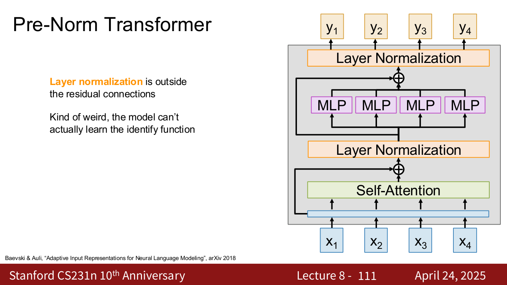

Text: "Layer normalization is outside the residual connections" ("Layer normalization" in orange bold) / "Kind of weird, the model can't actually learn the identify function" (printed "identify", sic).

Figure: same as slide 110.

Credit line: Baevski & Auli, "Adaptive Input Representations for Neural Language Modeling", arXiv 2018

*[Ed: the slide prints "identify function"; "identity function" is presumably meant.]*

## Slide 112 — Pre-Norm Transformer

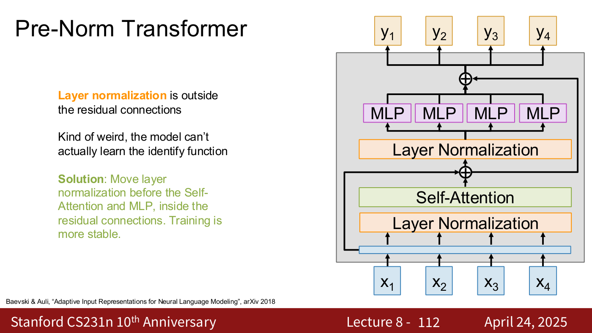

Same text as slide 111, plus a paragraph: "**Solution**: Move layer normalization before the Self-Attention and MLP, inside the residual connections. Training is more stable." ("Solution" in bold green, rest in green).

Figure changed: block drawn with 4 inputs $x_1$ to $x_4$ and outputs $y_1$ to $y_4$, bottom to top: light blue bar, orange "Layer Normalization", green "Self-Attention", a circled plus (the residual line from the bar goes around Layer Normalization and Self-Attention into it), orange "Layer Normalization", 4 purple "MLP" boxes, a second circled plus (the second residual line leaves the right side of the first plus, runs up the right edge and enters the second plus from the right, bypassing Layer Normalization and the MLPs), then arrows up to $y_1$ to $y_4$. So there is no Layer Normalization after the last plus; each Layer Normalization now sits before its sublayer, inside the residual branch.

Credit line: Baevski & Auli, "Adaptive Input Representations for Neural Language Modeling", arXiv 2018

## Slide 113 — RMSNorm

Text: "Replace Layer Normalization with Root-Mean-Square Normalization (RMSNorm)" / "**Input**: x [shape D]" / "**Output**: y [shape D]" / "**Weight**: $\gamma$ [shape D]".

Equations:

$$y_i = \frac{x_i}{RMS(x)} \ast \gamma_i$$

$$RMS(x) = \sqrt{\varepsilon + \frac{1}{N}\sum_{i=1}^{N} x_i^2}$$

Text: "Training is a bit more stable".

*[Ed: the slide gives the vector shape as D but sums from i = 1 to N and divides by N; N is not defined on the slide, and elsewhere in the deck N is the number of vectors. The sum presumably runs over the D entries of x. Printed as is.]*

Figure (right): the pre-norm block of slide 112, with both orange boxes now labelled "RMSNorm" instead of "Layer Normalization". Bottom to top: inputs $x_1$ to $x_4$, light blue bar, "RMSNorm", green "Self-Attention", circled plus (residual from the bar bypasses RMSNorm and Self-Attention), "RMSNorm", 4 purple "MLP" boxes, second circled plus (residual bypasses RMSNorm and MLPs), outputs $y_1$ to $y_4$.

Credit line: Zhang and Sennrich, "Root Mean Square Layer Normalization", NeurIPS 2019

## Slide 114 — SwiGLU MLP

Text: "<u>**Classic MLP**</u>:" / "**Input**: X [N x D]" / "**Weights**: $W_1$ [D x 4D]" / $W_2$ [4D x D] / "**Output**: Y = $\sigma(XW_1)W_2$ [N x D]" (printed with a blue sigma).

Figure: same block as slide 113.

Credit line: Shazeer, "GLU Variants Improve Transformers", 2020

## Slide 115 — SwiGLU MLP

Same as slide 114, plus a second section: "<u>**SwiGLU MLP**</u>:" / "**Input**: X [N x D]" / "**Weights**: $W_1$ , $W_2$ [D x H]" / $W_3$ [H x D] / "**Output**:"

$$Y = (\sigma(XW_1) \odot XW_2)W_3$$

then "Setting H = 8D/3 keeps same total params".

## Slide 116 — SwiGLU MLP

Same as slide 115, plus an italic quotation to the right of the SwiGLU section: "*We offer no explanation as to why these architectures seem to work; we attribute their success, as all else, to divine benevolence.*" (no attribution printed beside the quote; the credit line is the Shazeer 2020 paper).

## Slide 117 — Mixture of Experts (MoE)

Text: "Learn E separate sets of MLP weights in each block; each MLP is an *expert*" / $W_1$: [D x 4D] => [E x D x 4D] / $W_2$: [4D x D] => [E x 4D x D].

Figure: same block as slide 113 (RMSNorm version).

Credit line: Shazeer et al, "Outrageously Large Neural Networks: The Sparsely-Gated Mixture-of-Experts Layer", 2017

## Slide 118 — Mixture of Experts (MoE)

Same as slide 117, plus: "Each token gets *routed* to A < E of the experts. These are the *active experts*." / "Increases params by E," / "But only increases compute by A".

## Slide 119 — Mixture of Experts (MoE)

Same as slide 118, plus (no credit line on this slide): "All of the biggest LLMs today (e.g. GPT4o, GPT4.5, Claude 3.7, Gemini 2.5 Pro, etc) almost certainly use MoE and have > 1T params; but they don't publish details anymore".

## Slide 120 — Tweaking Transformers

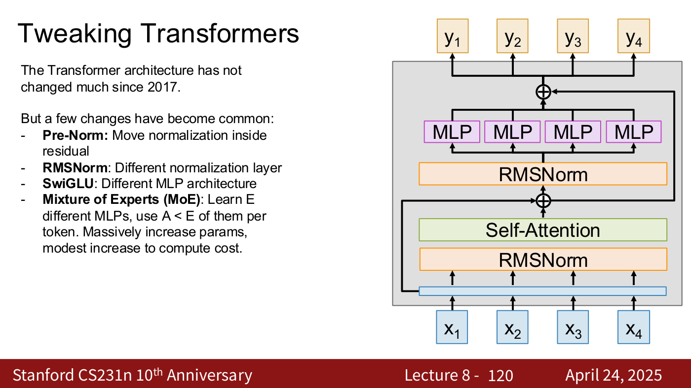

Text: "The Transformer architecture has not changed much since 2017." / "But a few changes have become common:" followed by four dashed items: "**Pre-Norm:** Move normalization inside residual"; "**RMSNorm**: Different normalization layer"; "**SwiGLU**: Different MLP architecture"; "**Mixture of Experts (MoE)**: Learn E different MLPs, use A < E of them per token. Massively increase params, modest increase to compute cost."

Figure: same RMSNorm pre-norm block as slide 113.

## Slide 121 — Summary: Attention + Transformers

Left heading: "**Attention**: A new primitive that operates on sets of vectors". Right heading: "**Transformer**: A neural network architecture that uses attention everywhere". Green text in the middle: "Transformers are the backbone of all large AI models today!" / "Used for language, vision, speech, …"

Left figure: the attention-layer diagram from earlier in the lecture. Three input vectors $X_1$, $X_2$, $X_3$ at the bottom (light blue), each with an arrow up to a query $Q_1$, $Q_2$, $Q_3$ (green). Above, a 3 by 3 grey grid of similarities $E_{i,j}$ (rows $E_{1,1}$ $E_{2,1}$ $E_{3,1}$ at the bottom, then $E_{1,2}$ $E_{2,2}$ $E_{3,2}$, then $E_{1,3}$ $E_{2,3}$ $E_{3,3}$ at the top), with keys $K_1$, $K_2$, $K_3$ (orange) on its left, one per row, fed by orange lines from $X_1$ to $X_3$. Above the grid a box "Softmax($\uparrow$)", then a 3 by 3 grid of attention weights $A_{i,j}$ (same layout), with values $V_1$, $V_2$, $V_3$ (purple) on its left, one per row, fed by purple lines from $X_1$ to $X_3$. At the top a box "Product($\rightarrow$), Sum($\uparrow$)" with arrows up to outputs $Y_1$, $Y_2$, $Y_3$ (yellow).

Right figure: a stack of 2 Transformer blocks in the layout of slide 93 (layer normalization after each residual addition: Self-Attention, residual plus, Layer Normalization, 4 MLP boxes, residual plus, Layer Normalization, grey backgrounds).

## Slide 122 — Next Time

Text: "Next Time:" / "Detection, Segmentation, Visualization".

