# Lecture 9 — Detection, Segmentation, Visualization, and Understanding (slide-by-slide)

Text and figures of all 178 pages of [`lecture_9.pdf`](https://cs231n.stanford.edu/slides/2025/lecture_9.pdf), CS231N (Stanford, Spring 2025), April 29, 2025. Cite these as "slide N" using the **printed** slide number (footer, after "Lecture 9 -"). The running footer ("Stanford CS231n 10th Anniversary", "Lecture 9 - N", "April 29, 2025") is on every page and is not repeated below. Equations are written in LaTeX; tensor shapes are quoted as printed ("3 x H x W").

The deck reveals its diagrams one element at a time, so many slides are build steps of the slide before and are written "Same as slide N, plus …". The full drawing is under the last slide of each build.

| Section | Slides |
| --- | --- |
| Title and administrative announcements | 1–2 |
| Recap of lecture 8: the Transformer, three ways of processing sequences | 3–4 |
| Vision Transformers (ViT): class token (5–12), pooled outputs (13–19) | 5–19 |
| Tweaking Transformers: pre-norm, RMSNorm, SwiGLU, mixture of experts | 20–29 |
| Today (agenda) | 30 |
| Computer vision tasks; image classification recalled | 31–32 |
| Semantic segmentation: the problem, sliding window, fully convolutional networks | 33–44 |
| In-network upsampling: unpooling, max unpooling, transposed convolution, 1D example | 45–58 |
| Fully convolutional networks with upsampling; U-Net; summary | 59–65 |
| Object detection: single object (classification + localization), multiple objects | 66–77 |
| Region proposals; R-CNN; Fast R-CNN | 78–92 |
| Region proposal network | 93–98 |
| Single-stage detectors: YOLO / SSD / RetinaNet; YOLO | 99–106 |
| DETR (object detection with transformers) | 107–112 |
| Instance segmentation: Faster R-CNN to Mask R-CNN, mask targets, results, pose | 113–123 |
| Open-source frameworks; recap of the tasks; agenda | 124–126 |
| Visualization: linear-classifier templates, first-layer filters | 127–129 |
| Saliency maps via backpropagation | 130–132 |
| Class activation mapping (CAM) | 133–141 |
| Grad-CAM | 142–146 |
| Visualizing ViT features | 147 |
| Agenda; next time: video understanding | 148–149 |
| Additional reading material (not presented): convolution as matrix multiplication | 150–152 |
| Additional reading: RoI Pool, RoI Align | 153–164 |
| Additional reading: R-CNN vs Fast R-CNN timings; Faster R-CNN in detail | 165–172 |
| Additional reading: detection trade-offs; intermediate features via (guided) backprop | 173–178 |

## Slide numbers vs PDF pages

The deck prints numbers 1–178 on 178 pages, one number per page, so the printed number and the PDF page number are the same throughout.

**What the recording covers.** The recording opens at 0:05 and never presents the administrative slide (2). It recaps the Transformer and the Vision Transformer (slides 3–19, ≈0:05–8:39) and then walks through the "Tweaking Transformers" slides (20–29, ≈8:39–13:24), which lecture 8 had left "as extra reading", followed by questions to ≈15:42. It then follows the deck through semantic segmentation (≈17:15–32:45), object detection (≈32:45–57:30, including R-CNN, Fast R-CNN, region proposal networks, YOLO and DETR, with a long run of questions on DETR, ≈52:03–57:30), instance segmentation with Mask R-CNN (≈57:30–1:00:33) and visualization (≈1:01:20–1:13:01: linear-classifier templates, first-layer filters, saliency maps, CAM, Grad-CAM and ViT features), and ends at 1:13:01 announcing video understanding as the next lecture (slide 149). The "Additional Reading Material" (slides 150–178) is not presented: the lecturer refers to it for why transposed convolution is called transposed (≈31:54; slides 151–152) and names guided backpropagation in one sentence (≈1:03:41; slides 175–178). So this file is the only source for convolution as matrix multiplication, RoI Pool and RoI Align, the R-CNN timing charts, the four-loss and two-stage view of Faster R-CNN, the detection trade-offs and guided backpropagation. See the [transcript](../transcripts/09-detection-segmentation-visualization.md).

**Slides repeated from earlier decks.** Slide 4 is lecture 8's slide 82. Slides 13–19 repeat lecture 8's Vision Transformer build (slides 100–109), and slides 20–29 lecture 8's "Tweaking Transformers" slides (110–120, with one SwiGLU build step fewer). The four-task figure on slides 31, 33, 66, 67, 113 and 125 is lecture 1's (part 2, slide 14); slide 32 is lecture 2's slide 7; and slide 127 is lecture 2's slide 62, with the 4-pixel example of lecture 2's slide 60.

**Printed slips, transcribed as printed with `[Ed:]` lines.** Slide 3's encoder block labels its inputs x0, x1, x2, x2. Slide 4 repeats lecture 8's O(N) memory for self-attention, which lecture 8 gives only with Flash Attention. Slide 21 prints "identify function", and slide 23's RMSNorm averages over "N" entries of a vector whose shape it gives as D (both repeated from lecture 8, slides 111 and 113). Slide 43 labels the low-resolution stage "Low-res: D3 x H/4 x W/4", the same size as the medium-resolution stages beside it (repeated on 44 and 59). Slide 127's ship score, 61.95, omits the bias: with $b = -1.2$ it is 60.75 (the same slip as lecture 2, slides 60 and 62, and lecture 5, slide 6). Smaller typos are noted in place ("pretranied" on 82, "where at overlaps" on 58, "a corrections" on 96, "Image a set of base boxes" on 99). Worked values that recompute: slide 25's SwiGLU with $H = 8D/3$ has $8D^2$ weights, as the classic MLP; slide 46's max pooling and max unpooling; slide 72's 4 and 12 numbers for one and three boxes; slides 151–152's matrix products; and every cell of slide 176's ReLU forward, backward and guided-backward example.

**Images.** 53 slides are rendered as images, each placed under its heading: 3, 12, 34, 39, 40, 42, 43, 46, 52, 56, 58, 60, 63, 64, 65, 70, 72, 74, 77, 78, 86, 92, 95, 96, 98, 99, 100, 104, 106, 107, 112, 115, 117, 120, 121, 122, 123, 129, 131, 132, 139, 140, 146, 147, 158, 163, 164, 165, 169, 171, 176, 177 and 178. The others have none, because they are the title (1), administrative, agenda, divider and text slides (2, 30, 124, 126, 148, 149, 150, 173, 174), equations and matrices transcribed exactly (142–145, 151, 152), figures rendered for an earlier lecture (4, lecture 8's slide 82; 13–19, lecture 8's slide 109; 20–29, lecture 8's slides 111, 112 and 120; 31, 33, 66, 67, 113 and 125, lecture 1's part 2, slide 14; 32, lecture 2's slide 7; 127, lecture 2's slide 62), grids transcribed exactly (45), build steps whose last step is rendered (5–11 → 12; 35–38 → 39; 41 → 42; 47–51 → 52; 53–55 → 56; 68–69 → 70; 71 → 72; 79–85 → 86; 87–91 → 92; 93–94 → 95; 97 → 98; 101–103 → 104; 105 → 106; 108–111 → 112; 114 → 115; 116 → 117; 118–119 → 120; 128 → 129; 130 → 131; 133–138 → 139; 153–157 → 158; 160–161 → 164; 162 → 163; 175 → 176), or a rendered figure repeated with new text or a moved box (44 and 59 → 43; 57, identical to 56; 61–62 → 60; 73, 75, 76 → 74; 141 → 140; 159 → 158; 166 → 165; 167, 168, 170, 172 → 171). Never construct an image path for a slide not listed here.

Companion pages: [wiki page for this lecture](../../wiki/09-detection-segmentation-visualization.md) · [transcript](../transcripts/09-detection-segmentation-visualization.md)

## Slide 1 — Lecture 9: Detection, Segmentation, Visualization, and Understanding

Title slide. Text: "Lecture 9:" / "Detection, Segmentation, Visualization, and Understanding".

## Slide 2 — Administrative Announcements

- Make sure to start Assignment 2 early. It is the longest of the three assignments, and the midterm and project milestone deadlines follow closely after the Assignment 2 deadline.
- Be sure to check out "this Ed post" (a hyperlink) for the best Colab practices to avoid unnecessary bugs and delays.

## Slide 3 — Last time: Transformer

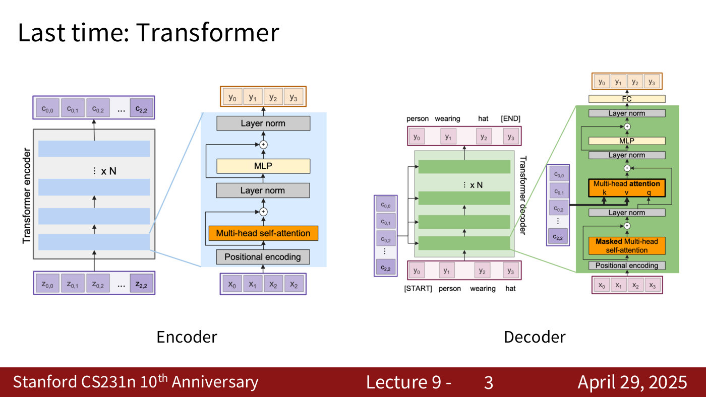

Figure: two diagrams side by side, captioned "Encoder" (left) and "Decoder" (right).

Encoder (left): a grey box labelled vertically "Transformer encoder" holds a stack of light-blue bars with "⋮ x N" between them (drawn: 4 blue bars, 1 above the "⋮ x N" and 3 below it). Below it, a purple row of input tokens $z_{0,0}$, $z_{0,1}$, $z_{0,2}$, …, $z_{2,2}$; above it a purple row of output tokens $c_{0,0}$, $c_{0,1}$, $c_{0,2}$, …, $c_{2,2}$. A light-blue zoom panel (joined by blue lines to the lowest bar) shows one encoder block, bottom to top: inputs $x_0$, $x_1$, $x_2$, $x_2$ (as printed), then "Positional encoding", then an orange "Multi-head self-attention" box with a skip connection into a $\oplus$ node, then "Layer norm", then a cream "MLP" box with a skip connection into a second $\oplus$, then "Layer norm", then outputs $y_0$, $y_1$, $y_2$, $y_3$ in an orange-bordered row.

Decoder (right): a green box labelled "Transformer decoder" (printed rotated beside the stack) with a stack of 4 green bars and "⋮ x N"; a column of arrows from the $c$ tokens feeds each bar. Below it a pink input row $y_0$, $y_1$, $y_2$, $y_3$ with words "[START]", "person", "wearing", "hat" beneath. Above it a pink output row $y_0$, $y_1$, $y_2$, $y_3$ with words "person", "wearing", "hat", "[END]" above. To its left a purple column $c_{0,0}$, $c_{0,1}$, $c_{0,2}$, ⋮, $c_{2,2}$ feeds the decoder. A dark-green zoom panel shows one decoder block, bottom to top: inputs $x_0$, $x_1$, $x_2$, $x_3$, "Positional encoding", "Masked Multi-head self-attention" (orange) with skip into $\oplus$, "Layer norm", then "Multi-head attention" (orange, bold, with inputs labelled k, v, q; a thick arrow from the $c$ column enters it from the left) with skip into $\oplus$, "Layer norm", "MLP" with skip into $\oplus$, "Layer norm", "FC", then outputs $y_0$, $y_1$, $y_2$, $y_3$.

*[Ed: the encoder block's inputs are printed x0, x1, x2, x2, with x2 repeated where the sequence of the outputs y0 to y3 would lead one to expect x3 (confirmed on a 600 dpi crop).]*

## Slide 4 — Three Ways of Processing Sequences

Three columns, each with a small diagram and text.

Recurrent Neural Network: figure of 4 orange output boxes $y_1$ to $y_4$ in a row joined left to right by black arrows ($y_1 \to y_2 \to y_3 \to y_4$); below each, a blue input box $x_1$ to $x_4$ with an arrow up into the matching $y$. Caption: "Works on 1D ordered sequences". Green text: "(+) Theoretically good at long sequences: O(N) compute and memory for a sequence of length N". Red text: "(-) Not parallelizable. Need to compute hidden states sequentially".

Convolution: figure of 4 orange boxes $y_1$ to $y_4$ above 4 blue boxes $x_1$ to $x_4$; between each neighbouring pair of columns the arrows cross (an X shape), so each $y$ takes input from its own $x$ and its neighbours. Caption: "Works on N-dimensional grids". Red text: "(-) Bad for long sequences: need to stack many layers to build up large receptive fields". Green text: "(+) Parallelizable, outputs can be computed in parallel".

Self-Attention: a small copy of the self-attention diagram (inputs $X_1$ to $X_3$, queries $Q$, keys $K$ and values $V$ on the left, a grid of $E$, a Softmax box, a grid of $A$, a "Product($\rightarrow$), Sum($\uparrow$)" box, outputs $Y_1$ to $Y_3$ at the top; too small to read in detail). Caption: "Works on sets of vectors". Green text: "(+) Great for long sequences; each output depends directly on all inputs" and "(+) Highly parallel, it's just 4 matmuls". Red text: "(-) Expensive: O(N²) compute, O(N) memory for sequence of length N".

*[Ed: this is lecture 8's slide 82, and it repeats that slide's O(N) memory for self-attention; lecture 8's slides 75 to 77 give O(N squared) memory for the attention weights, reduced to O(N) with Flash Attention (lecture 8, slide 78).]*

## Slide 5 — Vision Transformers (ViT)

Figure: a photograph of a tabby cat's face (looking at the camera, lying on a light surface) at the left, with a faint vertical line through it. Caption beneath: "Input image: e.g. 224x224x3".

Credit line: Dosovitskiy et al, "An Image is Worth 16x16 Words: Transformers for Image Recognition at Scale", ICLR 2021

## Slide 6 — Vision Transformers (ViT)

Figure: the cat photograph cut into a $3 \times 3$ grid of 9 square patches with white gaps between them, centred on the slide (ears in the top row, eyes in the middle row, nose and whiskers in the bottom row).

Credit lines: Dosovitskiy et al, "An Image is Worth 16x16 Words: Transformers for Image Recognition at Scale", ICLR 2021. Bottom right: "Cat image is free for commercial use under a Pixabay license" ("Cat image" and "Pixabay license" are hyperlinks).

## Slide 7 — Vision Transformers (ViT)

Figure: the 9 patches of slide 6 laid out in one row at the bottom (upper area empty), in raster order. Left label: "N input patches, each of shape 3x16x16".

Credit lines: Dosovitskiy et al, "An Image is Worth 16x16 Words: Transformers for Image Recognition at Scale", ICLR 2021. "Cat image is free for commercial use under a Pixabay license".

## Slide 8 — Vision Transformers (ViT)

Same as slide 7, plus: above each of the 9 patches, a black arrow pointing up into a tall thin green vector box (9 green boxes). Left label: "Linear projection to D-dimensional vector".

Credit lines: Dosovitskiy et al, "An Image is Worth 16x16 Words: Transformers for Image Recognition at Scale", ICLR 2021. "Cat image is free for commercial use under a Pixabay license".

## Slide 9 — Vision Transformers (ViT)

Same as slide 8, plus: beside each green vector an orange thin vector box; above each pair a "+" sign and above that a thin blue vector box (9 blue boxes). Left label: "Add positional embedding: learned D-dim vector per position".

Credit lines: Dosovitskiy et al, "An Image is Worth 16x16 Words: Transformers for Image Recognition at Scale", ICLR 2021. "Cat image is free for commercial use under a Pixabay license".

## Slide 10 — Vision Transformers (ViT)

Same as slide 9, plus: above the 9 blue vectors, a wide rounded pink box labelled "Transformer" (left label: "Exact same as NLP Transformer!"), and above it 9 thin teal output vector boxes (left label: "Output vectors").

Credit lines: Dosovitskiy et al, "An Image is Worth 16x16 Words: Transformers for Image Recognition at Scale", ICLR 2021. "Cat image is free for commercial use under a Pixabay license".

## Slide 11 — Vision Transformers (ViT)

Same as slide 10, plus a 10th column at the far right: a darker blue input vector (right label: "Special extra input: classification token (D dims, learned)") above which, past the Transformer box (which is widened to span it), sits a darker teal output vector.

Credit lines: Dosovitskiy et al, "An Image is Worth 16x16 Words: Transformers for Image Recognition at Scale", ICLR 2021. "Cat image is free for commercial use under a Pixabay license".

## Slide 12 — Vision Transformers (ViT)

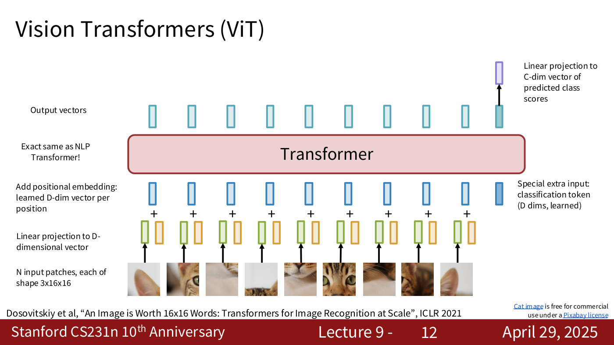

Same as slide 11, plus: a black arrow from the extra (rightmost) output vector up into a purple vector box (right label: "Linear projection to C-dim vector of predicted class scores").

Credit lines: Dosovitskiy et al, "An Image is Worth 16x16 Words: Transformers for Image Recognition at Scale", ICLR 2021. "Cat image is free for commercial use under a Pixabay license".

## Slide 13 — Vision Transformers (ViT) – a similar approach (different classifier)

Title: "Vision Transformers (ViT)" followed by the smaller phrase "– a similar approach (different classifier)".

Figure: at the left, the cat photograph with a red $3 \times 3$ grid drawn over it (caption: "Input image: e.g. 224x224x3"). To its right, the 9 patches stacked in a single vertical column in raster order (caption beneath: "Break into patches e.g. 16x16x3").

Credit line: Dosovitskiy et al, "An Image is Worth 16x16 Words: Transformers for Image Recognition at Scale", ICLR 2021

## Slide 14 — Vision Transformers (ViT)

Same as slide 12's title (no subtitle) and the layout of slide 13 (the red grid is gone from the photograph), plus: from each of the 9 patches a black arrow points right into a wide, short light-blue vector box (9 boxes in a column). Caption under that column: "Flatten and apply a linear transform 768 => D".

Credit line: Dosovitskiy et al, "An Image is Worth 16x16 Words: Transformers for Image Recognition at Scale", ICLR 2021

## Slide 15 — Vision Transformers (ViT)

Same as slide 14, plus: a large black right brace spanning the 9 blue vectors, with a line from it going right and then up into the bottom of a Transformer drawing at the right. That drawing is two identical grey blocks stacked, each (bottom to top) a light-blue input strip, a green "Self-Attention" box, a $\oplus$ node with a skip line, an orange "Layer Normalization" box, a row of 4 purple "MLP" boxes, another $\oplus$ with a skip line, and an orange "Layer Normalization" box, with small arrows between blocks and out of the top. Caption below it: "D-dim vector per patch are the input vectors to the Transformer".

Credit line: Dosovitskiy et al, "An Image is Worth 16x16 Words: Transformers for Image Recognition at Scale", ICLR 2021

## Slide 16 — Vision Transformers (ViT)

Same as slide 15, plus text to the right of the Transformer drawing: "Use positional encoding to tell the transformer the 2D position of each patch".

Credit line: Dosovitskiy et al, "An Image is Worth 16x16 Words: Transformers for Image Recognition at Scale", ICLR 2021

## Slide 17 — Vision Transformers (ViT)

Same as slide 16, plus text above the previous right-hand text: "Don't use any masking; each image patch can look at all other image patches".

Credit line: Dosovitskiy et al, "An Image is Worth 16x16 Words: Transformers for Image Recognition at Scale", ICLR 2021

## Slide 18 — Vision Transformers (ViT)

Same as slide 17, plus text at the top right above the previous text: "Transformer gives an output vector per patch".

Credit line: Dosovitskiy et al, "An Image is Worth 16x16 Words: Transformers for Image Recognition at Scale", ICLR 2021

## Slide 19 — Vision Transformers (ViT)

Same as slide 18, plus: a red "Pooling" box on top of the Transformer drawing, with arrows from the top block into it, and text above it: "Average pool NxD vectors to 1xD, apply a linear layer D=>C to predict class scores".

Credit line: Dosovitskiy et al, "An Image is Worth 16x16 Words: Transformers for Image Recognition at Scale", ICLR 2021

## Slide 20 — Tweaking Transformers

Text (left): "The Transformer architecture has not changed much since 2017." / "But a few changes have become common:" (no list items follow on this slide).

Figure (right): a single Transformer block drawn as a grey box. Bottom to top: four blue input boxes $x_1$, $x_2$, $x_3$, $x_4$ with arrows up into a light-blue strip; a green "Self-Attention" box; a skip line from the strip around Self-Attention into a $\oplus$ node; an orange "Layer Normalization" box; a row of 4 purple "MLP" boxes (fed from a branching line below them) with a skip line from below the MLP row up the left side into a second $\oplus$ node; and a top orange "Layer Normalization" box; 4 orange output boxes $y_1$, $y_2$, $y_3$, $y_4$ above.

## Slide 21 — Pre-Norm Transformer

Text: "Layer normalization (in orange) is outside the residual connections" / "Kind of weird, the model can't actually learn the identify function" (printed "identify").

Figure: the Transformer block of slide 20, unchanged (self-attention, then $\oplus$ with skip, then "Layer Normalization", then 4 MLPs, then $\oplus$ with skip, then a top "Layer Normalization"; so the layer norms sit after each $\oplus$, outside the skip paths).

*[Ed: printed "identify function"; identity function is meant (the same slip as lecture 8, slide 111).]*

Credit line: Baevski & Auli, "Adaptive Input Representations for Neural Language Modeling", arXiv 2018

## Slide 22 — Pre-Norm Transformer

Same text as slide 21, plus green text: "Solution: Move layer normalization before the Self-Attention and MLP, inside the residual connections. Training is more stable."

Figure: the block is redrawn, bottom to top: inputs $x_1$ to $x_4$ into a light-blue strip; an orange "Layer Normalization" box; a green "Self-Attention" box; a $\oplus$ node whose second input is a skip line from the strip up the left side; an orange "Layer Normalization" box; a row of 4 purple "MLP" boxes; a second $\oplus$ whose second input is a skip line running up the right side from the first $\oplus$; then arrows straight up to the outputs $y_1$ to $y_4$ (no top Layer Normalization). So the layer norms now sit on the branch into Self-Attention and into the MLPs, and the skip paths carry no normalization.

Credit line: Baevski & Auli, "Adaptive Input Representations for Neural Language Modeling", arXiv 2018

## Slide 23 — RMSNorm

Text: "Replace Layer Normalization with Root-Mean-Square Normalization (RMSNorm)" / "Input: x [shape D]" / "Output: y [shape D]" / "Weight: $\gamma$ [shape D]".

$$y_i = \frac{x_i}{RMS(x)} \ast \gamma_i$$

$$RMS(x) = \sqrt{\varepsilon + \frac{1}{N}\sum_{i=1}^{N} x_i^2}$$

"Training is a bit more stable".

Figure: the pre-norm block of slide 22 with both orange Layer Normalization boxes relabelled "RMSNorm".

*[Ed: the input x is given the shape D, but the RMS formula as printed averages over N entries with the sum running from 1 to N; the symbol N is not defined on this slide. This is lecture 8's slide 113, with the same slip.]*

Credit line: Zhang and Sennrich, "Root Mean Square Layer Normalization", NeurIPS 2019

## Slide 24 — SwiGLU MLP

Text, underlined heading "Classic MLP:" then: "Input: X [N x D]" / "Weights: W₁ [D x 4D]" / "W₂ [4D x D]" / "Output: Y = σ(XW₁)W₂ [N x D]".

Figure: the RMSNorm pre-norm block of slide 23, unchanged.

Credit line: Shazeer, "GLU Variants Improve Transformers", 2020

## Slide 25 — SwiGLU MLP

Same as slide 24, plus a second underlined heading "SwiGLU MLP:" with: "Input: X [N x D]" / "Weights: W₁, W₂ [D x H]" / "W₃ [H x D]" / "Output:"

$$Y = (\sigma(XW_1) \odot XW_2)W_3$$

and "Setting H = 8D/3 keeps same total params".

Check: the classic MLP has $D \cdot 4D + 4D \cdot D = 8D^2$ weights; SwiGLU has $3DH = 3D \cdot 8D/3 = 8D^2$. The claim recomputes.

Figure: unchanged block of slide 23.

Credit line: Shazeer, "GLU Variants Improve Transformers", 2020

## Slide 26 — Mixture of Experts (MoE)

Text: "Learn E separate sets of MLP weights in each block; each MLP is an expert" / "W₁: [D x 4D] => [E x D x 4D]" / "W₂: [4D x D] => [E x 4D x D]".

Figure: unchanged block of slide 23 (4 MLP boxes drawn in the MLP row; no experts or routing are drawn).

Credit line: Shazeer et al, "Outrageously Large Neural Networks: The Sparsely-Gated Mixture-of-Experts Layer", 2017

## Slide 27 — Mixture of Experts (MoE)

Same as slide 26, plus: "Each token gets routed to A < E of the experts. These are the active experts." / "Increases params by E, But only increases compute by A".

Figure: unchanged.

Credit line: Shazeer et al, "Outrageously Large Neural Networks: The Sparsely-Gated Mixture-of-Experts Layer", 2017

## Slide 28 — Mixture of Experts (MoE)

Same as slide 27 (the credit line is absent), plus: "All of the biggest LLMs today (e.g. GPT4o, GPT4.5, Claude 3.7, Gemini 2.5 Pro, etc) almost certainly use MoE and have > 1T params; but they don't publish details anymore".

Figure: unchanged.

## Slide 29 — Tweaking Transformers

Text: "The Transformer architecture has not changed much since 2017." / "But a few changes have become common:" followed by four dash items: "Pre-Norm: Move normalization inside residual"; "RMSNorm: Different normalization layer"; "SwiGLU: Different MLP architecture"; "Mixture of Experts (MoE): Learn E different MLPs, use A < E of them per token. Massively increase params, modest increase to compute cost."

Figure: the RMSNorm pre-norm block of slide 23.

## Slide 30 — Today

Agenda. Bullets, with sub-bullets:

- Transformers Recap
- **Computer Vision Tasks** (bold, the current section): Semantic Segmentation; Object Detection; Instance Segmentation
- Visualization & Understanding: Model Layers Visualization; Saliency Maps; CAM & Grad-CAM

## Slide 31 — Computer Vision Tasks

Figure: four columns, each with a heading, an image, a label line and a brace underneath.

- "Classification": a photograph of a grey-and-white kitten walking on grass. Label: "CAT". Brace caption: "No spatial extent".
- "Semantic Segmentation": a flat-colour segmentation map of the same kitten scene: blue sky at the top, a purple band (tree) below it, green grass at the bottom, and a yellow cat silhouette in the middle. Label: "GRASS, CAT, TREE, SKY" (each word in its region's colour: green, yellow, purple, blue). Brace caption: "No objects, just pixels".
- "Object Detection": a photograph of two dogs and a cat in front of a Christmas tree. A red box surrounds the left dog, a green box the middle dog and a blue box the cat. Label: "DOG, DOG, CAT" (red, green, blue).
- "Instance Segmentation": the same Christmas-tree photograph with the animals filled in solid colour: red for the left dog, green for the middle dog, blue for the cat. Label: "DOG, DOG, CAT" (red, green, blue).

A single wide brace under the Object Detection and Instance Segmentation columns is captioned "Multiple Object".

Credit line (bottom right): "This image is CC0 public domain".

## Slide 32 — Recall: Image Classification: A core task in Computer Vision

Figure: a photograph of a grey tabby cat sitting, facing slightly left. A long black arrow points right from the photograph to the word "cat".

Text above the arrow: "(assume given a set of possible labels)" and "{dog, cat, truck, plane, ...}".

Credit line under the photograph: "This image by Nikita is licensed under CC-BY 2.0".

## Slide 33 — Semantic Segmentation

Same figure as slide 31 (four columns: Classification, Semantic Segmentation, Object Detection, Instance Segmentation), with every column except "Semantic Segmentation" faded to near-invisible. The Semantic Segmentation column (segmentation map; label "GRASS, CAT, TREE, SKY"; brace caption "No objects, just pixels") is fully visible. The slide title is "Semantic Segmentation". The "This image is CC0 public domain" credit line of slide 31 is not shown.

## Slide 34 — Semantic Segmentation: The Problem

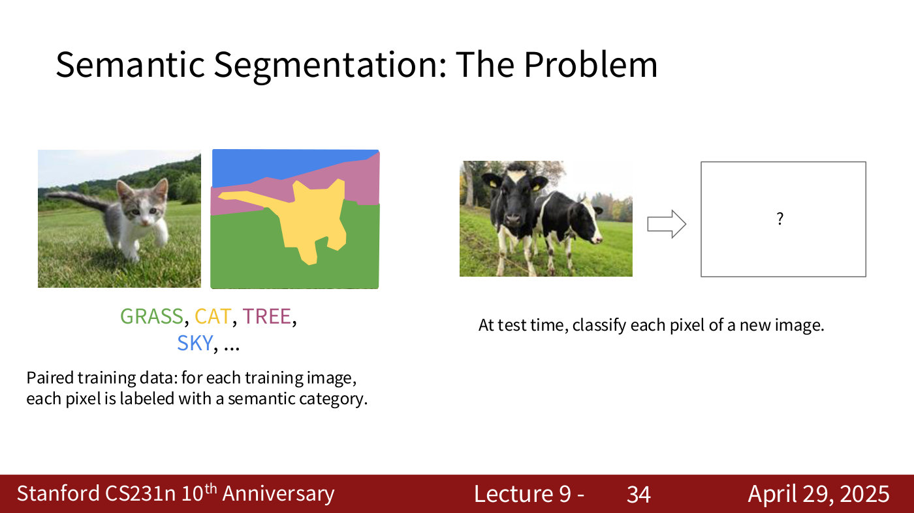

Figure, left: the kitten photograph beside its segmentation map (blue sky, purple tree band, green grass, yellow cat). Below them: "GRASS, CAT, TREE, SKY, ..." in the matching colours. Below that: "Paired training data: for each training image, each pixel is labeled with a semantic category."

Figure, right: a photograph of two black-and-white cows standing on grass, a hollow right-pointing arrow, and an empty rectangle containing a "?". Caption: "At test time, classify each pixel of a new image."

## Slide 35 — Semantic Segmentation Idea: Sliding Window

Figure: label "Full image" above a photograph of two black-and-white cows on grass. A red dot marks a point on the right-hand cow's head. Two dashed lines run from the dot to a tiny, nearly black square patch. A solid arrow runs from the dot to a "?" on the right.

## Slide 36 — Semantic Segmentation Idea: Sliding Window

Same as slide 35, plus two lines of text under the patch: in red, "Impossible to classify without context"; in blue, "Q: how do we include context?" No answer is printed on this slide.

## Slide 37 — Semantic Segmentation Idea: Sliding Window

Figure: the "Full image" cow photograph with three overlapping square windows on the right cow's head: red, blue and magenta. Dashed lines of the matching colour connect each window to a larger patch to the right, stacked vertically. Each patch has a small circle of the window's colour at its centre. The red patch shows a cow's eye and the white-and-black head, the blue patch shows black head with a green background at the right edge, and the magenta patch shows a cow's muzzle against green grass.

Text below in blue: "Q: how do we model this?" No answer is printed on this slide.

## Slide 38 — Semantic Segmentation Idea: Sliding Window

Same as slide 37, plus: the heading "Extract patch" above the patches and "Classify center pixel with CNN" above a column of three small line-drawn CNN architecture diagrams (one per patch). Output labels on the right: "Cow" (red patch), "Cow" (blue patch), "Grass" (magenta patch). The "Q: how do we model this?" line is removed.

Citations (bottom right):
- Farabet et al, "Learning Hierarchical Features for Scene Labeling," TPAMI 2013
- Pinheiro and Collobert, "Recurrent Convolutional Neural Networks for Scene Labeling", ICML 2014

## Slide 39 — Semantic Segmentation Idea: Sliding Window

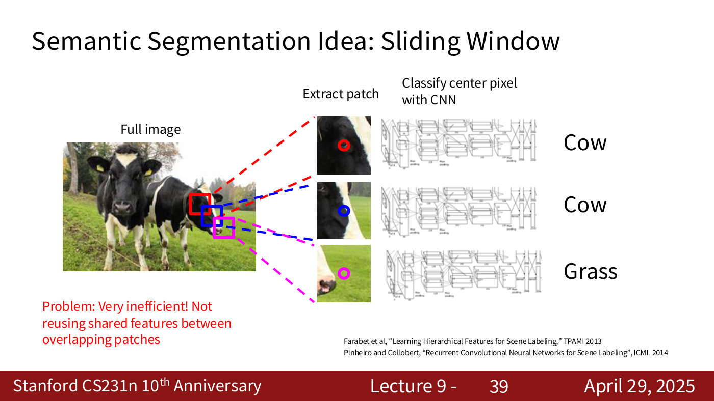

Same as slide 38, plus in red at the bottom left: "Problem: Very inefficient! Not reusing shared features between overlapping patches".

Citations as on slide 38.

## Slide 40 — Semantic Segmentation Idea: Convolution

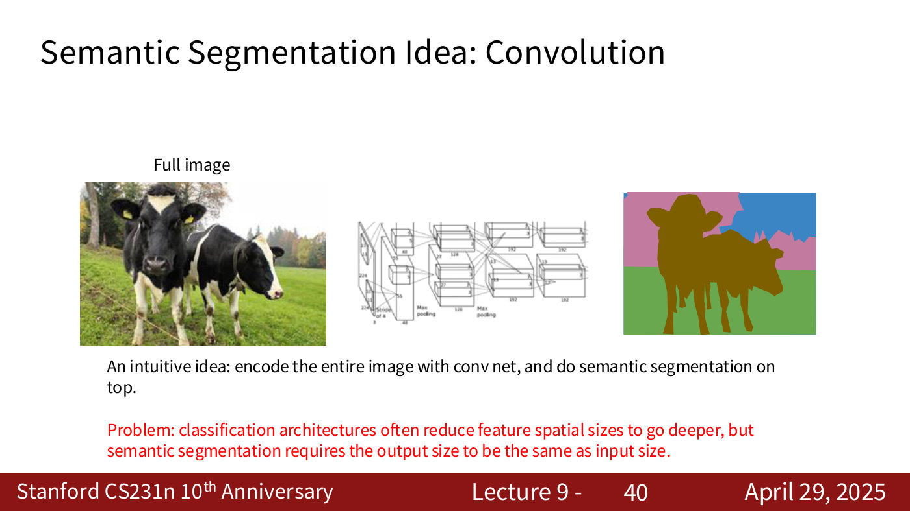

Figure: "Full image" cow photograph on the left, a line-drawn CNN architecture diagram in the middle, and on the right a segmentation map of the cow scene: a brown silhouette of the two cows, green grass at the bottom, a purple band behind them, and blue sky at the top right.

Text below: "An intuitive idea: encode the entire image with conv net, and do semantic segmentation on top." Then in red: "Problem: classification architectures often reduce feature spatial sizes to go deeper, but semantic segmentation requires the output size to be the same as input size."

## Slide 41 — Semantic Segmentation Idea: Fully Convolutional

Text at top: "Design a network with only convolutional layers without downsampling operators to make predictions for pixels all at once!"

Figure: a left-to-right pipeline. The cow photograph, labelled "Input: 3 x H x W", feeds through an arrow labelled "Conv" into a grey slab; then "Conv" into a second grey slab; "Conv" into a third grey slab (three equal slabs in a row). A brace under the three slabs is labelled "Convolutions: D x H x W". Another arrow "Conv" leads to a larger light-grey block labelled "Scores: C x H x W". An arrow labelled "argmax" leads to the segmentation map (brown cows, purple band, blue sky, green grass), labelled "Predictions: H x W".

## Slide 42 — Semantic Segmentation Idea: Fully Convolutional

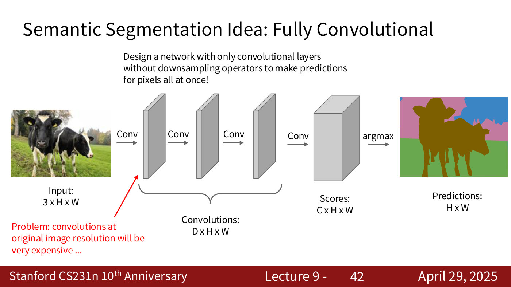

Same as slide 41, plus a red arrow from the first slab pointing down-left to red text in the bottom left: "Problem: convolutions at original image resolution will be very expensive ...".

## Slide 43 — Semantic Segmentation Idea: Fully Convolutional

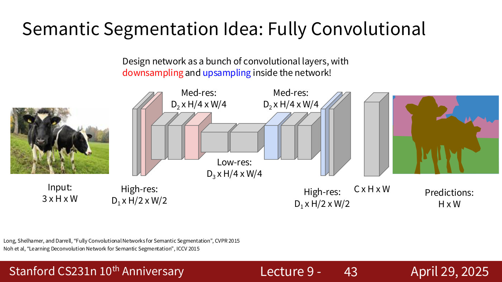

Text at top: "Design network as a bunch of convolutional layers, with downsampling and upsampling inside the network!" ("downsampling" is in red and "upsampling" in blue.)

Figure: the cow photograph "Input: 3 x H x W" on the left, then an encoder-decoder diagram drawn as a row of grey blocks that shrink and then grow again, ending with a slab labelled "C x H x W" and the segmentation map labelled "Predictions: H x W". As drawn, from left to right: two thin slabs (one grey, one pink-shaded) labelled "High-res: D1 x H/2 x W/2"; then three smaller blocks (grey, grey, pink-shaded) labelled "Med-res: D2 x H/4 x W/4"; then two smaller grey blocks labelled "Low-res: D3 x H/4 x W/4"; then three blocks (blue-shaded, grey, grey) labelled "Med-res: D2 x H/4 x W/4"; then two slabs (blue-shaded, grey) labelled "High-res: D1 x H/2 x W/2"; then a final single tall grey slab labelled "C x H x W". The pink-shaded blocks mark the downsampling steps and the blue-shaded blocks the upsampling steps (the text colours match). Counted on a 600 dpi crop: 2, 3, 2, 3 and 2 blocks, then the output slab.

*[Ed: "Low-res: D3 x H/4 x W/4" is printed with the same H/4 x W/4 as the two "Med-res" labels beside it, so the labels do not show the low-resolution stage as smaller (confirmed on a 600 dpi crop). The same labels are repeated on slides 44 and 59.]*

Citations (bottom left):
- Long, Shelhamer, and Darrell, "Fully Convolutional Networks for Semantic Segmentation", CVPR 2015
- Noh et al, "Learning Deconvolution Network for Semantic Segmentation", ICCV 2015

## Slide 44 — Semantic Segmentation Idea: Fully Convolutional

Same as slide 43, plus two labels: in red at the top left, "Downsampling: Pooling, strided convolution"; in blue at the top right, "Upsampling: ???". No answer for the "???" is printed on this slide.

Citations as on slide 43.

## Slide 45 — In-Network upsampling: "Unpooling"

Figure: two examples, each a $2 \times 2$ input grid, an arrow, and a $4 \times 4$ output grid divided into four $2 \times 2$ quadrants by thick lines.

Left, "Nearest Neighbor": input (labelled "Input: 2 x 2") has rows 1 2 / 3 4. Output (labelled "Output: 4 x 4") has rows:

| 1 | 1 | 2 | 2 |
| --- | --- | --- | --- |
| 1 | 1 | 2 | 2 |
| 3 | 3 | 4 | 4 |
| 3 | 3 | 4 | 4 |

Right, "Bed of Nails": input (labelled "Input: 2 x 2") has rows 1 2 / 3 4. Output (labelled "Output: 4 x 4") has rows:

| 1 | 0 | 2 | 0 |
| --- | --- | --- | --- |
| 0 | 0 | 0 | 0 |
| 3 | 0 | 4 | 0 |
| 0 | 0 | 0 | 0 |

## Slide 46 — In-Network upsampling: "Max Unpooling"

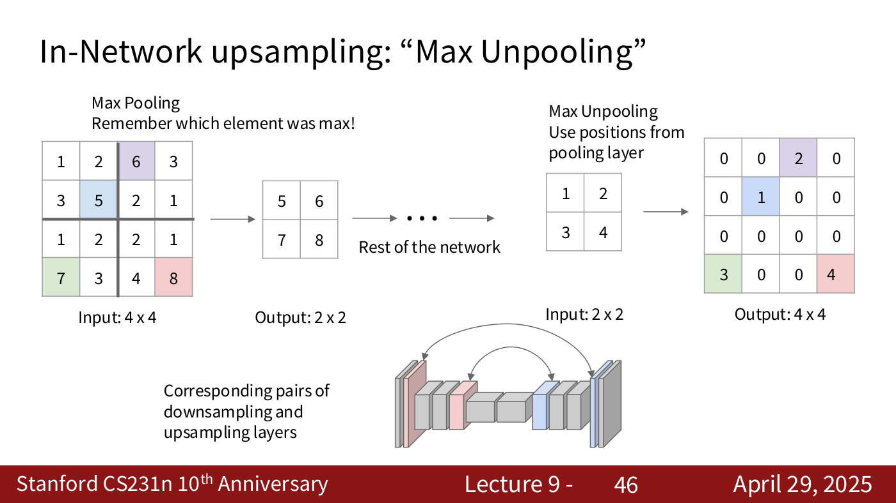

Figure: left, text "Max Pooling / Remember which element was max!" above a $4 \times 4$ input grid (labelled "Input: 4 x 4"), split into four $2 \times 2$ quadrants:

| 1 | 2 | 6 | 3 |
| --- | --- | --- | --- |
| 3 | 5 | 2 | 1 |
| 1 | 2 | 2 | 1 |
| 7 | 3 | 4 | 8 |

The maxima are shaded: 6 (purple), 5 (blue), 7 (green), 8 (pink). An arrow leads to a $2 \times 2$ grid labelled "Output: 2 x 2" with rows 5 6 / 7 8. A further arrow through "..." labelled "Rest of the network" leads to the right half.

Right: text "Max Unpooling / Use positions from pooling layer" above a $2 \times 2$ grid labelled "Input: 2 x 2" with rows 1 2 / 3 4. An arrow leads to a $4 \times 4$ grid labelled "Output: 4 x 4":

| 0 | 0 | 2 | 0 |
| --- | --- | --- | --- |
| 0 | 1 | 0 | 0 |
| 0 | 0 | 0 | 0 |
| 3 | 0 | 0 | 4 |

The nonzero entries are shaded to match the pooled positions: 2 (purple), 1 (blue), 3 (green), 4 (pink).

Bottom: a small copy of the encoder-decoder diagram of slide 43, with curved double-headed arrows linking the first downsampling block to the last upsampling block, and the second downsampling block to the second upsampling block. Caption: "Corresponding pairs of downsampling and upsampling layers".

## Slide 47 — Learnable Upsampling

Text: "Recall: Normal 3 x 3 convolution, stride 1 pad 1".

Figure: two empty $4 \times 4$ grids, left labelled "Input: 4 x 4" and right labelled "Output: 4 x 4".

## Slide 48 — Learnable Upsampling

Same as slide 47, plus: a red $3 \times 3$ square overlays the top-left of the input grid, extending one cell beyond the grid on the top and left (the padding). An arrow from input to output is labelled "Dot product between filter and input". The top-left cell of the output grid is shaded pink.

## Slide 49 — Learnable Upsampling

Same as slide 48, plus a blue $3 \times 3$ square on the input, shifted one cell right of the red square (overlapping it), and the second cell of the output's top row is shaded light blue.

## Slide 50 — Learnable Upsampling

Text: "Recall: Normal 3 x 3 convolution, stride 2 pad 1" ("stride 2" underlined).

Figure: an empty $4 \times 4$ grid labelled "Input: 4 x 4" and an empty $2 \times 2$ grid labelled "Output: 2 x 2".

## Slide 51 — Learnable Upsampling

Same as slide 50 (text "Recall: Normal 3 x 3 convolution, stride 2 pad 1"; $4 \times 4$ input, $2 \times 2$ output), plus: a red $3 \times 3$ square overlays the top-left of the input (extending one cell beyond the grid on the top and left), an arrow labelled "Dot product between filter and input", and the top-left cell of the output is shaded pink.

## Slide 52 — Learnable Upsampling

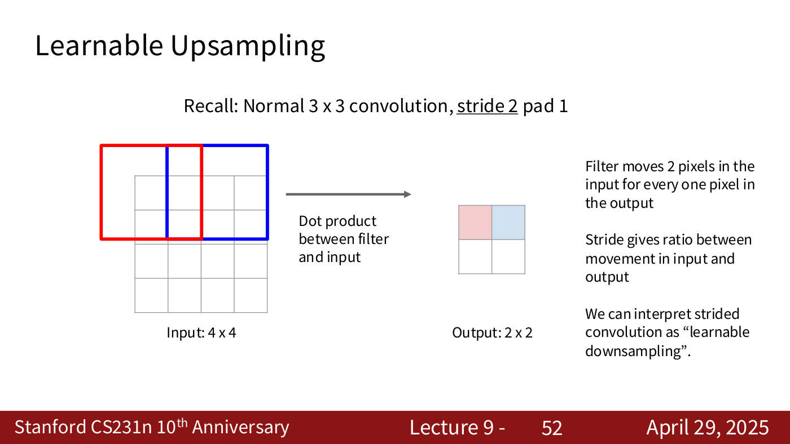

Same as slide 51, plus a blue $3 \times 3$ square on the input, moved two cells to the right of the red square (overlapping it by one column), and the top-right output cell shaded light blue. New text at the right:

"Filter moves 2 pixels in the input for every one pixel in the output"

"Stride gives ratio between movement in input and output"

"We can interpret strided convolution as "learnable downsampling"."

## Slide 53 — Learnable Upsampling: Transposed Convolution

Text: "3 x 3 transposed convolution, stride 2 pad 1".

Figure: an empty $2 \times 2$ grid labelled "Input: 2 x 2" and an empty $4 \times 4$ grid labelled "Output: 4 x 4".

## Slide 54 — Learnable Upsampling: Transposed Convolution

Same as slide 53, plus: the top-left input cell is shaded pink; an arrow from input to output is labelled "Input gives weight for filter"; a red $3 \times 3$ square overlays the top-left of the output grid, extending one cell beyond the grid on the top and left.

## Slide 55 — Learnable Upsampling: Transposed Convolution

Same as slide 54, plus: the top-right input cell is shaded light blue; a blue $3 \times 3$ square on the output, two cells to the right of the red square (overlapping it by one column), extending one cell above the grid. New text at the right: "Filter moves 2 pixels in the output for every one pixel in the input" ("output" and "input" underlined) and "Stride gives ratio between movement in output and input".

## Slide 56 — Learnable Upsampling: Transposed Convolution

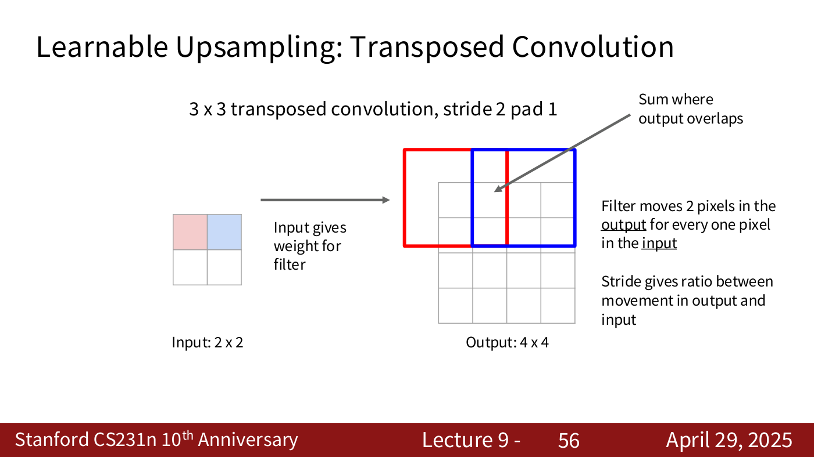

Same as slide 55, plus a grey arrow from the text "Sum where output overlaps" (top right) pointing to the overlap region of the red and blue squares in the output grid.

## Slide 57 — Learnable Upsampling: Transposed Convolution

Same as slide 56 (identical content: "Sum where output overlaps" arrow, both squares, both shaded input cells and the right-hand text).

## Slide 58 — Learnable Upsampling: 1D Example

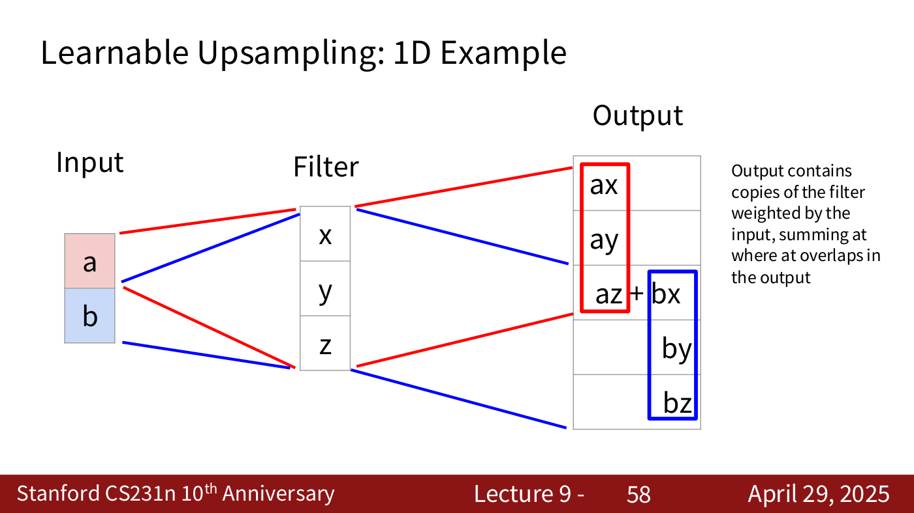

Figure: three columns, "Input", "Filter" and "Output".

- Input: two stacked cells, "a" (pink) above "b" (light blue).
- Filter: three stacked cells "x", "y", "z".
- Output: five stacked cells holding, top to bottom, "ax", "ay", "az + bx", "by", "bz". A red box encloses "ax", "ay" and "az" (the first three rows); a blue box encloses "bx", "by" and "bz" (rows three to five).

Red lines run from the pink input cell "a" to the top and bottom of the filter column and from the top and bottom of the filter column to the top and bottom of the red box in the output. Blue lines do the same for "b" and the blue box. Note at the right: "Output contains copies of the filter weighted by the input, summing at where at overlaps in the output" (as printed).

## Slide 59 — Semantic Segmentation Idea: Fully Convolutional

Same as slide 44 (the encoder-decoder diagram: input $3 \times H \times W$; "High-res: D1 x H/2 x W/2"; "Med-res: D2 x H/4 x W/4"; "Low-res: D3 x H/4 x W/4"; "Med-res: D2 x H/4 x W/4"; "High-res: D1 x H/2 x W/2"; predictions "H x W"; the same top text and citations), with these changes: the blue label at the top right now reads "Upsampling: Unpooling or strided transposed convolution" (the "???" is replaced), and the "C x H x W" label under the last slab is not shown.

Citations as on slide 43.

## Slide 60 — U-Net

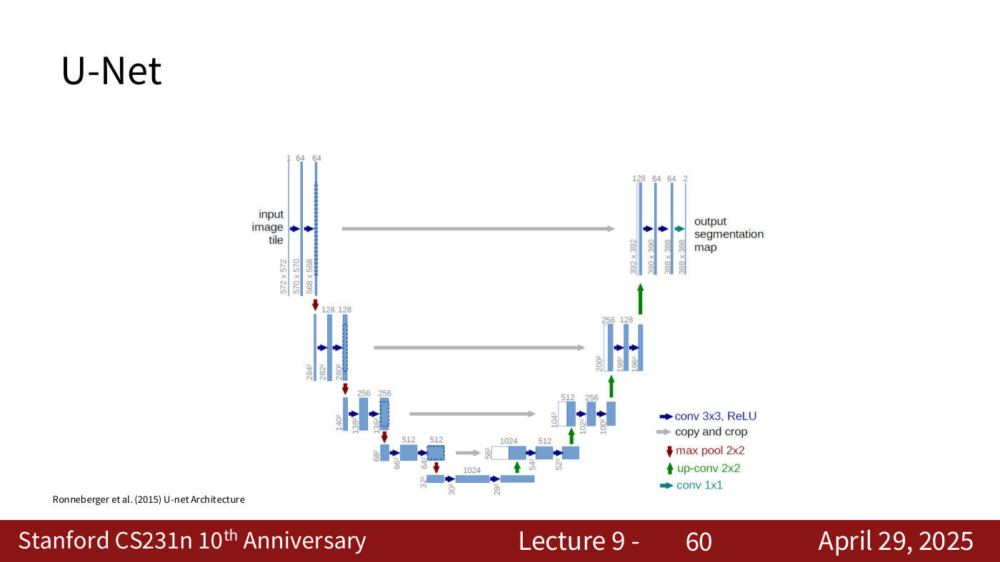

Figure: the U-Net architecture diagram on a white background: a U shape of vertical blue bars (feature maps), the left (contracting) side going down and the right (expanding) side going up, with the number of channels printed above a bar and its spatial size printed rotated beside it. Counted on 600 dpi crops of each level:

- Left side, top to bottom. Level 1, labelled "input image tile": 3 bars labelled 1, 64, 64 (572 x 572, 570 x 570, 568 x 568). Levels 2 to 4: 3 bars each, with the channel number printed over the second and third bars only: 128, 128 (284², 282², 280²); 256, 256 (140², 138², 136²); 512, 512 (68², 66², 64²). The last bar of each of these four levels has a dotted-outline region inside it (the part that is cropped). Bottom level: 3 bars (32², 30², 28²), with 1024 printed over the middle bar only.
- Right side, bottom to top. Each level starts with a concatenated bar drawn half white (empty) and half blue. Lowest: 1024 over the concatenated bar (56²), 512 over the second (54²), a third bar with no number (52²). Next: 512 (104²), 256 (102²), a third bar (100²). Next: 256 (200²), 128 (198²), a third bar (196²). Top: 4 bars labelled 128, 64, 64, 2 (392 x 392, 390 x 390, 388 x 388, 388 x 388), labelled "output segmentation map".
- Four grey "copy and crop" arrows run from the left side to the right side at the same level (the top three long, the one at the 512 level short).

Legend (bottom right): dark blue right arrow "conv 3x3, ReLU"; grey right arrow "copy and crop"; dark red down arrow "max pool 2x2"; green up arrow "up-conv 2x2"; teal right arrow "conv 1x1".

Credit line (bottom left): "Ronneberger et al. (2015) U-net Architecture".

## Slide 61 — U-Net

Same U-Net diagram as slide 60 (also on a white background), plus an overlay.

Overlay: a large orange-gold arrow runs diagonally from just right of the input tile's lower end down to the bottom of the U. Text on it: "“downsampling” Phase" (orange), "- Increases field of view" (green), "- Lose Spatial Information" (red).

Credit line: Ronneberger et al. (2015) U-Net Architecture

## Slide 62 — U-Net

Same as slide 61, but the orange overlay arrow now runs from the bottom of the U diagonally up to the top right (the output segmentation map). Text on it: "“Upsampling” Phase" (orange) and "- Create High Resolution Mapping" (green). The "downsampling" text is removed.

Credit line: Ronneberger et al. (2015) U-Net Architecture

## Slide 63 — U-Net

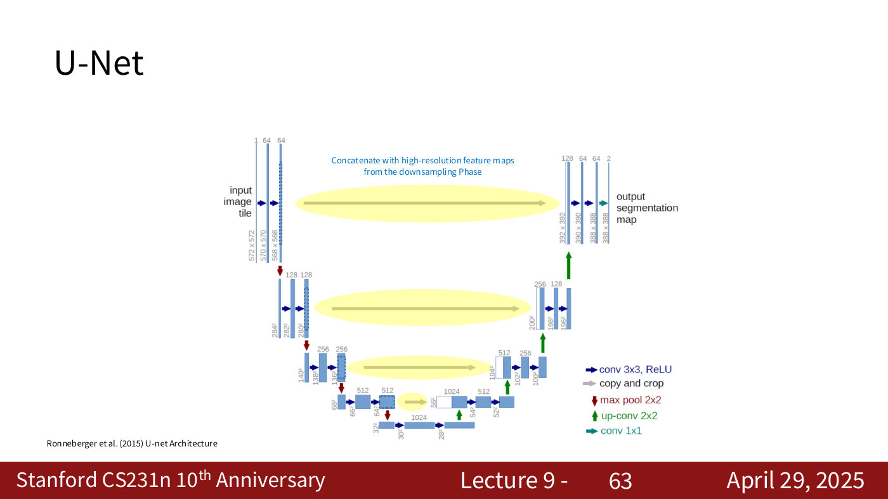

Same U-Net diagram as slide 61, without the orange arrow. Each of the four grey "copy and crop" arrows is now highlighted by a pale yellow ellipse. Blue text above the top ellipse: "Concatenate with high-resolution feature maps from the downsampling Phase".

Credit line: Ronneberger et al. (2015) U-Net Architecture

## Slide 64 — Semantic Segmentation: Summary

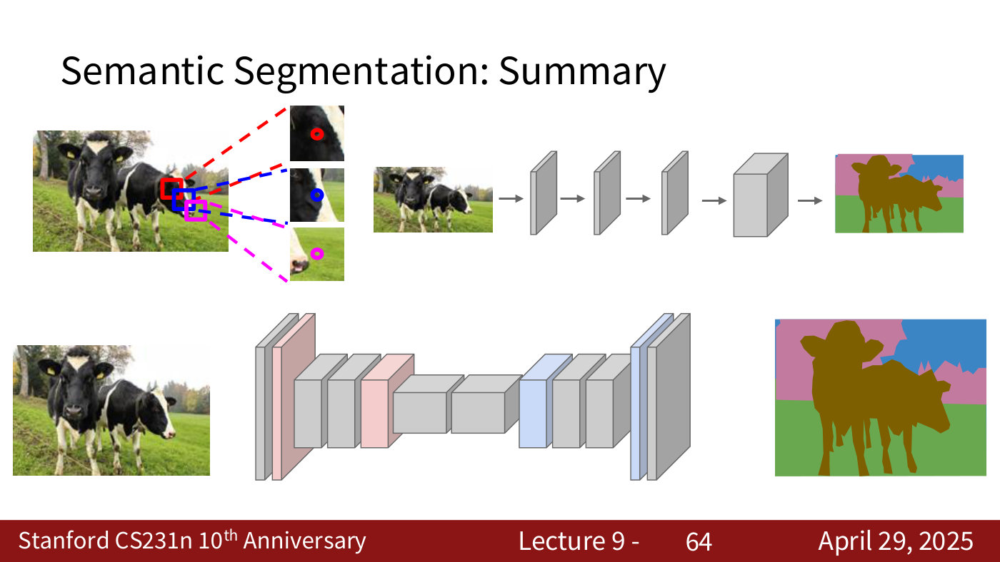

Figure: three rows of illustrations, no text apart from the title.

- Top left: a photograph of two black-and-white cows on grass, with three small boxes drawn on it (red, blue, magenta) near a cow's head; dashed lines of the same colours link each box to a zoomed square crop at the right (a red-circled eye patch, a blue-circled patch, a magenta-circled nose patch).
- Top right: the cow photograph, then an arrow to a chain of three thin grey slabs (each joined by arrows), then an arrow to one thicker grey block, then an arrow to a segmentation map (cows brown, grass green, trees pink, sky blue).
- Bottom: the cow photograph at the left, an encoder-decoder drawing in the middle, the same as slide 43's (counted on a 600 dpi crop: high-res grey and pink slabs; med-res grey, grey and pink blocks; two grey low-res blocks; med-res blue, grey and grey blocks; high-res blue and grey slabs), and the colour segmentation map at the right.

## Slide 65 — Semantic Segmentation

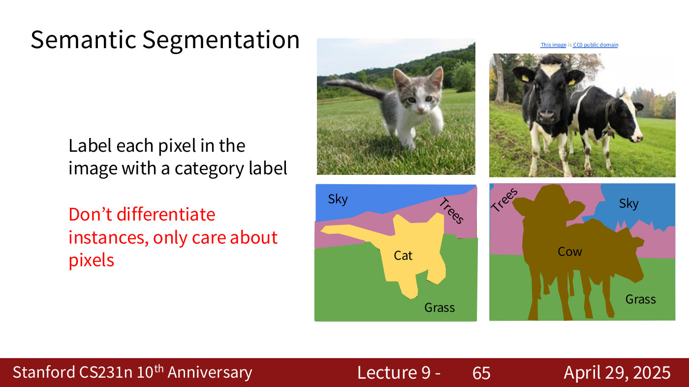

Text: "Label each pixel in the image with a category label"; in red: "Don’t differentiate instances, only care about pixels".

Figure: two photographs with their label maps below. Left: a kitten walking on grass; label map below with regions "Sky" (blue), "Trees" (pink, text rotated), "Cat" (yellow), "Grass" (green). Right: two black-and-white cows on grass; label map with "Sky" (blue), "Trees" (pink), "Cow" (brown, one region covering both cows), "Grass" (green).

Credit line (above the cow photograph): This image is CC0 public domain

## Slide 66 — Object Detection

Figure: the four-task comparison row, with the first three columns faded and only the fourth drawn in full. Columns: "Classification" (kitten photograph, label "CAT", brace under it "No spatial extent"), "Semantic Segmentation" (kitten label map, label "GRASS, CAT, TREE, SKY", brace "No objects, just pixels"), "Object Detection" (photograph of two dogs and a cat in front of a Christmas tree, faint red, green and blue boxes, label "DOG, DOG, CAT"), "Instance Segmentation" (same photo with red, green and blue filled silhouettes over the two dogs and the cat, label "DOG, DOG, CAT" coloured red, green, blue). Only Instance Segmentation is at full strength. A brace under the last two columns begins to appear, with the label "Multiple Object" partly hidden behind the footer area.

## Slide 67 — Object Detection

Same as slide 66, plus the "Object Detection" column is now at full strength: the photograph shows a red box around the first dog, a green box around the second dog and a blue box around the cat; label "DOG, DOG, CAT" in red, green, blue. The brace under the last two columns is complete and labelled "Multiple Object". Columns 1 and 2 stay faded.

## Slide 68 — Object Detection: Single Object

Subtitle: "(Classification + Localization)"

Figure: a photograph of a kitten on grass with a blue box drawn on it; the box's top-left corner is a red dot labelled "x, y", the left side labelled "h" (red) and the bottom labelled "w" (red). The photo is followed by a CNN drawing (greyed-out convolution and max-pool block diagram, with "Max pooling" labels), then a vertical grey bar labelled "Vector: 4096". Two arrows leave the vector. Upper arrow, labelled "Fully Connected: 4096 to 1000", leads to "Class Scores / Cat: 0.9 / Dog: 0.05 / Car: 0.01 / ...". Lower arrow, labelled "Fully Connected: 4096 to 4", leads to "Box Coordinates" with "(x, y, w, h)" in red.

Credit line: This image is CC0 public domain

## Slide 69 — Object Detection: Single Object

Subtitle: "(Classification + Localization)"

Same as slide 68, plus: an arrow from "Class Scores" to "Softmax Loss", with an arrow from "Correct label: Cat" pointing down into "Softmax Loss"; an arrow from "Box Coordinates (x, y, w, h)" to "L2 Loss", with an arrow from "Correct box: (x’, y’, w’, h’)" pointing up into "L2 Loss"; and the text "Treat localization as a regression problem!" at the lower left.

Credit line: This image is CC0 public domain

## Slide 70 — Object Detection: Single Object

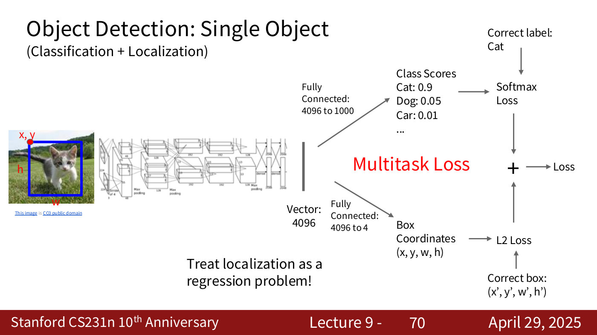

Subtitle: "(Classification + Localization)"

Same as slide 69, plus: red text "Multitask Loss" in the middle, a "+" node that receives arrows from "Softmax Loss" (down) and "L2 Loss" (up), and an arrow from the "+" to the word "Loss".

Credit line: This image is CC0 public domain

## Slide 71 — Object Detection: Multiple Objects

Figure: three rows, each a photograph, then a CNN drawing (AlexNet-style block diagram with "Max pooling" and "dense" labels), then text of expected outputs.

- Row 1: kitten on grass; output "CAT: (x, y, w, h)".
- Row 2: two dogs and a cat in front of a Christmas tree; output "DOG: (x, y, w, h)" / "DOG: (x, y, w, h)" / "CAT: (x, y, w, h)".
- Row 3: a goose followed by a line of goslings on grass; output "DUCK: (x, y, w, h)" / "DUCK: (x, y, w, h)" / "….".

## Slide 72 — Object Detection: Multiple Objects

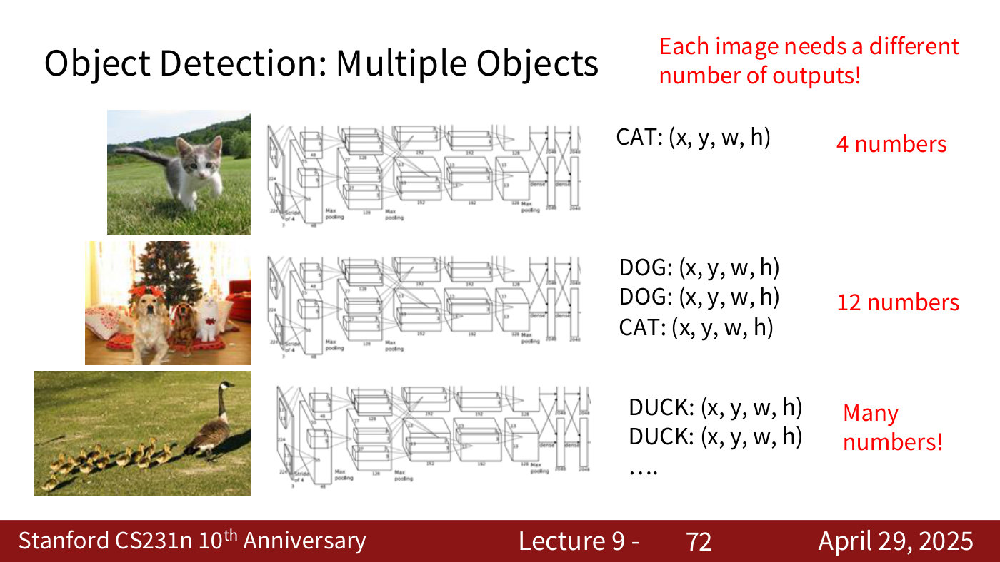

Same as slide 71, plus red text at the top right: "Each image needs a different number of outputs!" and red labels beside the rows: "4 numbers" (row 1), "12 numbers" (row 2), "Many numbers!" (row 3).

## Slide 73 — Object Detection: Multiple Objects

Text: "Apply a CNN to many different crops of the image, CNN classifies each crop as object or background".

Figure: the dogs-and-cat photograph with a blue box drawn over the lower-left region (a cushion, no animal), a CNN drawing to the right, and the output "Dog? NO / Cat? NO / Background? YES".

## Slide 74 — Object Detection: Multiple Objects

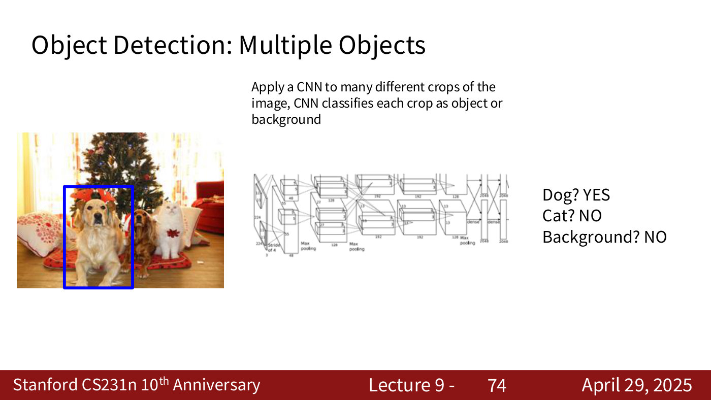

Same as slide 73, but the blue box now surrounds the first (golden) dog. Output: "Dog? YES / Cat? NO / Background? NO".

## Slide 75 — Object Detection: Multiple Objects

Same as slide 73, but the blue box now surrounds the second (brown) dog. Output: "Dog? YES / Cat? NO / Background? NO".

## Slide 76 — Object Detection: Multiple Objects

Same as slide 73, but the blue box now surrounds the white cat. Output: "Dog? NO / Cat? YES / Background? NO". Added, in blue text near the bottom: "Q: What’s the problem with this approach?" (no answer is printed on this slide; the next slide gives one).

## Slide 77 — Object Detection: Multiple Objects

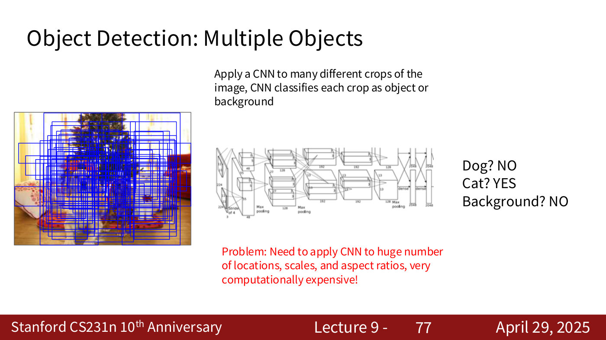

Same as slide 73 (output "Dog? NO / Cat? YES / Background? NO" remains), but the photograph is now covered by many overlapping blue boxes of different sizes and aspect ratios, and the question text is replaced by red text: "Problem: Need to apply CNN to huge number of locations, scales, and aspect ratios, very computationally expensive!"

## Slide 78 — Region Proposals: Selective Search

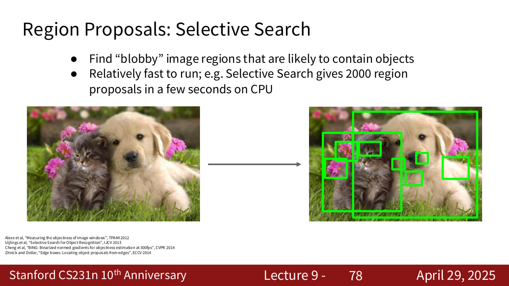

Bullets:
- Find “blobby” image regions that are likely to contain objects
- Relatively fast to run; e.g. Selective Search gives 2000 region proposals in a few seconds on CPU

Figure: at the left, a photograph of a kitten and a golden puppy among pink flowers on grass; an arrow points right to the same photograph with about ten green rectangles of various sizes drawn on it (two large ones, one around the kitten and one around kitten and puppy together, and several small ones on the flowers, the kitten's head and the puppy's face and body).

Citations (small print at the bottom left):
- Alexe et al, “Measuring the objectness of image windows”, TPAMI 2012
- Uijlings et al, “Selective Search for Object Recognition”, IJCV 2013
- Cheng et al, “BING: Binarized normed gradients for objectness estimation at 300fps”, CVPR 2014
- Zitnick and Dollar, “Edge boxes: Locating object proposals from edges”, ECCV 2014

## Slide 79 — R-CNN

Figure: only the first element of the R-CNN pipeline is drawn: a photograph of a man in a cowboy hat on a horse, shown as a slanted parallelogram with a green outline, labelled "Input image". The rest of the slide is empty.

Credit line: Girshick et al, “Rich feature hierarchies for accurate object detection and semantic segmentation”, CVPR 2014. Figure copyright Ross Girshick, 2015; source. Reproduced with permission.

## Slide 80 — R-CNN

Same as slide 79, plus: several lighter, irregular rectangular regions overlaid on the input image, with red arrows from three of them to the text "Regions of Interest (RoI) from a proposal method (~2k)".

Credit line: Girshick et al, “Rich feature hierarchies for accurate object detection and semantic segmentation”, CVPR 2014. Figure copyright Ross Girshick, 2015; source. Reproduced with permission.

## Slide 81 — R-CNN

Same as slide 80, plus: three green up-arrows rise from three of the regions on the input image, each ending in a small pale-grey parallelogram (three in all). Text beside them: "Warped image regions (224x224 pixels)".

Credit line: Girshick et al, “Rich feature hierarchies for accurate object detection and semantic segmentation”, CVPR 2014. Figure copyright Ross Girshick, 2015; source. Reproduced with permission.

## Slide 82 — R-CNN

Same as slide 81, plus: above each of the three warped regions, a green arrow leads up into a white 3D box labelled "Conv Net" (three boxes). Text: "Forward each region through ConvNet (ImageNet-pretranied)" (spelled "pretranied" as printed).

Credit line: Girshick et al, “Rich feature hierarchies for accurate object detection and semantic segmentation”, CVPR 2014. Figure copyright Ross Girshick, 2015; source. Reproduced with permission.

## Slide 83 — R-CNN

Same as slide 82, plus: above each Conv Net box a green arrow leads up to a purple-outlined box labelled "SVMs" (three). Text: "Classify regions with SVMs".

Credit line: Girshick et al, “Rich feature hierarchies for accurate object detection and semantic segmentation”, CVPR 2014. Figure copyright Ross Girshick, 2015; source. Reproduced with permission.

## Slide 84 — R-CNN

Same as slide 83, plus: beside each "SVMs" box a blue-outlined box labelled "Bbox reg" with its own green arrow rising from the Conv Net box (three). Text at the top right: "Predict “corrections” to the RoI: 4 numbers: (dx, dy, dw, dh)".

Credit line: Girshick et al, “Rich feature hierarchies for accurate object detection and semantic segmentation”, CVPR 2014. Figure copyright Ross Girshick, 2015; source. Reproduced with permission.

## Slide 85 — R-CNN

Same as slide 84, plus red text at the right: "Problem: Very slow! Need to do ~2k independent forward passes for each image!" The "Forward each region through ConvNet" text now reads without the "(ImageNet-pretranied)" note.

Credit line: Girshick et al, “Rich feature hierarchies for accurate object detection and semantic segmentation”, CVPR 2014. Figure copyright Ross Girshick, 2015; source. Reproduced with permission.

## Slide 86 — “Slow” R-CNN

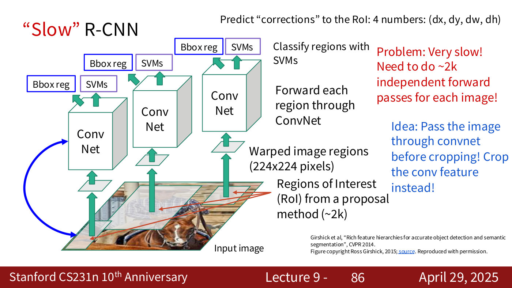

Title now "“Slow” R-CNN". Same as slide 85, plus a thick blue double-headed curved arrow at the left, linking the first Conv Net box to the input image, and blue text: "Idea: Pass the image through convnet before cropping! Crop the conv feature instead!"

Credit line: Girshick et al, “Rich feature hierarchies for accurate object detection and semantic segmentation”, CVPR 2014. Figure copyright Ross Girshick, 2015; source. Reproduced with permission.

## Slide 87 — Fast R-CNN

Figure: at the left, only the input image (the man on a horse, as a green-outlined parallelogram) labelled "Input image". At the right, a smaller copy of the slide 85 "Slow" R-CNN drawing, titled "“Slow” R-CNN": three Conv Net boxes with a "SVMs" box above each, warped regions below, and the input image labelled "Input image" at its bottom.

Credit line: Girshick, “Fast R-CNN”, ICCV 2015. Figure copyright Ross Girshick, 2015; source. Reproduced with permission.

## Slide 88 — Fast R-CNN

Same as slide 87, plus on the left drawing: one large white 3D box labelled "ConvNet" standing on the input image, with the text "Run whole image through ConvNet" beside it; a green arrow from its top leads to one pale-grey parallelogram labelled "“conv5” features". At the left, text: "“Backbone” network: AlexNet, VGG, ResNet, etc". The "Slow" R-CNN drawing at the right is unchanged.

Credit line: Girshick, “Fast R-CNN”, ICCV 2015. Figure copyright Ross Girshick, 2015; source. Reproduced with permission.

## Slide 89 — Fast R-CNN

Same as slide 88, plus: three rectangles drawn on the "conv5" features parallelogram, and a red arrow from the text "Regions of Interest (RoIs) from a proposal method" (at the upper left) pointing to them.

Credit line: Girshick, “Fast R-CNN”, ICCV 2015. Figure copyright Ross Girshick, 2015; source. Reproduced with permission.

## Slide 90 — Fast R-CNN

Same as slide 89, plus: from each of the three rectangles on the conv5 features a green arrow rises to a small pale-grey parallelogram (three). Red text: "Crop + Resize features".

Credit line: Girshick, “Fast R-CNN”, ICCV 2015. Figure copyright Ross Girshick, 2015; source. Reproduced with permission.

## Slide 91 — Fast R-CNN

Figure: a Fast R-CNN diagram on the left and a smaller "Slow" R-CNN diagram on the right.

Left diagram, bottom to top: a tilted input photograph (horses, a rider) labelled "Input image"; above it a white box-shaped block labelled "ConvNet", with the note "Run whole image through ConvNet" to its right. A green arrow leads up from the ConvNet to a grey tilted layer labelled "conv5" features (text: "“conv5” features") on which three small green outlined region boxes are drawn. From each region box a green arrow goes up to a small grey cropped patch (three patches), labelled in orange "Crop + Resize features". The three patches feed a green arrow each into a box labelled "CNN" (note "Per-Region Network"). From the "CNN" box two arrows go up: one to a box "Linear + softmax" (orange label "Object category") and one to a box "Linear" (orange label "Box offset").

Left-margin labels: "Regions of Interest (RoIs) from a proposal method" with a red arrow pointing at the region boxes on the conv5 layer; "“Backbone” network: AlexNet, VGG, ResNet, etc" beside the ConvNet.

Right diagram: title "“Slow” R-CNN". Three separate ConvNet blocks (each labelled "Conv Net") stand over the same input image (labelled "Input image"); each has a small cropped patch with an arrow into it from the image, and each has an arrow up to a purple box labelled "SVMs".

Credit line: Girshick, "Fast R-CNN", ICCV 2015. Figure copyright Ross Girshick, 2015; source. Reproduced with permission.

## Slide 92 — Fast R-CNN

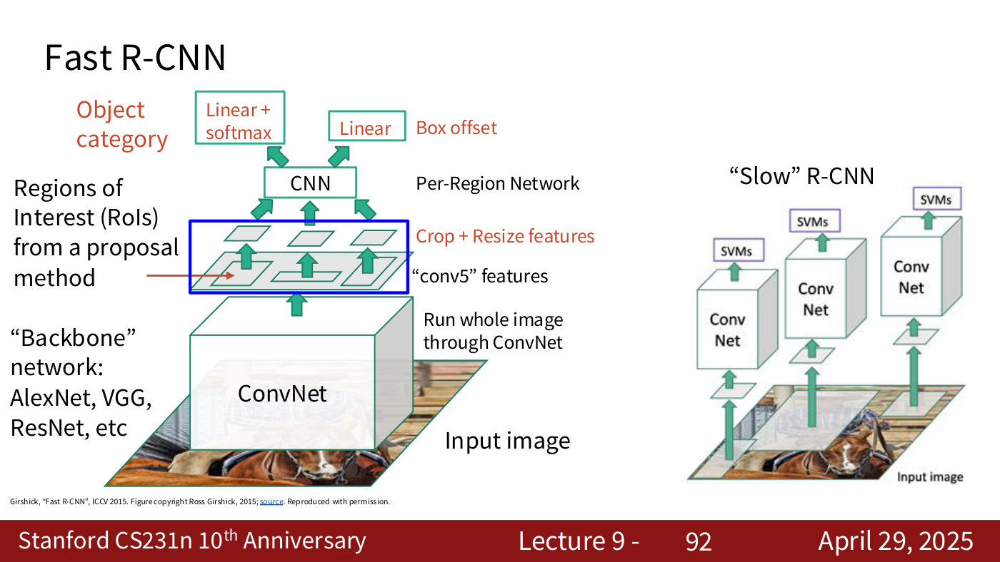

Same as slide 91, plus a blue rectangle drawn around the conv5-features layer, the three region boxes and the three cropped patches (the "Crop + Resize features" step). Text and credit line unchanged (Girshick, "Fast R-CNN", ICCV 2015. Figure copyright Ross Girshick, 2015; source. Reproduced with permission.).

## Slide 93 — Region Proposal Network

Figure: on the left a photograph of a kitten walking on grass, captioned "Input Image (e.g. 3 x 640 x 480)". A grey trapezoid labelled "CNN" sits to its right. Further right is a 3D feature block overlaid on a faint copy of the photograph, divided by a grid (8 columns by 7 rows visible on the front face), captioned "Image features (e.g. 512 x 20 x 15)".

## Slide 94 — Region Proposal Network

Same as slide 93, plus the note at top right: "Imagine an anchor box of fixed size at each point in the feature map". Four blue square outlines of the same size are drawn over the feature block, each centred on a blue-shaded grid cell (four shaded cells), overlapping one another.

## Slide 95 — Region Proposal Network

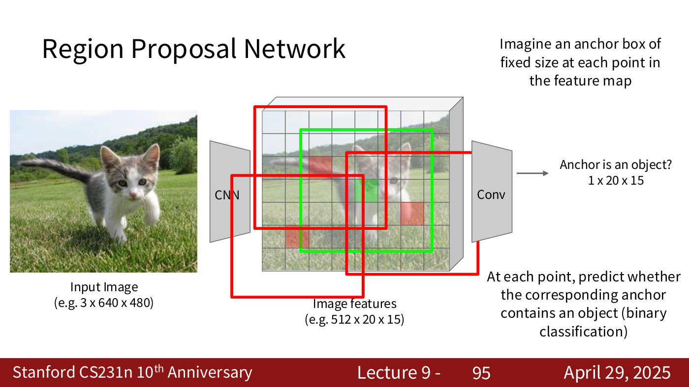

Same as slide 94 (same note at top right), plus a grey trapezoid labelled "Conv" to the right of the feature block with an arrow to the text "Anchor is an object? 1 x 20 x 15". Of the four anchor boxes, three are now red (with red-shaded centre cells) and one is green (with a green-shaded centre cell). New text bottom right: "At each point, predict whether the corresponding anchor contains an object (binary classification)".

## Slide 96 — Region Proposal Network

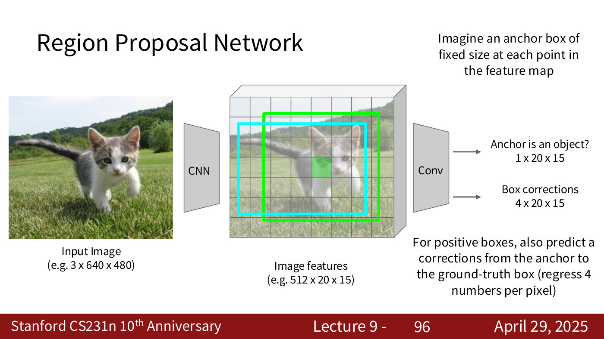

Same as slide 93 layout with the "Conv" trapezoid and the note at top right "Imagine an anchor box of fixed size at each point in the feature map". Only one anchor box remains: a green square outline centred on a green-shaded cell over the cat's face. A second, cyan rectangle overlaps it without lying inside it: it extends past the green box on the left, and its top and bottom edges lie inside the green box's. Two outputs from "Conv": "Anchor is an object? 1 x 20 x 15" and "Box corrections 4 x 20 x 15". New text bottom right: "For positive boxes, also predict a corrections from the anchor to the ground-truth box (regress 4 numbers per pixel)".

## Slide 97 — Region Proposal Network

Same layout as slide 96. New note at top right: "In practice use K different anchor boxes of different size / scale at each point". The feature block shows four blue anchor boxes of different sizes and aspect ratios all centred on the same blue-shaded cell (four outlines of four distinct shapes: a small square, a medium near-square wider than it is tall, a tall narrow box, and a wide short box that extends over the Conv trapezoid). Outputs: "Anchor is an object? K x 20 x 15" and "Box transforms 4K x 20 x 15".

## Slide 98 — Region Proposal Network

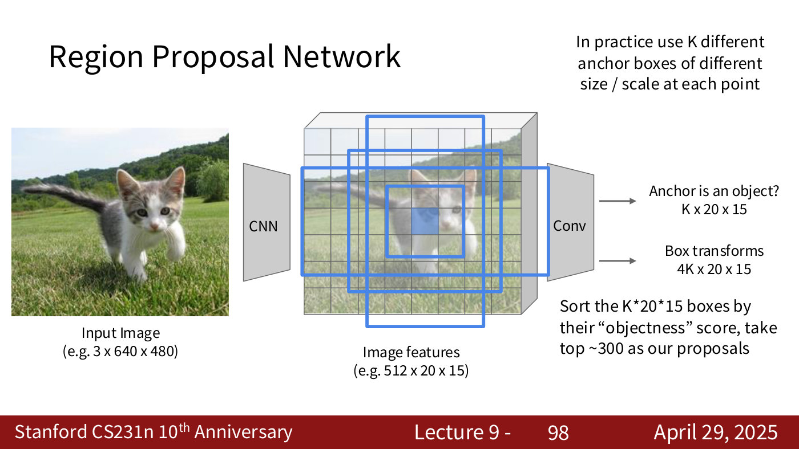

Same as slide 97, plus text bottom right: "Sort the K\*20\*15 boxes by their “objectness” score, take top ~300 as our proposals".

## Slide 99 — Single-Stage Object Detectors: YOLO / SSD / RetinaNet

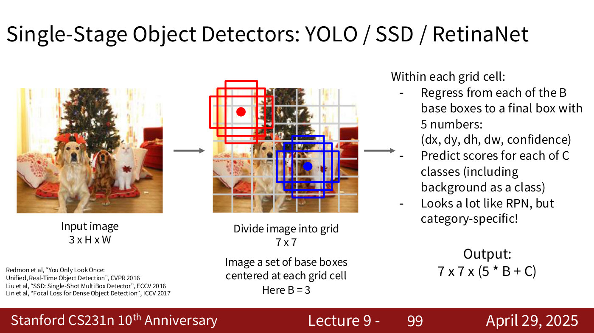

Figure: three-part left-to-right flow. Left: a photograph of two dogs and a white cat in front of a Christmas tree, captioned "Input image 3 x H x W". An arrow leads to the same photograph overlaid with a light grey grid, captioned "Divide image into grid 7 x 7" and "Image a set of base boxes centered at each grid cell Here B = 3". Two cells are highlighted: one near the top left with a red dot at its centre and three red boxes of different sizes centred on it; one lower right with a blue dot and three blue boxes centred on it. An arrow leads to the text on the right.

Right text: "Within each grid cell:" then three dashes:
- "Regress from each of the B base boxes to a final box with 5 numbers: (dx, dy, dh, dw, confidence)"
- "Predict scores for each of C classes (including background as a class)"
- "Looks a lot like RPN, but category-specific!"

Below: "Output: 7 x 7 x (5 * B + C)".

Citations (bottom left): Redmon et al, "You Only Look Once: Unified, Real-Time Object Detection", CVPR 2016. Liu et al, "SSD: Single-Shot MultiBox Detector", ECCV 2016. Lin et al, "Focal Loss for Dense Object Detection", ICCV 2017.

## Slide 100 — YOLO (You Only Look Once) real-time object detection

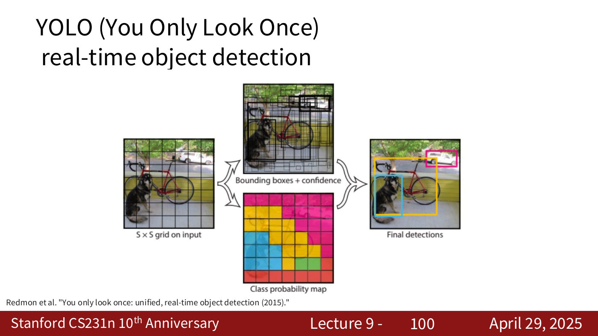

Figure: a pipeline diagram from the YOLO paper with four panels. Left: a photograph of a dog seated by a bicycle with a car behind, with a grid over it, captioned "S × S grid on input". Top middle: the same photo overlaid with many bounding boxes of various sizes (some thick, some thin), captioned "Bounding boxes + confidence". Bottom middle: a square grid coloured per cell in pink, yellow, blue, green and red, captioned "Class probability map". Right: the photo with three final boxes (cyan around the dog, yellow around the bicycle, pink around the car), captioned "Final detections". Curved double-headed arrows connect the left panel to the two middle panels, and curved arrows connect the two middle panels to the right panel.

Credit line: Redmon et al. "You only look once: unified, real-time object detection (2015)."

## Slide 101 — YOLO

Figure: the dog, bicycle and car photograph with a dense black grid drawn over it (about 14 by 14 cells visible), framed in cyan, at the left edge of the slide. Caption: "SxS Grid".

Credit line: Redmon et al. "You only look once: unified, real-time object detection (2015)."

## Slide 102 — YOLO

Same as slide 101, plus one grid cell in the upper right (over the car) is shaded blue. Text at the right: "For each box output:" then bullets:
- "P(object): probability that the box contains an object"
- "B bounding boxes (x, y, h, w)"
- "P(class): probability of belonging to a class"

Credit line unchanged.

## Slide 103 — YOLO

Same as slide 102, plus two blue rectangles over the car region (a larger one and a smaller, wider one inside it; the shaded cell is no longer shown), and the text "B=2" beneath the bullets. Credit line unchanged.

## Slide 104 — YOLO

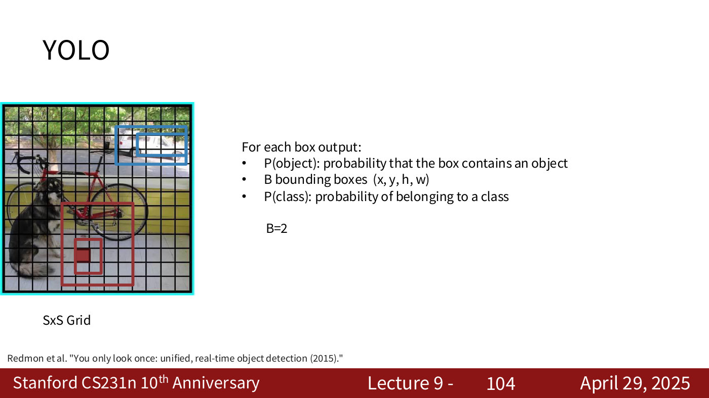

Same as slide 103, plus two red rectangles over the dog's/bicycle's lower-left region (a larger tall rectangle and a smaller narrow one inside it, with a small red-shaded cell at the left of the inner one). Blue rectangles, bullets and "B=2" unchanged. Credit line unchanged.

## Slide 105 — YOLO

Figure: the gridded photograph (as slide 101, caption "SxS Grid") followed by a thick black arrow to a second copy of the photograph covered with many overlapping coloured rectangles (red, yellow, cyan, green, purple, etc.) of many sizes. Text at right: "Many bounding boxes with different object probabilities". The bullets and B=2 text of slide 104 are gone. Credit line unchanged.

## Slide 106 — YOLO

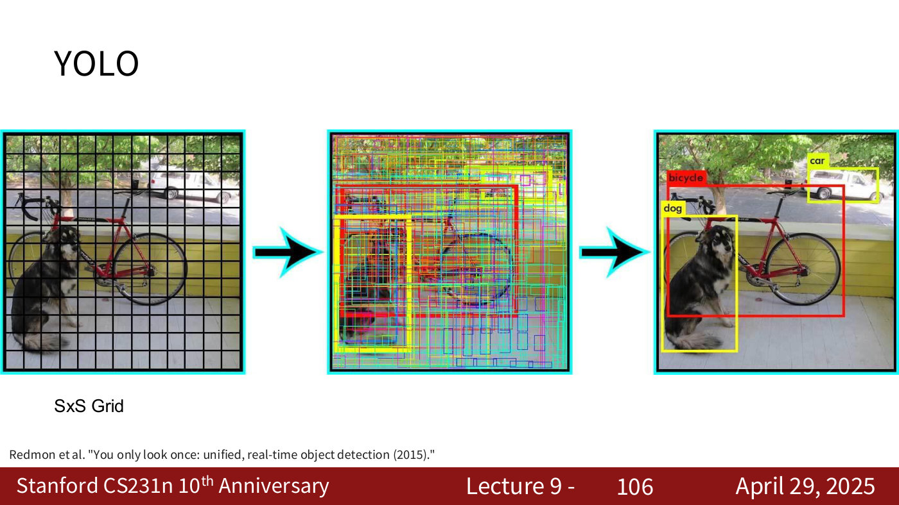

Same as slide 105, plus a second black arrow to a third panel: the clean photograph with three labelled final boxes: "dog" (yellow box around the dog), "bicycle" (red box around the bicycle) and "car" (yellow box around the car). The text "Many bounding boxes with different object probabilities" is gone. Credit line unchanged.

## Slide 107 — Object Detection with Transformers: DETR

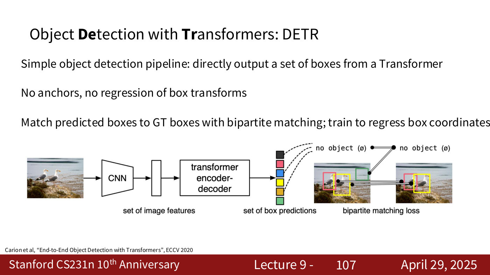

Title with "De" and "Tr" in bold ("Object **De**tection with **Tr**ansformers: DETR"). Text, three lines:
- "Simple object detection pipeline: directly output a set of boxes from a Transformer"
- "No anchors, no regression of box transforms"
- "Match predicted boxes to GT boxes with bipartite matching; train to regress box coordinates"

Figure: a left-to-right pipeline from the DETR paper. A photograph of two seagulls on a shore; an arrow into a grey trapezoid "CNN"; an arrow to a tall narrow rectangle (caption below, spanning these: "set of image features"); an arrow into a box "transformer encoder-decoder"; an arrow to a vertical column of six coloured squares (top to bottom: black, pink, blue, yellow, orange, green), caption "set of box predictions". Dashed curves go from the black, blue and orange (gold) squares to the label "no object (ø)" at the top; the pink, yellow and green squares have no line leaving them. Below, a copy of the seagull photograph carries pink, yellow and green boxes, and to the right a second copy carries pink and yellow boxes; double lines join dots inside the two photographs (pink to pink, yellow to yellow), and the green box in the first photograph is linked to a second "no object (ø)" label. Caption: "bipartite matching loss".

Credit line: Carion et al, "End-to-End Object Detection with Transformers", ECCV 2020.

## Slide 108 — Object Detection with Transformers: DETR

Title unchanged (no bold letters now). The text lines of slide 107 are gone and the DETR pipeline figure is moved up beneath the title (same figure as slide 107, same six coloured squares, same captions "set of image features", "set of box predictions", "bipartite matching loss"). New below it: the start of a zoomed-in drawing in a dashed box labelled "backbone", with caption "set of image features", showing a "CNN" trapezoid with an arrow to a tall narrow rectangle, and the start of an arrow heading down-right toward a circle (cut off). Credit line unchanged.

## Slide 109 — Object Detection with Transformers: DETR

Same as slide 108, plus below the backbone box a second dashed box labelled "positional encoding" holding three stacked grey gradient squares (white at upper right, dark at lower left). An arrow from the backbone's rectangle and an arrow from the positional encoding both go into a circle containing "+". A curved arrow leaves the "+" to the right (cut off at the edge of the crop).

## Slide 110 — Object Detection with Transformers: DETR

Same as slide 109, plus a dashed box labelled "encoder" to the right of the "+" circle. Inside it: a box "transformer encoder"; below it a row of six small grey squares followed by "..." with an arrow from each up into the encoder (input tokens, receiving the arrow from "+"); above it a second row of six small grey squares followed by "..." with an arrow from the encoder into each (output tokens). A curve leaves the top row to the right (cut off).

Credit line: Carion et al, "End-to-End Object Detection with Transformers", ECCV 2020 (on 108–110 as on 107).

## Slide 111 — Object Detection with Transformers: DETR

Same as slide 110, plus a dashed box labelled "decoder" to the right of the encoder. Inside it: a box "transformer decoder"; below it a row of four small coloured squares (pink, green, orange, blue) labelled "object queries", each with an arrow up into the decoder; above it a row of four coloured squares (pink, green, orange, blue) with an arrow from the decoder into each. A curved arrow from the encoder's output row enters the decoder box from the left. Four curved lines leave the decoder's output squares to the right (cut off at the edge of the decoder box).

## Slide 112 — Object Detection with Transformers: DETR

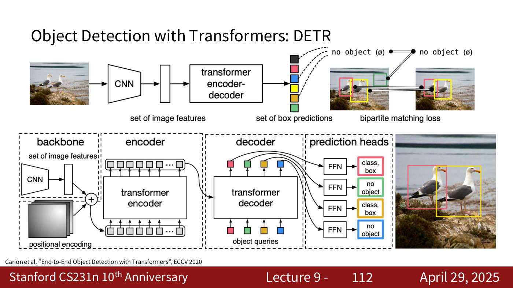

Same as slide 111, plus a dashed box labelled "prediction heads" to the right of the decoder, holding four stacked boxes "FFN", one per decoder output square (curved arrows from the pink, green, orange and blue squares into them, top to bottom). Each FFN has an arrow to a coloured output box: pink "class, box"; green "no object"; orange "class, box"; blue "no object". At the far right is the seagull photograph with two boxes: a pink box around the left seagull and a yellow box around the right seagull (the two boxes overlap).

## Slide 113 — Instance Segmentation

Figure: four panels in a row, the first three faded and the fourth in full colour, each with a title above and labels below.
- "Classification": the kitten-on-grass photograph, label "CAT", brace beneath with the text "No spatial extent" (faded).
- "Semantic Segmentation": a segmentation map (blue sky at top, red/green regions, a yellow cat shape in the middle, green grass at the bottom), label "GRASS, CAT, TREE, SKY" (each word coloured as its region), brace beneath with the text "No objects, just pixels" (faded).
- "Object Detection": the Christmas-tree photograph with three boxes (red, green, blue) around the two dogs and the cat, label "DOG, DOG, CAT" (faded).
- "Instance Segmentation" (full colour): the same photograph with filled masks: red mask on the first dog, green mask on the second dog, blue mask on the cat; label "DOG, DOG, CAT" (red, green, blue).

A single brace under the last two panels (Object Detection and Instance Segmentation) is labelled "Multiple Object" (the last panel's brace is in full colour).

## Slide 114 — Object Detection: Faster R-CNN

Title: "Object Detection: Faster R-CNN". Left: two small thumbnails; "Object Detection" (in full colour, bold title, the Christmas-tree photograph with red, green and blue boxes, label "DOG, DOG, CAT") and "Instance Segmentation" (faded, the same photograph with masks, label "DOG, DOG, CAT").

Right: the Faster R-CNN diagram, bottom to top. A tilted "image" at the bottom; above it a box "CNN"; an orange arrow up to a black plane labelled in red "feature map". From the feature map one orange arrow goes up-left to a red-outlined plane labelled "proposals" (with a label "Region Proposal Network" beside the arrow) showing three white boxes, and another long orange arrow goes straight up to a black plane labelled "RoI pooling" with three white boxes. From "proposals" two orange arrows go up-left to two orange-outlined boxes: "Classification loss" and "Bounding-box regression loss". From "RoI pooling" two orange arrows go up to two further orange boxes: "Classification loss" and "Bounding-box regression loss" with "..." between them.

## Slide 115 — Instance Segmentation: Mask R-CNN

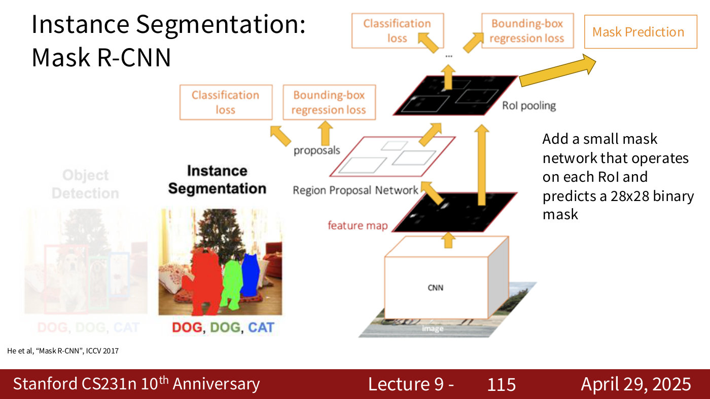

Same diagram as slide 114 with the title "Instance Segmentation: Mask R-CNN". The left thumbnails swap emphasis: "Object Detection" is faded, "Instance Segmentation" (bold title, masks in red, green and blue, label "DOG, DOG, CAT") is in full colour. New: an orange box "Mask Prediction" at the top right with an orange arrow to it from the RoI pooling plane. New text at right: "Add a small mask network that operates on each RoI and predicts a 28x28 binary mask".

Citation (bottom left): He et al, "Mask R-CNN", ICCV 2017.

## Slide 116 — Mask R-CNN

Figure: a photograph of the Christmas-tree scene with three light-green boxes (one around the top of the tree, one around the golden dog, one around the white cat), an arrow labelled "CNN +RPN" to a large tilted feature block (drawn as a 3D slab with a grey rectangle at its upper part, a small grey rectangle at right and a small grid at lower left). An arrow labelled "RoI Align" goes from the grid on that block to a smaller 3D block with a grid face, labelled "256 x 14 x 14". From the top of the small block an arrow goes up and right to the text "Classification Scores: C" and "Box coordinates (per class): 4 * C".

Citation (bottom left): He et al, "Mask R-CNN", arXiv 2017.

## Slide 117 — Mask R-CNN

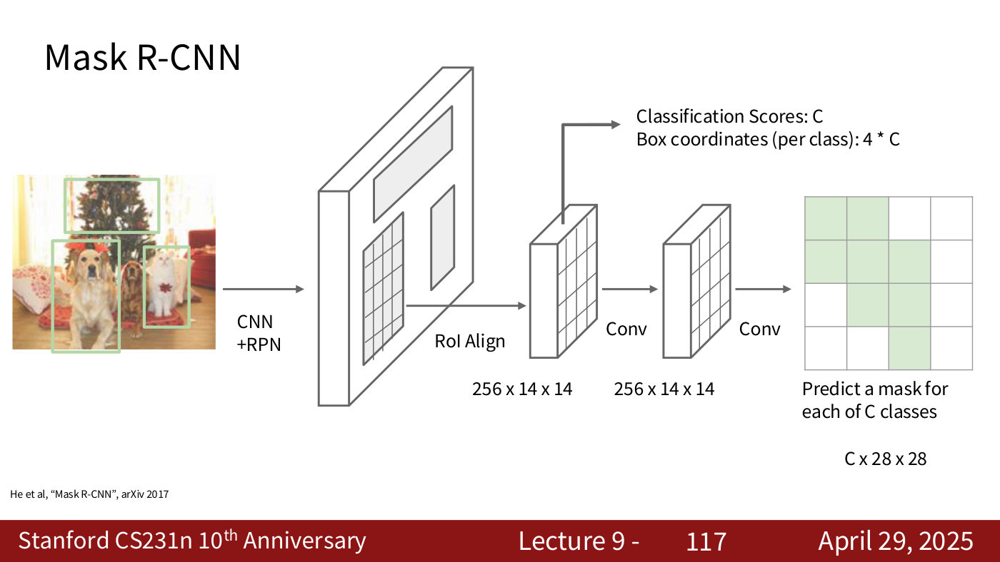

Same as slide 116, plus the small block "256 x 14 x 14" is followed by an arrow labelled "Conv" to a second block labelled "256 x 14 x 14", then an arrow labelled "Conv" to a 4 by 4 grid in which some cells are shaded light green (row 1: first two cells; row 2: first three cells; row 3: second and third cells; row 4: third cell), with the text "Predict a mask for each of C classes" and "C x 28 x 28" below it. The "Classification Scores: C / Box coordinates (per class): 4 * C" text and arrow stay at the top. Citation: He et al, "Mask R-CNN", arXiv 2017.

## Slide 118 — Mask R-CNN: Example Mask Training Targets

Figure: a photograph of a bedroom (child on a bed, a lamp, a chair) with a red box around the chair, next to a black-on-white pixelated binary mask (grid of squares) in the shape of a chair, drawn as a seat with a tall back and four legs (the mask grid is the box cropped and resized).

## Slide 119 — Mask R-CNN: Example Mask Training Targets

Same as slide 118, plus a second row: the same bedroom photograph with a different red box (a box around the chair, taller than in the first row) and its binary mask, a chair shape smaller than in the first row, not filling the square.

## Slide 120 — Mask R-CNN: Example Mask Training Targets

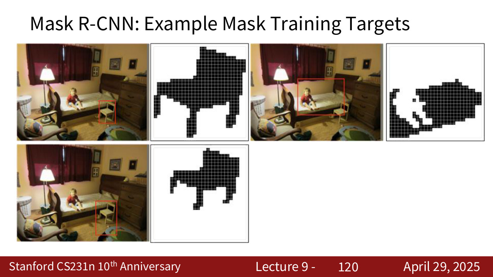

Same as slide 119, plus a third example in the top row to the right: the bedroom photograph with a large red box around the bed region (the child on the bed), and its binary mask: a black irregular shape filling most of the square, with white gaps at the left. Three examples in total (two in the top row, one in the second row).

## Slide 121 — Mask R-CNN: Example Mask Training Targets

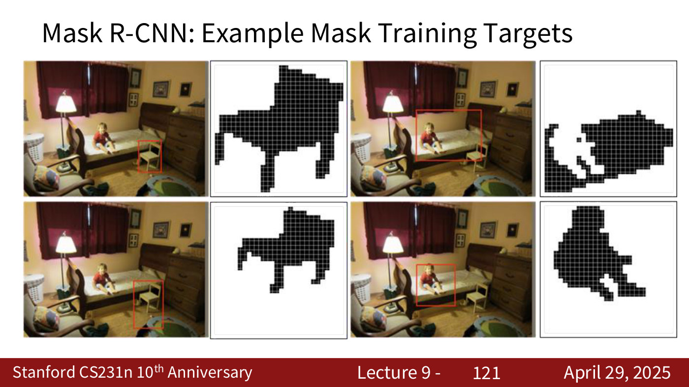

Figure: a 2 by 2 arrangement of four pairs. Each pair is a colour photograph of the same bedroom scene (a small child sitting on a bed with a lamp, dark red curtains and a wooden dresser, a pale chair at the foot of the bed) with a red rectangle drawn on it, next to a white square showing a black, blocky binary mask overlaid with a fine grid (the low-resolution mask target for that box).

- Top left: the red box is small, around the chair at the right of the bed; the mask beside it is a black chair-like silhouette with a back and legs.
- Top right: the red box is larger, covering the child and part of the bed; the mask beside it is a large black blob filling most of the square with white gaps at the left.
- Bottom left: the red box is a tall box around the chair; the mask is a black chair-like silhouette, smaller than in the top-left pair.
- Bottom right: the red box covers the child; the mask is a black blob with a rounded upper part and thin extensions at the lower right.

No credit line is printed.

## Slide 122 — Mask R-CNN: Very Good Results!

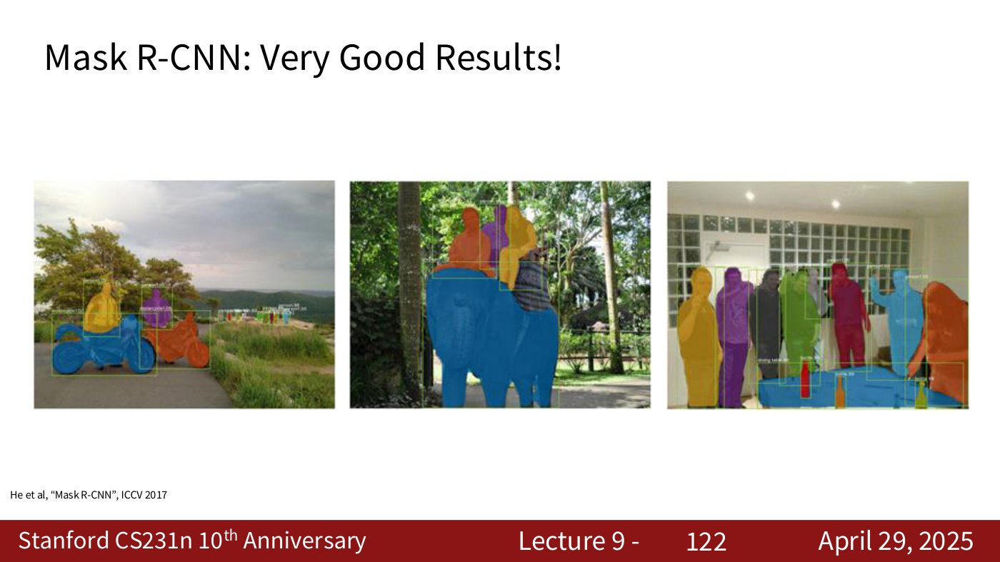

Figure: three colour photographs in a row with instance-segmentation overlays (each detected object filled with its own colour, with thin rectangular boxes and tiny illegible labels).

- Left: a road scene with trees and hills; a blue motorbike carrying a yellow person, an orange motorbike beside it with a purple person behind, and several small further objects in the distance.
- Middle: a forest scene with a large blue elephant carrying three riders, coloured orange, purple and yellow.
- Right: an indoor scene in front of a glass-block window; about seven people in different colours (orange, purple, dark grey, green, magenta, blue, and a large orange figure at the right edge), with a blue table region and red and orange bottles in front.

Credit line: He et al, "Mask R-CNN", ICCV 2017

## Slide 123 — Mask R-CNN: Also does pose

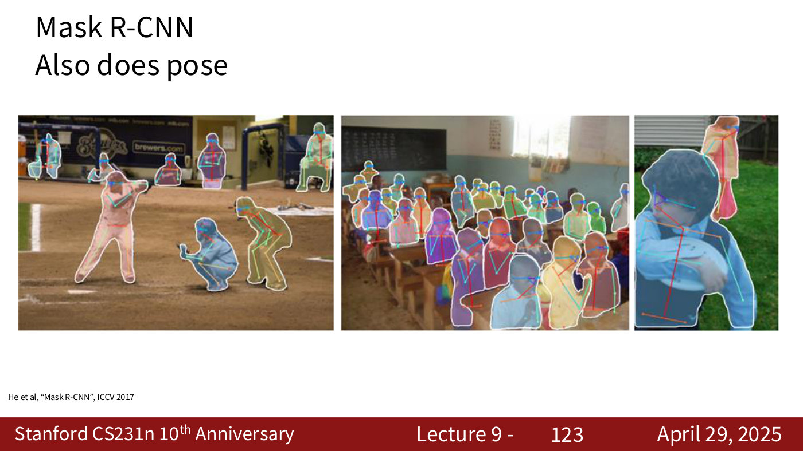

Title text: "Mask R-CNN" / "Also does pose".

Figure: three colour photographs in a row, with people segmented as translucent coloured masks outlined in white and each given a stick-figure skeleton (coloured line segments and dots for keypoints).

- Left: a baseball field; a batter in a swing, a catcher crouching and an umpire crouching, plus several spectators in the background, each with a mask and skeleton.
- Middle: a classroom with many seated children at wooden desks and a blackboard, each child with a coloured mask and a skeleton.
- Right: a close-up of a child in a blue top holding a white object, with a second person at the upper right in pink/orange; both have masks and skeletons.

Credit line: He et al, "Mask R-CNN", ICCV 2017

## Slide 124 — Open Source Frameworks

Text: "Lots of good implementations on GitHub!"

"TensorFlow Detection API:" / link https://github.com/tensorflow/models/tree/master/research/object_detection / "Faster RCNN, SSD, RFCN, Mask R-CNN, ..."

"Detectron2 (PyTorch)" / link https://github.com/facebookresearch/detectron2 / "Mask R-CNN, RetinaNet, Faster R-CNN, RPN, Fast R-CNN, R-FCN, ..."

"Finetune on your own dataset with pre-trained models"

## Slide 125 — Recap: Lots of computer vision tasks!

Figure: four columns, each with a heading, an image, a label line and a brace with a caption under it.

- "Classification": a photo of a kitten walking on grass; label "CAT" (single word).
- "Semantic Segmentation": a flat-colour segmentation of the kitten scene: blue sky at the top, purple tree band, green grass at the bottom and a yellow cat shape; label "GRASS, CAT, TREE, SKY", each word coloured to match (green, yellow, purple, blue).
- "Object Detection": a photo of two dogs and a cat in front of a Christmas tree, with three bounding boxes: red around the left dog, green around the middle dog, blue around the cat; label "DOG, DOG, CAT" coloured red, green, blue.
- "Instance Segmentation": the same photo with the three animals filled in as red, green and blue silhouettes; label "DOG, DOG, CAT" coloured red, green, blue.

Braces and captions: under Classification, "No spatial extent"; under Semantic Segmentation, "No objects, just pixels"; one brace spanning Object Detection and Instance Segmentation, "Multiple Object".

Credit line: This image is CC0 public domain

## Slide 126 — Today

Agenda list (the "Computer Vision Tasks" item is in bold, marking the current section):

- Transformers Recap
- **Computer Vision Tasks**
  - Semantic Segmentation
  - Object Detection
  - Instance Segmentation
- Visualization & Understanding
  - Model Layers Visualization
  - Saliency Maps
  - CAM & Grad-CAM

## Slide 127 — Interpreting a Linear Classifier: Visual Viewpoint

Figure with three parts.

Left: a grid of CIFAR-style example thumbnails, 10 rows by 10 columns, with row labels down the left side: airplane, automobile, bird, cat, deer, dog, frog, horse, ship, truck.

Top right: a worked linear-classifier diagram. An "Input image" (a faded cat photograph with the four numbers overlaid) is a $2 \times 2$ grid of pixels with values 56, 231 (top row) and 24, 2 (bottom row). Three arrows lead from it to three weight matrices labelled "W" on the left (row labels W, b, Score):

- First (orange-tinted): W = [0.2, -0.5 / 0.1, 2.0]; b = 1.1; Score = -96.8.
- Second (purple-tinted): W = [1.5, 1.3 / 2.1, 0.0]; b = 3.2; Score = 437.9.
- Third (green-tinted): W = [0, .25 / 0.2, -0.3]; b = -1.2; Score = 61.95.

Bottom: a row of 10 blurry template images, each captioned: plane, car, bird, cat, deer, dog, frog, horse, ship, truck (colour blobs: plane bluish, car purple/blue, bird greenish, cat pinkish-grey, deer green-brown, dog grey-pink, frog yellow-green, horse brown with pink, ship blue-white, truck dark purple).

*[Ed: printed ship score 61.95; computed 60.75, because 0(56) + 0.25(231) + 0.2(24) + (−0.3)(2) = 57.75 + 4.8 − 0.6 = 61.95 before the bias, and adding b = −1.2 gives 60.75. The printed 61.95 omits the bias term: the same slip as lecture 2, slides 60 and 62, whose figure this slide reuses, and lecture 5, slide 6. The cat (−96.8) and dog (437.9) scores check out.]*

## Slide 128 — First Layer: Visualize Filters

Figure: left, an $8 \times 8$ grid of small square filter images (colourful oriented edges, stripes and colour blobs) captioned "AlexNet:" / "64 x 3 x 11 x 11". Right edge: a small, low-resolution drawing of the AlexNet architecture (stacked boxes, convolution, max pooling and dense layers, with tiny illegible numbers), with the first convolution layer (the bottom-most pair of boxes, next to the input) outlined by a red rectangle.

Credit lines:
- Krizhevsky, "One weird trick for parallelizing convolutional neural networks", arXiv 2014
- He et al, "Deep Residual Learning for Image Recognition", CVPR 2016
- Huang et al, "Densely Connected Convolutional Networks", CVPR 2017

## Slide 129 — First Layer: Visualize Filters

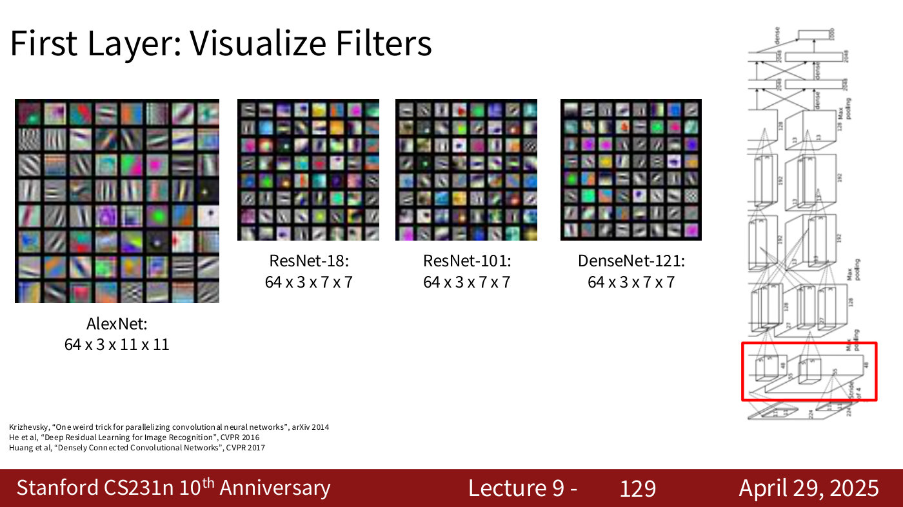

Same as slide 128, plus three more filter grids to the right of the AlexNet grid, each an $8 \times 8$ grid of small square filters (smaller, with more diffuse edge and blob patterns and some bright colour spots):

- "ResNet-18:" / "64 x 3 x 7 x 7"
- "ResNet-101:" / "64 x 3 x 7 x 7"
- "DenseNet-121:" / "64 x 3 x 7 x 7"

The same three credit lines as slide 128 are printed.

## Slide 130 — Which pixels matter: Saliency via Backprop

Figure: a horizontal grey arrow near the top labelled "Forward pass: Compute probabilities". Below it, from left to right: a photo of a small tan terrier-like dog standing on dry ground, then a drawing of the AlexNet-style architecture (stacked convolution boxes, max pooling, dense layers), then the word "Dog" at the right end.

Credit lines: Simonyan, Vedaldi, and Zisserman, "Deep Inside Convolutional Networks: Visualising Image Classification Models and Saliency Maps", ICLR Workshop 2014. / Figures copyright Karen Simonyan, Andrea Vedaldi, and Andrew Zisserman, 2014; reproduced with permission.

## Slide 131 — Which pixels matter: Saliency via Backprop

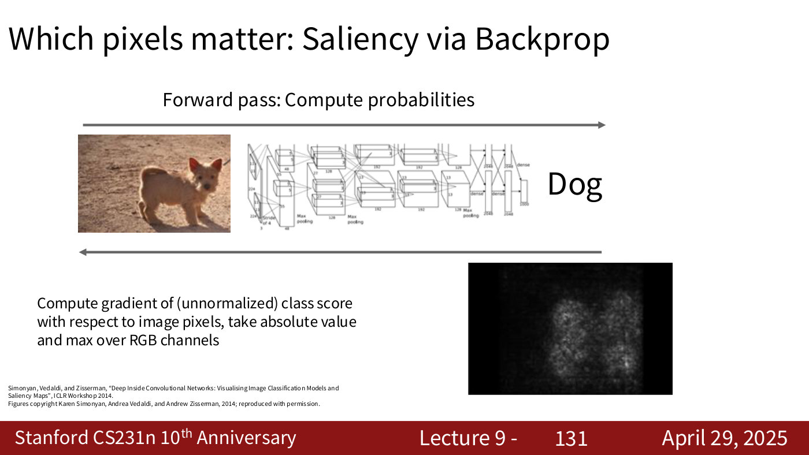

Same as slide 130, plus a second grey arrow pointing right to left below the first (backward direction), a text block at the lower left: "Compute gradient of (unnormalized) class score with respect to image pixels, take absolute value and max over RGB channels", and at the lower right a black rectangle containing a faint grey-white blotchy map (the saliency map for the dog image), brightest in a roughly central, rounded region with a darker border around it.

The same credit lines as slide 130 are printed.

## Slide 132 — Saliency Maps

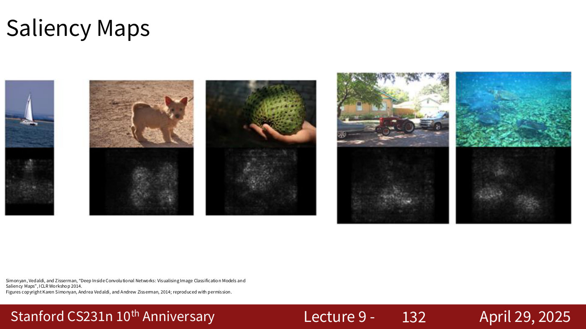

Figure: five photographs in a row, each with its saliency map beneath it (a black rectangle with a faint grey-white blotchy pattern):

- A white sailboat on blue water (narrow image); the map shows a small bright patch near the upper part.
- The small tan terrier-like dog on dry ground; the map shows a bright blotchy region around the dog's body.
- A hand holding a green, bumpy, spiky-skinned fruit; the map shows a bright blotchy region at the centre.
- A street scene with a red vintage tractor parked in front of houses, with cars beside it; the map shows brighter patches in the lower middle.
- An underwater scene with turquoise water and rocky seabed and two rays/fish shapes; the map shows two brighter patches at lower left and lower right.

The same credit lines as slide 130 are printed.

## Slide 133 — Class Activation Mapping (CAM)

Figure: three grey 3D shapes joined by two thick black arrows, left to right.

- A cuboid labelled with side labels "H" (height, left), "W" (bottom) and "K" (depth); caption "Last layer CNN features:" and $f \in \mathbb{R}^{H \times W \times K}$.
- First arrow, labelled "Global Average Pooling".
- A thin long bar labelled "K"; caption "Pooled features:" and $F \in \mathbb{R}^{K}$.
- Second arrow, labelled "Fully Connected Layer, weights" and $w \in \mathbb{R}^{K \times C}$.
- A thin long bar labelled "C"; caption "Class Scores:" and $S \in \mathbb{R}^{C}$.

Credit line: Zhou et al, "Learning Deep Features for Discriminative Localization", CVPR 2016

## Slide 134 — Class Activation Mapping (CAM)

Same as slide 133, plus at the lower left the equation:

$$F_k = \frac{1}{HW} \sum_{h,w} f_{h,w,k}$$

The same credit line as slide 133 is printed.

## Slide 135 — Class Activation Mapping (CAM)

Same as slide 134, plus to the right of the first equation:

$$S_c = \sum_k w_{k,c} F_k$$

The same credit line is printed.

## Slide 136 — Class Activation Mapping (CAM)

Same as slide 135, with the second equation extended:

$$S_c = \sum_k w_{k,c} F_k = \frac{1}{HW} \sum_k w_{k,c} \sum_{h,w} f_{h,w,k}$$

(The first equation $F_k = \frac{1}{HW} \sum_{h,w} f_{h,w,k}$ is still shown at left.) The same credit line is printed.

## Slide 137 — Class Activation Mapping (CAM)

Same as slide 136, plus a second line under the second equation, aligned at the equals sign:

$$= \frac{1}{HW} \sum_{h,w} \sum_k w_{k,c} f_{h,w,k}$$

The same credit line is printed.

## Slide 138 — Class Activation Mapping (CAM)

Same as slide 137, except that in the last line the inner sum over $k$ and the term $w_{k,c} f_{h,w,k}$ are highlighted in bold blue.

## Slide 139 — Class Activation Mapping (CAM)

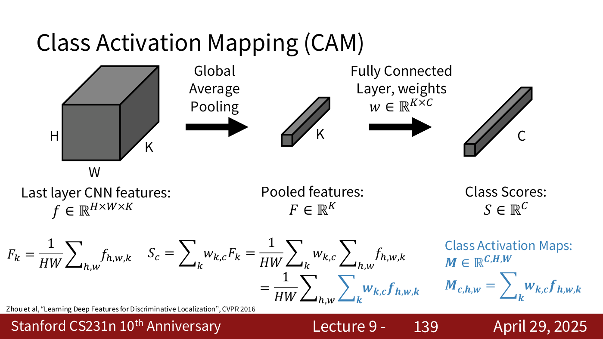

Same as slide 138, plus a blue block at the right: "Class Activation Maps:" / $M \in \mathbb{R}^{C,H,W}$ / and the equation

$$M_{c,h,w} = \sum_k w_{k,c} f_{h,w,k}$$

(in bold blue, matching the highlighted term of the previous slide). The same credit line is printed.

## Slide 140 — Class Activation Mapping (CAM)

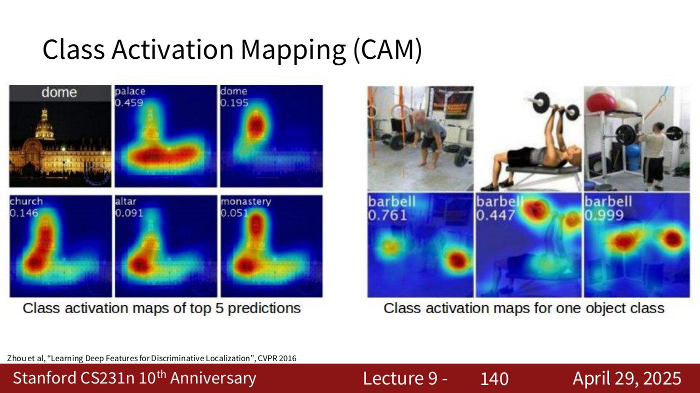

Figure with two groups, with captions beneath each.

Left: a $2 \times 3$ grid of images. Top row: a night photo of a large domed, floodlit building labelled "dome"; then two heat maps (blue background with red-yellow hot spots) labelled "palace" / 0.459 and "dome" / 0.195. Bottom row: three heat maps labelled "church" / 0.146, "altar" / 0.091, "monastery" / 0.051. The hot spots are mostly along the lower left and a vertical band at the left-centre (the dome/spire region), with the "palace" map having a wide horizontal band at the bottom and the "dome" map a compact spot in the upper middle. Caption: "Class activation maps of top 5 predictions".

Right: a $2 \times 3$ grid. Top row: three photographs of weight-lifting scenes (a man with a barbell on the floor near rings, a man lying on a bench pressing a barbell, a man standing beside a rack with a barbell and a large red ball). Bottom row: three heat maps, each labelled "barbell" with scores 0.761, 0.447 and 0.999 respectively, with red hot spots on the barbell plates (two spots in the first and third; spots at the upper plates and a lower patch in the second). Caption: "Class activation maps for one object class".

Credit line: Zhou et al, "Learning Deep Features for Discriminative Localization", CVPR 2016

## Slide 141 — Class Activation Mapping (CAM)

Same as slide 140, plus red text at the top right: "Problem: Can only apply to last conv layer". The same credit line is printed.

## Slide 142 — Gradient-Weighted Class Activation Mapping (Grad-CAM)

Numbered list, first item only:

1. Pick any layer, with activations $A \in \mathbb{R}^{H \times W \times K}$

Credit line: Selvaraju et al, "Grad-CAM: Visual Explanations from Deep Networks via Gradient-based Localization", CVPR 2017

## Slide 143 — Gradient-Weighted Class Activation Mapping (Grad-CAM)

Same as slide 142, plus item 2:

2. Compute gradient of class score $S_c$ with respect to A:

$$\frac{\partial S_c}{\partial A} \in \mathbb{R}^{H \times W \times K}$$

The same credit line is printed.

## Slide 144 — Gradient-Weighted Class Activation Mapping (Grad-CAM)

Same as slide 143, plus item 3:

3. Global Average Pool the gradients to get weights $\alpha \in \mathbb{R}^{K}$:

$$\alpha_k = \frac{1}{HW} \sum_{h,w} \frac{\partial S_c}{\partial A_{h,w,k}}$$

The same credit line is printed. (The slide number "144" is printed in yellow in the footer.)

## Slide 145 — Gradient-Weighted Class Activation Mapping (Grad-CAM)

Same as slide 144, plus item 4:

4. Compute activation map $M^c \in \mathbb{R}^{H,W}$:

$$M^c_{h,w} = ReLU\left(\sum_k \alpha_k A_{h,w,k}\right)$$

The same credit line is printed. (Slide number printed in yellow in the footer.)

## Slide 146 — Gradient-Weighted Class Activation Mapping (Grad-CAM)

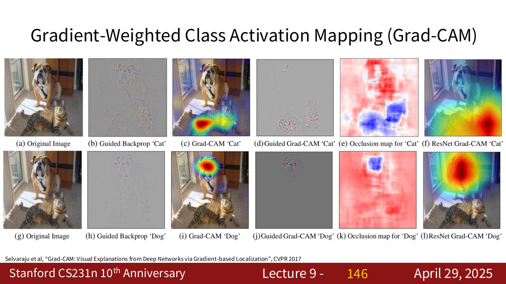

Figure: two rows of six panels each, with captions beneath each panel. Every panel is based on the same photograph of a brown-and-white bulldog wearing a tie sitting upright at the top of the picture, with a tabby cat lying in the sunlit foreground below it, beside a window.

Top row (class "Cat"):
- (a) Original Image: the photo.
- (b) Guided Backprop 'Cat': a grey image with faint thin coloured edge traces, concentrated around the dog's face and the cat's body.
- (c) Grad-CAM 'Cat': the photo with a heat-map overlay; a red-yellow hot spot on the cat's body at the lower middle, fading to blue elsewhere.
- (d) Guided Grad-CAM 'Cat': a grey image with faint edge traces, almost entirely restricted to the cat's striped body at the lower middle, with a small trace near the dog's ear at the top.
- (e) Occlusion map for 'Cat': a red/white/blue map; red region in the upper part (over the dog), blue patches in the lower middle and right (over the cat).
- (f) ResNet Grad-CAM 'Cat': the photo with a heat-map overlay; a red hot spot at the lower right over the cat, blue elsewhere.

Bottom row (class "Dog"):
- (g) Original Image: the same photo.
- (h) Guided Backprop 'Dog': a grey image with faint edge traces around the dog's face and head region.
- (i) Grad-CAM 'Dog': the photo with a red-yellow hot spot over the dog's head at the top, fading to blue.
- (j) Guided Grad-CAM 'Dog': a mostly uniform dark grey image with very faint traces near the dog's face at the top.
- (k) Occlusion map for 'Dog': a mostly red map with a blue patch at the upper middle (over the dog's head).
- (l) ResNet Grad-CAM 'Dog': a red hot spot over the dog's head and upper body at the top, fading through yellow and green to blue.

Credit line: Selvaraju et al, "Grad-CAM: Visual Explanations from Deep Networks via Gradient-based Localization", CVPR 2017 (slide number printed in yellow in the footer).

## Slide 147 — Visualizing ViT features

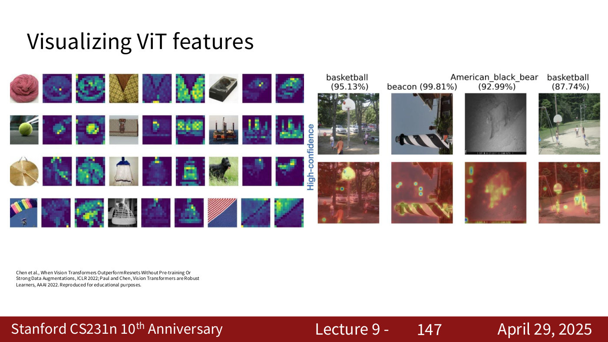

Figure: two groups.

Left: a $4 \times 9$ array of small images arranged as three-image groups per row: in each group of three, a natural photograph is followed by two small square purple-blue-green-yellow heat maps (coarse grids of cells) of features. Photographs, row by row: first row, a ball of pink yarn or wool, a tan/olive woven or checked garment, a dark rectangular object (a cassette-like or case-like item); second row, a yellow-green tennis ball on a court, a brown leather wallet or purse, an offshore oil-rig structure at sea; third row, a round gold cymbal, a white mop head, a black dog on grass; fourth row, a colourful parachute or paraglider, a white striped chair or rack in black and white, and a red-and-white striped object with a blue triangle. Each photo's two heat maps show bright regions in cells over the object or its parts.

Right: a row of four images with predicted labels above and a heat-map overlay version beneath each; a blue vertical label "High-confidence" at the left of the right group:
- "basketball (95.13%)": a park scene with a basketball hoop and backboard on a pole, people below; the overlay (red-tinted image with yellow-green spots) marks the hoop area.
- "beacon (99.81%)": a black-and-white striped lighthouse-like tower, the photograph rotated 90 degrees, with a building and sky beside it; the overlay highlights the striped tower.
- "American_black_bear (92.99%)": a grainy grey night-vision-like photograph of an animal; the overlay shows a bright blob over the animal.
- "basketball (87.74%)": a playground or sand court with a hoop and several people; the overlay shows bright spots at the hoop and the people.

Credit lines: Chen et al., When Vision Transformers Outperform Resnets Without Pre-training Or Strong Data Augmentations, ICLR 2022; Paul and Chen, Vision Transformers are Robust Learners, AAAI 2022. Reproduced for educational purposes.

## Slide 148 — Today

Same as slide 126: the agenda list ("Computer Vision Tasks" still in bold; Transformers Recap; Semantic Segmentation, Object Detection, Instance Segmentation; Visualization & Understanding; Model Layers Visualization, Saliency Maps, CAM & Grad-CAM).

## Slide 149 — Next time: Video Understanding

Text only: "Next time: Video Understanding".

## Slide 150 — Additional Reading Material

Divider slide. Text only: "Additional Reading Material".

## Slide 151 — Convolution as Matrix Multiplication (1D Example)

Text: "We can express convolution in terms of a matrix multiplication", followed by the equation $\vec{x} \ast \vec{a} = X\vec{a}$.

Below is a matrix equation. A $2 \times 6$ matrix with rows $[x, y, z, 0, 0, 0]$ and $[0, 0, x, y, z, 0]$ multiplies the column vector $[0, a, b, c, d, 0]^T$ and equals the column vector with entries $ay + bz$ and $bx + cy + dz$.

Caption under the equation: "Example: 1D conv, kernel size=3, stride=2, padding=1" ("stride=2" is underlined).

## Slide 152 — Convolution as Matrix Multiplication (1D Example)

Same as slide 151 (left side unchanged), plus a right-hand column.

Right-hand text: "Transposed convolution multiplies by the transpose of the same matrix:", then the equation $\vec{x} \ast^T \vec{a} = X^T\vec{a}$.

Matrix equation: a $6 \times 2$ matrix with rows $[x, 0]$, $[y, 0]$, $[z, x]$, $[0, y]$, $[0, z]$, $[0, 0]$ multiplies the column vector $[a, b]^T$ and equals the column vector with entries $ax$, $ay$, $az + bx$, $by$, $bz$, $0$.

Caption: "Example: 1D transposed conv, kernel size=3, stride=2, padding=0" ("stride=2" underlined).

## Slide 153 — Cropping Features: RoI Pool

Figure: on the left, a photograph of a grey-and-white kitten walking on grass, with a green rectangle drawn around the kitten. Caption "Input Image (e.g. 3 x 640 x 480)". A grey trapezoid labelled "CNN" lies between the image and a 3D grid block (a cuboid whose front face is a grid of about 8 columns by 7 rows). Caption under the block: "Image features: C x H x W (e.g. 512 x 20 x 15)".

Citation (small text, shown twice, bottom left and right): "Girshick, "Fast R-CNN", ICCV 2015."

## Slide 154 — Cropping Features: RoI Pool

Same as slide 153, plus a curved arrow from the green box on the input image to the feature block, labelled "Project proposal onto features". A green rectangle now appears on the front face of the feature grid (covering roughly columns 4–7 and rows 3–6, not aligned to grid lines).

Citation: "Girshick, "Fast R-CNN", ICCV 2015." (twice, as on slide 153).

## Slide 155 — Cropping Features: RoI Pool

Same as slide 154, plus the label "Snap" to grid cells (printed with quotes: "“Snap” to grid cells") above the block, and a blue rectangle on the feature grid, slightly offset from the green one, aligned to the grid lines.

Citation: "Girshick, "Fast R-CNN", ICCV 2015." (once, bottom left).

## Slide 156 — Cropping Features: RoI Pool

Same as slide 155, but the green rectangle on the feature grid is removed, leaving only the blue grid-aligned rectangle (about 4 cells wide by 5 cells tall on the front face). Added text at right: "Q: how do we resize the 512 x 5 x 4 region to, e.g., a 512 x 2 x 2 tensor?." No answer is printed on this slide.

Citation: "Girshick, "Fast R-CNN", ICCV 2015."

## Slide 157 — Cropping Features: RoI Pool

Same as slide 156, plus text at top right "Divide into 2x2 grid of (roughly) equal subregions", and the blue rectangle on the feature grid is split by blue lines into a $2 \times 2$ grid of four subregions.

Citation: "Girshick, "Fast R-CNN", ICCV 2015."

## Slide 158 — Cropping Features: RoI Pool

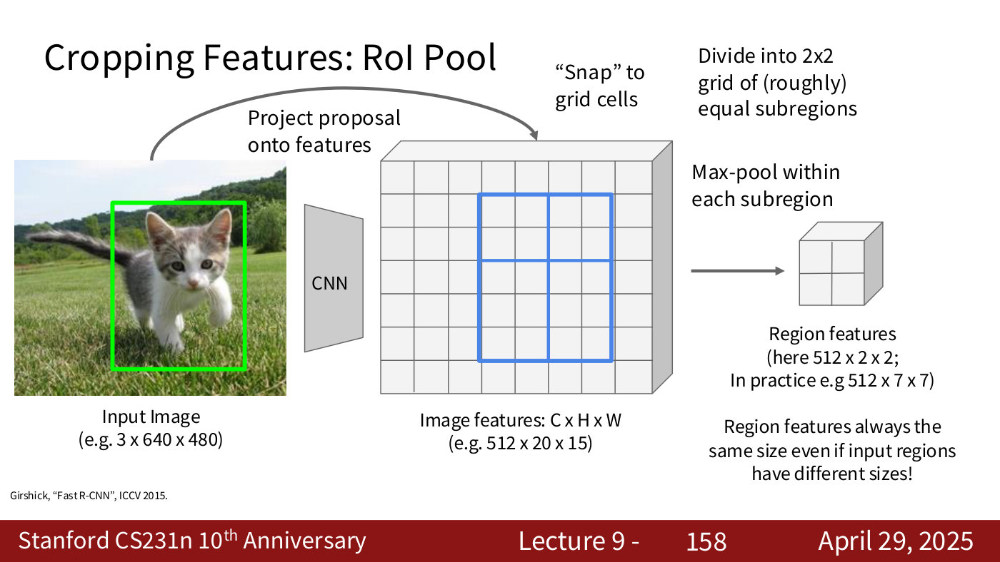

Same as slide 157, plus text "Max-pool within each subregion", an arrow pointing right from the feature block to a small cube divided into a $2 \times 2$ face, and the caption "Region features (here 512 x 2 x 2; In practice e.g 512 x 7 x 7)". Further text: "Region features always the same size even if input regions have different sizes!" The question text of slide 156 is removed.

Citation: "Girshick, "Fast R-CNN", ICCV 2015."

## Slide 159 — Cropping Features: RoI Pool

Same as slide 158, plus red text at the bottom: "Problem: Region features slightly misaligned".

Citation: "Girshick, "Fast R-CNN", ICCV 2015."

## Slide 160 — Cropping Features: RoI Align

Title: "Cropping Features: RoI Align" ("Align" underlined). Same input image, CNN and feature block as slide 153, with the curved arrow labelled "Project proposal onto features" and the text "No “snapping”!" above the block. On the feature grid the green (unsnapped, not grid-aligned) rectangle is divided by green lines into a $2 \times 2$ grid of four equal subregions.

Citation: "He et al, "Mask R-CNN", ICCV 2017"

## Slide 161 — Cropping Features: RoI Align

Same as slide 160, plus text at top right "Sample at regular points in each subregion using bilinear interpolation". Each of the four green subregions on the feature grid now holds four bright green dots arranged as a $2 \times 2$ pattern (16 dots in total).

Citation: "He et al, "Mask R-CNN", ICCV 2017"

## Slide 162 — Cropping Features: RoI Align

Same as slide 161, but the feature-grid drawing is faded except for one grid cell block outlined in dark grey (in the upper-right subregion, containing one green dot). A dashed pair of lines from that block leads to an enlarged square at the right, divided into four quadrants. Each quadrant has a dark grey dot at its centre, and one larger bright green dot sits at the centre of the whole square, where the quadrants meet. Text under the enlarged square: "Feature f_xy for point (x, y) is a linear combination of features at its four neighboring grid cells:" (the formula is not yet shown). Top-right text "Sample at regular points in each subregion using bilinear interpolation" is retained.

Citation: "He et al, "Mask R-CNN", ICCV 2017"

## Slide 163 — Cropping Features: RoI Align

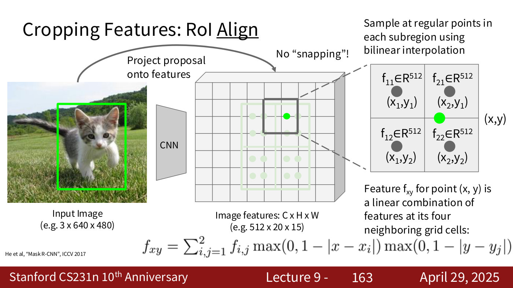

Same as slide 162, plus labels on the enlarged square: the four grey dots are labelled $f_{11} \in \mathbb{R}^{512}$ at $(x_1, y_1)$ (upper left), $f_{21} \in \mathbb{R}^{512}$ at $(x_2, y_1)$ (upper right), $f_{12} \in \mathbb{R}^{512}$ at $(x_1, y_2)$ (lower left), and $f_{22} \in \mathbb{R}^{512}$ at $(x_2, y_2)$ (lower right). The green dot is labelled $(x, y)$. A displayed equation at the bottom:

$$f_{xy} = \sum_{i,j=1}^{2} f_{i,j} \max(0, 1 - |x - x_i|) \max(0, 1 - |y - y_j|)$$

Citation: "He et al, "Mask R-CNN", ICCV 2017"

## Slide 164 — Cropping Features: RoI Align

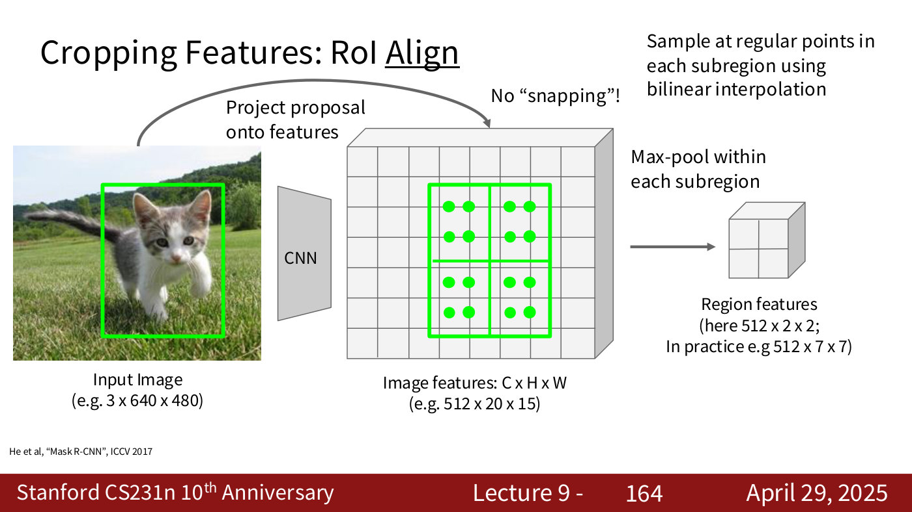

Same as slide 161 (green $2 \times 2$ subregions with four dots each on the unsnapped region, "No “snapping”!", "Sample at regular points in each subregion using bilinear interpolation"), plus "Max-pool within each subregion", an arrow to a small cube with a $2 \times 2$ face, and the caption "Region features (here 512 x 2 x 2; In practice e.g 512 x 7 x 7)".

Citation: "He et al, "Mask R-CNN", ICCV 2017"

## Slide 165 — R-CNN vs Fast R-CNN

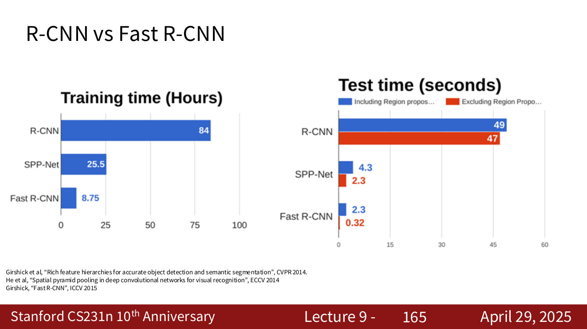

Two horizontal bar charts side by side.

Left chart, title "Training time (Hours)", x-axis ticks 0, 25, 50, 75, 100, one data series (blue bars), three categories:

- R-CNN: 84
- SPP-Net: 25.5
- Fast R-CNN: 8.75

Right chart, title "Test time (seconds)", x-axis ticks 0, 15, 30, 45, 60. Two data series: blue "Including Region propos…" and red "Excluding Region Propo…" (legend text is truncated as printed). Values:

- R-CNN: blue 49, red 47
- SPP-Net: blue 4.3, red 2.3
- Fast R-CNN: blue 2.3, red 0.32

Citations:
- Girshick et al, "Rich feature hierarchies for accurate object detection and semantic segmentation", CVPR 2014.
- He et al, "Spatial pyramid pooling in deep convolutional networks for visual recognition", ECCV 2014
- Girshick, "Fast R-CNN", ICCV 2015

## Slide 166 — R-CNN vs Fast R-CNN

Same as slide 165, plus red text with a red arrow pointing at the Fast R-CNN red bar (0.32) in the test-time chart: "Problem: Runtime dominated by region proposals!"

Citations: same three as slide 165.

## Slide 167 — Faster R-CNN: Make CNN do proposals!

Title: "Faster R-CNN:" ("er" underlined), subtitle "Make CNN do proposals!". Text: "Insert Region Proposal Network (RPN) to predict proposals from features". "Otherwise same as Fast R-CNN: Crop features for each proposal, classify each one".

Figure (bottom to top, on the right): an image at the base, a white cuboid labelled "CNN", an up arrow to a black rectangular plane labelled "feature map" (in red) showing a few faint white blobs. From the feature map, two yellow arrows go up: one to a red-outlined parallelogram labelled "proposals" (containing three white boxes) via the label "Region Proposal Network", and one long arrow straight up to a second black plane labelled "RoI pooling" (with three white boxes drawn on it). From "proposals", yellow arrows go up-left to two orange-outlined boxes, "Classification loss" and "Bounding-box regression loss" (the left pair). From the RoI pooling plane, an up arrow passes through "..." to a second pair of orange boxes at the top, "Classification loss" and "Bounding-box regression loss". Four loss boxes in total.

Citations: Ren et al, "Faster R-CNN: Towards Real-Time Object Detection with Region Proposal Networks", NIPS 2015
Figure copyright 2015, Ross Girshick; reproduced with permission

## Slide 168 — Faster R-CNN: Make CNN do proposals!

Same figure as slide 167. The left text is replaced by: "Jointly train with 4 losses:" followed by a numbered list:

1. RPN classify object / not object
2. RPN regress box coordinates
3. Final classification score (object classes)
4. Final box coordinates

Citations: same as slide 167, including "Figure copyright 2015, Ross Girshick; reproduced with permission".

## Slide 169 — Faster R-CNN: Make CNN do proposals!

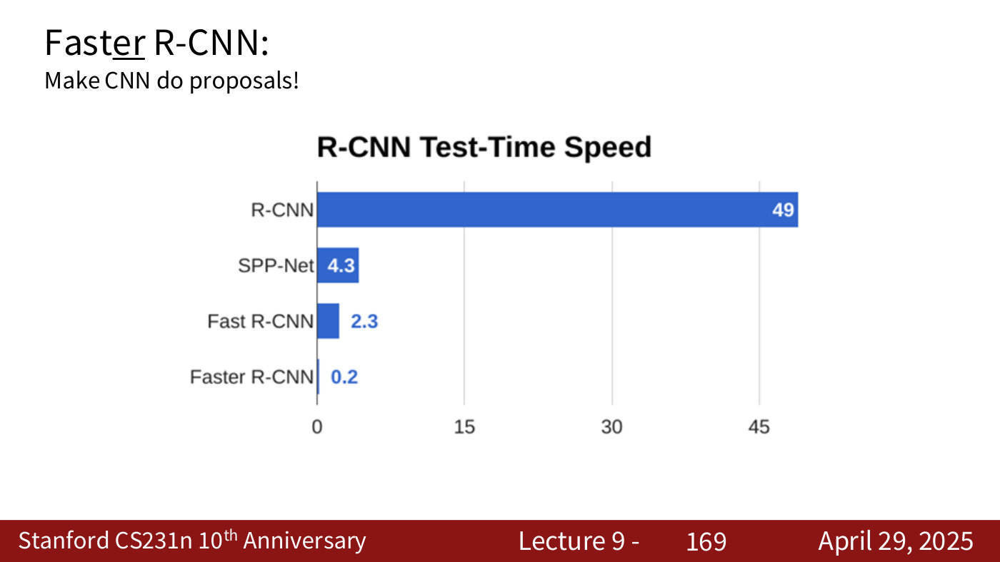

Same title as slide 167. A single horizontal bar chart titled "R-CNN Test-Time Speed", x-axis ticks 0, 15, 30, 45 (no unit printed on the axis), one data series (blue bars), four categories:

- R-CNN: 49
- SPP-Net: 4.3
- Fast R-CNN: 2.3
- Faster R-CNN: 0.2 (a barely visible bar)

## Slide 170 — Faster R-CNN: Make CNN do proposals!

Same figure as slide 167. Left text: "Glossing over many details:" followed by dash bullets:

- Ignore overlapping proposals with non-max suppression
- How are anchors determined?
- How do we sample positive / negative samples for training the RPN?
- How to parameterize bounding box regression?

The questions are posed without printed answers.

Citations: same as slide 167, including "Figure copyright 2015, Ross Girshick; reproduced with permission".

## Slide 171 — Faster R-CNN: Make CNN do proposals!

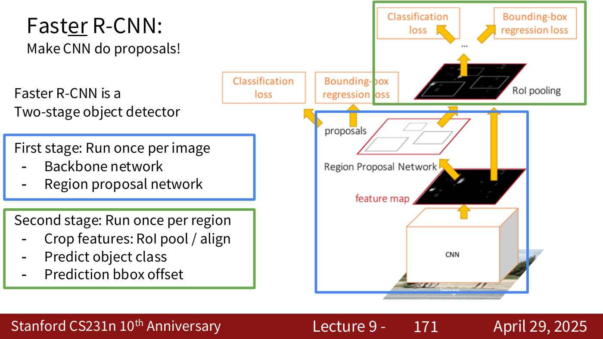

Same figure as slide 167, with two coloured frames drawn over it: a blue rectangle around the lower part (the CNN, feature map, Region Proposal Network and proposals) and a green rectangle around the upper part (the RoI pooling plane, the "..." and the top pair of loss boxes). The left pair of loss boxes (fed by the proposals) lies outside both frames.

Left text: "Faster R-CNN is a Two-stage object detector". A blue-bordered box: "First stage: Run once per image" with dash bullets "Backbone network" and "Region proposal network". A green-bordered box: "Second stage: Run once per region" with dash bullets "Crop features: RoI pool / align", "Predict object class", "Prediction bbox offset" (printed as "Prediction bbox offset").

## Slide 172 — Faster R-CNN: Make CNN do proposals!

Same as slide 171, plus the question at the top centre: "Do we really need the second stage?" No answer is printed on this slide.

## Slide 173 — Object Detection: Lots of variables ...

Text-only slide in three columns.

Column 1: "Backbone Network" followed by the list: VGG16, ResNet-101, Inception V2, Inception V3, Inception ResNet, MobileNet.

Column 2: "“Meta-Architecture”" followed by: "Two-stage: Faster R-CNN", "Single-stage: YOLO / SSD", "Hybrid: R-FCN". Below that: "Image Size", "# Region Proposals", "…".

Column 3: "Takeaways": "Faster R-CNN is slower but more accurate"; "SSD is much faster but not as accurate"; "Bigger / Deeper backbones work better".

Citation (main text): Huang et al, "Speed/accuracy trade-offs for modern convolutional object detectors", CVPR 2017

Small-print citations:
- R-FCN: Dai et al, "R-FCN: Object Detection via Region-based Fully Convolutional Networks", NIPS 2016
- Inception-V2: Ioffe and Szegedy, "Batch Normalization: Accelerating Deep Network Training by Reducing Internal Covariate Shift", ICML 2015
- Inception V3: Szegedy et al, "Rethinking the Inception Architecture for Computer Vision", arXiv 2016
- Inception ResNet: Szegedy et al, "Inception-V4, Inception-ResNet and the Impact of Residual Connections on Learning", arXiv 2016
- MobileNet: Howard et al, "Efficient Convolutional Neural Networks for Mobile Vision Applications", arXiv 2017

## Slide 174 — Object Detection: Lots of variables ...

Same as slide 173, plus one extra line under the Huang et al citation, in blue (link-styled) text: Zou et al, "Object Detection in 20 Years: A Survey", arXiv 2019

## Slide 175 — Intermediate Features via (guided) backprop

Title: "Intermediate Features via (guided) backprop". Figure: a photograph of an elephant on dry grass (left), followed by a small drawing of a convolutional network (an AlexNet-style diagram of stacked boxes and max-pooling layers, labelled with sizes such as 224, 55, 48, 128, 192, 13, 2048, dense, 1000; text in the drawing is too small to read reliably). A red arrow points up at the conv5 block of the diagram (the box whose face is labelled 13 and depth 128).

Text: "Pick a single intermediate channel, e.g. one value in 128 x 13 x 13 conv5 feature map" / "Compute gradient of activation value with respect to image pixels".

Citations:
- Zeiler and Fergus, "Visualizing and Understanding Convolutional Networks", ECCV 2014
- Springenberg et al, "Striving for Simplicity: The All Convolutional Net", ICLR Workshop 2015

## Slide 176 — Intermediate Features via (guided) backprop

Same as slide 175, with the wording changed to: "Pick a single intermediate neuron, e.g. one value in 128 x 13 x 13 conv5 feature map" / "Compute gradient of neuron value with respect to image pixels". Plus a figure panel on the right, labelled "b)" and "ReLU", showing three rows of $3 \times 3$ grids (cells coloured blue, pink or yellow; transcribed here cell by cell from the page).

Row 1, "Forward pass", with a right arrow between the grids. Left grid (the input): rows $[1, -1, 5]$, $[2, -5, -7]$, $[-3, 2, 4]$. Right grid (after ReLU): rows $[1, 0, 5]$, $[2, 0, 0]$, $[0, 2, 4]$. Cells with negative input (and zero output) are pink; the others blue.

Row 2, "Backward pass: backpropagation", with a left arrow from the right grid to the left grid. Right grid (the incoming gradient): rows $[-2, 3, -1]$, $[6, -3, 1]$, $[2, -1, 3]$, with the cells holding negative values coloured yellow (-2, -1, -3, -1) and the positive ones blue. Left grid (result): rows $[-2, 0, -1]$, $[6, 0, 0]$, $[0, -1, 3]$.

Row 3, "Backward pass: guided backpropagation" (words "guided backpropagation" in italics), with a left arrow from the same incoming-gradient grid ($[-2, 3, -1]$, $[6, -3, 1]$, $[2, -1, 3]$) to a result grid: rows $[0, 0, 0]$, $[6, 0, 0]$, $[0, 0, 3]$ (cells coloured: top row yellow, pink, yellow; middle row blue 6, a peach centre, pink; bottom row pink, yellow, blue 3).

Caption text on the right: "Images come out nicer if you only backprop positive gradients through each ReLU (guided backprop)".

Check of the arithmetic: the forward ReLU outputs equal $\max(0, x)$ for every cell. Ordinary backprop passes the incoming gradient only where the forward input was positive, giving the row 2 result. Guided backprop additionally zeroes negative gradients, giving the row 3 result. All values recompute.

Citations (left): Zeiler and Fergus, "Visualizing and Understanding Convolutional Networks", ECCV 2014; Springenberg et al, "Striving for Simplicity: The All Convolutional Net", ICLR Workshop 2015
Figure copyright Jost Tobias Springenberg, Alexey Dosovitskiy, Thomas Brox, Martin Riedmiller, 2015; reproduced with permission.

## Slide 177 — Intermediate features via (guided) backprop

Title: "Intermediate features via (guided) backprop". Two image grids side by side, each $6 \times 10$ (six rows, ten columns).

Left grid, caption "Maximally activating patches (Each row is a different neuron)": small natural-image patches. Row 1 shows eyes/noses of animals and people (an eye close-up, dog faces and noses); row 2 shows curved coloured objects (red, pink and green shapes, beak-like and tongue-like shapes); row 3 shows dark and light curved strokes and edges; row 4 shows text and letters (e.g. "ES", "CH", "AC", "er") on yellow/green/black backgrounds plus a skull-like image; row 5 shows round objects such as wheels, a clock-like and lamp-like objects and text ("Oops!"); row 6 shows bold white and black lettering and printed text pages.

Right grid, caption "Guided Backprop": a grey image of the same layout, where each cell is the guided-backprop result for the patch in the same position of the left grid, showing edges and strokes in muted colours (eye-like circles in row 1, curved strokes in rows 2 and 3, letter shapes such as "ES", "H", "e" in row 4, arcs in row 5, vertical-stroke letter shapes in row 6).

Citations: Zeiler and Fergus, "Visualizing and Understanding Convolutional Networks", ECCV 2014; Springenberg et al, "Striving for Simplicity: The All Convolutional Net", ICLR Workshop 2015
Figure copyright Jost Tobias Springenberg, Alexey Dosovitskiy, Thomas Brox, Martin Riedmiller, 2015; reproduced with permission.

## Slide 178 — Intermediate features via (guided) backprop

Same layout and captions as slide 177 ("Maximally activating patches (Each row is a different neuron)" on the left, "Guided Backprop" on the right), with different neurons (six rows of ten patches each). Left grid: row 1 dogs and cars (dark dog faces, car fronts); row 2 human faces and upper bodies (people in suits, children); row 3 round camera lenses and similar circular objects (one squirrel-like animal); row 4 dogs' faces and heads; row 5 tall objects and varied scenes (towers, a blue car, a green round object, bottles and vases); row 6 mixed items (a person in a hat, a dog's snout, a pink-and-yellow flower, teapots and kettles). Right grid: the guided-backprop result per patch in the same position, grey with faint coloured outlines: faces in row 2, concentric circles in row 3, dog-face outlines in row 4, faint outlines in rows 5 and 6.

Citations: same as slide 177, including "Figure copyright Jost Tobias Springenberg, Alexey Dosovitskiy, Thomas Brox, Martin Riedmiller, 2015; reproduced with permission."

