# Lecture 10 — Video Understanding (slide-by-slide)

Text and figures of all 103 pages of [`lecture_10.pdf`](https://cs231n.stanford.edu/slides/2025/lecture_10.pdf), CS231N (Stanford, Spring 2025), May 1, 2025, a guest lecture by Ruohan Gao (slide 2). Cite these as "slide N" using the **printed** slide number (footer, after "Lecture 10 -"). The running footer ("Stanford CS231n 10th Anniversary", "Lecture 10 - N", "May 1, 2025") is on every page and is not repeated below. Equations are written in LaTeX; tensor shapes are quoted as printed ("T x 3 x H x W").

The deck reveals its diagrams one element at a time, so many slides are build steps of the slide before and are written "Same as slide N, plus …". The full drawing is under the last slide of each build. Several slides embed videos; the PDF holds one still frame of each, and this file describes only that frame.

| Section | Slides |
| --- | --- |
| Title; the guest lecturer | 1–2 |
| Recall: image classification, detection and segmentation; a video frame | 3–6 |
| Video = 2D + time; video classification; videos are big; training on clips | 7–14 |
| Single-frame CNN; late fusion (FC layers, pooling); early fusion; 3D CNN | 15–21 |
| 2D convolution recalled; 3D convolution | 22–23 |
| Early fusion vs late fusion vs 3D CNN: sizes and receptive fields | 24–31 |
| 2D conv (early fusion) vs 3D conv: temporal shift-invariance; first-layer filters | 32–37 |
| Sports-1M; accuracy of the three; C3D and its cost | 38–42 |
| Recognizing actions from motion; optical flow; two-stream networks | 43–48 |
| Long-term temporal structure: CNN features plus an RNN; recurrent convolutional networks | 49–63 |
| Self-attention recalled; spatio-temporal self-attention (nonlocal block) | 64–71 |
| Inflating 2D networks to 3D (I3D) | 72–76 |
| Vision transformers for video; Kinetics-400 progress | 77–78 |
| Visualizing video models | 79–83 |
| Temporal action localization; spatio-temporal detection | 84–86 |
| Audio: the McGurk effect, visually guided source separation, audio-visual video understanding | 87–97 |
| Efficient video understanding | 98–100 |
| Multimodal egocentric video; video understanding and LLMs | 101–102 |
| Next time: large-scale distributed training | 103 |

## Slide numbers vs PDF pages

The deck prints numbers 1–103 on 103 pages, so the printed number and the PDF page number are the same throughout. Ten pages print no number (5, 6, 88–91, 93–95 and 100; most are full-page video stills); each sits between two numbered pages whose numbers equal their page numbers, so its label is certain, and each is marked "inferred" under its heading.

**What the recording covers.** The lecturer is introduced at 0:05 by a member of the course staff and starts at ≈0:51. The recording follows the deck from the recall of image tasks (slides 3–6, ≈0:51–3:10) through video classification and clip training (7–14, ≈3:10–8:35), single-frame, late-fusion, early-fusion and 3D CNNs (15–23, ≈8:35–21:44), the toy-architecture comparison (24–31, ≈21:44–26:23), 2D against 3D convolution and the learned filters (32–37, ≈26:23–31:50), Sports-1M, its results and C3D (38–42, ≈31:50–39:29), motion, optical flow and two-stream networks (43–48, ≈39:29–44:54), long-term structure, CNN plus RNN and recurrent convolutional networks (49–63, ≈44:54–51:09), the nonlocal block (64–71, ≈51:09–54:14), I3D (72–76, ≈54:14–58:07), video transformers (77–78, ≈58:07–59:39), visualization (79–83, ≈59:39–1:01:12) and temporal and spatio-temporal detection (84–86, ≈1:01:12–1:02:44). "In the final 10 minutes" it turns to audio (87–97, ≈1:02:44–1:05:03), efficient video understanding (98–100, ≈1:05:03–1:06:33), egocentric video (101, ≈1:06:33–1:07:19) and video foundation models with LLMs (102, ≈1:07:19), ending at ≈1:08:45 without reaching slide 103. The captions do not mention the McGurk slides (89–91) or the VisualVoice stills by name; they mark a change of speaker at ≈1:02:44, which may be a video playing, but do not say what was played. The tables of slides 24–31 and 40–41 are walked through in words; their exact values are on the slides only. See the [transcript](../transcripts/10-video-understanding.md).

**Slides repeated from earlier decks.** Slide 3's cat is lecture 2's slide 7. Slide 4's four tasks are lecture 1's part 2, slide 14 (and lecture 9's slides 31, 33, 66, 67, 113 and 125). Slide 22's convolution figure is lecture 5's slide 56. Slide 57's three-layer RNN is lecture 7's slide 104. Slide 64 recalls self-attention in lowercase notation ($e_{i,j}$, $a_{i,j}$), not lecture 8's.

**Printed slips, transcribed as printed with `[Ed:]` lines.** Slide 30's 3D CNN table prints its global-average-pool output as "24 x 1 x 1", a dimension short of its C x T x H x W column (the output is $24 \times 1 \times 1 \times 1$, as the Late Fusion row prints it; slide 31 repeats it). Slides 35–37 label the 3D kernel "Slide over x and y", copied from the 2D slide, although slide 36 says the filter "slides over time". Slide 41's column is headed "MFLOPs" but holds GFLOPs (it sums to the slide's 39.5 GFLOP), and its three fully connected rows (0.51, 0.45, 0.05) do not recompute from the layer sizes, where every convolution row does. Slide 75 says to "copy $K_t$ times in space" where the copies go along time, as its own figure shows. Smaller typos are noted in place: "compute vision" (2), "Dual Making" (77), "Christoph Feichtenhofers" (80), "Gabby et al." (92), "Pandal et al." (99), "From and Egocentric-Exocentric Perspective" (101). Slides 76 and 78 give the same Kinetics-400 numbers different names: 71.1 is "Inflated CNN" on 76 and "I3D" on 78, and 74.2 is "Two-stream inflated CNN" on 76 and "Inflated I3D" on 78. Worked values that recompute: slide 10's "~1.5" and "~10 GB per minute" (in binary gigabytes) and slide 11's 588 KB clip; every size and receptive field of slides 24–31; every convolution row of slide 41, and its "2.9x VGG"; I3D's inflation on slide 75.

**Images.** 47 slides are rendered as images, each placed under its heading: 5, 7, 9, 14, 15, 16, 18, 20, 21, 22, 23, 28, 34, 36, 37, 38, 42, 46, 47, 48, 50, 53, 55, 58, 61, 63, 64, 70, 71, 74, 75, 76, 77, 78, 79, 81, 83, 85, 86, 92, 96, 97, 98, 99, 100, 101 and 102. The others have none, because they are the title (1), a photograph of the guest lecturer (2), text slides (10, 11, 72, 103), figures rendered for an earlier lecture (3, lecture 2's slide 7; 4, lecture 1's part 2, slide 14; 57, lecture 7's slide 104), video stills whose content is the video or its sound (6, 43, 88, 89–91, 93–95), tables transcribed exactly (29–31, 40, 41), build steps whose last step is rendered (8 → 9; 12–13 → 14; 17 → 18; 19 → 20; 24–27 → 28; 32–33 → 34; 35 → 36; 39 → 42; 44–45 → 46; 49 → 50; 51–52 → 53; 54 → 55; 60 → 61; 62 → 63; 65–69 → 70; 73 → 74; 80 → 81; 82 → 83), or a rendered figure repeated with new text (56 → 53; 59 → 61; 84 → 9; 87 → 7). Never construct an image path for a slide not listed here.

Companion pages: [wiki page for this lecture](../../wiki/10-video-understanding.md) · [transcript](../transcripts/10-video-understanding.md)

## Slide 1 — Lecture 10: Video Understanding

Title slide. Text: "Lecture 10:" and "Video Understanding". No other content.

## Slide 2 — Instructor today

Figure: on the left, a head-and-shoulders photograph of a smiling man with short black hair and glasses, wearing a dark navy shirt, against a grey mottled backdrop. Below it: "Ruohan Gao" and the link "https://ruohangao.github.io/".

Centre-left text: "I taught CS231N at Stanford from 2021-2023" and, lower down, "Teaching multimodal compute vision now." (as printed, "compute vision").

A vertical red arrow points downward along the right-centre, with four labels beside it, each next to a photograph at the far right, top to bottom:
- "Ph.D. at UT Austin" (aerial photograph of a campus with a tall tower and red-roofed buildings)
- "Postdoc at Stanford" (aerial photograph of a sandstone campus quad with a lawn and palm trees)
- "Some time at Meta" (photograph of a person wearing glasses seated on a sofa in a living room with floating interface panels; a Meta logo at top left)
- "University of Maryland, College Park" (photograph of a modern glass-fronted building above a lawn)

## Slide 3 — Recall: (2D) Image classification

Figure: a photograph of a grey tabby cat sitting, facing slightly left. A black arrow points right from the photograph to the word "cat".

Text above the arrow: "(assume given a set of possible labels)" and "{dog, cat, truck, plane, ...}".

Credit line under the photograph: "This image by Nikita is licensed under CC-BY 2.0".

## Slide 4 — Last Lecture: (2D) Detection and Segmentation

Figure: four columns, each with a heading, an image and a label line.

- "Classification": photograph of a kitten walking on grass. Label: "CAT". Brace caption below: "No spatial extent".
- "Semantic Segmentation": a flat-colour map of the same scene (blue sky, purple band, green grass, yellow cat). Label: "GRASS, CAT, TREE, SKY" with each word in its map colour (green, yellow, purple, blue). Brace caption: "No objects, just pixels".
- "Object Detection": photograph of two dogs and a white cat in front of a Christmas tree, with three boxes (red around the left dog, green around the middle dog, blue around the cat). Label: "DOG, DOG, CAT" in red, green and blue.
- "Instance Segmentation": the same photograph with three filled masks (red left dog, green middle dog, blue cat). Label: "DOG, DOG, CAT" in red, green and blue.

One brace under the last two columns carries the caption "Multiple Objects".

Credit line (bottom right): "This image is CC0 public domain".

## Slide 5 — [Video frame: living room with dog and baby, labelled]

![Slide 5 — [Video frame: living room with dog and baby, labelled]](../images/10-video-understanding/slide-5.jpg)

*(This page prints no slide number; 5 is inferred from its neighbours.)*

This appears to be a video still, with no title and no text other than the overlay labels. Visible: a living room with a dark blue star-patterned sofa, a pale carpet and toys. A blue filled outline of a dog (left) sits inside a green rectangle labelled "Dog" in yellow; a purple filled outline of a baby (lower right) sits inside a green rectangle labelled "Baby" in yellow. Top right, in light blue: "Living room".

## Slide 6 — [Video frame: baby and soap bubbles]

*(This page prints no slide number; 6 is inferred from its neighbours.)*

This appears to be a video still, with no text. Visible: the same living room (blue sofa, carpet, pink toys), several soap bubbles in the upper centre, and a smiling baby in a purple top and denim dungarees at the lower right.

## Slide 7 — Today: Video = 2D + Time

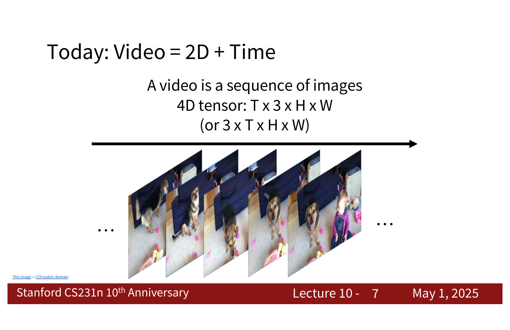

Text: "A video is a sequence of images", "4D tensor: T x 3 x H x W", "(or 3 x T x H x W)".

Figure: a long black arrow runs left to right under the text. Beneath it, five slanted (parallelogram) frames overlap in a row, each a still of the living room scene: a dog moving across the room in the first four, and the dog facing the camera with the baby on the right in the fifth. Ellipses "..." stand at the left and right ends, indicating that the sequence continues.

Credit line (bottom left): "This image is CC0 public domain".

## Slide 8 — Example task: Video Classification

Figure: a still of a person in a white shirt and shorts seen from behind, running along a pavement beside a wall, with parked cars ahead. Caption under it: "Input video:" and "T x 3 x H x W". A thick black arrow points right to a list of five labels: "Swimming", "Running", "Jumping", "Eating", "Standing". No label is marked as the answer.

Credit line (bottom left): "Running video is in the public domain".

## Slide 9 — Example task: Video Classification

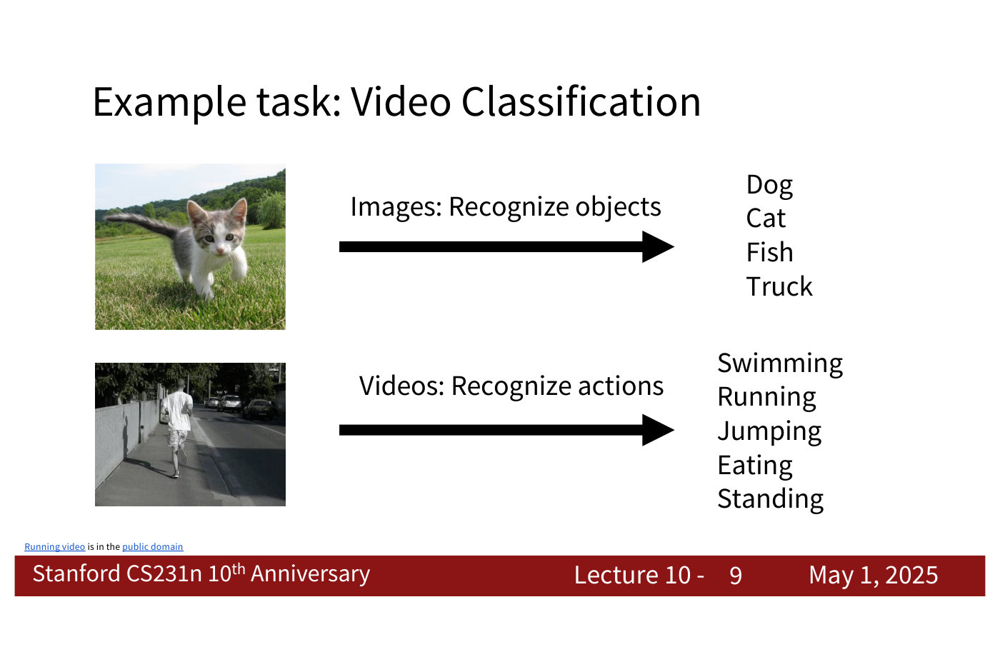

Same running-person still, now as one of two rows.

- Top row: a kitten-on-grass photograph, an arrow labelled "Images: Recognize objects", and the list "Dog", "Cat", "Fish", "Truck".
- Bottom row: the running-person still, an arrow labelled "Videos: Recognize actions", and the list "Swimming", "Running", "Jumping", "Eating", "Standing".

Credit line (bottom left): "Running video is in the public domain".

## Slide 10 — Problem: Videos are big!

Left: the running-person still captioned "Input video:" and "T x 3 x H x W". Right, text:

"Videos are ~30 frames per second (fps)"

"Size of uncompressed video (3 bytes per pixel):"

"SD (640 x 480): ~1.5 GB per minute"
"HD (1920 x 1080): ~10 GB per minute"

*[Ed: Recomputed at 30 fps and 3 bytes per pixel: SD is 640 x 480 x 3 = 921,600 bytes per frame, or 1.66 billion bytes per minute; HD is 1920 x 1080 x 3 = 6,220,800 bytes per frame, or 11.2 billion bytes per minute. In binary units (2^30 bytes) these are 1.54 and 10.4 GB, which is what the printed "~1.5" and "~10" match; slide 11's "588 KB" is likewise 602,112 / 1024. No slip.]*

## Slide 11 — Problem: Videos are big!

Same as slide 10, plus a new paragraph at the bottom right: "Solution: Train on short clips: low fps and low spatial resolution", "e.g. T = 16, H=W=112", "(3.2 seconds at 5 fps, 588 KB)".

*[Ed: Recomputed: 16 x 3 x 112 x 112 = 602,112 bytes, which is 588 KB in binary units (602,112 / 1024 = 588), and 16 frames at 5 fps is 3.2 seconds. Both printed values agree.]*

## Slide 12 — Training on Clips

Text: "Raw video: Long, high FPS". Figure: a single row of 17 small thumbnails of the running-person video, left to right, all at full contrast (counted on the page).

## Slide 13 — Training on Clips

Same as slide 12, plus a second line of text: "Training: Train model to classify short clips with low FPS". Below it, the same row of 17 thumbnails, mostly faded to light grey. A blue rectangle encloses the first 7 thumbnails, of which the 1st, 4th and 7th are shown at full contrast and the others faded. Thumbnails 8 to 10 are faded and outside both rectangles. A dark-red rectangle encloses the last 7 thumbnails (11th to 17th), of which the 11th, 14th and 17th are at full contrast. So each rectangle picks every third frame within a window: a short, low-fps clip. No label is printed on the rectangles.

## Slide 14 — Training on Clips

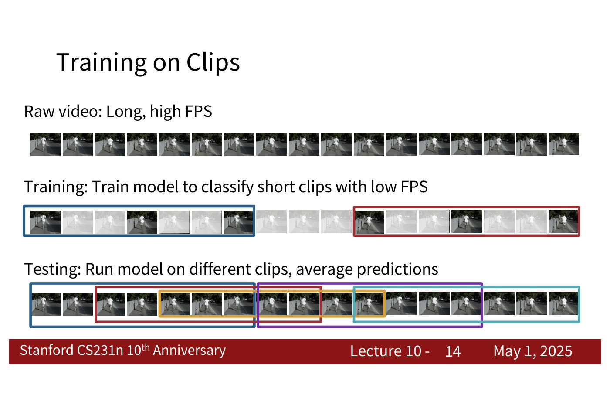

Same as slides 12 and 13, plus a third line of text: "Testing: Run model on different clips, average predictions". Below it, a third row of 17 thumbnails, all at full contrast, with five overlapping rectangles, each enclosing 7 consecutive thumbnails (counted on the page). From the left, numbering thumbnails 1 to 17:
- blue rectangle: thumbnails 1-7;
- dark-red rectangle: thumbnails 3-9;
- gold rectangle: thumbnails 5-11;
- purple rectangle: thumbnails 8-14;
- teal rectangle: thumbnails 11-17.

The rows above (raw video and training) are as on slide 13: raw row of 17 thumbnails, and the training row with the blue and dark-red rectangles around 7 thumbnails each.

## Slide 15 — Video Classification: Single-Frame CNN

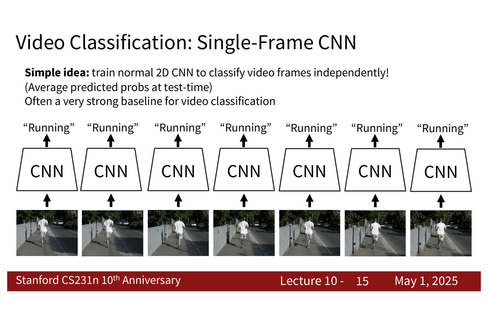

Text: "**Simple idea:** train normal 2D CNN to classify video frames independently!" "(Average predicted probs at test-time)" "Often a very strong baseline for video classification".

Figure: seven columns side by side. Each column is a still of the running person (bottom), an upward arrow into a trapezoid box labelled "CNN", and an upward arrow out of it to the quoted label "Running". The seven CNN boxes are drawn separately, with no connection between columns. Count: 7 frames, 7 CNN boxes, 7 outputs, all labelled "Running".

## Slide 16 — Video Classification: Late Fusion (with FC layers)

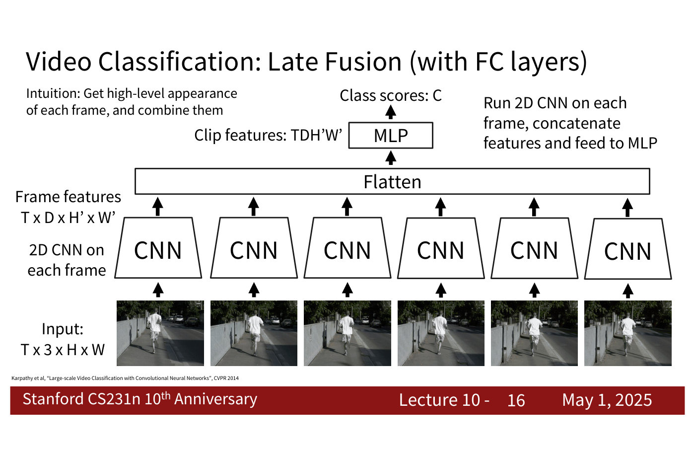

Text, upper left: "Intuition: Get high-level appearance of each frame, and combine them". Upper right: "Run 2D CNN on each frame, concatenate features and feed to MLP".

Figure, bottom to top:
- Row of 6 frames, labelled at left "Input: T x 3 x H x W".
- An upward arrow from each frame into its own trapezoid "CNN" box (6 CNN boxes), labelled at left "2D CNN on each frame".
- An upward arrow from each CNN to one wide box labelled "Flatten" spanning all six columns; the arrows are labelled at left "Frame features T x D x H' x W'".
- One arrow from "Flatten" to a box labelled "MLP"; the label to the left of the arrow reads "Clip features: TDH'W'" (as printed).
- One arrow from "MLP" to "Class scores: C".

Citation (bottom left): Karpathy et al, "Large-scale Video Classification with Convolutional Neural Networks", CVPR 2014

## Slide 17 — Video Classification: Late Fusion (with pooling)

Same layout as slide 16, with two changes. The wide box is labelled "Average Pool over space and time" instead of "Flatten", and the box above it is "Linear" instead of "MLP". Labels: "Clip features: D" (instead of "TDH'W'"), "Class scores: C", "Frame features T x D x H' x W'", "2D CNN on each frame", "Input: T x 3 x H x W". Upper-right text: "Run 2D CNN on each frame, pool features and feed to Linear". Upper-left text: "Intuition: Get high-level appearance of each frame, and combine them". Count: 6 frames, 6 CNN boxes.

No citation is printed on this slide.

## Slide 18 — Video Classification: Late Fusion (with pooling)

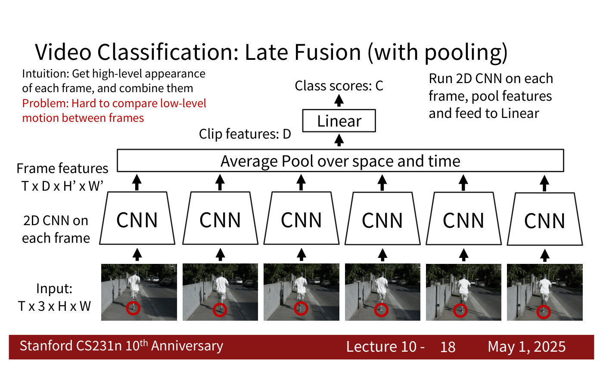

Same as slide 17, plus a red line under the intuition text: "Problem: Hard to compare low-level motion between frames". A small red circle is drawn around the runner's feet in each of the 6 input frames (the circle sits at a slightly different height in different frames). The label "2D CNN on each frame" is on two lines here.

## Slide 19 — Video Classification: Early Fusion

Text, upper left: "Intuition: Compare frames with very first conv layer, after that normal 2D CNN".

Figure: a row of 6 input frames, labelled at left "Input: T x 3 x H x W". A black bracket line joins the tops of all six frames into a single arrow that enters one trapezoid box labelled "2D CNN". The label at left of the bracket is "Reshape: 3T x H x W". An arrow from the trapezoid leads to "Class scores: C". There is only one CNN box (count: 1). Further text:
- beside the bracket: "First 2D convolution collapses all temporal information:" "Input: 3T x H x W" "Output: D x H x W";
- right of the trapezoid: "Rest of the network is standard 2D CNN".

Citation (bottom left): Karpathy et al, "Large-scale Video Classification with Convolutional Neural Networks", CVPR 2014

## Slide 20 — Video Classification: Early Fusion

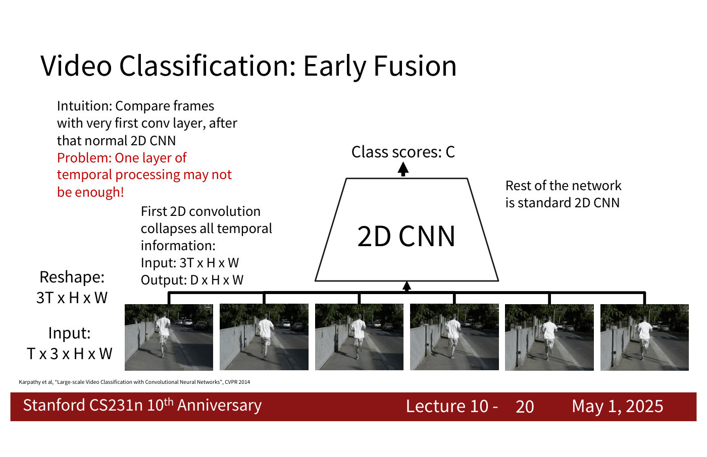

Same as slide 19, plus a red line under the intuition text: "Problem: One layer of temporal processing may not be enough!"

Citation as on slide 19.

## Slide 21 — Video Classification: 3D CNN

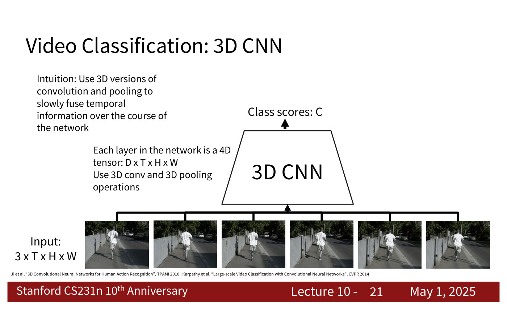

Text, upper left: "Intuition: Use 3D versions of convolution and pooling to slowly fuse temporal information over the course of the network".

Figure: a row of 6 input frames, labelled at left "Input: 3 x T x H x W". A black bracket line joins the six frames into one arrow entering a single trapezoid labelled "3D CNN" (count: 1). An arrow leads from the trapezoid to "Class scores: C". Text beside the trapezoid: "Each layer in the network is a 4D tensor: D x T x H x W" "Use 3D conv and 3D pooling operations".

Citations (bottom): Ji et al, "3D Convolutional Neural Networks for Human Action Recognition", TPAMI 2010 ; Karpathy et al, "Large-scale Video Classification with Convolutional Neural Networks", CVPR 2014

## Slide 22 — Convolution Layer

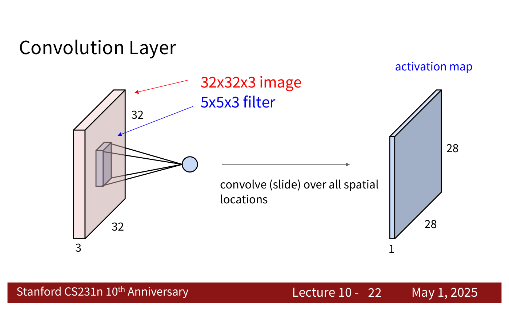

Figure (a 2D-convolution reminder): on the left, a slab drawn as a 3D box, labelled with a red arrow "32x32x3 image", with dimension labels "32", "32" and "3" along its edges. A small box inside it is labelled by a blue arrow "5x5x3 filter". Lines connect the small box to one circle (a single output neuron). An arrow from the circle to the right carries the caption "convolve (slide) over all spatial locations". On the right, a thin slab labelled "activation map" in blue, with dimension labels "28", "28" and "1".

No other text is printed.

## Slide 23 — 3D Convolution

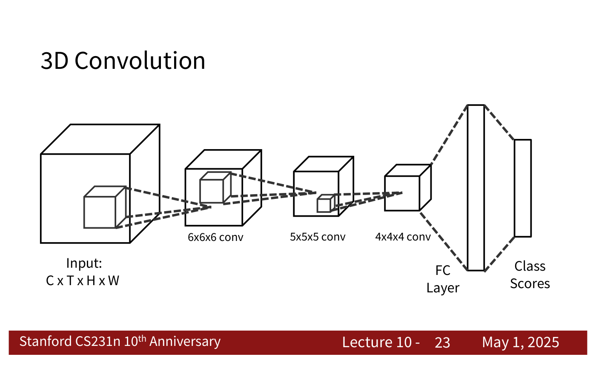

Figure: a left-to-right chain of cubes joined by dashed lines that narrow from each small sub-cube to a point in the next cube. Count: 4 cubes plus 2 bars.
- Large cube labelled underneath "Input: C x T x H x W", with a smaller cube drawn inside it.
- Medium cube labelled "6x6x6 conv", with a small cube drawn inside it.
- Smaller cube labelled "5x5x5 conv", with a tiny cube drawn inside it.
- Smallest cube labelled "4x4x4 conv".
- A tall narrow rectangle labelled "FC Layer", joined by dashed lines to the smallest cube.
- A shorter rectangle labelled "Class Scores", joined by dashed lines to the FC layer.

The slide prints no feature-map channel counts or output sizes, and does not say what the "6x6x6", "5x5x5" and "4x4x4" labels refer to beyond being printed under their cubes.

## Slide 24 — Early Fusion vs Late Fusion vs 3D CNN

Row label at left: "Late Fusion". A table (only partly revealed on this slide; its lower rows are not yet shown) with columns "Layer", "Size (C x T x H x W)" and "Receptive Field (T x H x W)":

| Layer | Size (C x T x H x W) | Receptive Field (T x H x W) |
| --- | --- | --- |
| Input | 3 x 20 x 64 x 64 | |
| Conv2D(3x3, 3->12) | 12 x 20 x 64 x 64 | 1 x 3 x 3 |

Bottom right note: "(Small example architectures, in practice much bigger)".

## Slide 25 — Early Fusion vs Late Fusion vs 3D CNN

Same as slide 24, plus a diagram at the lower left: two rows of 20 circles, labelled "Input" (bottom row) and "Conv(3x3)" (top row). Three circles in the input row (the 8th to 10th from the left) are red, joined by two lines to one red circle in the conv row (the 9th). All other circles are blue. The diagram shows one dimension only; the slide does not say which one.

## Slide 26 — Early Fusion vs Late Fusion vs 3D CNN

Same as slide 25, plus a third row and a new table row:

| Layer | Size (C x T x H x W) | Receptive Field (T x H x W) |
| --- | --- | --- |
| Input | 3 x 20 x 64 x 64 | |
| Conv2D(3x3, 3->12) | 12 x 20 x 64 x 64 | 1 x 3 x 3 |
| Pool2D(4x4) | 12 x 20 x 16 x 16 | 1 x 6 x 6 |

Diagram: a new top row of 5 circles labelled "Pool(4x4)", each joined by two lines to the outer circles of the 4 conv-row circles beneath it (the pool row covers the 20 conv circles in groups of 4). The red highlight now runs through three rows: 6 red circles in the input row (8th to 13th from the left), 4 red circles in the conv row (9th to 12th, the group under the third pool circle), and the third circle of the pool row. All other circles are blue.

*[Ed: Recomputed, no slip: the 4 x 4 pooling cuts 64 x 64 to 16 x 16, and the receptive field grows from 3 to 3 + (4 - 1) = 6 along each spatial dimension. The temporal size 20 and temporal receptive field 1 are unchanged by 2D layers.]*

## Slide 27 — Early Fusion vs Late Fusion vs 3D CNN

Label at left: "Late Fusion". Table (columns: "Layer", "Size (C x T x H x W)", "Receptive Field (T x H x W)"), shown only down to its fourth row (the table is cropped there):

| Layer | Size (C x T x H x W) | Receptive Field (T x H x W) |
| --- | --- | --- |
| Input | 3 x 20 x 64 x 64 | |
| Conv2D(3x3, 3->12) | 12 x 20 x 64 x 64 | 1 x 3 x 3 |
| Pool2D(4x4) | 12 x 20 x 16 x 16 | 1 x 6 x 6 |
| Conv2D(3x3, 12->24) | 24 x 20 x 16 x 16 | 1 x 14 x 14 |

Note to the right of the table: "Build slowly in space". Bottom right: "(Small example architectures, in practice much bigger)".

Figure (lower left): a node-and-edge diagram of one row of nodes per layer, labelled at the left, bottom to top: "Input", "Conv(3x3)", "Pool(4x4)", "Conv(3x3)". The Input row has 20 dots and the first Conv(3x3) row has 20 dots; the Pool(4x4) row has 5 dots and the top Conv(3x3) row has 5 dots. Lines connect one dot to the dots it depends on. Dots in the receptive field of the middle dot of the top row are red; all other dots are blue. Red dots: the middle top dot, 3 dots in the Pool row (the second to fourth), 12 dots in the lower Conv row (the 5th to 16th) and 14 dots in the Input row (the 4th to 17th), with 3 blue dots at each end of the Input row and 4 blue dots at each end of the lower Conv row, so the red region widens going down, as the receptive field grows with depth. The figure shows a one-dimensional slice of the input.

## Slide 28 — Early Fusion vs Late Fusion vs 3D CNN

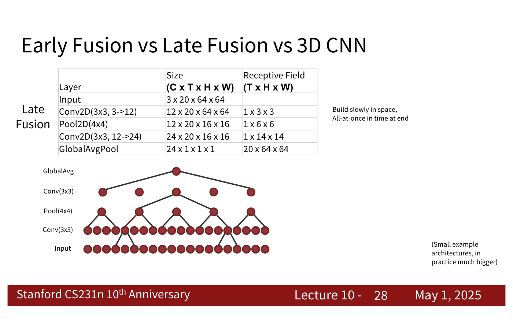

Same as slide 27, plus a fifth table row:

| Layer | Size (C x T x H x W) | Receptive Field (T x H x W) |
| --- | --- | --- |
| GlobalAvgPool | 24 x 1 x 1 x 1 | 20 x 64 x 64 |

The note to the right now reads "Build slowly in space, All-at-once in time at end". In the node diagram a fifth row labelled "GlobalAvg" is added on top with a single dot, joined by lines to the outer two (1st and 5th) dots of the top Conv(3x3) row, the same way each pool dot is joined to the outer dots of its group. Every dot in the diagram is now red (all 20 input dots are in the receptive field of the single top dot). "(Small example architectures, in practice much bigger)" stays at the bottom right.

## Slide 29 — Early Fusion vs Late Fusion vs 3D CNN

The Late Fusion table of slide 28 (all five rows, same values) with the node diagram removed, plus a second table under it labelled "Early Fusion" at the left. The note beside Late Fusion: "Build slowly in space, All-at-once in time at end". The Early Fusion table (the bottom edge of the table is cut off on this page; its last row reads as on slide 30):

| Layer | Size (C x T x H x W) | Receptive Field (T x H x W) |
| --- | --- | --- |
| Input | 3 x 20 x 64 x 64 | |
| Conv2D(3x3, 3\*20->12) | 12 x 64 x 64 | 20 x 3 x 3 |
| Pool2D(4x4) | 12 x 16 x 16 | 20 x 6 x 6 |
| Conv2D(3x3, 12->24) | 24 x 16 x 16 | 20 x 14 x 14 |
| GlobalAvgPool | 24 x 1 x 1 | 20 x 64 x 64 |

Note beside Early Fusion: "Build slowly in space, All-at-once in time at start". Bottom right: "(Small example architectures, in practice much bigger)".

## Slide 30 — Early Fusion vs Late Fusion vs 3D CNN

Same as slide 29 (Late Fusion and Early Fusion tables, now both complete), plus a third table labelled "3D CNN" at the left:

| Layer | Size (C x T x H x W) | Receptive Field (T x H x W) |
| --- | --- | --- |
| Input | 3 x 20 x 64 x 64 | |
| Conv3D(3x3x3, 3->12) | 12 x 20 x 64 x 64 | 3 x 3 x 3 |
| Pool3D(4x4x4) | 12 x 5 x 16 x 16 | 6 x 6 x 6 |
| Conv3D(3x3x3, 12->24) | 24 x 5 x 16 x 16 | 14 x 14 x 14 |
| GlobalAvgPool | 24 x 1 x 1 | 20 x 64 x 64 |

Note beside the 3D CNN table: "Build slowly in space, Build slowly in time "Slow Fusion"" (the quotation marks are printed around Slow Fusion). Bottom right: "(Small example architectures, in practice much bigger)".

*[Ed: Recomputed: every receptive field follows from the layers (a 3-wide convolution after a pool of 4 adds 2 x 4 = 8, so 6 becomes 14; the 3D pool of 4 takes the time extent from 3 to 6 as well), and the 3D pooling shrinks time from 20 to 5 and space from 64 to 16. One printed form is short a dimension: the 3D CNN's GlobalAvgPool row prints "24 x 1 x 1", where its other sizes have four dimensions (C x T x H x W) and the output is 24 x 1 x 1 x 1, as the Late Fusion row prints it. The Early Fusion row's "24 x 1 x 1" is consistent with its own three-dimensional sizes, since its first layer removes T. Kept as printed.]*

## Slide 31 — Early Fusion vs Late Fusion vs 3D CNN

Same as slide 30, plus the text "What is the difference?" at the top right, and two rows highlighted in pink: the Early Fusion "Conv2D(3x3, 3\*20->12)" row and the 3D CNN "Conv3D(3x3x3, 3->12)" row. No answer is printed on this slide.

## Slide 32 — 2D Conv (Early Fusion) vs 3D Conv (3D CNN)

Title with "2D Conv (Early Fusion)" underlined. Three columns:

Left, "Input: C_in x T x H x W (3D grid with C_in-dim feat at each point)": a cube drawn as an empty box with "H = 224", "W = 224" and "T = 16" labels on its three edges.

Middle, "Weight: C_out x C_in x T x 3 x 3, Slide over x and y": a long thin box, as long as the T axis (labelled "T = 16") with a small 3 x 3 end face, and two arrows beside it (one pointing up, one pointing right). Caption below: "C_out different filters".

Right, "Output: C_out x H x W, 2D grid with C_out - dim feat at each point": a thin slab with "H = 224" and "W = 224".

## Slide 33 — 2D Conv (Early Fusion) vs 3D Conv (3D CNN)

Same as slide 32, plus red text above the filters: "No temporal shift-invariance! Needs to learn separate filters for the same motion at different times in the clip". The weight drawing now shows two long filter boxes, each blue at one end and orange (tan) at the other, with the blue part occupying a different length in each, marking different filters for blue-to-orange at different times. The arrows beside the filter are removed. Caption still "C_out different filters".

## Slide 34 — 2D Conv (Early Fusion) vs 3D Conv (3D CNN)

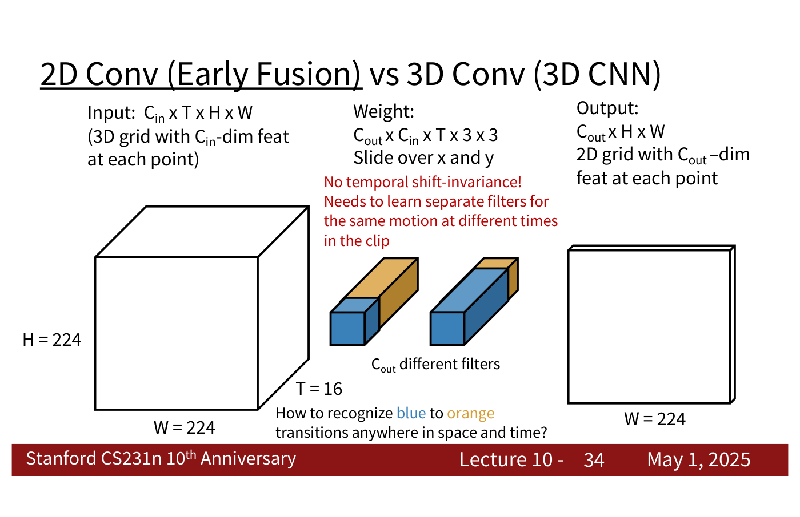

Same as slide 33, plus at the bottom: "How to recognize blue to orange transitions anywhere in space and time?" ("blue" is printed in blue and "orange" in orange).

## Slide 35 — 2D Conv (Early Fusion) vs 3D Conv (3D CNN)

Title with "3D Conv (3D CNN)" underlined instead. Three columns:

Left: "Input: C_in x T x H x W (3D grid with C_in-dim feat at each point)" with the same cube (H = 224, W = 224, T = 16).

Middle: "Weight: C_out x C_in x 3 x 3 x 3, Slide over x and y". A small cube labelled "T = 3" with three arrows (up, right and diagonal). Caption "C_out different filters".

Right: "Output: C_out x T x H x W, 3D grid with C_out-dim feat at each point", drawn as a cube with "H = 224" and "W = 224".

Bottom: "How to recognize blue to orange transitions anywhere in space and time?" (as on slide 34).

*[Ed: The weight label still reads "Slide over x and y", as on slide 32, although a 3 x 3 x 3 filter on a T x H x W grid also slides over time, as slide 36 says ("each filter slides over time!") and as the output's T dimension shows. Kept as printed; slides 36 and 37 repeat it.]*

## Slide 36 — 2D Conv (Early Fusion) vs 3D Conv (3D CNN)

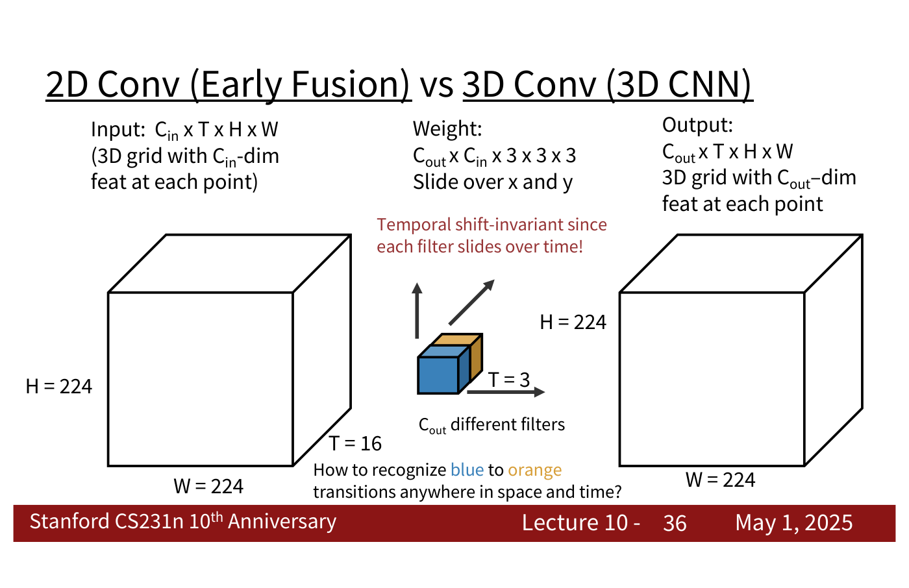

Same as slide 35, plus dark red text above the filter: "Temporal shift-invariant since each filter slides over time!" The small cube ("T = 3", with its three arrows: up, diagonal and right) is now coloured blue on its front and side and orange on its rear and top.

## Slide 37 — 2D Conv (Early Fusion) vs 3D Conv (3D CNN)

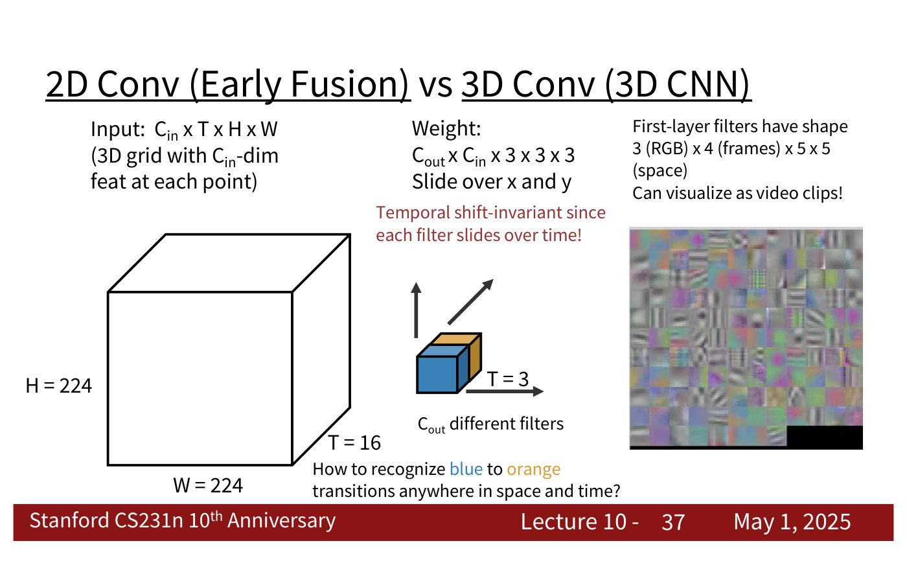

Same as slide 36 with the output cube replaced, at the top right, by the text "First-layer filters have shape 3 (RGB) x 4 (frames) x 5 x 5 (space) Can visualize as video clips!" and below it a mosaic image of first-layer filters: a grid of small square tiles, 12 columns by 11 rows, mostly grey, purple, green and pink with some blue, orange, red, teal and yellow-green, showing oriented stripe or colour-blob patterns. The last row has 8 tiles followed by a black block where the last 4 would be. (The tiles are static frames; the slide gives no source for the image.)

## Slide 38 — Example Video Dataset: Sports-1M

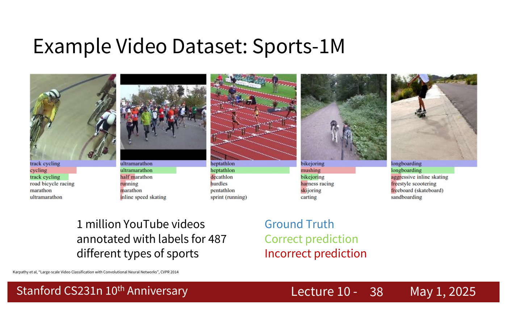

Figure: five video frames side by side, each with six labels beneath it: the ground-truth label on a blue bar (the colour key at the bottom marks blue as ground truth), then five predicted labels, with green or red bars of different lengths behind some of them (green for a correct prediction, red for an incorrect one; a label with no visible bar has a near-zero one). From left to right:

- Frame 1 (cyclists on a track): "track cycling" (blue), "cycling" (red bar), "track cycling" (green bar), "road bicycle racing", "marathon", "ultramarathon" as printed, with the last three unbarred.
- Frame 2 (runners in a road race, letterboxed with black bars): "ultramarathon" (blue), "ultramarathon" (green bar), then short thin red bars behind "half marathon", "running", "marathon" and "inline speed skating".
- Frame 3 (hurdlers on a red track): "heptathlon" (blue), "heptathlon" (green bar), "decathlon" (short red bar), "hurdles" (very short red bar), "pentathlon", "sprint (running)" (no visible bars).
- Frame 4 (two dogs on a path): "bikejoring" (blue), "mushing" (red bar), "bikejoring" (green bar), "harness racing" and "skijoring" (red bars), "carting" (no visible bar).
- Frame 5 (a person on a skateboard on a road, upper body cropped): "longboarding" (blue), "longboarding" (green bar), red bars behind "aggressive inline skating", "freestyle scootering" and "freeboard (skateboard)", "sandboarding" (no visible bar).

So the correct label is ranked first in frames 2, 3 and 5 and second in frames 1 and 4, where the top prediction ("cycling", "mushing") is wrong.

Text at the bottom: "1 million YouTube videos annotated with labels for 487 different types of sports". Colour key: "Ground Truth" (blue), "Correct prediction" (green), "Incorrect prediction" (red).

Citation: Karpathy et al, "Large-scale Video Classification with Convolutional Neural Networks", CVPR 2014.

## Slide 39 — Early Fusion vs Late Fusion vs 3D CNN

Bar chart titled "Sports-1M Top-5 Accuracy". Vertical axis ticks 70, 75, 80, 85 (no axis title). One series (all bars blue) over four categories, with printed values:

- Single Frame: 77.7
- Early Fusion: 76.8
- Late Fusion: 78.7
- 3D CNN: 80.2

Text at the right: "Single Frame model works well - always try this first!" and "3D CNNs have improved a lot since 2014!"

(The PDF's text layer also holds a fifth bar, "C3D" at 84.4, which is not visible on this page; it appears on slide 42.)

Citation: Karpathy et al, "Large-scale Video Classification with Convolutional Neural Networks", CVPR 2014.

## Slide 40 — C3D: The VGG of 3D CNNs

Text at left: "3D CNN that uses all 3x3x3 conv and 2x2x2 pooling (except Pool1 which is 1x2x2)" and "Released model pretrained on Sports-1M: Many people used this as a video feature extractor".

Table at the right (columns "Layer", "Size"; convolution rows shaded beige, pooling rows light blue, fully connected rows pink; 16 layer rows after the input, 8 convolutions, 5 poolings and 3 fully connected layers):

| Layer | Size |
| --- | --- |
| Input | 3 x 16 x 112 x 112 |
| Conv1 (3x3x3) | 64 x 16 x 112 x 112 |
| Pool1 (1x2x2) | 64 x 16 x 56 x 56 |
| Conv2 (3x3x3) | 128 x 16 x 56 x 56 |
| Pool2 (2x2x2) | 128 x 8 x 28 x 28 |
| Conv3a (3x3x3) | 256 x 8 x 28 x 28 |
| Conv3b (3x3x3) | 256 x 8 x 28 x 28 |
| Pool3 (2x2x2) | 256 x 4 x 14 x 14 |
| Conv4a (3x3x3) | 512 x 4 x 14 x 14 |
| Conv4b (3x3x3) | 512 x 4 x 14 x 14 |
| Pool4 (2x2x2) | 512 x 2 x 7 x 7 |
| Conv5a (3x3x3) | 512 x 2 x 7 x 7 |
| Conv5b (3x3x3) | 512 x 2 x 7 x 7 |
| Pool5 | 512 x 1 x 3 x 3 |
| FC6 | 4096 |
| FC7 | 4096 |
| FC8 | C |

Citation: Tran et al, "Learning Spatiotemporal Features with 3D Convolutional Networks", ICCV 2015.

## Slide 41 — C3D: The VGG of 3D CNNs

Same text as slide 40 plus: "Problem: 3x3x3 conv is very expensive! AlexNet: 0.7 GFLOP VGG-16: 13.6 GFLOP C3D: 39.5 GFLOP (2.9x VGG!)" (the words AlexNet, VGG-16 and C3D are underlined). The table gains a third column, "MFLOPs":

| Layer | Size | MFLOPs |
| --- | --- | --- |
| Input | 3 x 16 x 112 x 112 | |
| Conv1 (3x3x3) | 64 x 16 x 112 x 112 | 1.04 |
| Pool1 (1x2x2) | 64 x 16 x 56 x 56 | |
| Conv2 (3x3x3) | 128 x 16 x 56 x 56 | 11.10 |
| Pool2 (2x2x2) | 128 x 8 x 28 x 28 | |
| Conv3a (3x3x3) | 256 x 8 x 28 x 28 | 5.55 |
| Conv3b (3x3x3) | 256 x 8 x 28 x 28 | 11.10 |
| Pool3 (2x2x2) | 256 x 4 x 14 x 14 | |
| Conv4a (3x3x3) | 512 x 4 x 14 x 14 | 2.77 |
| Conv4b (3x3x3) | 512 x 4 x 14 x 14 | 5.55 |
| Pool4 (2x2x2) | 512 x 2 x 7 x 7 | |
| Conv5a (3x3x3) | 512 x 2 x 7 x 7 | 0.69 |
| Conv5b (3x3x3) | 512 x 2 x 7 x 7 | 0.69 |
| Pool5 | 512 x 1 x 3 x 3 | |
| FC6 | 4096 | 0.51 |
| FC7 | 4096 | 0.45 |
| FC8 | C | 0.05 |

Citation: Tran et al, ICCV 2015 (as on slide 40).

*[Ed: The column is headed "MFLOPs", but its values add up to 39.50 (1.04 + 11.10 + 5.55 + 11.10 + 2.77 + 5.55 + 0.69 + 0.69 + 0.51 + 0.45 + 0.05), the slide's "39.5 GFLOP", so the entries are in billions (GFLOPs), not millions. Counted as multiply-adds (input channels × 27 × output channels × output positions), every convolution row recomputes exactly: Conv1 3 x 27 x 64 x 200,704 = 1.04 billion, Conv2 11.10, Conv3a 5.55, Conv3b 11.10, Conv4a 2.77, Conv4b 5.55, Conv5a and Conv5b 0.69 each. The fully connected rows do not recompute the same way: FC6 has 512 x 1 x 3 x 3 = 4608 inputs and 4096 outputs, about 0.019 billion multiply-adds, and FC7 4096 x 4096, about 0.017 billion; FC8 depends on C, which the slide does not give. The printed 0.51, 0.45 and 0.05 are kept as printed. 39.5 / 13.6 = 2.9, as printed.]*

## Slide 42 — Early Fusion vs Late Fusion vs 3D CNN

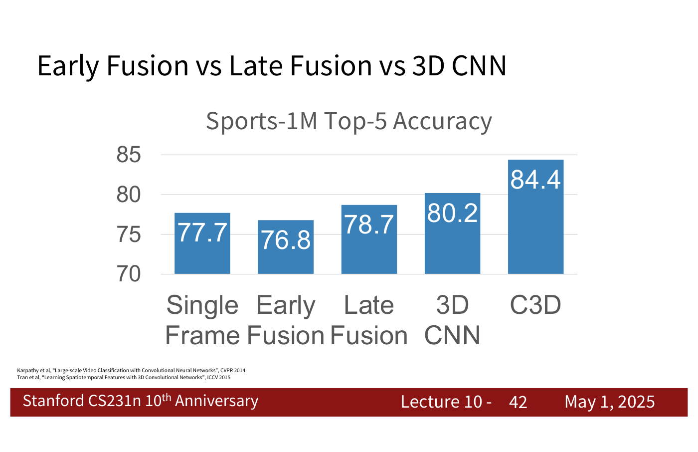

Same chart as slide 39 with a fifth bar added. Bar chart titled "Sports-1M Top-5 Accuracy". Vertical axis ticks 70, 75, 80, 85. One series (all bars blue), five categories:

- Single Frame: 77.7
- Early Fusion: 76.8
- Late Fusion: 78.7
- 3D CNN: 80.2
- C3D: 84.4

The side text of slide 39 is removed. Citations: Karpathy et al, "Large-scale Video Classification with Convolutional Neural Networks", CVPR 2014; Tran et al, "Learning Spatiotemporal Features with 3D Convolutional Networks", ICCV 2015.

## Slide 43 — Recognizing Actions from Motion

Text: "We can easily recognize actions using only motion information". Below it a dark grey rectangular frame (with black bars along its right and bottom edges) with two small bright white dots about four-fifths of the way across and just below mid-height. It appears to be a video still; only the two dots are visible in this frame and nothing else can be made out.

Citation: Johansson, "Visual perception of biological motion and a model for its analysis." Perception & Psychophysics. 14(2):201-211. 1973.

## Slide 44 — Measuring Motion: Optical Flow

Figure: two photographs stacked vertically, labelled "Image at frame t" (above the top one) and "Image at frame t+1" (below the bottom one). Each shows a woman with red hair in a dark top in a gym with wall bars and a blue floor, holding a long dark bow out to the right; her right arm is bent behind her head. A cyan rectangle marks the same region around her raised arm and head in both photographs; in the second frame the arm sits at a slightly different position inside the rectangle.

Citation: Simonyan and Zisserman, "Two-stream convolutional networks for action recognition in videos", NeurIPS 2014.

## Slide 45 — Measuring Motion: Optical Flow

Same as slide 44, plus: text "Optical flow gives a displacement field $F$ between images $I_t$ and $I_{t+1}$" (printed with subscripts). Two dashed cyan lines run from the cyan rectangle in the frame-t photograph to a larger cyan-bordered square holding a field of small blue arrows (the crop of the flow field for that region): arrows in the upper left point up and to the right, arrows lower right are longer and point right and slightly up, and arrows near the right and top edges are very short. Text below: "Tells where each pixel will move in the next frame:"

$$F(x, y) = (dx, dy)$$

$$I_{t+1}(x+dx, y+dy) = I_t(x, y)$$

Citation as on slide 44.

## Slide 46 — Measuring Motion: Optical Flow

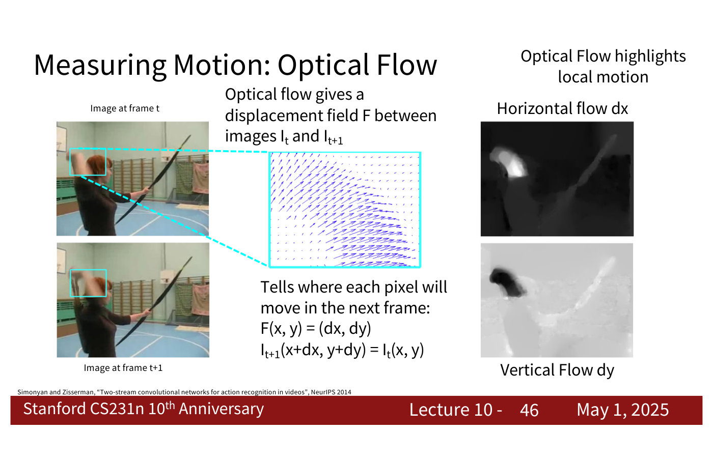

Same as slide 45, plus at the top right the text "Optical Flow highlights local motion" and, down the right side, two greyscale images of the full frame labelled "Horizontal flow dx" (top) and "Vertical Flow dy" (bottom). In the dx image a bright white-and-grey patch sits at the raised arm on a dark background, with a faint lighter streak along the bow. In the dy image a dark patch marks the same arm region on a light grey background, with a lighter streak along the bow.

Citation as on slide 44.

## Slide 47 — Separating Motion and Appearance: Two-Stream Networks

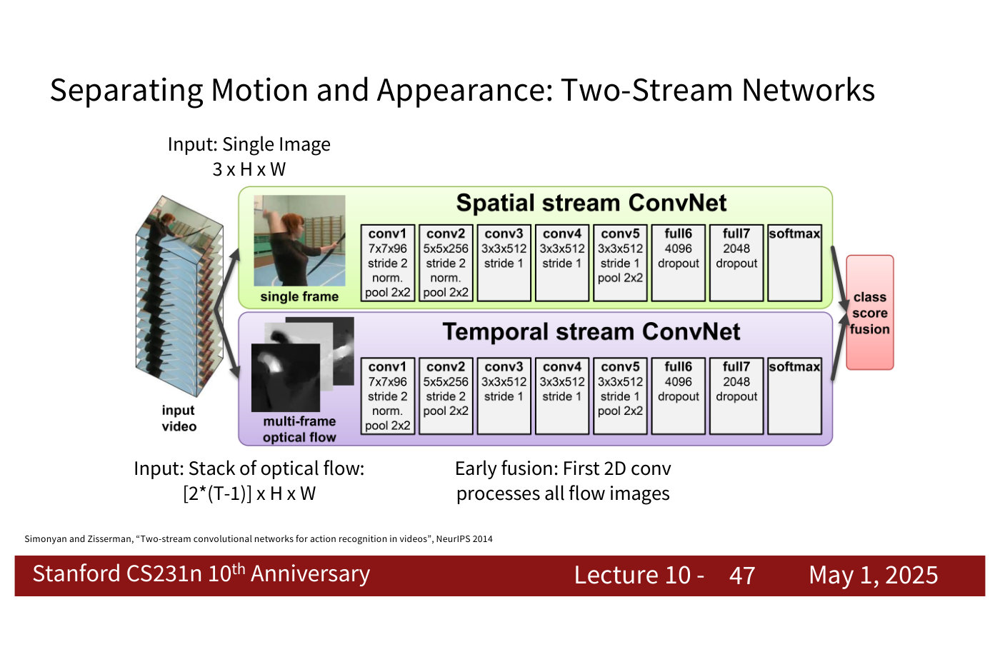

Figure (from the cited paper) with text around it. Above the figure: "Input: Single Image 3 x H x W". Below it, left: "Input: Stack of optical flow: [2\*(T-1)] x H x W"; centre: "Early fusion: First 2D conv processes all flow images".

At the left of the figure is a stack of video frames labelled "input video", with two arrows leaving it, one up to a green panel and one down to a purple panel.

Top, green panel "Spatial stream ConvNet": a photograph labelled "single frame" followed by a row of 8 boxes, left to right: "conv1 7x7x96 stride 2 norm. pool 2x2"; "conv2 5x5x256 stride 2 norm. pool 2x2"; "conv3 3x3x512 stride 1"; "conv4 3x3x512 stride 1"; "conv5 3x3x512 stride 1 pool 2x2"; "full6 4096 dropout"; "full7 2048 dropout"; "softmax" (empty box below the label).

Bottom, lavender panel "Temporal stream ConvNet": three overlapping greyscale optical-flow images labelled "multi-frame optical flow", followed by a row of 8 boxes: "conv1 7x7x96 stride 2 norm. pool 2x2"; "conv2 5x5x256 stride 2 pool 2x2" (no "norm.", unlike the spatial stream's conv2); "conv3 3x3x512 stride 1"; "conv4 3x3x512 stride 1"; "conv5 3x3x512 stride 1 pool 2x2"; "full6 4096 dropout"; "full7 2048 dropout"; "softmax".

An arrow from the right edge of each stream's panel (just after softmax) leads to a pink, red-bordered box at the right labelled "class score fusion". Drawn count: 8 boxes per stream, 16 in all.

Citation: Simonyan and Zisserman, "Two-stream convolutional networks for action recognition in videos", NeurIPS 2014.

## Slide 48 — Separating Motion and Appearance: Two-Stream Networks

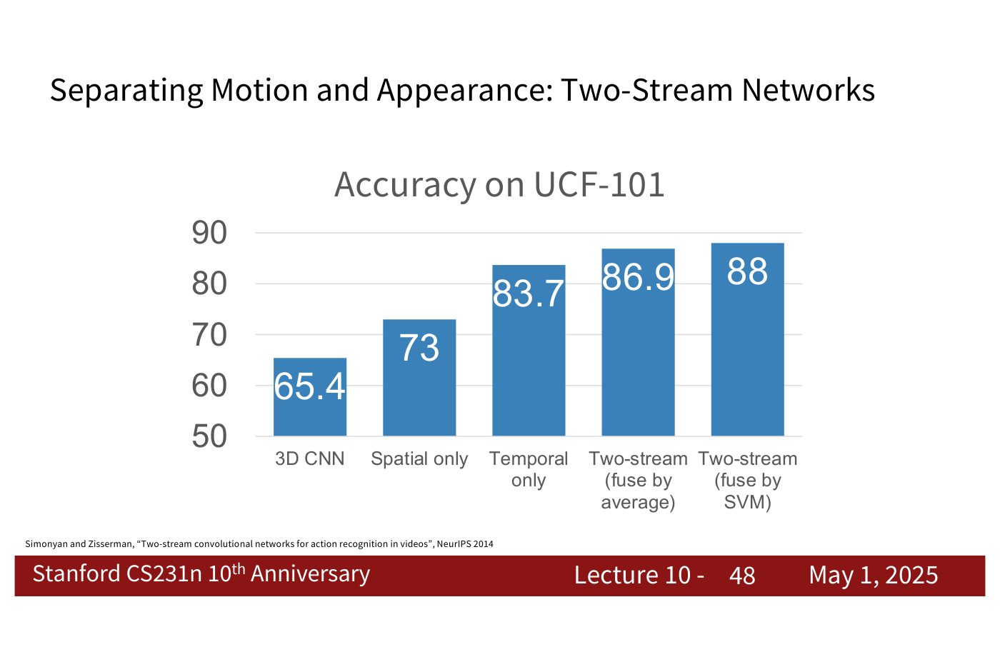

Bar chart titled "Accuracy on UCF-101". Vertical axis ticks 50, 60, 70, 80, 90 (no axis title). One series (all bars blue), five categories, with printed values:

- 3D CNN: 65.4
- Spatial only: 73
- Temporal only: 83.7
- Two-stream (fuse by average): 86.9
- Two-stream (fuse by SVM): 88

Citation: Simonyan and Zisserman, "Two-stream convolutional networks for action recognition in videos", NeurIPS 2014.

## Slide 49 — Modeling long-term temporal structure

Text: "So far all our temporal CNNs only model local motion between frames in very short clips of ~2-5 seconds. What about long-term structure?"

Figure: a thick horizontal arrow labelled "Time" at the right end. Two short vertical ticks on it are labelled "First event" (left) and "Second event" (right). In the middle a trapezoid (wider at the bottom) labelled "3D CNN" sits on the arrow, with a brace under it labelled "~5 seconds". The two events lie outside the span of the 3D CNN.

## Slide 50 — Modeling long-term temporal structure

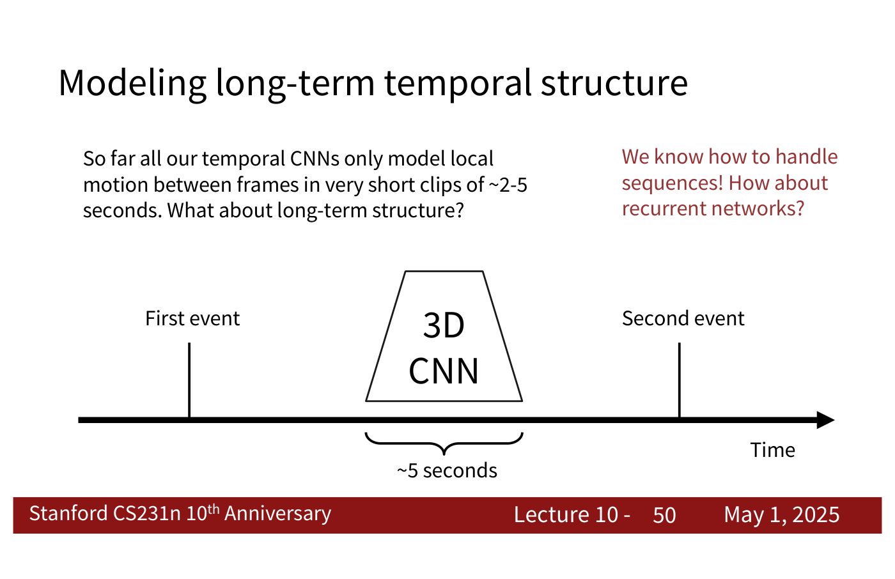

Same as slide 49, plus at the top right in dark red: "We know how to handle sequences! How about recurrent networks?"

## Slide 51 — Modeling long-term temporal structure

Figure: the "Time" arrow again, now with 5 equally spaced trapezoids, each labelled "CNN", sitting on it. Above each trapezoid is a short vertical blue bar. At the left an upward arrow is labelled "Extract features with CNN (2D or 3D)". No text other than the title and these labels.

## Slide 52 — Modeling long-term temporal structure

Same as slide 51, plus the text "Process local features using recurrent network (e.g. LSTM)" at the top, and a horizontal arrow between each pair of neighbouring blue bars (4 arrows, pointing left to right).

## Slide 53 — Modeling long-term temporal structure

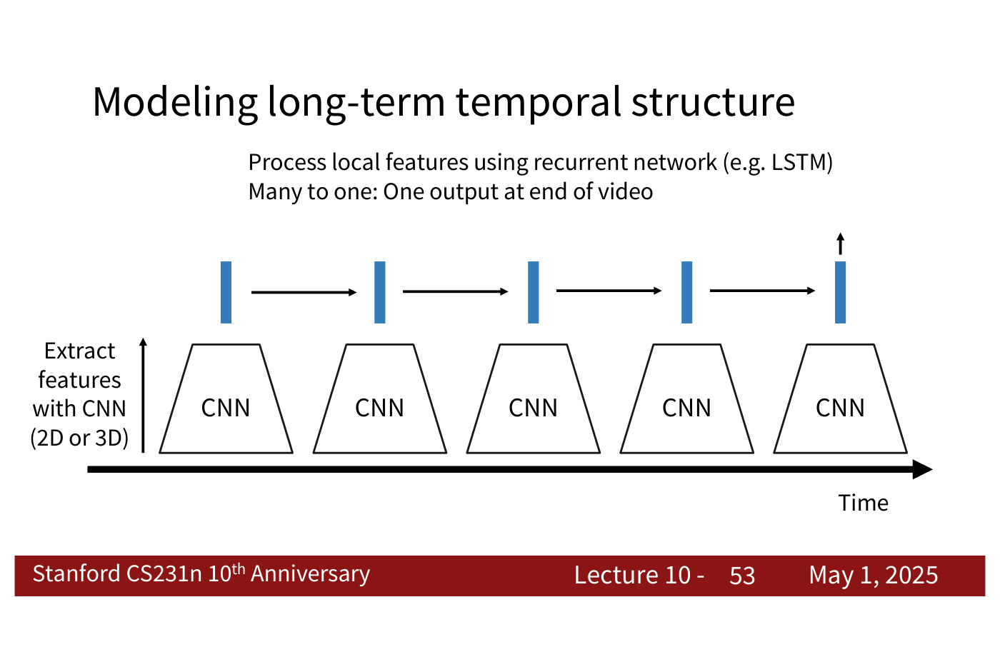

Text: "Process local features using recurrent network (e.g. LSTM)" and "Many to one: One output at end of video".

Figure: a row of 5 trapezoid boxes, each labelled "CNN", sitting on a thick horizontal arrow labelled "Time" (at its right end). A vertical arrow at the left, pointing up, is labelled "Extract features with CNN (2D or 3D)". Above each CNN is one blue vertical bar (5 bars). Thin black arrows run left to right between neighbouring bars (4 arrows). Only the right-most (5th) bar has an arrow pointing up out of it, the single output.

## Slide 54 — Modeling long-term temporal structure

Same as slide 53, with the text changed to "Process local features using recurrent network (e.g. LSTM)" and "Many to many: one output per video frame". All 5 blue bars now have an upward output arrow (5 output arrows).

## Slide 55 — Modeling long-term temporal structure

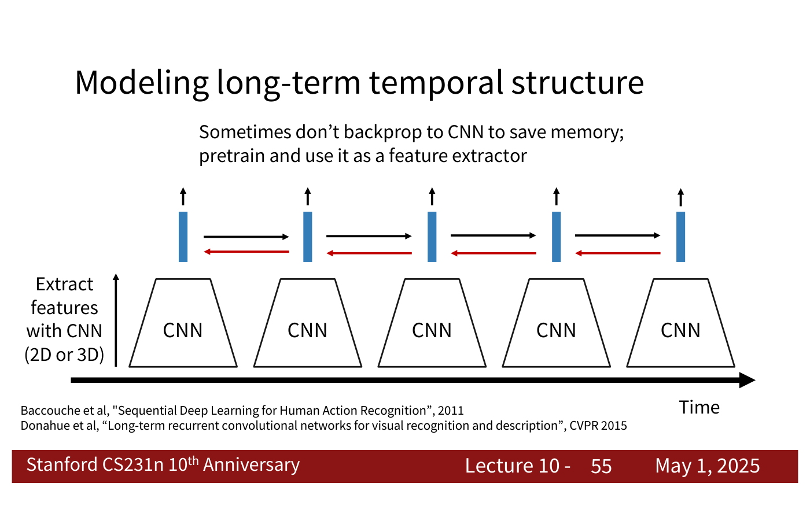

Same figure as slide 54 (5 CNN boxes, 5 blue bars, 5 output arrows), plus a red leftward arrow under each of the 4 black rightward arrows between bars (backward-pass arrows). Text: "Sometimes don't backprop to CNN to save memory; pretrain and use it as a feature extractor". The red arrows stop at the blue bars; none goes down into the CNN boxes.

Citations (bottom left):
- Baccouche et al, "Sequential Deep Learning for Human Action Recognition", 2011
- Donahue et al, "Long-term recurrent convolutional networks for visual recognition and description", CVPR 2015

## Slide 56 — Modeling long-term temporal structure

Text:
- "Inside CNN: Each value is a function of a fixed temporal window (local temporal structure)"
- "Inside RNN: Each vector is a function of all previous vectors (global temporal structure)"
- "Can we merge both approaches?"

Figure: same as slide 53 (5 CNN boxes, 5 blue bars joined by 4 rightward arrows, "Extract features with CNN (2D or 3D)", "Time") but with no output arrows above the bars and no red arrows.

Citations as on slide 55.

## Slide 57 — Recall: Multi-layer RNN

Text: "We can use a similar structure to process videos!"

Figure: a grid titled "Three-layer RNN", with an axis labelled "depth" (arrow pointing up, at the left) and an axis labelled "time" (arrow pointing right, below). There are 7 columns (time steps 0 to 6) and 5 rows. Bottom row: 7 pink input boxes $x_0$ to $x_6$. Above them 3 rows of green hidden-state boxes, each with a cream-coloured box stacked behind it: row 1 is $h^1_0$ to $h^1_6$, row 2 is $h^2_0$ to $h^2_6$, row 3 is $h^3_0$ to $h^3_6$. Top row: 7 blue output boxes $y_0$ to $y_6$. Arrows run up from each input to the first hidden layer, up between hidden layers, and up from the top hidden layer to each output. Horizontal arrows run left to right between neighbouring hidden boxes in the same row. (Total 7 inputs, 21 hidden boxes, 7 outputs.)

## Slide 58 — Recurrent Convolutional Network

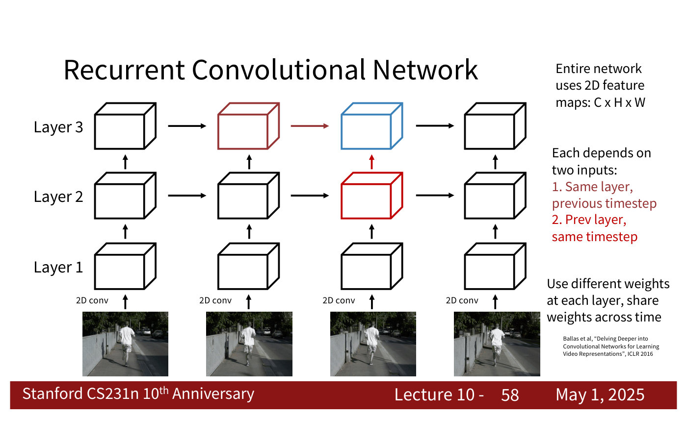

Text at right (top to bottom):
- "Entire network uses 2D feature maps: C x H x W"
- "Each depends on two inputs:" then, in brown, "1. Same layer, previous timestep" and, in red, "2. Prev layer, same timestep"
- "Use different weights at each layer, share weights across time"

Figure: a grid of 3D cuboids, 4 columns (time steps) by 3 rows labelled at the left "Layer 1", "Layer 2", "Layer 3" (12 cuboids). Under each column is a photograph, one per column (4 photographs), showing a man in a white shirt and light shorts seen from behind, running along a pavement beside a wall, with trees and parked cars ahead; an upward arrow labelled "2D conv" leads from each photograph to the Layer 1 cuboid. Black upward arrows join the cuboids in each column from Layer 1 to Layer 2 to Layer 3, and black rightward arrows join neighbouring columns in Layers 2 and 3 (and in Layer 1, there are no horizontal arrows drawn). Highlighted in the third column: the Layer 3 cuboid has a blue outline, the Layer 2 cuboid has a red outline with a red upward arrow into the blue one, and the Layer 3 cuboid in the second column has a brown outline with a brown rightward arrow into the blue one. The colours match the brown and red text items: the blue cuboid depends on the brown one (same layer, previous timestep) and the red one (previous layer, same timestep).

Citation: Ballas et al, "Delving Deeper into Convolutional Networks for Learning Video Representations", ICLR 2016

## Slide 59 — Recurrent Convolutional Network

Text: "Normal 2D CNN:"

Figure: a 3D cuboid labelled "Input features: C x H x W" on the left, a rightward arrow labelled "2D Conv", and a second cuboid labelled "Output features: C x H x W" on the right.

## Slide 60 — Recurrent Convolutional Network

Figure: three cuboids. Top left: "Features from layer L, timestep t-1". Bottom left: "Features from layer L-1, timestep t". Both send thick lines (the top one bends down, the bottom one steps up) into a box labelled "RNN-like recurrence". An arrow from that box leads to a larger cuboid at the right labelled "Features for layer L, timestep t".

Top right, "Recall: Recurrent Network" with the formula $h_t = f_W(h_{t-1}, x_t)$. Each part is boxed and labelled: $h_t$ (blue box) "new state"; $f_W$ (purple box) "some function with parameters W"; $h_{t-1}$ (green box) "old state"; $x_t$ (red box), with no label printed for it.

Citation: Ballas et al, "Delving Deeper into Convolutional Networks for Learning Video Representations", ICLR 2016

## Slide 61 — Recurrent Convolutional Network

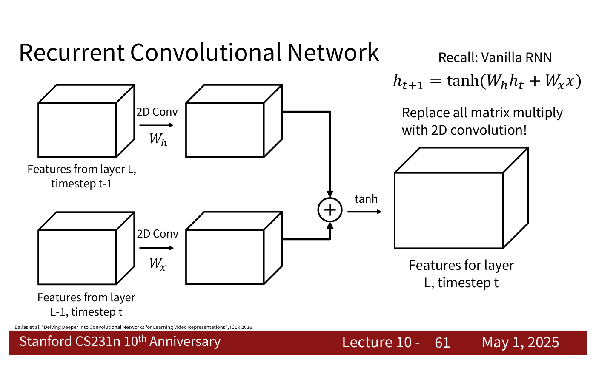

Text top right: "Recall: Vanilla RNN" with $h_{t+1} = \tanh(W_h h_t + W_x x)$, then "Replace all matrix multiply with 2D convolution!"

Figure: same layout as slide 60 but the "RNN-like recurrence" box is expanded. "Features from layer L, timestep t-1" goes through an arrow labelled "2D Conv" with weight $W_h$ to a new cuboid; "Features from layer L-1, timestep t" goes through an arrow labelled "2D Conv" with weight $W_x$ to another new cuboid. Both new cuboids feed a circled plus sign (sum), followed by an arrow labelled "tanh" into the cuboid "Features for layer L, timestep t".

Citation: Ballas et al, "Delving Deeper into Convolutional Networks for Learning Video Representations", ICLR 2016

## Slide 62 — Modeling long-term temporal structure

Figure, left panel: two trapezoids labelled "CNN" on a thick "Time" arrow, each with a blue bar above it and a rightward arrow joining the two bars. Labels: "RNN: Infinite temporal extent (fully-connected)" beside the bars and "CNN: finite temporal extent (convolutional)" beside the trapezoids.

Figure, right panel: two larger trapezoids labelled "Recurrent CNN" on a thick "Time" arrow, joined by 4 stacked rightward arrows (of decreasing length from top to bottom). Label above: "Recurrent CNN: Infinite temporal extent (convolutional)".

Citations: bottom left, Baccouche et al, "Sequential Deep Learning for Human Action Recognition", 2011 and Donahue et al, "Long-term recurrent convolutional networks for visual recognition and description", CVPR 2015. Bottom right, Ballas et al, "Delving Deeper into Convolutional Networks for Learning Video Representations", ICLR 2016.

## Slide 63 — Modeling long-term temporal structure

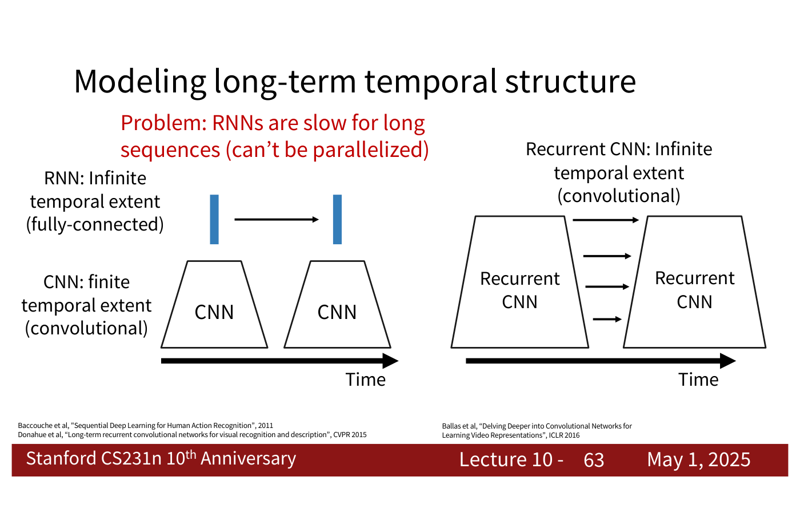

Same as slide 62, plus in red at the top: "Problem: RNNs are slow for long sequences (can't be parallelized)". Citations as on slide 62.

## Slide 64 — Recall: Self-Attention

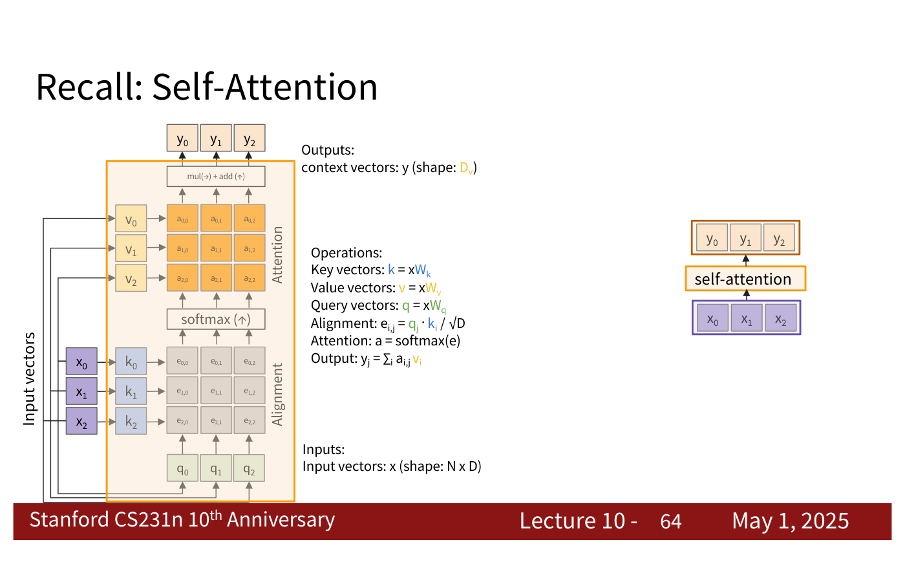

Figure, left: a self-attention diagram inside an orange frame. Input vectors $x_0$, $x_1$, $x_2$ (purple, labelled "Input vectors") feed key vectors $k_0$, $k_1$, $k_2$ (blue-grey), value vectors $v_0$, $v_1$, $v_2$ (yellow) and query vectors $q_0$, $q_1$, $q_2$ (green). A grid of $3 \times 3$ alignment scores $e_{i,j}$ ($e_{0,0}$ to $e_{2,2}$, labelled "Alignment") goes through a box "softmax (↑)" into a $3 \times 3$ grid of attention weights $a_{i,j}$ (orange, labelled "Attention"). These and the value vectors go into a box "mul(→) + add (↑)" and out to outputs $y_0$, $y_1$, $y_2$.

Text next to the diagram:
- "Outputs: context vectors: y (shape: $D_v$)"
- "Operations:"
- "Key vectors: k = $xW_k$"
- "Value vectors: v = $xW_v$"
- "Query vectors: q = $xW_q$"
- "Alignment: $e_{i,j} = q_j \cdot k_i / \sqrt{D}$"
- "Attention: a = softmax(e)"
- "Output: $y_j = \sum_i a_{i,j} v_i$"
- "Inputs: Input vectors: x (shape: N x D)"

Figure, right: a compact version: three purple boxes $x_0$, $x_1$, $x_2$, an arrow up to an orange box "self-attention", and an arrow up to three boxes $y_0$, $y_1$, $y_2$.

## Slide 65 — Spatio-Temporal Self-Attention (Nonlocal Block)

Figure: at the left, "Input clip": 4 stacked frames of the running-man scene (man in white shirt seen from behind on a pavement), then a grey trapezoid labelled "3D CNN". To its right is a large empty cream-coloured rectangle labelled "Nonlocal Block" (underneath). Inside it, at its left edge, is one green cuboid labelled "Features: C x T x H x W". The rest of the block is empty on this slide (it is filled in on later slides).

Citation: Wang et al, "Non-local neural networks", CVPR 2018

## Slide 66 — Spatio-Temporal Self-Attention (Nonlocal Block)

Same as slide 65 (input clip of 4 frames, grey "3D CNN" trapezoid, cream "Nonlocal Block" rectangle, green "Features: C x T x H x W" cuboid), plus three branches from the features cuboid, each a line with an arrow labelled "1x1x1 Conv" into a new green cuboid:
- top: "Queries: C' x T x H x W"
- middle: "Keys: C' x T x H x W"
- bottom: "Values: C' x T x H x W"

Citation: Wang et al, "Non-local neural networks", CVPR 2018

## Slide 67 — Spatio-Temporal Self-Attention (Nonlocal Block)

Same as slide 66, plus: the Queries cuboid has an arrow labelled "Transpose" that goes into a circled "x" (matrix multiply); the Keys cuboid has an arrow going up into the same circled "x". An arrow labelled "softmax" leads from the circle to a flat light-green square labelled "Attention Weights (THW) x (THW)". The Values cuboid is not yet connected.

Citation as on slide 66.

## Slide 68 — Spatio-Temporal Self-Attention (Nonlocal Block)

Same as slide 67, plus: an arrow runs down from the Attention Weights square into a second circled "x" at the lower right. The Values cuboid also feeds an arrow into that circle. An arrow leads from the circle to a new cuboid labelled "C' x T x H x W".

Citation as on slide 66.

## Slide 69 — Spatio-Temporal Self-Attention (Nonlocal Block)

Same as slide 68, plus: from the "C' x T x H x W" cuboid, a line labelled "1x1x1 Conv" bends upward into a new cuboid labelled "C x T x H x W".

Citation as on slide 66.

## Slide 70 — Spatio-Temporal Self-Attention (Nonlocal Block)

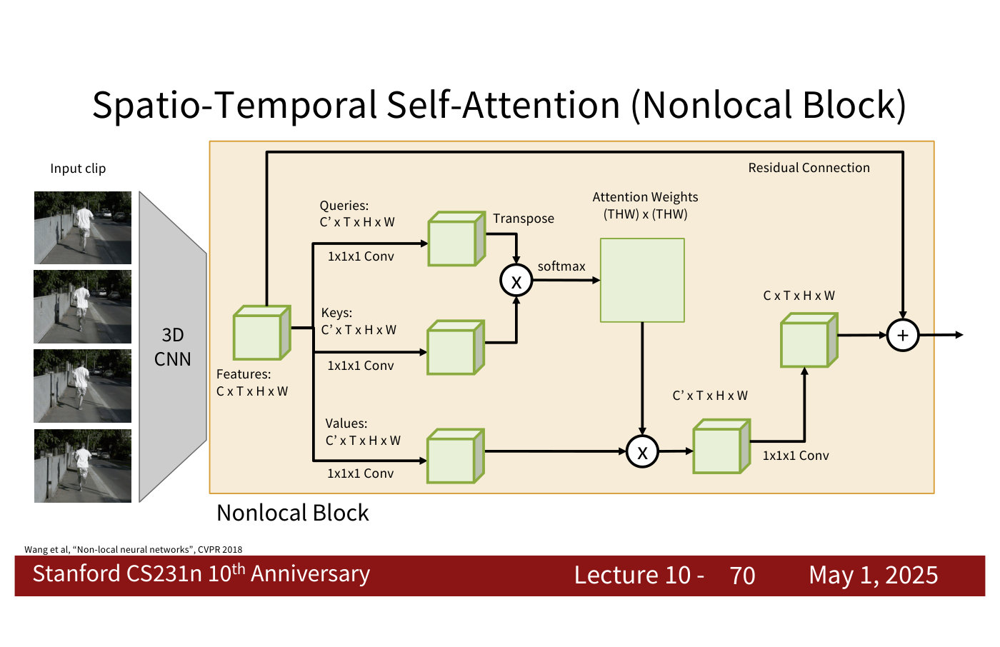

Same as slide 69, plus: a line labelled "Residual Connection" leaves the top of the "Features: C x T x H x W" cuboid, runs along the top of the block, and comes down into a circled "+" at the right. The final "C x T x H x W" cuboid also feeds into this circle, and an arrow leaves the circle to the right, out of the block. This is the full block as drawn: six cuboids (features; queries, keys and values; the "C' x T x H x W" product; the final "C x T x H x W"), four "1x1x1 Conv" labels, two matrix-multiply circles and one sum circle, a softmax into the attention-weights square, and the residual connection.

Citation as on slide 66.

## Slide 71 — Spatio-Temporal Self-Attention (Nonlocal Block)

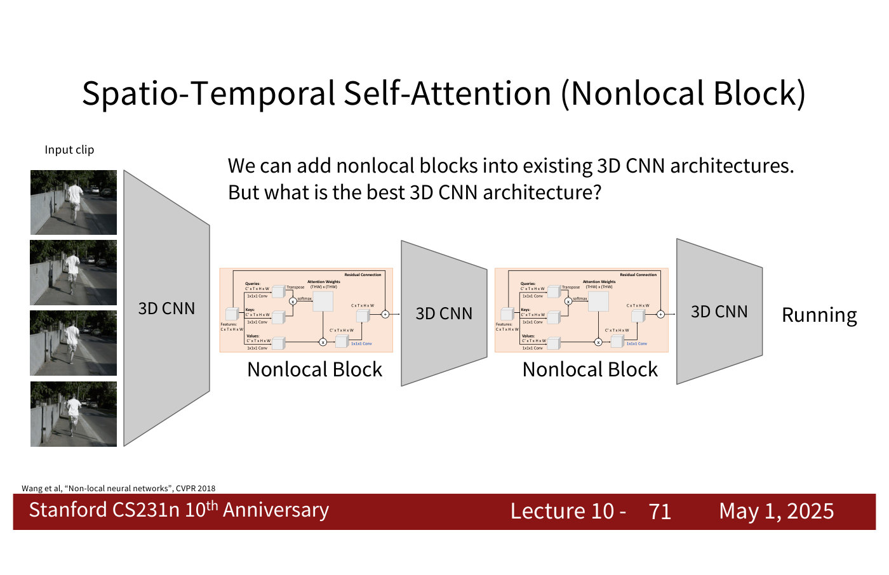

Text: "We can add nonlocal blocks into existing 3D CNN architectures." and "But what is the best 3D CNN architecture?"

Figure: left, "Input clip" (4 frames of the running-man scene), then a tall grey trapezoid labelled "3D CNN". It is followed in a row by a small copy of the full Nonlocal Block diagram from slide 70 (labelled "Nonlocal Block"), a smaller grey trapezoid "3D CNN", a second small copy of the Nonlocal Block diagram (labelled "Nonlocal Block"), a third grey trapezoid "3D CNN", and the word "Running" at the right. Three 3D CNN trapezoids and two Nonlocal Blocks in all, joined by arrows.

Citation as on slide 66.

## Slide 72 — Inflating 2D Networks to 3D (I3D)

Text: "There has been a lot of work on architectures for images. Can we reuse image architectures for video?" Then: "Idea: take a 2D CNN architecture." and "Replace each 2D $K_h \times K_w$ conv/pool layer with a 3D $K_t \times K_h \times K_w$ version" (printed as "2D K_h x K_w", "3D K_t x K_h x K_w" with subscripts).

Citation: Carreira and Zisserman, "Quo Vadis, Action Recognition? A New Model and the Kinetics Dataset", CVPR 2017

## Slide 73 — Inflating 2D Networks to 3D (I3D)

Same text as slide 72, plus a figure titled "Inception Block: Original". Boxes, bottom to top: "Previous layer" feeds (via a split line) three boxes in a lower row: "1x1 Conv", "1x1 Conv" and a dark grey "3x3 MaxPool". These feed an upper row of three boxes: "5x5 Conv" (above the first 1x1 Conv), "3x3 Conv" (above the second) and "1x1 Conv" (above the MaxPool). A separate "1x1 Conv" box at the left takes "Previous layer" directly. All four branches (the left 1x1 Conv and the three upper boxes) feed one wide box "Concatenate", which has an arrow going up out of it. Eight boxes in all (7 operation boxes plus Concatenate).

Citation as on slide 72.

## Slide 74 — Inflating 2D Networks to 3D (I3D)

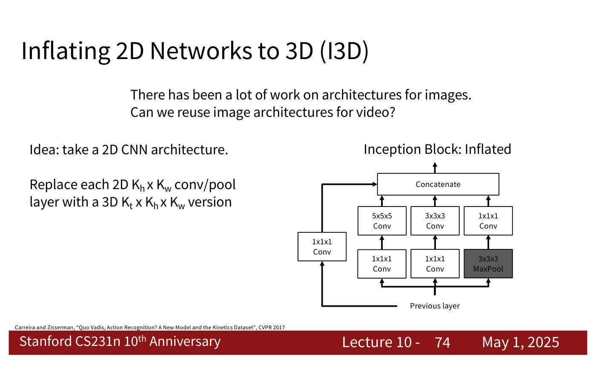

Same as slide 73 with the figure titled "Inception Block: Inflated", with every box's kernel gaining a third dimension: lower row "1x1x1 Conv", "1x1x1 Conv", "3x3x3 MaxPool" (dark grey); upper row "5x5x5 Conv", "3x3x3 Conv", "1x1x1 Conv"; left branch "1x1x1 Conv"; then "Concatenate". Same wiring as slide 73.

Citation as on slide 72.

## Slide 75 — Inflating 2D Networks to 3D (I3D)

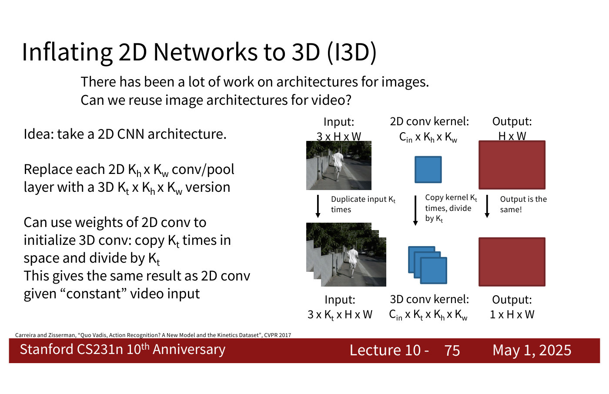

Text (left): "There has been a lot of work on architectures for images. Can we reuse image architectures for video?" "Idea: take a 2D CNN architecture." "Replace each 2D $K_h \times K_w$ conv/pool layer with a 3D $K_t \times K_h \times K_w$ version" "Can use weights of 2D conv to initialize 3D conv: copy $K_t$ times in space and divide by $K_t$" "This gives the same result as 2D conv given "constant" video input".

*[Ed: "copy Kt times in space" is printed; the copies are stacked along time, as the figure's "Copy kernel Kt times, divide by Kt" and the Cin x Kt x Kh x Kw kernel show. Kept as printed. The inflation recomputes: a constant input repeated Kt times meets Kt copies of the 2D kernel, each divided by Kt, so the Kt partial sums add back to the 2D output.]*

Figure (right), two rows of three columns. Top row: "Input: 3 x H x W" (one frame of the running-man scene), "2D conv kernel: C_in x K_h x K_w" (one blue square), "Output: H x W" (a dark red rectangle). Bottom row: "Input: 3 x K_t x H x W" (the same frame drawn as a stack of 3 offset copies), "3D conv kernel: C_in x K_t x K_h x K_w" (a stack of 3 offset blue squares), "Output: 1 x H x W" (a dark red rectangle of the same size). Down-arrows between the rows carry the labels "Duplicate input K_t times" (input column), "Copy kernel K_t times, divide by K_t" (kernel column) and "Output is the same!" (output column).

Citation as on slide 72.

## Slide 76 — Inflating 2D Networks to 3D (I3D)

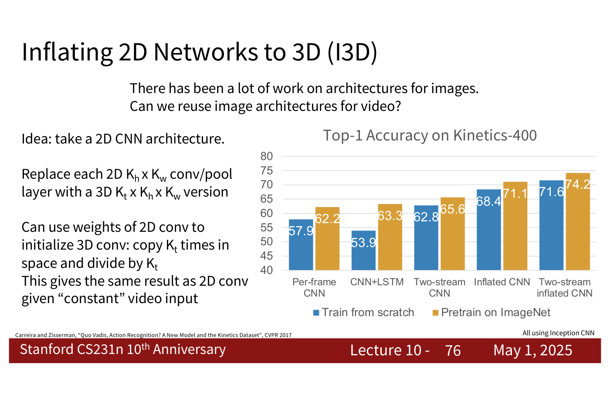

Text (left) as on slide 75 (without the figure). At the bottom right, above the footer: "All using Inception CNN".

Chart: title "Top-1 Accuracy on Kinetics-400". Bar chart, y axis from 40 to 80 in steps of 5 (no y-axis title printed); x axis has 5 categories (no axis title). Two series: blue "Train from scratch" and gold "Pretrain on ImageNet" (legend at bottom). Each value is printed in white on its bar.

| Category | Train from scratch (blue) | Pretrain on ImageNet (gold) |
| --- | --- | --- |
| Per-frame CNN | 57.9 | 62.2 |
| CNN+LSTM | 53.9 | 63.3 |
| Two-stream CNN | 62.8 | 65.6 |
| Inflated CNN | 68.4 | 71.1 |
| Two-stream inflated CNN | 71.6 | 74.2 |

Citation as on slide 72.

## Slide 77 — Vision Transformers for Video

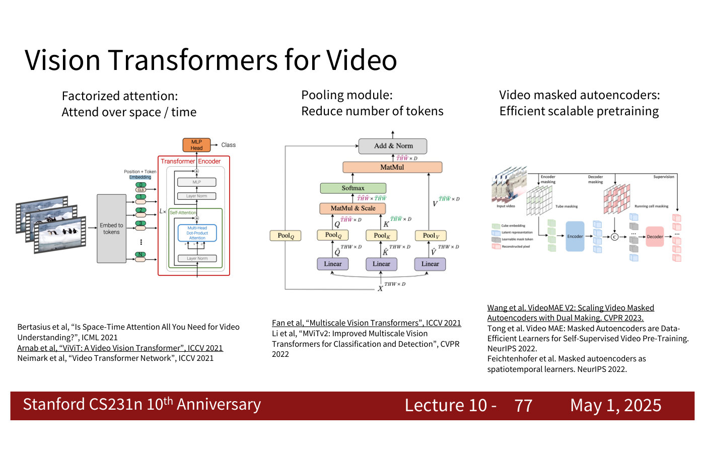

Three columns, each with a heading, a figure and citations.

Left, heading "Factorized attention: Attend over space / time". Figure: a film-strip of 3 video frames (penguins on ice) goes into a grey box "Embed to tokens", which outputs a column of tokens numbered 0 (green, marked "CLS"), 1, 2, 3, "...", N (each green index token beside a small pale token), labelled "Position + Token Embedding". These enter (with small K, V, Q labels on the arrows into the attention box) a red-bordered "Transformer Encoder" box repeated "L x", containing "Layer Norm", "Multi-Head Dot-Product Attention" (inside a green "Self-Attention" box, with a "+" residual), then "Layer Norm", "MLP" and a "+" residual. Above the encoder an orange "MLP Head" box outputs "Class". Citations: Bertasius et al, "Is Space-Time Attention All You Need for Video Understanding?", ICML 2021; Arnab et al, "ViViT: A Video Vision Transformer", ICCV 2021; Neimark et al, "Video Transformer Network", ICCV 2021.

Middle, heading "Pooling module: Reduce number of tokens". Figure: input $X$ (shape printed "THW x D") feeds three "Linear" boxes giving $\hat{Q}$, $\hat{K}$, $\hat{V}$ (each "THW x D"). Each goes into a pooling box ("Pool_Q", "Pool_K", "Pool_V"), giving $Q$, $K$ and $V$ with a reduced token count: $Q$ is $\hat{T}\hat{H}\hat{W} \times D$ (a hat over each letter, pink) and $K$ and $V$ are $\tilde{T}\tilde{H}\tilde{W} \times D$ (a tilde over each letter, green). Q and K enter "MatMul & Scale", whose output is $\hat{T}\hat{H}\hat{W} \times \tilde{T}\tilde{H}\tilde{W}$, then "Softmax", then "MatMul" together with V, giving $\hat{T}\hat{H}\hat{W} \times D$, then "Add & Norm". A residual line from $X$ goes through a separate "Pool_Q" box to "Add & Norm". An arrow leaves the top. Citations: Fan et al, "Multiscale Vision Transformers", ICCV 2021; Li et al, "MViTv2: Improved Multiscale Vision Transformers for Classification and Detection", CVPR 2022.

Right, heading "Video masked autoencoders: Efficient scalable pretraining". Figure (small text): an "Input video" cube of frames goes through "Tube masking" (a grid with masked cells) and "Encoder masking" into an "Encoder" box, then "Latent representation" tokens and "Learnable mask token" are combined (circled C) with "Decoder masking" ("Running cell masking") into a "Decoder" box producing "Reconstructed pixel" cubes, with an arrow labelled "Supervision". The legend has four items: "Cube embedding" (green), "Latent representation" (blue), "Learnable mask token" (grey), "Reconstructed pixel" (pink). Citations: Wang et al. VideoMAE V2: Scaling Video Masked Autoencoders with Dual Making. CVPR 2023. Tong et al. Video MAE: Masked Autoencoders are Data-Efficient Learners for Self-Supervised Video Pre-Training. NeurIPS 2022. Feichtenhofer et al. Masked autoencoders as spatiotemporal learners. NeurIPS 2022.

## Slide 78 — Vision Transformers for Video

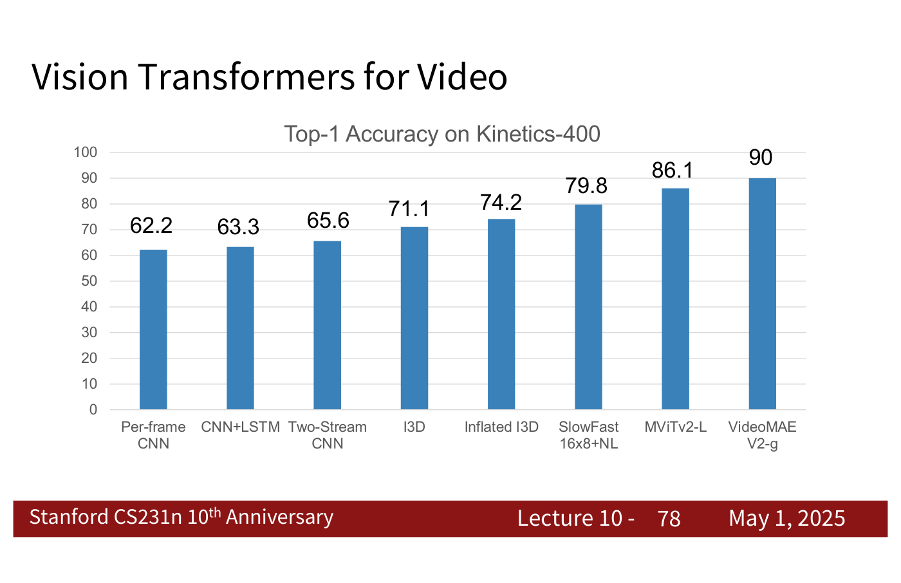

Chart: title "Top-1 Accuracy on Kinetics-400". Bar chart, one series (blue), y axis 0 to 100 in steps of 10 (no y-axis title printed), 8 categories on the x axis (no axis title). Values are printed above each bar.

| Category | Value |
| --- | --- |
| Per-frame CNN | 62.2 |
| CNN+LSTM | 63.3 |
| Two-Stream CNN | 65.6 |
| I3D | 71.1 |
| Inflated I3D | 74.2 |
| SlowFast 16x8+NL | 79.8 |
| MViTv2-L | 86.1 |
| VideoMAE V2-g | 90 |

No source citation is printed on this slide.

## Slide 79 — Visualizing Video Models

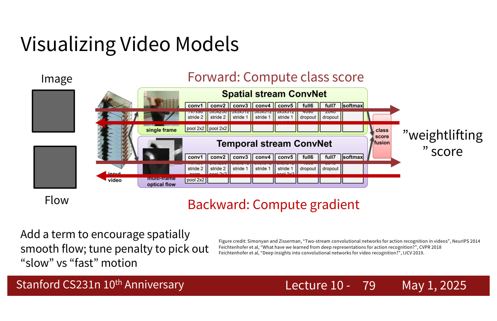

Figure: a two-stream action-recognition diagram (from Simonyan and Zisserman). On the left, an "input video" drawn as a stack of frames. Two branches run to the right: a green box "Spatial stream ConvNet" (fed a "single frame" photo of a person) and a purple box "Temporal stream ConvNet" (fed "multi-frame optical flow", greyscale flow images). Each stream is a row of 8 boxes: conv1, conv2, conv3, conv4, conv5, full6, full7, softmax (conv1 and conv2 carry small text such as "stride 2", "pool 2x2"; full6 "dropout", full7 "dropout"; the small text is partly covered by the arrows). Both streams feed a red box "class score fusion". To the right of it is the text "”weightlifting” score" (printed this way).

Overlaid on each stream: a dark-red arrow pointing right (forward) and a bright-red arrow pointing left (backward). Text above the diagram in dark red: "Forward: Compute class score"; below in bright red: "Backward: Compute gradient".

On the far left, two grey square placeholders: "Image" (above the upper one) and "Flow" (below the lower one). The upper square lines up with the spatial stream's backward arrow, the lower with the temporal stream's.

Text at bottom left: "Add a term to encourage spatially smooth flow; tune penalty to pick out “slow” vs “fast” motion".

Credit lines (bottom):
- Figure credit: Simonyan and Zisserman, “Two-stream convolutional networks for action recognition in videos”, NeurIPS 2014
- Feichtenhofer et al, “What have we learned from deep representations for action recognition?”, CVPR 2018
- Feichtenhofer et al, “Deep insights into convolutional networks for video recognition?”, IJCV 2019.

## Slide 80 — Can you guess the action?

Citations (top right):
- Feichtenhofer et al, “What have we learned from deep representations for action recognition?”, CVPR 2018
- Feichtenhofer et al, “Deep insights into convolutional networks for video recognition?”, IJCV 2019.
- Slide credit: Christoph Feichtenhofers

Figure: three square visualizations side by side, headed "Appearance", “Slow” motion and “Fast” motion. The first (Appearance) is a muted grey-brown image tiled with many small barbell-like shapes in red, green and purple tints; a small pink label in its bottom-left corner reads "Fast motion appearance". The second (“Slow” motion) is a grey image with cyan and purple blobs forming two T-shaped or barbell-like figures in the centre. The third (“Fast” motion) is a similar grey image with purple and cyan blobs, with a more spread-out layout of two such shapes. The slide asks the question; no answer is printed on this slide.

## Slide 81 — Can you guess the action? Weightlifting

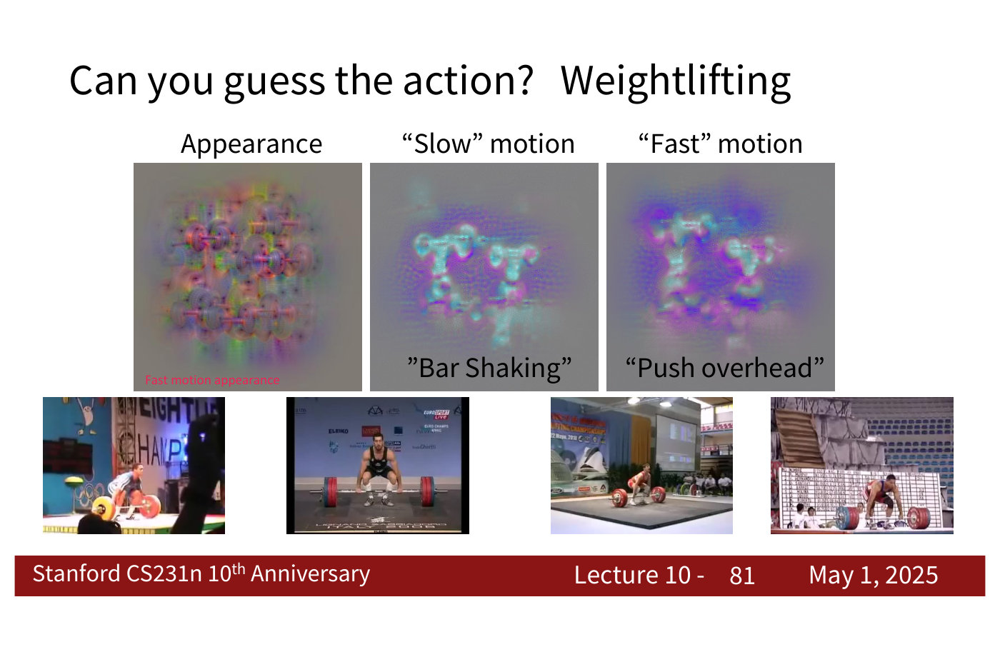

Same three visualizations as slide 80 (headings "Appearance", “Slow” motion, “Fast” motion; pink label "Fast motion appearance" in the first), now with captions at the bottom of the two motion images: ”Bar Shaking” under “Slow” motion and “Push overhead” under “Fast” motion (quotation marks as printed).

Below them, a row of four video-frame photographs of weightlifting: (1) a lifter crouched over a barbell with yellow and red plates on a stage, a "WEIGHTLIFTING CHAMP..." banner behind; (2) a lifter in black crouching at a barbell with red and blue plates, "EUROSPORT" logo at the top right; (3) a wide shot of a lifter with a barbell on a platform in a hall; (4) a lifter bent over a barbell with red and blue plates in front of a scoreboard.

## Slide 82 — Can you guess the action?

Same layout as slide 80, with different visualizations: the "Appearance" image is a muted pink-grey image tiled with many small face-like patches (eyes, noses, lips in pink with green and purple specks); pink label "Fast motion appearance" at its bottom left. The “Slow” motion image is grey with cyan, white and purple blobs suggesting hand-like and face-like forms in the centre. The “Fast” motion image is similar with more purple and magenta. No answer is printed on this slide. No citation lines appear on this slide.

## Slide 83 — Can you guess the action? Apply Eye Makeup

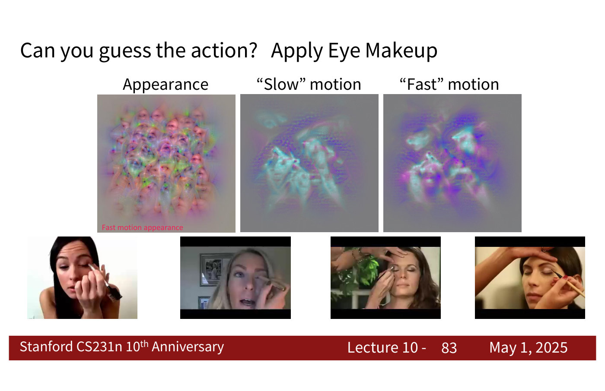

Same three visualizations as slide 82, with the title now reading "Can you guess the action?   Apply Eye Makeup". Below them, a row of four video-frame photographs: (1) a dark-haired woman holding a brush near her eye; (2) a blonde woman holding an applicator to her eye with picture frames behind her; (3) a woman with closed eyes and hands applying liner to her eyelid, green leaves behind; (4) a woman with closed eyes and a hand with a pencil at her eye.

## Slide 84 — So far: Classify short clips

Figure: a small greyish video-frame photograph of a person in a white shirt and shorts, seen from behind, running along a pavement beside a wall, with parked cars and trees beyond. A long black right-pointing arrow labelled "Videos: Recognize actions" runs to a list of five labels: "Swimming", "Running", "Jumping", "Eating", "Standing".

## Slide 85 — Temporal Action Localization

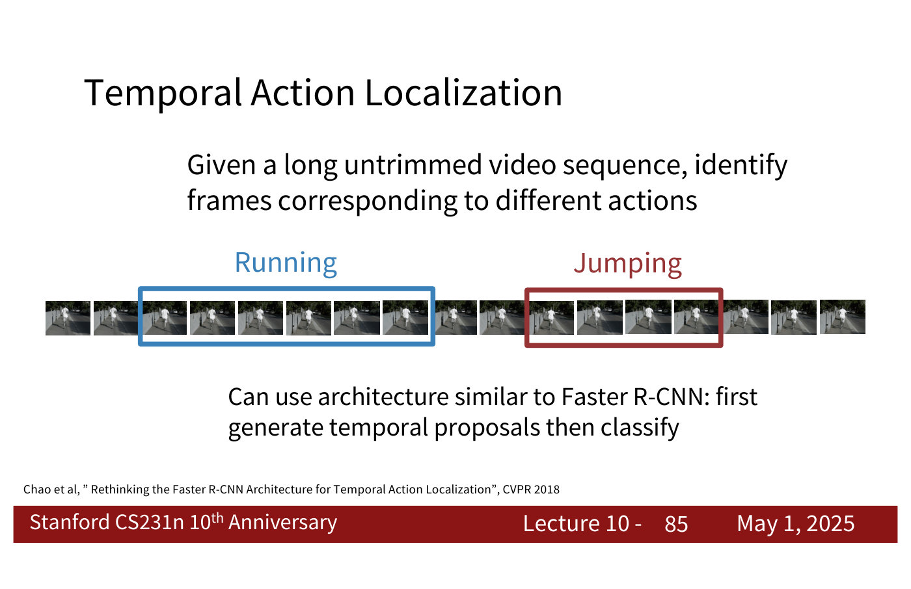

Text: "Given a long untrimmed video sequence, identify frames corresponding to different actions".

Figure: a horizontal strip of 17 small frames (each showing the runner from slide 84). A blue box labelled "Running" encloses frames 3 to 8 (6 frames); a dark-red box labelled "Jumping" encloses frames 11 to 14 (4 frames). Frames 1, 2, 9, 10 and 15 to 17 lie outside both boxes.

Text below: "Can use architecture similar to Faster R-CNN: first generate temporal proposals then classify".

Citation: Chao et al, ” Rethinking the Faster R-CNN Architecture for Temporal Action Localization”, CVPR 2018

## Slide 86 — Spatio-Temporal Detection

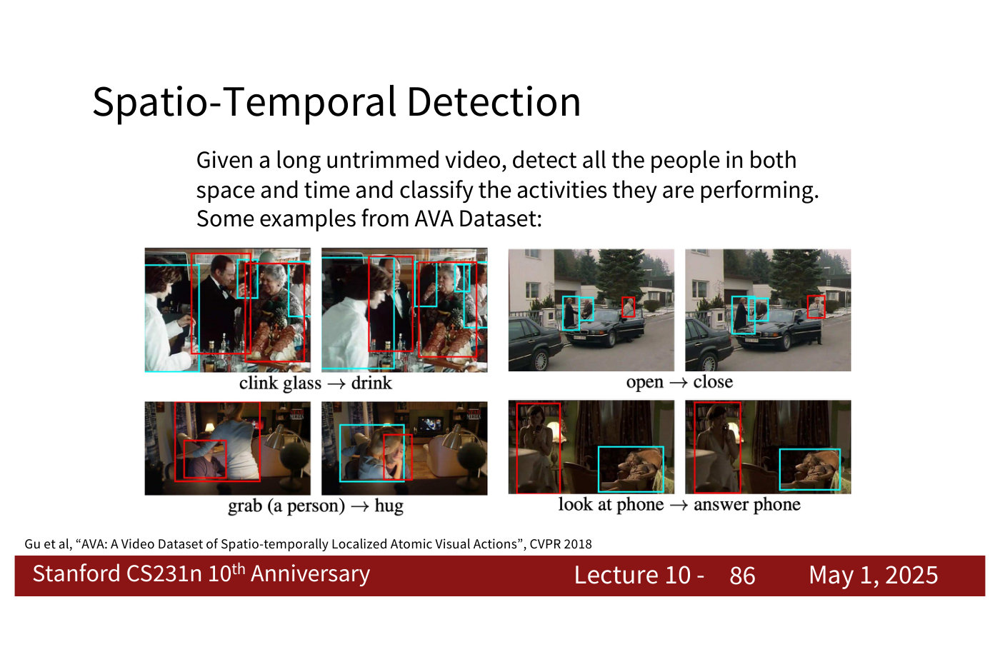

Text: "Given a long untrimmed video, detect all the people in both space and time and classify the activities they are performing. Some examples from AVA Dataset:"

Figure: four pairs of film frames with red and cyan bounding boxes around people, each pair captioned with a transition: "clink glass → drink" (a dinner scene with a man in a dark suit and an older woman, boxes in red and cyan), "open → close" (two people near a dark car on a street, boxes around them), "grab (a person) → hug" (a dim living room with two people, boxes in red and cyan), "look at phone → answer phone" (a woman standing at left in a room, and a person seated in an armchair at right, boxes in red and cyan).

Citation: Gu et al, “AVA: A Video Dataset of Spatio-temporally Localized Atomic Visual Actions”, CVPR 2018

## Slide 87 — Today: Temporal Stream

Figure: five video frames drawn as slanted (parallelogram) panels, stacked left to right in depth, with "..." before the first and after the last. The frames show a brown-and-black dog in a living room with a navy sofa and a pink-purple toy; in the last frame a baby in a purple top and denim overalls sits at the right. These frames are the temporal axis.

Text below: "3D CNN, Two-Stream Neural Network, Spatial-Temporal Self-Attention…..."

## Slide 88 — [Video frame: baby and soap bubbles]

*(This page prints no slide number; 88 is inferred from its neighbours.)*

A full-slide photograph with no text: a living room with a navy sofa, a beige carpet and pink toys. A laughing baby in a purple top and denim overalls sits at the lower right, and several soap bubbles float above the carpet in the upper middle. It appears to be a video still.

## Slide 89 — [Video frame: man saying "Ba Ba Ba ..."]

*(This page prints no slide number; 89 is inferred from its neighbours.)*

A full-slide close-up still of a balding man with grey goatee and round glasses, in a dark top, against a blue sky; mouth closed. "BBC TWO" logo at top left. White text at the left: "Ba Ba Ba …". Bottom left: "Video source: BBC". Bottom right: "(McGurk & McDonald 1976)". It appears to be a video still.

## Slide 90 — [Video frame: man saying "Fa Fa Fa ..."]

*(This page prints no slide number; 90 is inferred from its neighbours.)*

Same man and layout as slide 89 (BBC TWO logo, "Video source: BBC", "(McGurk & McDonald 1976)"), with the text "Fa Fa Fa …" at the left; his lips are slightly parted. It appears to be a video still.

## Slide 91 — [Video frame: two side-by-side faces]

*(This page prints no slide number; 91 is inferred from its neighbours.)*

Same man shown twice, side by side, against blue sky, both with mouths open (the left with a wider open mouth, the right with teeth showing). A faint, mostly illegible "BBC" logo at top left. Bottom left: "Video source: BBC". Bottom right: "(McGurk & McDonald 1976)". No other text. It appears to be a video still.

## Slide 92 — Visually-guided audio source separation

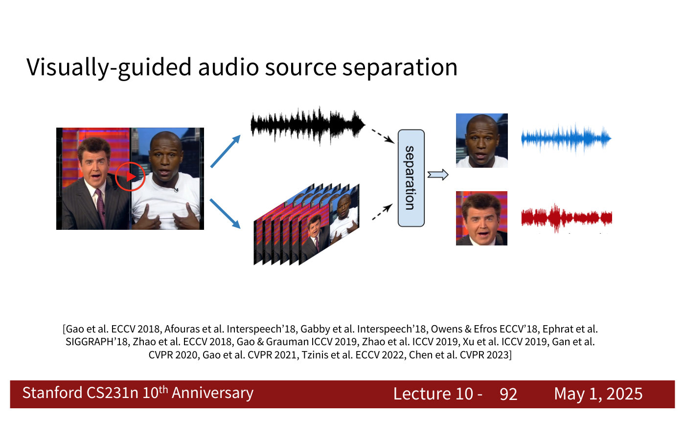

Figure, left to right: a video frame of two people side by side (a man in a pinstriped suit and tie at left, a man in a white T-shirt at right) with a red circled play icon between them. Two blue arrows lead from it: an upper arrow to a black audio waveform, and a lower arrow to a stack of 6 video frames of the same scene. Dashed black arrows lead from the waveform and from the frame stack into a light-blue rounded box labelled "separation" (text rotated). A hollow arrow from that box leads to two outputs: the face of the man in the white T-shirt (upper) paired with a blue waveform, and the face of the man in the suit (lower) paired with a red waveform. The figure shows a mixed audio track plus video being separated into one audio track per visible speaker.

Citation block (bottom): "[Gao et al. ECCV 2018, Afouras et al. Interspeech’18, Gabby et al. Interspeech’18, Owens & Efros ECCV’18, Ephrat et al. SIGGRAPH’18, Zhao et al. ECCV 2018, Gao & Grauman ICCV 2019, Zhao et al. ICCV 2019, Xu et al. ICCV 2019, Gan et al. CVPR 2020, Gao et al. CVPR 2021, Tzinis et al. ECCV 2022, Chen et al. CVPR 2023]"

## Slide 93 — [Video frame: "Speech mixture"]

*(This page prints no slide number; 93 is inferred from its neighbours.)*

A full-slide still of two TV-interview panels side by side with black framing: at left a man in a pinstriped dark suit and patterned tie against a red-orange background with purple stripes, looking to the side with eyes narrowed; at right a bald man in a white T-shirt against a city skyline, with his hand raised in front of his mouth. Yellow caption near the bottom: "Speech mixture". Bottom left: "Gao et al., VisualVoice, CVPR 2021". It appears to be a video still.

## Slide 94 — [Video frame: "Separated voice for the left speaker"]

*(This page prints no slide number; 94 is inferred from its neighbours.)*

Same frame as slide 93, plus a red rectangle around the left man's head and upper chest. Yellow caption: "Separated voice for the left speaker". Bottom left: "Gao et al., VisualVoice, CVPR 2021". It appears to be a video still.

## Slide 95 — [Video frame: "Separated voice for the right speaker"]

*(This page prints no slide number; 95 is inferred from its neighbours.)*

Same frame as slide 93, plus a red rectangle around the right man's head and neck region. Yellow caption: "Separated voice for the right speaker". Bottom left: "Gao et al., VisualVoice, CVPR 2021". It appears to be a video still.

## Slide 96 — Musical instruments source separation

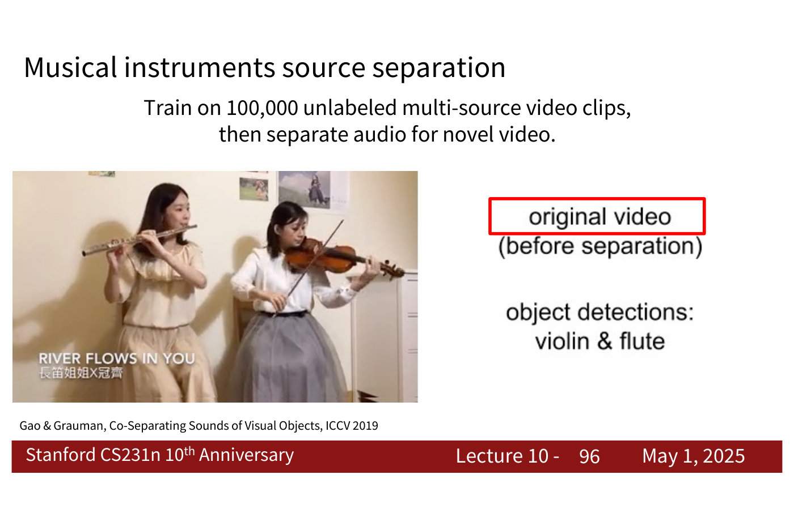

Text: "Train on 100,000 unlabeled multi-source video clips, then separate audio for novel video."

Figure: left, a video frame of two women seated in front of a cream wall with posters, one playing a flute and one a violin; overlaid text at the bottom left "RIVER FLOWS IN YOU" and a line of Chinese characters. At right, a red-outlined box containing "original video", followed by "(before separation)", then "object detections: violin & flute". It appears to be a video still.

Citation: Gao & Grauman, Co-Separating Sounds of Visual Objects, ICCV 2019

## Slide 97 — Audio-Visual Video Understanding

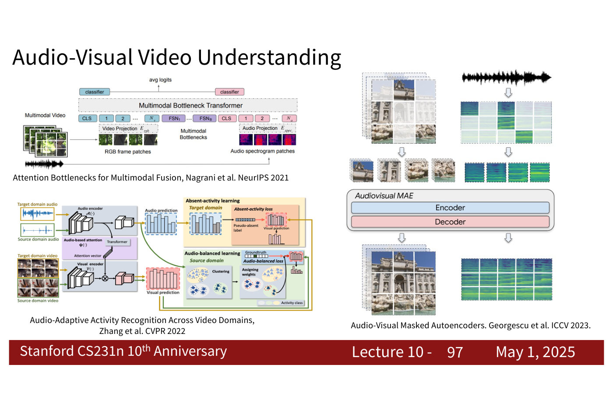

Three figures, each with a printed caption.

Top left: "Multimodal Video" (a stack of video frames plus an audio waveform) feeds two parallel token paths. Video path: "RGB frame patches" go through a "Video Projection E_rgb" box into tokens CLS, 1, 2, ..., N_v. Audio path: "Audio spectrogram patches" go through an "Audio Projection E_spec" box into tokens CLS, 1, 2, ..., N_a. Between the two token rows are purple tokens FSN_1 ... FSN_B, labelled "Multimodal Bottlenecks". All tokens enter a wide grey box "Multimodal Bottleneck Transformer". Above it are two blue/pink "classifier" boxes joined by a line to "avg logits". Caption: "Attention Bottlenecks for Multimodal Fusion, Nagrani et al. NeurIPS 2021".

Bottom left: a dense diagram with an audio branch and a visual branch. Inputs on the left: "Target domain audio", "Source domain audio", "Target domain video", "Source domain video". An "Audio encoder" and a "Visual encoder" (stacked-block icons), an "Audio-based attention" box with "Transformer" and an "Attention vector", an "Audio prediction" bar chart and a "Visual prediction" bar chart. On the right, an "Absent-activity learning" panel (Target domain; "Pseudo-absent label"; "Absent-activity loss") and an "Audio-balanced learning" panel (Source domain; "Clustering"; "Assigning weights"; "Groundtruth"; "Audio-balanced loss"; "Activity class" legend). The small text is too small to transcribe fully beyond these labels. Caption: "Audio-Adaptive Activity Recognition Across Video Domains, Zhang et al. CVPR 2022".

Right: an audio-visual masked autoencoder diagram. Top row: a stack of image frames divided into a $3 \times 3$ grid of patches, with most patches faded (masked), and an audio waveform converted to a spectrogram divided into patches with most faded. Arrows lead down to the few visible patches (4 image patches, 4 spectrogram patches), then into a rounded box "Audiovisual MAE" containing a blue bar "Encoder" and a pink bar "Decoder". Arrows lead down to the reconstructed full frame (a complete grid of patches) and the reconstructed spectrogram. Caption: "Audio-Visual Masked Autoencoders. Georgescu et al. ICCV 2023."

## Slide 98 — Efficient Video Understanding

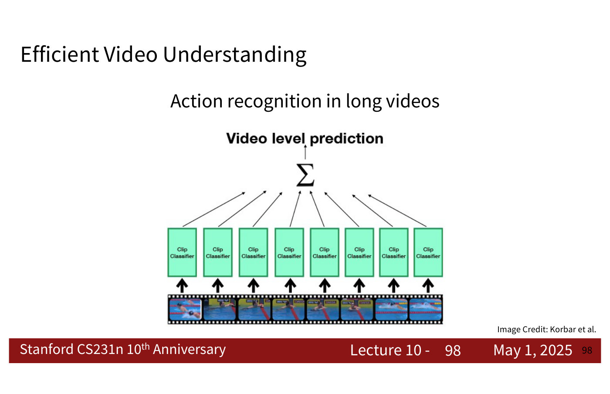

Text: "Action recognition in long videos".

Figure: a film strip of 8 frames of a swimmer. An up arrow from each frame leads to its own green box "Clip Classifier" (8 boxes in a row). Thin arrows from the 8 boxes converge on a "Σ" symbol, with an arrow up to "Video level prediction".

Credit: Image Credit: Korbar et al.

## Slide 99 — Efficient Video Understanding

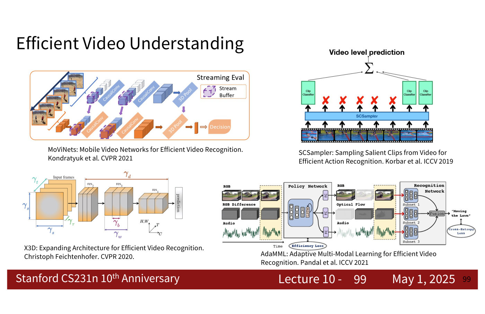

Four figures, each with a caption.

Top left, "Streaming Eval": a stack of 6 video frames of a person running (3 with blue borders, 3 with orange), with a large dark-blue arrow along the stack. Two rows of cubes and boxes labelled "CausalConv", "CausalConv", "3D Pool" in the upper row (blue) and "CausalConv", "CausalConv", "3D Pool" in the lower row (orange), purple dashed cubes labelled "Stream Buffer", and a final "Decision" box. Caption: "MoViNets: Mobile Video Networks for Efficient Video Recognition. Kondratyuk et al. CVPR 2021".

Top right: same style as slide 98 but with a blue bar "SCSampler" between the film strip and the classifiers. The film strip has 8 frames with 8 up arrows into the bar; from the bar, 8 up arrows lead to a row of positions. Only 3 positions hold a green "Clip Classifier" box (the first, seventh and eighth); the other 5 (positions 2 to 6) carry a red X. The three classifiers feed "Σ" and "Video level prediction". Caption: "SCSampler: Sampling Salient Clips from Video for Efficient Action Recognition. Korbar et al. ICCV 2019".

Bottom left: a stack of input frames with labels $\gamma_t$, $\gamma_s$, $\gamma_\tau$ and "Input frames", followed by 3 progressively smaller block groups labelled "res2", "res3", "res4" and a box "prediction"; a span labelled $\gamma_d$ over the blocks, with $\gamma_b$ and $\gamma_w$ below; axes "H,W", "T", "C". Caption: "X3D: Expanding Architecture for Efficient Video Recognition. Christoph Feichtenhofer. CVPR 2020."

Bottom right: three input rows "RGB", "RGB Difference", "Audio" over "Time", entering a "Policy Network" (an LSTM with three "FC" outputs and an "Efficiency Loss" label); the selected inputs ("RGB", "Optical Flow", "Audio") go into a "Recognition Network" with 3 subnets ("Subnet 1", "Subnet 2", "Subnet 3") that feed a "Fusion" box and output the text "Mowing the Lawn" with a "Cross-Entropy Loss" box. Caption: "AdaMML: Adaptive Multi-Modal Learning for Efficient Video Recognition. Pandal et al. ICCV 2021".

## Slide 100 — Efficient Video Understanding

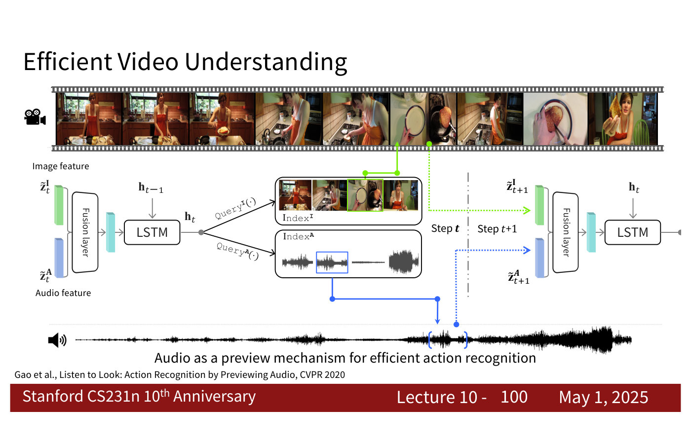

*(This page prints no slide number; 100 is inferred from its neighbours.)*

Figure: at top, a film strip of 9 video frames of a woman cooking (standing at a kitchen counter, a pan on a stove, a close view of a pan with food, a plate of food, the woman holding food up), with a camera icon at the left. At the bottom, an audio waveform with a loudspeaker icon at the left. Between them is an unrolled recurrent diagram over two steps, "Step $t$" and "Step $t+1$" separated by a vertical dash-dot line.

At step $t$: a green "Image feature" bar $\tilde{\mathbf{z}}^{\mathbf{I}}_ {t}$ and a blue "Audio feature" bar $\tilde{\mathbf{z}}^{\mathbf{A}}_ {t}$ go into a "Fusion layer", then into an "LSTM" box that also receives $\mathbf{h}_ {t-1}$ and outputs $\mathbf{h}_ {t}$. From $\mathbf{h}_ {t}$, two arrows labelled "Query^I(·)" and "Query^A(·)" lead to two rounded boxes: "Index^I" (4 small video thumbnails, the third highlighted with a green frame) and "Index^A" (4 audio waveform segments, the second highlighted with a blue frame). A green line leads from the highlighted thumbnail up to the corresponding frame in the film strip (the sixth frame, pan with food). A blue line leads from the highlighted audio segment down to a bracketed span of the waveform. Dotted lines (green from the frame, blue from the audio span) lead to step $t+1$, where they form $\tilde{\mathbf{z}}^{\mathbf{I}}_ {t+1}$ and $\tilde{\mathbf{z}}^{\mathbf{A}}_ {t+1}$, another "Fusion layer" and "LSTM" that receives $\mathbf{h}_ {t}$.

Caption: "Audio as a preview mechanism for efficient action recognition". Citation: Gao et al., Listen to Look: Action Recognition by Previewing Audio, CVPR 2020

## Slide 101 — Multimodal Egocentric Video Understanding

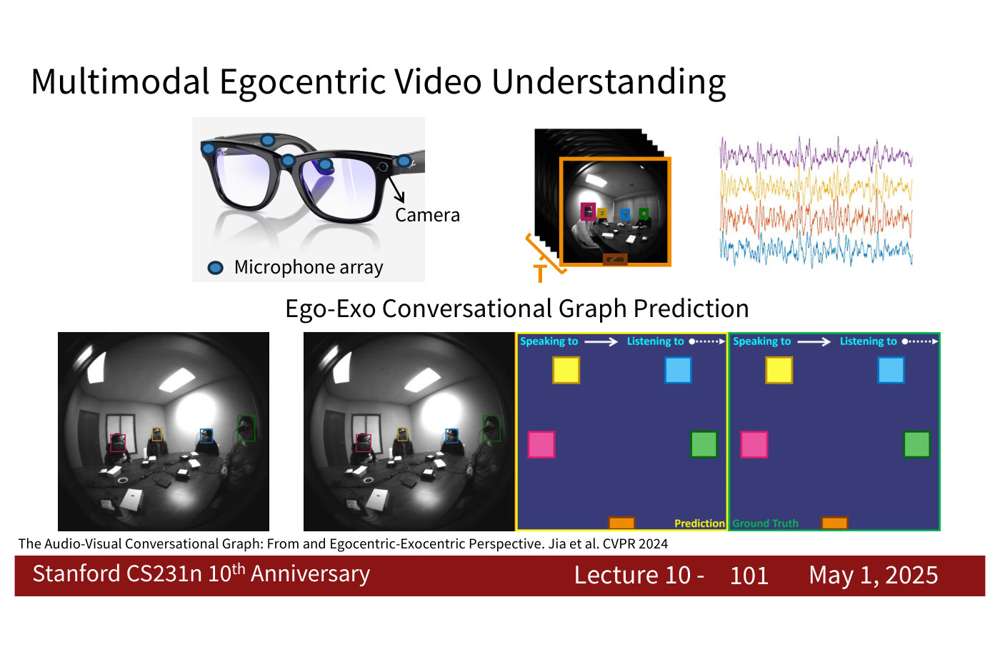

Figure, top: a pair of smart glasses with 5 blue dots marked "Microphone array" and an arrow to the lens labelled "Camera"; next to it a stack of greyscale fisheye frames (axis "T") with four coloured boxes (magenta, yellow, blue, green) around faces, plus a small orange box at the bottom; at the right, four coloured multichannel waveforms (purple, yellow, orange, blue).

Heading: "Ego-Exo Conversational Graph Prediction".

Figure, bottom: four panels in a row. Two greyscale fisheye photographs of a meeting room with four people around a table, faces boxed in magenta, yellow, blue and green. Then two dark-blue graph panels, each headed "Speaking to → Listening to ·····▸": the first has a yellow outline and the label "Prediction", the second has a green outline and the label "Ground Truth". Each shows coloured squares in yellow (top left), light blue (top right), pink (left), green (right) and a small orange rectangle at the bottom, and no arrows or edges are visible between them.

Citation: The Audio-Visual Conversational Graph: From and Egocentric-Exocentric Perspective. Jia et al. CVPR 2024 (printed this way)

## Slide 102 — Video Understanding + LLMs

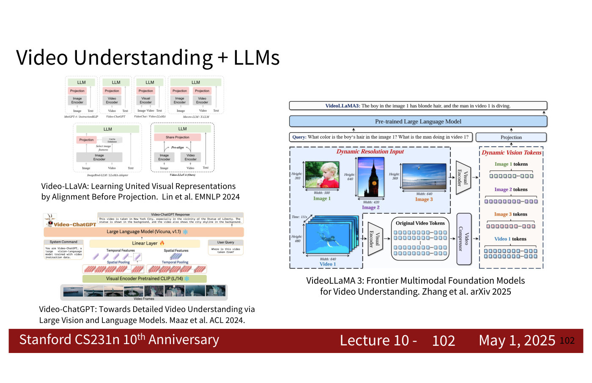

Three figures, each with a caption.

Top left: a diagram of 5 LLM architectures, each a stack of "LLM" over "Projection" over an encoder, with image/video/text inputs. The top row has 4 small panels (labelled MiniGPT-4 / InstructionBLIP, Video-ChatGPT, VideoChat / Video-LLaMA, Macaw-LLM / X-LLM); the bottom row has 2 panels (ImageBind-LLM / LLaMA-Adapter, and "Video-LLaVA (Ours)" in a dashed box with "Share Projection", "Pre-align", "Image Encoder", "Video Encoder"). Text in the panels is very small. Caption: "Video-LLaVA: Learning United Visual Representations by Alignment Before Projection. Lin et al. EMNLP 2024".

Bottom left: "Video-ChatGPT" diagram. From the bottom: "Video Frames" (a strip of 8 frames of a statue and skyline) into a green "Visual Encoder Pretrained CLIP (L/14)" bar, into two rows of feature blocks, "Spatial Pooling" and "Temporal Pooling", giving "Temporal Features" and "Spatial Features", into a yellow "Linear Layer", into a large orange "Large Language Model (Vicuna, v1.1)". A "System Command" box and a "User Query" box ("Where is this video taken from?") feed the LLM, whose "Video-ChatGPT Response" is printed at the top ("This video is taken in New York City, especially in the vicinity of the Statue of Liberty. ..."; the rest is too small to transcribe). Caption: "Video-ChatGPT: Towards Detailed Video Understanding via Large Vision and Language Models. Maaz et al. ACL 2024."

Right: "VideoLLaMA3" diagram. At the bottom left, "Dynamic Resolution Input": Image 1 (a child, Height 393, Width 500), Image 2 (a clock tower, Height 640, Width 420), Image 3 (a beach, Height 369, Width 640), and Video 1 (underwater diver, Time 111s, Height 480, Width 640). Images go through a "Visual Encoder"; the video goes through a "Visual Encoder", "Original Video Tokens" and a "Video Compressor". At right, "Dynamic Vision Tokens" are shown as rows of small squares for "Image 1 tokens", "Image 2 tokens", "Image 3 tokens" and "Video 1 tokens". These pass through a "Projection" box. A "Query: What color is the boy's hair in the image 1? What is the man doing in video 1?" goes into a "Pre-trained Large Language Model", whose output at the top reads "VideoLLaMA3: The boy in the image 1 has blonde hair, and the man in video 1 is diving." Caption: "VideoLLaMA 3: Frontier Multimodal Foundation Models for Video Understanding. Zhang et al. arXiv 2025".

## Slide 103 — Next time: Large Scale Distributed Training

Text only: "Next time: Large Scale Distributed Training".

