# Lecture 11 — Large-Scale Distributed Training (slide-by-slide)

Text and figures of all 148 pages of [`lecture_11.pdf`](https://cs231n.stanford.edu/slides/2025/lecture_11.pdf), CS231N (Stanford, Spring 2025), May 6, 2025. Cite these as "slide N" using the **printed** slide number (footer, after "Lecture 11 -"). The running footer ("Stanford CS231n 10th Anniversary", "Lecture 11 - N", "May 6, 2025") is on every page and is not repeated below. Equations are written in LaTeX; matrix shapes and hardware figures are quoted as printed ("[NxD]", "16x4").

The deck reveals its diagrams one element at a time, so many slides are build steps of the slide before and are written "Same as slide N, plus …". The full drawing is under the last slide of each build. The fully sharded data parallelism slides (46–64) are titled "FSPD" on the deck, as printed; the text and the lecture say FSDP.

| Section | Slides |
| --- | --- |
| Title; administrative (midterm review and in-class midterm); today | 1–3 |
| Running example: Llama3-405B | 4 |
| Inside a GPU: the NVIDIA H100, its memory, L2 cache, streaming multiprocessors, FP32 cores and Tensor Cores | 5–16 |
| GPUs have gotten much faster (FP32 and Tensor Core TFLOP/sec, K40 to B200) | 17–19 |
| From one GPU to a cluster: server, rack, pod and Meta's Llama3 cluster | 20–25 |
| Google TPUs; other training chips | 26–27 |
| How to train on lots of GPUs: four ways to split (Batch, Sequence, Dim, layers) | 28–31 |
| Data parallelism (DP) | 32–45 |
| Fully sharded data parallelism (FSDP, printed "FSPD") | 46–64 |
| Hybrid sharded data parallelism (HSDP) | 65–67 |
| Data parallelism summary; activations fill memory | 68–70 |
| Activation checkpointing | 71–101 |
| A scaling recipe | 102 |
| Hardware FLOPs utilization (HFU) | 103–107 |
| Model FLOPs utilization (MFU) | 108–113 |
| Context parallelism (CP): ring attention, Ulysses | 114–126 |
| Pipeline parallelism (PP) and microbatches | 127–133 |
| Tensor parallelism (TP), one layer and two layers | 134–144 |
| ND parallelism and Llama3-405B's configuration | 145–146 |
| Summary; next time (self-supervised learning) | 147–148 |

## Slide numbers vs PDF pages

The deck prints numbers 1–148 on 148 pages, one per page, so the printed number and the PDF page number are the same throughout.

**What the recording covers.** The recording opens with the title and the running example (slides 1, 3–4, ≈0:05–2:23) and does not present slide 2 (administrative: the midterm review session on Friday 5/9 and the in-class midterm on Tuesday 5/13), so this file is the only source for it. It then follows the deck in order: the H100 and its internals (5–16, ≈2:23–11:41), GPU throughput over time (17–19, ≈11:41–14:46), server, rack, pod and the Llama 3 cluster (20–25, ≈14:46–23:14), TPUs and other chips (26–27, ≈23:14–26:17), the four axes (28–31, ≈26:17–28:35), data parallelism (32–45, ≈28:35–40:51), FSDP (46–64, ≈40:51–48:37), HSDP (65–67, ≈48:37–52:24), the data-parallelism summary and activation memory (68–70, ≈52:24–53:11), activation checkpointing (71–101, ≈53:11–55:28), the scaling recipe (102, ≈55:28–57:46), HFU (103–107, ≈57:46–59:18), MFU (108–113, ≈59:18–1:03:08), context parallelism (114–126, ≈1:03:08–1:05:27), pipeline parallelism (127–133, ≈1:05:27–1:09:16), tensor parallelism (134–144, ≈1:09:16–1:10:50), ND parallelism (145–146, ≈1:10:50–1:11:36) and the summary (147, ≈1:11:36–1:12:21). Slide 148 (next time) is not reached. At ≈1:03:08 the lecturer says the remaining slides can be checked offline, so context, pipeline and tensor parallelism (114–144) get a brief tour and their details are sourced to this file. Spoken with no counterpart on a slide: binning as the reason only 132 of 144 SMs are enabled (≈6:16–7:02; slide 12 prints only "due to yield"), a model left in 32-bit running about 20 times slower (≈10:53–11:41), how long large training runs last, rack and cluster sizes and cooling (≈18:38–21:41), the TPU v2 pod of 256 chips in slide 26's photograph (≈23:59), asynchronous SGD (≈35:29–36:15), PyTorch's DistributedDataParallel and CUDA (≈37:01–38:34), and MFU above 50% on A100s (≈1:02:22). See the [transcript](../transcripts/11-large-scale-distributed-training.md).

**Slides repeated from earlier decks.** None; slide 147's two pictures repeat this deck's slides 10–13 and 24.

**Printed slips, transcribed as printed with `[Ed:]` lines.** Slide 25's "1.875 PB of GPU memory" is 24,576 x 80 GB in binary units (about 1.97 PB decimal). Slides 46–64 are titled "FSPD", and their ZeRO citation spells the first author "Rajbhandrari". Slide 68 lists "Adam β1, β1" where slide 44 has "β1, β2". Slide 69's 63GB is in binary units (67.6 GB decimal), and its sequence length of 4096 differs from the 8192 of slides 125 and 146. Slide 98's counter prints "Current Memory: 2" with one box drawn, and slides 100–101 keep the counter at 14 / 2 / 2 while all eight boxes are drawn. Slide 112's Llama3-405B rows give 41% MFU for 400 TFLOPs/GPU, where 400 / 989.4 is 40.4% (repeated on 113 and 146). Slide 138 says to shard the first layer "over row" and the second "over column", the opposite of its own drawing on 140–143. Slides 139–143 label Z "[DxD]" where Z = YU is N x D. Smaller typos are noted in place: "it's own" (37–43), "L-length" then "S-length" (116–125), "LLama3-405B" (146). Worked values that recompute: 14–16 (256 KB of registers, 256 and 4096 FLOP/cycle), 25's other totals, 44, 68's 800GB and 10GB, 69's product, 125's 8192 per GPU, 130's 1/N, 133's 16/28, and every GPU count and token count of 146.

**Images.** 30 slides are rendered as images, each placed under its heading: 5, 9, 12, 16, 19, 21, 22, 23, 24, 26, 27, 43, 47, 56, 61, 64, 67, 71, 76, 88, 101, 106, 119, 123, 124, 132, 133, 138, 143 and 146. The others have none, because they are title or divider slides (1, 3, 148), text slides (2, 4, 30–33, 102–104, 108, 111, 114, 115, 125–127, 134, 144, 145), equations (34–36), code listings transcribed exactly (105, 109, 110), tables transcribed exactly (112, 113), build steps whose last step is rendered (7–8 → 9; 10–11 → 12; 13–15 → 16; 17–18 → 19; 20 → 21; 37–42 → 43; 46 → 47; 48–55 → 56; 57–60 → 61; 62–63 → 64; 65–66 → 67; 116–118 → 119; 120–122 → 123; 128–131 → 132; 135–137 → 138; 139–142 → 143), the other steps of the activation-checkpointing walk-through, of which 76, 88 and 101 stand for the normal run, full recomputation and checkpoints (72–75, 77–87, 89–100), or a rendered figure repeated with new text (6, 28, 29 → 5; 25 → 24; 44–45 → 43; 68–70, the FSDP drawing of 64 without its braces; 107 → 106; 147, the summary, repeating 10–13 and 24). Never construct an image path for a slide not listed here.

Companion pages: [wiki page for this lecture](../../wiki/11-large-scale-distributed-training.md) · [transcript](../transcripts/11-large-scale-distributed-training.md)

## Slide 1 — Lecture 11: Large-Scale Distributed Training

Title slide. Text: "Lecture 11:" / "Large-Scale Distributed Training".

## Slide 2 — Administrative

"Reminders:"

- "Friday 5/9: Midterm Review Session"
- "Tuesday 5/13: In-Class Midterm"

## Slide 3 — Today: Large-Scale Distributed Training

Divider slide. Text: "Today:" / "Large-Scale Distributed Training".

## Slide 4 — Running Example: Llama3-405B

- "GPT4 kicked off a trend of not sharing any model details:"
  - Quotation (italic): "Given both the competitive landscape and the safety implications of large-scale models like GPT-4, this report contains no further details about the architecture (including model size), hardware, training compute, dataset construction, training method, or similar."
- "Llama3: Open-source LLM released by Meta in April 2024; paper shares many model and training details"
- "Llama4: Released initial models April 2025, but no paper yet"

Citations (bottom right): "Llama Team, "The Llama 3 Herd of Models", https://arxiv.org/abs/2407.21783" and "OpenAI, "GPT4 Technical Report", arXiv 2023".

## Slide 5 — GPUs and How to Train On Them

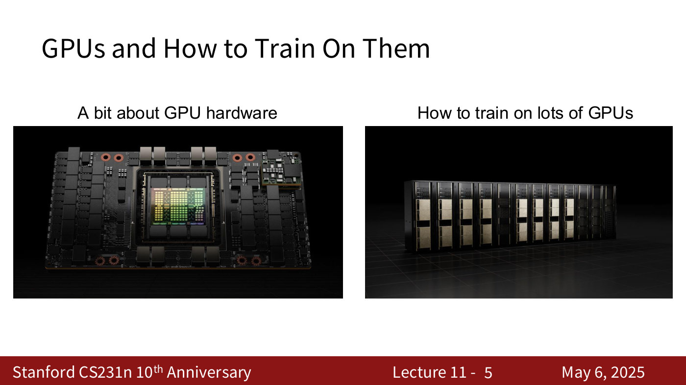

Two panels side by side, each a caption over a dark product image.

- Left caption: "A bit about GPU hardware". Image: a render of an NVIDIA H100 board seen from above at an angle, a black circuit board with a square central package (a multicoloured die in the middle ringed by memory stacks) and rows of power components on both sides.
- Right caption: "How to train on lots of GPUs". Image: a render of a long row of server racks in a dark room, with gold-coloured panels on the front of each rack.

## Slide 6 — GPUs and How to Train On Them

Same as slide 5, except the right panel (caption "How to train on lots of GPUs" and its rack image) is greyed out and faded, while the left panel ("A bit about GPU hardware" and the H100 board image) stays at full contrast.

## Slide 7 — Inside a GPU: NVIDIA H100

Left: the H100 board image from slide 5, at the left of the slide. Right, text:

"**GPU = Graphics Processing Unit**"
"Originally for graphics"
"Now a general parallel processor"

## Slide 8 — Inside a GPU: NVIDIA H100

Same as slide 7, plus: a yellow rectangle drawn around the multicoloured central die of the board image, with a yellow arrow from it to new text on the right: "Compute Cores".

## Slide 9 — Inside a GPU: NVIDIA H100

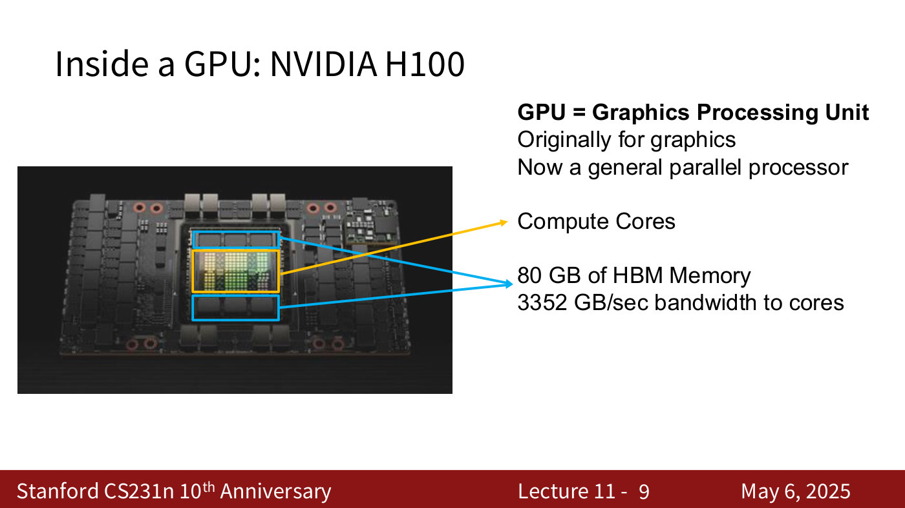

Same as slide 8, plus: two blue rectangles, one directly above and one directly below the yellow die rectangle (these mark the memory stacks next to the die), with two blue arrows from them converging on new text on the right: "80 GB of HBM Memory" / "3352 GB/sec bandwidth to cores".

## Slide 10 — Inside a GPU: NVIDIA H100

Left: a small thumbnail of the H100 board (top left) with its central die boxed in yellow; two yellow lines run from that box and widen to a large yellow-framed floorplan diagram of the die that fills the lower left of the slide. Right, bold heading: "H100 Compute Cores" (no other text on this slide).

Floorplan diagram (small print, mostly illegible labels; what can be read):

- A dark bar across the top: "PCI Express 5.0 Host Interface". Under it an orange bar: "GigaThread Engine with MIG Control".
- Eight "GPC" blocks, each a grey frame holding a grid of green SM units with "TPC" and "SM" labels: four GPC blocks in a row above the middle band and four in a row below it. Each GPC shows nine columns of units.
- A wide blue band across the middle, split into two halves by a narrow gap with two small arrows between them; each half is labelled "L2 Cache".
- Left and right edges: three tall boxes each side labelled "HBM3" (six in total), each with a pair of double-headed arrows, and between them and the GPCs a column of five "Memory Controller" strips on each side.
- A grey bar along the bottom: "High-Speed Hub", with a row of green boxes under it, each labelled "NVLink" (18 boxes).

## Slide 11 — Inside a GPU: NVIDIA H100

Same as slide 10, plus: the blue L2 Cache band is outlined in green and a green arrow runs from it to new text on the right: "50MB of L2 Cache".

## Slide 12 — Inside a GPU: NVIDIA H100

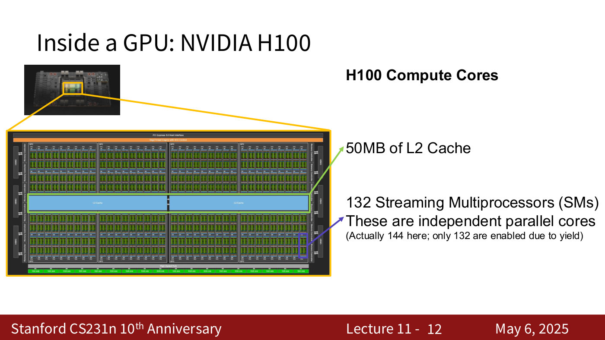

Same as slide 11, plus: a small purple outline around the rightmost column of the lower-right GPC (two stacked SMs, in its bottom half), with a purple arrow to new text on the right:

"132 Streaming Multiprocessors (SMs)"
"These are independent parallel cores"
"(Actually 144 here; only 132 are enabled due to yield)" (small print)

## Slide 13 — Inside a GPU: NVIDIA H100

Heading (top right): "H100 Streaming Multiprocessor". Left: the small H100 board thumbnail, below it a smaller copy of the floorplan with a yellow frame, and a purple line from one SM at the lower right of that floorplan widening to a large purple-framed diagram of a single SM filling the centre and right. Left caption under the thumbnails: "Sort of like a CPU core with vector instructions".

SM diagram (labelled "SM" top left of the frame):

- A light-blue bar across the top: "L1 Instruction Cache".
- Four identical quadrants in a 2 x 2 grid. Each quadrant, top to bottom: a light-blue bar "L0 Instruction Cache"; an orange bar "Warp Scheduler (32 thread/clk)"; a brown bar "Dispatch Unit (32 thread/clk)"; a dark-teal block "Register File (16,384 x 32-bit)"; then a green area with, left to right, a column of boxes labelled "INT32", two columns of boxes labelled "FP32", one column labelled "FP64" (each column 16 boxes tall, so 16 INT32, 32 FP32, 16 FP64 per quadrant), and one large green block "TENSOR CORE 4th GENERATION"; then a bottom row of eight small dark-red boxes labelled "LD/ST" and a wider dark-red box "SFU".
- Below the quadrants: a bright green bar "Tensor Memory Accelerator"; a light-blue bar "256 KB L1 Data Cache / Shared Memory"; and a row of four dark-blue boxes each labelled "Tex".

## Slide 14 — Inside a GPU: NVIDIA H100

Same as slide 13, plus: the L1 instruction/data cache bars are outlined in green and the four "Register File" blocks are outlined in orange; new text under the heading:

"256 KB **L1 cache**, **256 KB registers**" ("L1 cache" in green bold underlined, "256 KB registers" in orange bold underlined, matching the outlines).

## Slide 15 — Inside a GPU: NVIDIA H100

Same as slide 14, plus: in each of the four quadrants the two FP32 columns are outlined in cyan; new text:

"128 **FP32 Cores**" ("FP32 Cores" in cyan bold underlined)
"Computes a\*x + b per clock cycle"
"2 FLOPs = Floating Point Operations"
"256 FLOP/cycle per SM"

## Slide 16 — Inside a GPU: NVIDIA H100

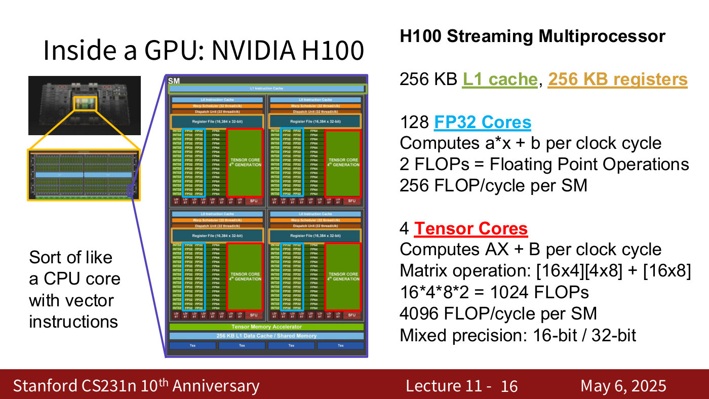

Same as slide 15, plus: each of the four "TENSOR CORE 4th GENERATION" blocks is outlined in red; new text:

"4 **Tensor Cores**" ("Tensor Cores" in red bold underlined)
"Computes AX + B per clock cycle"
"Matrix operation: [16x4][4x8] + [16x8]"
"16\*4\*8\*2 = 1024 FLOPs"
"4096 FLOP/cycle per SM"
"Mixed precision: 16-bit / 32-bit"

## Slide 17 — GPUs Have Gotten Much Faster!

Line chart. Y axis: "TFLOP/sec", 0 to 6000 in steps of 1000. X axis: dates, ticks at Apr-12, Aug-13, Dec-14, May-16, Sep-17, Feb-19, Jun-20, Oct-21, Mar-23, Jul-24, Dec-25. Light grey gridlines at every tick, both ways. Legend (top): two series, "FP32" (blue) and "Tensor Core" (green).

- FP32 (blue): nearly flat along the bottom. Labelled points: K40 "5 FP32" (just after Aug-13); P100 "10.6 FP32" (two blue dots, at about Nov-15 and Apr-16, with one label above both); V100 "15.7 FP32" (about May-17); A100 "19.5 FP32" (just before Jun-20); H100 "67 FP32" (about Mar-22); B200 "83.3 FP32" (about Nov-24).
- Tensor Core (green): starts at V100 and rises steeply. Exactly four points: V100 "125 TC" (about May-17); A100 "312 TC" (just before Jun-20); H100 "989 TC" (about Mar-22, plotted at about 1000); B200 "5000 TC" (about Nov-24, at 5000 on the y axis).

Each GPU name (K40, P100, V100, A100, H100, B200) is underlined, with the "TC" / "FP32" numbers on the lines below it. There is no green point for K40 or P100.

## Slide 18 — GPUs Have Gotten Much Faster!

Same as slide 17, plus: red text "1000x speedup since 2013!" in the upper middle of the plot, with a red line running from the K40 label up and across to the left of this text, and a second red line from the right of the text, stepping up, to the B200 label.

## Slide 19 — GPUs Have Gotten Much Faster!

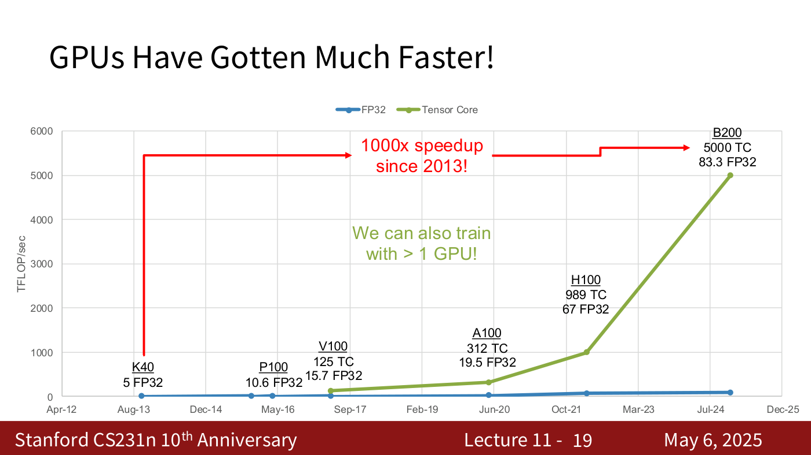

Same as slide 18, plus: green text in the middle of the plot, "We can also train with > 1 GPU!".

## Slide 20 — NVIDIA H100 GPU

Heading (bold, left): "H100 GPU". Text under it: "3352 GB/sec inside the GPU". Right: the large H100 board image (as on slide 5).

## Slide 21 — NVIDIA H100 GPU

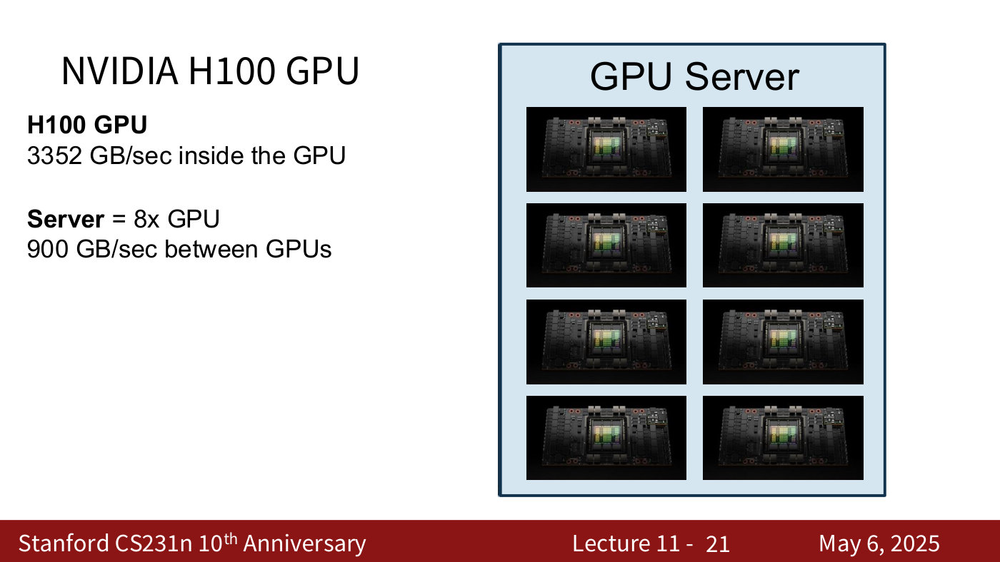

Left text:

"**H100 GPU**"
"3352 GB/sec inside the GPU"

"**Server** = 8x GPU"
"900 GB/sec between GPUs"

Right: a light-blue framed box titled "GPU Server" holding eight H100 board images in a 2-column by 4-row grid (8 boards).

## Slide 22 — Case Study: Meta's Llama3 Cluster

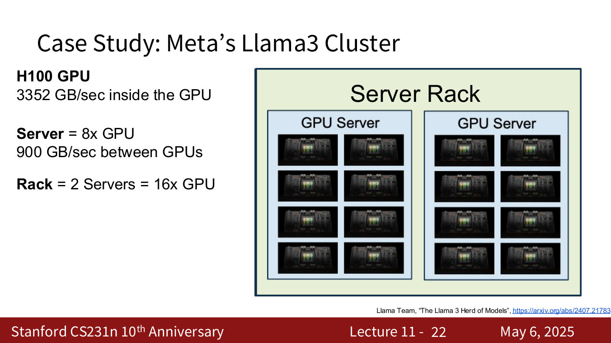

Left text:

"**H100 GPU**"
"3352 GB/sec inside the GPU"

"**Server** = 8x GPU"
"900 GB/sec between GPUs"

"**Rack** = 2 Servers = 16x GPU"

Right: a pale-green framed box titled "Server Rack" holding two light-blue "GPU Server" boxes side by side; each contains eight H100 board images in a 2 x 4 grid (16 boards in all).

Citation (bottom right): "Llama Team, "The Llama 3 Herd of Models", https://arxiv.org/abs/2407.21783".

## Slide 23 — Case Study: Meta's Llama3 Cluster

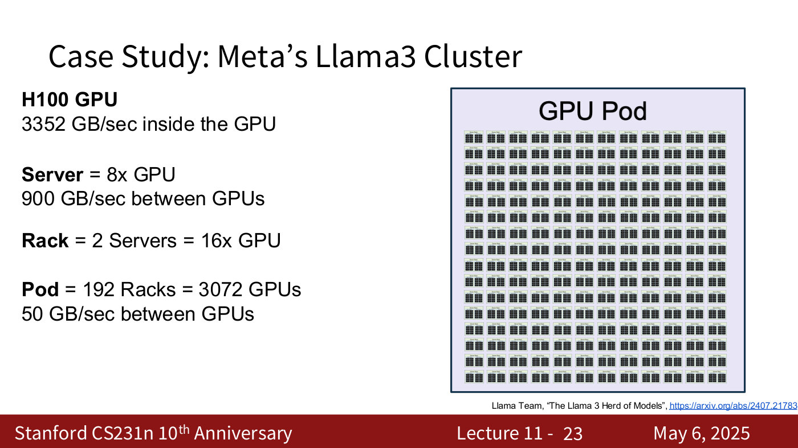

Left text:

"**H100 GPU**"
"3352 GB/sec inside the GPU"

"**Server** = 8x GPU"
"900 GB/sec between GPUs"

"**Rack** = 2 Servers = 16x GPU"

"**Pod** = 192 Racks = 3072 GPUs"
"50 GB/sec between GPUs"

Right: a lavender framed box titled "GPU Pod" holding a grid of tiny "Server Rack" icons (each a small green box containing two small server boxes), 12 columns by 16 rows = 192 icons.

Citation (bottom right): "Llama Team, "The Llama 3 Herd of Models", https://arxiv.org/abs/2407.21783".

## Slide 24 — Case Study: Meta's Llama3 Cluster

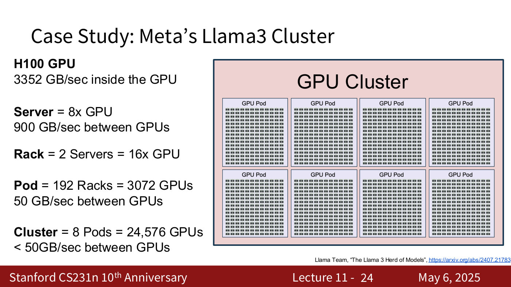

Left text:

"**H100 GPU**"
"3352 GB/sec inside the GPU"

"**Server** = 8x GPU"
"900 GB/sec between GPUs"

"**Rack** = 2 Servers = 16x GPU"

"**Pod** = 192 Racks = 3072 GPUs"
"50 GB/sec between GPUs"

"**Cluster** = 8 Pods = 24,576 GPUs"
"< 50GB/sec between GPUs"

Right: a pink framed box titled "GPU Cluster" holding eight lavender boxes each labelled "GPU Pod", in 2 rows of 4; each pod is filled with the same 12 x 16 grid of tiny rack icons as slide 23.

Citation (bottom right): "Llama Team, "The Llama 3 Herd of Models", https://arxiv.org/abs/2407.21783".

## Slide 25 — GPU Cluster = One Big Computer

Left text:

"**Total Cluster Stats**"
"24,576 GPUs"
"1.875 PB of GPU memory"
"415M FP32 cores"
"13M Tensor Cores"
"24.3 EFLOP/sec = 24.3 x 10^18" (the 18 is a superscript)

Lower left, in green bold with "Goal" underlined: "Goal: Train one giant neural network on this cluster"

Right: the same "GPU Cluster" drawing as slide 24 (eight "GPU Pod" boxes in 2 rows of 4 inside a pink frame).

*[Ed: printed "1.875 PB of GPU memory". The slide's inputs, 24,576 GPUs at 80 GB each (slide 9), give 1,966,080 GB, which is about 1.966 PB in decimal units; 1.875 results from dividing 1,966,080 GB by 1024 twice, so the printed value may use binary units (GB vs GiB).]*

*[Ed: The other totals recompute from the per-GPU figures of slides 12, 15, 16 and 17: 24,576 x 132 SMs x 128 FP32 cores is 415,236,096 (about 415M); 24,576 x 132 x 4 Tensor Cores is 12,976,128 (about 13M); 24,576 x 989 TFLOP/sec is about 24.3 x 10^18 FLOP/sec.]*

## Slide 26 — Google: Tensor Processing Units (TPUs)

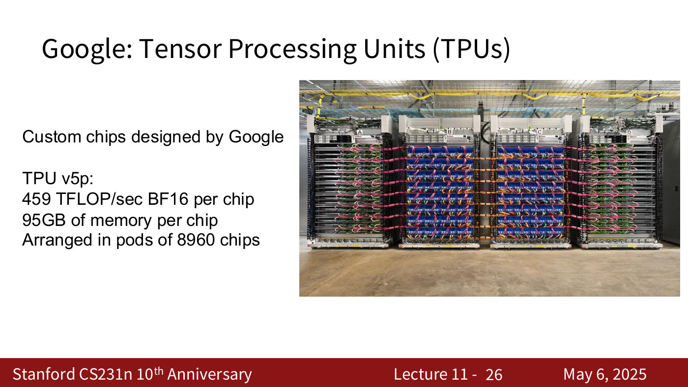

Left text:

"Custom chips designed by Google"

"TPU v5p:"
"459 TFLOP/sec BF16 per chip"
"95GB of memory per chip"
"Arranged in pods of 8960 chips"

Right: a photograph of a row of four tall server racks in a data hall, with yellow cable trays overhead; the two middle racks are filled with blue-lit units and bundles of pink and orange cables, the outer two have green-lit units. Letters (A, B, C, D) appear on the tops of the racks. No printed credit line.

## Slide 27 — Other Training Chips

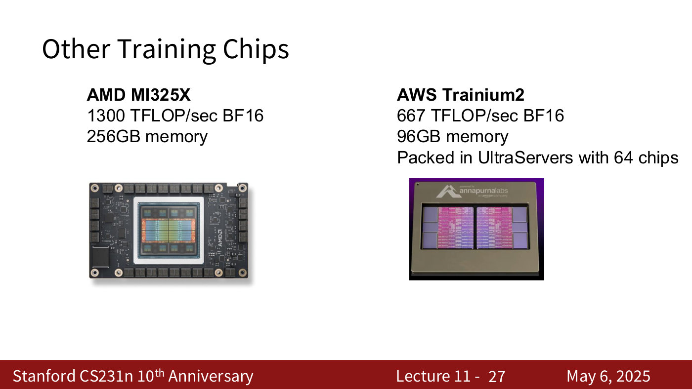

Two columns, each with text over a chip photograph.

- Left, "**AMD MI325X**" / "1300 TFLOP/sec BF16" / "256GB memory". Photograph: a dark grey-and-black circuit board with a white/silver square central package holding a multicoloured die ringed by smaller dies; "AMD" is printed on the board to the right of the package.
- Right, "**AWS Trainium2**" / "667 TFLOP/sec BF16" / "96GB memory" / "Packed in UltraServers with 64 chips". Photograph: a metallic chip package on a purple background with the logo "powered by annapurnalabs" (small text "an amazon company") and two pink-and-purple dies side by side, with three small lavender dies on each side.

## Slide 28 — Today: GPUs and How to Train On Them

Same layout as slide 5 (title now "Today: GPUs and How to Train On Them"), with the right panel ("How to train on lots of GPUs" and the rack image) greyed out and the left panel ("A bit about GPU hardware" and the H100 board image) at full contrast.

## Slide 29 — Today: GPUs and How to Train On Them

Same as slide 28, but reversed: the left panel ("A bit about GPU hardware" and the H100 image) is greyed out and the right panel ("How to train on lots of GPUs" and the rack image) is at full contrast.

## Slide 30 — How to train on lots of GPUs

Text: "A model with L layers operates on tensors of shape (Batch, Sequence, Dim)"

Four items in a 2 x 2 layout, each a bold name with a line under it (the large gaps between the rows are blank on this slide):

- Top left: "**Data Parallelism (DP)**" / "Split on Batch dimension"
- Top right: "**Context Parallelism (CP)**" / "Split on Sequence dimension"
- Bottom left: "**Pipeline Parallelism (PP)**" / "Split on L dimension"
- Bottom right: "**Tensor Parallelism (TP)**" / "Split on Dim dimension"

## Slide 31 — How to train on lots of GPUs

Same as slide 30, but only the top-left item ("Data Parallelism (DP)" / "Split on Batch dimension") is at full contrast; the other three are greyed out.

## Slide 32 — Data Parallelism

Text (top left): "Recall: Loss is usually averaged over a minibatch of N samples" ("Recall" underlined).

## Slide 33 — Data Parallelism

Same as slide 32, plus: "Idea: Use minibatch of MN samples, split over M GPUs" ("Idea" underlined).

## Slide 34 — Data Parallelism

Same as slide 33, plus: "Gradients are linear, so each GPU computes its own gradient:" and two displayed equations:

$$L = \frac{1}{MN} \sum_{i=1}^{M} \sum_{j=1}^{N} \ell(x_{i,j}, W)$$

$$\frac{\partial L}{\partial W} = \frac{1}{M} \sum_{i=1}^{M} \left( \frac{1}{N} \sum_{j=1}^{N} \frac{\partial}{\partial W} \ell(x_{i,j}, W) \right)$$

## Slide 35 — Data Parallelism

Same as slide 34, plus: in the second equation the inner term $\frac{1}{N} \sum_{j=1}^{N} \frac{\partial}{\partial W} \ell(x_{i,j}, W)$ is coloured blue, with a blue annotation to its right: "Each GPU computes gradient on N examples".

## Slide 36 — Data Parallelism

Same as slide 35, plus: the outer factor $\frac{1}{M} \sum_{i=1}^{M}$ and the enclosing large parentheses in the second equation are coloured green, with a green annotation to its right: "Average gradients across M GPUs".

## Slide 37 — Data Parallelism

Same left text as slide 33 and 34 ("Recall: Loss is usually averaged over a minibatch of N samples" / "Idea: Use minibatch of MN samples, split over M GPUs" / "Gradients are linear, so each GPU computes its own gradient:"); the equations are removed. New numbered list item below it: "1. Each GPU has it's own copy of model + optimizer" (printed "it's").

Right: three copies of the same small network drawing stacked vertically, each labelled below it "GPU 1", "GPU 2", "GPU 3", separated by two horizontal dashed lines (one between GPU 1 and GPU 2, one between GPU 2 and GPU 3). Each copy is four blue vertical rectangles in a row (4 per GPU), joined by three black arrows pointing left to right.

## Slide 38 — Data Parallelism

Left text: "Recall: Loss is usually averaged over a minibatch of N samples" ("Recall" underlined). "Idea: Use minibatch of MN samples, split over M GPUs" ("Idea" underlined). "Gradients are linear, so each GPU computes its own gradient:". Then a numbered list:

1. "Each GPU has it's own copy of model + optimizer" (as printed)
2. "Each GPU loads its own batch of data"

Figure (right): three stacked panels, labelled "GPU 1", "GPU 2", "GPU 3" at their lower left, separated by two horizontal dashed lines (one between GPU 1 and GPU 2, one between GPU 2 and GPU 3). Each panel holds the same network drawn as 4 tall blue rectangles in a row, joined by 3 short black right-pointing arrows. To the left of each network is a stack of three input labels: GPU 1 has $x_{1,1}$, $x_{1,2}$, $x_{1,3}$; GPU 2 has $x_{2,1}$, $x_{2,2}$, $x_{2,3}$; GPU 3 has $x_{3,1}$, $x_{3,2}$, $x_{3,3}$. Count: 3 GPUs, 12 blue rectangles in all, 9 arrows, 9 input labels.

## Slide 39 — Data Parallelism

Same as slide 38, plus list item "3. Each GPU runs forward to compute loss", and a loss label to the right of each network: $L_1$ (GPU 1), $L_2$ (GPU 2), $L_3$ (GPU 3).

## Slide 40 — Data Parallelism

Same as slide 39, plus list item "4. Each GPU runs backward to compute gradients", and under each of the 4 blue rectangles of every network a black fraction: GPU 1 has $\partial L_1/\partial W_1$, $\partial L_1/\partial W_2$, $\partial L_1/\partial W_3$, $\partial L_1/\partial W_4$ (written as partial-derivative fractions with $L_1$ on top and $W_1$ ... $W_4$ below); GPU 2 has the same with $L_2$; GPU 3 has the same with $L_3$. 12 fractions in all.

## Slide 41 — Data Parallelism

Same as slide 40, plus list item "5. Average gradients across all GPUs", and these additions in dark red. Above each of the 4 blue rectangles of every network (12 positions) a red fraction $\partial L/\partial W_1$ ... $\partial L/\partial W_4$, with no GPU subscript on L (the averaged gradient). A dark-red line runs right from the bottom-right gradient (dL_i/dW_4) of each of the 3 GPUs to a common vertical dark-red line at the far right of the figure; from that vertical line three dark-red arrows point left, one into the red $\partial L/\partial W_4$ label above each GPU's network (GPU 1's arrow is at the top of the slide). So each GPU's local gradients feed a common line that returns the averaged gradient to every GPU.

## Slide 42 — Data Parallelism

Same as slide 41, plus list item "6. Each GPU updates its own weights".

## Slide 43 — Data Parallelism

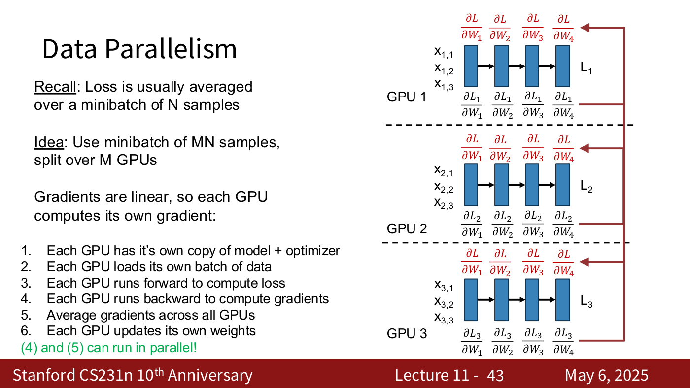

Same as slide 42, plus a green line under the list: "(4) and (5) can run in parallel!".

## Slide 44 — Data Parallelism

Same figure as slide 43 (with the red averaged-gradient arrows). The numbered list and the green line are gone. In their place, in red text under "Gradients are linear, so each GPU computes its own gradient:":

"Problem: Model size constrained by GPU memory." ("Problem" underlined)

"Each weight needs 4 numbers (weight, grad, Adam β1, β2). Each number needs 2 bytes."

"1B params takes 8GB; 10B params fills up 80GB GPU."

*[Ed: Recomputed: 4 numbers x 2 bytes = 8 bytes per parameter; 1B parameters x 8 bytes = 8 GB; 10B parameters x 8 bytes = 80 GB. Printed values agree.]*

## Slide 45 — Data Parallelism

Same as slide 44, plus a green line at the bottom of the text: "Solution: Split model weights across GPUs" ("Solution" underlined).

## Slide 46 — Fully Sharded Data Parallelism (FSPD)

(Title as printed, "FSPD".)

Text: "Split model weights across GPUs". "Each weight $W_i$ is owned by one GPU, which also holds its grads and optim states".

Figure: two panels, "GPU 1" above and "GPU 2" below, separated by one horizontal dashed line. Each panel is a network of 4 rectangles in a row joined by 3 black arrows, all rectangles in a pale (light) blue. Inputs: GPU 1 has $x_{1,1}$, $x_{1,2}$, $x_{1,3}$ and loss label $L_1$; GPU 2 has $x_{2,1}$, $x_{2,2}$, $x_{2,3}$ and loss label $L_2$. Under the 4 rectangles of each GPU are the labels $W_1$, $W_2$, $W_3$, $W_4$. On GPU 1, $W_1$ and $W_2$ are black and $W_3$ and $W_4$ are grey; on GPU 2, $W_1$ and $W_2$ are grey and $W_3$ and $W_4$ are black. Black means that GPU owns (holds) that weight; grey means it does not. So GPU 1 owns $W_1$ and $W_2$, GPU 2 owns $W_3$ and $W_4$.

Citation (bottom right, small): Rajbhandrari et al, "ZeRO: Memory Optimizations Toward Training Trillion Parameter Models", arXiv 2019

## Slide 47 — Fully Sharded Data Parallelism (FSPD)

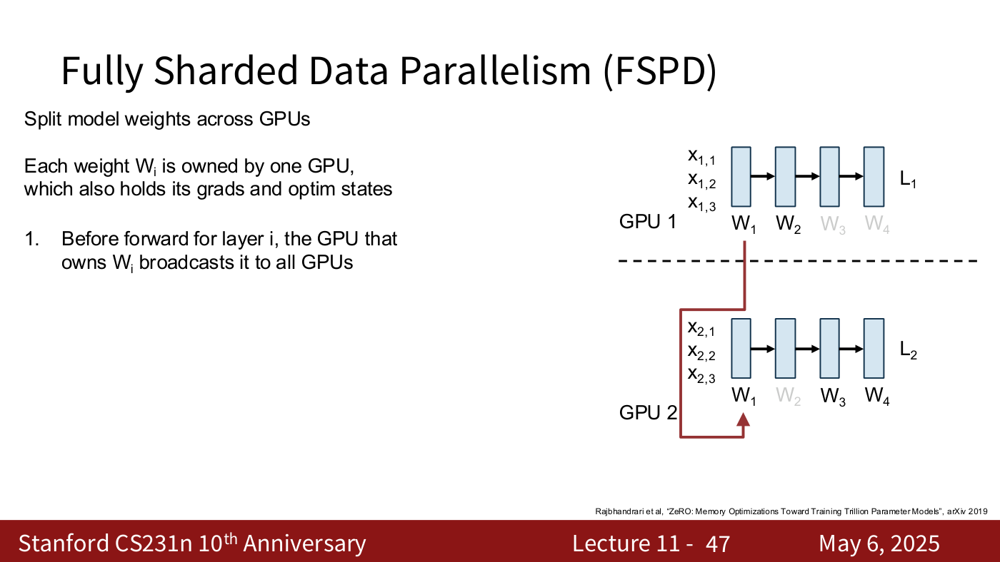

Same as slide 46, plus list item "1. Before forward for layer i, the GPU that owns $W_i$ broadcasts it to all GPUs". In the figure a dark-red arrow leaves GPU 1's $W_1$ label, runs down across the dashed line, around the left of GPU 2's input labels and below GPU 2's panel, and points up into GPU 2's $W_1$ label. GPU 2's $W_1$ label is now black (it holds a copy). The rectangles are all still pale blue.

## Slide 48 — Fully Sharded Data Parallelism (FSPD)

Same as slide 46 with list items 1 and 2: "1. Before forward for layer i, the GPU that owns $W_i$ broadcasts it to all GPUs" and "2. All GPUs run forward for layer i, then delete their local copy of $W_i$". No arrow. The first rectangle (layer 1) of both GPUs is now a darker blue (forward through layer 1 done). GPU 2's $W_1$ label is grey again (copy deleted); labels otherwise as on slide 46.

## Slide 49 — Fully Sharded Data Parallelism (FSPD)

Same as slide 48, plus a green curly brace to the right of list items 1 and 2 with green text "Fetch $W_{i+1}$ while computing forward with $W_i$". In the figure, a dark-red arrow now goes from GPU 1's $W_2$ label to GPU 2's $W_2$ label (same route as the arrow on slide 47), and GPU 2's $W_2$ is black. The first rectangle of each GPU is dark blue; the other three are pale.

## Slide 50 — Fully Sharded Data Parallelism (FSPD)

Same as slide 49. The first 2 rectangles of each GPU are dark blue, the other 2 pale. GPU 2's $W_1$ and $W_2$ are grey and its $W_3$ and $W_4$ are black. The dark-red arrow now goes from GPU 2's $W_3$ label up to GPU 1's $W_3$ label (arrowhead at GPU 1), and GPU 1's $W_3$ is black ($W_1$, $W_2$, $W_3$ black and $W_4$ grey on GPU 1).

## Slide 51 — Fully Sharded Data Parallelism (FSPD)

Same as slide 50, one step further. The first 3 rectangles of each GPU are dark blue, the 4th pale. The dark-red arrow goes from GPU 2's $W_4$ up to GPU 1's $W_4$ (arrowhead at GPU 1); GPU 1's labels $W_1$, $W_2$ and $W_4$ are black and $W_3$ is grey; GPU 2's $W_1$, $W_2$ are grey and $W_3$, $W_4$ black.

## Slide 52 — Fully Sharded Data Parallelism (FSPD)

Same as slide 51 with no arrow: all 4 rectangles of each GPU are dark blue (forward pass finished). GPU 1's labels: $W_1$ and $W_2$ black, $W_3$ and $W_4$ grey. GPU 2's: $W_1$ and $W_2$ grey, $W_3$ and $W_4$ black.

## Slide 53 — Fully Sharded Data Parallelism (FSPD)

Same as slide 52, plus list item "3. Before backward for layer i, owner broadcasts $W_i$ to all GPUs". The dark-red arrow from GPU 2's $W_4$ to GPU 1's $W_4$ is back, and GPU 1's $W_4$ is black (GPU 1: $W_1$, $W_2$, $W_4$ black, $W_3$ grey; GPU 2: $W_3$, $W_4$ black, $W_1$, $W_2$ grey). All rectangles dark blue.

## Slide 54 — Fully Sharded Data Parallelism (FSPD)

Same as slide 53, plus a note at the top right: "Optimization: don't delete last weight at end of forward to avoid immediately resending it".

## Slide 55 — Fully Sharded Data Parallelism (FSPD)

Same as slide 54, plus list item "4. All GPUs run backward for layer i to compute local $dL/dW_i$ and delete $W_i$". In the figure the arrow is gone. A red fraction $\partial L_1/\partial W_4$ sits above GPU 1's 4th rectangle and $\partial L_2/\partial W_4$ above GPU 2's 4th rectangle. GPU 1's $W_4$ label is grey again (deleted); GPU 2's $W_4$ is black, with $W_3$ black and $W_1$, $W_2$ grey; GPU 1's $W_1$ and $W_2$ are black and $W_3$ grey.

## Slide 56 — Fully Sharded Data Parallelism (FSPD)

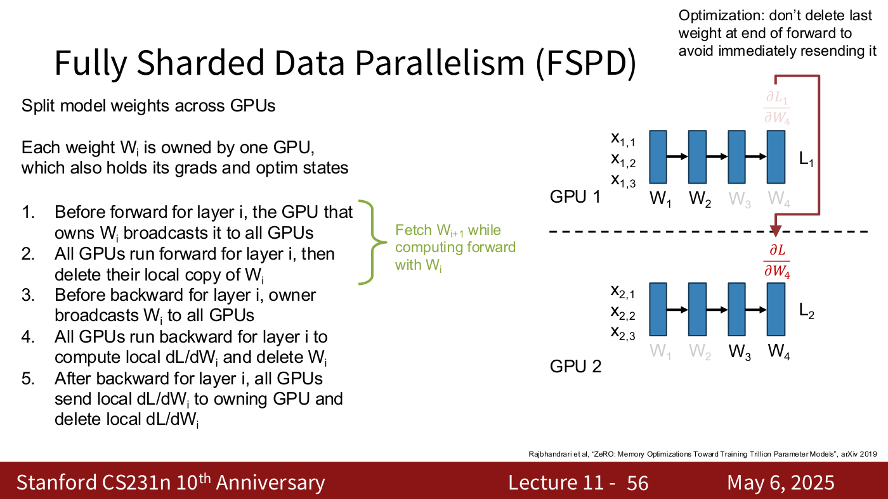

Same as slide 55, plus list item "5. After backward for layer i, all GPUs send local $dL/dW_i$ to owning GPU and delete local $dL/dW_i$. In the figure GPU 1's $\partial L_1/\partial W_4$ is now faded to pale pink, and a dark-red arrow leaves its top, goes up and right, then down past the "Optimization" note and across the dashed line, and points down into GPU 2's red gradient label, which now reads $\partial L/\partial W_4$ (no subscript on L).

## Slide 57 — Fully Sharded Data Parallelism (FSPD)

Same as slide 56, plus list item "6. Owner of $W_i$ makes gradient update". The arrow is gone; GPU 1's $\partial L_1/\partial W_4$ remains faded (pale pink) and GPU 2's red $\partial L/\partial W_4$ remains. GPU 2's $W_4$ label is now bold black.

## Slide 58 — Fully Sharded Data Parallelism (FSPD)

Same as slide 57 (all six list items, the first green brace and its text, the "Optimization" note at the top right, GPU 1's faded $\partial L_1/\partial W_4$ and GPU 2's red $\partial L/\partial W_4$), plus a second green curly brace spanning list items 3 to 6 with green text: "Fetch $W_i$ while computing with $W_{i+1}$; send $dL/dW_i$ and update $W_i$ while computing with $W_{i-1}$". In the figure: all rectangles dark blue; GPU 1 labels $W_1$ and $W_2$ black, $W_3$ and $W_4$ grey; GPU 2 labels $W_1$ and $W_2$ grey, $W_3$ black, $W_4$ bold black. No arrow.

## Slide 59 — Fully Sharded Data Parallelism (FSPD)

Same as slide 58, plus a dark-red arrow from GPU 2's $W_3$ label: the line leaves it downward, runs left under GPU 2's panel, up the left side of GPU 2's inputs, then up across the dashed line to an arrowhead pointing up into GPU 1's $W_3$ label (broadcast of $W_3$ from its owner GPU 2 to GPU 1). GPU 1's $W_3$ is black; $W_4$ is grey. Gradient labels unchanged (GPU 1 faded $\partial L_1/\partial W_4$, GPU 2 red $\partial L/\partial W_4$).

## Slide 60 — Fully Sharded Data Parallelism (FSPD)

Same as slide 59 with a different arrow and new gradient labels. A dark-red arrow now goes from GPU 1's $W_2$ label down across the dashed line, around the left and below GPU 2's panel, and up into GPU 2's $W_2$ label (GPU 2's $W_2$ is now black; $W_1$ grey, $W_3$ and $W_4$ black with $W_4$ bold). GPU 1's labels: $W_1$ and $W_2$ black, $W_3$ and $W_4$ grey. New gradient labels above the rectangles: GPU 1 has a red $\partial L_1/\partial W_3$ above its 3rd rectangle and the faded $\partial L_1/\partial W_4$ above its 4th; GPU 2 has a red $\partial L_2/\partial W_3$ above its 3rd rectangle and a red $\partial L/\partial W_4$ above its 4th.

## Slide 61 — Fully Sharded Data Parallelism (FSPD)

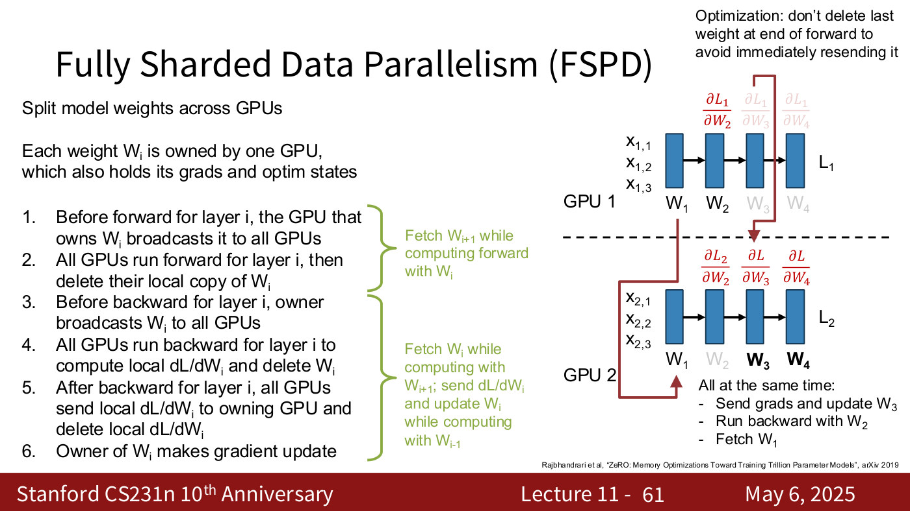

Same as slide 60, one step further. Gradient labels above the rectangles: GPU 1 has a red $\partial L_1/\partial W_2$ above its 2nd rectangle and faded (pale pink) $\partial L_1/\partial W_3$ and $\partial L_1/\partial W_4$ above its 3rd and 4th; GPU 2 has a red $\partial L_2/\partial W_2$, a red $\partial L/\partial W_3$ and a red $\partial L/\partial W_4$ above its 2nd, 3rd and 4th rectangles. GPU 1's labels: $W_1$ and $W_2$ black, $W_3$ and $W_4$ grey. GPU 2's labels: $W_1$ black, $W_2$ grey, $W_3$ and $W_4$ bold black. Two dark-red arrows are drawn at once. (a) A line starts above GPU 1's faded $\partial L_1/\partial W_3$, runs down through GPU 1's panel between its 3rd and 4th rectangles and across the dashed line, and ends in an arrowhead pointing down into GPU 2's red $\partial L/\partial W_3$ (GPU 1's local gradient for $W_3$ is sent to the owner, GPU 2). (b) An arrow from GPU 1's $W_1$ label runs down across the dashed line, around the left and below GPU 2's panel, and points up into GPU 2's $W_1$ label.

Extra text under GPU 2's panel, at the right: "All at the same time:" followed by three dash items: "Send grads and update $W_3$", "Run backward with $W_2$", "Fetch $W_1$".

## Slide 62 — Fully Sharded Data Parallelism (FSPD)

Same as slide 61, one step further; the "All at the same time" text and the $W_1$ arrow are gone. Gradient labels: GPU 1 has red $\partial L_1/\partial W_1$ (1st rectangle), red $\partial L/\partial W_2$ (2nd rectangle, no subscript on L), and faded (pale pink) $\partial L_1/\partial W_3$ and $\partial L_1/\partial W_4$; GPU 2 has red $\partial L_2/\partial W_1$, faded (pale pink) $\partial L_2/\partial W_2$, red $\partial L/\partial W_3$, red $\partial L/\partial W_4$. Labels: GPU 1 $W_1$ black, $W_2$ bold black, $W_3$ and $W_4$ grey; GPU 2 $W_1$ and $W_2$ grey, $W_3$ and $W_4$ bold black. One dark-red arrow: a line runs from the top of GPU 2's faded $\partial L_2/\partial W_2$ up across the dashed line and through GPU 1's panel, turns at the top beside the "Optimization" note and ends in an arrowhead pointing down into GPU 1's $\partial L/\partial W_2$ (GPU 2's local gradient for $W_2$ is sent to the owner, GPU 1).

## Slide 63 — Fully Sharded Data Parallelism (FSPD)

Same as slide 62, one step further. Gradient labels: GPU 1 has red $\partial L/\partial W_1$, red $\partial L/\partial W_2$, faded $\partial L_1/\partial W_3$, faded $\partial L_1/\partial W_4$; GPU 2 has faded $\partial L_2/\partial W_1$, faded $\partial L_2/\partial W_2$, red $\partial L/\partial W_3$, red $\partial L/\partial W_4$. Labels: GPU 1 $W_1$ and $W_2$ bold black, $W_3$ and $W_4$ grey; GPU 2 $W_1$ and $W_2$ grey, $W_3$ and $W_4$ bold black. One dark-red arrow runs from GPU 2's faded $\partial L_2/\partial W_1$ up through both panels and ends in an arrowhead pointing down into GPU 1's $\partial L/\partial W_1$.

## Slide 64 — Fully Sharded Data Parallelism (FSPD)

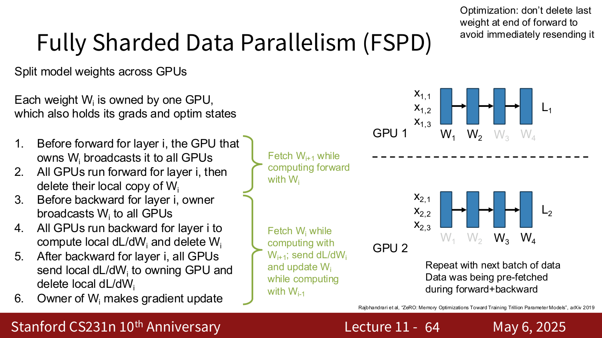

Same as slide 58 (both green braces and their text, "Optimization" note) but with the gradient labels and arrows all gone: GPU 1 labels $W_1$ and $W_2$ black, $W_3$ and $W_4$ grey; GPU 2 $W_1$ and $W_2$ grey, $W_3$ and $W_4$ black; all rectangles dark blue. New text under GPU 2's panel: "Repeat with next batch of data" and "Data was being pre-fetched during forward+backward".

## Slide 65 — Hybrid Sharded Data Parallel (HSDP)

Left text: "Split N = M\*K GPUs into M groups of K". "Each group of K GPUs does FSDP, splits model weights across all K GPUs. K can be O(100) GPUs." "Do DP across the M groups."

Figure: title above it "Example: HSDP with M=2 groups of K=4 GPUs". A grid of 8 GPUs: 2 columns by 4 rows, separated by a vertical dashed line down the middle and three horizontal dashed lines (between rows 1-2, 2-3, 3-4). Left column labels (to the left of each network): "GPU (1, 1)", "GPU (1, 2)", "GPU (1, 3)", "GPU (1, 4)" from top to bottom; right column: "GPU (2, 1)", "GPU (2, 2)", "GPU (2, 3)", "GPU (2, 4)". Each GPU shows 4 blue rectangles joined by 3 black arrows (no input labels or losses), with labels $W_1$, $W_2$, $W_3$, $W_4$ underneath, of which exactly one is black and the other three grey. In row k, in both columns, $W_k$ is black: row 1 $W_1$, row 2 $W_2$, row 3 $W_3$, row 4 $W_4$. So each column is one group of 4 GPUs sharding the 4 weights, and the two columns hold identical shardings.

## Slide 66 — Hybrid Sharded Data Parallel (HSDP)

Same as slide 65, plus a bold-headed paragraph: "**Multidimensional parallelism**: Use different parallelism strategies at the same time! Organize GPUs in a 2D grid".

## Slide 67 — Hybrid Sharded Data Parallel (HSDP)

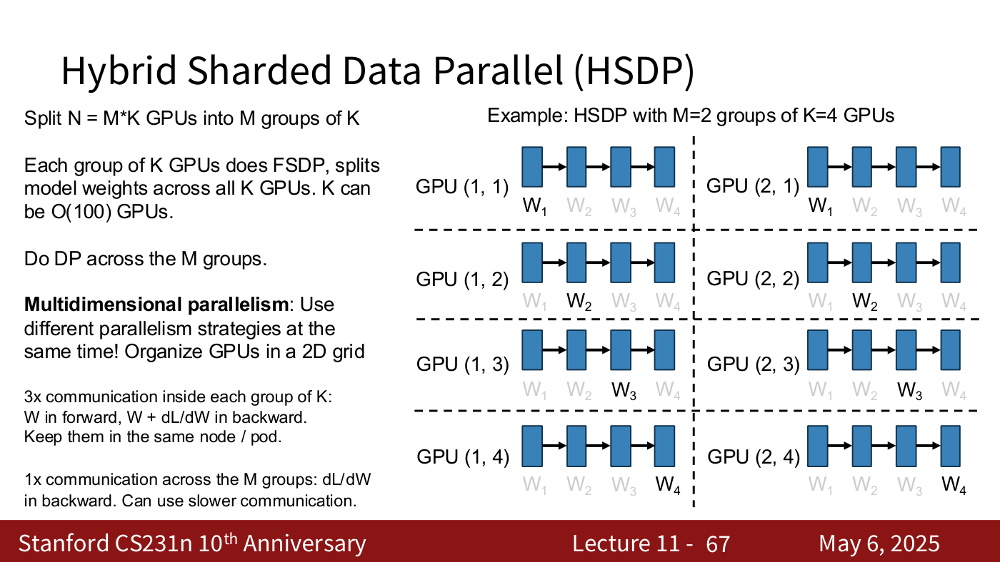

Same as slide 66, plus two small-print paragraphs at the bottom left:

"3x communication inside each group of K:
W in forward, W + dL/dW in backward.
Keep them in the same node / pod."

"1x communication across the M groups: dL/dW
in backward. Can use slower communication."

## Slide 68 — Data Parallelism (DP, FSPD, HSDP)

Left text: "Split data and model weights across GPUs" (black). Green text: "Can now scale up to big models that don't fit in a single GPU!" and "A model with 100B params needs 4 numbers per param (param, grad, Adam β1, β1); 2 bytes per number takes 800GB; splitting over 80 GPUs is just 10GB per GPU!" (the second beta is printed "β1", as written here).

*[Ed: The fourth number is printed "Adam β1" a second time, where slide 44 prints "Adam β1, β2". The arithmetic recomputes: 100B parameters x 4 numbers x 2 bytes = 800 GB; 800 GB / 80 GPUs = 10 GB per GPU.]*

Figure (right): the same two-GPU drawing as slide 46 (GPU 1 above GPU 2, one dashed line, 4 blue rectangles each joined by 3 arrows, inputs $x_{1,1}$, $x_{1,2}$, $x_{1,3}$ and $x_{2,1}$, $x_{2,2}$, $x_{2,3}$, losses $L_1$ and $L_2$), but here all rectangles are dark blue. Labels: GPU 1 $W_1$ and $W_2$ black, $W_3$ and $W_4$ grey; GPU 2 $W_1$ and $W_2$ grey, $W_3$ and $W_4$ black.

Citation (bottom right, small): Rajbhandrari et al, "ZeRO: Memory Optimizations Toward Training Trillion Parameter Models", arXiv 2019

## Slide 69 — Data Parallelism (DP, FSPD, HSDP)

Same as slide 68, plus a red paragraph: "Problem: Model activations can fill up memory. Llama3-405B Transformer has 126 layers, D=16,384, seq length 4096. Just FFN hidden activations need 2\*126\*(4\*16384)\*4096 bytes = 63GB; plus need other activations." ("Problem" underlined.)

*[Ed: Recomputed: 2 x 126 x (4 x 16384) x 4096 = 67,645,734,912 bytes, which is 67.6 GB in decimal units and 63.0 GB in binary units (2^30 bytes). The printed 63GB matches the binary-unit (GiB) reading. The sequence length printed here, 4096, differs from the 8192 that slides 125 and 146 give for Llama3-405B's first training stage.]*

## Slide 70 — Data Parallelism (DP, FSPD, HSDP)

Same as slide 69, plus a green paragraph at the bottom: "Solution: Don't keep all activations in memory; recompute them on the fly!" ("Solution" underlined.)

## Slide 71 — Activation Checkpointing

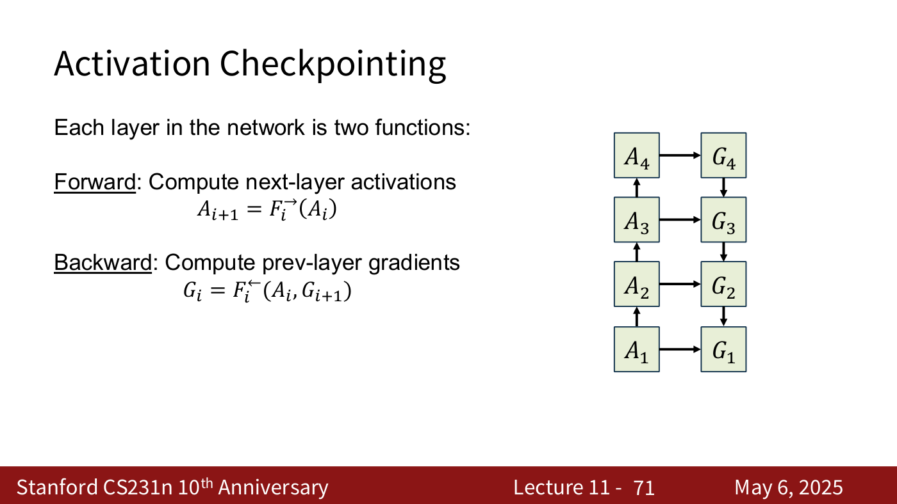

Left text: "Each layer in the network is two functions:". "Forward: Compute next-layer activations" ("Forward" underlined), displayed equation $A_{i+1} = \overrightarrow{F_i}(A_i)$ (the arrow over $F_i$ points right). "Backward: Compute prev-layer gradients" ("Backward" underlined), displayed equation $G_i = \overleftarrow{F_i}(A_i, G_{i+1})$ (the arrow over $F_i$ points left).

Figure (right): a grid of 8 small boxes with pale-green fill and dark outline, in two columns of 4. Left column, top to bottom: $A_4$, $A_3$, $A_2$, $A_1$. Right column, top to bottom: $G_4$, $G_3$, $G_2$, $G_1$. Black arrows: between the A boxes, 3 upward arrows ($A_1$ to $A_2$, $A_2$ to $A_3$, $A_3$ to $A_4$); from each $A_i$ a rightward arrow to $G_i$ (4 arrows); between the G boxes, 3 downward arrows ($G_4$ to $G_3$, $G_3$ to $G_2$, $G_2$ to $G_1$). Count: 8 boxes, 10 arrows.

## Slide 72 — Activation Checkpointing

Same as slide 71, plus: "Q: How much compute and memory does this take? Assume each $\overrightarrow{F_i}$ and $\overleftarrow{F_i}$ is O(1) compute and memory." No answer is printed on this slide.

## Slide 73 — Activation Checkpointing

Same as slide 72, but the figure is faded to light grey except box $A_1$, which keeps its full-contrast fill and outline. New text at the top right: "Compute: 1", "Current Memory: 1", "Peak Memory: 1".

## Slide 74 — Activation Checkpointing

Same as slide 73, one step further: boxes $A_1$ and $A_2$ and the upward arrow between them are at full contrast (the rest faded). Top right: "Compute: 2", "Current Memory: 2", "Peak Memory: 2".

## Slide 75 — Activation Checkpointing

Left text: "Each layer in the network is two functions:". "Forward: Compute next-layer activations" with the equation $A_{i+1} = \overrightarrow{F_i}(A_i)$. "Backward: Compute prev-layer gradients" with the equation $G_i = \overleftarrow{F_i}(A_i, G_{i+1})$ ("Forward" and "Backward" are underlined; the printed equation puts a right arrow over $F_i$ in the forward line and a left arrow over $F_i$ in the backward line). Below: "Q: How much compute and memory does this take? Assume each $\overrightarrow{F_i}$ and $\overleftarrow{F_i}$ is O(1) compute and memory."

Figure (right): a grid of eight boxes in two columns and four rows, the left column labelled $A_1$ (bottom) to $A_4$ (top) and the right column $G_1$ (bottom) to $G_4$ (top). Horizontal arrows point from each $A_i$ to the $G_i$ in its row (four arrows). Vertical arrows in the $A$ column point upward ($A_1$ to $A_2$, $A_2$ to $A_3$, $A_3$ to $A_4$, three arrows). Vertical arrows in the $G$ column point downward ($G_4$ to $G_3$, $G_3$ to $G_2$, $G_2$ to $G_1$, three arrows). Boxes are pale green with a dark outline when "active" and faded grey when not; the drawing is built one step at a time, so a box that is drawn solid is currently held in memory.

Counter above the figure (top right): "Compute: 3", "Current Memory: 3", "Peak Memory: 3".

State on this slide: $A_1$, $A_2$, $A_3$ are solid (stored), with dark arrows $A_1$ to $A_2$ and $A_2$ to $A_3$. $A_4$, all four $G$ boxes and the remaining arrows are faded (not yet computed).

## Slide 76 — Activation Checkpointing

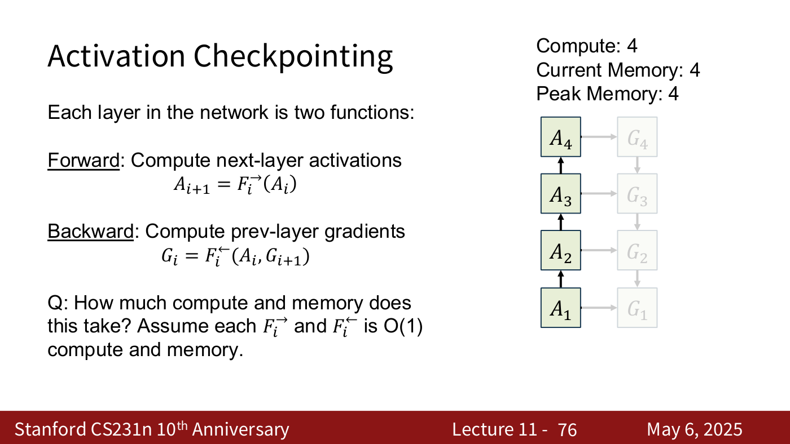

Same as slide 75, plus $A_4$ is now solid (with a dark arrow $A_3$ to $A_4$). Counter: "Compute: 4", "Current Memory: 4", "Peak Memory: 4". Solid: $A_1$, $A_2$, $A_3$, $A_4$ (four boxes). All $G$ boxes faded.

## Slide 77 — Activation Checkpointing

Same drawing as slide 76, with these changes. $G_4$ becomes solid; $A_4$ turns faded (freed). The arrow $A_3$ to $A_4$ is faded. Counter: "Compute: 5", "Current Memory: 4", "Peak Memory: 4". Solid: $A_1$, $A_2$, $A_3$, $G_4$ (four boxes).

## Slide 78 — Activation Checkpointing

Same as slide 77, with these changes. $G_3$ becomes solid; $A_3$ and $G_4$ turn faded. Counter: "Compute: 6", "Current Memory: 3", "Peak Memory: 4". Solid: $A_1$, $A_2$, $G_3$ (three boxes); the dark arrow $A_1$ to $A_2$ remains.

## Slide 79 — Activation Checkpointing

Same as slide 78, with these changes. $G_2$ becomes solid; $A_2$ and $G_3$ turn faded. Counter: "Compute: 7", "Current Memory: 2", "Peak Memory: 4". Solid: $A_1$, $G_2$ (two boxes).

## Slide 80 — Activation Checkpointing

Same as slide 79, with these changes. $G_1$ becomes solid; $A_1$ and $G_2$ turn faded. Counter: "Compute: 8", "Current Memory: 1", "Peak Memory: 4". Solid: $G_1$ only (one box).

## Slide 81 — Activation Checkpointing

Same drawing and counter as slide 80 ("Compute: 8", "Current Memory: 1", "Peak Memory: 4"; only $G_1$ solid). The "Q: How much compute and memory…" paragraph is replaced by the text Forward+backward: $O(N)$ compute, $O(N)$ memory. The forward and backward equations remain.

## Slide 82 — Activation Checkpointing

Same as slide 81, plus a green text at the bottom right, under the figure: "Idea: Recompute activations during the backward pass" ("Idea" underlined).

## Slide 83 — Activation Checkpointing

Same text as slide 82. The figure restarts a new build: counter "Compute: 1", "Current Memory: 1", "Peak Memory: 1". Solid: $A_1$ only; everything else faded.

## Slide 84 — Activation Checkpointing

Same as slide 83, with these changes. $A_2$ is solid and $A_1$ turns faded (the earlier activation is freed as soon as the next is computed). Counter: "Compute: 2", "Current Memory: 1", "Peak Memory: 1". Solid: $A_2$ only.

## Slide 85 — Activation Checkpointing

Same as slide 84, with $A_3$ solid and $A_2$ faded. Counter: "Compute: 3", "Current Memory: 1", "Peak Memory: 1". Solid: $A_3$ only.

## Slide 86 — Activation Checkpointing

Same as slide 85, with $A_4$ solid and $A_3$ faded. Counter: "Compute: 4", "Current Memory: 1", "Peak Memory: 1". Solid: $A_4$ only.

## Slide 87 — Activation Checkpointing

Same as slide 86, with $G_4$ solid and $A_4$ faded. Counter: "Compute: 5", "Current Memory: 1", "Peak Memory: 1". Solid: $G_4$ only.

## Slide 88 — Activation Checkpointing

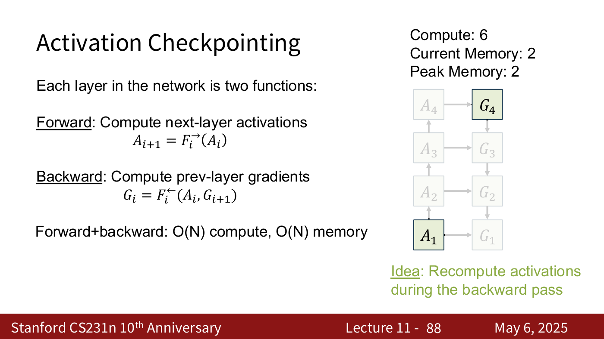

Same as slide 87, with these changes. $A_1$ becomes solid again (recomputed from the start) while $G_4$ stays solid. Counter: "Compute: 6", "Current Memory: 2", "Peak Memory: 2". Solid: $A_1$, $G_4$ (two boxes).

## Slide 89 — Activation Checkpointing

Same as slide 88, with $A_2$ solid and $A_1$ faded; $G_4$ stays solid. Counter: "Compute: 7", "Current Memory: 2", "Peak Memory: 2". Solid: $A_2$, $G_4$.

## Slide 90 — Activation Checkpointing

Same as slide 89, with $A_3$ solid and $A_2$ faded; $G_4$ stays solid. Counter: "Compute: 8", "Current Memory: 2", "Peak Memory: 2". Solid: $A_3$, $G_4$.

## Slide 91 — Activation Checkpointing

Same as slide 90, with these changes. $G_3$ becomes solid; $A_3$ and $G_4$ turn faded. Counter: "Compute: 9", "Current Memory: 1", "Peak Memory: 2". Solid: $G_3$ only.

## Slide 92 — Activation Checkpointing

Same as slide 91, with $A_1$ solid again (recomputed); $G_3$ stays solid. Counter: "Compute: 10", "Current Memory: 2", "Peak Memory: 2". Solid: $A_1$, $G_3$.

## Slide 93 — Activation Checkpointing

Same as slide 92, with $A_2$ solid and $A_1$ faded; $G_3$ stays solid. Counter: "Compute: 11", "Current Memory: 2", "Peak Memory: 2". Solid: $A_2$, $G_3$.

## Slide 94 — Activation Checkpointing

Same as slide 93, with $G_2$ solid; $A_2$ and $G_3$ turn faded. Counter: "Compute: 12", "Current Memory: 1", "Peak Memory: 2". Solid: $G_2$ only.

## Slide 95 — Activation Checkpointing

Same as slide 94, with $A_1$ solid again; $G_2$ stays solid. Counter: "Compute: 13", "Current Memory: 2", "Peak Memory: 2". Solid: $A_1$, $G_2$.

## Slide 96 — Activation Checkpointing

Same as slide 95, with $G_1$ solid; $A_1$ and $G_2$ turn faded. Counter: "Compute: 14", "Current Memory: 1", "Peak Memory: 2". Solid: $G_1$ only. This ends the build of the "recompute during the backward pass" run: the forward pass was run once, then every needed $A_i$ was recomputed from $A_1$ each time, holding at most two boxes at once.

## Slide 97 — Activation Checkpointing

Same drawing and counter as slide 96 ("Compute: 14", "Current Memory: 1", "Peak Memory: 2"; only $G_1$ solid) and the "Idea: Recompute activations during the backward pass" text at the bottom right. The left text gains a second line under Forward+backward: $O(N)$ compute, $O(N)$ memory: Full Recomputation: $O(N^2)$ compute, $O(1)$ memory.

## Slide 98 — Activation Checkpointing

Same as slide 97, plus a red line below the two complexity lines: "Problem: $N^2$ compute is bad!" ("Problem" underlined). The counter reads "Compute: 14", "Current Memory: 2", "Peak Memory: 2"; the drawing still shows only $G_1$ solid.

*[Ed: The counter prints "Current Memory: 2" on this slide, but the drawing shows one solid box (G1) and the counter on slides 96 and 97 prints 1.]*

## Slide 99 — Activation Checkpointing

Same as slide 98, with the bottom-right green text replaced: "Idea: Don't recompute everything; save a checkpoint every C layers" ("Idea" underlined). Counter and drawing unchanged from slide 98 (counter "Compute: 14", "Current Memory: 2", "Peak Memory: 2"; only $G_1$ solid). The red "Problem: $N^2$ compute is bad!" line remains.

## Slide 100 — Activation Checkpointing

Same as slide 99, with these changes. The red "Problem" line is removed. The figure is now fully drawn: all eight boxes $A_1$ to $A_4$ and $G_1$ to $G_4$ are solid, and all arrows (four horizontal, three upward in the $A$ column, three downward in the $G$ column) are dark. The counter still prints "Compute: 14", "Current Memory: 2", "Peak Memory: 2". The left text gains a third line: C checkpoints: $O(N^2/C)$ compute, $O(C)$ memory. The three lines now read:

- Forward+backward: $O(N)$ compute, $O(N)$ memory
- Full Recomputation: $O(N^2)$ compute, $O(1)$ memory
- C checkpoints: $O(N^2/C)$ compute, $O(C)$ memory

The bottom-right text is "Idea: Don't recompute everything; save a checkpoint every C layers". No checkpoint positions are marked on the drawing.

## Slide 101 — Activation Checkpointing

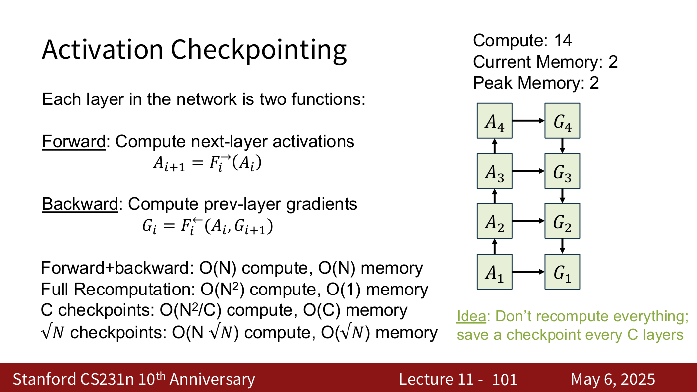

Same as slide 100 (same fully solid drawing, counter and bottom-right idea text), plus a fourth line in the left text: $\sqrt{N}$ checkpoints: $O(N\sqrt{N})$ compute, $O(\sqrt{N})$ memory. The four lines now read:

- Forward+backward: $O(N)$ compute, $O(N)$ memory
- Full Recomputation: $O(N^2)$ compute, $O(1)$ memory
- C checkpoints: $O(N^2/C)$ compute, $O(C)$ memory
- $\sqrt{N}$ checkpoints: $O(N\sqrt{N})$ compute, $O(\sqrt{N})$ memory

## Slide 102 — How to train on lots of GPUs

"HSDP + Activation checkpointing can take you a long way!"

"Scaling recipe:" (numbered list)

1. "Use **data parallelism** up to ~128 GPUs, models with ~1B params"
2. "Always set per-GPU batch size to max out GPU memory"
3. "If your model is >1B params, consider **FSDP**"
4. "Add **activation checkpointing** to fit larger batches per GPU"
5. "If you have >256 GPUs, consider **HSDP**"
6. "If you have >1K GPUs, models >50B params, or sequence lengths > 16K then use more advanced strategies (CP, PP, TP)"

Red text: "**Problem**: Lots of knobs to tune! How should we set them?" Green text: "**Solution**: Maximize Model Flops Utilization (MFU)" ("Model Flops Utilization (MFU)" underlined).

## Slide 103 — Hardware FLOPs Utilization (HFU)

"Recall: H100 can theoretically do 989.4 TFLOP/sec of 16-bit matrix multiplies on Tensor Cores" ("Recall" underlined). "Question: How much throughput can we see in practice?" ("Question" underlined).

Footnote (bottom right, small): "Chowdhery et al, "PaLM: Scaling Language Modeling with Pathways", arXiv 2022"

## Slide 104 — Hardware FLOPs Utilization (HFU)

Same as slide 103, plus: "Hardware FLOPs Utilization (HFU): The fraction of theoretical matmul performance we actually achieve" ("Hardware FLOPs Utilization (HFU)" underlined). Same footnote as slide 103.

## Slide 105 — Hardware FLOPs Utilization (HFU)

Same as slide 104, plus on the right a label "Benchmark for the best-case scenario: only matrix multiply" and a dark-theme code screenshot (top right), with grey caption under it: "Run this with CUDA_LAUNCH_BLOCKING=1, otherwise GPU kernels launch async and measurements are wrong". Code as printed:

```
h100_tflop_per_sec = 989.4
sizes = [512, 1024, 2048, 4096,
         8192, 16_384, 32_768]
for N in sizes:
    x = torch.randn(N, N, device="cuda",
                    dtype=torch.bfloat16)
    flops = 2 * N * N * N
    times = []
    for i in range(12):
        t0 = time.time()
        y = x @ x
        if i > 2: times.append(time.time() - t0)
    sec = np.mean(times)
    tflops_per_sec = flops / sec / 10 ** 12
    hfu = 100 * tflops_per_sec / h100_tflop_per_sec
    print(f"N: {N}, "
          f"TFLOP/sec: {tflops_per_sec:.2f}, "
          f"HFU: {hfu:.2f}%")
```

Same footnote as slide 103.

## Slide 106 — Hardware FLOPs Utilization (HFU)

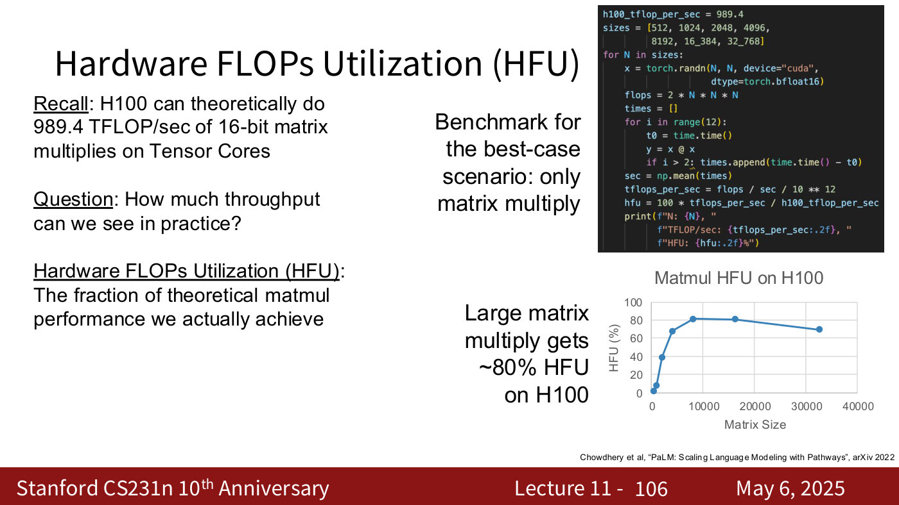

Same as slide 105, plus a chart at lower right titled "Matmul HFU on H100", with the label to its left: "Large matrix multiply gets ~80% HFU on H100". Chart: line chart with markers, one series (blue), x axis "Matrix Size" ranging 0 to 40000 (gridlines every 10000), y axis "HFU (%)" ranging 0 to 100 (gridlines every 20). Seven points, approximate values read off the chart (matching the seven sizes in the code):

- Matrix size 512: about 2 %
- 1024: about 8 %
- 2048: about 39 %
- 4096: about 68 %
- 8192: about 81 %
- 16384: about 81 %
- 32768: about 70 %

The line rises steeply to 8192, is flat to 16384, then falls slightly at 32768. No data labels are printed. Same footnote as slide 103.

## Slide 107 — Hardware FLOPs Utilization (HFU)

Same as slide 106, plus red text at lower left: "Problem: HFU does not account for activation checkpointing or "helper" computation like data augmentation, optimizer, preprocessing" ("Problem" underlined). Same footnote as slide 103.

## Slide 108 — Model FLOPs Utilization (MFU)

"Idea: What fraction of the GPU's theoretical peak FLOPs is being used for "useful" model computation?" ("Idea" underlined)

Numbered list:

1. "Compute $\text{FLOP}_ {\text{theoretical}}$ = total number of matrix multiply FLOPs in the forward + backward pass" followed by two grey lines: "(can approximate backward = 2x forward)" and "(Ignore nonlinearities, normalization, elementwise ops like residuals. They will run on FP32 cores)"
2. "Look up $\text{FLOP/sec}_ {\text{theoretical}}$ = theoretical max throughput of your device" followed by grey "(H100: 989 TFLOP/sec)"
3. "Compute $t_{\text{theoretical}}$ = $\text{FLOP}_ {\text{theoretical}}$ / $\text{FLOP/sec}_ {\text{theoretical}}$"
4. "Measure $t_{\text{actual}}$ = Actual time for a full iteration of data loading, forward, backward, optimizer step"
5. "MFU = $t_{\text{theoretical}}$ / $t_{\text{actual}}$"

Footnote: "Chowdhery et al, "PaLM: Scaling Language Modeling with Pathways", arXiv 2022"

## Slide 109 — Model FLOPs Utilization (MFU)

Same as slide 108, plus on the right a dark-theme code screenshot with the note "Example: Wide MLP with big batch size gets ~49% MFU on H100" ("Example" underlined) overlaid on its right side. Code as printed:

```
L, D, N = 8, 8192, 8192

flop_fwd = N * L * 2 * D * D
flop_bwd = 2 * flop_fwd
flop_theoretical = flop_fwd + flop_bwd
t_theoretical = flop_theoretical / (989.4 * 10 ** 12)

layers = []
for _ in range(L):
    layers += [torch.nn.Linear(D, D), torch.nn.ReLU()]
model = torch.nn.Sequential(*layers).cuda()
optimizer = torch.optim.Adam(model.parameters(), lr=1e-4)

for _ in range(20):
    torch.cuda.synchronize()
    t0 = time.time()
    x = torch.randn(
        N, D, device="cuda",
        dtype=torch.float32
    )
    with torch.autocast(
        device_type="cuda",
        dtype=torch.bfloat16,
    ):
        y = model(x)
    loss = ((x - y) ** 2.0).sum()
    loss.backward()
    optimizer.step()
    optimizer.zero_grad()
    torch.cuda.synchronize()
    t_actual = time.time() - t0
    mfu = t_theoretical / t_actual
    print(f"MFU: {100*mfu:.2f}%")
```

Same footnote as slide 108. The ~49% is a measured result that the slide does not derive from its listed inputs, so it is not recomputed here.

## Slide 110 — Model FLOPs Utilization (MFU)

Same as slide 109, plus green text at lower left under the list: "Optimize distributed training setup to maximize MFU!"

## Slide 111 — Model FLOPs Utilization (MFU)

"Idea: What fraction of the GPU's theoretical peak FLOPs is being used for "useful" model computation?" ("Idea" underlined). "MFU >30% is good, >40% is excellent". No other content (the numbered list and code from slides 108 to 110 are gone); no footnote.


## Slide 112 — Model FLOPs Utilization (MFU)

Text: "Idea: What fraction of the GPU's theoretical peak FLOPs is being used for "useful" model computation?" "MFU >30% is good, >40% is excellent".

Table 1 (centre; citation under it: Chowdhery et al, "PaLM: Scaling Language Modeling with Pathways", arXiv 2022). Column headings: "Model", "# of Parameters (in billions)", "Accelerator chips", "Model FLOPS utilization".

| Model | # of Parameters (in billions) | Accelerator chips | Model FLOPS utilization |
| --- | --- | --- | --- |
| GPT-3 | 175B | V100 | 21.3% |
| Gopher | 280B | 4096 TPU v3 | 32.5% |
| Megatron-Turing NLG | 530B | 2240 A100 | 30.2% |
| PaLM | 540B | 6144 TPU v4 | 46.2% |

Table 2 (lower right; citation under it: Llama Team, "The Llama3 Herd of Models", arXiv 2024). Left of it, the text "Example: Llama3-405B training on H100 GPUs". Column headings: "GPUs", "TFLOPs/GPU", "BF16 MFU".

| GPUs | TFLOPs/GPU | BF16 MFU |
| --- | --- | --- |
| 8,192 | 430 | 43% |
| 16,384 | 400 | 41% |
| 16,384 | 380 | 38% |

*[Ed: Dividing the TFLOPs/GPU column by the H100's 989.4 TFLOP/sec (slide 103) gives 43.5%, 40.4% and 38.4%, so the second row's printed 41% does not follow from the rounded 400 shown; the table is reproduced from the cited Llama 3 paper, and slides 113 and 146 repeat it.]*

## Slide 113 — Model FLOPs Utilization (MFU)

Same as slide 112, plus red text at the right: "More recent devices sometimes get *worse* MFU since their peak FLOPs increases much faster than their memory bandwidth" and, below it, "A100 => H100:" "3.1x FLOPs" "2.1x memory bandwidth".

## Slide 114 — How to train on lots of GPUs

Text: "A model with L layers operates on tensors of shape (Batch, Sequence, Dim)". Four items in a 2 x 2 layout, each a bold name with a line below:

- Top left: "Data Parallelism (DP)" / "Split on Batch dimension" (shown in black, highlighted).
- Top right: "Context Parallelism (CP)" / "Split on Sequence dimension" (faded grey).
- Bottom left: "Pipeline Parallelism (PP)" / "Split on L dimension" (faded grey).
- Bottom right: "Tensor Parallelism (TP)" / "Split on Dim dimension" (faded grey).

## Slide 115 — How to train on lots of GPUs

Same text and 2 x 2 layout as slide 114, but the highlighted (black) item is now the top right, "Context Parallelism (CP)" / "Split on Sequence dimension"; the other three are faded grey.

## Slide 116 — Context Parallelism (CP)

Text: "(Usually for Transformers)" "Idea: Transformers operate on L-length sequences. Use multiple GPUs to process a single long sequence".

Figure (right): one Transformer block drawn bottom to top, with a vertical dashed line splitting the whole picture into a left half labelled "GPU 1" and a right half labelled "GPU 2" (the labels appear both above the outputs and below the inputs).

- Bottom: four light-blue input boxes "x1", "x2", "x3", "x4"; x1 and x2 are on the GPU 1 side, x3 and x4 on the GPU 2 side. Arrows go up from each into a thin, wide light-blue bar spanning all four columns (inside a large grey rectangle that encloses the block).
- From the bar, four arrows go up into an orange box "Layer Normalization", then into a green box "Self-Attention".
- A residual arrow runs from the bar, up the left edge, into a circled-plus node (the first residual add) placed just above Self-Attention.
- From that plus node, an arrow goes up into a second orange "Layer Normalization" box, then four arrows into four pink/purple boxes in a row, each labelled "MLP" (4 MLP boxes).
- A second residual arrow runs from the first plus node up the right edge into a second circled-plus node near the top. The four MLP outputs also feed into this node.
- From the top plus node, four arrows go up to four orange output boxes "y1", "y2", "y3", "y4" (y1, y2 on GPU 1; y3, y4 on GPU 2).

## Slide 117 — Context Parallelism (CP)

Same as slide 116, plus green text: "Normalization, residual connections: Easy, they have no weights and trivially parallelizable". In the figure, three green rectangles are drawn: one around the top residual (circled-plus) node and its arrows to the outputs; one around the upper Layer Normalization box together with the first circled-plus node; and one around the lower Layer Normalization box. The Self-Attention box is shown paler than before.

## Slide 118 — Context Parallelism (CP)

Same as slide 117, plus gold/orange text: "MLP: Trivially parallelizable, but has weights. Each GPU keeps a copy of the weights and communicates gradients like in DP". In the figure, a gold rectangle now encloses the row of four MLP boxes.

## Slide 119 — Context Parallelism (CP)

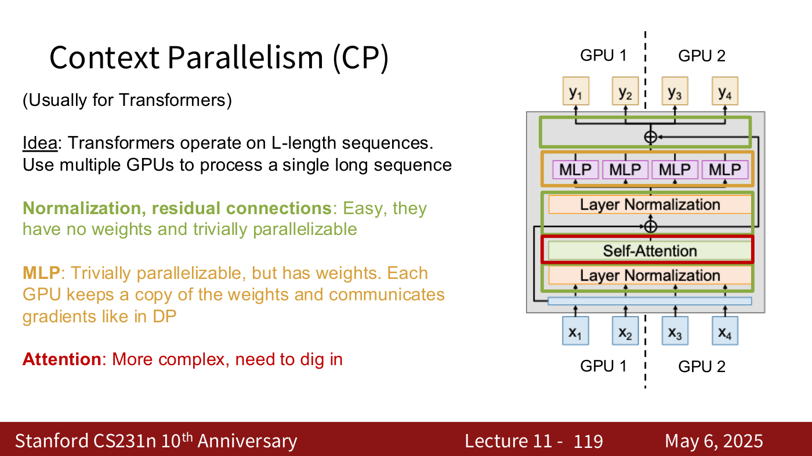

Same as slide 118, plus red text: "Attention: More complex, need to dig in". In the figure, a red rectangle now encloses the "Self-Attention" box (previously pale).

## Slide 120 — Context Parallelism (CP)

Text: "(Usually for Transformers)" "Idea: Transformers operate on L-length sequences. Use multiple GPUs to process a single long sequence" (same as slide 116). The Transformer-block figure is replaced by a self-attention diagram, bottom to top:

- Bottom row: three light-blue boxes "X1", "X2", "X3". Arrows go up from each to a light-green box "Q1", "Q2", "Q3" above it (3 Q boxes).
- Long black lines run from the X boxes along the bottom and up the left side to two columns of boxes at the left: a column of three orange boxes "K1", "K2", "K3" and, above it, a column of three purple boxes "V1", "V2", "V3" (each K and V box receives an arrow from the X lines).
- A grey panel contains a 3 x 3 grid of cells labelled E (affinity) values, by row from the top: "E1,1 E2,1 E3,1", "E1,2 E2,2 E3,2", "E1,3 E2,3 E3,3". Each K box has an arrow pointing right into its row of E cells (K1 into the "E1,1 E2,1 E3,1" row, K2 into the middle row, K3 into the bottom row); each Q box has an arrow going up into its column of E cells.
- Between the E panel and the next panel, the label "Softmax(↑)" (up arrow printed).
- A second grey panel contains a 3 x 3 grid of cells labelled "A1,1 A2,1 A3,1", "A1,2 A2,2 A3,2", "A1,3 A2,3 A3,3". Each V box has an arrow pointing right into its row of A cells (V1 top row, V2 middle, V3 bottom).
- Above the A panel, a white box labelled "Product(→), Sum(↑)" (arrows printed). Three arrows go up from it to three orange boxes "Y1", "Y2", "Y3".

## Slide 121 — Context Parallelism (CP)

Same as slide 120, plus gold text: "QKV Projection: Same as MLP, parallelize over the sequence and sync gradients as in DP". Three gold rectangles are drawn: around the V1-V3 column, around the K1-K3 column, and around the Q1-Q3 row.

## Slide 122 — Context Parallelism (CP)

Same as slide 121, except the idea line now reads "Idea: Transformers operate on S-length sequences." (the earlier slides print "L-length"). Plus red text: "Attention operator: Hardest to parallelize". A red rectangle now encloses both grey panels (the E grid, "Softmax(↑)" and the A grid).

## Slide 123 — Context Parallelism (CP)

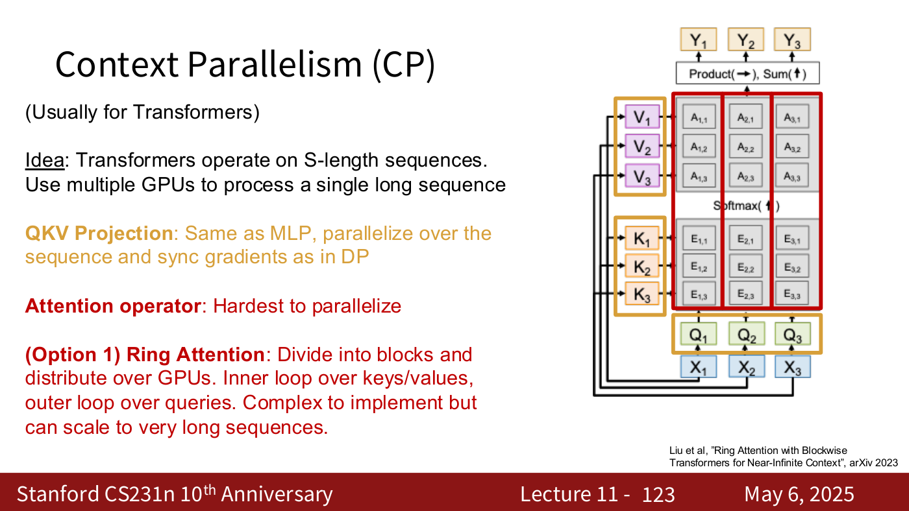

Same as slide 122, plus red text: "(Option 1) Ring Attention: Divide into blocks and distribute over GPUs. Inner loop over keys/values, outer loop over queries. Complex to implement but can scale to very long sequences." In the figure, the red rectangle around the E and A panels is now divided by two vertical red lines into three vertical strips, one per column (column 1 = E1,\* and A1,\* cells, and so on; 3 strips). Citation (bottom right): Liu et al, "Ring Attention with Blockwise Transformers for Near-Infinite Context", arXiv 2023

## Slide 124 — Context Parallelism (CP)

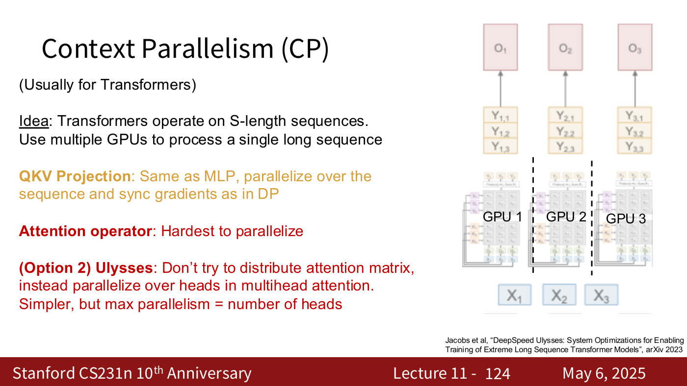

Text: "(Usually for Transformers)" "Idea: Transformers operate on S-length sequences. Use multiple GPUs to process a single long sequence" "QKV Projection: Same as MLP, parallelize over the sequence and sync gradients as in DP" "Attention operator: Hardest to parallelize" "(Option 2) Ulysses: Don't try to distribute attention matrix, instead parallelize over heads in multihead attention. Simpler, but max parallelism = number of heads".

Figure (right, mostly faded): at the bottom three light-blue boxes "X1", "X2", "X3". Above them, three faded, small copies of the attention diagram of slide 120 side by side, with three labels "GPU 1", "GPU 2", "GPU 3" overlaid in black and two vertical dashed lines separating the three copies (GPU 1 | GPU 2 | GPU 3). Above each copy is a stack of three small boxes ("Y1,1", "Y1,2", "Y1,3" over the first; "Y2,1", "Y2,2", "Y2,3" over the second; "Y3,1", "Y3,2", "Y3,3" over the third), and above each stack an arrow up into a larger pink box with red outline labelled "O1", "O2", "O3" respectively. Citation (bottom right): Jacobs et al, "DeepSpeed Ulysses: System Optimizations for Enabling Training of Extreme Long Sequence Transformer Models", arXiv 2023

## Slide 125 — Context Parallelism (CP)

Text: "(Usually for Transformers)" "Idea: Transformers operate on S-length sequences. Use multiple GPUs to process a single long sequence" "Often used for long-sequence finetuning." "Example: Llama3-405B training:" then two items:

- "Stage 1: S=8192, no context-parallelism"
- "Stage 2: S=131,072, 16-way context-parallelism (8192 per GPU)"

Citation (bottom left): Llama Team, "The Llama3 Herd of Models", arXiv 2024

*[Ed: Recomputed: 131,072 / 16 = 8,192 per GPU, matching the printed value.]*

## Slide 126 — How to train on lots of GPUs

Same as slide 115: the 2 x 2 layout with "Context Parallelism (CP)" / "Split on Sequence dimension" highlighted in black (top right) and the other three faded.

## Slide 127 — How to train on lots of GPUs

Same 2 x 2 layout as slide 114, with "Pipeline Parallelism (PP)" / "Split on L dimension" (bottom left) highlighted in black and the other three faded.

## Slide 128 — Pipeline Parallelism (PP)

Text: "Idea: Split the layers of the model across GPUs. Copy activations between layers at GPU boundaries."

Figure (right): a row of 8 tall blue rectangles (layers) joined left to right by 7 short black arrows. Three vertical dashed lines divide them into four groups of two layers each, labelled underneath "GPU 1", "GPU 2", "GPU 3", "GPU 4". The arrows that cross the dashed lines are the activation copies between GPUs. Citation (bottom right): Huang et al, "Gpipe: Efficient Training of Giant Neural Networks using Pipeline Parallelism", arXiv 2018

## Slide 129 — Pipeline Parallelism (PP)

Same as slide 128, plus red text: "Problem: Sequential dependencies; GPUs are mostly sitting idle." ("Problem" underlined).

## Slide 130 — Pipeline Parallelism (PP)

Same as slide 129, plus the red line "Max MFU with N-way PP is 1/N" and, under the layer diagram, a schedule grid. Above the grid, a long arrow labelled "Time" pointing right. The grid has 4 rows labelled at left "GPU 1", "GPU 2", "GPU 3", "GPU 4" and 8 columns (time steps). Shaded light-blue cells carry arrows; all other cells are empty white:

| Time step | 1 | 2 | 3 | 4 | 5 | 6 | 7 | 8 |
| --- | --- | --- | --- | --- | --- | --- | --- | --- |
| GPU 1 | → | | | | | | | ← |
| GPU 2 | | → | | | | | ← | |
| GPU 3 | | | → | | | ← | | |
| GPU 4 | | | | → | ← | | | |

A right arrow marks a forward pass and a left arrow a backward pass (the slide prints only the arrows, with no legend text). Each GPU therefore has exactly 2 shaded cells out of 8; 8 shaded cells in all.

## Slide 131 — Pipeline Parallelism (PP)

Same as slide 130, plus three large white ellipses with black outline drawn over the grid: a large circle at the top centre labelled "Bubble" (covering the empty cells in the upper middle of the grid), and two tilted unlabelled ovals, one over the empty lower-left cells (GPU 3 and GPU 4 rows, left side) and one over the empty lower-right cells (GPU 3 and GPU 4 rows, right side). They mark the idle (empty) regions of the schedule.

## Slide 132 — Pipeline Parallelism (PP)

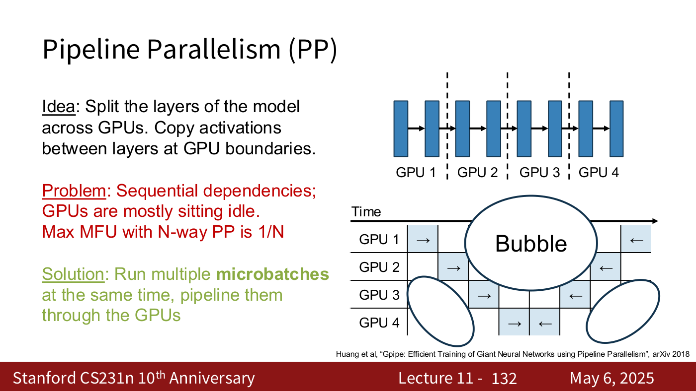

Same as slide 131 (layer diagram, schedule grid with the "Bubble" ellipses, red "Problem" text), plus green text: "Solution: Run multiple **microbatches** at the same time, pipeline them through the GPUs" ("Solution" underlined, "microbatches" bold).

## Slide 133 — Pipeline Parallelism (PP) - Microbatches

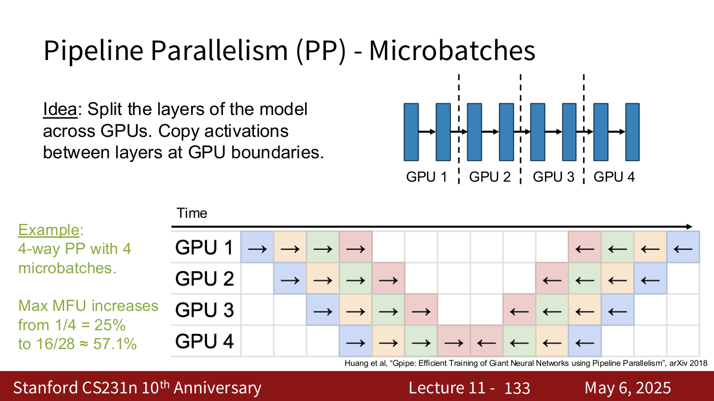

Text: "Idea: Split the layers of the model across GPUs. Copy activations between layers at GPU boundaries." The same 8-layer, 4-GPU diagram as slide 128 sits at upper right (8 blue rectangles, three dashed lines, labels "GPU 1" to "GPU 4"). At left, green text: "Example: 4-way PP with 4 microbatches." and "Max MFU increases from 1/4 = 25% to 16/28 ≈ 57.1%". Citation (bottom right): Huang et al, "Gpipe: Efficient Training of Giant Neural Networks using Pipeline Parallelism", arXiv 2018

Schedule grid: an arrow labelled "Time" pointing right above it; 4 rows labelled "GPU 1" to "GPU 4"; 14 columns (time steps). Shaded cells hold an arrow (right = forward, left = backward; no legend is printed). Cell colour marks the microbatch: blue, orange, green, red, in that order (4 microbatches; no legend is printed, the colour-to-microbatch reading is from the pattern). Cells not listed are empty white. Cell by cell (column numbers counted on the page):

| Time step | 1 | 2 | 3 | 4 | 5 | 6 | 7 | 8 | 9 | 10 | 11 | 12 | 13 | 14 |
| --- | --- | --- | --- | --- | --- | --- | --- | --- | --- | --- | --- | --- | --- | --- |
| GPU 1 | → blue | → orange | → green | → red | | | | | | | ← red | ← green | ← orange | ← blue |
| GPU 2 | | → blue | → orange | → green | → red | | | | | ← red | ← green | ← orange | ← blue | |
| GPU 3 | | | → blue | → orange | → green | → red | | | ← red | ← green | ← orange | ← blue | | |
| GPU 4 | | | | → blue | → orange | → green | → red | ← red | ← green | ← orange | ← blue | | | |

Each GPU has 8 shaded cells (4 forward, 4 backward); 32 shaded cells out of 56 in all. On GPU 4 the red microbatch's forward and backward cells are adjacent (columns 7 and 8).

*[Ed: Recomputed: 32 shaded cells of 56 gives 4/7 = 57.1%, and 16/28 = 4/7 = 57.1%, matching the printed value; 1/4 = 25% also matches.]*

## Slide 134 — How to train on lots of GPUs

Same 2 x 2 layout as slide 114, with "Tensor Parallelism (TP)" / "Split on Dim dimension" (bottom right) highlighted in black and the other three faded.

## Slide 135 — Tensor Parallelism (TP)

Text: "Idea: Split the weights of each linear layer across GPUs, use block matrix multiply". Title area, top right: "XW = Y (1 GPU)".

Figure: three matrices in a row with an "=" between the second and third. A tall grey rectangle labelled below "X: [NxD]"; a smaller light-blue square labelled "W: [DxD]"; "=" ; a tall grey rectangle labelled "Y: [NxD]". All are drawn as single undivided blocks.

## Slide 136 — Tensor Parallelism (TP)

Same as slide 135 but the heading is "XW = Y (4-way TP)". X is still one undivided grey rectangle. W is now split by vertical lines into 4 side-by-side column blocks, coloured and labelled left to right "W1" (blue), "W2" (orange), "W3" (green), "W4" (red). Y is likewise split into 4 column blocks "Y1" (blue), "Y2" (orange), "Y3" (green), "Y4" (red). Labels under the matrices: "X: [NxD]", "W: [DxD]", "Y: [NxD]". Row "Block shapes:" with "[1x1]" under X, "[1x4]" under W and "[1x4]" under Y. Below: "GPU $i$ computes $XW_i = Y_i$".

## Slide 137 — Tensor Parallelism (TP)

Same as slide 136, plus red text: "Problem: Need to gather parts of Y after forward, can't overlap with communication" ("Problem" underlined).

## Slide 138 — Tensor Parallelism (TP)

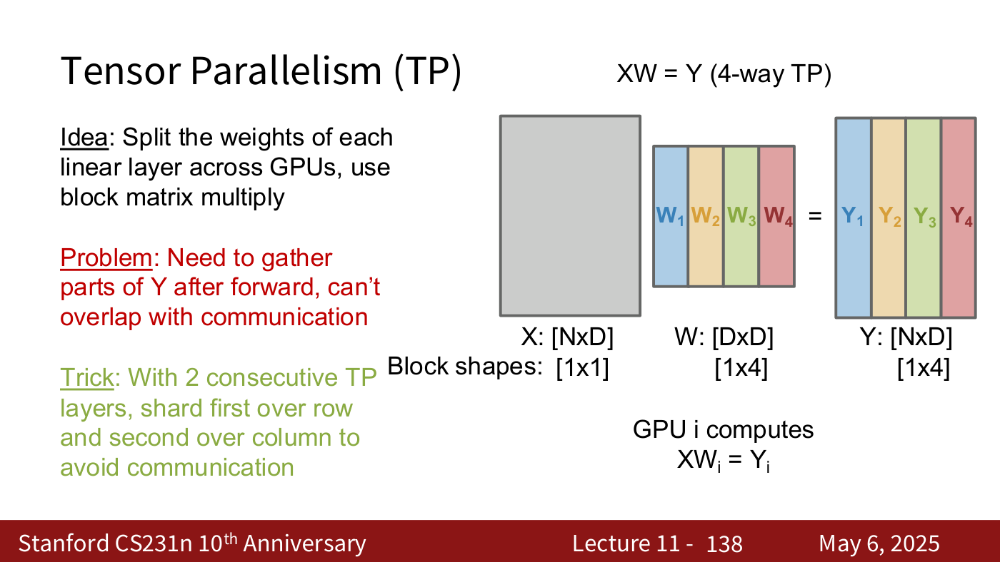

Same as slide 137, plus green text: "Trick: With 2 consecutive TP layers, shard first over row and second over column to avoid communication" ("Trick" underlined).

*[Ed: The words and the drawing use opposite names. This slide says to shard the first layer "over row" and the second "over column"; slides 140–143 split the first matrix W into side-by-side column blocks (block shape [1x4]) and the second matrix U into stacked row blocks ([4x1]), and the lecturer says "column-shaped chunks" for the first and "row-shaped chunks" for the second (≈1:10:03).]*

## Slide 139 — Tensor Parallelism (TP) - Two Layers

Heading, top right: "(4-way TP)", "XW = Y (layer 1)", "YU = Z (layer 2)".

Figure: five unsplit matrices in a row, with "=" after the second and after the fourth: a tall grey "X: [NxD]"; a light-blue square "W: [DxD]"; "="; a tall grey "Y: [NxD]"; a light-blue square "U: [DxD]"; "="; a grey rectangle labelled "Z: [DxD]" (as printed; Z is drawn like X and Y, a tall grey rectangle). Nothing on this slide is split: the page's text layer already holds the block labels "Y1"–"Y4" and "U1"–"U4" of slide 140, but they are not visible here.

*[Ed: Z is labelled "[DxD]" here and on slides 140–143. With Y printed as [NxD] and U as [DxD], Z = YU is N x D, which is how it is drawn (the same tall shape as X and Y).]*

## Slide 140 — Tensor Parallelism (TP) - Two Layers

Same heading and layout as slide 139, now with the matrices split: X is one undivided grey block; W is split into 4 column blocks "W1" (blue), "W2" (orange), "W3" (green), "W4" (red); Y is split into 4 column blocks "Y1" (blue), "Y2" (orange), "Y3" (green), "Y4" (red); U is split into 4 horizontal row blocks stacked top to bottom "U1" (blue), "U2" (orange), "U3" (green), "U4" (red); Z is one undivided grey block. Labels: "X: [NxD]", "W: [DxD]", "Y: [NxD]", "U: [DxD]", "Z: [DxD]". Row "Block shapes:" with "[1x1]" under X, "[1x4]" under W, "[1x4]" under Y, "[4x1]" under U, "[1x1]" under Z.

## Slide 141 — Tensor Parallelism (TP) - Two Layers

Same as slide 140, plus, at lower right, coloured text: $Z = Y_1U_1 + Y_2U_2 + Y_3U_3 + Y_4U_4$ (each term coloured to match its blocks: blue, orange, green, red).

## Slide 142 — Tensor Parallelism (TP) - Two Layers

Same as slide 141, plus two captions under the matrices: under W and left, "GPU $i$ computes $XW_i = Y_i$"; under Y and U, "GPU $i$ computes $Y_iU_i = Z_i$".

## Slide 143 — Tensor Parallelism (TP) - Two Layers

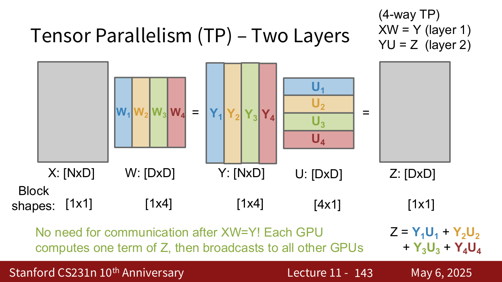

Same as slide 141 (the two "GPU i computes" captions of slide 142 are gone), plus green text across the bottom: "No need for communication after XW=Y! Each GPU computes one term of Z, then broadcasts to all other GPUs".

## Slide 144 — How to train on lots of GPUs

Same as slide 134: 2 x 2 layout with "Tensor Parallelism (TP)" / "Split on Dim dimension" highlighted in black, the other three faded.

## Slide 145 — How to train on lots of GPUs

Same 2 x 2 layout, now with all four items in black (none faded): top left "Data Parallelism (DP)" / "Split on Batch dimension"; top right "Context Parallelism (CP)" / "Split on Sequence dimension"; bottom left "Pipeline Parallelism (PP)" / "Split on L dimension"; bottom right "Tensor Parallelism (TP)" / "Split on Dim dimension". Centre text: "Q: Which to use for largest models?" "A: All of them!" ("Q" and "A" bold).

## Slide 146 — ND Parallelism

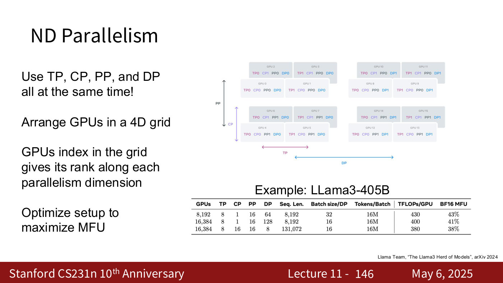

Text, left: "Use TP, CP, PP, and DP all at the same time!" "Arrange GPUs in a 4D grid" "GPUs index in the grid gives its rank along each parallelism dimension" "Optimize setup to maximize MFU".

Figure (upper right, a diagram of 16 GPUs): four groups of 4 GPU tiles, drawn as 2 x 2 tiles in front with 2 x 2 tiles behind (offset up-right). Each tile is labelled "GPU n" and a line of four rank labels "TPa CPb PPc DPd". Front tiles are lighter, back tiles darker grey.

| GPU | TP | CP | PP | DP |
| --- | --- | --- | --- | --- |
| GPU 0 | TP0 | CP0 | PP0 | DP0 |
| GPU 1 | TP1 | CP0 | PP0 | DP0 |
| GPU 2 | TP0 | CP1 | PP0 | DP0 |
| GPU 3 | TP1 | CP1 | PP0 | DP0 |
| GPU 4 | TP0 | CP0 | PP1 | DP0 |
| GPU 5 | TP1 | CP0 | PP1 | DP0 |
| GPU 6 | TP0 | CP1 | PP1 | DP0 |
| GPU 7 | TP1 | CP1 | PP1 | DP0 |
| GPU 8 | TP0 | CP0 | PP0 | DP1 |
| GPU 9 | TP1 | CP0 | PP0 | DP1 |
| GPU 10 | TP0 | CP1 | PP0 | DP1 |
| GPU 11 | TP1 | CP1 | PP0 | DP1 |
| GPU 12 | TP0 | CP0 | PP1 | DP1 |
| GPU 13 | TP1 | CP0 | PP1 | DP1 |
| GPU 14 | TP0 | CP1 | PP1 | DP1 |
| GPU 15 | TP1 | CP1 | PP1 | DP1 |

Layout: the left cluster (GPUs 0 to 7) has DP0 and the right cluster (GPUs 8 to 15) has DP1. Each cluster has two 2 x 2 blocks, the upper PP0 (GPUs 0-3, 8-11) and the lower PP1 (GPUs 4-7, 12-15); within a block the front row is CP0 and the back row CP1; left tile TP0, right tile TP1. Axis arrows: a vertical black double-headed arrow labelled "PP" at far left; a vertical purple double-headed arrow labelled "CP" next to it (lower part); a horizontal magenta double-headed arrow under the left cluster labelled "TP"; a longer horizontal blue double-headed arrow labelled "DP" spanning from under the left cluster to under the right cluster. Rank text colours: TP magenta, CP purple, PP dark grey/black, DP blue.

Table (lower right), titled "Example: LLama3-405B" (as printed). Citation under it: Llama Team, "The Llama3 Herd of Models", arXiv 2024

| GPUs | TP | CP | PP | DP | Seq. Len. | Batch size/DP | Tokens/Batch | TFLOPs/GPU | BF16 MFU |
| --- | --- | --- | --- | --- | --- | --- | --- | --- | --- |
| 8,192 | 8 | 1 | 16 | 64 | 8,192 | 32 | 16M | 430 | 43% |
| 16,384 | 8 | 1 | 16 | 128 | 8,192 | 16 | 16M | 400 | 41% |
| 16,384 | 8 | 16 | 16 | 8 | 131,072 | 16 | 16M | 380 | 38% |

*[Ed: Recomputed: GPUs = TP x CP x PP x DP gives 8 x 1 x 16 x 64 = 8,192; 8 x 1 x 16 x 128 = 16,384; 8 x 16 x 16 x 8 = 16,384, all matching. Tokens/Batch = DP x Batch size/DP x Seq. Len. gives 64 x 32 x 8,192 = 16,777,216; 128 x 16 x 8,192 = 16,777,216; 8 x 16 x 131,072 = 16,777,216, all about 16M. No slip.]*

## Slide 147 — Summary: Large-Scale Distributed Training

Left column: text "A GPU is a parallel processor with hundreds of cores" above a picture of a GPU in two zoom stages: a small chip photo with a yellow box, zoom lines to an enlarged strip of the die, and purple zoom lines from there to a schematic labelled "SM" (four quadrants of green core blocks with Tensor Cores), as on slides 10–13. Below it: text "A GPU cluster has O(10K) GPUs" above a pink rectangle labelled "GPU Cluster" containing 8 smaller boxes in 2 rows of 4, each labelled "GPU Pod" and filled with a dense grid of tiny squares (individual GPUs).

Right column, text: "Split up the computation along different axes" "Consider a model with many Layers, operating on tensors of shape (Batch, Seq, Dim)" then four dash items:

- "Data Parallel (DP): Split on Batch"
- "Context Parallel (CP): Split on Seq"
- "Pipeline Parallel (PP): Split on Layers"
- "Tensor Parallel (TP): Split on Dim"

Then: "Activation Checkpointing saves memory by recomputing during backward" ("Activation Checkpointing" bold), and "Tune parallelism recipe to maximize Model Flops Utilization (MFU)" ("Model Flops Utilization (MFU)" bold).

## Slide 148 — Next Time

Title slide, text only: "Next Time:" "Self-Supervised Learning".

