# Lecture 12 — Self-Supervised Learning (slide-by-slide)

Text and figures of all 115 pages of [`lecture_12.pdf`](https://cs231n.stanford.edu/slides/2025/lecture_12.pdf), CS231N (Stanford, Spring 2025), May 8, 2025. Cite these as "slide N" using the **printed** slide number (footer, after "Lecture 12 -"). The running footer ("Stanford CS231n 10th Anniversary", "Lecture 12 - N", "May 8, 2025") is on every page and is not repeated below. Equations are written in LaTeX following the slides' own symbols.

The deck reveals several diagrams one element at a time, so some slides are build steps of the slide before and are written "Same as slide N, plus …". Slides 114–117 come after the "Next time" slide (111), as an appendix.

| Section | Slides |
| --- | --- |
| Title; administrative (midterm, review section, proposal feedback) | 1–2 |
| Where the course is: GPU hardware, the vision tasks, visualizing and understanding | 3–6 |
| Learned representations, and the cost of labels | 7–8 |
| Self-supervised learning: pretext task, then downstream task | 9–12 |
| How to evaluate a self-supervised method; the broader picture | 13–16 |
| Today's agenda | 17–18 |
| Pretext task: predicting rotations (RotNet) | 19–24 |
| Pretext tasks: relative patch locations, jigsaw puzzles | 25–27 |
| Pretext task: inpainting (context encoders) | 28–33 |
| Pretext task: image colouring (colorization, split-brain autoencoders) | 34–41 |
| Pretext task: video colouring, and tracking that emerges from it | 42–51 |
| Masked autoencoders (MAE) | 52–60 |
| Summary of pretext tasks; a more general pretext task | 61–65 |
| Contrastive representation learning; the InfoNCE formulation | 66–75 |
| SimCLR | 76–86 |
| MoCo, MoCo v2, and comparisons with SimCLR | 87–93 |
| Instance vs. sequence contrastive learning; contrastive predictive coding (CPC) | 94–101 |
| Other examples: MoCo v3, DINO, DINOv2 | 102–106 |
| Summary of contrastive representation learning | 107–110 |
| Next time: generative models | 111 |
| Appendix: CPC on visual context; Dense Object Net | 114–117 |

## Slide numbers vs PDF pages

The deck prints numbers 1–117 on 115 pages. Printed numbers 112 and 113 are absent (slides hidden in the source deck), so PDF pages 1–111 are slides 1–111 and PDF pages 112, 113, 114 and 115 are slides 114, 115, 116 and 117. Every page prints its number.

**What the recording covers.** The recording opens with a recap of the previous lectures ("Last time, on Tuesday this week…", ≈0:05) and never presents the title or slide 2 (administrative: the midterm on Tuesday 5/13 during lecture time, the review section on Friday 5/9 at 12:30 pm, project proposal feedback on Gradescope), so this file is the only source for slide 2. It then follows the deck in order: recap and the cost of labels (3–8, ≈0:05–4:00); the pretext and downstream tasks (9–12, ≈4:00–10:14); evaluation and the broader picture (13–18, ≈10:14–14:55); rotation prediction (19–24, ≈14:55–22:41); relative patch locations and jigsaw puzzles (25–27, ≈22:41–26:36); inpainting (28–33, ≈26:36–31:13); colouring and split-brain autoencoders (34–41, ≈31:13–36:41); video colouring and tracking (42–51, ≈36:41–40:37); student questions (≈40:37–46:01); masked autoencoders (52–60, ≈46:01–53:43); the pretext-task summary and two more questions (61–63, ≈53:43–58:26); contrastive learning and InfoNCE (64–75, ≈58:26–1:05:27); SimCLR (76–86, ≈1:05:27–1:10:54); and MoCo and MoCo v2 (87–93, ≈1:10:54–1:13:17). There the lecturer stops ("So I will stop here", ≈1:13:17), naming contrastive predictive coding, MoCo v3 and DINO as material "you can look at in the slides". Slides 94–111 (CPC, MoCo v3, DINO, DINOv2, the summary of contrastive learning, next time) and the appendix (114–117: CPC on visual context, Dense Object Net) are not presented, and are sourced to this file alone.

**Printed slips, transcribed as printed with `[Ed:]` lines.** Slide 31's adversarial loss has unbalanced brackets: the expectation's "[" closes after $\log(D(x))$ and a second "]" follows the last term with nothing to close. Slide 81's drawing is not self-consistent in size: two stacks of 5 inputs give a row of 10 vectors ($2N = 10$), while the affinity matrix, also labelled 2N on each side, is drawn 6 x 6 (slide 82's six blue cells fit that grid). Typos are kept in place and marked: slide 13's "leaerned" and stray closing parenthesis, and slide 54's title "Masking Methos". Slide 106 is titled "DINO v2", but its credit line names the 2021 DINO paper of slides 103–105. Slide 98 drops the sentence "The original paper uses GRU-RNN here" that slide 97 prints; that is a change between builds, not a slip. Slide 53's diagram masks 17 of its 25 patches (68%), where slides 54–55 give 75% as the ratio the paper samples. The tables reproduced from different papers report different numbers for the same rows: ImageNet-supervised classification is 78.9 (fc6-8) and 79.9 (all) on slide 23 but 78.2% on slides 27 and 33; the context encoder's segmentation is 29.7 on slides 23 and 27 and 30.0% on slide 33; Wang and Gupta's classification and detection are 58.4% and 44.0% on slide 27 and 58.7% and 47.4% on slide 33. Recomputed and consistent: slide 59's "random 75" row (84.9, 73.5) matches the two charts' points at 75; slide 60's MoCo v3 row (83.2, 84.1) matches slide 102's fine-tuning rows; slide 92's MoCo v2 rows (67.5 at 200 epochs, 71.1 at 800) match slide 91's (d) and (e); the InfoNCE loss of slides 71, 75 and 107 (one positive and N − 1 negatives) and the bound $MI - \log(N) \geq -L$; slide 78's loss averages 2N terms; slide 2's dates (Friday 5/9, Tuesday 5/13, from Thursday May 8).

**Images.** 60 slides are rendered as images, each placed under its heading: 5, 6, 8, 9, 10, 11, 12, 15, 16, 19, 21, 22, 24, 25, 26, 28, 29, 32, 34, 35, 36, 37, 38, 39, 40, 41, 43, 44, 47, 48, 49, 50, 51, 52, 53, 58, 59, 60, 66, 69, 72, 76, 77, 82, 83, 85, 86, 88, 94, 96, 97, 98, 100, 101, 103, 104, 106, 115, 116 and 117 (58 JPEG; slides 58 and 82 are PNG). The others have none, because they are title, agenda or next-time slides (1, 17, 18, 67, 111), text (2, 13, 54–57, 61, 62, 90, and 102, a pasted paper page whose abstract and table are transcribed), figures already rendered for an earlier lecture (3 repeats lecture 11's slide 5; 4 is the four-task figure of lecture 9), repeats of a figure rendered here (7 of 6; 63 of 12; 68 of 66; 99 of 94's right half; 108 of 85; 109 of 87; 110 of 95; 114 of 83, with its table transcribed), build steps whose later step is rendered (14 → 15; 20 → 21; 30 → 32; 42 → 43; 45–46 → 47; 64–65 → 66; 81 → 82; 87 → 88; 95 → 96), tables transcribed exactly (23, 27, 33, 84, 91, 92, 93), equations and their text builds (31, 70, 71, 73, 74, 75, 107), or the algorithm box and code listings transcribed exactly (78–80, 89, 105). No page carries a video link or media annotation. Slides 48–51 hold one still image per panel, credited to a Google AI blog post; the PDF cannot show whether these played as animations in the lecture, and the recording does not say, so their descriptions are of the frames as exported.

Companion pages: [wiki page for this lecture](../../wiki/12-self-supervised-learning.md) · [transcript](../transcripts/12-self-supervised-learning.md)

## Slide 1 — Lecture 12: Self-Supervised Learning

Title slide: "Lecture 12: Self-Supervised Learning". Footer: "Stanford CS231n 10th Anniversary", "Lecture 12 - 1", "May 8, 2025".

## Slide 2 — Administrative

- "Midterm next Tuesday (5/13 during lecture time) – Don't be late; See this Ed post for logistic details." ("this Ed" is a hyperlink.)
- "Midterm review section tomorrow, Friday, 5/9 at 12:30 pm."
- "Project proposal feedback is available on Gradescope."

## Slide 3 — Previous Lecture: GPUs and How to Train On Them

Two photographs side by side on black backgrounds. Left, captioned "A bit about GPU hardware": a close-up product render of a GPU board with a central die and memory modules around it. Right, captioned "How to train on lots of GPUs": a render of a long row of server racks (a GPU cluster). No credit line printed.

## Slide 4 — Lots of Computer Vision Tasks

Four panels, left to right, each with a title above, an image, and a label line below.

- "Classification": photo of a kitten walking on grass; label "CAT". A brace under this panel reads "No spatial extent".
- "Semantic Segmentation": a flat-colour segmentation map (blue sky at top, purple band of trees, yellow cat shape, green grass); label "GRASS, CAT, TREE, SKY" with each word in its region's colour (green, yellow, purple, blue). A brace under this panel reads "No objects, just pixels".
- "Object Detection": photo of a Christmas tree with two dogs and a cat in front; three boxes drawn: red around the left dog, green around the middle dog, blue around the cat. Label "DOG, DOG, CAT" in red, green, blue.
- "Instance Segmentation": same photo with filled coloured masks (red, green, blue) over the same three animals. Label "DOG, DOG, CAT" in red, green, blue.

A single brace spans the last two panels, reading "Multiple Object". Credit at lower right: "This image is CC0 public domain" (both "This image" and "CC0 public domain" are links).

## Slide 5 — Last Week: Visualizing and Understanding

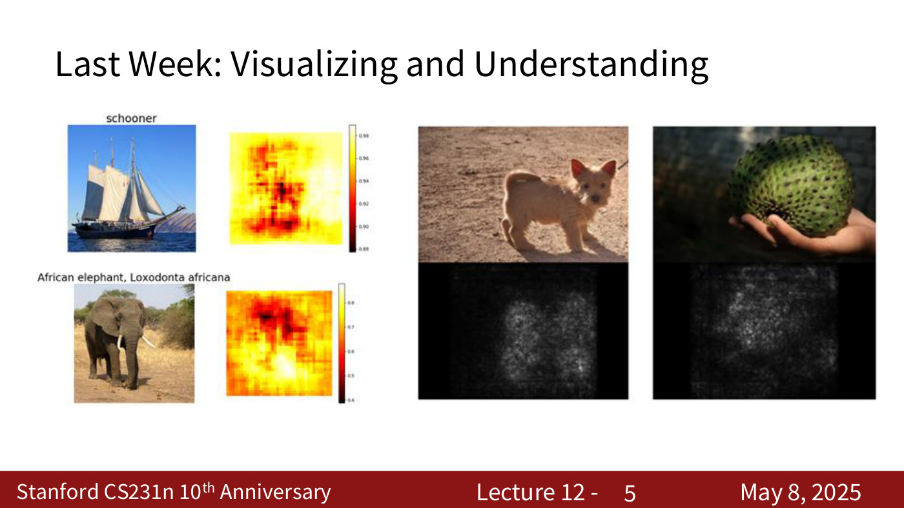

Title only plus two groups of images, no other text.

Left group: two rows, each a photo with a heat map to its right and a colour bar beside the heat map. Top row: title "schooner", a photo of a sailing ship, and a heat map (red/yellow, colour bar ticks roughly 0.88 to 0.98). Bottom row: title "African elephant, Loxodonta africana", a photo of an elephant, and a heat map (colour bar ticks roughly 0.4 to 0.8). The slide does not say what the heat maps show.

Right group: two photos, each with a dark grayscale map below it showing a faint bright blob. Left: a small tan dog standing on dirt. Right: a green spiky fruit held in a hand. The slide does not label these maps either.

## Slide 6 — Last Week: Visualizing and Understanding

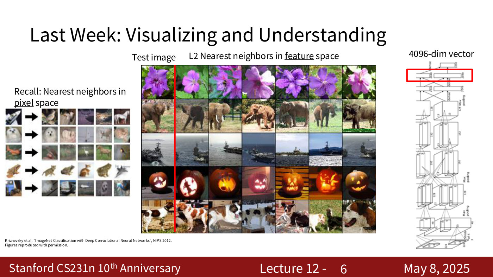

Three parts.

Left, text "Recall: Nearest neighbors in pixel space" ("pixel" underlined): five rows, each a small query image, a black arrow, then six small retrieved images (a column of 5 query images and 5 x 6 retrieved images). The retrieved images are visually similar in colour/layout but not in content.

Centre: header "Test image" over the first column and "L2 Nearest neighbors in feature space" ("feature" underlined) over the rest. A 5-row by 7-column grid; the first column (test image) is separated from the other six by a red vertical line. Rows: purple flowers; elephants; aircraft carriers / ships; carved lit pumpkins; spotted dogs (white-brown). The six neighbours in each row show the same category.

Right: label "4096-dim vector" above a drawing of the AlexNet architecture (vertical stack of layers, input at bottom, dense layers at top); a red box highlights the top dense layer region.

Credit, bottom left: "Krizhevsky et al, "ImageNet Classification with Deep Convolutional Neural Networks", NIPS 2012. Figures reproduced with permission."

## Slide 7 — Learned Representations

Same as slide 6 (same pixel-space nearest-neighbour examples, 5 x 7 feature-space grid with red divider, "4096-dim vector" AlexNet drawing with red box, same credit "Krizhevsky et al, "ImageNet Classification with Deep Convolutional Neural Networks", NIPS 2012. Figures reproduced with permission."), with the title changed to "Learned Representations".

## Slide 8 — Learned Representations

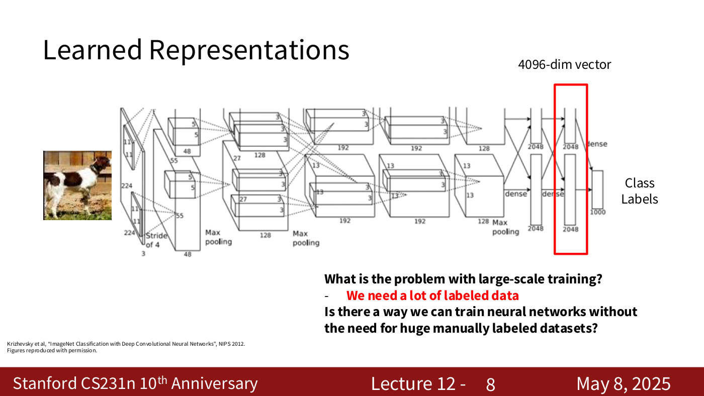

Title "Learned Representations". The AlexNet diagram drawn horizontally. At left, a photo of a white-and-brown dog (input) feeds the first conv block (labels 224, 224, 3; filters 11 x 11; "Stride of 4"; 55, 55, 48 feature maps; "Max pooling"; 27/128 maps with 5 x 5 filters; "Max pooling"; 13 x 13 x 192 blocks with 3 x 3 filters; a third "Max pooling" after the last 13 x 13 x 128 block). The network is drawn as two parallel branches (conv1 to conv5), and the top edge of the drawing is cut off on the slide. At right: two "dense" layers of 2048 units, each drawn as a pair of parallel columns (four columns in all), then "dense" to a 1000-unit column; a label "Class Labels" sits at far right. A red box surrounds both columns of the second 2048 pair, labelled above "4096-dim vector".

Text at lower right, bold: "What is the problem with large-scale training?" then a bullet "We need a lot of labeled data" (this phrase in red), then "Is there a way we can train neural networks without the need for huge manually labeled datasets?"

Credit, bottom left: "Krizhevsky et al, "ImageNet Classification with Deep Convolutional Neural Networks", NIPS 2012. Figures reproduced with permission."

## Slide 9 — Self-Supervised Learning

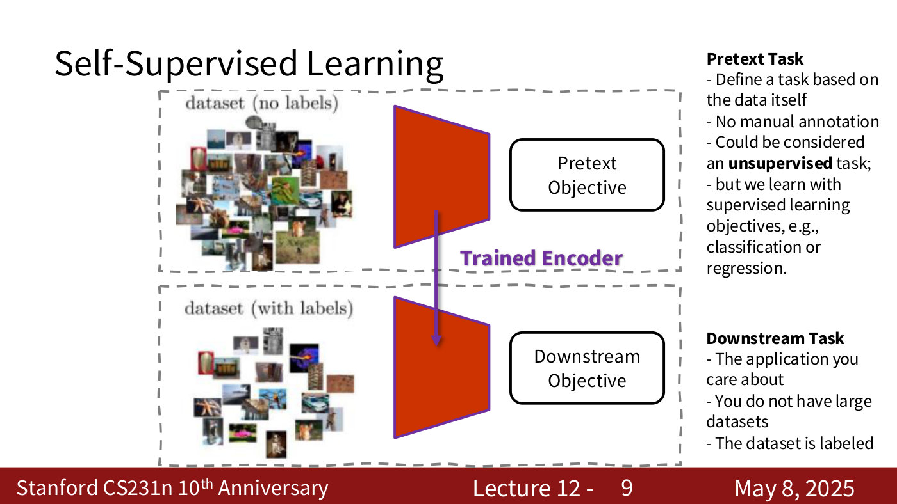

Diagram with two dashed-outline panels stacked vertically.

Top panel: a cloud of many small photos labelled "dataset (no labels)"; a red-orange trapezoid (wide on the left, narrowing to the right: the encoder, unlabelled); to its right a rounded box "Pretext Objective".

Bottom panel: a smaller cloud of photos labelled "dataset (with labels)"; a red-orange trapezoid; a rounded box "Downstream Objective".

A purple arrow runs from the top trapezoid down to the bottom trapezoid, labelled in bold purple "Trained Encoder".

Right-hand text. "Pretext Task" (bold): "- Define a task based on the data itself", "- No manual annotation", "- Could be considered an unsupervised task;" (the word "unsupervised" bold), "- but we learn with supervised learning objectives, e.g., classification or regression."

"Downstream Task" (bold): "- The application you care about", "- You do not have large datasets", "- The dataset is labeled".

## Slide 10 — Self-Supervised Learning – Pretext Task

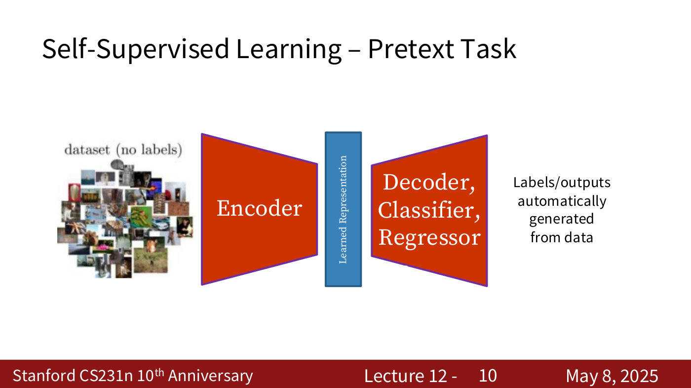

Diagram, left to right: cloud of photos labelled "dataset (no labels)"; a red-orange trapezoid labelled "Encoder" (wide left, narrow right); a tall blue rectangle with vertical text "Learned Representation"; a red-orange trapezoid (narrow left, wide right) labelled "Decoder, Classifier, Regressor"; text at right "Labels/outputs automatically generated from data".

## Slide 11 — Self-Supervised Learning – Downstream Task

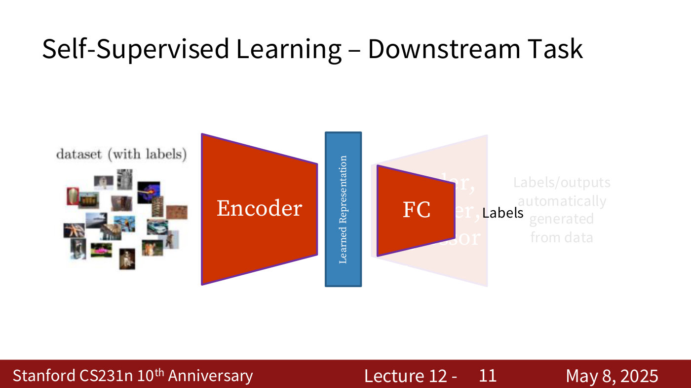

Same layout as slide 10, with changes. The dataset cloud is labelled "dataset (with labels)" (a smaller set of photos). The "Encoder" trapezoid and blue "Learned Representation" bar are kept. The decoder trapezoid from slide 10 is faded to a ghost (its text "Decoder, Classifier, Regressor" and the right text "Labels/outputs automatically generated from data" are faint), and a new small solid red-orange trapezoid labelled "FC" sits in front of it, with the word "Labels" in black text to its right.

## Slide 12 — Self-supervised pretext tasks

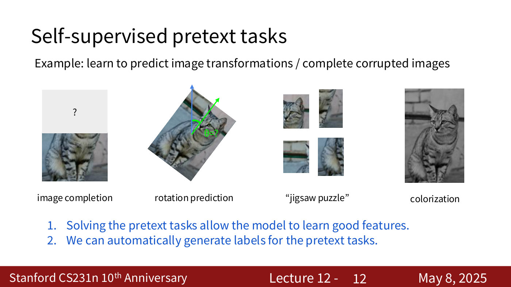

Subtitle: "Example: learn to predict image transformations / complete corrupted images". Four example panels, each using a photo of a sitting tabby cat, with captions below.

- "image completion": the lower part of the cat image shown; the top part replaced by a light gray block containing "?".
- "rotation prediction": the cat image rotated (tilted about 30 degrees clockwise) with a blue vertical arrow, a green arrow at an angle from the same origin, and a small green angle label ("θ=?").
- ""jigsaw puzzle"": four separate crops of the cat image (2 x 2 arrangement, scrambled): upper-left shows the cat's face, upper-right a narrow strip, lower-left a small background patch, lower-right a body patch.
- "colorization": the cat image in grayscale.

Below, in blue, a numbered list: "1. Solving the pretext tasks allow the model to learn good features." and "2. We can automatically generate labels for the pretext tasks."

## Slide 13 — How to evaluate a self-supervised learning method?

Bulleted list (bold main bullets, sub-bullets below):

- "Pretext Task Performance" - "Measure how well the model performs on the task it was trained on without labels."
- "Representation Quality" - "Evaluate the quality of the learned representations"; sub-sub-bullets: "Linear Evaluation Protocol: Train a linear classifier on the leaerned representations;" (typo "leaerned" as printed; "Linear Evaluation Protocol:" italic), "Clustering: Measure clustering performance;" (italic label), "t-SNE: Visualize the representations to assess their separability.)" (italic label; a stray closing parenthesis as printed).
- "Robustness and Generalization" - "Test how well the model generalizes to different datasets and is robust to variations."
- "Computational Efficiency" - "Assess the efficiency of the method in terms of training time and resource requirements."
- "Transfer Learning and Downstream Task Performance" - "Assess the utility of the learned representations by transferring them to a downstream supervised task." This last bullet and its sub-bullet are enclosed in a dark-red rectangle.

## Slide 14 — How to evaluate a self-supervised learning method?

Flow diagram, left to right: a database cylinder icon labelled "lots of unlabeled data"; arrow to a rounded gray box "self-supervised learning"; arrow to a lavender rounded box "feature extractor (e.g., a convnet)".

Below, a small network drawing: a photo of a bird (blurred, brown) feeds a stack of 5 vertical bars (first three lavender, labelled "conv" by a brace; last two white, labelled "fc"), with an arrow to the output "90°".

Text bottom: "1. Learn good feature extractors from self-supervised pretext tasks, e.g., predicting image rotations".

## Slide 15 — How to evaluate a self-supervised learning method?

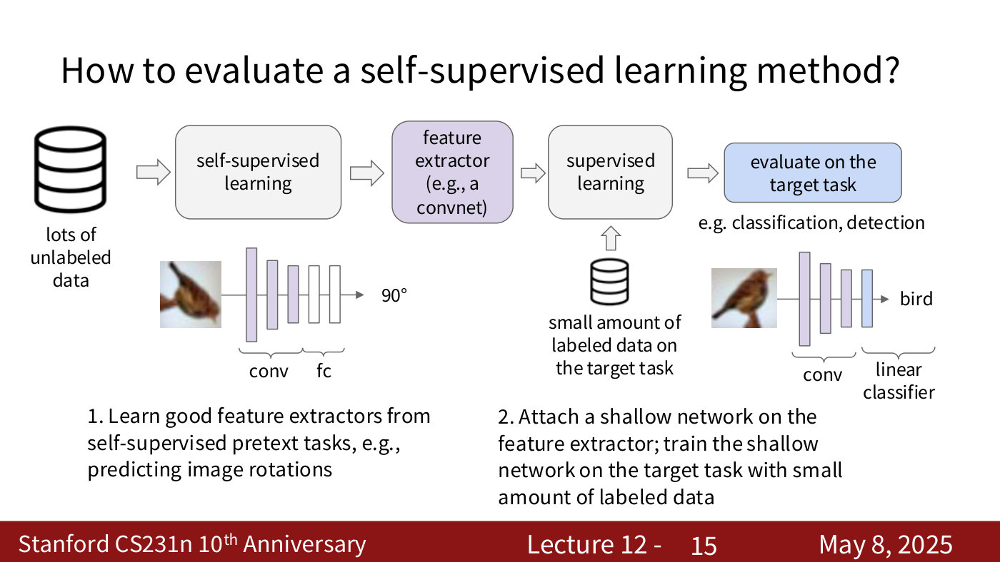

Same as slide 14, plus the right half of the flow: arrow to a gray rounded box "supervised learning" (with an up-arrow into it from a database icon labelled "small amount of labeled data on the target task"), then arrow to a blue rounded box "evaluate on the target task" with the text beneath "e.g. classification, detection". A second small network drawing at the right: a bird photo (clearer) feeds 5 bars (first three lavender, labelled "conv"; the last two, shorter and blue, labelled "linear classifier" by a brace; the drawing shows the blue bar group as the new head), with an arrow to output "bird". Text bottom right: "2. Attach a shallow network on the feature extractor; train the shallow network on the target task with small amount of labeled data". The left text "1. Learn good feature extractors from self-supervised pretext tasks, e.g., predicting image rotations" and the left network (conv and fc, output "90°") remain.

## Slide 16 — Broader picture

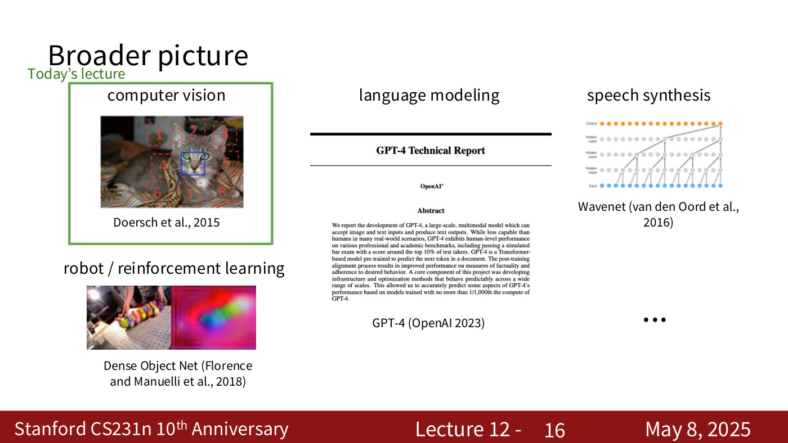

A grid of five examples; a green rectangle surrounds the first and a label "Today's lecture" in green sits at its upper-left.

- "computer vision" (inside green box): a cat photo with a 3 x 3 grid overlaid: red numbers 1 to 8 in red dashed cells around a blue central square, captioned "Doersch et al., 2015".
- "language modeling": an image of the first page of a paper headed "GPT-4 Technical Report", "OpenAI*", "Abstract" and "Abstract", captioned "GPT-4 (OpenAI 2023)". The abstract reads: "We report the development of GPT-4, a large-scale, multimodal model which can accept image and text inputs and produce text outputs. While less capable than humans in many real-world scenarios, GPT-4 exhibits human-level performance on various professional and academic benchmarks, including passing a simulated bar exam with a score around the top 10% of test takers. GPT-4 is a Transformer-based model pre-trained to predict the next token in a document. The post-training alignment process results in improved performance on measures of factuality and adherence to desired behavior. A core component of this project was developing infrastructure and optimization methods that behave predictably across a wide range of scales. This allowed us to accurately predict some aspects of GPT-4's performance based on models trained with no more than 1/1,000th the compute of GPT-4."
- "speech synthesis": a diagram of a layered dilated-convolution network (rows labelled Input, Hidden Layer x3, Output), captioned "Wavenet (van den Oord et al., 2016)". Below it an ellipsis "…".
- "robot / reinforcement learning": two side-by-side images (a photo of hands holding a colourful caterpillar toy over a perforated table, and a magenta dense-descriptor map with a rainbow-coloured blob where the toy is), captioned "Dense Object Net (Florence and Manuelli et al., 2018)".

## Slide 17 — Today's Agenda

"Pretext tasks from image transformations" (bold heading)
- "Rotation, inpainting, rearrangement, coloring"
- "Reconstruction-based learning (MAE)"

"Contrastive representation learning" (bold heading)
- "Intuition and formulation"
- "Instance contrastive learning: SimCLR and MOCO"
- "Sequence contrastive learning: CPC"
- "Self-Distillation Without Labels, DINO"

## Slide 18 — Today's Agenda

Same as slide 17, but the "Contrastive representation learning" heading and its four bullets are greyed out; the "Pretext tasks from image transformations" section is in full black.

## Slide 19 — Pretext task: predict rotations

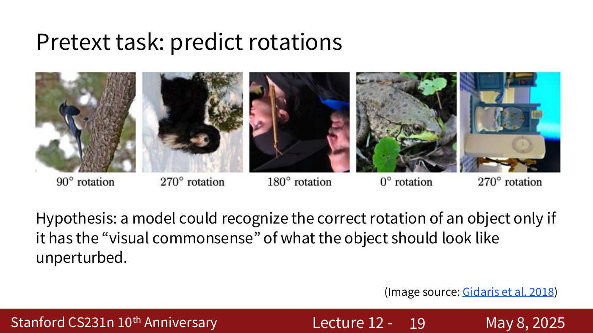

Row of 5 photos, each rotated, with captions: a magpie-like bird on a tree trunk "90° rotation"; a dark furry dog "270° rotation"; a person in a graduation cap "180° rotation"; a frog among leaves "0° rotation"; a white device (MP3-player-like) "270° rotation".

Text: "Hypothesis: a model could recognize the correct rotation of an object only if it has the "visual commonsense" of what the object should look like unperturbed."

Credit at lower right: "(Image source: Gidaris et al. 2018)" ("Gidaris et al. 2018" is a link).

## Slide 20 — Pretext task: predict rotations

Diagram (partial build). At left, a photo labelled "Image X" (a blue bird on a branch against blue sky) with an arrow splitting into four horizontal branches. Each branch has a light-blue box, then an arrow to a rotated copy of the image, then a short black arrow pointing right (to nothing yet):

- "g(X, y=0)" labelled "Rotate 0 degrees" -> "Rotated image: X^0" (upright bird)
- "g(X, y=1)" labelled "Rotate 90 degrees" -> "Rotated image: X^1"
- "g(X, y=2)" labelled "Rotate 180 degrees" -> "Rotated image: X^2"
- "g(X, y=3)" labelled "Rotate 270 degrees" -> "Rotated image: X^3"

Right-hand text: "Self-supervised learning by rotating the entire input images." and "The model learns to predict which rotation is applied (4-way classification)".

Credit: "(Image source: Gidaris et al. 2018)" ("Gidaris et al. 2018" is a link).

## Slide 21 — Pretext task: predict rotations

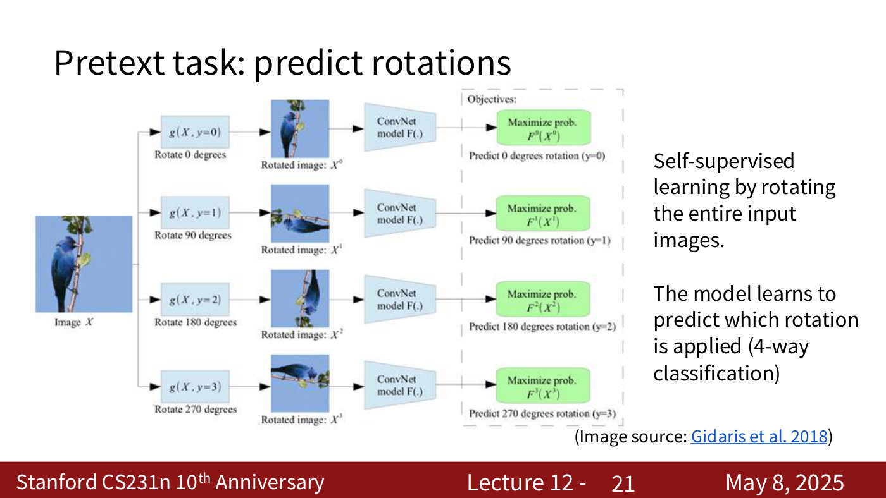

Same as slide 20, plus, for each of the four rows: a light-blue trapezoid labelled "ConvNet model F(.)" receiving the rotated image, then an arrow to a green rounded box "Maximize prob." with the formula, and below it a caption. The four green boxes (4 rows) read "F^0(X^0)", "F^1(X^1)", "F^2(X^2)", "F^3(X^3)" with captions "Predict 0 degrees rotation (y=0)", "Predict 90 degrees rotation (y=1)", "Predict 180 degrees rotation (y=2)", "Predict 270 degrees rotation (y=3)". The four green boxes sit inside a dashed rectangle headed "Objectives:". Same right-hand text and credit "(Image source: Gidaris et al. 2018)".

## Slide 22 — Evaluation on semi-supervised learning

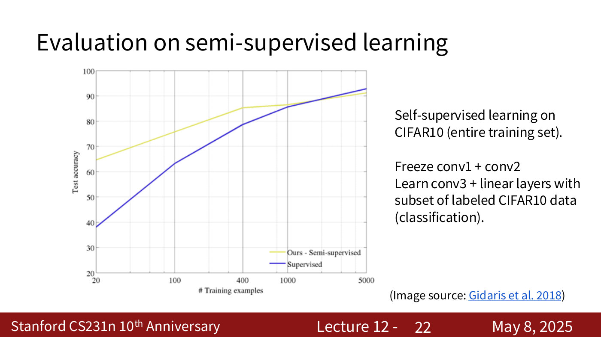

Line chart. Y axis "Test accuracy", ticks 20, 30, 40, 50, 60, 70, 80, 90, 100. X axis "# Training examples", logarithmic-style spacing with labelled ticks 20, 100, 400, 1000, 5000; vertical gray grid lines at 100, 400 and 1000. Two series (2), each with a line through the five x positions:

- Yellow-green line, legend "Ours - Semi-supervised": about 65 at 20, about 76 at 100, about 85 at 400, about 86.5 at 1000, about 91.5 at 5000.
- Blue line, legend "Supervised": about 38 at 20, about 63 at 100, about 79 at 400, about 86 at 1000, about 93 at 5000.

The yellow-green line is above blue at 20, 100, 400 and 1000 (at 1000 about 86.5 against about 85.7); the lines cross between 1000 and 5000, and blue ends slightly above at 5000. Values are read by eye; none is printed.

Right-hand text: "Self-supervised learning on CIFAR10 (entire training set)." then "Freeze conv1 + conv2 / Learn conv3 + linear layers with subset of labeled CIFAR10 data (classification)." Credit: "(Image source: Gidaris et al. 2018)".

## Slide 23 — Transfer learned features to supervised learning

Table, printed from the paper, with column groups: first column row names; "Trained layers" row with entries; then columns "Classification (%mAP)", "Detection (%mAP)", "Segmentation (%mIoU)". Header row, the "Trained layers" row: "fc6-8" under Classification, "all" under Classification (second sub-column), "all" under Detection, "all" under Segmentation. So Classification has two sub-columns (fc6-8, all); Detection and Segmentation have one each.

| Method | Classification fc6-8 | Classification all | Detection all | Segmentation all |
| --- | --- | --- | --- | --- |
| ImageNet labels | 78.9 | 79.9 | 56.8 | 48.0 |
| Random | (blank) | 53.3 | 43.4 | 19.8 |
| Random rescaled Krähenbühl et al. (2015) | 39.2 | 56.6 | 45.6 | 32.6 |
| Egomotion (Agrawal et al., 2015) | 31.0 | 54.2 | 43.9 | (blank) |
| Context Encoders (Pathak et al., 2016b) | 34.6 | 56.5 | 44.5 | 29.7 |
| Tracking (Wang & Gupta, 2015) | 55.6 | 63.1 | 47.4 | (blank) |
| Context (Doersch et al., 2015) | 55.1 | 65.3 | 51.1 | (blank) |
| Colorization (Zhang et al., 2016a) | 61.5 | 65.6 | 46.9 | 35.6 |
| BIGAN (Donahue et al., 2016) | 52.3 | 60.1 | 46.9 | 34.9 |
| Jigsaw Puzzles (Noroozi & Favaro, 2016) | - | 67.6 | 53.2 | 37.6 |
| NAT (Bojanowski & Joulin, 2017) | 56.7 | 65.3 | 49.4 | (blank) |
| Split-Brain (Zhang et al., 2016b) | 63.0 | 67.1 | 46.7 | 36.0 |
| ColorProxy (Larsson et al., 2017) | (blank) | 65.9 | (blank) | 38.4 |
| Counting (Noroozi et al., 2017) | - | 67.7 | 51.4 | 36.6 |
| (Ours) RotNet | **70.87** | **72.97** | **54.4** | **39.1** |

Blue annotations: a blue box around the "ImageNet labels" row with the arrow label "Pretrained with full ImageNet supervision"; a blue box around the "Random" and "Random rescaled Krähenbühl et al. (2015)" rows with the label "No pretraining"; a blue box around the "(Ours) RotNet" row with the label below the table "Self-supervised learning with rotation prediction".

Right-hand text: "Self-supervised learning on ImageNet (entire training set) with AlexNet." and "Finetune on labeled data from Pascal VOC 2007." Credit: "source: Gidaris et al. 2018" (link).

## Slide 24 — Visualize learned visual attentions

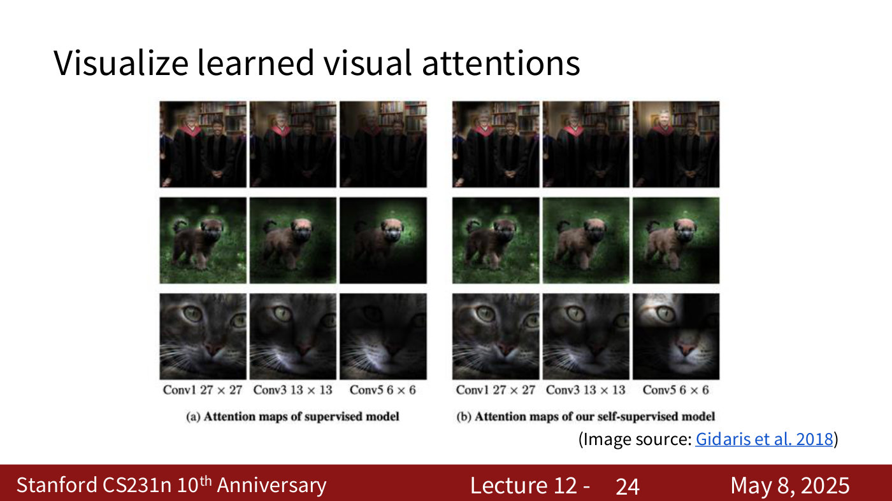

Two 3 x 3 image grids, side by side, each of attention maps (brightness shows attention) for three photos, one per row: row 1 a group of people in black academic gowns in front of bookshelves; row 2 a brown puppy on grass; row 3 a close-up of a tabby cat's face. Column captions under each grid: "Conv1 27 x 27", "Conv3 13 x 13", "Conv5 6 x 6". Sub-captions: left grid "(a) Attention maps of supervised model", right grid "(b) Attention maps of our self-supervised model". The maps are darkened versions of each photo with the attended regions left bright. In the supervised grid's Conv5 column the puppy and cat maps are strongly vignetted (the puppy lit only in a halo around its head, the cat dark except around the whiskers). In the self-supervised grid's Conv5 column the cat map has bright upper-left and lower-centre regions with the upper right and lower left dark, the puppy map has a dark lower-right corner, and the people map leaves the left person's face brightly lit. The slide gives no further explanation. Credit: "(Image source: Gidaris et al. 2018)".

## Slide 25 — Pretext task: predict relative patch locations

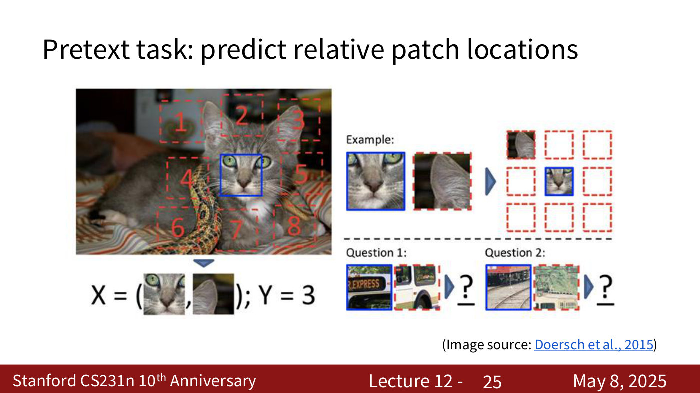

Left: a photo of a grey tabby cat on a patterned blanket with a snake-like orange-yellow pattern; a blue solid square marks the centre patch (cat's face); 8 red dashed squares surround it, numbered 1 to 8 (1, 2, 3 across the top; 4 at left of the centre, 5 at right; 6, 7, 8 across the bottom). Below, a small blue-down arrow, then the text "X = (face patch, ear patch); Y = 3" drawn as two small image patches in brackets: the centre face patch and an ear patch (the one from position 3), followed by "); Y = 3".

Right: "Example:" a blue-bordered face patch and a red-dashed-bordered ear patch, then an arrow to a 3 x 3 grid of red dashed squares where the face patch sits in the centre (blue border) and the ear patch sits at the top-left square. A dashed horizontal line separates this from "Question 1:" (a blue-bordered patch of a bus with "EXPRESS" text and a red-dashed patch of a bus side, followed by "?") and "Question 2:" (a blue-bordered patch of rail tracks / train and a red-dashed patch of a landscape, followed by "?"). No answers printed. Credit: "(Image source: Doersch et al., 2015)".

## Slide 26 — Pretext task: solving "jigsaw puzzles"

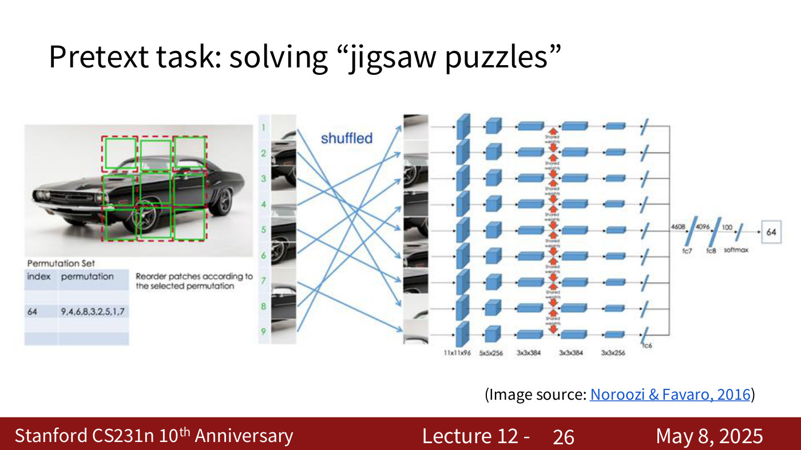

Left: a photo of a black muscle car (side view) with a 3 x 3 grid of green squares, each inside a red dashed box, over it. Below it a table headed "Permutation Set" with columns "index" and "permutation"; one row visible "64 | 9,4,6,8,3,2,5,1,7", and the note "Reorder patches according to the selected permutation".

Centre: a column of 9 patches numbered 1 to 9; blue lines labelled "shuffled" cross to a second column of 9 patches in shuffled order.

Right: nine parallel identical branches (one per patch, 9 in total), each a series of five blue blocks labelled along the bottom "11x11x96", "5x5x256", "3x3x384", "3x3x384", "3x3x256". "Shared weights" is printed 8 times, once between each adjacent pair of branches, with red up-and-down arrows between the third and fourth blocks. The branches merge at "fc6" (an unlabelled slash mark), then arrows labelled "4608" into "fc7", "4096" into "fc8" and "100" into "softmax", then a box "64". Credit: "(Image source: Noroozi & Favaro, 2016)".

## Slide 27 — Transfer learned features to supervised learning

Table caption (verbatim from paper): "Table 1: Results on PASCAL VOC 2007 Detection and Classification. The results of the other methods are taken from Pathak et al. [30]."

| Method | Pretraining time | Supervision | Classification | Detection | Segmentation |
| --- | --- | --- | --- | --- | --- |
| Krizhevsky et al. [25] | 3 days | 1000 class labels | **78.2%** | **56.8%** | **48.0%** |
| Wang and Gupta[39] | 1 week | motion | 58.4% | 44.0% | - |
| Doersch et al. [10] | 4 weeks | context | 55.3% | 46.6% | - |
| Pathak et al. [30] | 14 hours | context | 56.5% | 44.5% | 29.7% |
| Ours | 2.5 days | context | **67.6%** | **53.2%** | **37.6%** |

Text below: ""Ours" is feature learned from solving image Jigsaw puzzles (Noroozi & Favaro, 2016). Doersch et al. is the method with relative patch location". Credit: "(source: Noroozi & Favaro, 2016)".

## Slide 28 — Pretext task: predict missing pixels (inpainting)

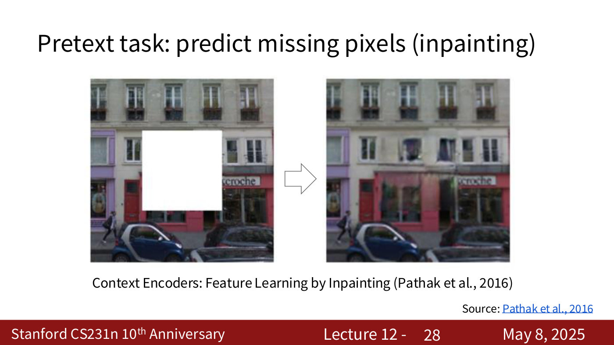

Two street-scene photos (a building with a red shop front, a small blue car, pedestrian) with a right-pointing arrow between them. Left: input with a large white square covering the middle of the image. Right: the output with the white square filled by a blurry, plausible reconstruction (pinkish-red shop-front colour and window-like shapes). Caption: "Context Encoders: Feature Learning by Inpainting (Pathak et al., 2016)". Credit: "Source: Pathak et al., 2016" (link).

## Slide 29 — Learning to inpaint by reconstruction

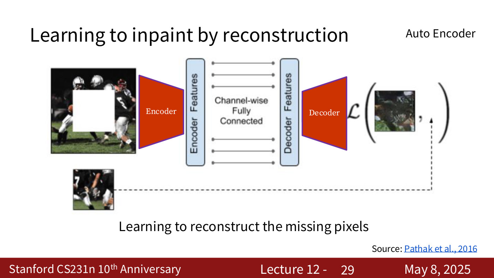

Top-right label: "Auto Encoder". Diagram, left to right: a photo of American-football players with a white square missing; a red-orange trapezoid labelled "Encoder"; a vertical rounded blue bar "Encoder Features"; between them, a middle annotation "Channel-wise Fully Connected" with 6 horizontal lines (3 above, 3 below the text) joining the Encoder Features bar to a vertical blue bar "Decoder Features"; a red-orange trapezoid labelled "Decoder"; then $\mathcal{L}($ [small reconstructed patch], $)$ (a loss with two arguments: the decoder's predicted patch, and a second argument arrived at by a dashed arrow from a small ground-truth crop at lower left, a patch of football players, running along the bottom and up into the loss). Caption below: "Learning to reconstruct the missing pixels". Credit: "Source: Pathak et al., 2016".

## Slide 30 — Inpainting evaluation

Two street-scene images: left "Input (context)" with a white square over the middle of a grey building wall with a window below; right "reconstruction" where the square is filled by a blurry grey-brown smear with darker vertical streaks. Credit: "Source: Pathak et al., 2016".

## Slide 31 — Learning to inpaint by reconstruction

Title with subtitle line: "(We will talk about adversarial learning in the next lecture)". Text: "Loss = reconstruction + adversarial learning". Equations as printed:

$$L(x) = L_{recon}(x) + L_{adv}(x)$$

$$L_{recon}(x) = \lVert M \ast (x - F_\theta((1-M) \ast x)) \rVert_2^2$$

$$L_{adv} = \max_D \mathbb{E}[\log(D(x))] + \log(1 - D(F((1-M) \ast x)))]$$

Annotations with blue arrows: "Element wise multiplication" pointing at the $\ast$ in $L_{recon}$; $M = \begin{cases} 0 \text{ not masked} \cr 1 \text{ masked} \end{cases}$ pointing at $M$; "Encoder" pointing at $F_\theta$. Text below: "Adversarial loss between "real" images and inpainted images". Credit: "Source: Pathak et al., 2016".

*[Ed: the printed* $L_{adv}$ *has unbalanced brackets: the expectation's "[" closes after* $\log(D(x))$*, and a second "]" follows the last term with no bracket to close, so the expectation's scope is ambiguous. Transcribed as printed.]*

## Slide 32 — Inpainting evaluation

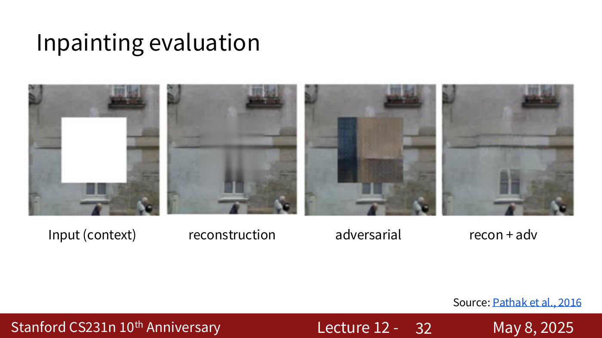

Four street-scene images in a row, same context image (grey building wall, white square masked in the first), with captions: "Input (context)" (white square), "reconstruction" (blurry smear, as slide 30), "adversarial" (a sharp but wrong-looking textured brown/blue rectangle pasted in), "recon + adv" (a plausible fill with a window shape continuing the wall). Credit: "Source: Pathak et al., 2016".

## Slide 33 — Transfer learned features to supervised learning

| Pretraining Method | Supervision | Pretraining time | Classification | Detection | Segmentation |
| --- | --- | --- | --- | --- | --- |
| ImageNet [26] | 1000 class labels | 3 days | 78.2% | 56.8% | 48.0% |
| Random Gaussian | initialization | < 1 minute | 53.3% | 43.4% | 19.8% |
| Autoencoder | - | 14 hours | 53.8% | 41.9% | 25.2% |
| Agrawal et al. [1] | egomotion | 10 hours | 52.9% | 41.8% | - |
| Wang et al. [39] | motion | 1 week | 58.7% | 47.4% | - |
| Doersch et al. [7] | relative context | 4 weeks | 55.3% | 46.6% | - |
| Ours | context | 14 hours | 56.5% | 44.5% | 30.0% |

(Citation numbers in green in the original.) Text below: "Self-supervised learning on ImageNet training set, transfer to classification (Pascal VOC 2007), detection (Pascal VOC 2007), and semantic segmentation (Pascal VOC 2012)". Credit: "Source: Pathak et al., 2016".

## Slide 34 — Pretext task: image coloring

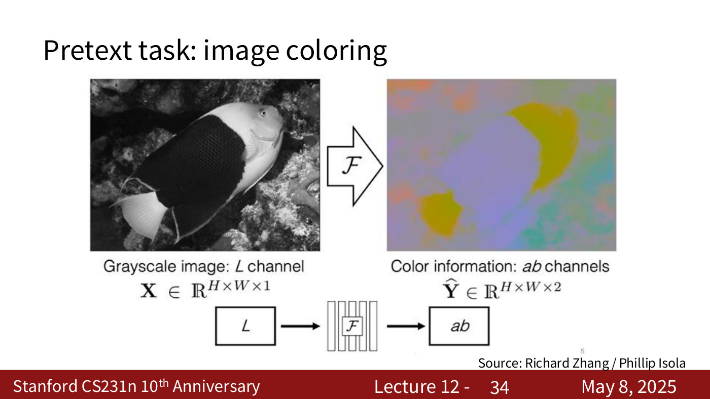

Left: a grayscale photo of an angelfish (black body, white head and tail) on a reef, captioned "Grayscale image: $L$ channel" and $\mathbf{X} \in \mathbb{R}^{H \times W \times 1}$. A large right arrow containing $\mathcal{F}$. Right: a pale, low-saturation image showing the predicted colour (purple-grey body, yellow patches at the head and tail, teal and orange blotches), captioned "Color information: $ab$ channels" and $\hat{\mathbf{Y}} \in \mathbb{R}^{H \times W \times 2}$. Bottom strip: box $L$ -> an elongated rectangle stack containing $\mathcal{F}$ -> box $ab$. Credit: "Source: Richard Zhang / Phillip Isola".

## Slide 35 — Pretext task: image coloring

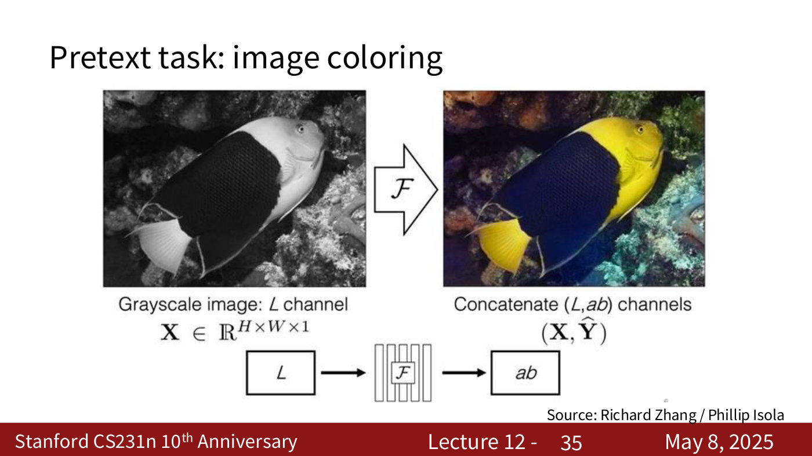

Same as slide 34, except the right image is the full-colour result (yellow and blue fish on a dark reef) and the right caption reads "Concatenate $(L, ab)$ channels" with $(\mathbf{X}, \hat{\mathbf{Y}})$. Left caption and strip unchanged. Credit: "Source: Richard Zhang / Phillip Isola".

## Slide 36 — Learning features from colorization: Split-brain Autoencoder

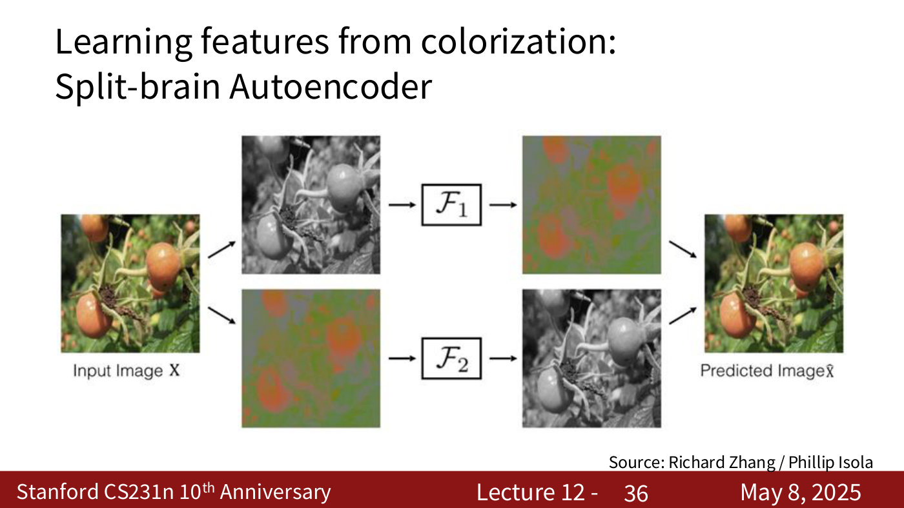

Left: a colour photo of rose hips ("Input Image X"). Two arrows lead to two branches. Top branch: a grayscale version of the image -> box $\mathcal{F}_ {1}$ -> a pale colour-channel image. Bottom branch: the colour-channel (ab) image -> box $\mathcal{F}_ {2}$ -> a grayscale image. Both branch outputs arrow into one colour image at right, "Predicted Image $\hat{\mathrm{X}}$". Credit: "Source: Richard Zhang / Phillip Isola".

## Slide 37 — Learning features from colorization: Split-brain Autoencoder

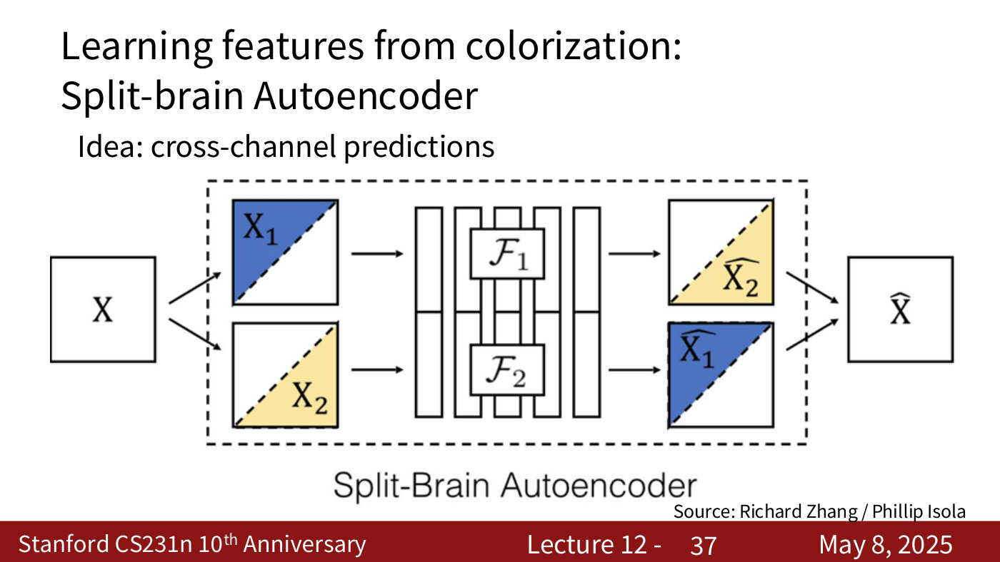

Subtitle: "Idea: cross-channel predictions". Schematic inside a dashed box, with the caption "Split-Brain Autoencoder" printed below the box. Left: a white square "X" with two arrows to two squares: top $X_1$ (upper-left blue triangle) and bottom $X_2$ (lower-right yellow triangle). Both feed one network drawn as 5 tall rectangles in a row, each split by a horizontal line into an upper and a lower half; a box $\mathcal{F}_ {1}$ sits on the upper halves and a box $\mathcal{F}_ {2}$ on the lower halves. Outputs: top square with a yellow lower-right triangle labelled $\widehat{X_2}$, bottom square with a blue upper-left triangle labelled $\widehat{X_1}$; both arrow into a white square $\hat{X}$, which sits outside the dashed box, to its right. Credit: "Source: Richard Zhang / Phillip Isola".

## Slide 38 — Learning features from colorization: Split-brain Autoencoder

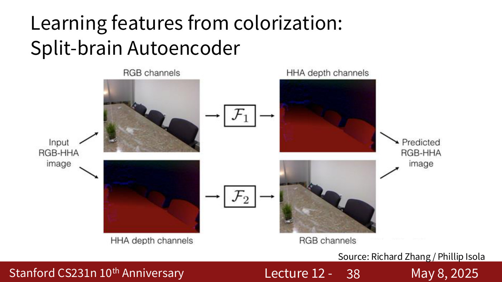

Same split-brain layout applied to RGB-D data. Left text "Input RGB-HHA image" with two arrows. Top branch: image "RGB channels" (an office table with chairs and a plant) -> $\mathcal{F}_ {1}$ -> "HHA depth channels" (dark red/black rendering of the same scene). Bottom branch: "HHA depth channels" -> $\mathcal{F}_ {2}$ -> "RGB channels". Right text "Predicted RGB-HHA image" with arrows from both outputs. Credit: "Source: Richard Zhang / Phillip Isola".
## Slide 39 — Transfer learned features to supervised learning

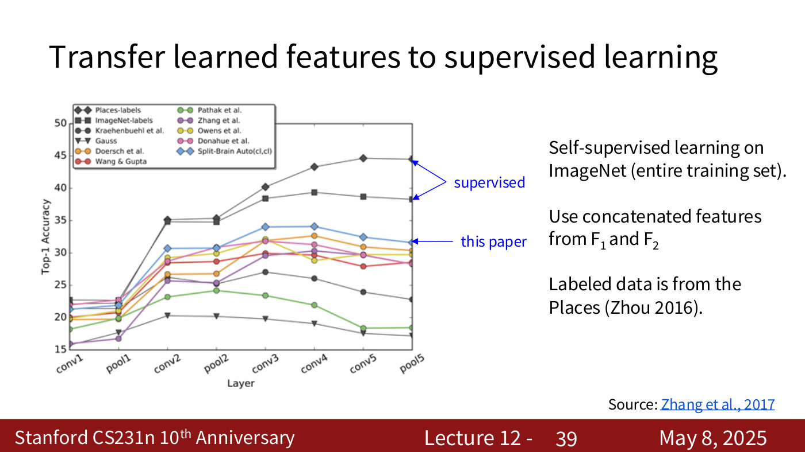

Left: a line chart. Y axis: "Top-1 Accuracy", ticks 15 to 50 in steps of 5. X axis: "Layer", categories conv1, pool1, conv2, pool2, conv3, conv4, conv5, pool5 (rotated labels). Legend (top left, two columns, 11 series): "Places-labels" (dark grey diamond), "ImageNet-labels" (dark grey square), "Kraehenbuehl et al." (dark grey circle), "Gauss" (dark grey down-triangle), "Doersch et al." (orange circle), "Wang & Gupta" (red circle), "Pathak et al." (green circle), "Zhang et al." (purple circle), "Owens et al." (yellow circle), "Donahue et al." (pink circle), "Split-Brain Auto(cl,cl)" (blue diamond).

- Places-labels: about 22 at conv1 and pool1, jumps to about 35 at conv2/pool2, then rises to about 40 (conv3), 43 (conv4), 44.5 (conv5), 44.5 (pool5). Top curve.
- ImageNet-labels: about 22 at conv1/pool1, about 35 at conv2/pool2, about 38.5 (conv3), 39.5 (conv4), 38.5 (conv5), 38 (pool5). Second curve.
- Split-Brain Auto(cl,cl) (blue): about 21 at conv1, 22 (pool1), 30.5 (conv2), 30.5 (pool2), 34 (conv3), 34 (conv4), 32.5 (conv5), 31.5 (pool5). Best of the self-supervised methods.
- Donahue et al. (pink), Owens et al. (yellow), Doersch et al. (orange), Wang & Gupta (red), Zhang et al. (purple): clustered between about 25 and 32 from conv2 on, mostly peaking at conv3 (about 30 to 32; Doersch et al. peaks at conv4, about 32.6) and falling to about 28 to 30.5 at pool5. Zhang et al. starts lower than the rest, at about 16 at conv1 and 16.7 at pool1.
- Pathak et al. (green): about 18 at conv1, peaking about 24 at pool2, falling to about 18.5 at conv5/pool5.
- Kraehenbuehl et al. (dark grey circle): about 22.5 at conv1, 27 at conv3, falling to about 23 at pool5.
- Gauss (down-triangle): about 16 at conv1 (its marker hidden under Zhang et al.'s), about 17.6 at pool1, about 20 at conv2 to conv3, falling to about 17 at pool5. Lowest curve from conv2 on.

(Values read by eye from the render; none are printed.) Two blue annotations: a pair of arrows from the text "supervised" pointing to the Places-labels and ImageNet-labels curves at pool5; an arrow from the text "this paper" pointing to the Split-Brain curve at pool5.

Right text:

"Self-supervised learning on ImageNet (entire training set)."

"Use concatenated features from F₁ and F₂"

"Labeled data is from the Places (Zhou 2016)."

"Source: Zhang et al., 2017" ("Zhang et al., 2017" is a hyperlink).

## Slide 40 — Pretext task: image coloring

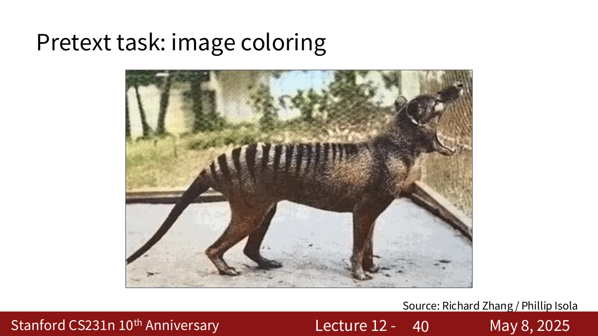

A single colour photograph, centred: a striped, dog-like animal (dark brown, stripes across its back and rump, long thin tail) standing side-on facing right on a pale concrete floor with its mouth wide open, in front of a wire fence; blurred green foliage and a pale building behind. No other text.

"Source: Richard Zhang / Phillip Isola"

## Slide 41 — Pretext task: image coloring

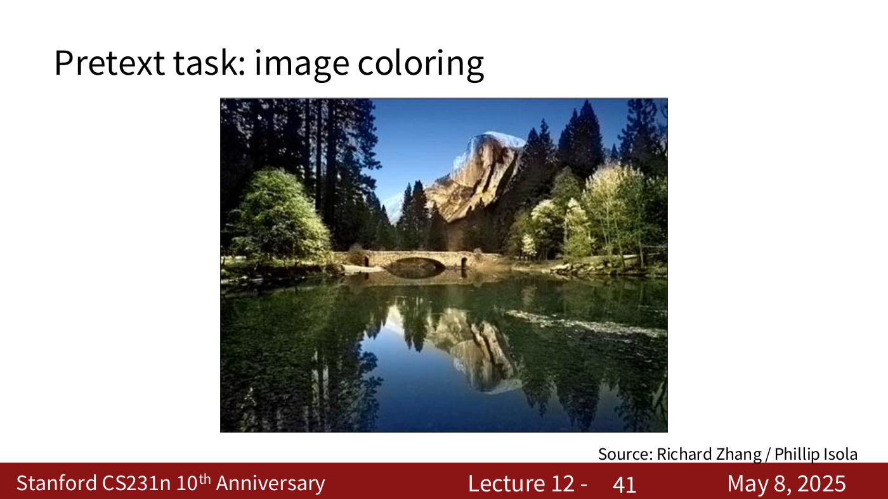

A single colour photograph, centred: a landscape of a river with a stone arch bridge in the middle distance, a pale rock-faced mountain peak behind it against a blue sky, dark conifers on both sides and a light-green deciduous tree at left; the water in the foreground mirrors the mountain and trees.

"Source: Richard Zhang / Phillip Isola"

## Slide 42 — Pretext task: video coloring

"Idea: model the temporal coherence of colors in videos"

Row of five items. Left: a colour frame captioned above "reference frame" and below "t = 0": a motor-racing scene with a red car on a track, grass at lower right, spectator stands and trees behind. To the right, under the caption "how should I color these frames?", three grayscale frames of the same scene with the car moving to the right, captioned "t = 1", "t = 2", "t = 3", followed by "…".

"Source: Vondrick et al., 2018" (hyperlink)

## Slide 43 — Pretext task: video coloring

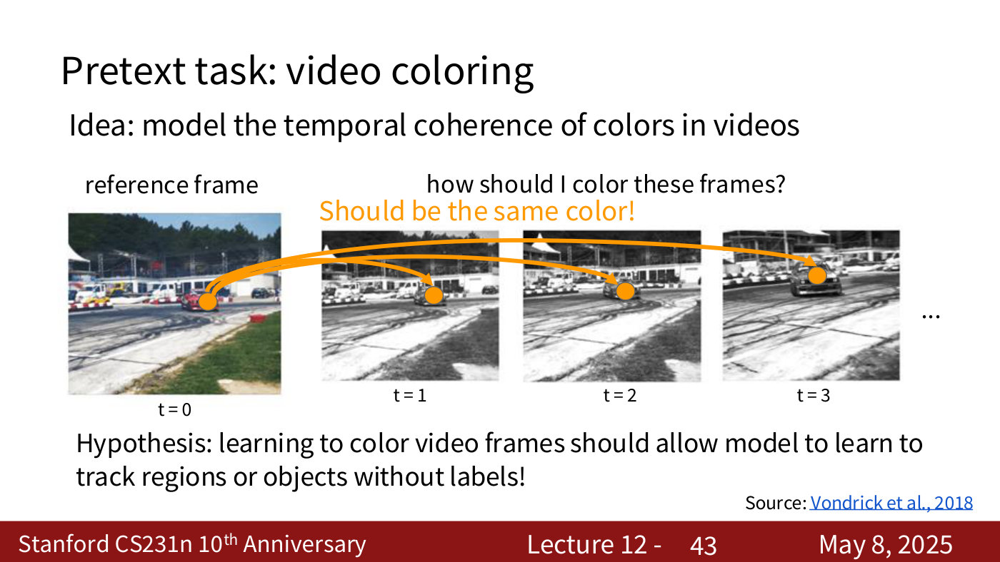

Same as slide 42, plus: an orange dot on the car in the t = 0 frame, an orange dot on the car in each of the three grayscale frames, and three orange curved arrows from the t = 0 dot to the t = 1, t = 2 and t = 3 dots, with orange text "Should be the same color!" above them. New text at the bottom:

"Hypothesis: learning to color video frames should allow model to learn to track regions or objects without labels!"

"Source: Vondrick et al., 2018"

## Slide 44 — Learning to color videos

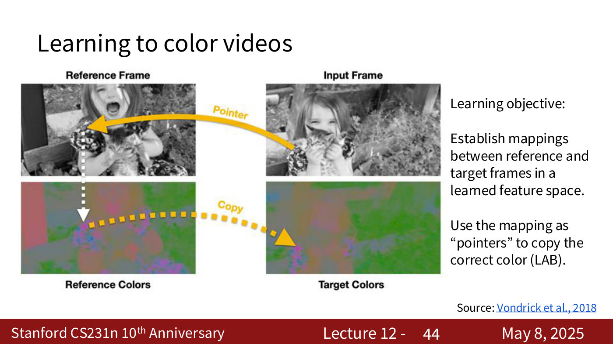

Left, a 2 x 2 image grid with column headings "Reference Frame" (left) and "Input Frame" (right). Top row: grayscale photographs of a small girl holding a kitten (reference: mouth open, kitten held at the bottom; input: face partly hidden behind the kitten, garden background). A thick yellow arrow labelled "Pointer" runs from the input frame to the reference frame. Bottom row, captioned "Reference Colors" (left) and "Target Colors" (right): blurred colour-quantised images (pink, green, grey, purple patches). A white dotted arrow runs down from a point on the girl's clothing in the reference frame to the same place in the reference colours; a yellow dotted arrow labelled "Copy" runs from there to a purple patch in the target colours, ending in a yellow triangle.

Right text:

"Learning objective:"

"Establish mappings between reference and target frames in a learned feature space."

"Use the mapping as “pointers” to copy the correct color (LAB)."

"Source: Vondrick et al., 2018"

## Slide 45 — Learning to color videos

Diagram in two rows, labelled at their left "Reference Frame" (top) and "Target Frame" (bottom). Only two columns carry headings, "Grayscale Video" and "Embeddings"; a third column holds two colour panels, labelled to their right. Row 1: a grey square containing a grey circle (lower left) and a dark triangle (upper right) with an arrow to a dark-grey trapezoid labelled "CNN" (wide on the left, narrowing to the right), an arrow to a grid-textured embedding square with the same circle and triangle, the triangle labelled $f_{i}$. Row 2: the same, target frame with the circle at the left and the triangle lower right; the CNN has the same shape; its embedding square shows the triangle labelled $f_{j}$. A yellow curved arrow runs from $f_{j}$ (target embedding) up to $f_{i}$ (reference embedding). Right column: top panel, labelled "Reference Colors" at its right, with a red circle and a blue triangle labelled $c_{i}$; bottom panel, labelled "Predicted Colors" at its right, with a red circle and a blue triangle labelled $y_{j}$; a dotted yellow arrow runs from $c_{i}$ down to $y_{j}$.

Below, left: caption "attention map on the reference frame" and

$$A_{ij} = \frac{\exp\left(f_{i}^{T} f_{j}\right)}{\sum_{k} \exp\left(f_{k}^{T} f_{j}\right)}$$

"Source: Vondrick et al., 2018"

## Slide 46 — Learning to color videos

Same as slide 45, plus a second caption in the middle bottom: "predicted color = weighted sum of the reference color" with

$$y_{j} = \sum_{i} A_{ij} c_{i}$$

"Source: Vondrick et al., 2018"

## Slide 47 — Learning to color videos

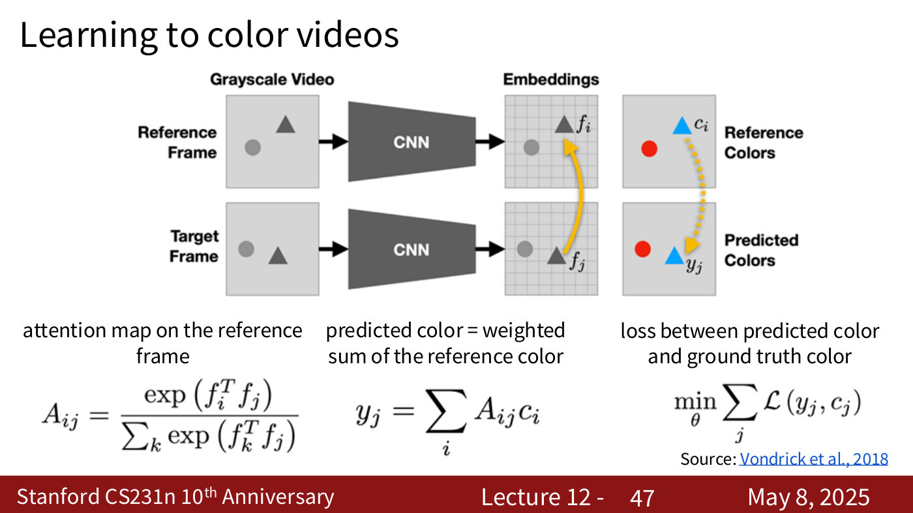

Same as slide 46, plus a third caption at bottom right: "loss between predicted color and ground truth color" with

$$\min_{\theta} \sum_{j} \mathcal{L}\left(y_{j}, c_{j}\right)$$

"Source: Vondrick et al., 2018"

## Slide 48 — Colorizing video (qualitative)

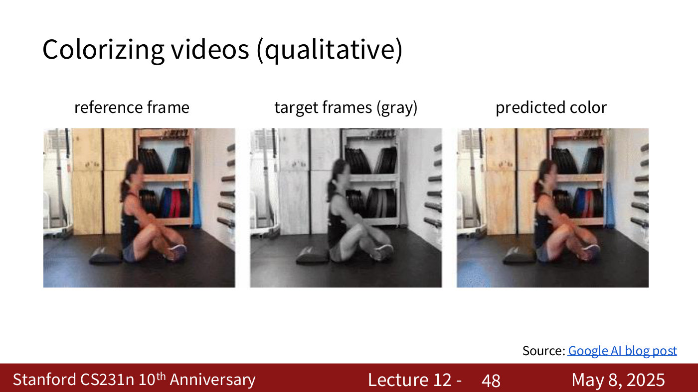

Heading as printed: "Colorizing videos (qualitative)". Three images side by side with captions above: "reference frame", "target frames (gray)", "predicted color". Each shows a woman with a ponytail in dark sportswear sitting on a black gym mat, knees drawn up, in front of wooden cabinets and weight plates on a rack. The reference and predicted-color images are in colour (wood tan, red and blue plates); the middle one is grayscale. The predicted colour looks close to the reference.

"Source: Google AI blog post" (hyperlink)

## Slide 49 — Colorizing video (qualitative)

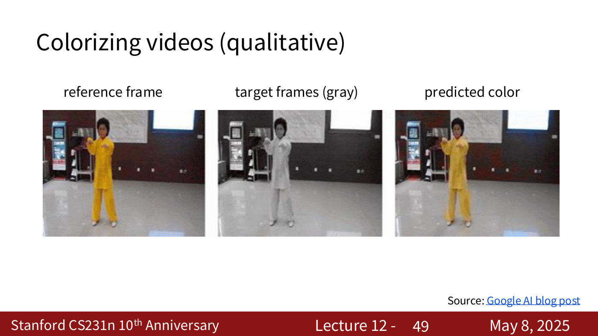

Heading as printed: "Colorizing videos (qualitative)". Same layout as slide 48 with captions "reference frame", "target frames (gray)", "predicted color". Each image shows a person in a bright yellow martial-arts outfit standing in a hall with a white tiled floor, a dark wall and a window at upper right. Reference and predicted images are in colour with a yellow outfit; the middle one is grayscale.

"Source: Google AI blog post"

## Slide 50 — Tracking emerges from colorization

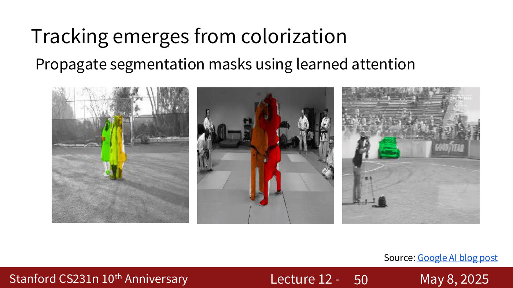

"Propagate segmentation masks using learned attention"

Three video frames side by side (grayscale backgrounds, coloured overlays). Left: two people standing close on grass, overlaid in green and yellow-orange masks. Middle: two people in a judo/martial-arts hold on a mat, one overlaid in orange and one in red, other people sitting around. Right: a green mask on a small car in front of a grandstand with "GOOD YEAR" signage visible; a person with a camera tripod stands at left.

"Source: Google AI blog post"

## Slide 51 — Tracking emerges from colorization

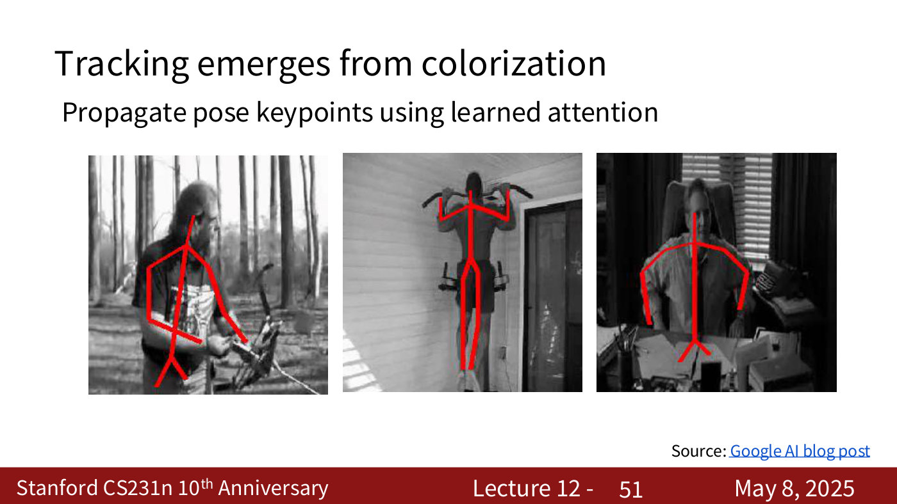

"Propagate pose keypoints using learned attention"

Three grayscale frames, each with a red stick-figure skeleton overlaid on a person. Left: a bearded man in a forest holding an object (apparent bow), skeleton with head, torso and limbs. Middle: a man doing a pull-up on a bar against a white wall, skeleton with raised arms. Right: a man seated at a desk by a window with blinds, skeleton with arms down.

"Source: Google AI blog post"

## Slide 52 — Masked Auto Encoders (MAE)

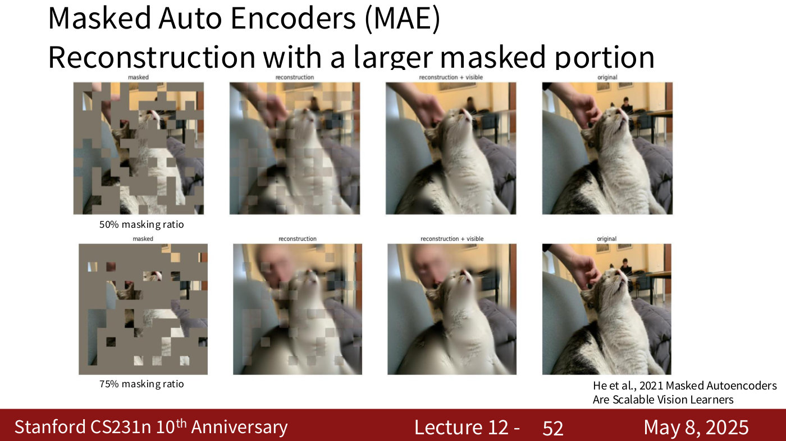

Title as printed on two lines: "Masked Auto Encoders (MAE)" / "Reconstruction with a larger masked portion". Image grid, 2 rows x 4 columns, tiny column labels over each image: "masked", "reconstruction", "reconstruction + visible", "original". All images show the same photograph: a grey-and-white cat looking up while a hand strokes its head, with a blurred room behind. Row 1: masked image with about half the patches replaced by flat grey-brown, then the blurry reconstruction, the reconstruction with the visible patches pasted in, and the original; caption under the first image: "50% masking ratio". Row 2: same, with most patches masked (few patches visible); caption under the first image: "75% masking ratio". The row 2 reconstructions are blurrier, and a face-like blur appears at the top left of the reconstruction.

"He et al., 2021 Masked Autoencoders Are Scalable Vision Learners"

## Slide 53 — Masked Auto Encoders (MAE)

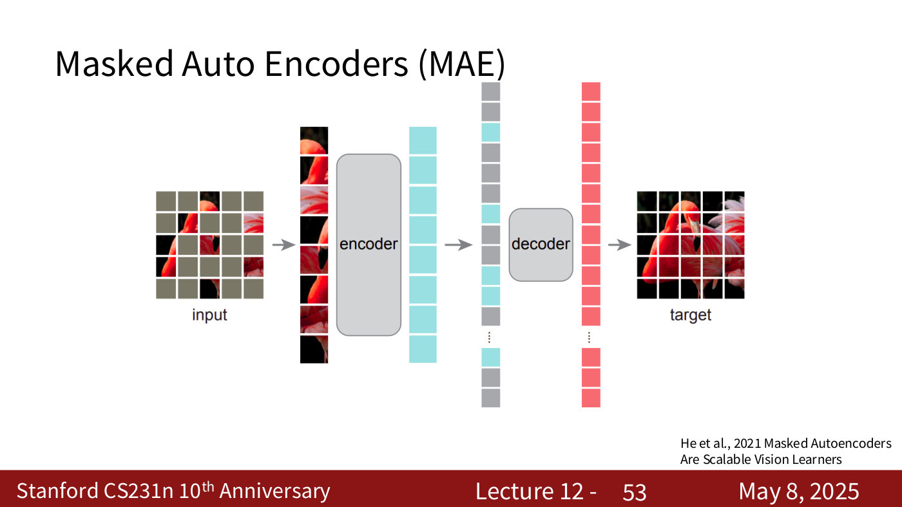

Diagram, left to right: "input" (a 5 x 5 grid of patches of a red flamingo image: 8 of the 25 patches show image content and 17 are flat grey-brown masked patches) with an arrow to a vertical stack of the 8 visible patches only, an arrow into a rounded grey box "encoder", an arrow from it to a vertical stack of 8 light-cyan boxes (one per visible patch). An arrow then leads to a longer vertical column mixing grey boxes and cyan boxes, drawn as 15 boxes (5 cyan, 10 grey) with a "⋮" near the bottom (12 boxes above it, 3 below); no label names the grey boxes. It leads into a rounded grey box "decoder", then a column of 15 salmon-red boxes (also with "⋮") and an arrow to "target": the 5 x 5 flamingo image reconstructed in full. Caption under the right image: "target"; under the left: "input".

"He et al., 2021 Masked Autoencoders Are Scalable Vision Learners"

## Slide 54 — Masking Methos

Title printed as "Masking Methos" (sic). Top right: the MAE architecture diagram from slide 53 (small), captioned "Figure 6. MAE architecture from the paper". Bullets:

- "Similar to the original ViT, divide the input into non-overlapping patches."
- "Uniformly sample a very large proportion (75%) of these patches and mask them" ("very large", "proportion" underlined)
- "Masking a high ratio makes predicting the task challenging and meaningful." (underlined: "Masking a high ratio", "challenging and meaningful.")
- "Also, not using mask tokens and picking a high sampling ratio (masking most of the image, e.g., 75%, and sampling a small visible portion, e.g., 25%, to feed into the encoder) enables the encoder to be very large."

"He et al., 2021 Masked Autoencoders Are Scalable Vision Learners"

## Slide 55 — MAE Encoder

Top right: the small MAE diagram with caption "Figure 6. MAE architecture from the paper". Bullets:

- "The encoder only operates on unmasked patches (25%)"
- "Embeds the patches by linear projection and add positional embeddings"
- "Uses transformer blocks"
- "Since the input patches are a small part of the input, the encoder is chosen to be very large. (encoder has over 9 times computations per token vs decoder)" (underlined: "very large", "over 9 times")

"He et al., 2021 Masked Autoencoders Are Scalable Vision Learners"

## Slide 56 — MAE Decoder

Top right: the small MAE diagram with caption "Figure 6. MAE architecture from the paper". Bullets:

- "Merges the encoder outputs with the shared mask tokens in previously masked places, adding positional encodings to them." ("shared mask tokens" underlined)
- "Uses transformer blocks, followed by a linear projection for finalizing pixel reconstruction."
- "Is solely responsible for reconstruction, meaning it is not used post-training. Hence, it is independent of the encoder design, making it flexible (unlike traditional AEs or UNet). This is an asymmetrical autoencoder design." ("not used post-training" underlined; "asymmetrical" in red)

"He et al., 2021 Masked Autoencoders Are Scalable Vision Learners"

## Slide 57 — Reconstruction

- "The MSE (mean squared error loss) in the pixel space between the input image and the reconstructed image is adopted." ("MSE (mean squared error loss) in the pixel space" underlined)
- "Loss is only computed for masked patches" ("only computed for masked patches" underlined)

"He et al., 2021 Masked Autoencoders Are Scalable Vision Learners"

## Slide 58 — Linear Probing vs Full Fine-tuning

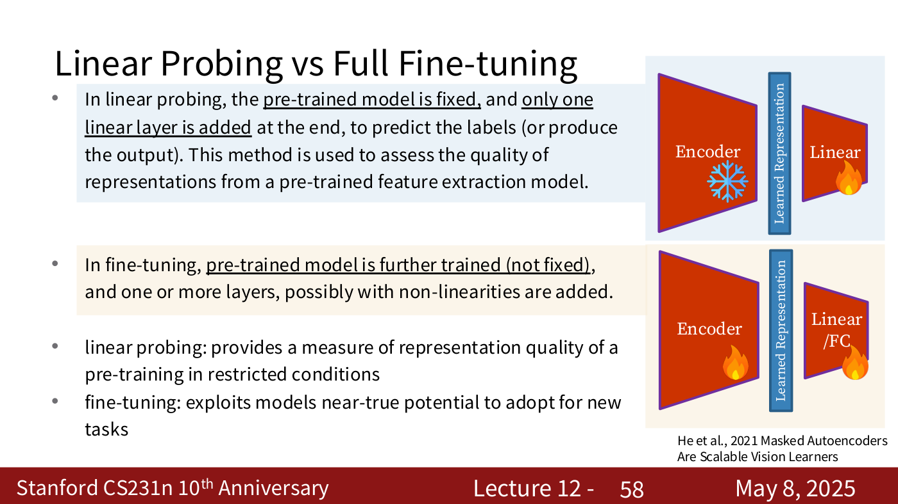

Left bullets, with text blocks on pale blue (first bullet) and pale beige (second bullet) backgrounds:

- "In linear probing, the pre-trained model is fixed, and only one linear layer is added at the end, to predict the labels (or produce the output). This method is used to assess the quality of representations from a pre-trained feature extraction model." ("pre-trained model is fixed," and "only one linear layer is added" underlined)
- "In fine-tuning, pre-trained model is further trained (not fixed), and one or more layers, possibly with non-linearities are added." ("pre-trained model is further trained (not fixed)" underlined)
- "linear probing: provides a measure of representation quality of a pre-training in restricted conditions"
- "fine-tuning: exploits models near-true potential to adopt for new tasks"

Right, two diagrams on matching backgrounds. Top (pale blue): an orange-red trapezoid "Encoder" (wide on the left, narrowing to the right) with a snowflake icon (frozen), then a thin blue vertical bar labelled "Learned Representation", then a smaller orange-red trapezoid "Linear" with a flame icon (trained). Bottom (beige): the same layout, but "Encoder" carries a flame icon and the last box is labelled "Linear /FC" with a flame icon.

"He et al., 2021 Masked Autoencoders Are Scalable Vision Learners"

## Slide 59 — Ablation Studies

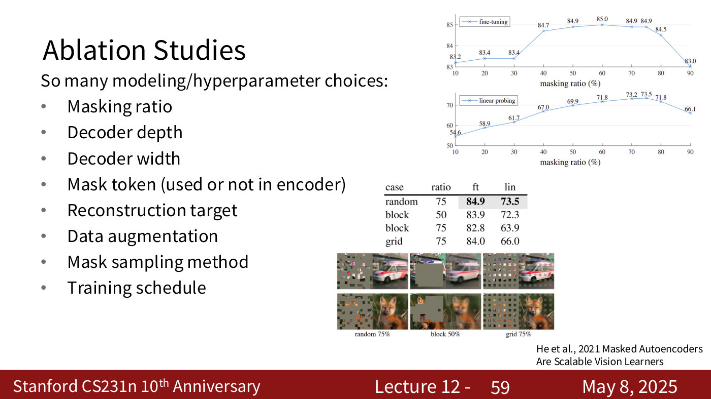

Left text: "So many modeling/hyperparameter choices:" then bullets: "Masking ratio", "Decoder depth", "Decoder width", "Mask token (used or not in encoder)", "Reconstruction target", "Data augmentation", "Mask sampling method", "Training schedule" (8 bullets).

Top right: two small line charts from the paper, each with X axis "masking ratio (%)" with ticks 10 to 90 in steps of 10, and one series ("x" markers, blue line) with printed value labels at 10 points (10, 20, 30, 40, 50, 60, 70, 75, 80, 90, the 75 point sitting between 70 and 80).

- Upper chart, legend "fine-tuning", Y ticks 83, 84, 85. Printed values in order: 83.2, 83.4, 83.4, 84.7, 84.9, 85.0, 84.9, 84.9, 84.5, 83.0 (peak 85.0 at 60).
- Lower chart, legend "linear probing", Y ticks 50, 60, 70. Printed values in order: 54.6, 58.9, 61.7, 67.0, 69.9, 71.8, 73.2, 73.5, 71.8, 66.1 (peak 73.5 at 75).

Middle right: a table (header row as printed):

| case | ratio | ft | lin |
| --- | --- | --- | --- |
| random | 75 | 84.9 | 73.5 |
| block | 50 | 83.9 | 72.3 |
| block | 75 | 82.8 | 63.9 |
| grid | 75 | 84.0 | 66.0 |

(The 84.9 and 73.5 cells of the "random" row are shaded grey and bold.)

Below the table, an image grid of 2 rows x 3 columns of small images: top row an ambulance (white and red van) and bottom row a fox; columns are three masking styles, captioned under the bottom row "random 75%", "block 50%", "grid 75%". Each of the six cells is a pair: the masked input (left) next to the model's reconstruction (right). The masking styles are scattered patches, a large contiguous block removed, and a regular grid pattern of small visible patches.

"He et al., 2021 Masked Autoencoders Are Scalable Vision Learners"

## Slide 60 — Masked Autoencoder – Comparisons

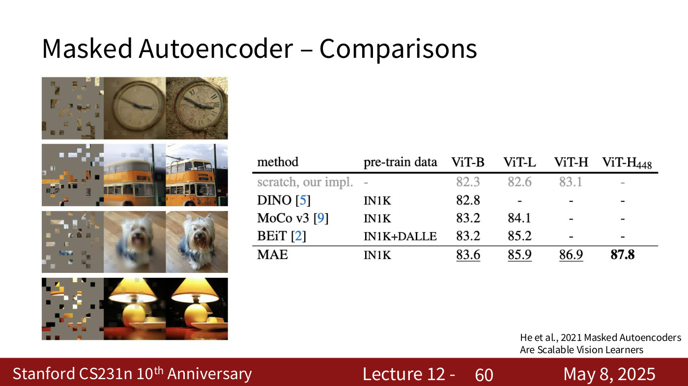

Left: an image grid of 4 rows x 3 columns, each row one example: masked input (grey-brown with a few visible patches), the reconstruction, and the original. Rows: a round clock on a stone wall; an orange-and-white double-decker bus; a Yorkshire terrier dog on a wooden floor; a yellow lamp on a plate on a dark background.

Right: a table (header row as printed; $\text{ViT-H}_ {448}$ last column):

| method | pre-train data | ViT-B | ViT-L | ViT-H | $\text{ViT-H}_ {448}$ |
| --- | --- | --- | --- | --- | --- |
| scratch, our impl. (grey text) | - | 82.3 | 82.6 | 83.1 | - |
| DINO [5] | IN1K | 82.8 | - | - | - |
| MoCo v3 [9] | IN1K | 83.2 | 84.1 | - | - |
| BEiT [2] | IN1K+DALLE | 83.2 | 85.2 | - | - |
| MAE | IN1K | 83.6 | 85.9 | 86.9 | 87.8 |

(MAE row values 83.6, 85.9, 86.9 are underlined; 87.8 is bold. A horizontal rule separates the MAE row from the rows above. Citation numbers [5], [9], [2] are blue.)

"He et al., 2021 Masked Autoencoders Are Scalable Vision Learners"

## Slide 61 — Summary: pretext tasks from image transformations

- "Pretext tasks focus on “visual common sense”, e.g., predict rotations, inpainting, rearrangement, and colorization."
- "The models are forced learn good features about natural images, e.g., semantic representation of an object category, in order to solve the pretext tasks."
- "We often do not care about the performance of these pretext tasks, but rather how useful the learned features are for downstream tasks (classification, detection, segmentation)."

## Slide 62 — Summary: pretext tasks from image transformations

Same as slide 61, plus a fourth bullet in red: "Problems: 1) coming up with individual pretext tasks is tedious, and 2) the learned representations may not be general."

## Slide 63 — Pretext tasks from image transformations

Four images in a row, each with a caption below, all based on a seated tabby cat: "image completion" (bottom part of the cat photo with a light-grey box with "?" above it); "rotation prediction" (the cat image rotated about 30 degrees, with a blue vertical arrow and a green arrow tilted to the right, a green arc between them and the text "θ=?"); "“jigsaw puzzle”" (four patches of the cat photo in a 2 x 2 arrangement with gaps: top-left cat face, top-right a patch of wall, bottom-left body, bottom-right a narrow body strip); "colorization" (a grayscale version of the cat photo).

Below, red text: "Learned representations may be tied to a specific pretext task!" and blue text: "Can we come up with a more general pretext task?"

## Slide 64 — A more general pretext task?

Same four images as slide 63 (without captions), plus: a colour copy of the cat photo at the bottom centre, with the green text "same object" to its left, and four green double-headed arrows from it to the image-completion image, the rotated image, the jigsaw patches and the grayscale image.

## Slide 65 — A more general pretext task?

Same as slide 64, plus: a photograph of a brown puppy at bottom right, a red double-headed arrow between the cat photo and the puppy, and red text "different object" below the arrow.

## Slide 66 — Contrastive Representation Learning

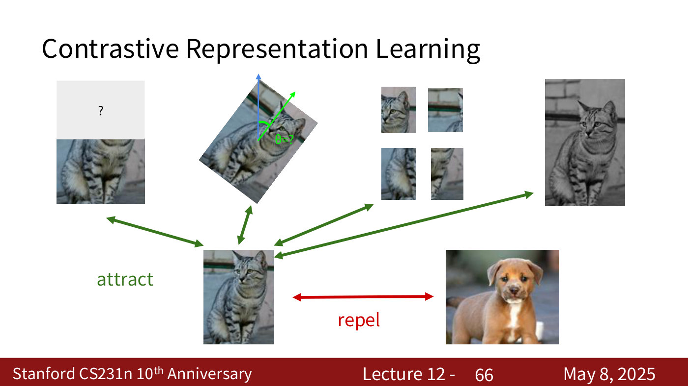

Same as slide 65 but with the title "Contrastive Representation Learning" and the labels changed: the green "same object" label becomes "attract" and the red "different object" label becomes "repel".

## Slide 67 — Today's Agenda

Agenda with the first two groups greyed out and the third at full contrast:

Greyed: "Pretext tasks from image transformations" (bold heading) with bullets "Rotation, inpainting, rearrangement, coloring" and "Reconstruction-based learning (MAE)".

Active: "Contrastive representation learning" (bold) with bullets "Intuition and formulation", "Instance contrastive learning: SimCLR and MOCO", "Sequence contrastive learning: CPC", "Self-Distillation Without Labels, DINO".

(Title printed with a curly apostrophe: "Today’s Agenda".)

## Slide 68 — Contrastive Representation Learning

Same as slide 66 (identical figure and labels "attract" and "repel").

## Slide 69 — Contrastive Representation Learning

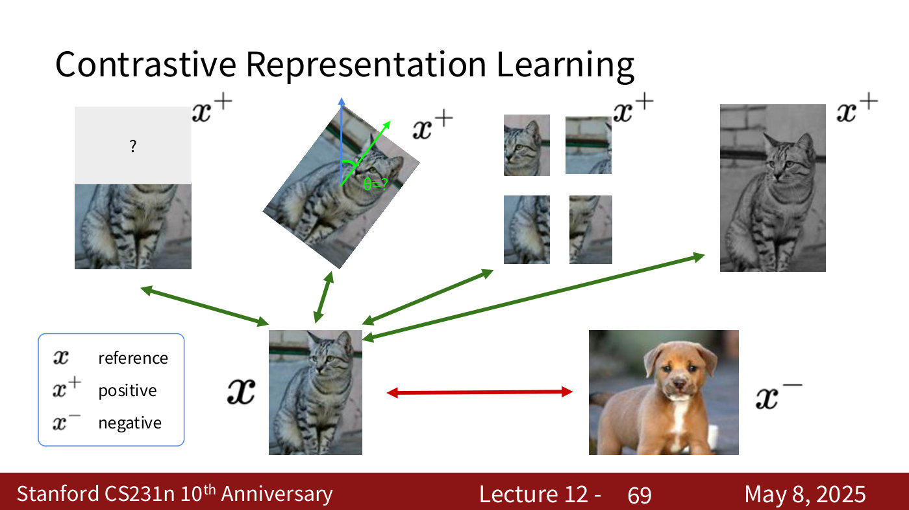

Same figure as slide 68, with the "attract" and "repel" labels removed and these added: the notation $x^{+}$ at the top right of each of the four transformed images (image completion, rotation, jigsaw, grayscale), $x$ to the left of the bottom cat image, and $x^{-}$ to the right of the puppy. A rounded blue-bordered legend box at bottom left reads: $x$ "reference", $x^{+}$ "positive", $x^{-}$ "negative".

## Slide 70 — A formulation of contrastive learning

"What we want:"

$$\text{score}(f(x), f(x^{+})) \gg \text{score}(f(x), f(x^{-}))$$

"x: reference sample; x⁺ positive sample; x⁻ negative sample"

"Given a chosen score function, we aim to learn an encoder function f that yields high score for positive pairs (x, x⁺) and low scores for negative pairs (x, x⁻)."

## Slide 71 — A formulation of contrastive learning

"Loss function given 1 positive sample and N - 1 negative samples:"

$$L = -\mathbb{E}_ {X}\left[\log \frac{\exp(s(f(x), f(x^{+})))}{\exp(s(f(x), f(x^{+}))) + \sum_ {j=1}^{N-1} \exp(s(f(x), f(x^{-}_ {j})))}\right]$$

## Slide 72 — A formulation of contrastive learning

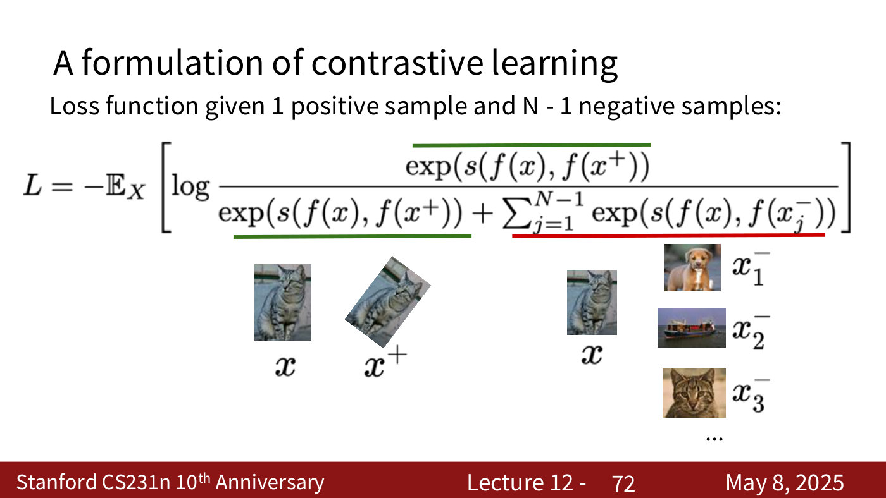

Same as slide 71, plus: a green line over the numerator and a green line under the first term of the denominator, $\exp(s(f(x), f(x^{+})))$; a red line under the sum over the negatives in the denominator. Below, two small picture groups: left, a cat image labelled $x$ and a rotated copy of the cat labelled $x^{+}$; right, the cat image labelled $x$ beside a column of three images labelled $x^{-}_ {1}$ (a puppy), $x^{-}_ {2}$ (a boat) and $x^{-}_ {3}$ (a different tabby cat's face), followed by "…".

## Slide 73 — A formulation of contrastive learning

Same formula and underlines as slide 72 (the cat images removed), plus labels: green "score for the positive pair" under the green line, red "score for the N-1 negative pairs" under the red line, and the text "This seems familiar …"

## Slide 74 — A formulation of contrastive learning

Same as slide 73, plus two lines under "This seems familiar …":

"Cross entropy loss for a N-way softmax classifier!"
"I.e., learn to find the positive sample from the N samples"

## Slide 75 — A formulation of contrastive learning

"Loss function given 1 positive sample and N - 1 negative samples:"

$$L = -\mathbb{E}_ {X}\left[\log \frac{\exp(s(f(x), f(x^{+})))}{\exp(s(f(x), f(x^{+}))) + \sum_ {j=1}^{N-1} \exp(s(f(x), f(x^{-}_ {j})))}\right]$$

"Commonly known as the InfoNCE loss (van den Oord et al., 2018)" (citation is a hyperlink)
"A lower bound on the mutual information between f(x) and f(x⁺)"

$$MI[f(x), f(x^{+})] - \log(N) \geq -L$$

"The larger the negative sample size (N), the tighter the bound"

"Detailed derivation: Poole et al., 2019" (hyperlink)

## Slide 76 — SimCLR: A Simple Framework for Contrastive Learning

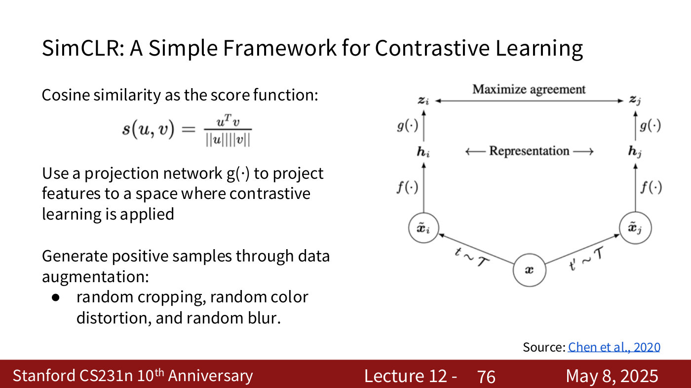

Left text:

"Cosine similarity as the score function:"

$$s(u, v) = \frac{u^{T} v}{||u|| ||v||}$$

"Use a projection network g(·) to project features to a space where contrastive learning is applied"

"Generate positive samples through data augmentation:"
- "random cropping, random color distortion, and random blur."

Right: a diagram. At the bottom, a circle $\boldsymbol{x}$ with two arrows going up-left and up-right, labelled $t \sim \mathcal{T}$ (left) and $t' \sim \mathcal{T}$ (right), to circles $\tilde{\boldsymbol{x}}_ {i}$ and $\tilde{\boldsymbol{x}}_ {j}$. From each, an upward arrow labelled $f(\cdot)$ leads to $\boldsymbol{h}_ {i}$ and $\boldsymbol{h}_ {j}$, with a horizontal double arrow between them labelled "Representation". Another upward arrow labelled $g(\cdot)$ in each branch leads to $\boldsymbol{z}_ {i}$ and $\boldsymbol{z}_ {j}$, with a horizontal double arrow between them labelled "Maximize agreement".

"Source: Chen et al., 2020" (hyperlink)

## Slide 77 — SimCLR: generating positive samples from data augmentation

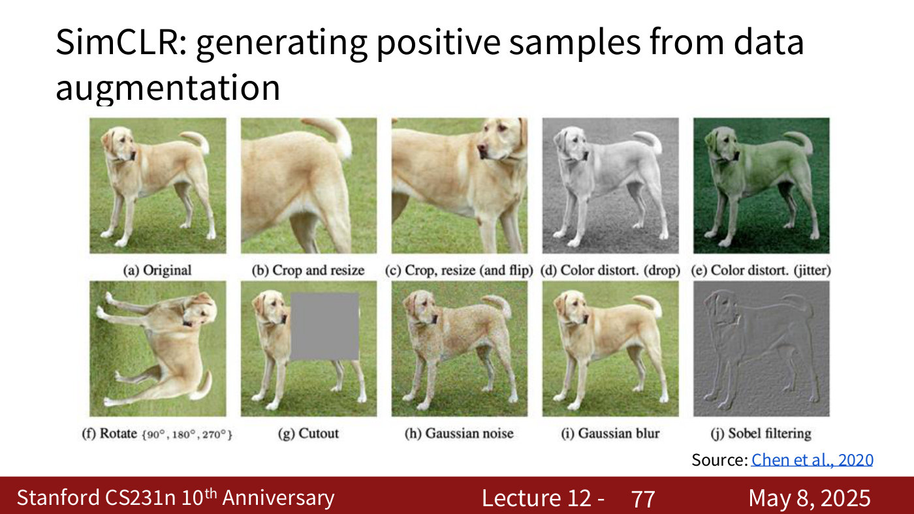

A grid of 10 images, 2 rows x 5 columns, all of the same photograph of a yellow Labrador-like dog standing on grass, shown under different augmentations. Captions printed under each:

- Row 1: "(a) Original" (the full dog, facing left), "(b) Crop and resize" (a zoomed crop of the dog's rear and tail), "(c) Crop, resize (and flip)" (a crop of the dog's head and front, flipped so it faces right), "(d) Color distort. (drop)" (greyscale version), "(e) Color distort. (jitter)" (a green-tinted, darker version).
- Row 2: "(f) Rotate {90°, 180°, 270°}" (the dog rotated so it lies sideways), "(g) Cutout" (the dog with a grey square covering its middle/back), "(h) Gaussian noise" (a grainy version), "(i) Gaussian blur" (a slightly blurred version), "(j) Sobel filtering" (a grey edge-map, embossed look).

Credit: "Source: Chen et al., 2020" (hyperlinked).

## Slide 78 — SimCLR

Left: the title "SimCLR" and, in blue text, "Generate a positive pair by sampling data augmentation functions", with three blue arrows pointing at three blue-boxed lines of the algorithm at the right. Centre: a pasted image of the paper's algorithm box. Top right, in red: "*We use a slightly different formulation in the assignment. You should follow the assignment instructions."

The algorithm image reads:

"Algorithm 1 SimCLR's main learning algorithm."

- "input: batch size $N$, constant $\tau$, structure of $f$, $g$, $\mathcal{T}$."
- "for sampled minibatch $\lbrace \boldsymbol{x}_ {k} \rbrace_ {k=1}^{N}$ do"
- "for all $k \in \lbrace 1, \ldots, N \rbrace$ do"
- "draw two augmentation functions $t \sim \mathcal{T}$, $t' \sim \mathcal{T}$" (boxed in blue)
- "# the first augmentation"
- $\tilde{\boldsymbol{x}}_ {2k-1} = t(\boldsymbol{x}_ {k})$ (boxed in blue)
- $\boldsymbol{h}_ {2k-1} = f(\tilde{\boldsymbol{x}}_ {2k-1})$ with comment "# representation"
- $\boldsymbol{z}_ {2k-1} = g(\boldsymbol{h}_ {2k-1})$ with comment "# projection"
- "# the second augmentation"
- $\tilde{\boldsymbol{x}}_ {2k} = t'(\boldsymbol{x}_ {k})$ (boxed in blue)
- $\boldsymbol{h}_ {2k} = f(\tilde{\boldsymbol{x}}_ {2k})$ "# representation"
- $\boldsymbol{z}_ {2k} = g(\boldsymbol{h}_ {2k})$ "# projection"
- "end for"
- "for all $i \in \lbrace 1, \ldots, 2N \rbrace$ and $j \in \lbrace 1, \ldots, 2N \rbrace$ do"
- $s_ {i,j} = \boldsymbol{z}_ {i}^{\top} \boldsymbol{z}_ {j} / (\lVert \boldsymbol{z}_ {i} \rVert \lVert \boldsymbol{z}_ {j} \rVert)$ with comment "# pairwise similarity"
- "end for"
- "define $\ell(i,j)$ as $\ell(i,j) = -\log \frac{\exp(s_ {i,j}/\tau)}{\sum_ {k=1}^{2N} \mathbb{1}_ {[k \neq i]} \exp(s_ {i,k}/\tau)}$"
- $\mathcal{L} = \frac{1}{2N} \sum_ {k=1}^{N} \left[ \ell(2k-1, 2k) + \ell(2k, 2k-1) \right]$
- "update networks $f$ and $g$ to minimize $\mathcal{L}$"
- "end for"
- "return encoder network $f(\cdot)$, and throw away $g(\cdot)$"

Credit: "Source: Chen et al., 2020".

## Slide 79 — SimCLR

Same as slide 78, plus: a blue box around the definition of $\ell(i,j)$ (the InfoNCE loss line) with a blue arrow from new blue text at lower right: "InfoNCE loss:" / "Use all non-positive samples in the batch as x⁻" (printed "x" with a superscript minus).

## Slide 80 — SimCLR

Same as slide 79, plus: new blue text at lower left, "Iterate through and use each of the 2N sample as reference, compute average loss", with a blue arrow to the line defining $\mathcal{L}$.

## Slide 81 — SimCLR: mini-batch training

Title "SimCLR: mini-batch training". Top right, the formula
$$s_ {i,j} = \frac{z_ {i}^{T} z_ {j}}{\lVert z_ {i} \rVert \thinspace \lVert z_ {j} \rVert}$$
with the label "“Affinity matrix”" under it.

Diagram, left to right: two stacks of 5 slanted rectangles each (top stack grey, bottom stack green), with the caption "list of positive pairs" under the top stack. Each stack has an arrow into a rounded pale-green box labelled "encoder" (two encoder boxes, one above the other). Curved arrows from both encoders point into one row of 10 thin vertical bars alternating grey, green, grey, green, ... (grey first, green last), labelled above $\mathbf{z} \in \mathbb{R}^{2N \times D}$, with the caption beneath "Each 2k and 2k + 1 element is a positive pair". An arrow from this row leads to an empty square grid, 6 x 6 cells, with "2N" printed to the right (vertical side) and "2N" below (horizontal side).

Bottom, red: "*We use a slightly different formulation in the assignment. You should follow the assignment instructions."

*[Ed: the drawing is not self-consistent in size: the two stacks of 5 inputs give a row of 10 vectors (2N = 10), but the affinity matrix, also labelled 2N on each side, is drawn as 6 x 6 cells. Slide 82's six blue cells fit the 6 x 6 grid (three positive pairs). Transcribed as drawn.]*

## Slide 82 — SimCLR: mini-batch training

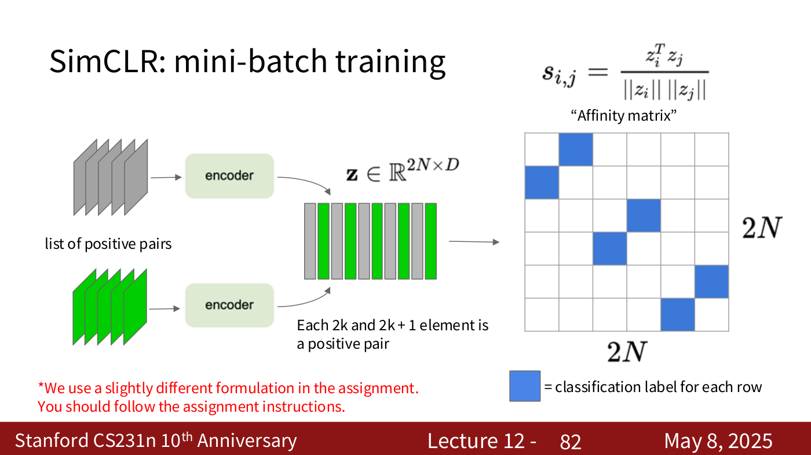

Same as slide 81, plus: six cells of the 6 x 6 grid are filled blue, one per row: (row 1, col 2), (row 2, col 1), (row 3, col 4), (row 4, col 3), (row 5, col 6), (row 6, col 5), i.e. each row's blue cell is at its positive partner's column and none on the diagonal. A legend at lower right: a blue square followed by "= classification label for each row".

## Slide 83 — Training linear classifier on SimCLR features

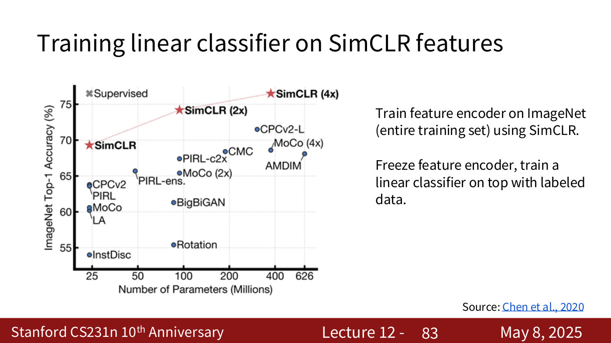

Left: a scatter plot. Y axis: "ImageNet Top-1 Accuracy (%)", ticks 55, 60, 65, 70, 75. X axis: "Number of Parameters (Millions)", ticks 25, 50, 100, 200, 400, 626 (a log-like spacing). Light dotted gridlines. A legend entry at top left: grey cross "Supervised" (at about 76 on y, no specific x). Red stars (three) joined by a red dotted line: "SimCLR" (at x = 25, y about 69.3), "SimCLR (2x)" (x = about 94, y about 74.2), "SimCLR (4x)" (x = about 375, y about 76.5). Blue dots with labels (approximate): "CPCv2-L" (about 305, 71.5), "MoCo (4x)" (about 375, 68.6), "AMDIM" (about 626, 68.1), "CMC" (about 190, 68.4), "PIRL-c2x" (about 94, 67.4), "MoCo (2x)" (about 94, 65.4), "PIRL-ens." (about 50, 65.7), "CPCv2" (25, about 63.8), "PIRL" (25, about 63.6), "MoCo" (25, about 60.6), "LA" (25, about 60.2), "BigBiGAN" (about 86, 61.3), "Rotation" (about 86, 55.4), "InstDisc" (25, about 54). Positions are read off the plot.

Right text: "Train feature encoder on ImageNet (entire training set) using SimCLR." / "Freeze feature encoder, train a linear classifier on top with labeled data."

Credit: "Source: Chen et al., 2020".

## Slide 84 — Semi-supervised learning on SimCLR features

Left: a pasted table from the paper. Columns: "Method", "Architecture", then "Label fraction" spanning "1%" and "10%", with the sub-header "Top 5".

| Method | Architecture | 1% | 10% |
| --- | --- | --- | --- |
| Supervised baseline | ResNet-50 | 48.4 | 80.4 |
| *Methods using other label-propagation:* | | | |
| Pseudo-label | ResNet-50 | 51.6 | 82.4 |
| VAT+Entropy Min. | ResNet-50 | 47.0 | 83.4 |
| UDA (w. RandAug) | ResNet-50 | - | 88.5 |
| FixMatch (w. RandAug) | ResNet-50 | - | 89.1 |
| S4L (Rot+VAT+En. M.) | ResNet-50 (4×) | - | 91.2 |
| *Methods using representation learning only:* | | | |
| InstDisc | ResNet-50 | 39.2 | 77.4 |
| BigBiGAN | RevNet-50 (4×) | 55.2 | 78.8 |
| PIRL | ResNet-50 | 57.2 | 83.8 |
| CPC v2 | ResNet-161(∗) | 77.9 | 91.2 |
| SimCLR (ours) | ResNet-50 | 75.5 | 87.8 |
| SimCLR (ours) | ResNet-50 (2×) | 83.0 | 91.2 |
| SimCLR (ours) | ResNet-50 (4×) | **85.8** | **92.6** |

The last three SimCLR rows are enclosed in a red rounded rectangle. Caption under the table: "Table 7. ImageNet accuracy of models trained with few labels."

Right text: "Train feature encoder on ImageNet (entire training set) using SimCLR." / "Finetune the encoder with 1% / 10% of labeled data on ImageNet."

Credit: "Source: Chen et al., 2020".

## Slide 85 — SimCLR design choices: projection head

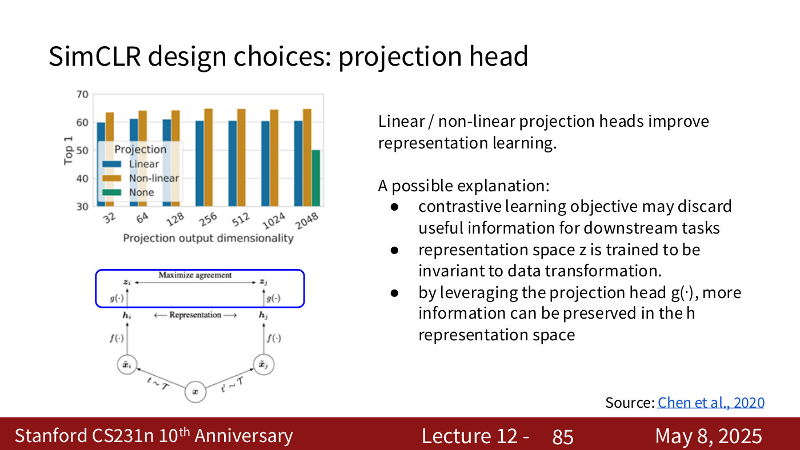

Top left: a grouped bar chart. Y axis "Top 1", ticks 30, 40, 50, 60, 70 (axis starts at 30). X axis "Projection output dimensionality" with 7 groups: 32, 64, 128, 256, 512, 1024, 2048. Legend "Projection": "Linear" (blue), "Non-linear" (orange), "None" (green). Bars (approximate): Linear is about 60 to 61 in every group; Non-linear is about 63.5 to 65 in every group (about 63.5 at 32, about 65 at 256 and above); "None" (green) appears only in the 2048 group at about 50. So 3 series; Linear and Non-linear in all 7 groups, None in one group only.

Below the chart: a small diagram from the paper. At the bottom a circle $\boldsymbol{x}$; two arrows labelled $t \sim \mathcal{T}$ and $t' \sim \mathcal{T}$ go up to circles $\tilde{\boldsymbol{x}}_ {i}$ and $\tilde{\boldsymbol{x}}_ {j}$; each goes through $f(\cdot)$ up to $\boldsymbol{h}_ {i}$ and $\boldsymbol{h}_ {j}$ (a double arrow between them labelled "← Representation →"); then through $g(\cdot)$ up to $\boldsymbol{z}_ {i}$ and $\boldsymbol{z}_ {j}$, with a double arrow labelled "Maximize agreement". The top part (the $g(\cdot)$ level with "Maximize agreement") is enclosed in a blue rounded box.

Right text: "Linear / non-linear projection heads improve representation learning." / "A possible explanation:"
- "contrastive learning objective may discard useful information for downstream tasks"
- "representation space z is trained to be invariant to data transformation."
- "by leveraging the projection head g(·), more information can be preserved in the h representation space"

Credit: "Source: Chen et al., 2020".

## Slide 86 — SimCLR design choices: large batch size

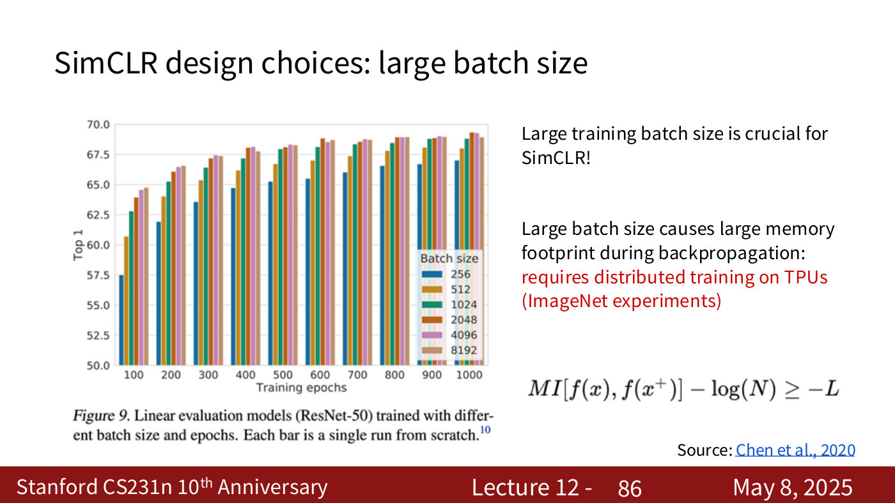

Left: a grouped bar chart. Y axis "Top 1", ticks 50.0 to 70.0 in steps of 2.5. X axis "Training epochs", 10 groups: 100, 200, 300, 400, 500, 600, 700, 800, 900, 1000. Legend "Batch size", 6 series: 256 (blue), 512 (orange), 1024 (green), 2048 (red-brown), 4096 (purple), 8192 (tan/pink). Bars rise with epochs and, mostly, with batch size (at 600 epochs 2048, about 68.8, is above 4096, about 68.5). The legend overlaps the last two groups. Approximate values: at 100 epochs, 256 is about 57.5, 512 about 60.7, 1024 about 62.8, 2048 about 63.9, 4096 about 64.6, 8192 about 64.8. At 1000 epochs, 256 is about 67, 512 about 68, 1024 about 68.8, 2048 about 69.3, 4096 about 69.3, 8192 about 69 (the largest batches level off or dip slightly at higher epochs). Values are read off the plot.

Caption: "Figure 9. Linear evaluation models (ResNet-50) trained with different batch size and epochs. Each bar is a single run from scratch.¹⁰"

Right text: "Large training batch size is crucial for SimCLR!" / "Large batch size causes large memory footprint during backpropagation:" followed in red by "requires distributed training on TPUs (ImageNet experiments)". Below, a formula: $MI[f(x), f(x^{+})] - \log(N) \geq -L$.

Credit: "Source: Chen et al., 2020".

## Slide 87 — Momentum Contrastive Learning (MoCo)

Title "Momentum Contrastive Learning (MoCo)". Left diagram (bottom to top): bottom row, $x^{\text{query}}$ at left and $x_ {0}^{\text{key}}\ x_ {1}^{\text{key}}\ x_ {2}^{\text{key}}\ \ldots$ at right (a curly brace groups the keys). An arrow goes up from $x^{\text{query}}$ into a pale-green box "encoder", then up to $q$. The keys feed a pale-blue box "momentum encoder", an arrow goes up labelled "queue" to $k_ {0}\ k_ {1}\ k_ {2}\ \ldots$. An arrow from $q$ and an arrow from the keys meet at "similarity" and then go up to "contrastive loss". The arrow coming from the keys is struck through with a red slash and a red label "no_grad".

Right text: "Key differences to SimCLR:"
- "Keep a running queue of keys (negative samples)." ("queue" in blue)
- "Compute gradients and update the encoder only through the queries." ("only through the queries" in blue)
- "Decouple min-batch size with the number of keys: can support a large number of negative samples." ("a large number of negative samples" in blue)

Credit: "Source: He et al., 2020".

## Slide 88 — Momentum Contrastive Learning (MoCo)

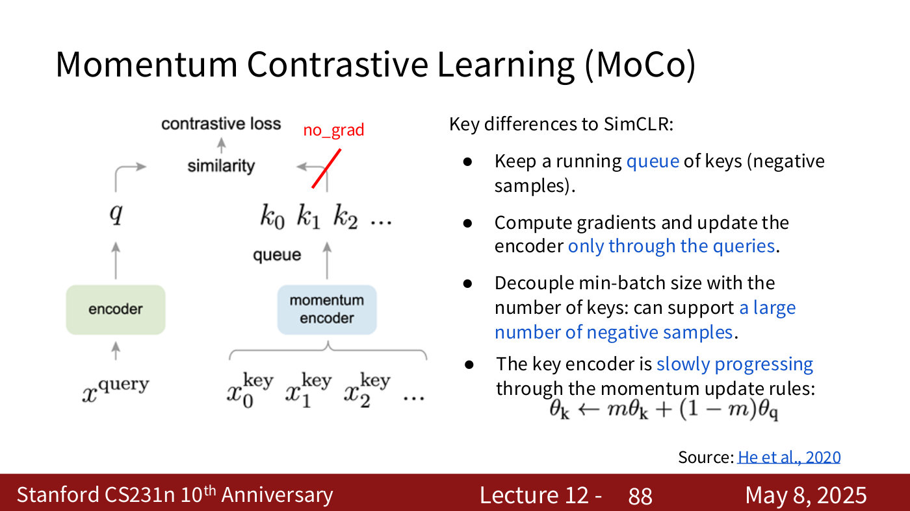

Same as slide 87, plus a fourth bullet: "The key encoder is slowly progressing through the momentum update rules:" ("slowly progressing" in blue) followed by the displayed formula
$$\theta_ {k} \leftarrow m\theta_ {k} + (1-m)\theta_ {q}$$

Credit: "Source: He et al., 2020".

## Slide 89 — MoCo

Title "MoCo". Centre: a pasted image of the paper's pseudocode, "Algorithm 1 Pseudocode of MoCo in a PyTorch-like style." Its text:

```
# f_q, f_k: encoder networks for query and key
# queue: dictionary as a queue of K keys (CxK)
# m: momentum
# t: temperature

f_k.params = f_q.params # initialize
for x in loader: # load a minibatch x with N samples
    x_q = aug(x) # a randomly augmented version
    x_k = aug(x) # another randomly augmented version

    q = f_q.forward(x_q) # queries: NxC
    k = f_k.forward(x_k) # keys: NxC
    k = k.detach() # no gradient to keys

    # positive logits: Nx1
    l_pos = bmm(q.view(N,1,C), k.view(N,C,1))

    # negative logits: NxK
    l_neg = mm(q.view(N,C), queue.view(C,K))

    # logits: Nx(1+K)
    logits = cat([l_pos, l_neg], dim=1)

    # contrastive loss, Eqn.(1)
    labels = zeros(N) # positives are the 0-th
    loss = CrossEntropyLoss(logits/t, labels)

    # SGD update: query network
    loss.backward()
    update(f_q.params)

    # momentum update: key network
    f_k.params = m*f_k.params+(1-m)*f_q.params

    # update dictionary
    enqueue(queue, k) # enqueue the current minibatch
    dequeue(queue) # dequeue the earliest minibatch
```

Footnote under the code: "bmm: batch matrix multiplication; mm: matrix multiplication; cat: concatenation."

Blue annotations with blue arrows to blue-boxed code regions:
- "Generate a positive pair by sampling data augmentation functions" (box around the two lines "q = f_q.forward(x_q)" and "k = f_k.forward(x_k)")
- "No gradient through the key" (a separate box around "k = k.detach() # no gradient to keys")
- "Use the running queue of keys as the negative samples" (box around "# negative logits: NxK" and the l_neg line)
- "InfoNCE loss" (box from "# logits: Nx(1+K)" through the loss line)
- "Update f_k through momentum" (box around "# momentum update: key network" and the momentum update line)
- "Update the FIFO negative sample queue" (box around the enqueue and dequeue lines)

Credit: "Source: He et al., 2020".

## Slide 90 — “MoCo V2”

Title "“MoCo V2”". Centre: a pasted paper header: "Improved Baselines with Momentum Contrastive Learning" / "Xinlei Chen   Haoqi Fan   Ross Girshick   Kaiming He" / "Facebook AI Research (FAIR)".

Text: "A hybrid of ideas from SimCLR and MoCo:"
- "From SimCLR: non-linear projection head and strong data augmentation."
- "From MoCo: momentum-updated queues that allow training on a large number of negative samples (no TPU required!)."

Credit: "Source: Chen et al., 2020".

## Slide 91 — MoCo vs. SimCLR vs. MoCo V2

Left: a pasted table. Header groups: "unsup. pre-train" over "MLP", "aug+", "cos", "epochs"; "ImageNet acc."; "VOC detection" over "AP50", "AP", "AP75". Check marks shown as ✓.

| case | MLP | aug+ | cos | epochs | ImageNet acc. | AP50 | AP | AP75 |
| --- | --- | --- | --- | --- | --- | --- | --- | --- |
| supervised (grey) | | | | | 76.5 | 81.3 | 53.5 | 58.8 |
| MoCo v1 | | | | 200 | 60.6 | 81.5 | 55.9 | 62.6 |
| (a) | ✓ | | | 200 | 66.2 | 82.0 | 56.4 | 62.6 |
| (b) | | ✓ | | 200 | 63.4 | 82.2 | 56.8 | 63.2 |
| (c) | ✓ | ✓ | | 200 | 67.3 | **82.5** | 57.2 | 63.9 |
| (d) | ✓ | ✓ | ✓ | 200 | 67.5 | 82.4 | 57.0 | 63.6 |
| (e) | ✓ | ✓ | ✓ | **800** | **71.1** | **82.5** | **57.4** | **64.0** |

Rows "MoCo v1" through "(c)" are enclosed in a blue rounded rectangle.

Caption: "Table 1. **Ablation of MoCo baselines**, evaluated by ResNet-50 for (i) ImageNet linear classification, and (ii) fine-tuning VOC object detection (mean of 5 trials). “**MLP**”: with an MLP head; “**aug+**”: with extra blur augmentation; “**cos**”: cosine learning rate schedule."

Right: "Key takeaways:"
- "Non-linear projection head and strong data augmentation are crucial for contrastive learning."

Credit: "Source: Chen et al., 2020".

## Slide 92 — MoCo vs. SimCLR vs. MoCo V2

Left: a pasted table. Header: "unsup. pre-train" over "MLP", "aug+", "cos", "epochs", "batch"; and "ImageNet acc."

| case | MLP | aug+ | cos | epochs | batch | ImageNet acc. |
| --- | --- | --- | --- | --- | --- | --- |
| MoCo v1 [6] | | | | 200 | 256 | 60.6 |
| SimCLR [2] | ✓ | ✓ | ✓ | 200 | 256 | 61.9 |
| SimCLR [2] | ✓ | ✓ | ✓ | 200 | 8192 | 66.6 |
| **MoCo v2** | ✓ | ✓ | ✓ | 200 | 256 | **67.5** |
| *results of **longer** unsupervised training follow:* | | | | | | |
| SimCLR [2] | ✓ | ✓ | ✓ | 1000 | 4096 | 69.3 |
| **MoCo v2** | ✓ | ✓ | ✓ | 800 | 256 | **71.1** |

(The MoCo v2 rows are shaded grey.)

Caption: "Table 2. **MoCo vs. SimCLR**: ImageNet linear classifier accuracy (**ResNet-50, 1-crop 224×224**), trained on features from unsupervised pre-training. “aug+” in SimCLR includes blur and stronger color distortion. SimCLR ablations are from Fig. 9 in [2] (we thank the authors for providing the numerical results)."

Right: "Key takeaways:"
- "Non-linear projection head and strong data augmentation are crucial for contrastive learning."
- "Decoupling mini-batch size with negative sample size allows MoCo-V2 to outperform SimCLR with smaller batch size (256 vs. 8192)."

Credit: "Source: Chen et al., 2020".

## Slide 93 — MoCo vs. SimCLR vs. MoCo V2

Left: a pasted table.

| mechanism | batch | memory / GPU | time / 200-ep. |
| --- | --- | --- | --- |
| **MoCo** | 256 | **5.0G** | **53 hrs** |
| end-to-end | 256 | 7.4G | 65 hrs |
| end-to-end | 4096 | 93.0G† | n/a |

(The MoCo row is shaded grey.) Caption: "Table 3. **Memory and time cost** in 8 V100 16G GPUs, implemented in PyTorch. †: based on our estimation."

Right: "Key takeaways:"
- "Non-linear projection head and strong data augmentation are crucial for contrastive learning."
- "Decoupling mini-batch size with negative sample size allows MoCo-V2 to outperform SimCLR with smaller batch size (256 vs. 8192)."
- "… all with much smaller memory footprint! (“end-to-end” means SimCLR here)"

Credit: "Source: Chen et al., 2020".

## Slide 94 — Instance vs. Sequence Contrastive Learning

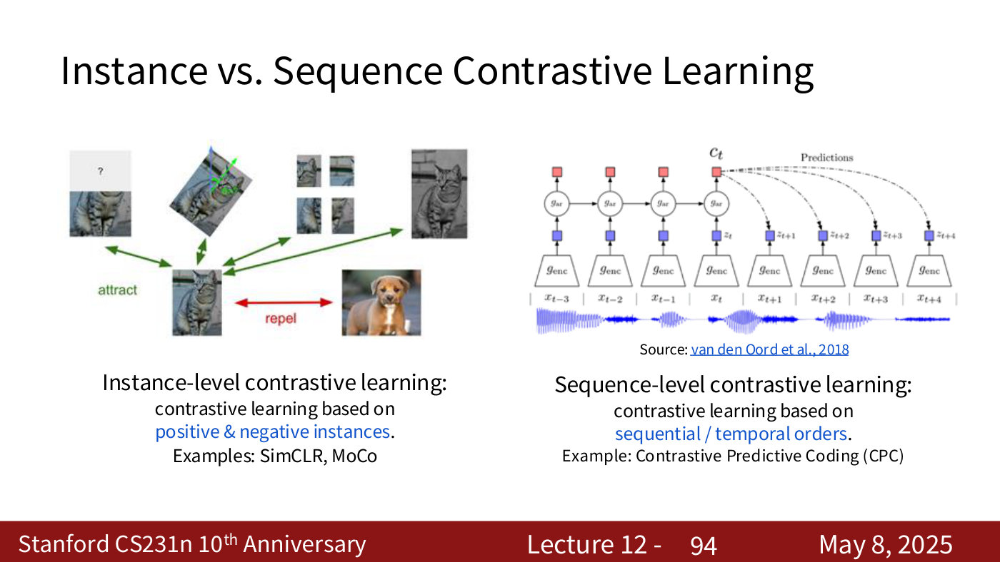

Left figure (instance-level): a central photo of a tabby cat (bottom centre). Green double-headed arrows labelled "attract" connect it to five other images arranged around it: top left, a cat photo with the upper part blanked out and a "?" (an inpainting-style crop); top middle, a rotated cat image with a small green mark on it; top right area, a pair of small cat crops (four small crops, 2 x 2, in a jigsaw-like layout); far right, a greyscale cat. A red double-headed arrow labelled "repel" connects the central cat to a photo of a puppy on the right. Caption under: "Instance-level contrastive learning:" / "contrastive learning based on positive & negative instances." ("positive & negative instances" in blue) / "Examples: SimCLR, MoCo".

Right figure (sequence-level), the CPC diagram: a row of 8 trapezoids $g_ {enc}$ at the bottom, under inputs $x_ {t-3}$, $x_ {t-2}$, $x_ {t-1}$, $x_ {t}$, $x_ {t+1}$, $x_ {t+2}$, $x_ {t+3}$, $x_ {t+4}$; each trapezoid feeds a blue square ($z_ {t}$ labelled for the fourth, $z_ {t+1}$ to $z_ {t+4}$ for the last four). The first four blue squares feed circles $g_ {ar}$ (4 circles, linked left to right by arrows), each with a red square above; the fourth red square is labelled $c_ {t}$, with dashed arrows labelled "Predictions" from it to $z_ {t+1}$ to $z_ {t+4}$. Under the inputs is a blue audio waveform. Credit: "Source: van den Oord et al., 2018".

Caption under: "Sequence-level contrastive learning:" / "contrastive learning based on sequential / temporal orders." ("sequential / temporal orders" in blue) / "Example: Contrastive Predictive Coding (CPC)".

## Slide 95 — Contrastive Predictive Coding (CPC)

Left: the same CPC diagram as slide 94 (8 $g_ {enc}$ trapezoids, inputs $x_ {t-3}$ to $x_ {t+4}$, 4 $g_ {ar}$ circles, $c_ {t}$, "Predictions" arrows), now with digit images instead of the waveform. Under the first four inputs (the left four), a row of 4 coloured digit images labelled "context" (digits 2, 3, 4, 5 on varied coloured backgrounds). Under the last four inputs, a row of 4 digit images labelled "positive" (6, 7, 8, 9 on varied backgrounds), and below it a row of 4 digit images labelled "negative" (9, 5, 0, 4 on varied backgrounds). Under the figure: "Figure source" (hyperlinked).

Right text, three paragraphs:
- "Contrastive: contrast between “right” and “wrong” sequences using contrastive learning." ("sequences" in blue)
- "Predictive: the model has to predict future patterns given the current context." ("future patterns" in blue)
- "Coding: the model learns useful feature vectors, or “code”, for downstream tasks, similar to other self-supervised methods." ("useful feature vectors" in blue)

Credit: "Source: van den Oord et al., 2018,".

## Slide 96 — Contrastive Predictive Coding (CPC)

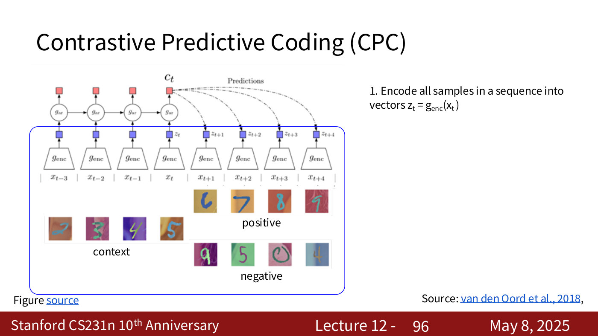

Same as slide 95, but the right-hand paragraphs are replaced by one line: "1. Encode all samples in a sequence into vectors $z_ {t} = g_ {enc}(x_ {t})$". A blue rounded rectangle encloses the whole lower part of the diagram (the $g_ {enc}$ row, the $z$ squares, the inputs, and the context / positive / negative digit images).

Credit: "Source: van den Oord et al., 2018,". "Figure source" link at lower left.

## Slide 97 — Contrastive Predictive Coding (CPC)


Same CPC diagram as slide 95/96. The blue rounded rectangle now encloses only the upper-left part: the four $g_ {ar}$ circles, the four red squares, the four blue $z$ squares below them (through $z_ {t}$) and the label $c_ {t}$; the $g_ {enc}$ row is outside it.

Right text:
- "1. Encode all samples in a sequence into vectors $z_ {t} = g_ {enc}(x_ {t})$"
- "2. Summarize context (e.g., half of a sequence) into a context code $c_ {t}$ using an auto-regressive model ($g_ {ar}$). The original paper uses GRU-RNN here."

Credit: "Source: van den Oord et al., 2018,". "Figure source" link at lower left.

## Slide 98 — Contrastive Predictive Coding (CPC)


Same CPC diagram, now with the blue rounded rectangle around the right half of the upper diagram: from $c_ {t}$ and the fourth $g_ {ar}$ circle across the "Predictions" dashed arrows and the $z_ {t}$ to $z_ {t+4}$ squares (down to the tops of the $g_ {enc}$ trapezoids on the right).

Right text:
- "1. Encode all samples in a sequence into vectors $z_ {t} = g_ {enc}(x_ {t})$"
- "2. Summarize context (e.g., half of a sequence) into a context code $c_ {t}$ using an auto-regressive model ($g_ {ar}$)" (the sentence about GRU-RNN is no longer printed)
- "3. Compute InfoNCE loss between the context $c_ {t}$ and future code $z_ {t+k}$ using the following time-dependent score function:" ("time-dependent score function:" in blue), then the displayed formula
$$s_ {k}(z_ {t+k}, c_ {t}) = z_ {t+k}^{T} W_ {k} c_ {t}$$
then "where $W_ {k}$ is a trainable matrix."

Credit: "Source: van den Oord et al., 2018,". "Figure source" link at lower left.

## Slide 99 — CPC example: modeling audio sequences

The CPC diagram, larger and with no digit images: 8 $g_ {enc}$ trapezoids in a row, with printed inputs $x_ {t-3}$, $x_ {t-2}$, $x_ {t-1}$, $x_ {t}$, $x_ {t+1}$, $x_ {t+2}$, $x_ {t+3}$, $x_ {t+4}$, separated by tick marks; each trapezoid has an arrow up to a blue square (labelled $z_ {t}$ for the fourth, and $z_ {t+1}$ to $z_ {t+4}$ for the last four). The first four blue squares each feed a circle $g_ {ar}$ (4 circles, joined left to right by arrows), each with a red square above; the fourth red square is labelled $c_ {t}$ and sends 4 dashed curved arrows, labelled "Predictions", to the blue squares $z_ {t+1}$ to $z_ {t+4}$. Under the inputs is a blue audio waveform with bursts of varying amplitude.

Credit: "Source: van den Oord et al., 2018,".

## Slide 100 — CPC example: modeling audio sequences


Left: a t-SNE scatter plot of dense point clusters in 10 colours (light blue, pink/salmon, light green, black, blue, grey, red, orange, green, light pink), roughly separated; 10 clusters, plus one small multi-coloured clump at the right edge. Caption: "Figure 2: t-SNE visualization of audio (speech) representations for a subset of 10 speakers (out of 251). Every color represents a different speaker."

Right: a table (from the paper) with header "Method | ACC":

| Method | ACC |
| --- | --- |
| **Phone classification** | |
| Random initialization | 27.6 |
| MFCC features | 39.7 |
| CPC | 64.6 |
| Supervised | 74.6 |
| **Speaker classification** | |
| Random initialization | 1.87 |
| MFCC features | 17.6 |
| CPC | 97.4 |
| Supervised | 98.5 |

Under the table: "Linear classification on trained representations (LibriSpeech dataset)".

Credit: "Source: van den Oord et al., 2018,".

## Slide 101 — CPC example: modeling visual context


Text at top: "Idea: split image into patches, model rows of patches from top to bottom as a sequence. I.e., use top rows as context to predict bottom rows."

Figure (from the paper): on the left, two overlapping light-blue squares (the darker overlap) over the input image, labelled "64 px" (side of a square) and "50% overlap", with a vertical arrow labelled "256 px" and the label "input image" below. Blue dashed lines run from these squares to the first cell(s) of a grid labelled $g_ {enc}$ "- output" (7 columns x 7 rows; two cells filled blue, at row 1 column 1 and row 2 column 2). At the right, a smaller grid labelled $g_ {ar}$ "- output" (7 columns x 3 rows) has one red cell (row 3, column 4) with the label $c_ {t}$ printed to its left. The last three rows of the $g_ {enc}$ grid are labelled $z_ {t+2}$, $z_ {t+3}$, $z_ {t+4}$, each with a blue cell in column 4 and a double arrowhead; dash-dot arrows labelled "Predictions" link the red cell to these three rows. Red dashed lines from the red cell go back to the upper rows of the $g_ {enc}$ grid.

Credit: "Source: van den Oord et al., 2018,".

## Slide 102 — Other examples: MoCo v3

Left text: "“This paper does not describe a novel method.”"

Right: a pasted first page of a paper: "An Empirical Study of Training Self-Supervised Vision Transformers" / "Xinlei Chen*   Saining Xie*   Kaiming He" / "Facebook AI Research (FAIR)" / "Code: https://github.com/facebookresearch/moco-v3". Abstract (printed): "This paper does not describe a novel method. Instead, it studies a straightforward, incremental, yet must-know baseline given the recent progress in computer vision: self-supervised learning for Vision Transformers (ViT). While the training recipes for standard convolutional networks have been highly mature and robust, the recipes for ViT are yet to be built, especially in the self-supervised scenarios where training becomes more challenging. In this work, we go back to basics and investigate the effects of several fundamental components for training self-supervised ViT. We observe that instability is a major issue that degrades accuracy, and it can be hidden by apparently good results. We reveal that these results are indeed partial failure, and they can be improved when training is made more stable. We benchmark ViT results in MoCo v3 and several other self-supervised frameworks, with ablations in various aspects. We discuss the currently positive evidence as well as challenges and open questions. We hope that this work will provide useful data points and experience for future research."

Table on the page:

| framework | model | params | acc. (%) |
| --- | --- | --- | --- |
| *linear probing:* | | | |
| iGPT [9] | iGPT-L | 1362M | 69.0 |
| iGPT [9] | iGPT-XL | 6801M | 72.0 |
| MoCo v3 | ViT-B | 86M | 76.7 |
| MoCo v3 | ViT-L | 304M | 77.6 |
| MoCo v3 | ViT-H | 632M | 78.1 |
| MoCo v3 | ViT-BN-H | 632M | 79.1 |
| MoCo v3 | ViT-BN-L/7 | 304M | **81.0** |
| *end-to-end fine-tuning:* | | | |
| masked patch pred. [16] | ViT-B | 86M | 79.9† |
| MoCo v3 | ViT-B | 86M | 83.2 |
| MoCo v3 | ViT-L | 304M | **84.1** |

Table caption: "Table 1.   **State-of-the-art Self-supervised Transformers** in ImageNet classification, evaluated by linear probing (top panel) or end-to-end fine-tuning (bottom panel). Both iGPT [9] and masked patch prediction [16] belong to the masked auto-encoding paradigm. MoCo v3 is a contrastive learning method that compares two (224×224) crops. ViT-B, -L, -H are the Vision Transformers proposed in [16]. ViT-BN is modified with BatchNorm, and “/7” denotes a patch size of 7×7. †: pre-trained in JFT-300M."

Credit (bottom): "Chen et al., An Empirical Study of Training Self-Supervised Vision Transformers, FAIR".

## Slide 103 — DINO: Self-Distillation with No Labels


Top: a pasted paper header: "Emerging Properties in Self-Supervised Vision Transformers" / "Mathilde Caron^{1,2}   Hugo Touvron^{1,3}   Ishan Misra^{1}   Hervé Jegou^{1}" / "Julien Mairal^{2}   Piotr Bojanowski^{1}   Armand Joulin^{1}" / "1 Facebook AI Research   2 Inria*   3 Sorbonne University".

Figure: a 2 x 8 strip of images, i.e. 8 image pairs (4 per row), each pair an original photo followed by a dark-purple attention map with yellow/green highlights on the object. Row 1 pairs: a bird in foliage, a hairbrush/comb-like object on a wooden item, the Houses of Parliament and Big Ben across the river, two giraffes in grass. Row 2 pairs: a sailboat on water, a red door with a bicycle, a dog on an armchair, a small airplane on a runway. (Row 1's second map highlights the elongated object; the maps in general highlight the main object.)

Caption: "Figure 1: **Self-attention from a Vision Transformer with 8 × 8 patches trained with no supervision.** We look at the self-attention of the [CLS] token on the heads of the last layer. This token is not attached to any label nor supervision. These maps show that the model automatically learns class-specific features leading to unsupervised object segmentations."

Credit (bottom right): "Caron et al. 2021 Emerging Properties in Self-Supervised Vision Transformers".

## Slide 104 — DINO


Title "DINO". Two diagrams.

Left (paper diagram): at the bottom a circle "x" with arrows to two circles $\mathbf{x}_ {1}$ (left) and $\mathbf{x}_ {2}$ (right). Above $\mathbf{x}_ {1}$: a grey box "student $g_ {\theta_ {s}}$", then a box "softmax", then circle $p_ {1}$. Above $\mathbf{x}_ {2}$: a grey box "teacher $g_ {\theta_ {t}}$", then a box "centering", then a box "softmax", with a stop-gradient mark (two slashes on the arrow, label "sg"), then circle $p_ {2}$. An arrow labelled "ema" goes from the student box to the teacher box. Between the two top circles: "loss:" / "- $p_ {2} \log p_ {1}$".

Right (a colour schematic): left, a stack of two images labelled "minibatch". Top band (pink, "Teacher"): image pair, arrow, a network icon, arrow labelled "Centering + Sharpening", leading to a bar chart of 3 bars (light grey short, blue-grey shorter, yellow tall). Bottom band (cream, "Student"): image pair, arrow, network icon, with an arrow labelled "backprop" pointing back left and an arrow to the right, leading to a bar chart of 3 bars in maroon (with lighter ghost bars behind the first two). A vertical arrow labelled "EMA" points from Student up to Teacher; a down arrow between the two bar charts. Under it the formula
$$\theta_ {\text{teacher}} \leftarrow \tau \cdot \theta_ {\text{teacher}} + (1-\tau) \cdot \theta_ {\text{student}}$$

Credit: "Caron et al. 2021 Emerging Properties in Self-Supervised Vision Transformers".

## Slide 105 — DINO

Title "DINO". A pasted code image, "Algorithm 1 DINO PyTorch pseudocode w/o multi-crop." Its text:

```
# gs, gt: student and teacher networks
# C: center (K)
# tps, tpt: student and teacher temperatures
# l, m: network and center momentum rates
gt.params = gs.params
for x in loader: # load a minibatch x with n samples
    x1, x2 = augment(x), augment(x) # random views

    s1, s2 = gs(x1), gs(x2) # student output n-by-K
    t1, t2 = gt(x1), gt(x2) # teacher output n-by-K

    loss = H(t1, s2)/2 + H(t2, s1)/2
    loss.backward() # back-propagate

    # student, teacher and center updates
    update(gs) # SGD
    gt.params = l*gt.params + (1-l)*gs.params
    C = m*C + (1-m)*cat([t1, t2]).mean(dim=0)

def H(t, s):
    t = t.detach() # stop gradient
    s = softmax(s / tps, dim=1)
    t = softmax((t - C) / tpt, dim=1) # center + sharpen
    return - (t * log(s)).sum(dim=1).mean()
```

Credit: "Caron et al. 2021 Emerging Properties in Self-Supervised Vision Transformers".

## Slide 106 — DINO v2


Title "DINO v2". A pasted figure: four columns labelled "(a)", "(b)", "(c)", "(d)", each holding 4 photographs (left) next to 4 black-background PCA colour maps (right), i.e. 16 photo/map pairs. Column (a): an eagle with spread wings, a passenger jet seen from below, a bald eagle in flight, a passenger jet in side view; the maps show rainbow-coloured silhouettes with matching parts (wings, body) in matching colours. Column (b): an elephant on red earth, an elephant reaching its trunk up into a tree, an elephant in a zoo enclosure, a brass Ganesha statue. Column (c): a white horse running, a herd of horses in dust, an orange line drawing of a horse, an aerial view of a green field with tiny animals. Column (d): a cardboard model SUV, a bus at sunset on a road, a red cartoon bus, a white SUV in desert dust.

Caption: "Figure 1: **Visualization of the first PCA components.** We compute a PCA between the patches of the images from the same column (a, b, c and d) and show their first 3 components. Each component is matched to a different color channel. Same parts are matched between related images despite changes of pose, style or even objects. Background is removed by thresholding the first PCA component."

Credit: "Caron et al. 2021 Emerging Properties in Self-Supervised Vision Transformers", as printed: the slide is titled "DINO v2", but its credit line names the 2021 DINO paper of slides 103–105.

## Slide 107 — Summary: Contrastive Representation Learning

Text and formulas:

"A general formulation for contrastive learning:"
$$\text{score}(f(x), f(x^{+})) \gg \text{score}(f(x), f(x^{-}))$$

"InfoNCE loss: N-way classification among positive and negative samples"
$$L = -\mathbb{E}_ {X} \left[ \log \frac{\exp(s(f(x), f(x^{+})))}{\exp(s(f(x), f(x^{+}))) + \sum_ {j=1}^{N-1} \exp(s(f(x), f(x_ {j}^{-})))} \right]$$

"Commonly known as the InfoNCE loss (van den Oord et al., 2018)" (the citation hyperlinked, small)
"A lower bound on the mutual information between f(x) and f(x⁺)"
$$MI[f(x), f(x^{+})] - \log(N) \geq -L$$

## Slide 108 — Summary: Contrastive Representation Learning

Left text: "SimCLR: a simple framework for contrastive representation learning"
- "Key ideas: non-linear projection head to allow flexible representation learning"
- "Simple to implement, effective in learning visual representation"
- "Requires large training batch size to be effective; large memory footprint"

Right: the SimCLR framework diagram from the paper. Bottom circle $\boldsymbol{x}$; arrows labelled $t \sim \mathcal{T}$ (left) and $t' \sim \mathcal{T}$ (right) up to circles $\tilde{\boldsymbol{x}}_ {i}$ and $\tilde{\boldsymbol{x}}_ {j}$; arrows $f(\cdot)$ up to $\boldsymbol{h}_ {i}$ and $\boldsymbol{h}_ {j}$ (a double arrow between them labelled "← Representation →"); arrows $g(\cdot)$ up to $\boldsymbol{z}_ {i}$ and $\boldsymbol{z}_ {j}$, with a double arrow at the top labelled "Maximize agreement".

## Slide 109 — Summary: Contrastive Representation Learning

Left text: "MoCo (v1, v2): contrastive learning using momentum sample encoder"
- "Decouples negative sample size from minibatch size; allows large batch training without TPU"
- "MoCo-v2 combines the key ideas from SimCLR, i.e., nonlinear projection head, strong data augmentation, with momentum contrastive learning"

Right: the MoCo diagram as on slide 87 (encoder, momentum encoder, queue, $q$, $k_ {0}\ k_ {1}\ k_ {2}\ \ldots$, "similarity", "contrastive loss", inputs $x^{\text{query}}$ and $x_ {0}^{\text{key}}\ x_ {1}^{\text{key}}\ x_ {2}^{\text{key}}\ \ldots$), without the red "no_grad" label or slash.

## Slide 110 — Summary: Contrastive Representation Learning

Left text: "CPC: sequence-level contrastive learning"
- "Contrast “right” sequence with “wrong” sequence."
- "InfoNCE loss with a time-dependent score function."
- "Can be applied to a variety of learning problems, but not as effective in learning image representations compared to instance-level methods."

Right: the CPC diagram with digit images as on slide 95 (8 $g_ {enc}$ trapezoids, 4 $g_ {ar}$ circles, $c_ {t}$, "Predictions", "context" row of 4 digits, "positive" row of 4 digits, "negative" row of 4 digits), slightly smaller and lower resolution.

## Slide 111 — Next time: Generative Models

Text only: "Next time:  Generative Models".

## Slide 114 — CPC example: modeling visual context

(Printed number 114; PDF page 112.) Left: a pasted table from the paper.

| Method | Top-1 ACC |
| --- | --- |
| **Using AlexNet conv5** | |
| Video [28] | 29.8 |
| Relative Position [11] | 30.4 |
| BiGan [35] | 34.8 |
| Colorization [10] | 35.2 |
| Jigsaw [29] * | 38.1 |
| **Using ResNet-V2** | |
| Motion Segmentation [36] | 27.6 |
| Exemplar [36] | 31.5 |
| Relative Position [36] | 36.2 |
| Colorization [36] | 39.6 |
| **CPC** | **48.7** |

Caption: "Table 3: ImageNet top-1 unsupervised classification results. *Jigsaw is not directly comparable to the other AlexNet results because of architectural differences."

Right bullets:
- "Compares favorably with other pretext task-based self-supervised learning method."
- "Doesn't do as well compared to newer instance-based contrastive learning methods on image feature learning."

Below the bullets, a copy of the scatter plot from slide 83 (ImageNet Top-1 Accuracy (%) against Number of Parameters (Millions), ticks 25, 50, 100, 200, 400, 626; same points: SimCLR, SimCLR (2x), SimCLR (4x), Supervised, CPCv2-L, MoCo (4x), AMDIM, CMC, PIRL-c2x, MoCo (2x), PIRL-ens., CPCv2, PIRL, MoCo, LA, BigBiGAN, Rotation, InstDisc), with two blue boxes added: one around "CPCv2-L" (upper right area) and one around "CPCv2" (lower left, at 25 million).

Credit: "Source: van den Oord et al., 2018,".

## Slide 115 — Other examples: Dense Object Net


(Printed number 115; PDF page 113.) Subtitle: "Contrastive learning on pixel-wise feature descriptors".

Figure: a 2-row x 4-column grid of 8 photographs, in 4 column pairs (top image above bottom image), with column titles "(c) Background Randomization", "(d) Cross Object Loss", "(e) Direct Multi Object", "(f) Synthetic Multi Object". Each pair is two views of toy objects on a pegboard table, with green lines (matching points) and red lines (non-matching points) joining small circled points between the top and bottom image. (c): a small dark object on an orange-brown textured background above, a pegboard with a cap below; one green and two red lines. (d): a white stuffed toy above, a striped caterpillar toy below; red lines (two). (e): a colourful striped caterpillar toy above, white toy and caterpillar below; green and red lines. (f): top, a blue plush turtle and a white glove-shaped toy; bottom, the white toy and a blue robot toy; two green and three red lines, the red ones ending at circled points on the empty floor or beside the white toy.

Credit: "Dense Object Net, Florence et al., 2018".

## Slide 116 — Other examples: Dense Object Net


(Printed number 116; PDF page 114.) A pasted figure of small images, not a uniform grid. The top two rows are 5 photos over 5 descriptor maps, panel "(a)": in frames 1–3 a person's hands hold a colourful caterpillar toy over a pegboard table, and frames 4–5 show the toy alone from above; the maps have pink/magenta backgrounds with blue, green and cyan blobs where the toy is. Below, panels "(b)", "(c)" and "(d)" are each one photo over one descriptor map: (b) four shoes (a grey sneaker, a brown shoe, a yellow-green sneaker and a dark boot), with a purple/blue map; (c) four caps (a maroon cap printed "MIT", a black cap, a grey cap and an orange cap), with a green-background map; (d) several mugs on a table, with a yellow/orange map with blue-green blobs. Panels "(e)" and "(f)" each fill both of the lower rows with a stack of 4 photo/map pairs: a photo of a toy on a table on a red background beside a black panel holding a rainbow-coloured silhouette. The panel letters are printed in white in the top-left corner of the photos. No caption.

Credit: "Dense Object Net, Florence et al., 2018".

## Slide 117 — Other examples: Dense Object Net


(Printed number 117; PDF page 115.) Two images side by side: left, a photograph of a white pegboard (grid of dark dots) on a table with a brown edge; right, its descriptor map as a pink/magenta and violet-blue smooth image with a pink border. Nothing else is printed apart from the title and the credit.

Credit: "Dense Object Net, Florence et al., 2018".
