# Lecture 1 — Introduction

**CS231N Deep Learning for Computer Vision, Stanford, Spring 2025.** Delivered April 1, 2025, in
two halves: Fei-Fei Li on the history of computer vision and deep learning (0:05 to about
44:25), then Ehsan Adeli on how the course is organised (44:25 to the end, 1:02:34).
[Video](https://www.youtube.com/watch?v=2fq9wYslV0A) ·
[edited transcript](../raw/transcripts/01-introduction.md) ·
part 1 deck as [text](../raw/slides/01-introduction-part-1.md) /
[PDF](https://cs231n.stanford.edu/slides/2025/lecture_1_part_1.pdf) ·
part 2 deck as [text](../raw/slides/01-introduction-part-2.md) /
[PDF](https://cs231n.stanford.edu/slides/2025/lecture_1_part_2.pdf)

## What this lecture establishes

The course sits at the intersection of computer vision and deep learning, and Fei-Fei Li's
history explains why that intersection exists. Vision is an ancient, hard, ill-posed problem
that nature solved over hundreds of millions of years; neuroscience and cognitive science
pointed computer vision at object recognition as the problem worth solving; a separate thread of
neural-network research produced the convolutional architecture and the backpropagation learning
rule; and the two threads met in 2012, when AlexNet won the ImageNet challenge once large-scale
data and GPU computation were available. Ehsan Adeli's half lays out the four parts of the course:
deep-learning basics, perceiving and understanding the visual world, generative and interactive
visual intelligence, and human-centred applications. The logistics slides were not presented
aloud; they are summarised in [course logistics](course-logistics.md).

**Citing this lecture.** The lecture has two decks, each numbered from 1, so citations here say
"part 1, slide N" or "part 2, slide N". Part 1's printed numbers equal its PDF pages. Part 2's do
not: printed numbers 4, 5 and 45 were hidden in the source deck, so from PDF page 4 on the
printed number runs two ahead of the page, and from page 43 on, three ahead (part 2, slide 53 is
PDF page 50). Timestamps are written (≈M:SS) and refer to the video.

---

## Part 1 — A brief history of computer vision and deep learning (Fei-Fei Li)

### The scope of the class

Li positions computer vision as "an integral part of AI" — "not only is vision part of
intelligence, it's a cornerstone of intelligence" — and machine learning as one of the most
important mathematical tools for solving AI (≈0:52). Deep learning, the revolution of "the past
10 plus years", is "a set of algorithmic techniques … built around a family of algorithms called
neural networks" (≈1:37). The class covers neither all of computer vision nor all of deep
learning but "the core intersection of these two fields". The deck builds this as a Venn diagram
over eight slides: an Artificial Intelligence ellipse containing overlapping Computer Vision and
Machine Learning ellipses, Deep Learning inside Machine Learning, and the class as the region
where Deep Learning overlaps Computer Vision, shaded red (part 1, slide 8). The later builds add
Natural Language Processing, Speech Recognition and Robotics as overlapping fields, and
Mathematics, Neuroscience, Computer Science, Psychology, Biology and Physics as the disciplines
around them (part 1, slide 12; ≈2:24).

![Part 1, slide 8 — [Venn diagram, build 4: "This class"]](../raw/images/01-introduction-part-1/slide-8.png)

*Part 1, slide 8 — the scope of the class: the red region where Deep Learning overlaps Computer Vision, inside Machine Learning and AI. [Deck](https://cs231n.stanford.edu/slides/2025/lecture_1_part_1.pdf)*

![Part 1, slide 12 — [Venn diagram, build 8: contributing disciplines]](../raw/images/01-introduction-part-1/slide-12.jpg)

*Part 1, slide 12 — [Venn diagram, build 8: contributing disciplines]. [Deck](https://cs231n.stanford.edu/slides/2025/lecture_1_part_1.pdf)*

### Why vision: 540 million years of evolution

"The history of vision began 540 million years ago" (≈3:12), at the Cambrian explosion, a period
of about 10 million years in which the fossil record shows animal species exploding (part 1,
slide 14). Li calls the onset of eyes "one of the most compelling theories" for that explosion:
the first trilobites gained photosensitive cells — "literally a very simple pinhole" that
collected light (≈3:58). Without senses, "life is metabolism"; with them, an animal becomes part
of an environment it must act in, and evolutionary forces drive intelligence to evolve (≈4:45).
Vision and touch are the two oldest senses, so "that entire course of 540 million years of
evolution of vision is the evolution of intelligence". Humans are especially visual: "more than
half of our cortical cells are involved in visual processing" (≈5:32). The deck makes the point
with close-ups of four animals' eyes (part 1, slide 15).

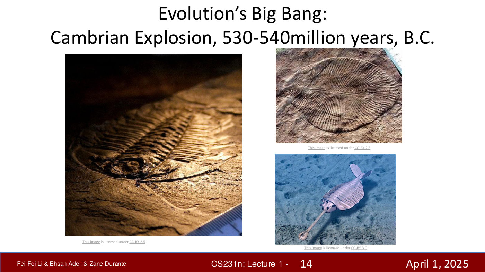

*Part 1, slide 14 — Evolution's Big Bang: Cambrian Explosion, 530-540million years, B.C.. [Deck](https://cs231n.stanford.edu/slides/2025/lecture_1_part_1.pdf)*

![Part 1, slide 15 — [photographs: eyes of four animals]](../raw/images/01-introduction-part-1/slide-15.jpg)

*Part 1, slide 15 — [photographs: eyes of four animals]. [Deck](https://cs231n.stanford.edu/slides/2025/lecture_1_part_1.pdf)*

### Seeing machines

Humans also build machines that see. Li shows Leonardo da Vinci's camera-obscura drawings
alongside Gemma Frisius's 1545 engraving and an 18th-century encyclopedia plate, and notes that
thinkers in ancient Greece and ancient China already described projecting images through
pinholes (≈6:19; part 1, slide 16). Cameras have since "truly exploded" — phones, drones, dash
cameras, a Mars rover, smart glasses (part 1, slide 17) — "but cameras are not enough for seeing,
just like eyes are not enough for seeing … We need to understand how visual intelligence
happens, and that's really the crux of this course" (≈7:05).

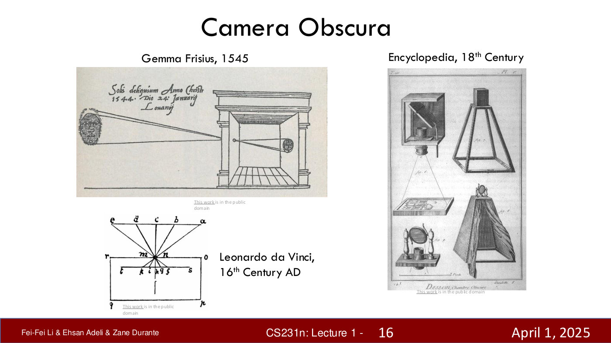

*Part 1, slide 16 — Camera Obscura. [Deck](https://cs231n.stanford.edu/slides/2025/lecture_1_part_1.pdf)*

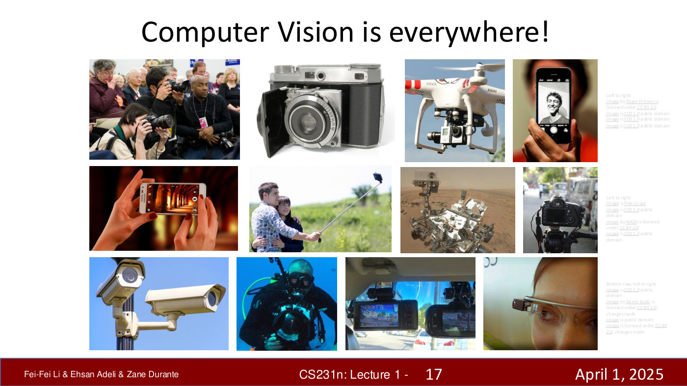

*Part 1, slide 17 — Computer Vision is everywhere!. [Deck](https://cs231n.stanford.edu/slides/2025/lecture_1_part_1.pdf)*

### Hubel and Wiesel: receptive fields and a hierarchy (1959)

The history proper starts in neuroscience. Hubel and Wiesel recorded with electrodes from neurons
in the primary visual cortex of anaesthetised cats (≈7:54) and found two things. First, each
neuron has its own **receptive field**: "for every neuron there's a part of space it actually
sees … a very confined patch", and within it the neuron responds to simple patterns — in the
primary visual cortex, "oriented edges or moving oriented edges" (≈8:41). Second, the visual
pathway is **hierarchical**: neurons feed into other neurons, and those deeper in the hierarchy
have more complex receptive fields, so oriented edges might feed a corner detector and that an
object detector (≈9:28). Li flags the consequence directly: this description "will have a profound
impact on the neural network modeling of visual algorithms" (≈10:14). The slide labels the two
cell types: simple cells respond to a specific orientation, complex cells to orientation and
movement, with some translation invariance (part 1, slide 19). Hubel and Wiesel later won the
Nobel Prize in Medicine, which Li dates "20-something years later" (≈10:14).

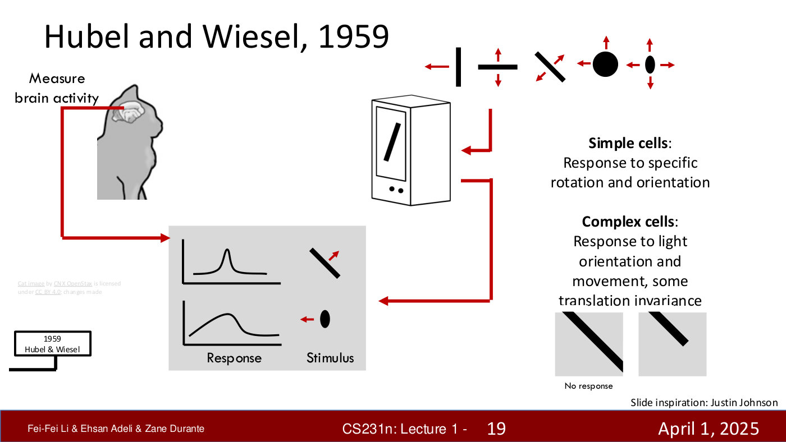

*Part 1, slide 19 — Hubel and Wiesel's experiment: bar stimuli shown to a cat while recording from visual cortex; simple cells respond to orientation, complex cells to orientation and movement. [Deck](https://cs231n.stanford.edu/slides/2025/lecture_1_part_1.pdf)*

### The beginning of computer vision (1960s)

Most people attribute the first PhD thesis in computer vision to Larry Roberts in 1963, which
studied how to recover the surfaces, corners and features of a simple block shape from an image
(≈10:59). The slide shows his three panels — original picture, differentiated (edge) picture and
selected feature points (part 1, slide 20). In 1966 an MIT summer project set out to solve vision
in one summer with a few undergraduates (≈11:48); the slide reproduces Seymour Papert's memo, "The
Summer Vision Project", MIT AI Group Vision Memo No. 100, July 7, 1966 (part 1, slide 21). "Vision
did not get solved in that summer"; instead it became a field whose annual conferences now draw
more than 10,000 people. Li dates the field's beginning to these two works in the 1960s (≈12:35).

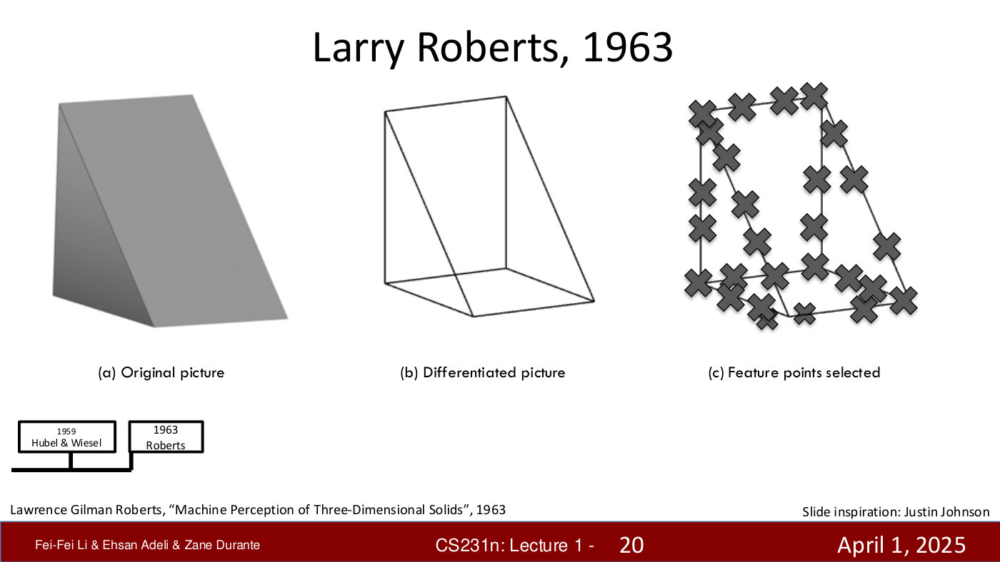

*Part 1, slide 20 — Larry Roberts, 1963. [Deck](https://cs231n.stanford.edu/slides/2025/lecture_1_part_1.pdf)*

![Part 1, slide 21 — [document: "The Summer Vision Project", Seymour Papert, 1966]](../raw/images/01-introduction-part-1/slide-21.jpg)

*Part 1, slide 21 — [document: "The Summer Vision Project", Seymour Papert, 1966]. [Deck](https://cs231n.stanford.edu/slides/2025/lecture_1_part_1.pdf)*

### David Marr's stages of visual representation (1970s)

In his 1970s book *Vision*, David Marr tried to study visual processing systematically, with what
Li describes as unstated inspiration from neuroscience and cognitive science (≈12:35). His
pipeline (part 1, slide 22) runs from the input image (perceived intensities) to a **primal
sketch** of edges, blobs and boundaries; then a **2½-D sketch** recording local surface
orientation and discontinuities in depth — in the slide's example, separating the foreground
basketball from the floor behind it (≈13:22); and finally a **3-D model representation**, which
Marr considered the goal of vision.

![Part 1, slide 22 — [David Marr, "Vision": stages of visual representation]](../raw/images/01-introduction-part-1/slide-22.jpg)

*Part 1, slide 22 — Marr's stages: input image, primal sketch (edges), 2½-D sketch (depth and surface orientation), 3-D model. [Deck](https://cs231n.stanford.edu/slides/2025/lecture_1_part_1.pdf)*

### Why vision is hard

Li digresses on why that last stage is "the hardest thing of vision" (≈14:08). Light from a 3D
world is projected onto a roughly 2D surface — once a patch of photosensitive cells, now a
retina — so "recovering … the entire 3D world from 2D images is the fundamental problem nature had
to solve and computer vision has to solve, and mathematically that's an ill-posed problem"
(≈14:54). Nature's trick was multiple eyes, mostly two, and triangulation; but two eyes are not
enough, because one must also solve correspondence. Even humans are not geometrically precise
about 3D shape (≈15:40).

She also contrasts vision with language. Language "doesn't exist in nature"; it is generated by
the brain, "1D", "sequential", which she links to why large language models (outside the scope of
this class) are so powerful. Vision is not generated: "there is actually a physical world out
there respecting the laws of physics", so vision has very different tasks (≈16:29). No slide
accompanies this digression; the transcript is the only source for it.

### Recognition in the 1970s and 1980s, and the AI winter

Early pioneers, without data or powerful computers, already attacked object recognition (≈17:16).
At Stanford, **generalized cylinders** (Brooks and Binford, 1979) modelled objects as assemblies
of 3D cylinders, and **pictorial structures** (Fischler and Elschlager, 1973) modelled the human
body as a graph of parts, drawn on the slide as a stick figure of connected nodes (part 1,
slide 23; the slide prints "Elshlager"). Li calls these "compositional models of the human body
and objects", and notes that Rodney Brooks went on to become "one of the greatest roboticists of
our time" and the founder of Roomba (≈18:02). In the 1980s, as photos began to be digitised, work turned to edge detection (John
Canny, 1986; David Lowe, 1987; part 1, slide 24). Li concedes the audience's likely reaction —
"it's kind of trivial to get some sketches and edges, and it's not really going anywhere" — and
says that is roughly right: enthusiasm and funding dwindled, computer vision, expert systems and
robotics "didn't deliver", and the field entered the **AI winter** (≈18:48). Underneath it,
subfields such as computer vision, NLP and robotics kept growing (≈19:34).

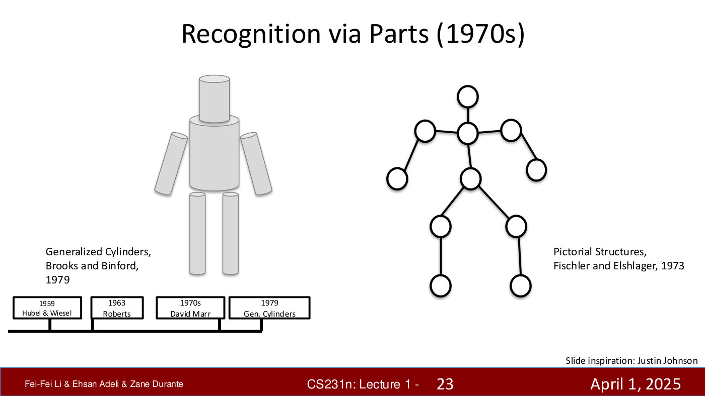

*Part 1, slide 23 — Recognition via Parts (1970s). [Deck](https://cs231n.stanford.edu/slides/2025/lecture_1_part_1.pdf)*

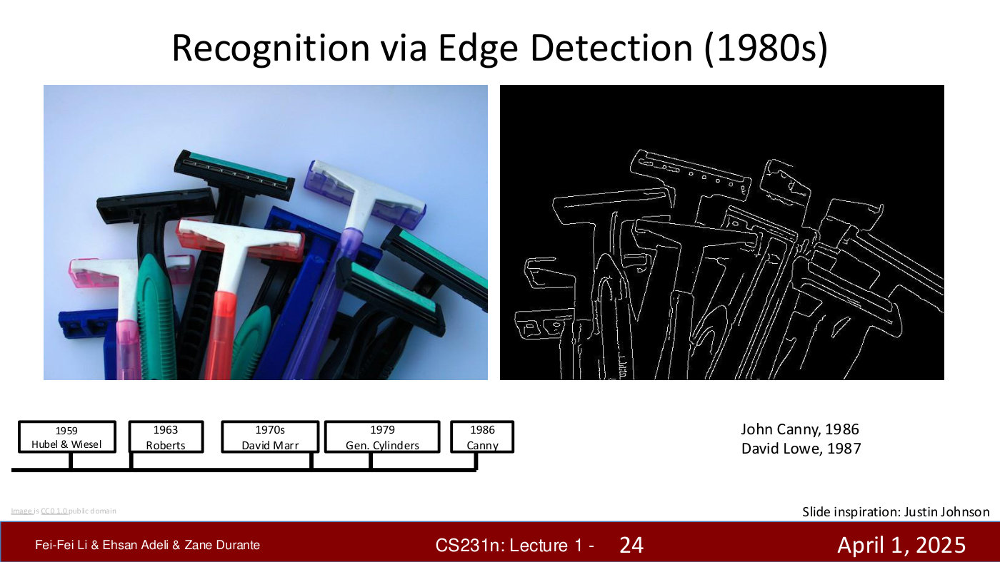

*Part 1, slide 24 — Recognition via Edge Detection (1980s). [Deck](https://cs231n.stanford.edu/slides/2025/lecture_1_part_1.pdf)*

### What cognitive science and neuroscience pointed to

Meanwhile psychology and neuroscience "started to point out to us the North Star problems we
should work on" (≈19:34).

**Scene context.** Biederman (*Science*, 1972) showed that detecting a bicycle depends on whether
the rest of the image is coherent or scrambled, even though the bicycle lands on the same place
on the retina either way — "seeing the entire forest … impacts the way we see objects" (≈20:19;
part 1, slide 27).

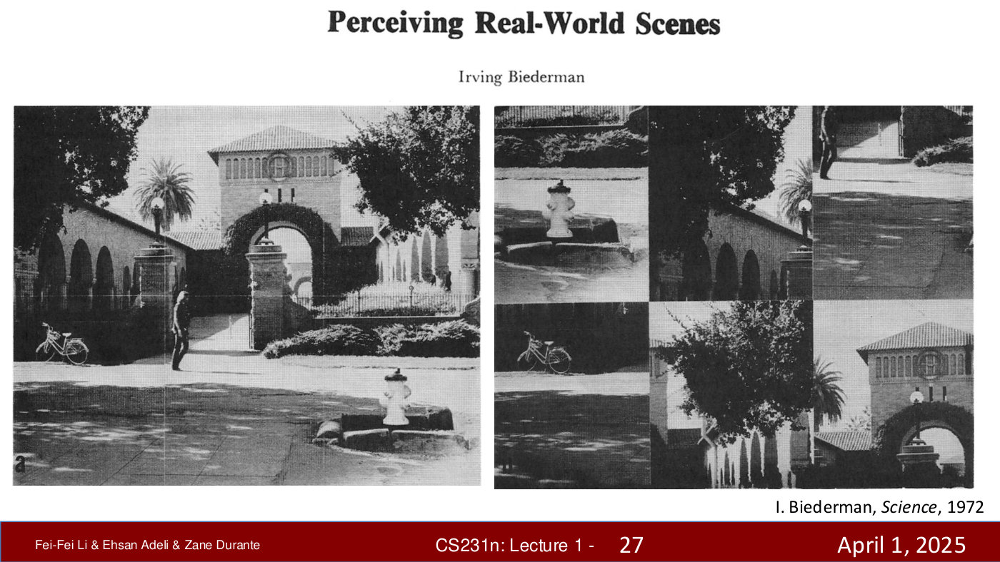

*Part 1, slide 27 — Perceiving Real-World Scenes (Biederman). [Deck](https://cs231n.stanford.edu/slides/2025/lecture_1_part_1.pdf)*

**Speed.** In rapid serial visual presentation experiments from the 1970s (Potter), viewers spot
a person in an unseen video played at 10 Hz — 100 milliseconds per frame — without being told
what or where the target is (≈21:04; part 1, slide 28).

**150 milliseconds.** Simon Thorpe and colleagues recorded EEG while subjects categorised complex
natural scenes as containing an animal or not; about 150 ms after the image appears, the brain
already shows a differential signal (Thorpe, Fize and Marlot, *Nature*, 1996; ≈21:51). In the
figure, the green (animal) and red (non-animal) evoked-potential curves separate from about
150 ms, and the blue difference curve rises then (part 1, slide 29). Slow as that sounds next to
a GPU, "it's only a few hops in the brain" (≈22:40).

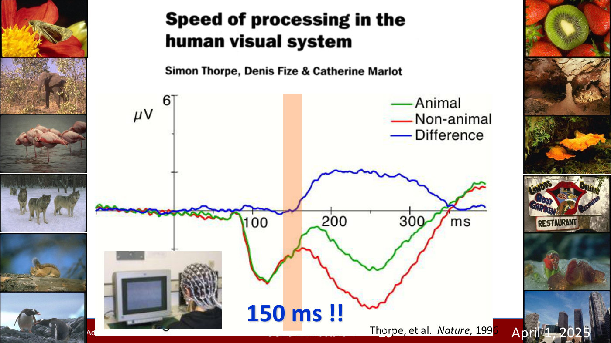

*Part 1, slide 29 — Thorpe et al. 1996: the animal (green) and non-animal (red) EEG responses diverge about 150 ms after the image appears; the blue curve is their difference. [Deck](https://cs231n.stanford.edu/slides/2025/lecture_1_part_1.pdf)*

**Specialised areas.** Brain regions specialised for faces, places and body parts were found in
the 1990s and early 2000s (Kanwisher et al., 1997; Epstein and Kanwisher, 1998; part 1,
slide 30).

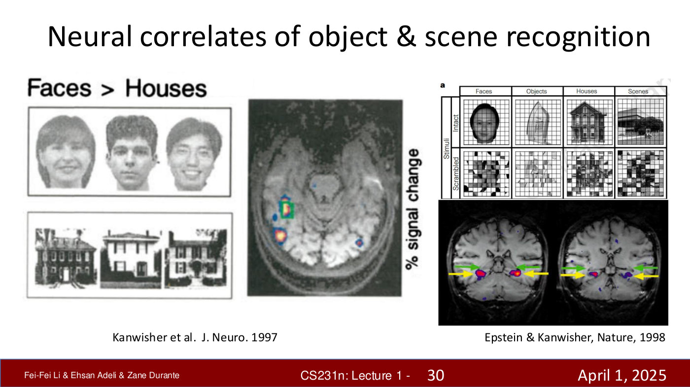

*Part 1, slide 30 — Neural correlates of object & scene recognition. [Deck](https://cs231n.stanford.edu/slides/2025/lecture_1_part_1.pdf)*

The conclusion Li draws is that the field should stop studying sketches and characteristic
shapes and "go after important fundamental problems that drive visual intelligence", of which the
first is **object recognition in natural settings** (≈23:26; part 1, slide 31).

### Object recognition before deep learning (1990s–2000s)

The field responded with a sequence of approaches, all still during the AI winter
(≈23:26–25:48).

**Recognition via grouping** separates foreground objects from the background, e.g. Normalized
Cuts (Shi and Malik, 1997; part 1, slide 32).

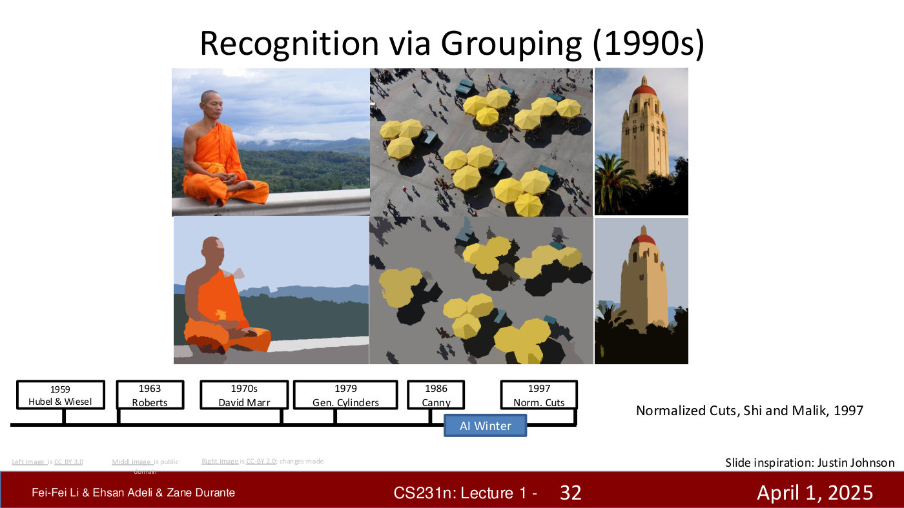

*Part 1, slide 32 — Recognition via Grouping (1990s). [Deck](https://cs231n.stanford.edu/slides/2025/lecture_1_part_1.pdf)*

**Recognition via matching** uses local features such as SIFT (David Lowe, 1999), shown matching
keypoints between two stop signs (part 1, slide 33).

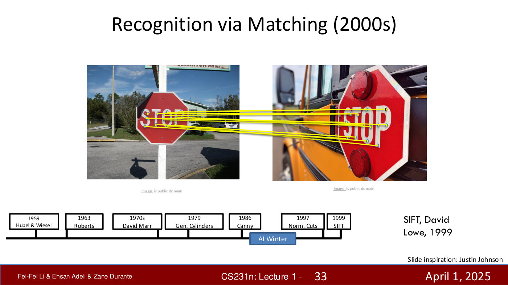

*Part 1, slide 33 — Recognition via Matching (2000s). [Deck](https://cs231n.stanford.edu/slides/2025/lecture_1_part_1.pdf)*

**Face detection** by Viola and Jones (2001) was "one of the first successful applications of
machine learning to vision". Li recalls it was published in her first year of graduate school,
and five years later the first digital camera used its algorithm for automatic face focus
(≈24:14; part 1, slide 34).

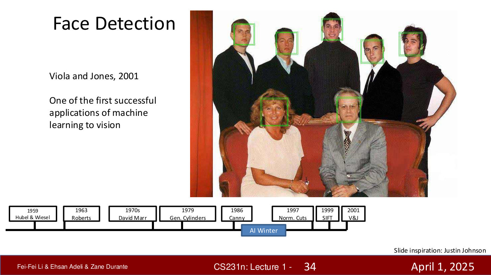

*Part 1, slide 34 — Face Detection. [Deck](https://cs231n.stanford.edu/slides/2025/lecture_1_part_1.pdf)*

**Datasets** arrived with the internet and digital cameras: "thousands of images or tens of
thousands of images", in datasets such as Caltech 101 and the PASCAL Visual Object Challenge
(≈25:02; part 1, slide 35).

![Part 1, slide 35 — [Caltech 101 and PASCAL Visual Object Challenge]](../raw/images/01-introduction-part-1/slide-35.jpg)

*Part 1, slide 35 — [Caltech 101 and PASCAL Visual Object Challenge]. [Deck](https://cs231n.stanford.edu/slides/2025/lecture_1_part_1.pdf)*

### The neural-network thread

In parallel, "a separate effort … eventually became deep learning" (≈25:48).

**The perceptron.** The deck shows Frank Rosenblatt's Mark I Perceptron (about 1957); Li names
Rumelhart and, early in his career, Geoff Hinton among those who worked with small numbers of
artificial neurons to see how they could process information and learn (part 1, slide 36).

![Part 1, slide 36 — [Rumelhart/Hinton/Williams paper title; Rosenblatt's perceptron machine]](../raw/images/01-introduction-part-1/slide-36.jpg)

*Part 1, slide 36 — [Rumelhart/Hinton/Williams paper title; Rosenblatt's perceptron machine]. [Deck](https://cs231n.stanford.edu/slides/2025/lecture_1_part_1.pdf)*

**Minsky and Papert (1969)** showed that perceptrons cannot learn the XOR function — the slide
plots the four XOR points, where the two classes sit on opposite diagonals and no single line
separates them — which "caused a little bit of a setback" (≈26:34; part 1, slide 37).

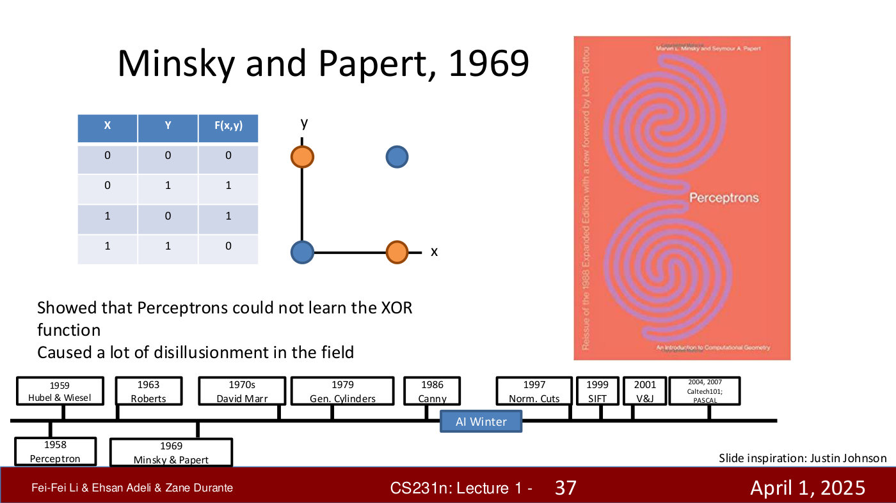

*Part 1, slide 37 — XOR: the two classes sit on opposite diagonals of the square, so no single line separates them. [Deck](https://cs231n.stanford.edu/slides/2025/lecture_1_part_1.pdf)*

**The Neocognitron (Fukushima, 1980)** was "directly inspired by Hubel and Wiesel's hierarchy":
early layers of simple cells, which Fukushima implemented as convolution, interleaved with complex
cells that pool the convolution outputs (part 1, slide 38). It had about five to seven layers, but
"every parameter was hand-designed" — hundreds of them — and there was no practical training
algorithm (≈27:21–28:07).

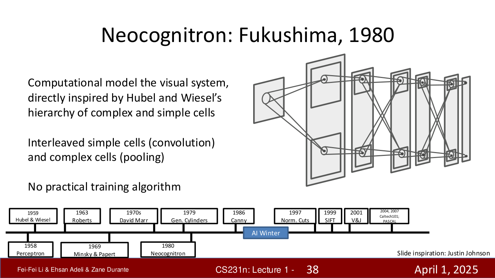

*Part 1, slide 38 — Neocognitron: Fukushima, 1980. [Deck](https://cs231n.stanford.edu/slides/2025/lecture_1_part_1.pdf)*

**Backpropagation (Rumelhart, Hinton and Williams, 1986)** was the breakthrough: a learning rule
that compares the network's output with the correct answer and "propagate[s] the information back
so that you can improve the parameters along the neural network", following "basic calculus chain
rules" (≈28:53). The slide prints the chain-rule step for a weight $w_{ji}$ from unit $i$ to unit
$j$, where $E_p$ is the error on pattern $p$ and $o_{pj}$ the output of unit $j$:

$$\frac{\partial E_p}{\partial w_{ji}} = \frac{\partial E_p}{\partial o_{pj}} \frac{\partial o_{pj}}{\partial w_{ji}}$$

Li calls it "a watershed moment for neural network algorithms" (≈29:40). The slide's title says
1986; its timeline box prints "1985 Backprop" (part 1, slide 39). Lecture 4 teaches the method
itself; see [backpropagation](backpropagation.md).

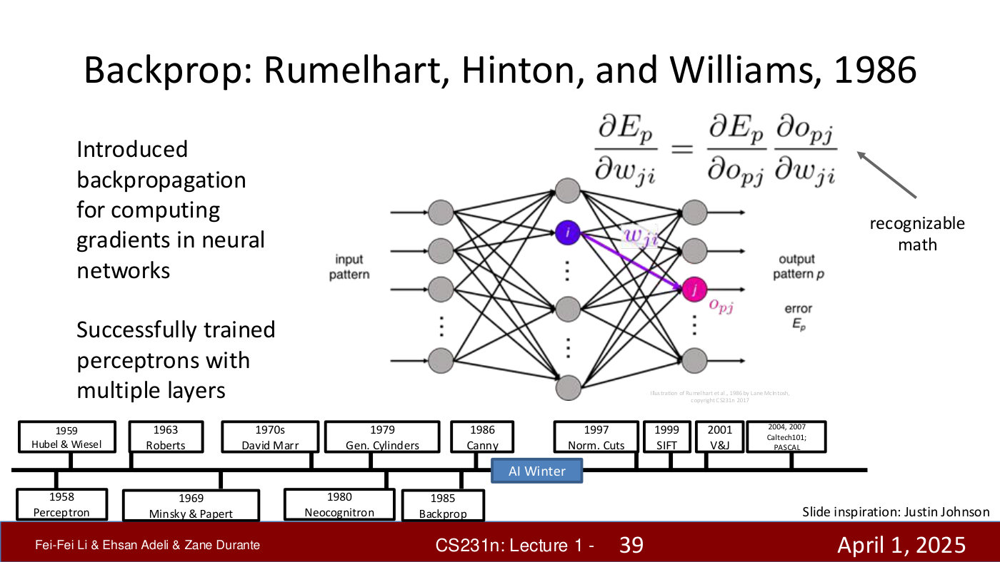

*Part 1, slide 39 — Backprop: Rumelhart, Hinton, and Williams, 1986. [Deck](https://cs231n.stanford.edu/slides/2025/lecture_1_part_1.pdf)*

**Convolutional networks (LeCun et al., 1998).** Yann LeCun at Bell Labs applied backpropagation
to a Neocognitron-like architecture of about seven layers to recognise handwritten digits and
letters (≈29:40). The slide says it was deployed commercially by NEC to process handwritten
cheques and is "very similar to our modern convolutional networks"; Li says it went to US postal
offices and banks (≈30:27; part 1, slide 40). Lecture 5 explains how such networks work; see
[convolutional networks](convolutional-networks.md).

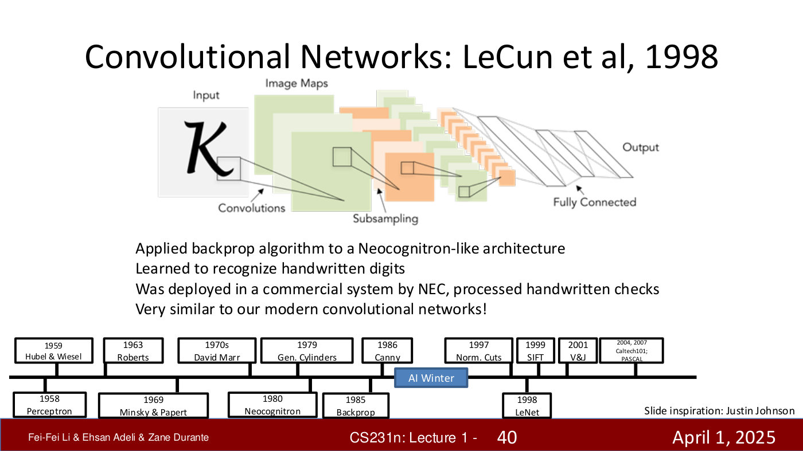

*Part 1, slide 40 — Convolutional Networks: LeCun et al, 1998. [Deck](https://cs231n.stanford.edu/slides/2025/lecture_1_part_1.pdf)*

**The 2000s.** People trained deeper networks — e.g. RBM pre-training of deep autoencoders (Hinton
and Salakhutdinov, 2006) — but it was "not a mainstream research topic" (part 1, slide 41).
Digits were "quasi-solved", yet on natural photos of cats, dogs, microwaves and chairs "it just
didn't work" (≈30:27).

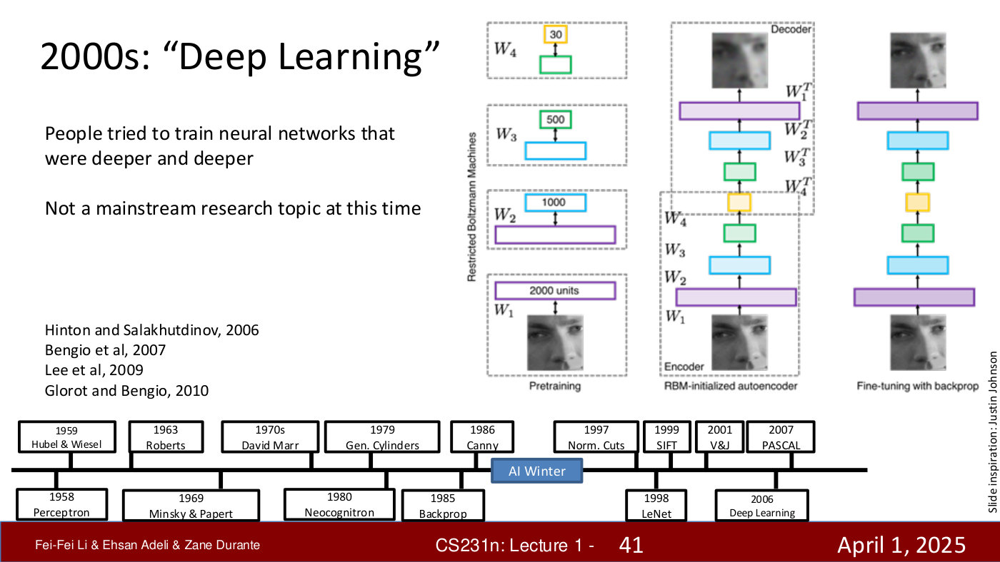

*Part 1, slide 41 — 2000s: "Deep Learning". [Deck](https://cs231n.stanford.edu/slides/2025/lecture_1_part_1.pdf)*

### Data as a first-class citizen: ImageNet

Li's diagnosis was "the lack of data" — "not just an inconvenience" but "a mathematical problem",
because these "high-capacity algorithms … need to be driven by lots of data in order to learn to
generalize" (≈31:14; part 1, slide 42: "No good dataset to work on"). Data had been
"underappreciated", since most people were looking only at architectures; it is "a first-class
citizen for machine learning and deep learning" (≈32:00). Her lab built **ImageNet**: 15 million
images, cleaned from a billion, sorted into 22,000 categories — roughly the number of categories
humans learn to recognise in early life, according to the cognitive-science literature they
studied (≈32:00–32:48). From it they ran the **ImageNet Large Scale Visual Recognition
Challenge**: 1,000 object classes and 1,431,167 images (part 1, slide 43). Entrants could use any
algorithm; the slide's example output for one photograph is a list of five labels — scale,
T-shirt, steel drum, drumstick, mud turtle — with "steel drum" underlined. See
[ImageNet](imagenet.md) for the dataset and the challenge in one place.

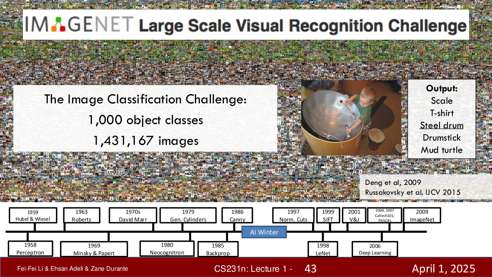

*Part 1, slide 43 — ImageNet Large Scale Visual Recognition Challenge. [Deck](https://cs231n.stanford.edu/slides/2025/lecture_1_part_1.pdf)*

### 2012: AlexNet

The winning error fell every year:

| Year | Winner | Error (%) |
| --- | --- | --- |
| 2010 | Lin et al | 28.2 |
| 2011 | Sanchez & Perronnin | 25.8 |
| 2012 | Krizhevsky et al (AlexNet) | 16.4 |
| 2013 | Zeiler & Fergus | 11.7 |
| 2014 | Simonyan & Zisserman (VGG) | 7.3 |
| 2014 | Szegedy et al (GoogLeNet) | 6.7 |
| 2015 | He et al (ResNet) | 3.6 |
| 2016 | Shao et al | 3.0 |
| 2017 | Hu et al (SENet) | 2.3 |
| — | Human (Russakovsky et al) | 5.1 |

These are the values printed on the bar chart, whose vertical axis carries no title (part 1,
slide 44). Li describes the first year's best error as "nearly 30%" and says "humans can perform
at under, say, 3% error" (≈33:35) — the slide's human figure is 5.1.

![Part 1, slide 44 — [ImageNet challenge bar chart of winning error by year]](../raw/images/01-introduction-part-1/slide-44.jpg)

*Part 1, slide 44 — winning ImageNet challenge error by year, falling from 28.2 (2010) to 2.3 (2017), against a human figure of 5.1. [Deck](https://cs231n.stanford.edu/slides/2025/lecture_1_part_1.pdf)*

In 2012 Geoff Hinton and his students entered a convolutional neural network, **AlexNet**, and
"reduced the error almost by half" (≈33:35–34:21; part 1, slide 46; Krizhevsky, Sutskever and
Hinton, NeurIPS 2012). The deck sets AlexNet beside the Neocognitron, "32 years apart" (part 1,
slide 47), and Li's point is that the architecture had not changed much. Two things had: a
"principled, mathematically rigorous learning rule", backpropagation, so parameters no longer had
to be hand-tuned; and data large enough to drive models with millions of parameters — later
trillions (≈34:21–35:08). Many people, she says, consider 2012 and AlexNet "the historical moment
of the birth, or rebirth, of modern AI" (≈35:08).

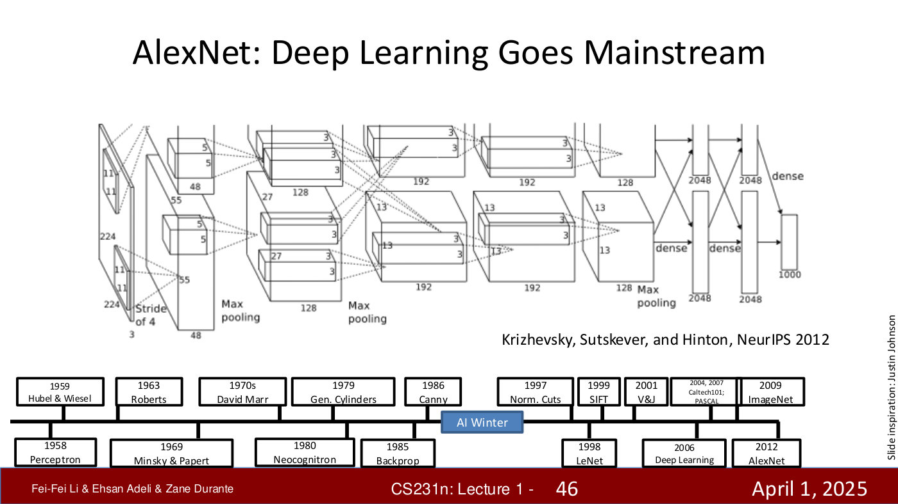

*Part 1, slide 46 — AlexNet: Deep Learning Goes Mainstream. [Deck](https://cs231n.stanford.edu/slides/2025/lecture_1_part_1.pdf)*

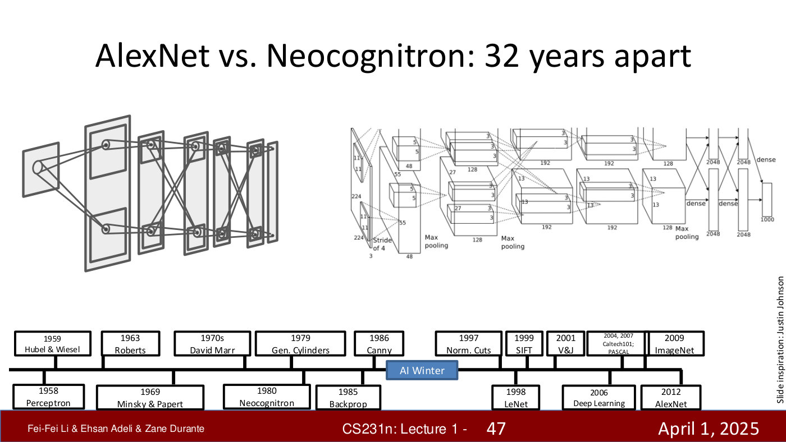

*Part 1, slide 47 — the Neocognitron (1980) and AlexNet (2012) side by side, 32 years apart. [Deck](https://cs231n.stanford.edu/slides/2025/lecture_1_part_1.pdf)*

### The deep-learning explosion

Since then the field has exploded (≈35:54). Submissions to CVPR, the main computer-vision
conference, rose from about 300 in 1985 to over 7,000 at the chart's right edge, around 2020, and
ML+AI papers on arXiv from near zero to about 4,000 a month (part 1, slide 48). Architectures moved from the 2010
NEC-UIUC pipeline of hand-designed descriptors and a linear SVM to AlexNet ("SuperVision", 2012),
GoogLeNet and VGG (2014) and the very deep residual network from MSRA (2015) (part 1, slide 49).

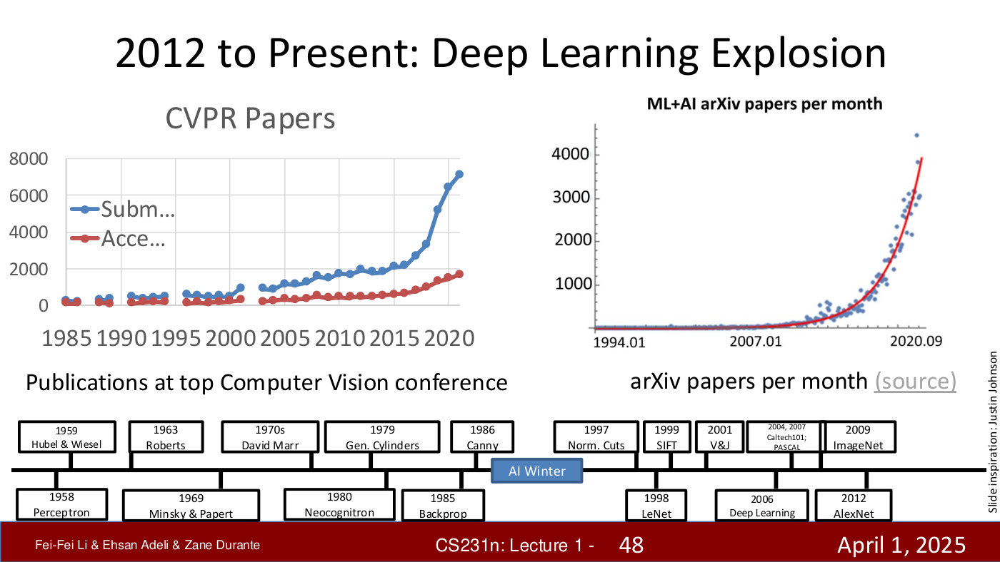

*Part 1, slide 48 — 2012 to Present: Deep Learning Explosion. [Deck](https://cs231n.stanford.edu/slides/2025/lecture_1_part_1.pdf)*

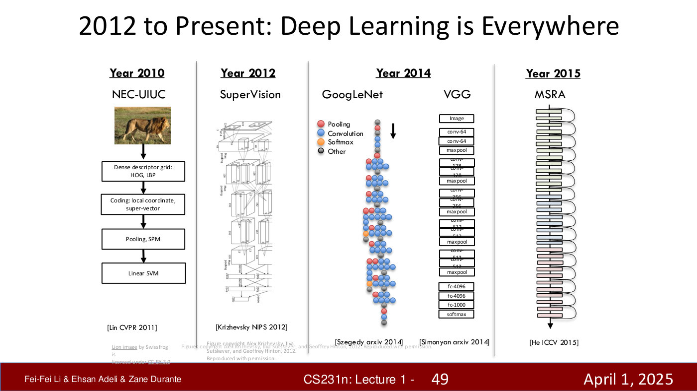

*Part 1, slide 49 — 2012 to Present: Deep Learning is Everywhere. [Deck](https://cs231n.stanford.edu/slides/2025/lecture_1_part_1.pdf)*

Li then tours the variety of vision tasks — "vision is not just calling out cats and dogs"
(≈36:40–39:42) — with a slide of examples for each.

Right after 2012 came algorithms for image classification and retrieval (part 1, slide 50), and
for object detection and image segmentation (part 1, slide 51). Vision is not only static images,
so there is video classification and activity recognition (part 1, slide 52), as well as pose
recognition and playing Atari games (part 1, slide 53).

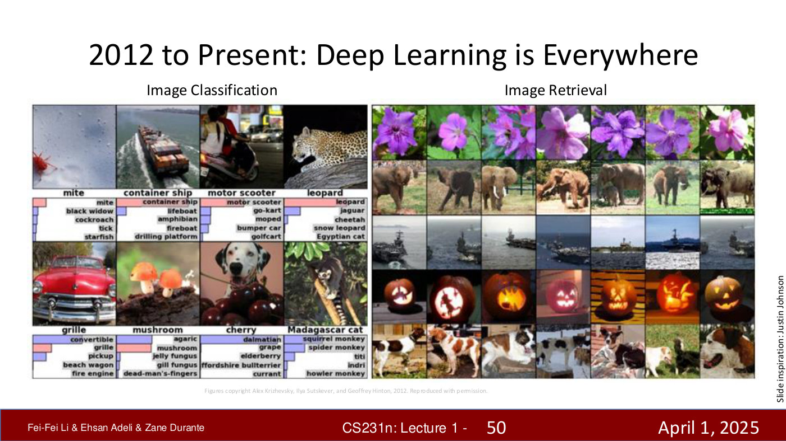

*Part 1, slide 50 — 2012 to Present: Deep Learning is Everywhere (image classification, image retrieval). [Deck](https://cs231n.stanford.edu/slides/2025/lecture_1_part_1.pdf)*

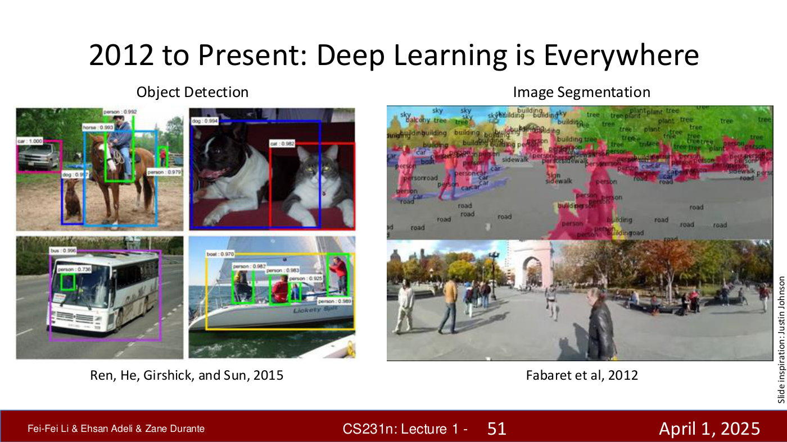

*Part 1, slide 51 — 2012 to Present: Deep Learning is Everywhere (object detection, image segmentation). [Deck](https://cs231n.stanford.edu/slides/2025/lecture_1_part_1.pdf)*

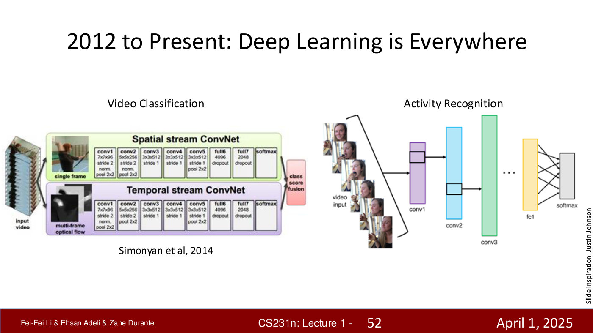

*Part 1, slide 52 — 2012 to Present: Deep Learning is Everywhere (video classification, activity recognition). [Deck](https://cs231n.stanford.edu/slides/2025/lecture_1_part_1.pdf)*

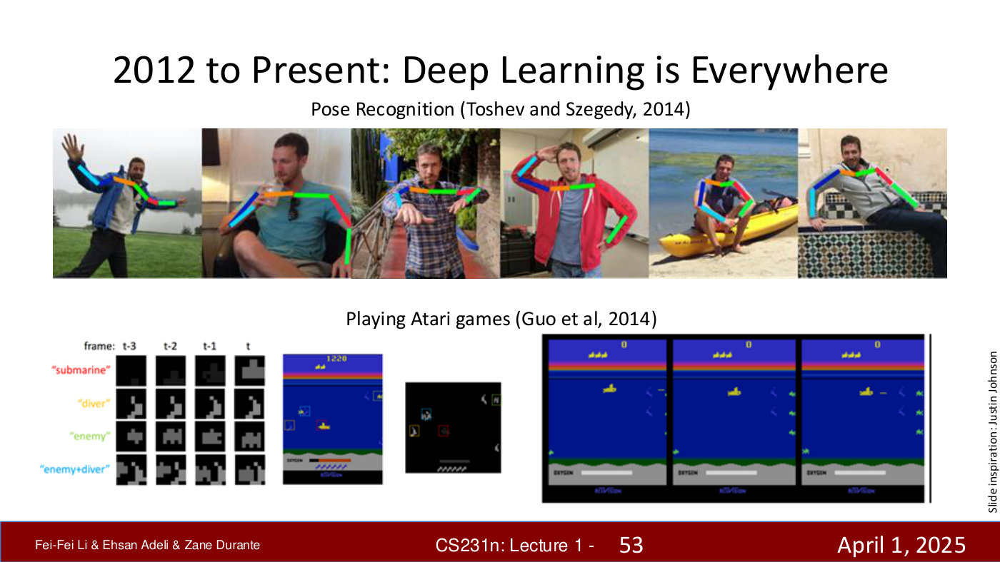

*Part 1, slide 53 — 2012 to Present: Deep Learning is Everywhere (pose recognition, Atari). [Deck](https://cs231n.stanford.edu/slides/2025/lecture_1_part_1.pdf)*

Applications reach into medicine and science: medical imaging, galaxy classification and whale
recognition (part 1, slide 54). Li adds that the first photograph of a black hole used many
computer-vision and computational-photography techniques (≈38:11).

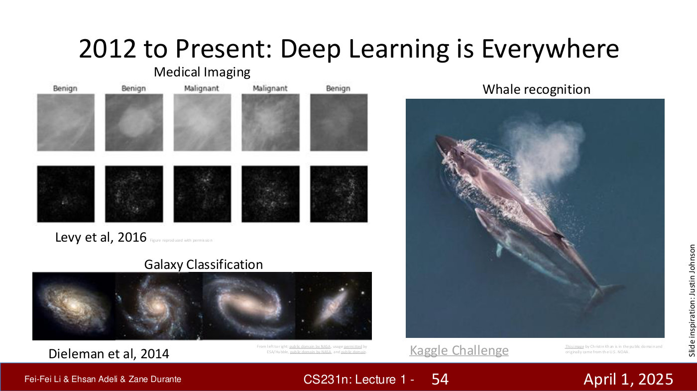

*Part 1, slide 54 — 2012 to Present: Deep Learning is Everywhere (medical imaging, galaxies, whales). [Deck](https://cs231n.stanford.edu/slides/2025/lecture_1_part_1.pdf)*

Image captioning followed soon after 2012, including Andrej Karpathy's thesis work with Li
(≈38:56; part 1, slide 55), and then visual relationships and scene graphs — "you also see what's
beyond pixels" (part 1, slide 56).

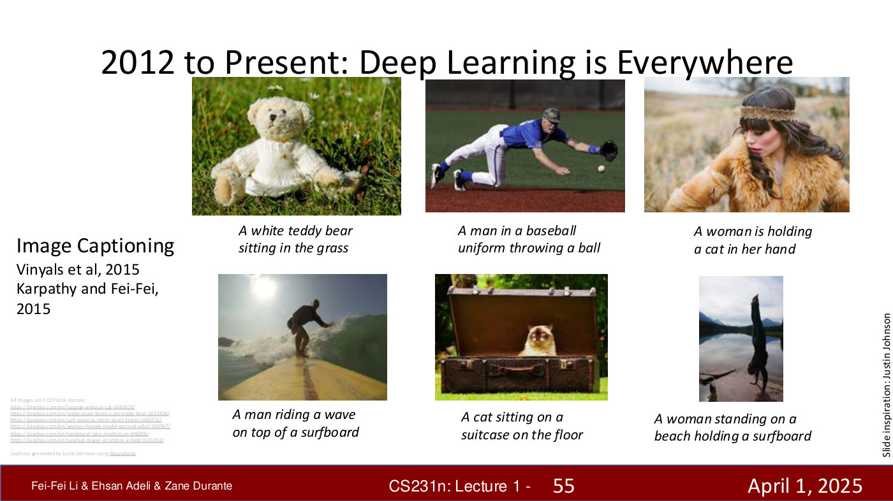

*Part 1, slide 55 — 2012 to Present: Deep Learning is Everywhere (image captioning). [Deck](https://cs231n.stanford.edu/slides/2025/lecture_1_part_1.pdf)*

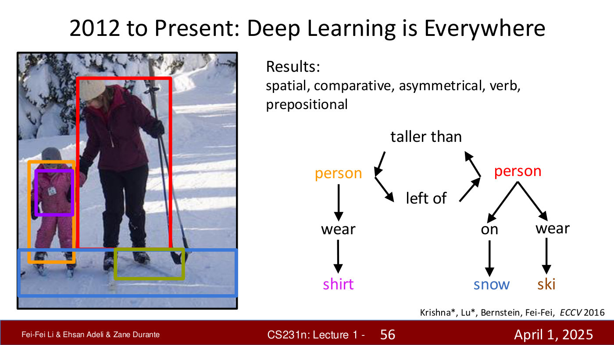

*Part 1, slide 56 — 2012 to Present: Deep Learning is Everywhere (scene graphs / visual relationships). [Deck](https://cs231n.stanford.edu/slides/2025/lecture_1_part_1.pdf)*

DeepDream and neural style transfer are on one slide; style transfer is the work of Justin
Johnson, who guest-lectures the course (≈38:56–39:42; part 1, slide 57).

![Part 1, slide 57 — [DeepDream and neural style transfer]](../raw/images/01-introduction-part-1/slide-57.jpg)

*Part 1, slide 57 — [DeepDream and neural style transfer]. [Deck](https://cs231n.stanford.edu/slides/2025/lecture_1_part_1.pdf)*

Image generation runs from progressive GANs (part 1, slide 58, a video that does not render in
the PDF) to early DALL·E's avocado and peach armchairs (part 1, slides 59–60).

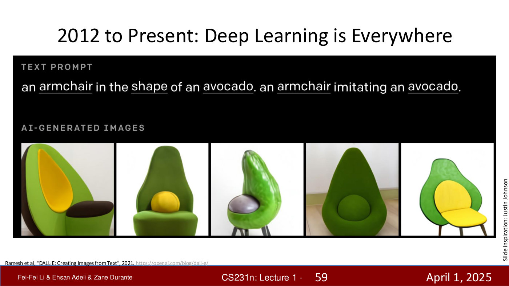

*Part 1, slide 59 — 2012 to Present: Deep Learning is Everywhere (DALL·E, avocado armchair). [Deck](https://cs231n.stanford.edu/slides/2025/lecture_1_part_1.pdf)*

[Computer vision tasks](computer-vision-tasks.md) collects the task definitions from both halves
of the lecture.

### Computation, algorithms, data

"The three converging forces of computation, algorithms and data have taken this field to a whole
different level" (≈39:42; part 1, slide 61). Li stresses hardware — the lecture is given in the
NVIDIA auditorium — with a chart of GFLOP per dollar for CPUs and NVIDIA GPUs: CPUs stay near
zero while FP32 GPUs climb from the GeForce 8800 GTX through the GTX 580 used for AlexNet to the
RTX 3090 at about 43 GFLOP per dollar (≈40:30; part 1, slide 62). With "Tensor Cores", special
hardware for deep learning, recent GPUs reach roughly 95–171 (part 1, slide 63). Further charts
show the same acceleration in conference attendance (NeurIPS rising to about 13,500 by 2019),
AI startups and enterprise AI revenue (part 1, slide 64; ≈41:18). Her summary: "we're now totally
out of the AI winter … in an AI global warming period" (≈40:30).

![Part 1, slide 61 — [Computation, Algorithms, Data]](../raw/images/01-introduction-part-1/slide-61.jpg)

*Part 1, slide 61 — [Computation, Algorithms, Data]. [Deck](https://cs231n.stanford.edu/slides/2025/lecture_1_part_1.pdf)*

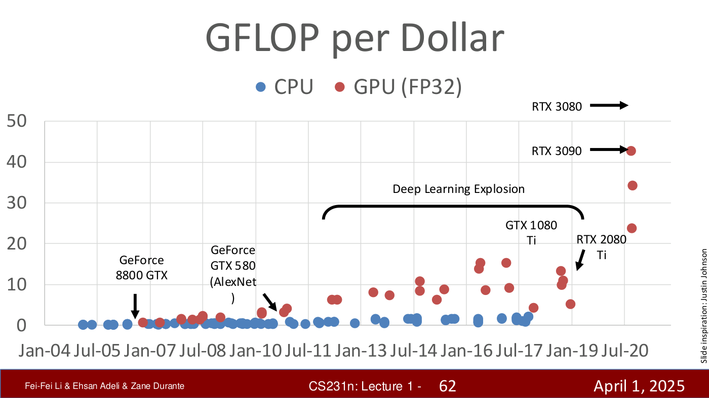

*Part 1, slide 62 — GFLOP per Dollar. [Deck](https://cs231n.stanford.edu/slides/2025/lecture_1_part_1.pdf)*

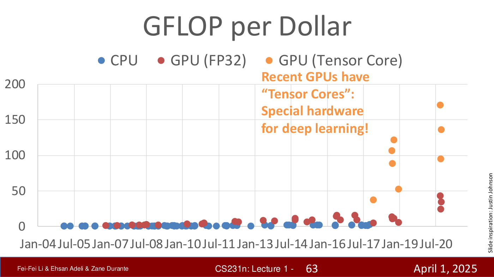

*Part 1, slide 63 — GFLOP per dollar: CPUs (blue) stay near zero, FP32 GPUs (red) reach about 43, Tensor-Core GPUs (orange) about 171. [Deck](https://cs231n.stanford.edu/slides/2025/lecture_1_part_1.pdf)*

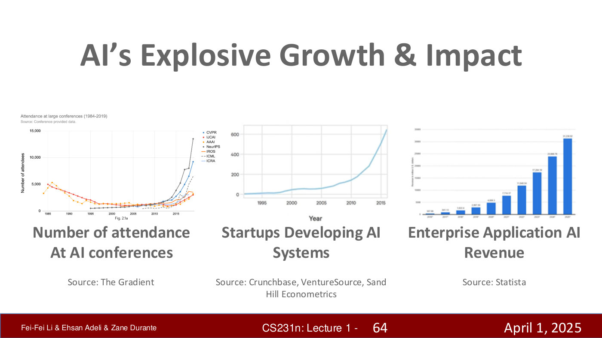

*Part 1, slide 64 — AI's Explosive Growth & Impact. [Deck](https://cs231n.stanford.edu/slides/2025/lecture_1_part_1.pdf)*

### What computer vision can harm, help, and still cannot do

"With great tools come great consequences" (≈42:06). Because large AI systems are driven by data,
and "data is an artifact of human activities", they inherit human bias — face-recognition
algorithms included. The slide's example is a table of commercial gender classifiers' accuracy by
skin tone and gender:

| Gender classifier | Darker male | Darker female | Lighter male | Lighter female | Largest gap |
| --- | --- | --- | --- | --- | --- |
| Microsoft | 94.0% | 79.2% | 100% | 98.3% | 20.8% |
| FACE++ | 99.3% | 65.5% | 99.2% | 94.0% | 33.8% |
| IBM | 88.0% | 65.3% | 99.7% | 92.9% | 34.4% |

In every row the darker-female column is the lowest (part 1, slide 66). The same slide shows a news report on
AI-scored hiring interviews; Li asks whether AI deciding jobs or loans is "totally bad" or
"totally good", calls these "very complicated issues", and says "not all AI issues are engineering
issues" (≈42:52). On the positive side, she, Adeli and Zane Durante work on AI for the ageing
population and patients — computer vision to deliver care (≈43:38; part 1, slide 67). She closes
with photographs of children exploring and of a practical joke: human vision has "nuance,
subtlety, richness, complexity, and also emotion" that computer vision cannot yet match (≈44:25;
part 1, slide 68).

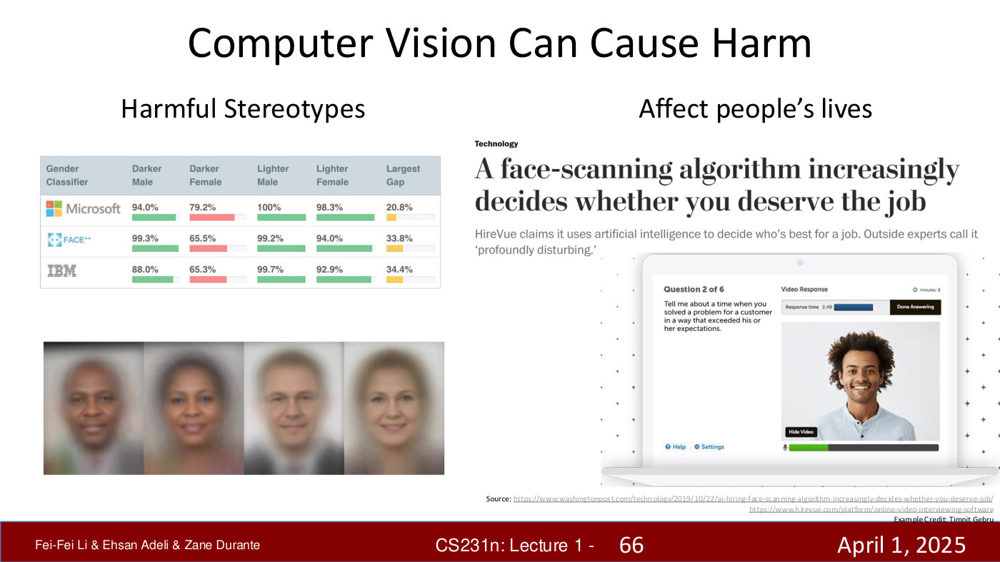

*Part 1, slide 66 — gender-classifier accuracy by skin tone and gender; the darker-female column is lowest for every vendor. [Deck](https://cs231n.stanford.edu/slides/2025/lecture_1_part_1.pdf)*

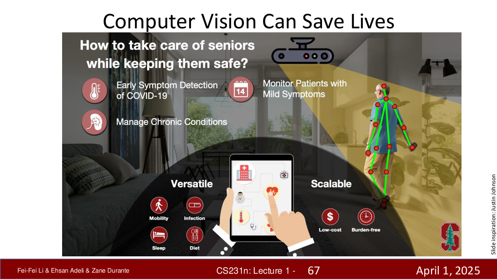

*Part 1, slide 67 — Computer Vision Can Save Lives. [Deck](https://cs231n.stanford.edu/slides/2025/lecture_1_part_1.pdf)*

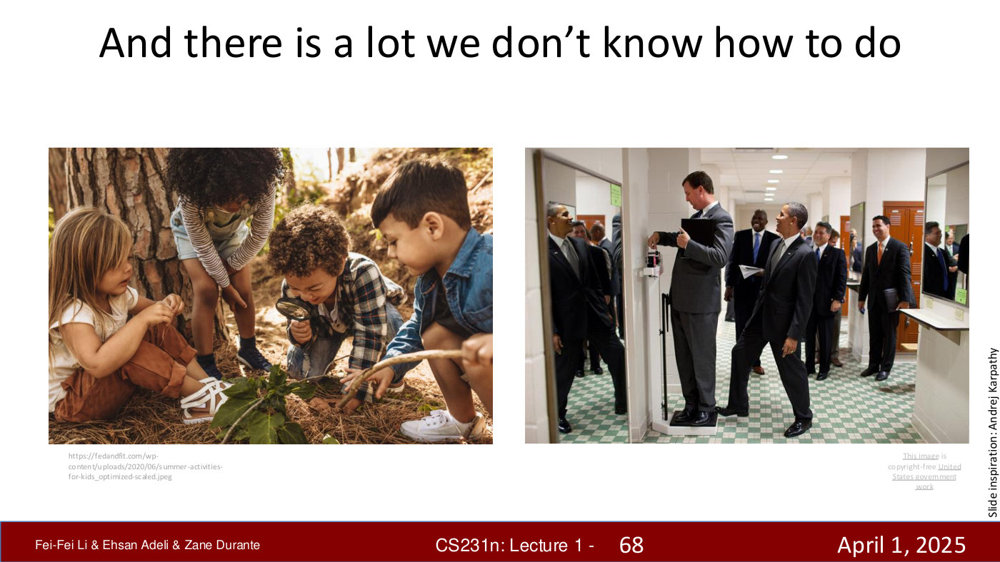

*Part 1, slide 68 — And there is a lot we don't know how to do. [Deck](https://cs231n.stanford.edu/slides/2025/lecture_1_part_1.pdf)*

---

## Part 2 — Course overview (Ehsan Adeli)

Adeli takes over at ≈44:25 and introduces the course's four parts (≈45:14; part 2, slide 6). A
later slide gives the lecture ranges for each part — Deep Learning Basics (lectures 2–4),
Perceiving and Understanding the Visual World (5–12), Reconstructing and Interacting with the
Visual World (13–17) and Human-Centered Artificial Intelligence (18) (part 2, slide 51). The two
slides name the last two parts differently; the agenda slides say "Generative and Interactive
Visual Intelligence" and "Human-Centered Applications and Implications". The lecture-by-lecture
schedule is in [course logistics](course-logistics.md#course-roadmap).

### Deep learning basics (lectures 2–4)

"At its core, [computer vision is] about enabling machines to see and understand images", and the
most fundamental task is **image classification**: given an image of a cat, output the label
"cat" (≈45:14–46:04). The task is "deceptively simple" but underlies applications from
self-driving to medical diagnosis. The basics build up in three steps, each added to the same slide beside the cat
example (part 2, slides 7–10).

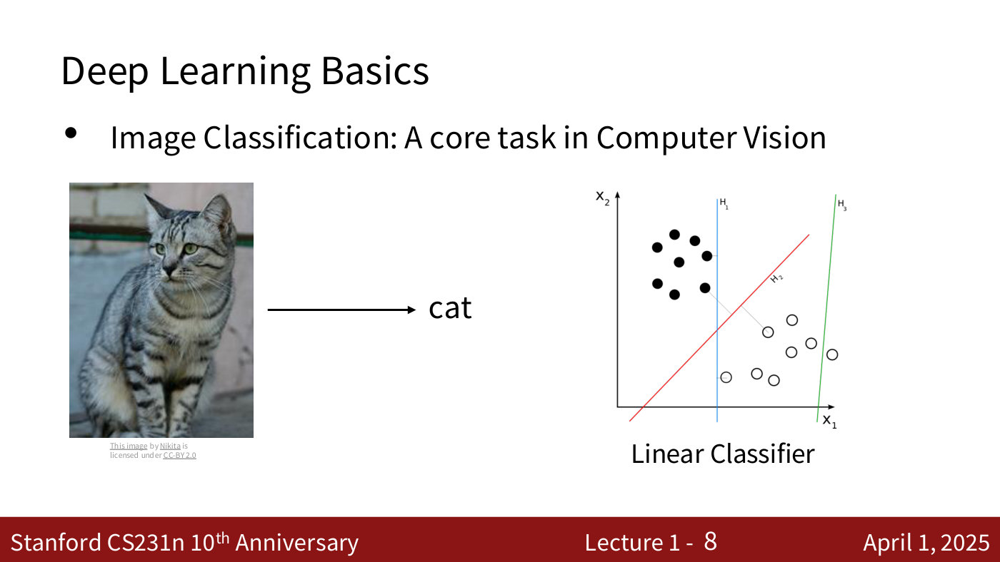

*Part 2, slide 8 — Deep Learning Basics. [Deck](https://cs231n.stanford.edu/slides/2025/lecture_1_part_2.pdf)*

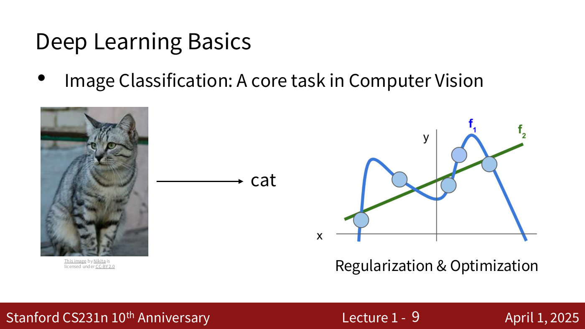

*Part 2, slide 9 — Deep Learning Basics. [Deck](https://cs231n.stanford.edu/slides/2025/lecture_1_part_2.pdf)*

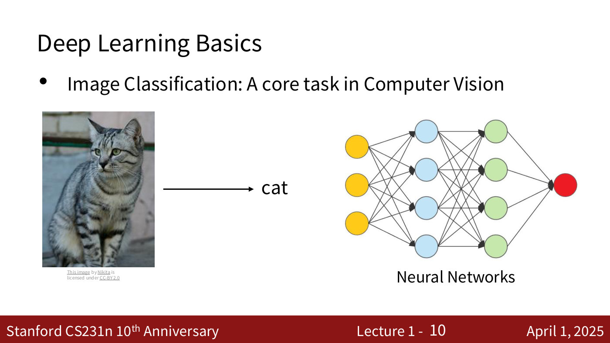

*Part 2, slide 10 — Deep Learning Basics. [Deck](https://cs231n.stanford.edu/slides/2025/lecture_1_part_2.pdf)*

- **Linear classifiers.** Treat each image as a point in a feature space — 2D on the slide, axes
  $x_1$ and $x_2$ — and find a hyperplane separating the classes, say cats from dogs. The slide
  draws three candidate lines $H_1$, $H_2$ and $H_3$ between two clusters (≈46:50). Linear models
  "struggle when the data isn't cleanly separable with a straight line".
- **Regularization and optimization.** Modelling more complex patterns brings overfitting and
  underfitting. Regularization controls model complexity and optimization finds the best-fit
  parameters, so that a model fits the data and also generalises to new data (≈47:38). The slide
  contrasts a wiggly curve $f_1$ through all five points with a straight line $f_2$ near them.
- **Neural networks** stack multiple layers of operations to model non-linear functions
  (≈48:25). The course covers how they work, how they are trained, and how to debug and improve
  them (≈49:12).

### Perceiving and understanding the visual world (lectures 5–12)

This part pairs **tasks** — specific problems to solve — with **models**, the computational
frameworks built to solve them (≈49:12–49:59; part 2, slide 13).

The tasks go beyond classification (≈50:47–53:08; part 2, slides 14–15).

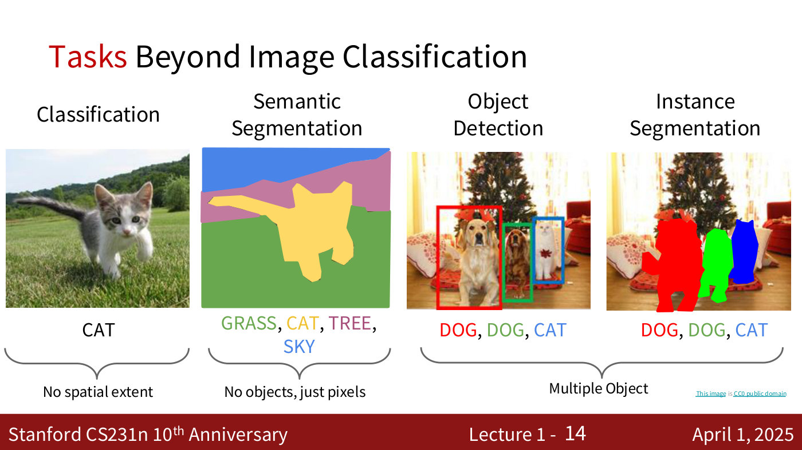

*Part 2, slide 14 — one label for the image (classification), a label per pixel (semantic segmentation), a box per object (detection), a mask per object (instance segmentation). [Deck](https://cs231n.stanford.edu/slides/2025/lecture_1_part_2.pdf)*

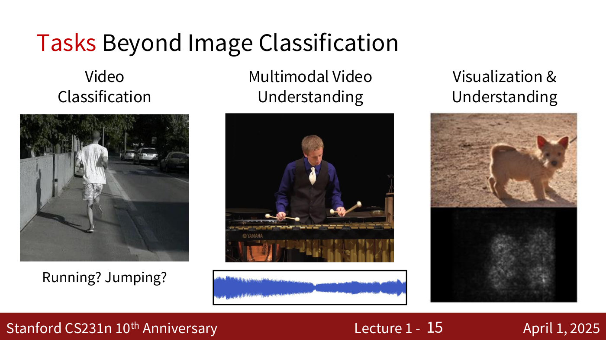

*Part 2, slide 15 — Tasks Beyond Image Classification. [Deck](https://cs231n.stanford.edu/slides/2025/lecture_1_part_2.pdf)*

- **Semantic segmentation** labels every pixel (grass, cat, tree, sky) but does not distinguish
  individual objects — "no objects, just pixels".
- **Object detection** says what is in the image and where, with a labelled bounding box per
  object.
- **Instance segmentation**, "the most granular of them all", combines the two: every object
  instance gets its own mask.
- **Video classification** asks what is happening over time — running, jumping, dancing.
- **Multimodal video understanding** blends visual and audio features; the example is a person
  playing a vibraphone.
- **Visualization and understanding** interprets what a model has learned, e.g. an attention map
  of what it attends to when classifying.

The models start with **convolutional neural networks** — convolution, subsampling and
fully-connected operations from image to output (≈53:08–53:56; part 2, slide 16) — and go on to
**recurrent neural networks** for sequential data and **attention and transformers** (part 2,
slide 17). New this quarter is **large-scale distributed training**: as datasets and models grow,
strategies such as data parallelism (copy the model to every worker and split the data) and model
parallelism (split the model across devices) become necessary, along with problems such as
synchronising workers (≈53:56–55:30; part 2, slide 18).

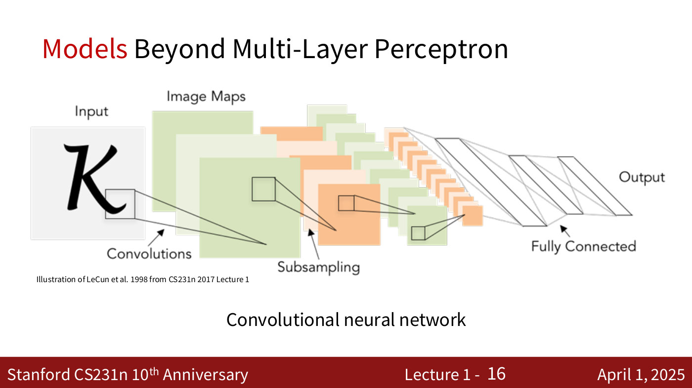

*Part 2, slide 16 — Models Beyond Multi-Layer Perceptron. [Deck](https://cs231n.stanford.edu/slides/2025/lecture_1_part_2.pdf)*

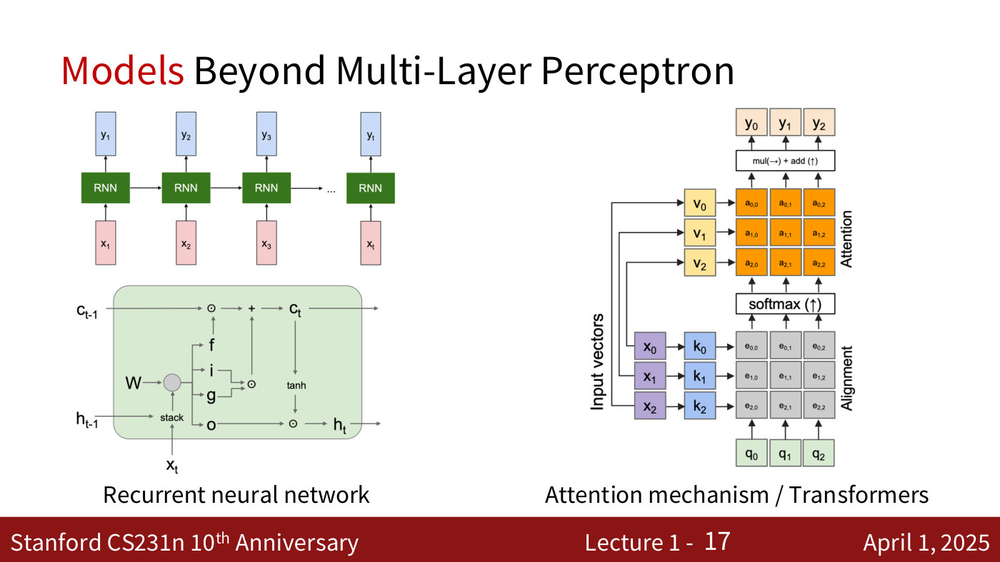

*Part 2, slide 17 — beyond the MLP: an unrolled RNN with an LSTM cell (left), and the attention mechanism behind transformers (right). [Deck](https://cs231n.stanford.edu/slides/2025/lecture_1_part_2.pdf)*

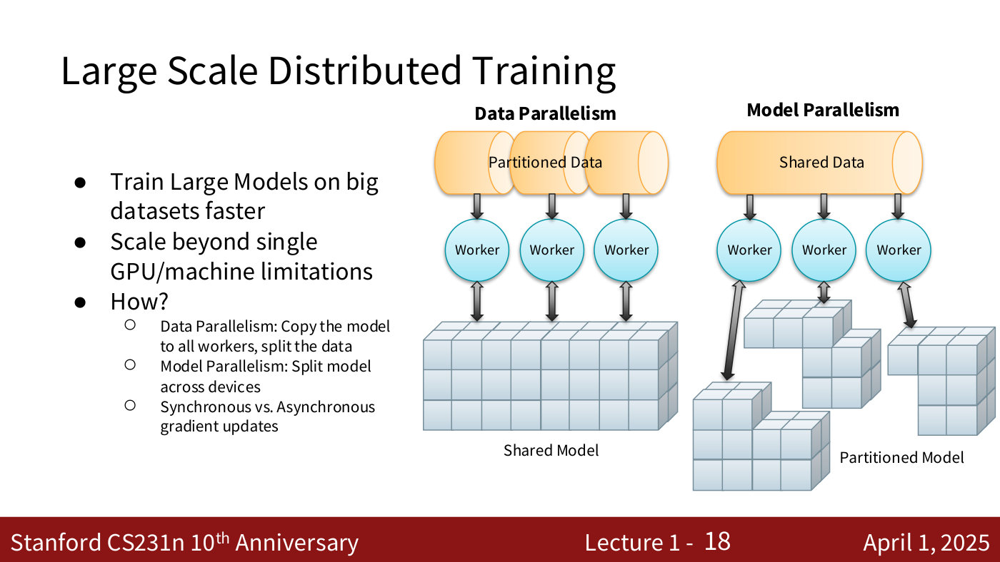

*Part 2, slide 18 — Large Scale Distributed Training. [Deck](https://cs231n.stanford.edu/slides/2025/lecture_1_part_2.pdf)*

### Generative and interactive visual intelligence (lectures 13–17)

This part goes "beyond 2D recognition" (≈55:30–59:27). Adeli opens it with self-supervised
learning, although the ranges on part 2, slide 51 put lecture 12, Self-Supervised Learning, in the perception
part.

**Self-supervised learning** is learning in which "models learn to understand and represent data
by getting some training signals from the data itself", which lets large models train on vast
unlabelled datasets. On the slide, two views of the same image pass through a shared embedding
network and a distance function compares the two embeddings (part 2, slide 22).

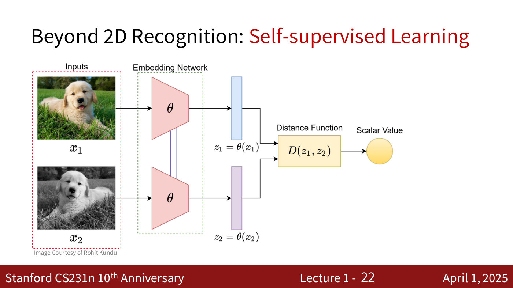

*Part 2, slide 22 — self-supervised learning: two views of one image pass through a shared embedding network θ, and a distance function compares the embeddings. [Deck](https://cs231n.stanford.edu/slides/2025/lecture_1_part_2.pdf)*

**Generative models** "go beyond recognition. They actually generate." Style transfer is the
classic example — a Stanford photo re-rendered in the style of *The Starry Night* (part 2,
slide 23) — and text-to-image models such as DALL-E 2 now generate entirely novel images from a
prompt (part 2, slide 24).

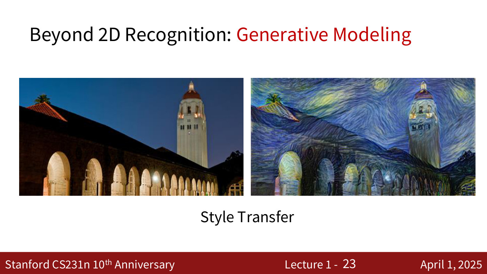

*Part 2, slide 23 — Beyond 2D Recognition: Generative Modeling. [Deck](https://cs231n.stanford.edu/slides/2025/lecture_1_part_2.pdf)*

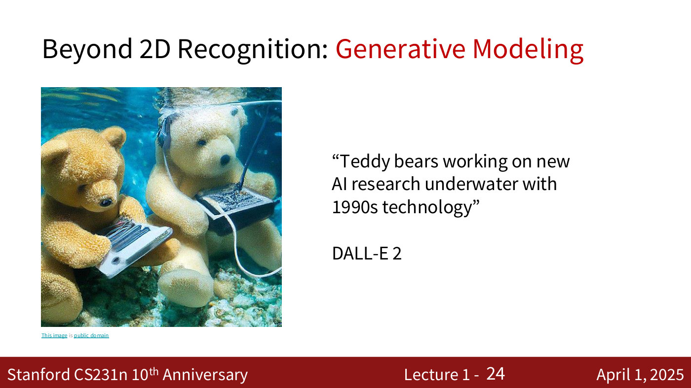

*Part 2, slide 24 — Beyond 2D Recognition: Generative Modeling. [Deck](https://cs231n.stanford.edu/slides/2025/lecture_1_part_2.pdf)*

**Diffusion models** "learn to reverse a gradual noising process to generate images". In
Assignment 3 students implement a generative model that produces emojis from text prompts, such
as "face with a cowboy hat", denoised from pure noise (≈57:03–57:51; part 2, slide 25).

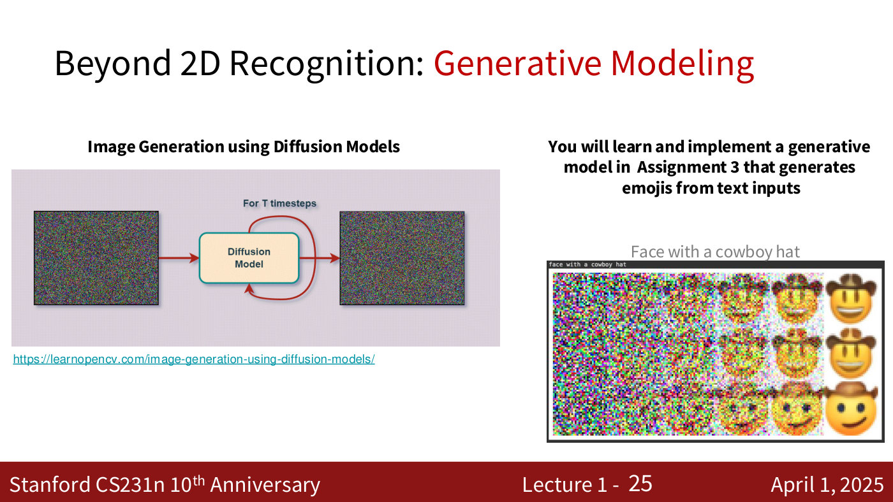

*Part 2, slide 25 — diffusion: a model denoises step by step over T timesteps; Assignment 3 uses this to generate emojis from text. [Deck](https://cs231n.stanford.edu/slides/2025/lecture_1_part_2.pdf)*

**Vision–language models** connect text and images in a shared representation space, for
cross-modal retrieval, captioning and visual question answering; the slide includes CLIP's
contrastive pre-training diagram (≈57:51–58:39; part 2, slide 26).

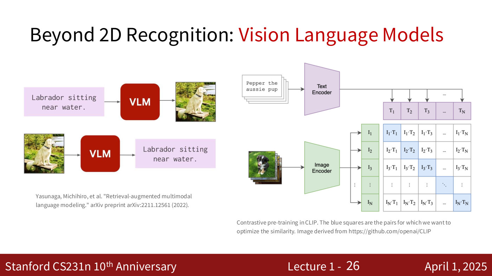

*Part 2, slide 26 — Beyond 2D Recognition: Vision Language Models. [Deck](https://cs231n.stanford.edu/slides/2025/lecture_1_part_2.pdf)*

**3D vision** covers voxel reconstruction, shape completion and 3D object detection from single
images, important for robotics and AR/VR (≈58:39; part 2, slide 27).

*Part 2, slide 27 — Beyond 2D Recognition: 3D Vision. [Deck](https://cs231n.stanford.edu/slides/2025/lecture_1_part_2.pdf)*

**Embodied intelligence** means agents that perceive, plan and act, from cleaning up a messy room
to generalising from human demonstrations (≈59:27; part 2, slide 28).

*Part 2, slide 28 — Beyond 2D Recognition: Embodied Intelligence. [Deck](https://cs231n.stanford.edu/slides/2025/lecture_1_part_2.pdf)*

### Human-centred applications and implications (lecture 18)

Adeli points to how the field's impact has been recognised (≈59:27–1:01:02): the 2018 Turing
Award to Geoffrey Hinton, Yoshua Bengio and Yann LeCun "for conceptual and engineering
breakthroughs that have made deep neural networks a critical component of computing" (part 2,
slide 31), and the 2024 Nobel Prize in Physics to Hinton jointly with John Hopfield (part 2,
slide 32). The deck adds two slides not discussed aloud: the IEEE PAMI Longuet-Higgins Prize,
awarded at CVPR 2019 to the 2009 ImageNet paper (part 2, slide 33), and CVPR paper statistics,
with submissions rising from 1,131 in 2006 to 9,155 in 2023 and acceptances from 318 to 2,359
(part 2, slide 34).

![Part 2, slide 34 — [CVPR Nashville and CVPR paper statistics]](../raw/images/01-introduction-part-2/slide-34.jpg)

*Part 2, slide 34 — [CVPR Nashville and CVPR paper statistics]. [Deck](https://cs231n.stanford.edu/slides/2025/lecture_1_part_2.pdf)*

### Learning objectives and what comes next

The course's three learning objectives are (≈1:01:02; part 2, slide 49):

1. **Formalize computer vision applications into tasks** — define inputs and outputs, and the data
   and compute a model needs.
2. **Develop and train vision models** — code, debug and train convolutional networks, and use
   frameworks such as PyTorch and TensorFlow.
3. **Gain an understanding of where the field is and where it is headed** — recent research, open
   challenges, and the ethical and societal considerations before deployment.

The basics come first — "bear with us, because these are important topics and you need to
understand the details first: how to build the models from scratch" (≈1:01:48). The next lecture
is image classification with linear classifiers: k-nearest neighbour and linear classification
(≈1:02:34; part 2, slide 52). See [Lecture 2](02-image-classification.md).

*Part 2, slide 52 — Next time: Image classification with Linear Classifiers. [Deck](https://cs231n.stanford.edu/slides/2025/lecture_1_part_2.pdf)*

### Logistics (not presented aloud)

The recording skips from the award slides to the learning objectives, so the logistics slides —
lectures, website, discussion sections, Ed, office hours, assignments, grading, late days,
collaboration policy, prerequisites, textbooks and career paths (part 2, slides 35–50) — are
known only from the deck. They are summarised in [course logistics](course-logistics.md).

---

## Sources

- [Edited transcript](../raw/transcripts/01-introduction.md) — repunctuated, with restored names
  listed in its header. Seven passages are marked `[unclear]` or `[Ed:]` there.
- [Part 1 deck, slide by slide](../raw/slides/01-introduction-part-1.md) — 69 slides, every figure
  described; [PDF](https://cs231n.stanford.edu/slides/2025/lecture_1_part_1.pdf).
- [Part 2 deck, slide by slide](../raw/slides/01-introduction-part-2.md) — 50 pages, printed
  numbers 1–53; [PDF](https://cs231n.stanford.edu/slides/2025/lecture_1_part_2.pdf).
- [Video](https://www.youtube.com/watch?v=2fq9wYslV0A).
