# Lecture 2 — Image Classification with Linear Classifiers

**CS231N Deep Learning for Computer Vision, Stanford, Spring 2025.** Delivered April 3, 2025, by
Ehsan Adeli. [Video](https://www.youtube.com/watch?v=pdqofxJeBN8) ·
[edited transcript](../raw/transcripts/02-image-classification.md) ·
deck as [text](../raw/slides/02-image-classification.md) /
[PDF](https://cs231n.stanford.edu/slides/2025/lecture_2.pdf)

## What this lecture establishes

Image classification — give the machine an image and a fixed set of labels, and have it pick the
right label — is easy for people and hard for a computer, because the computer sees only a grid of
numbers, and those numbers change completely with viewpoint, lighting, clutter, occlusion, pose and
breed. Since no one can write down rules for "cat", the course takes the **data-driven approach**:
collect labelled images, train a classifier, and evaluate it on new images. The lecture builds two
such classifiers. The **k-nearest-neighbour** classifier memorises the training set and labels a
new image by its closest training images; it is used to introduce distance metrics,
**hyperparameters** and how to choose them with a validation set or cross-validation. The
**linear classifier** $f(x, W) = Wx + b$ learns a weight matrix instead, and is the building block
of every neural network in the rest of the course; the lecture reads it three ways (algebraic,
visual, geometric), shows what it cannot separate, and defines the **softmax (cross-entropy) loss**
that measures how good a choice of $W$ is. Finding the best $W$ — optimisation — is left for the
[next lecture](03-regularization-optimization.md).

**What the recording covers.** The recording starts at the syllabus (slide 5), so the
administrative slides 2–4 are known only from the deck. It ends mid-sentence at 1:06:37, while
answering the second softmax question (slide 83). The deck's last 21 slides — a "coming up" slide,
the **multiclass SVM loss**, assigned as a reading (slides 85–100), and a comparison of softmax and
SVM (the deck's last four slides) — are not presented; they are summarised at the end of this page from the
slides alone.

**Citing this lecture.** Slide numbers are the numbers printed on the slides. Printed numbers 32
and 49 were hidden in the source deck, so from PDF page 32 on the printed number runs one ahead of
the page, and from page 48 on, two ahead (slide 104 is PDF page 102). Timestamps are written
(≈M:SS) and refer to the video.

## Administrative notes (slides only)

Assignment 1 is out Wednesday 4/9 and due 4/23 by 11:59 PM, covering k-nearest neighbor, linear
classifiers (softmax), a two-layer neural network, image features, and deep neural networks and
optimizers (slide 2). The course-project proposal is due Friday 4/25 at 11:59 PM; each project team
is assigned a TA, partners can be found through a Google Form, and "Is X a valid project for 231n?"
goes to a private Ed post or TA office hours (slide 3). The first discussion section is that Friday,
12:30–1:20 PM, in the NVIDIA Auditorium and on Zoom, on Python, NumPy and Google Colab, presented by
Emily Jin with Matthew Jin (slide 4). See [course logistics](course-logistics.md) for the rest.

## The image classification task

The lecture opens on the syllabus: of the "Deep Learning Basics" topics, today covers data-driven
approaches, linear classification and k-nearest neighbor (≈0:51–1:37; slide 5). Image
classification is "a core task in computer vision" that the course returns to "quite often
throughout the quarter because it's a very good benchmark" (≈1:37). The task: given an image and a
predetermined set of possible labels — dog, cat, truck, plane — the system assigns one of those
labels to the image (≈2:24–3:11; slide 7). Other approaches beyond the two covered here are in the
deck's backup slides, which are not in the posted PDF (≈2:24).

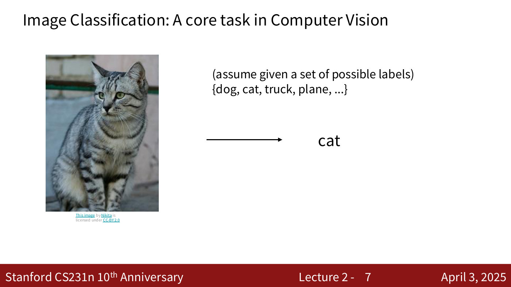

*Slide 7 — Image Classification: A core task in Computer Vision. [Deck](https://cs231n.stanford.edu/slides/2025/lecture_2.pdf)*

For a person this is "a very, very easy task", because our brains are wired for a holistic
understanding of the image; for a computer it is "a completely different story" (≈3:11). The
computer sees a tensor of integers, each pixel value between 0 and 255 (8 bits); an $800 \times 600$ colour
image has three channels, red, green and blue, so it is an $800 \times 600 \times 3$ tensor (≈3:56; slide 8).
The difference between what we perceive and what the machine sees is the **semantic gap** (≈4:43).

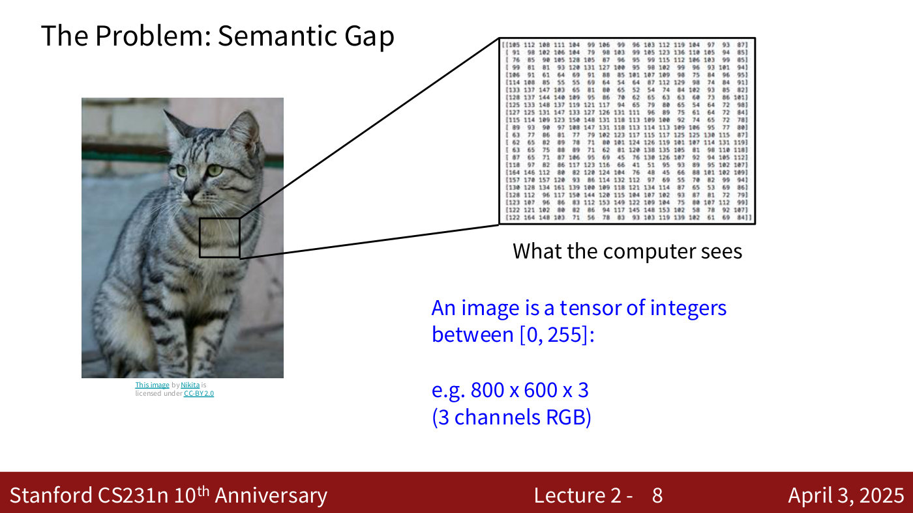

*Slide 8 — the semantic gap: a patch of the cat becomes a grid of integers, which is all the computer sees. [Deck](https://cs231n.stanford.edu/slides/2025/lecture_2.pdf)*

### Why it is hard: the challenges

**Viewpoint variation.** Move the camera — even pan it while the cat sits perfectly still — and
every one of the $800 \times 600 \times 3$ pixel values changes. To us it is the same object; to the computer
it is a completely new data point (≈4:43–5:28; slide 9).

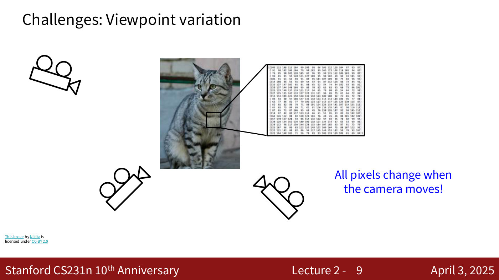

*Slide 9 — Challenges: Viewpoint variation. [Deck](https://cs231n.stanford.edu/slides/2025/lecture_2.pdf)*

**Illumination.** A pixel's RGB value is a function of the surface material's colour and of the
light source, so the same cat gives different numbers in a dark room and under the sun — "it's
still the cat" (≈5:28–7:01; slide 10).

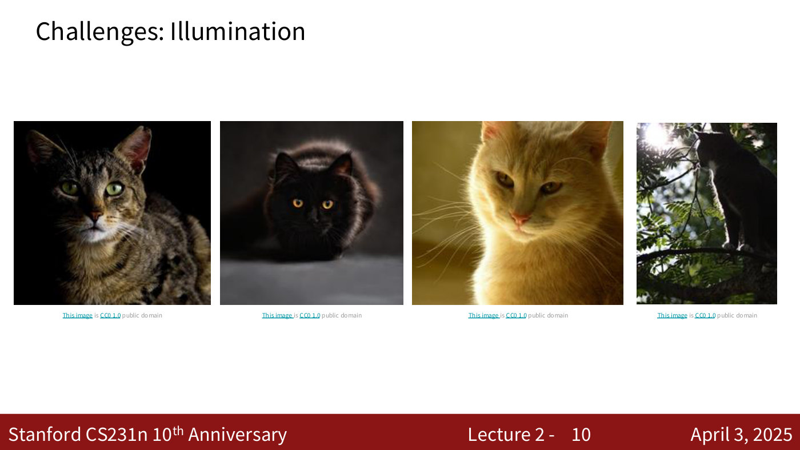

*Slide 10 — Challenges: Illumination. [Deck](https://cs231n.stanford.edu/slides/2025/lecture_2.pdf)*

**Background clutter, scale and resolution.** Asked for more challenges, students named
background clutter — the object blending into its surroundings — and zooming in and out, which
Adeli calls the scale of the object (≈7:01; slide 11). A student also suggested resolution; he
answers that because models normalise the size of the input image, resolution matters less unless
it comes with zooming effects on the object (≈7:01–7:50).

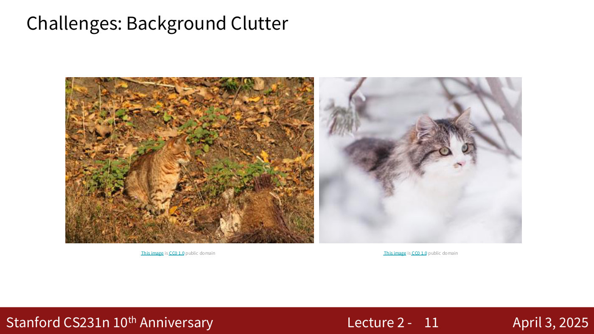

*Slide 11 — Challenges: Background Clutter. [Deck](https://cs231n.stanford.edu/slides/2025/lecture_2.pdf)*

**Occlusion.** Only part of the object may be visible. In the slide's last example only a tail, and
perhaps a little of a paw, shows between sofa cushions; it could be a tiger or a raccoon, but
because it is on a couch in a living room it is most probably a cat (≈7:50–8:37; slide 12). Context
does the work.

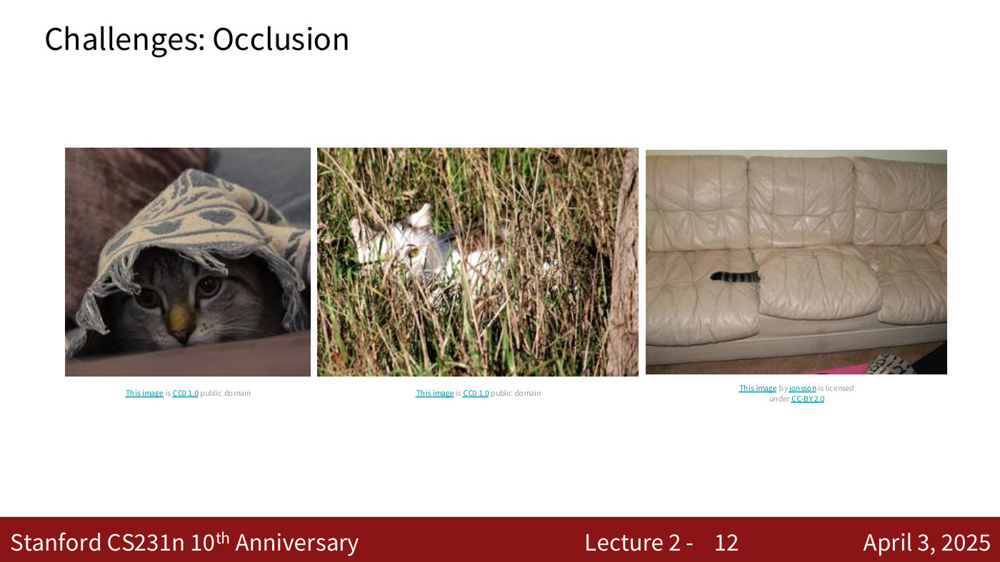

*Slide 12 — Challenges: Occlusion. [Deck](https://cs231n.stanford.edu/slides/2025/lecture_2.pdf)*

**Deformation.** "Cats are very deformable", which challenges algorithms built step by step to
detect them — "not today's algorithms", he adds (≈8:37–9:24; slide 13).

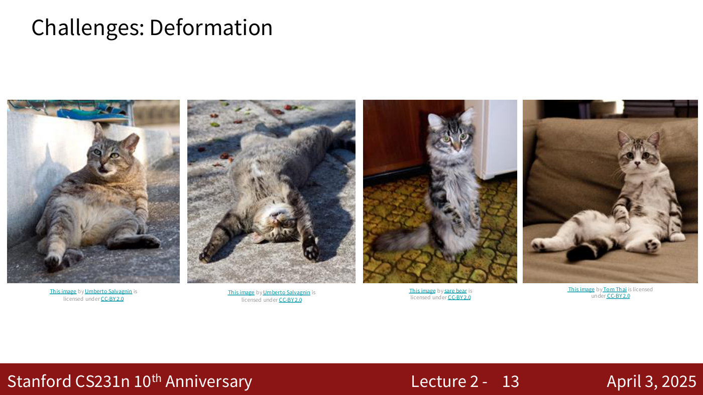

*Slide 13 — Challenges: Deformation. [Deck](https://cs231n.stanford.edu/slides/2025/lecture_2.pdf)*

**Intraclass variation.** Cats come in different sizes, colours, patterns and breeds, and all of
them are still cats (≈9:24; slide 14).

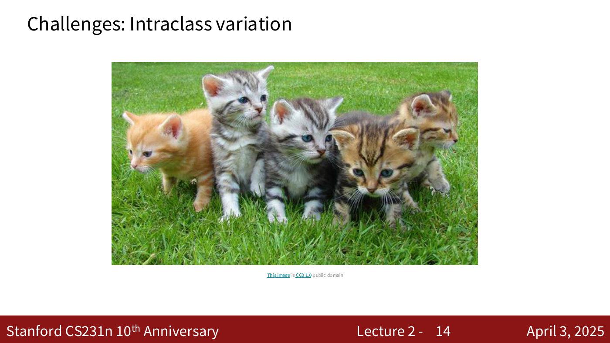

*Slide 14 — Challenges: Intraclass variation. [Deck](https://cs231n.stanford.edu/slides/2025/lecture_2.pdf)*

**Context.** Looked at alone, the cropped animal on the right of slide 15 is easy to classify as a
tiger; with the context — a street, a fence, and the shadows the fence bars cast across its fur —
it can be classified correctly (≈9:24–10:09; slide 15).

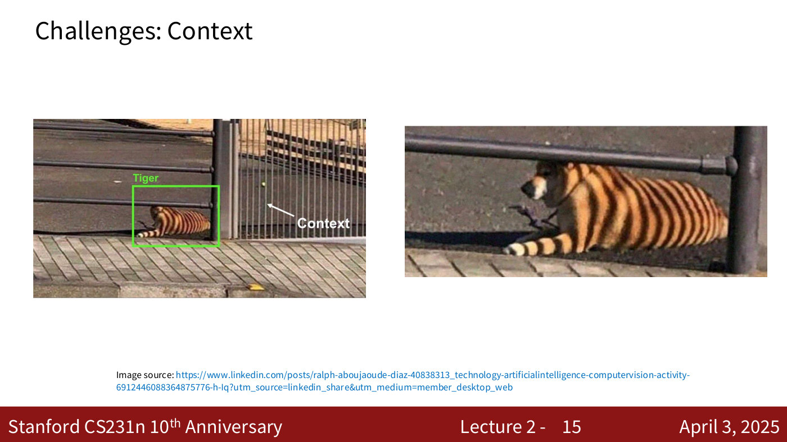

*Slide 15 — context: cropped, the animal's fur looks striped like a tiger's; the stripes are shadows of the fence bars. [Deck](https://cs231n.stanford.edu/slides/2025/lecture_2.pdf)*

Despite all this, today's classifiers do "a really great job" at classifying images, thanks to
efforts like ImageNet and the larger-scale benchmarks that followed (≈10:55; slide 16; see
[ImageNet](imagenet.md)). The rest of the course builds, step by step, the building blocks of those
models (≈10:55–11:44).

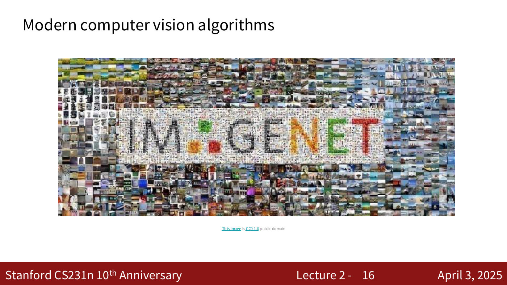

*Slide 16 — Modern computer vision algorithms. [Deck](https://cs231n.stanford.edu/slides/2025/lecture_2.pdf)*

## From hand-written rules to the data-driven approach

For sorting a list there is a clear flowchart of if-then-else steps; for recognising a cat there is
"no way to hardcode the steps" (≈11:44–12:30; slide 17). There have been attempts: find the edges
in the image, then important patterns such as corners, extract features around them or count
corner types, and map those to a class (≈12:30–13:16; slide 18, which credits Canny's 1986 edge
detector). These worked on images of very limited variability but do not scale: the rules have to
be written for every object, and finding the logic for each takes a great deal of effort by itself
(≈13:16–14:02).

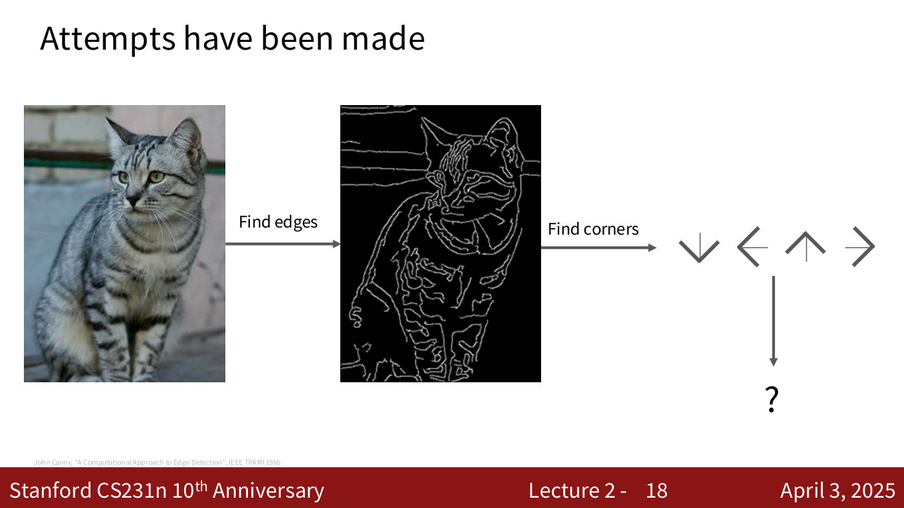

*Slide 18 — Attempts have been made. [Deck](https://cs231n.stanford.edu/slides/2025/lecture_2.pdf)*

Machine learning replaces the logic with data, in three steps (≈14:02–16:20; slide 19). First,
collect a dataset of images and labels — "10, 20 years ago" by running image searches on the
internet, today from existing datasets. Second, train a classifier: a function `train(images,
labels)` that builds a model associating images with labels. Third, evaluate it on new images: a
function `predict(model, test_images)` that labels images that were not in the training set.

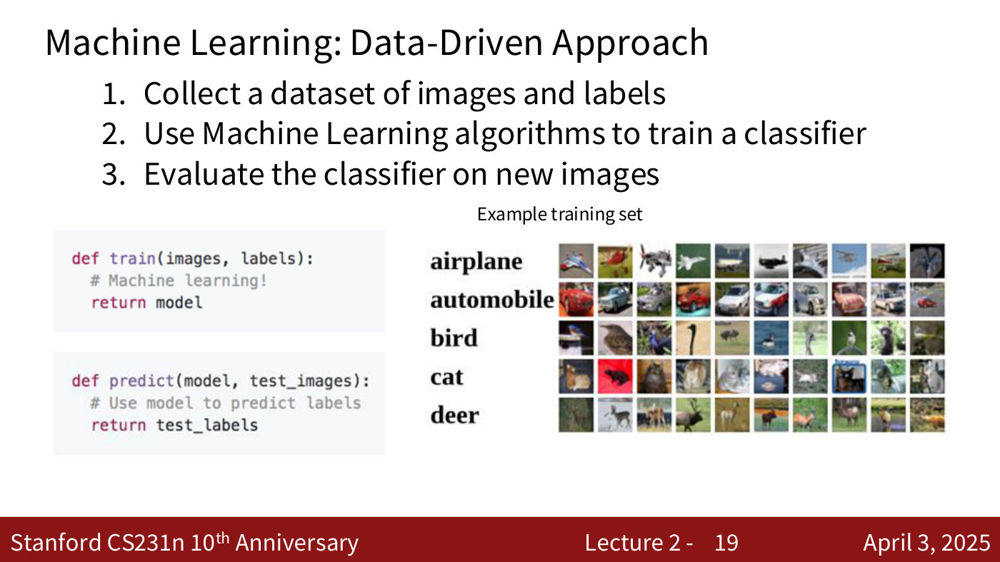

*Slide 19 — Machine Learning: Data-Driven Approach. [Deck](https://cs231n.stanford.edu/slides/2025/lecture_2.pdf)*

## The nearest-neighbour classifier

The simplest data-driven classifier, studied first because its simplicity makes the surrounding
concepts easy to explain (≈16:20–17:05). **Training memorises** all the images and labels — "the
training function basically doesn't do anything other than keeping everything in memory".
**Prediction** finds the most similar training image and outputs its label (≈17:05–17:51;
slide 21).

Finding "the most similar" needs a **distance function**: it takes two images and returns a real
number measuring how alike they are (≈17:51–18:37; slide 22).

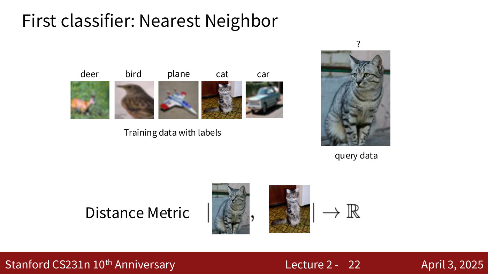

*Slide 22 — First classifier: Nearest Neighbor. [Deck](https://cs231n.stanford.edu/slides/2025/lecture_2.pdf)*

### L1 distance

The first, and one of the most popular, is the **L1 distance**, the sum over all pixels of the
absolute differences between two images $I_1$ and $I_2$ (≈18:37–19:22; slide 23):

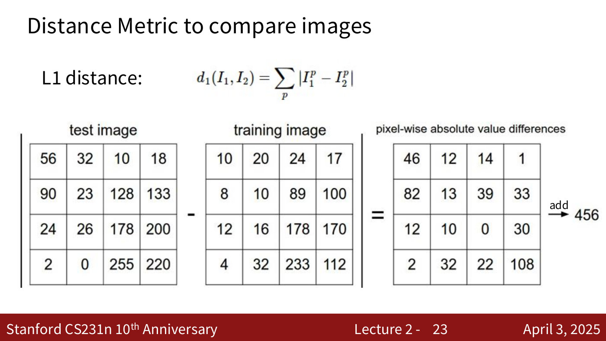

*Slide 23 — L1 distance between a test and a training image: subtract pixel by pixel, take absolute values, add up (456). [Deck](https://cs231n.stanford.edu/slides/2025/lecture_2.pdf)*

$$d_1(I_1, I_2) = \sum_p \vert I_1^p - I_2^p \vert$$

where $p$ runs over pixel positions and $I^p$ is the value of image $I$ at pixel $p$. The slide works
a $4 \times 4$ example: subtract the training image from the test image pixel by pixel, take absolute
values, and add — the distance is 456. "The most basic distance function, but it's actually very
useful in many applications", and it returns throughout the course (≈19:22–20:10).

In NumPy the classifier is a few lines (≈20:10–20:56; slides 24–26): `train` stores `X` and `y`;
`predict` loops over test images, computes the L1 distance to every training row with
`np.sum(np.abs(self.Xtr - X[i,:]), axis = 1)`, and copies the label at `np.argmin` of the distances.

Two student questions follow. Pixel values are the RGB values at each pixel location of the
$800 \times 600 \times 3$ tensor (≈20:56). They run from 0 to 255 because RGB, the most common standard, is a
24-bit format with 8 bits for each of the red, green and blue channels — sometimes 32 bits, with an
alpha channel (≈21:42–22:27).

### Speed: the wrong way round

With $N$ training examples, training is $O(1)$ — nothing is computed or even moved, only a copy is
kept — and prediction is $O(N)$, since every test image must be compared with every training image
(≈22:27–24:48; slide 27). That is backwards: "we want classifiers that are fast at prediction; slow
for training is ok" (slide 27), because training can be done offline (≈24:48–25:35). Adeli compares
it to a chatbot that, for every question, compared the question with every possible answer on the
internet before replying. Faster and approximate nearest-neighbour methods, including GPU ones,
exist but are beyond this course; the slide points to the `faiss` library (Johnson et al.,
"Billion-scale similarity search with GPUs", 2017) (≈25:35; slide 28).

### Decision regions, and why k > 1

Plotting training points from five classes in 2D and colouring every location by the class of its
nearest training point shows how the **1-nearest-neighbour** classifier partitions the space
(≈25:35–26:23; slide 29). The partition has a problem: a single yellow point sitting in the middle
of the green points carves out a yellow island around itself. It is probably an outlier or noise,
and with only one neighbour it decides a whole region (≈27:09).

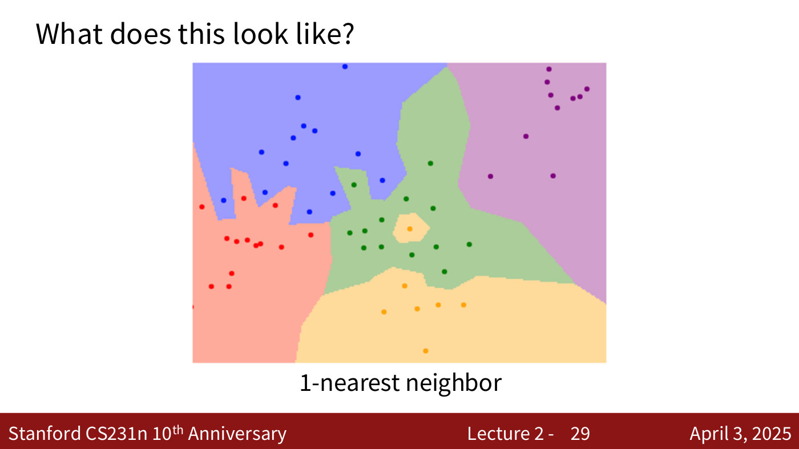

*Slide 29 — What does this look like?. [Deck](https://cs231n.stanford.edu/slides/2025/lecture_2.pdf)*

**k-nearest neighbours** makes this more robust: instead of copying the nearest point's label, take
a majority vote among the $k$ closest training points (≈27:09–27:55; slide 30). With $k = 3$ and
$k = 5$ the boundaries smooth out and the yellow island disappears, but **white regions** appear:
places where the vote is tied between classes and no decision can be made. Those are "good regions
to go and collect more data for" (≈27:55–28:42). Asked later how to decide in a tie, he says the
usual choice is a random one of the top candidates; and when, in a problem such as genetics or
medical imaging, you see pockets of the space with no good samples or with ambiguity, you go and
collect samples from that area (≈44:58–45:44).

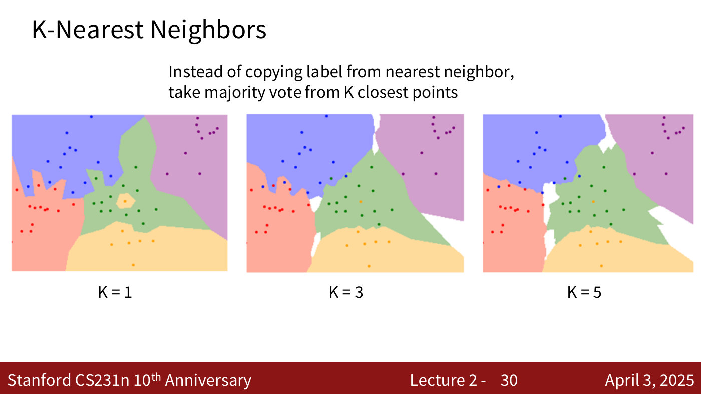

*Slide 30 — majority vote over K = 1, 3, 5 neighbours: the yellow island disappears, and white tie regions appear where no class wins. [Deck](https://cs231n.stanford.edu/slides/2025/lecture_2.pdf)*

### L1 versus L2

The second choice to make is the distance function (≈28:42). The **L1 distance** is also called
the Manhattan distance; the points at equal L1 distance from the origin form a square, drawn
rotated 45° as a diamond (≈29:28–30:15; slide 31). The **L2 (Euclidean) distance** squares the
differences, sums them, and takes the square root:

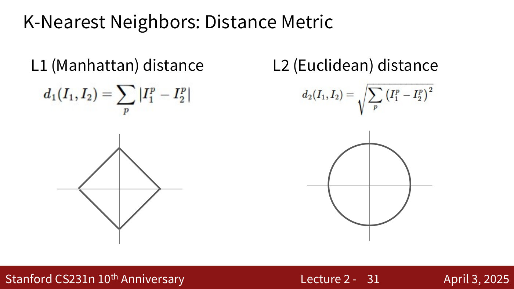

*Slide 31 — K-Nearest Neighbors: Distance Metric. [Deck](https://cs231n.stanford.edu/slides/2025/lecture_2.pdf)*

$$d_2(I_1, I_2) = \sqrt{\sum_p \left(I_1^p - I_2^p\right)^2}$$

and the points at equal L2 distance from the origin form a circle (≈30:15; slide 31). Slide 33 puts
numbers on this: the points $A = (1, 0)$ and $B = (0.5, 0.5)$ are both at L1 distance 1 from the
origin $O$, while under L2 the point at distance 1 in the diagonal direction is
$(1/\sqrt{2}, 1/\sqrt{2})$. The worked example is on the slide only; the lecture describes the
shapes.

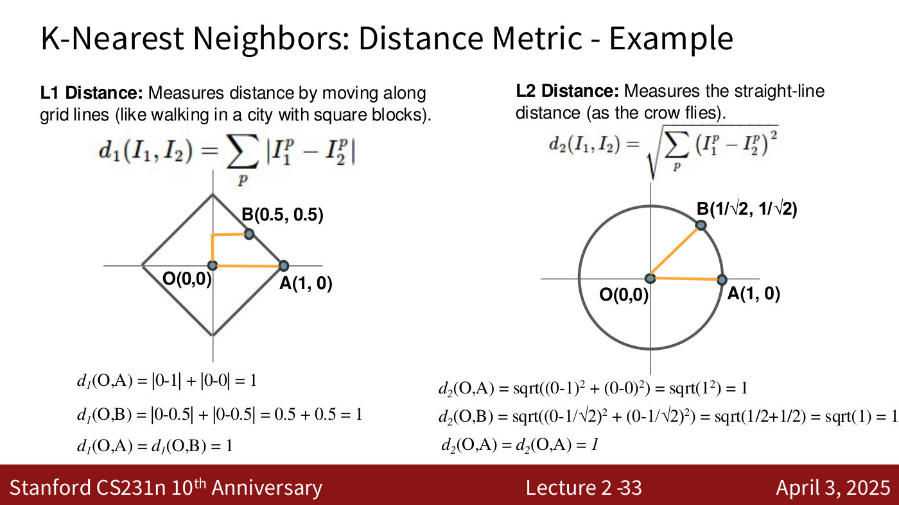

*Slide 33 — A and B are both at L1 distance 1 from O (left); at L2 distance 1 the diagonal point moves out to (1/√2, 1/√2) (right). [Deck](https://cs231n.stanford.edu/slides/2025/lecture_2.pdf)*

The axes of these pictures are features — two pixel values, say (≈31:01). **Rotating the axes
changes L1 distances but not L2 distances.** So, in Adeli's account, when the features are specific
and meaningful and their information should be preserved, L1 is often better, because its shape
enforces distances along the features; when the features are more arbitrary, L2 makes more sense
(≈31:01–31:47). A student asked why L1 is better for preserving features; he answers that
rotating the feature axes changes the L1 distance function completely while L2 is unchanged, so L1
is sensitive to the particular features and L2 is not (≈32:32–34:04).

On the same data with $k = 1$, the L1 decision boundaries run mostly parallel to the two feature
axes, while the L2 boundaries are smoother (≈34:04–34:51; slide 34). An interactive demo on the
lab's website lets you try different distance functions and values of $k$ (≈34:51; slide 35, which
links <http://vision.stanford.edu/teaching/cs231n-demos/knn/>).

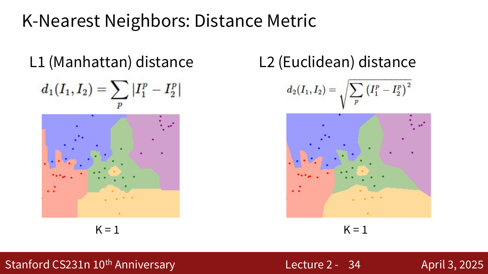

*Slide 34 — the same data with K = 1: L1 boundaries (left) run mostly parallel to the axes; L2 boundaries (right) are smoother. [Deck](https://cs231n.stanford.edu/slides/2025/lecture_2.pdf)*

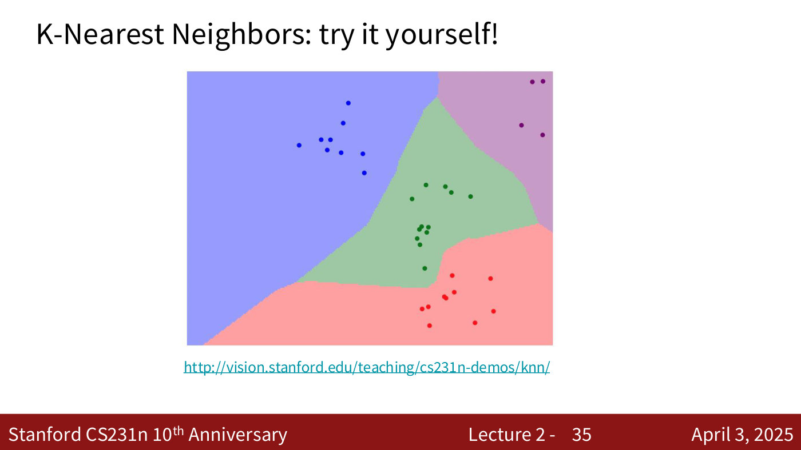

*Slide 35 — K-Nearest Neighbors: try it yourself!. [Deck](https://cs231n.stanford.edu/slides/2025/lecture_2.pdf)*

## Hyperparameters and how to set them

A main reason for studying nearest neighbour is that it introduces **hyperparameters**: choices you
must make to run the algorithm at all (≈35:39). Here they are $k$ and the distance function. Their
best values are very much dataset- and problem-dependent, so they have to be found for each
problem — **hyperparameter tuning** (≈36:25; slide 36). See also
[hyperparameters and validation](hyperparameters-and-validation.md).

The deck builds up four ways to choose them (slides 37–42).

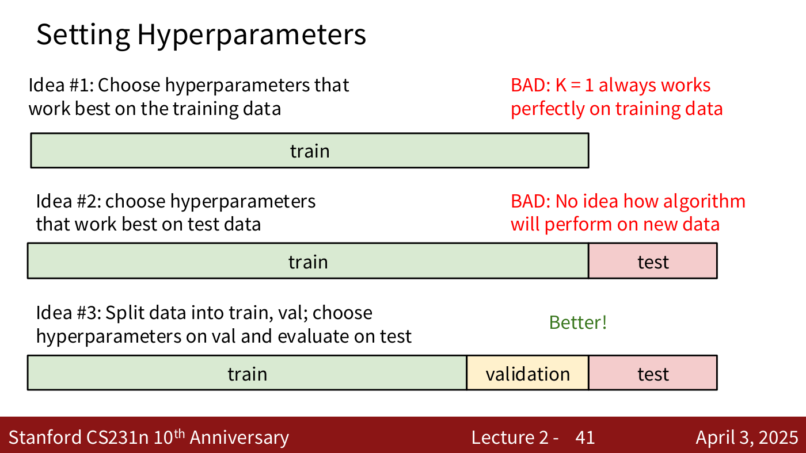

*Slide 41 — Setting Hyperparameters. [Deck](https://cs231n.stanford.edu/slides/2025/lecture_2.pdf)*

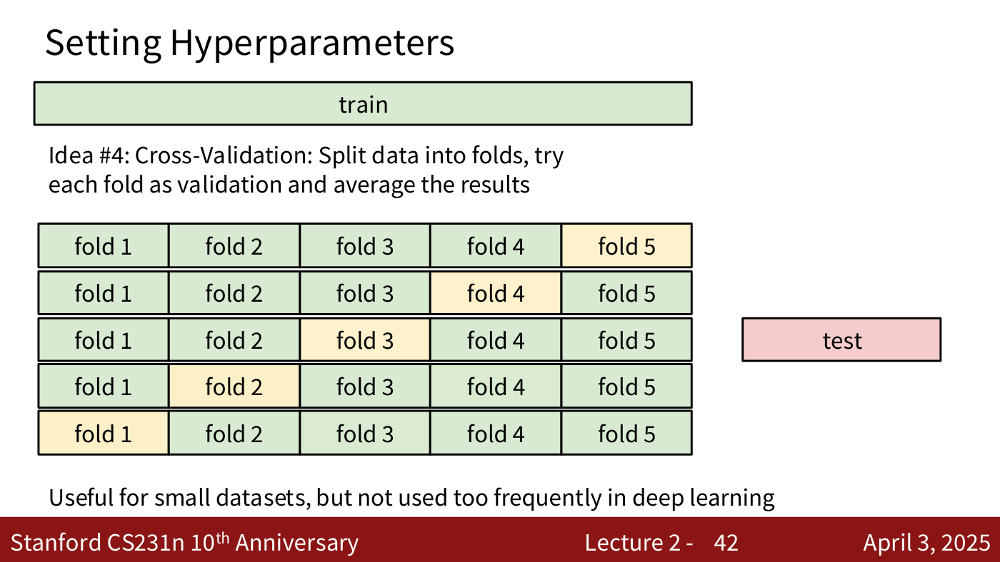

*Slide 42 — Setting Hyperparameters. [Deck](https://cs231n.stanford.edu/slides/2025/lecture_2.pdf)*

**Idea 1: whatever works best on the training data.** A bad idea: with nearest neighbour, $k = 1$
always gives 100% training accuracy, because the training data is memorised (≈36:25–37:12;
slides 37–38).

**Idea 2: whatever works best on the test data.** Better than the first, but "kind of cheating":
you have no idea how the model will do on data outside the test set. "Never do this" (≈37:12–38:00;
slides 39–40).

**Idea 3: split off a validation set.** Train on part of the training data, choose the
hyperparameters on the held-out validation part, and only then run the chosen setting on the test
set (≈38:00–39:33; slide 41). Its weakness is that a validation set, usually much smaller, may not
represent the whole landscape.

**Idea 4: cross-validation.** Split the training data into folds — five on the slide — let each
fold serve once as the validation set, train on the rest, and average the five validation
accuracies; repeat for each hyperparameter setting, pick the best, and apply it to the test set
(≈39:33–40:19; slide 42). It is more reliable, but in large-scale deep learning it is less
practised, because repeating training five times on huge datasets is very hard; there, intuition
and a single validation set are common. Outside computer vision and large datasets it is advised,
and research papers often require it to show results are reproducible (≈40:19–41:07). The slide
says it is "useful for small datasets, but not used too frequently in deep learning".

## k-NN on real images: CIFAR-10

**CIFAR-10**, which the assignments use often, has 10 classes, 50,000 training images and 10,000
test images (≈41:07–41:53; slides 43–44); each image is $32 \times 32 \times 3$ (slide 58). The source is Alex
Krizhevsky, "Learning Multiple Layers of Features from Tiny Images", technical report, 2009.
Slide 44 adds, for ten test images, their ten nearest training images.

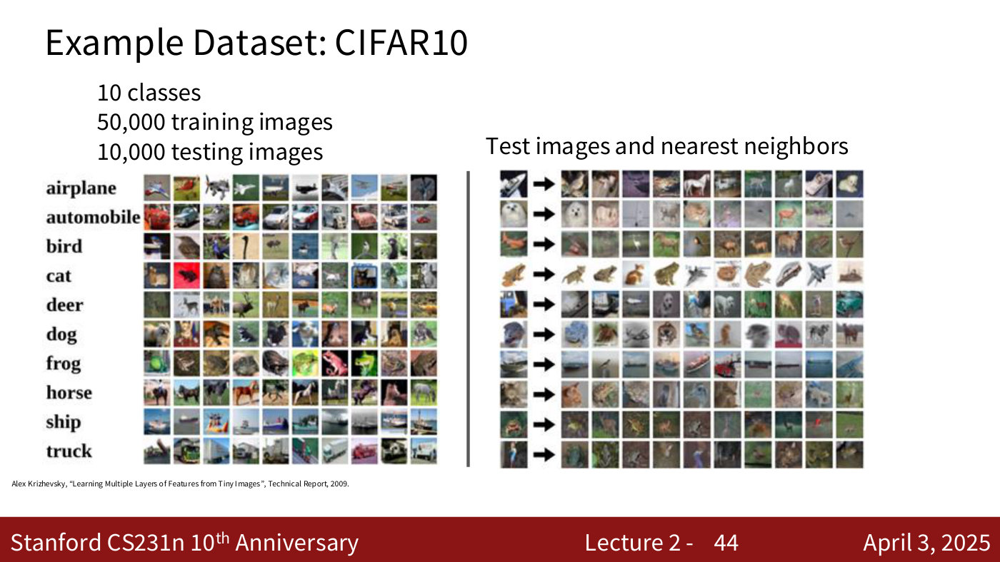

*Slide 44 — Example Dataset: CIFAR10. [Deck](https://cs231n.stanford.edu/slides/2025/lecture_2.pdf)*

Five-fold cross-validation on $k$ is plotted on slide 45: one dot per fold for each tested $k$, a
line through the means and bars for the standard deviation. The slide's conclusion is "Seems that
k ~= 7 works best for this data", and Adeli reads the best accuracy as close to 28–29% — the exact
words are unclear in the captions (≈42:39). Read off the chart, the mean rises from about 0.27 at
$k = 1$ to about 0.29 around $k = 8$–10, then falls back to about 0.27 at $k = 100$. That is "not
too bad", since random guessing on a 10-class problem gets about 10% — but there is a lot of room to
improve (≈42:39–43:25).

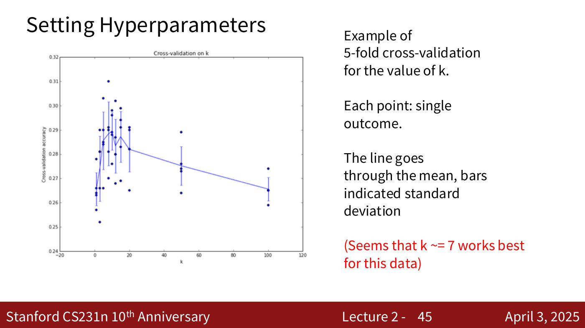

*Slide 45 — five-fold cross-validation on k for CIFAR-10: one dot per fold, the line through the means; the slide reads the best as k ≈ 7. [Deck](https://cs231n.stanford.edu/slides/2025/lecture_2.pdf)*

Looking at the neighbours shows why (≈43:25–44:12; slide 47). There are many mistakes, especially
in the single closest neighbour: in the fourth row the test image is a frog but its nearest
neighbour is a dog. The distance is applied to pixels, and pixel-wise the two images look alike —
the same colours in most pixels. The slide outlines each row's first neighbour in red or green
without labelling the colours.

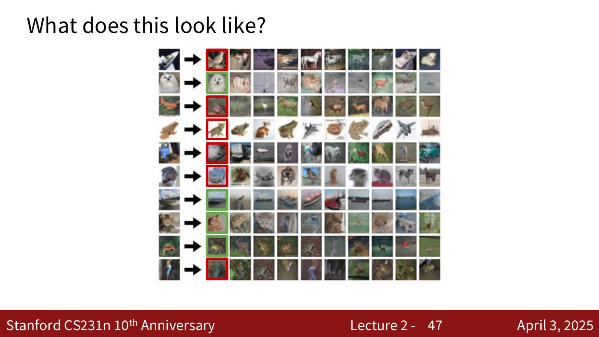

*Slide 47 — ten CIFAR-10 test images and their nearest training images by pixel distance; the first neighbour is outlined red in six rows and green in four (the slide does not label the colours). [Deck](https://cs231n.stanford.edu/slides/2025/lecture_2.pdf)*

The conclusion is stated in slide 48's title: **k-nearest neighbour with pixel distance is never
used**, because distance metrics on pixels are not informative. An occluded copy of a photograph, a
copy shifted by one pixel, and a tinted copy are all at the same pixel distance from the original,
though to a human the shifted one is no different at all (≈44:12–44:58; slide 48). Better
approaches come in later lectures.

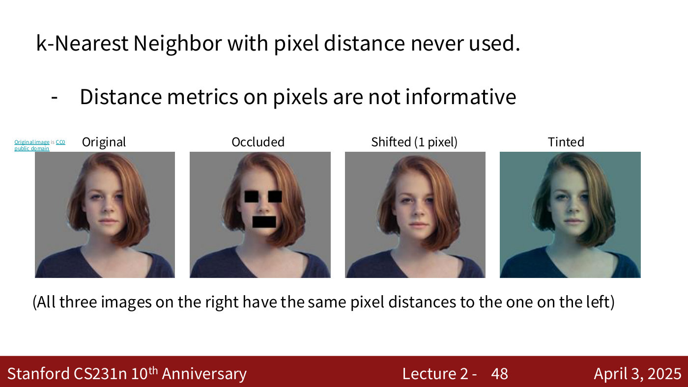

*Slide 48 — occluded, shifted by one pixel, and tinted copies all sit at the same pixel distance from the original. [Deck](https://cs231n.stanford.edu/slides/2025/lecture_2.pdf)*

**Summary of k-NN** (slide 50): in image classification we start with a training set of images and
labels and must predict labels on the test set; k-NN predicts from the $k$ nearest training
examples; the distance metric and $k$ are hyperparameters; choose them on the validation set; and
"only run on the test set once at the very end!" (≈45:44).

## The linear classifier

Adeli calls this "the most important building block for almost all of deep learning" (≈46:29). See
also [linear classifiers](linear-classifiers.md).

### The parametric approach

Unlike nearest neighbour, the linear classifier is **parametric**: it learns parameters $W$, the
weights, and a function $f(x, W)$ that maps an input image $x$ to output numbers, here one score per
class giving the image's membership in each of the 10 classes (≈46:29–47:14; slide 52). For
CIFAR-10 the image is a $32 \times 32 \times 3$ array, so $x$ is a vector of 3,072 numbers, and with 10 classes
the output is 10 scores. The linear classifier is

$$f(x, W) = Wx + b$$

with $x$ of size $3072 \times 1$, $W$ of size $10 \times 3072$, $b$ of size $10 \times 1$, and $f(x, W)$ of size $10 \times 1$
(≈47:14–48:47; slides 53–55). (The captions render "3,072" as "372"; the transcript flags each
occurrence.) The **bias** $b$ is "input-independent": it shifts the class scores, which helps
separate the classes (≈48:47), and its role is clearest geometrically (below).

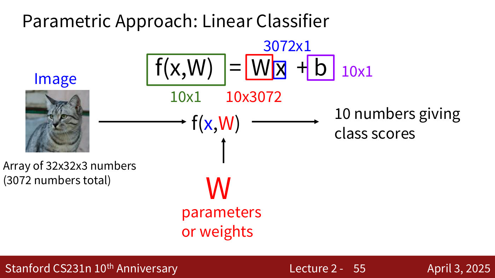

*Slide 55 — Parametric Approach: Linear Classifier. [Deck](https://cs231n.stanford.edu/slides/2025/lecture_2.pdf)*

### Building block of neural networks

Linear functions stacked one after another, with more added between them, make up neural networks
(≈48:47–49:33; slide 56, a photograph of stacked toy blocks with "linear classifiers" as the blocks
and "neural network" as the stack). Linear layers are everywhere in popular architectures: slide 57
boxes the final fully connected layers of AlexNet (Krizhevsky et al., 2012) and the final
"avg pool, fc 1000" of a 34-layer ResNet (He et al., 2015) (≈49:33). Lecture 4 builds these
networks; see [neural networks](neural-networks.md).

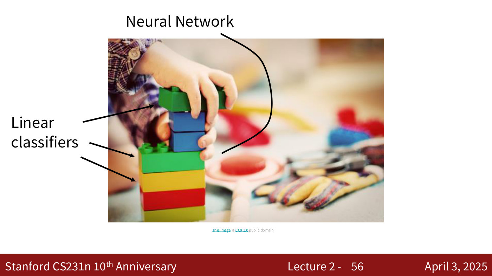

*Slide 56 — Neural Network / Linear classifiers. [Deck](https://cs231n.stanford.edu/slides/2025/lecture_2.pdf)*

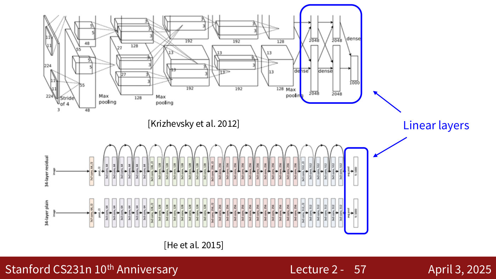

*Slide 57 — Linear layers. [Deck](https://cs231n.stanford.edu/slides/2025/lecture_2.pdf)*

### Algebraic viewpoint

To make the mapping concrete, slides 59–60 shrink the image to four pixels and three classes (cat,
dog, ship) (≈50:18–51:09). The $2 \times 2$ image (pixel values 56, 231, 24, 2) is flattened into a vector,
multiplied by a $3 \times 4$ matrix $W$, and added to $b$:

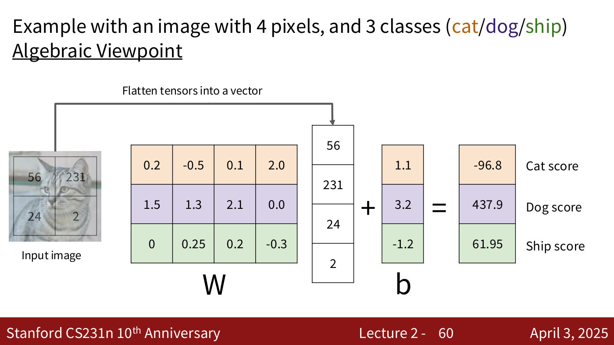

*Slide 60 — the algebraic viewpoint: a 4-pixel image times W plus b gives one score per class (the printed ship score, 61.95, omits the bias; with it, 60.75). [Deck](https://cs231n.stanford.edu/slides/2025/lecture_2.pdf)*

$$\begin{bmatrix} 0.2 & -0.5 & 0.1 & 2.0 \cr 1.5 & 1.3 & 2.1 & 0.0 \cr 0 & 0.25 & 0.2 & -0.3 \end{bmatrix} \begin{bmatrix} 56 \cr 231 \cr 24 \cr 2 \end{bmatrix} + \begin{bmatrix} 1.1 \cr 3.2 \cr -1.2 \end{bmatrix} = \begin{bmatrix} -96.8 \cr 437.9 \cr 61.95 \end{bmatrix}$$

giving a cat score of −96.8, a dog score of 437.9 and a ship score of 61.95 (slide 60). The first two
check out exactly; the printed ship score is the product before the bias is added — with the bias
of −1.2 it is 60.75.

### Visual viewpoint: templates

Each row of $W$ produces one class's score, so each row is a **template** for that class, and it
can be reshaped back into an image (≈51:09–51:57; slides 61–62). For a linear classifier trained
on CIFAR-10, the ten learned templates are blurry colour images; for the car, "you do see a
template-ish front of a car", although it is all done with just one linear classifier
(≈51:57–52:43; slide 62).

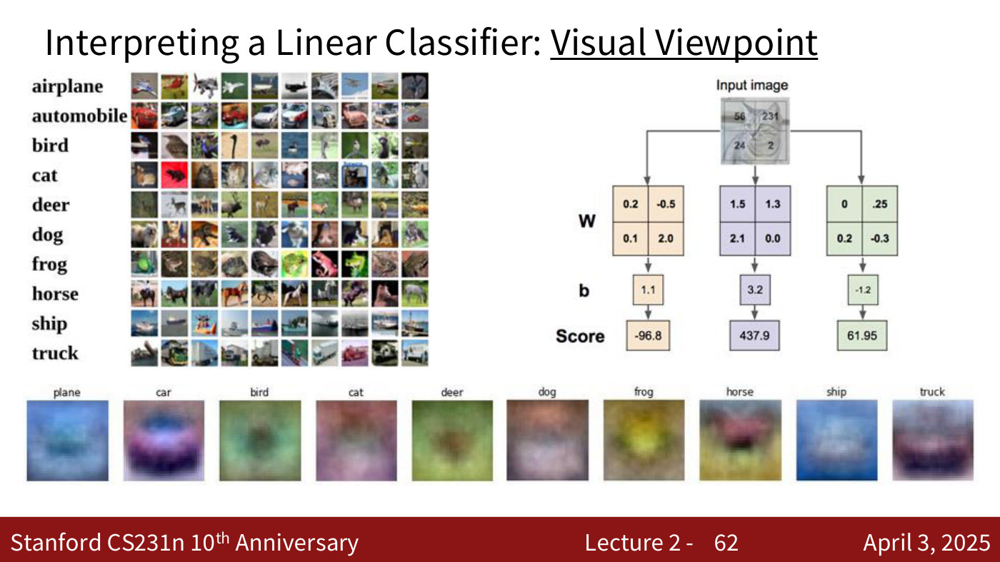

*Slide 62 — the visual viewpoint: each row of W reshaped into an image, one learned template per CIFAR-10 class (bottom row). [Deck](https://cs231n.stanford.edu/slides/2025/lecture_2.pdf)*

### Geometric viewpoint: hyperplanes

Geometrically, a linear classifier finds lines — in 2D — that separate each class from the others;
in higher dimensions they are hyperplanes (≈52:43; slide 63, with lines for an airplane, a car and
a deer classifier, and a 3D plot of planes). The bias is what lets those lines and hyperplanes
avoid passing through the origin: without it every decision boundary would have to go through the
centre of the space, "which doesn't really make sense" (≈53:29).

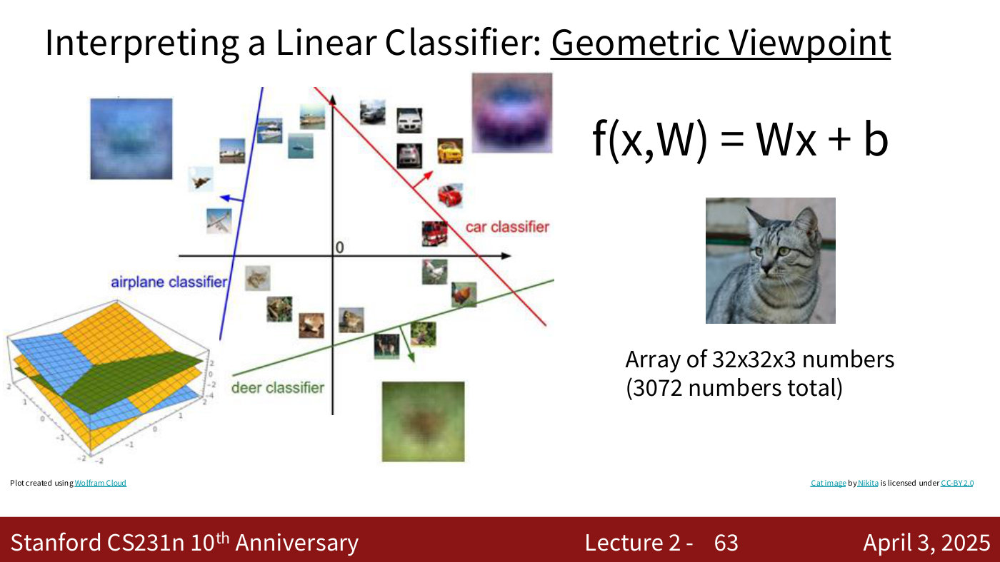

*Slide 63 — the geometric viewpoint: each classifier is a line in 2D (a hyperplane in higher dimensions), drawn with a perpendicular arrow; the 3D plot at the bottom left shows planes. [Deck](https://cs231n.stanford.edu/slides/2025/lecture_2.pdf)*

### What a linear classifier cannot do

It cannot separate many arrangements of data (≈53:29–55:01; slide 64): class 1 in the first and
third quadrants and class 2 in the second and fourth; class 1 a ring, $1 \le$ L2 norm $\le 2$, with
everything else class 2; and class 1 made of three separate modes with everything else class 2. In
each case no line separates the classes.

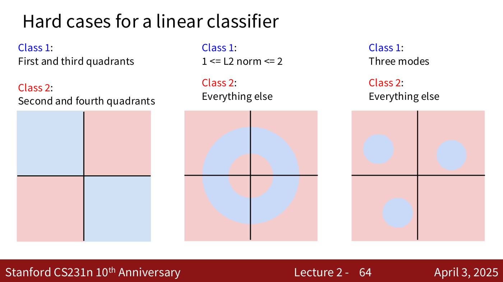

*Slide 64 — three arrangements no single line can separate: opposite quadrants, a ring, and three separate modes. [Deck](https://cs231n.stanford.edu/slides/2025/lecture_2.pdf)*

## Choosing W: the loss function

The remaining question is how to choose $W$ (≈55:01; slide 65). Slide 65 shows the 10 class scores
some $W$ gives three images: the cat image's cat score is 2.9, but its dog score is 8.02; the car
image's automobile score, 6.04, is its highest; and the frog image's frog score, −4.34, is among its
lowest. Two things are needed. First, a **loss function** (also called an objective function) that
quantifies "our unhappiness with the scores across the training data" — how badly the model is
doing. Second, a way to efficiently change $W$ to minimise it: **optimisation**, which [the next lecture](03-regularization-optimization.md#optimisation) covers
(≈55:01–55:49; ≈1:05:04).

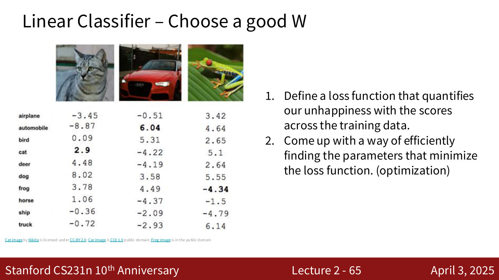

*Slide 65 — Linear Classifier – Choose a good W. [Deck](https://cs231n.stanford.edu/slides/2025/lecture_2.pdf)*

For simplicity the lecture then uses three training examples and three classes, cat, car and frog,
with these scores (≈55:49; slide 66):

| class | cat image | car image | frog image |
| --- | --- | --- | --- |
| cat | **3.2** | 1.3 | 2.2 |
| car | 5.1 | **4.9** | 2.5 |
| frog | −1.7 | 2.0 | **−3.1** |

(bold marks the correct class for each image). Given a dataset $\lbrace (x_i, y_i) \rbrace_{i=1}^{N}$,
where $x_i$ is an image and $y_i$ its integer label, the loss over the dataset is the average of the
per-example losses $L_i$ (≈56:35–57:21; slides 68–69):

$$L = \frac{1}{N} \sum_i L_i(f(x_i, W), y_i)$$

Each $L_i$ compares the predicted scores with the ground-truth label. There are different ways to
define it; the lecture presents the softmax classifier (≈57:21). See also
[loss functions](loss-functions.md).

## The softmax classifier

The scores $s = f(x_i; W)$ are unbounded and not very controllable, so the softmax classifier turns
them into **probabilities** (≈57:21–58:53; slides 71–72). The **softmax function** gives the
probability that image $x_i$ belongs to class $k$:

$$P(Y = k \mid X = x_i) = \frac{e^{s_k}}{\sum_j e^{s_j}}$$

where $s_k$ is the score of class $k$ and the sum runs over all classes $j$. It is two steps
(≈58:53–59:39; slides 73–74). **Exponentiate**, so that every value is positive — probabilities must
be ≥ 0: the cat image's scores 3.2, 5.1, −1.7 become 24.5, 164.0, 0.18, the "unnormalized
probabilities". Then **normalise** by their sum, so that they sum to 1: 0.13, 0.87, 0.00.

Read as a judgement, this $W$ "thinks that this image is a cat with a probability of 13%" — a
mistake, which optimisation should fix (≈59:39). The raw scores are the **unnormalized
log-probabilities**, or **logits** (≈59:39–1:00:26; slide 75). This is the same framework as
logistic regression; with more than two classes it is **multinomial logistic regression**
(≈1:00:26), which is the slide's title.

### The loss

The objective is to maximise the probability of the correct class (≈1:00:26–1:01:13). Because
losses are written as quantities to minimise, the probability is negated, and its log is taken
"to make the numbers a little bit more manageable" (≈1:01:13–1:01:59):

$$L_i = -\log P(Y = y_i \mid X = x_i)$$

For the cat image, $L_i = -\log(0.13) = 2.04$ (slide 76). Choosing weights this way is **maximum
likelihood estimation** — "choose weights to maximize the likelihood of the observed data", with
CS 229 cited for details (≈1:01:59; slide 77).

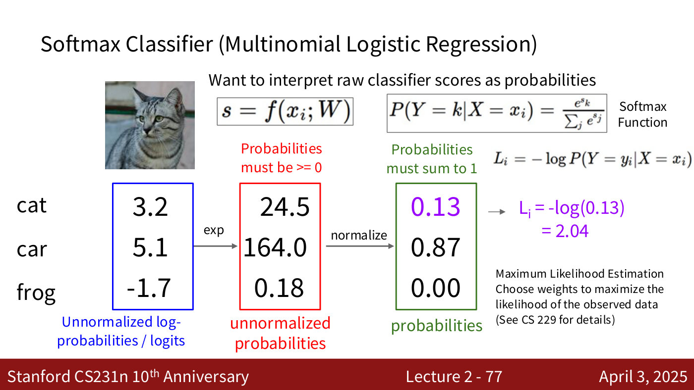

*Slide 77 — Softmax Classifier (Multinomial Logistic Regression). [Deck](https://cs231n.stanford.edu/slides/2025/lecture_2.pdf)*

### KL divergence and cross-entropy

The same loss can be read as matching two distributions: the estimated probabilities (0.13, 0.87,
0.00) and the correct probabilities (1.00, 0.00, 0.00) (≈1:02:45; slide 78). Matching them means
minimising the **Kullback–Leibler divergence** (≈1:02:45–1:03:32; slide 79):

$$D_{KL}(P \Vert Q) = \sum_y P(y) \log \frac{P(y)}{Q(y)}$$

where $P$ is the correct distribution and $Q$ the predicted one. "This is an information-theoretic
perspective", and in this setting the KL divergence simplifies to the same negative log
(≈1:03:32). Going further, it is exactly the **cross-entropy** (slide 80):

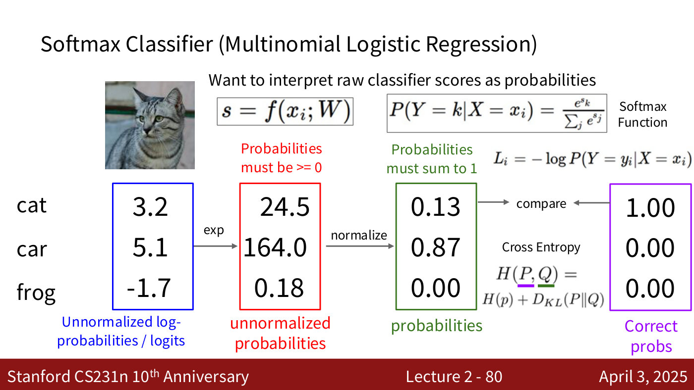

*Slide 80 — the softmax pipeline: scores (logits) → exp → normalise to probabilities, compared with the correct one-hot probabilities by cross-entropy. [Deck](https://cs231n.stanford.edu/slides/2025/lecture_2.pdf)*

$$H(P, Q) = H(P) + D_{KL}(P \Vert Q)$$

(on the slide, the first term's argument is printed as a lowercase p). With one-hot correct labels the entropy $H(P)$ of the
correct distribution is zero, so cross-entropy is again the same negative log — which is why the
loss is called cross-entropy (≈1:03:32–1:04:19). Adeli connects it to the cross-entropy losses in
neural-network frameworks, naming "BCE, binary cross-entropy" (≈1:04:19).

Putting it all together (slide 81):

$$L_i = -\log\left(\frac{e^{s_{y_i}}}{\sum_j e^{s_j}}\right)$$

(the slide prints the numerator exponent as $s y_i$, without the subscript).

### Two questions

**What are the minimum and maximum possible softmax loss?** (slide 82). Adeli takes answers from
the room; the captions are partial. They show that if the correct class's probability is zero, its
log is minus infinity and the negation makes the loss infinite (≈1:05:04). The rest of the exchange
is inaudible.

**At initialisation all the scores are approximately equal; what is the loss, assuming $C$
classes?** (slides 82–83). The probabilities are then all about $1/C$, so the loss is
$-\log(1/C) = \log C$; for $C = 10$, $\log 10 \approx 2.3$ (≈1:05:51–1:06:37; slide 83). The
recording ends here, mid-sentence.

## Not presented: the multiclass SVM loss and softmax vs. SVM (slides 84–104)

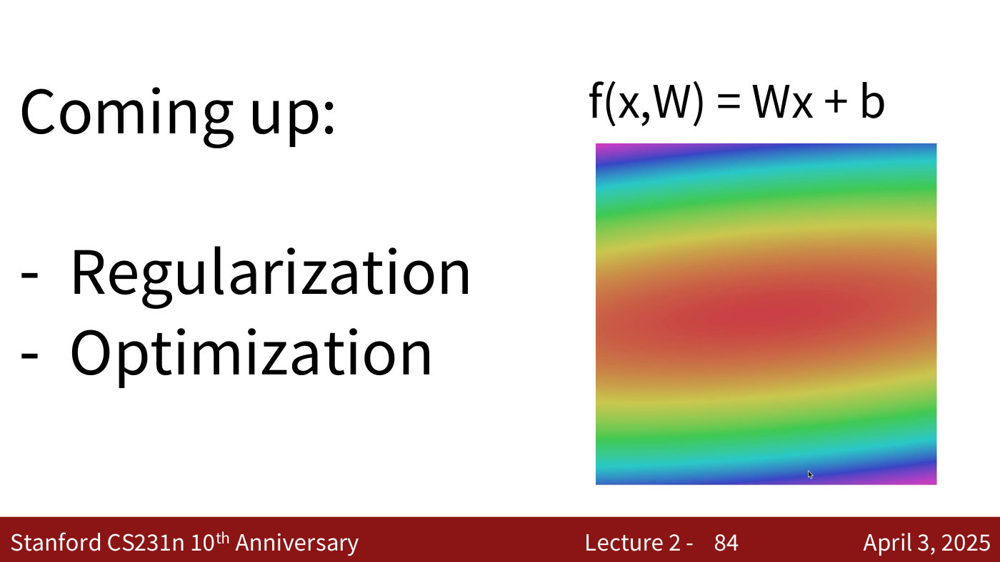

*Slide 84 — Coming up:. [Deck](https://cs231n.stanford.edu/slides/2025/lecture_2.pdf)*

Everything in this section comes from the deck alone; the recording has ended. Slide 84 announces
regularization and optimization as coming up next (they are
[lecture 3](03-regularization-optimization.md)), beside an unlabelled rainbow heat-map. Slide 85
marks the SVM loss as a **reading assignment**.

### Multiclass SVM loss

With the same three images and scores, and the shorthand $s = f(x_i, W)$ for the scores vector,
the **multiclass SVM loss** for example $i$ is (slide 86):

$$L_i = \sum_{j \neq y_i} \max(0, s_j - s_{y_i} + 1)$$

For each wrong class $j$, the loss is zero if the correct class's score $s_{y_i}$ beats $s_j$ by
at least 1, and grows linearly otherwise. Plotted against $s_{y_i} - s_j$, the difference between
the correct and an incorrect class's score, the loss is a straight line falling to zero at 1 and
flat at zero beyond it — a hinge (slides 87–89).

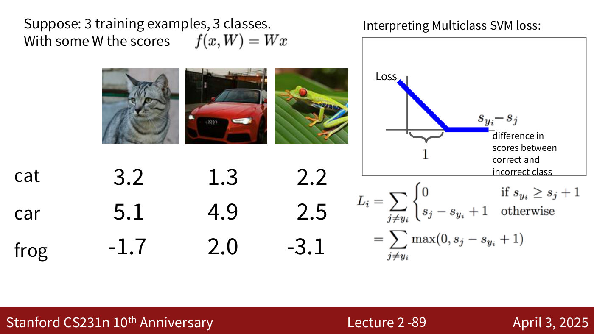

*Slide 89 — the SVM hinge: the loss falls linearly as the correct class's score pulls ahead, and is zero once the margin reaches 1. [Deck](https://cs231n.stanford.edu/slides/2025/lecture_2.pdf)*

The slides then compute it for each image (slides 90–94). For the cat image,
$\max(0, 5.1 - 3.2 + 1) + \max(0, -1.7 - 3.2 + 1) = 2.9 + 0 = 2.9$. For the car image, both terms
are negative inside the max, so the loss is 0. For the frog image,
$\max(0, 2.2 - (-3.1) + 1) + \max(0, 2.5 - (-3.1) + 1) = 6.3 + 6.6 = 12.9$. The loss over the
dataset is the average, $L = (2.9 + 0 + 12.9)/3 = 5.27$.

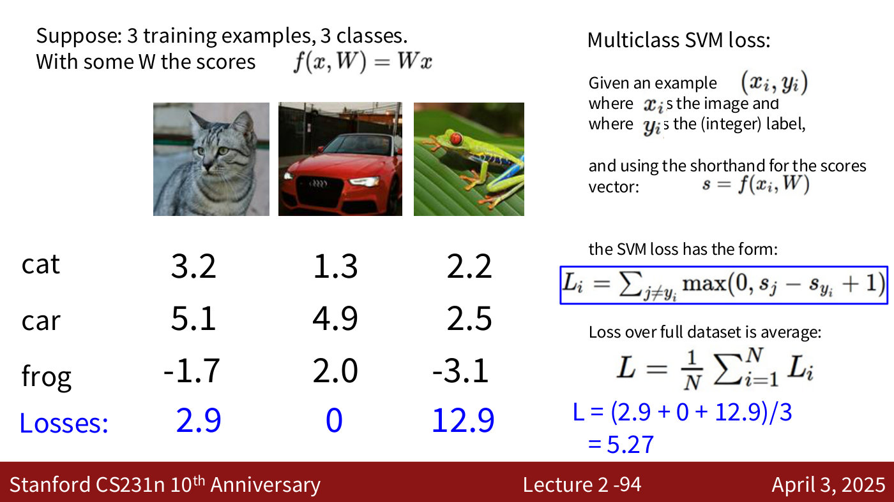

*Slide 94 — Multiclass SVM loss (untitled). [Deck](https://cs231n.stanford.edu/slides/2025/lecture_2.pdf)*

Slides 95–99 pose six questions and print no answers: what happens to the car image's loss if the
car scores decrease by 0.5; the minimum and maximum possible SVM loss; the loss at initialisation,
when $W$ is small and all scores are near 0, with $N$ examples and $C$ classes; what changes if the
sum includes $j = y_i$; what changes with the mean instead of the sum; and what if the hinge were
squared, $L_i = \sum_{j \neq y_i} \max(0, s_j - s_{y_i} + 1)^2$, drawn as a curve that bends down
smoothly to zero at 1 instead of a straight line (slide 99). Slide 100 gives a vectorised
implementation: compute `scores = W.dot(x)`, then `margins = np.maximum(0, scores - scores[y] + 1)`,
set `margins[y] = 0`, and sum.

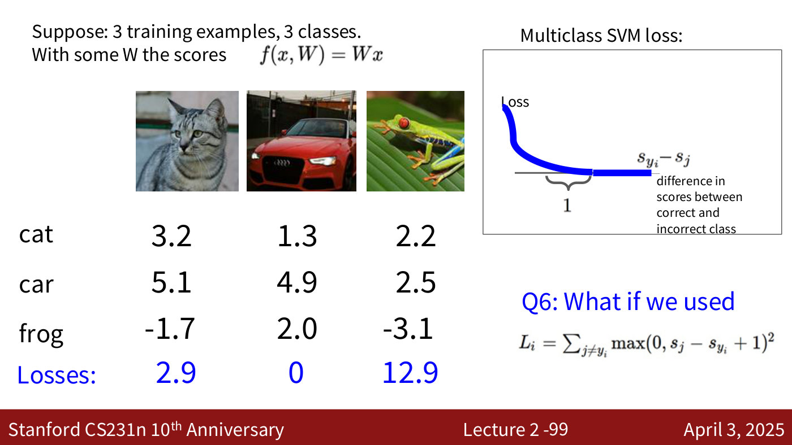

*Slide 99 — Multiclass SVM loss (untitled). [Deck](https://cs231n.stanford.edu/slides/2025/lecture_2.pdf)*

### Softmax vs. SVM

One worked example runs through both losses (slide 101): a $3 \times 4$ $W$, a 4-pixel $x_i$ and a bias give the
scores −2.85, 0.86, 0.28, with the correct class $y_i = 2$ (the third score). The **hinge loss**
is $\max(0, -2.85 - 0.28 + 1) + \max(0, 0.86 - 0.28 + 1) = 1.58$. The **cross-entropy loss**
exponentiates the scores to 0.058, 2.36, 1.32, normalises them to 0.016, 0.631, 0.353, and takes
$-\log(0.353)$, printed as 0.452. That value is the base-10 logarithm; the natural logarithm used
on slides 76 and 83 gives about 1.04.

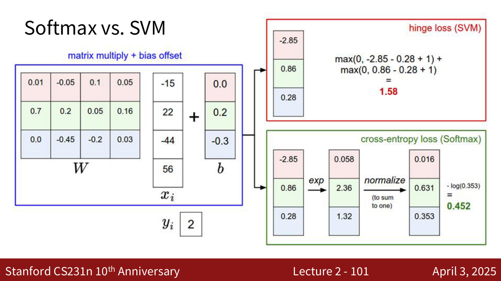

*Slide 101 — one example through both losses: hinge loss 1.58 (top) and cross-entropy loss (bottom), printed as 0.452 with a base-10 log. [Deck](https://cs231n.stanford.edu/slides/2025/lecture_2.pdf)*

Slides 102–104 set the two formulas side by side and ask, for the scores [10, −2, 3], [10, 9, 9]
and [10, −100, −100] with $y_i = 0$, what the softmax and SVM losses are, and what happens to each
when the correct class's score is doubled from 10 to 20. The deck prints no answers.

---

## Sources

- [Edited transcript](../raw/transcripts/02-image-classification.md) — repunctuated, with restored
  terms listed in its header. Five passages are marked `[unclear]` or `[Ed:]` there.
- [Deck, slide by slide](../raw/slides/02-image-classification.md) — 102 pages, printed numbers
  1–104; every figure described; [PDF](https://cs231n.stanford.edu/slides/2025/lecture_2.pdf).
- [Video](https://www.youtube.com/watch?v=pdqofxJeBN8).
- Previous lecture: [Lecture 1 — Introduction](01-introduction.md).
- Next lecture: [Lecture 3 — Regularization and Optimization](03-regularization-optimization.md).
