# Lecture 3 — Regularization and Optimization

**CS231N Deep Learning for Computer Vision, Stanford, Spring 2025.** Delivered April 8, 2025, by
Zane Durante (per the course schedule; the recording does not name him).
[Video](https://www.youtube.com/watch?v=dyNGd06MWn4) ·
[edited transcript](../raw/transcripts/03-regularization-optimization.md) ·
deck as [text](../raw/slides/03-regularization-optimization.md) /
[PDF](https://cs231n.stanford.edu/slides/2025/lecture_3.pdf)

## What this lecture establishes

Lecture 2 ended with a linear classifier and a loss that scores how bad a choice of weights $W$
is. This lecture adds the two things needed to actually train it. **Regularization** adds a
second term to the loss that deliberately makes the model do worse on the training data so that it
does better on data it has not seen; the lecture introduces L2, L1 and elastic-net regularization
and shows which weights each one prefers. **Optimisation** is how the best $W$ is found: follow the
negative gradient of the loss downhill. The lecture computes a gradient numerically, then argues
for the analytic gradient checked against the numerical one, and builds up from **gradient
descent** to **stochastic gradient descent** (SGD) on minibatches. It then shows three ways SGD
struggles (narrow valleys, local minima and saddle points, noisy gradients) and the optimisers
that address them: **SGD with momentum**, **RMSProp**, **Adam** and **AdamW**. It closes with
**learning-rate schedules** (step, cosine, linear, inverse square root, warm-up), a brief look at
**second-order** methods and why deep learning avoids them, practical defaults, and a preview of
two-layer neural networks.

**What the recording covers.** The recording starts at the recap of lecture 2 (slide 5), so the
administrative slides 2–4 are known only from the deck. It ends at 1:08:25 in the "Looking
Ahead" material on two-layer networks. The rest of the deck — slides 100–101 and an
appendix of "Slides from Previous Years" (slides 102–123) on Nesterov momentum, AdaGrad, L-BFGS
and softmax vs. SVM — is not presented; it is summarised at the end of this page from the slides
alone.

**Animations missing from the PDF.** Several slides compare optimisers by drawing their paths
across a coloured loss surface. In the posted PDF those slides show only the surface and a legend,
with **no paths drawn** (checked at 600 dpi); they were presumably animations. Where the lecturer
describes what the animation showed, this page reports it from the transcript; nothing about those
paths can be taken from the slides.

**Citing this lecture.** Slide numbers are the numbers printed on the slides. Printed numbers 10,
11, 12 and 29 were hidden in the source deck, so from PDF page 10 on the printed number runs three
ahead of the page, and from page 26 on, four ahead (slide 123 is PDF page 119). Timestamps are
written (≈M:SS) and refer to the video.

## Administrative notes (slides only)

Assignment 1 "will release tomorrow" (April 9) and is due Wednesday 4/23 at 11:59 PM. Office hours
help with high-level questions only, with no code debugging, under a "No Code Show Policy" whose
link the slide does not print (slide 2). The project proposal is due Friday 4/25. TA expertise and
office hours are posted on the course webpage, in a mix of in-person and Zoom (slide 3). Students
should read all pinned Ed posts; CGOE students who want to take the midterm on campus should email
`cs231n-staff-spr25@stanford.edu` (slide 4). See [course logistics](course-logistics.md) for the
rest.

## Recap of lecture 2

The lecture opens by recapping [lecture 2](02-image-classification.md) (≈0:05–8:34): image
classification as mapping an image to one label from a fixed set; the semantic gap and the
challenges of recognition (illumination, deformation, occlusion, clutter, intraclass variation);
the data-driven approach and [k-nearest neighbours](k-nearest-neighbors.md), with a validation set
to choose $k$; and the [linear classifier](linear-classifiers.md) $f(x, W) = Wx + b$, read three
ways (slides 6–9).

The lecturer also returns to **L1 and L2 distance**, because there had been confusion about them
and the course had posted an explanation on Ed (≈3:57). Under L1 (Manhattan) distance you may only
move left, right, up and down, never diagonally: a point reached by moving up 0.5 and right 0.5 is
at distance 1 from the origin, the same as a point 1 away along an axis, which is why all the
points on the diamond's edge are equidistant. Under L2 (Euclidean) distance the points equidistant
from the origin form a circle (≈4:42). The diagram he refers to is not in the posted deck; lecture
2's [L1 versus L2](02-image-classification.md#l1-versus-l2) section has it.

Asked why $x$ has 3,072 entries, he multiplies out a CIFAR-10 image: 32 pixels high, 32 wide and
three colour values per pixel give $32 \times 32 \times 3 = 3072$ (≈8:34–9:20). Asked whether a
template in the visual viewpoint is the same as a nearest neighbour, he says no: the templates are
formed from the classifier's line, not from any one data point (≈8:34).

The running example is the same three images and scores as in lecture 2 (slide 13):

| class | cat image | car image | frog image |
| --- | --- | --- | --- |
| cat | **3.2** | 1.3 | 2.2 |
| car | 5.1 | **4.9** | 2.5 |
| frog | −1.7 | 2.0 | **−3.1** |

The correct-class scores are in bold. The classifier does badly on the cat, because the car score
is higher; well on the car; and badly on the frog, where the correct score is the lowest of the
three (≈9:20–10:06). A **loss function** turns that intuition into a number: over a dataset
$\lbrace (x_i, y_i) \rbrace_{i=1}^{N}$ of images $x_i$ and integer labels $y_i$, the loss is the
average of the per-example losses $L_i$ (slide 13; see [loss functions](loss-functions.md)).

## Regularization

### Data loss and regularization loss

The full loss has two parts (slides 14–15):

$$L(W) = \frac{1}{N} \sum_{i=1}^{N} L_i(f(x_i, W), y_i) + \lambda R(W)$$

The first sum is the **data loss**: "model predictions should match training data". The second,
$\lambda R(W)$, is the **regularization** term, labelled "prevent the model from doing too well on
training data". The lecturer puts the goal plainly: regularization makes the model do worse on the
training data so that it does better on new, unseen test data (≈11:43).

### Prefer simpler models

The toy example fits a function to five points, with input $x$ and output $y$ (slide 16). Model
$f_1$ is a wiggly curve through every point, so its data loss is essentially zero; model $f_2$ is a
straight line that passes near the points but not through all of them (slide 17). Intuitively
$f_2$ is the better model, and when new points from the same distribution arrive, they fall near
the line and far from the curve (≈13:14–14:01).

The slide's caption: "Regularization pushes against fitting the data too well so we don't fit
noise in the data" (slide 18). The lecturer connects it to **Occam's razor** — among competing
hypotheses, try the simplest first (≈14:01), which the deck states as "the simplest is the best",
after William of Ockham, 1285–1347 (slide 19).

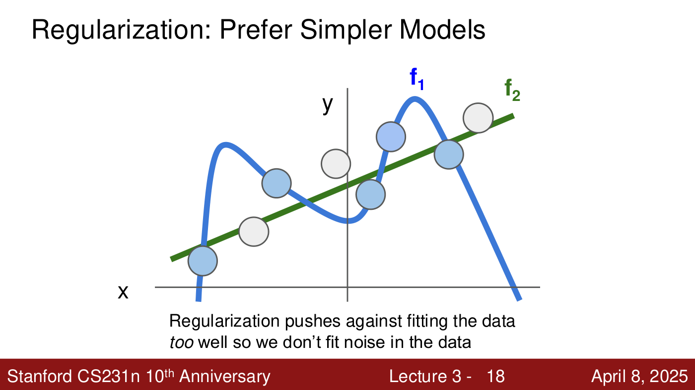

*Slide 18 — Regularization: Prefer Simpler Models. [Deck](https://cs231n.stanford.edu/slides/2025/lecture_3.pdf)*

### The regularization strength $\lambda$

$\lambda$ is the **regularization strength**, a hyperparameter (slide 20). It can be any value from
zero, meaning no regularization, upward, with larger values regularizing more strongly; like other
hyperparameters it is set with training and validation sets (≈14:01–14:47; see
[hyperparameters and validation](hyperparameters-and-validation.md)).

### L2, L1 and elastic net

The deck's simple examples, where $W_{k,l}$ is the entry in row $k$ and column $l$ of $W$ and
$\beta$ weights the L2 part of the elastic net (slide 21):

$$R(W) = \sum_k \sum_l W_{k,l}^2 \qquad \text{(L2)}$$

$$R(W) = \sum_k \sum_l \lvert W_{k,l} \rvert \qquad \text{(L1)}$$

$$R(W) = \sum_k \sum_l \beta W_{k,l}^2 + \lvert W_{k,l} \rvert \qquad \text{(elastic net, L1 + L2)}$$

L2 squares each weight and sums; L1 takes absolute values instead (≈14:47–15:33). The difference
matters in practice. Squaring makes a small weight much smaller — 0.001 becomes $10^{-6}$ — so L2
barely penalises small non-zero weights and tends to leave many small, spread-out values. L1 does
not shrink small values first, so it tends to drive many weights to zero or very close to it,
giving sparse weights (≈15:33–16:20). Asked what "pushing a weight towards zero" means, the lecturer explains
that training minimises the sum of the two terms: if a weight contributes to the regularization
term but not to the data loss, optimisation removes it (≈17:06–17:52).

More complex regularizers, covered later in the course, include dropout, batch normalization,
stochastic depth and fractional pooling (slide 22). Some of these change the layers of the model,
and regularization is an active research area (≈17:52). Regularization does not always mean a
simpler model: dropout, for instance, makes the model more complex but improves test performance;
what all of them share is doing worse on the training data to do better on the test data
(≈23:15–24:01).

### Why regularize?

The deck lists three reasons (slide 23): to express preferences over weights, to make the model
simple so it works on test data, and to improve optimisation by adding curvature. On the last, the
lecturer notes that L2 adds a squared term, a parabola, which is convex and has nice optimisation
properties; this is beyond the course's scope (≈18:38–19:23).

### Which weights does each regularizer prefer?

Take $x = [1, 1, 1, 1]$, $w_1 = [1, 0, 0, 0]$ and $w_2 = [0.25, 0.25, 0.25, 0.25]$. Both give the
same score, $w_1^T x = w_2^T x = 1$, so the data loss is the same, and only the regularizer can
choose between them (slide 24).

**L2 prefers $w_2$** (slide 25): its L2 penalty is $4 \times 0.25^2 = 0.25$, against $1^2 = 1$ for
$w_1$, four times lower. "L2 regularization likes to 'spread out' the weights" (≈20:10).

**L1 is a trick question.** The deck asks which one L1 would prefer and prints no answer
(slide 26). The lecturer answers that, from the loss's point of view, the two are **equivalent**:
$4 \times 0.25 = 1$ and $1$ sum to the same L1 penalty, although in practice L1's tendency to
sparsity is what one would expect to see (≈20:10–20:57). The follow-up, an example where L1
would prefer one of them, gets only "if this is like 0.9, for example", without saying which
entry (≈20:57).

### Recap: the full loss

Slide 27 assembles the pieces: a dataset of $(x, y)$ pairs, a score function $s = f(x; W) = Wx$,
the softmax loss $L_i = -\log\left(e^{s_{y_i}} / \sum_j e^{s_j}\right)$ on each example (see
[loss functions](loss-functions.md#softmax-loss-cross-entropy)), and the full loss
$L = \frac{1}{N}\sum_{i=1}^{N} L_i + R(W)$. Asked why softmax, the lecturer says it turns any list
of numbers into a probability distribution that sums to one, with higher scores getting higher
probability (≈21:43–22:29).

The question that drives the rest of the lecture is printed on slide 28: "How do we find the best
W?" (≈24:01).

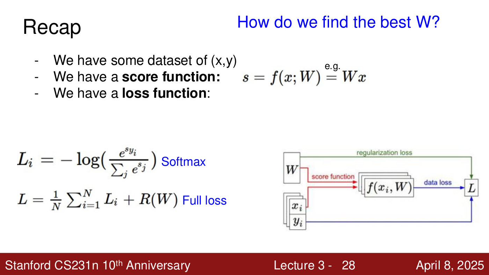

*Slide 28 — the computational graph of the full loss: W and the input feed the score function, which with the label gives the data loss; W alone gives the regularization loss; both reach the loss L. [Deck](https://cs231n.stanford.edu/slides/2025/lecture_3.pdf)*

## Optimisation

### The loss landscape

Optimisation is usually pictured as a **loss landscape**: the parameters are positions on the
ground, and the height is the loss. Training is a walk to the lowest point (≈24:01–24:46). The
analogy fails for a sighted walker, who could simply look for the valley floor. It becomes
accurate if the walker is **blindfolded** and can feel only the slope of the ground underfoot
(≈24:46–25:32). The deck illustrates it with a photograph of an alpine valley and a walking figure
(slides 31–32).

### Strategy 1: random search

The first, "very bad idea" is to try 1,000 random weight matrices and keep the one with the lowest
loss (slide 33). It does better than chance: the best random $W$ gets 15.5% accuracy on CIFAR-10,
against a state of the art of about 99.7% (slide 34; ≈25:32–26:18). The slide's code prints
0.1555, so "15.5%" truncates 15.55%.

### Strategy 2: follow the slope

The second strategy is the one used to train every model in the course: feel which way is downhill
and step that way (slide 35; ≈26:18–27:05).

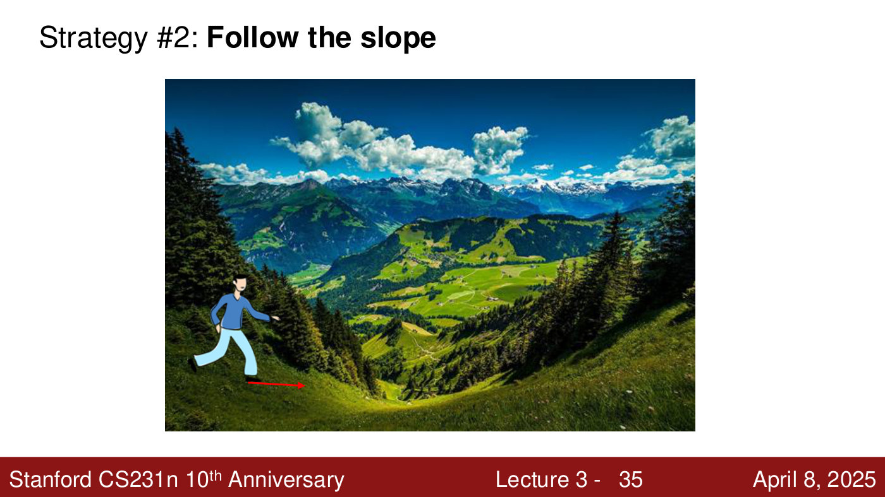

*Slide 35 — the blindfolded walker on the loss landscape: feel the slope underfoot and step downhill. [Deck](https://cs231n.stanford.edu/slides/2025/lecture_3.pdf)*

In one dimension, the slope is the derivative (slide 36):

$$\frac{df(x)}{dx} = \lim_{h \to 0} \frac{f(x+h) - f(x)}{h}$$

In several dimensions it is the **gradient**, the vector of partial derivatives along each
dimension. The slope in any direction is the dot product of that direction with the gradient, so
the gradient points uphill, and the direction of steepest descent is the **negative gradient**
(slide 36; ≈27:50–28:35).

### The numerical gradient

The limit definition can be used directly with a small $h$. Slides 37–44 work it through on a
weight vector $W = [0.34, -1.11, 0.78, 0.12, 0.55, 2.81, -3.1, -1.5, 0.33, \ldots]$ whose loss is
1.25347. Adding $h = 0.0001$ to the first entry gives a loss of 1.25322, so the first entry of the
gradient is $(1.25322 - 1.25347)/0.0001 = -2.5$. Adding it to the second entry gives 1.25353, so the
second entry is $(1.25353 - 1.25347)/0.0001 = 0.6$; adding it to the third leaves the loss at
1.25347, so the third entry is 0 (slides 39, 41 and 43; all three recompute exactly).

The method has two problems (slide 44): it is **slow**, because it loops over every dimension of
$W$, and it is **approximate**, with floating-point arithmetic adding significant error (≈28:35–29:20).

### The analytic gradient and the gradient check

But the loss is just a function of $W$, written out in full (slides 45–46): with the SVM loss of
lecture 2 or with the softmax loss, plus an L2 term, and $s = f(x; W) = Wx$. So the gradient
$\nabla_W L$ can be derived with calculus — treating the $x_i$ and $y_i$ as constants and applying
the chain rule — which is an exercise in the homework (≈29:20–30:52).

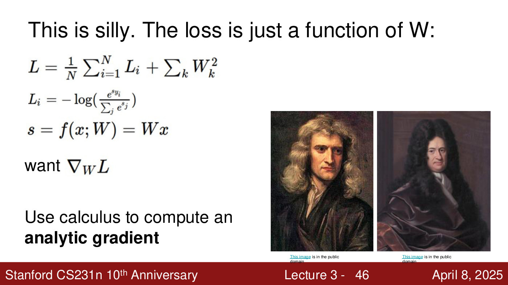

*Slide 46 — "Use calculus to compute an analytic gradient": the full loss with the softmax data term, beside two public-domain portraits the slide leaves unnamed. [Deck](https://cs231n.stanford.edu/slides/2025/lecture_3.pdf)*

The result is a formula for the whole gradient at once (slide 47). The comparison (slide 48): the
numerical gradient is approximate, slow and easy to write; the analytic gradient is exact, fast and
error-prone. "In practice: Always use analytic gradient, but check implementation with numerical
gradient. This is called a **gradient check**." The homework uses gradient checks to catch bugs
(≈31:37).

Asked whether a better but non-differentiable loss could be trained with the numerical method
instead, the lecturer says it might work, but if the loss is non-differentiable almost everywhere —
a cluster of disconnected points rather than a landscape — stepping in the direction of steepest
descent will not reliably lead to the best solution; these methods work best on convex functions
(≈31:37–33:09).

### Gradient descent

**Gradient descent** repeats one step: evaluate the gradient of the loss with respect to the
weights, then move the weights a fixed **step size** in the direction of the negative gradient
(slide 49):

```python
# Vanilla Gradient Descent

while True:
  weights_grad = evaluate_gradient(loss_fun, data, weights)
  weights += - step_size * weights_grad # perform parameter update
```

Seen from above, red marks the valley floor and purple the highest ground (slide 50; ≈34:40).
Although the step size is fixed, the steps get shorter near the bottom, because they are the step
size times the gradient, and the gradient shrinks where the ground flattens (≈34:40–35:27). Slide 51
shows the same kind of landscape stretched into a long horizontal valley.

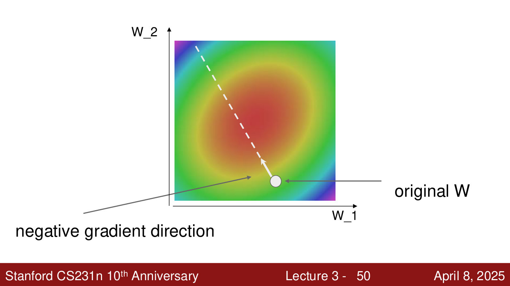

*Slide 50 — a loss landscape seen from above (red is low, purple high) over two weights; from the original W the negative gradient points toward the minimum. [Deck](https://cs231n.stanford.edu/slides/2025/lecture_3.pdf)*

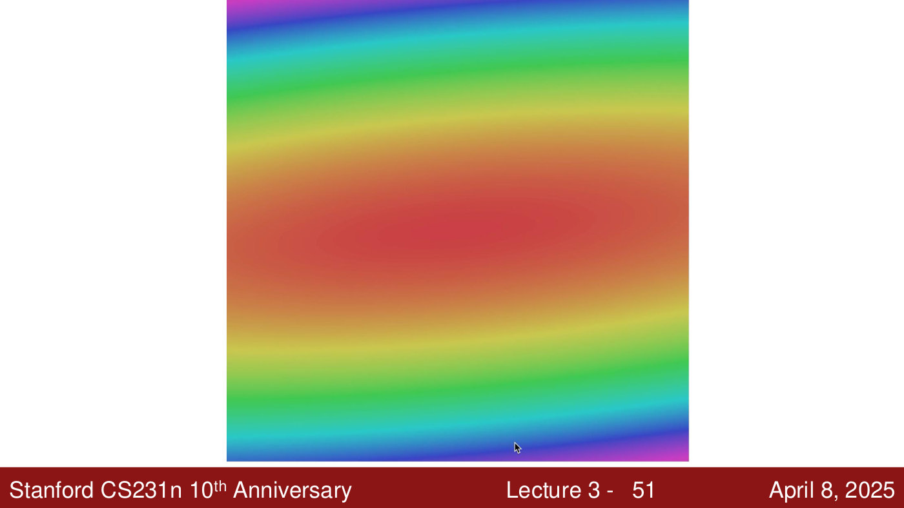

*Slide 51 — a loss landscape stretched into a long horizontal valley: the loss changes quickly up and down and slowly side to side. [Deck](https://cs231n.stanford.edu/slides/2025/lecture_3.pdf)*

The loop as written never stops. In practice it runs for a fixed number of iterations, or stops
when the loss improves by less than some tolerance, such as $10^{-5}$ or $10^{-9}$ per step
(≈35:27–36:14).

### Stochastic gradient descent

The loss and its gradient are averages over all $N$ training examples (slide 52):

$$\nabla_W L(W) = \frac{1}{N} \sum_{i=1}^{N} \nabla_W L_i(x_i, y_i, W) + \lambda \nabla_W R(W)$$

The full sum is expensive when $N$ is large, so **stochastic gradient descent** approximates it on
a **minibatch** of examples sampled at each step: 32, 64 or 128 are common, and the slide's code
samples 256 (slide 52). It is "stochastic" because the batch is random (≈36:59). In practice the
data are shuffled and gone through in full before looping again; one pass is an **epoch**
(≈36:59–37:46).

## Problems with SGD

### Poor conditioning

Picture a narrow valley: the loss changes quickly in one direction and slowly in another, drawn as
contour lines (level sets of equal loss) stretched wide along $w_1$ and narrow along $w_2$
(slide 53; ≈37:46). Gradient descent then makes "very slow progress along shallow dimension, jitter
along steep direction" (slide 54). The gradient is much larger across the valley than along it, so
the path zig-zags from wall to wall while creeping toward the minimum (≈38:31–39:16). With a large
enough step it can even oscillate out of the valley altogether, which happens when the learning
rate is too high (≈38:31).

Mathematically, such a loss has a **high condition number**: the ratio of the largest to the
smallest singular value of its **Hessian** matrix (the matrix of second derivatives) is large
(slide 55). Here the second derivative across the valley is large and along it is small (≈39:16).

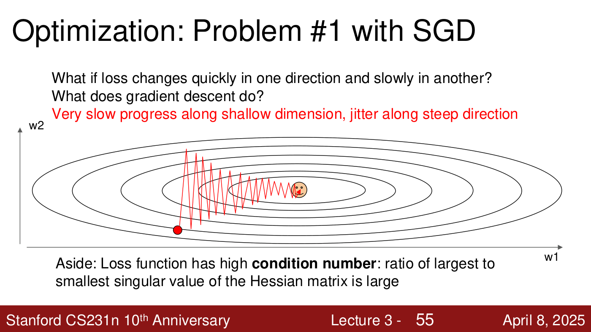

*Slide 55 — poor conditioning: on a long, narrow valley, gradient descent (red) zig-zags across the steep direction and creeps along the shallow one. [Deck](https://cs231n.stanford.edu/slides/2025/lecture_3.pdf)*

### Local minima and saddle points

Where the gradient is zero, gradient descent stops. That happens at the bottom of a **local
minimum**, and on a flat stretch such as a **saddle point**, even if the loss would drop a little
further on (slide 56; ≈40:01–40:48). Slide 57 marks both points: "Zero gradient, gradient descent gets stuck".

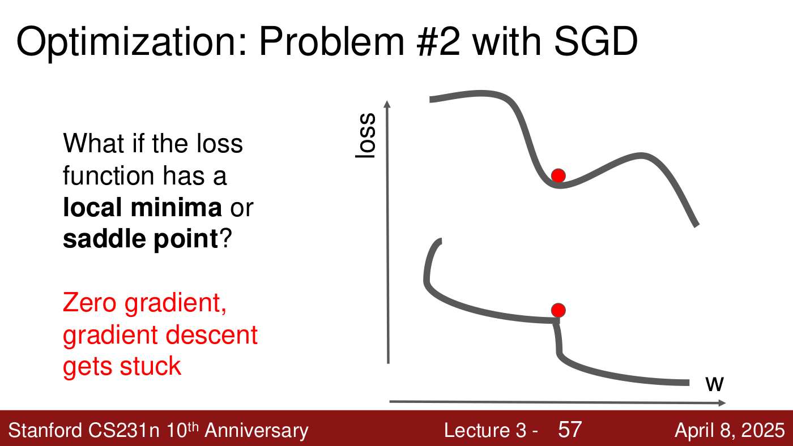

*Slide 57 — two places with zero gradient where gradient descent gets stuck: the bottom of a local minimum (top curve) and a flat point just before a drop (bottom curve). [Deck](https://cs231n.stanford.edu/slides/2025/lecture_3.pdf)*

Saddle points are much more common in high dimensions, citing Dauphin et al., "Identifying and
attacking the saddle point problem in high-dimensional non-convex optimization", NIPS 2014
(slide 58); as the weight matrix grows, saddle points become more likely (≈40:48–41:34). The
captions are unclear at one point in this passage.

A saddle is shaped like a horse's saddle: at its centre the gradient is zero in every direction,
although the loss falls away on either side (slide 59; ≈41:34). For $f(x, y) = x^2 - y^2$,
$\partial f / \partial x = 2x$ and $\partial f / \partial y = -2y$ are both 0 at the origin.

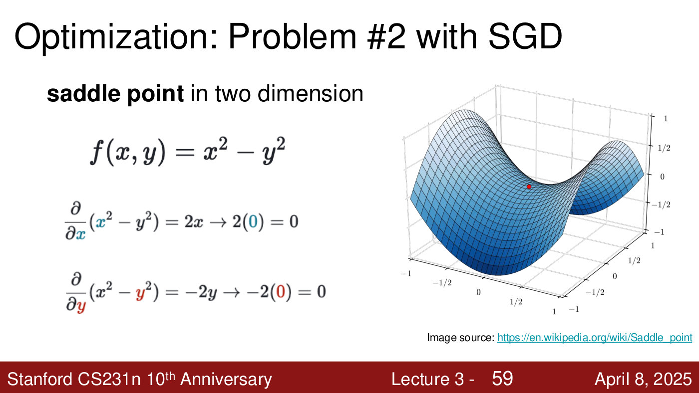

*Slide 59 — a saddle point of f(x, y) = x² − y²: both partial derivatives are zero at the centre, which curves up in one direction and down in the other. [Deck](https://cs231n.stanford.edu/slides/2025/lecture_3.pdf)*

### Noisy gradients

Because each step uses a minibatch, the gradient is only an estimate of the full-data gradient, so
"our gradients come from minibatches so they can be noisy!" (slide 60). Each step heads roughly,
but not exactly, toward the minimum (≈42:22). The slide's figure is one of the animation frames:
the PDF shows the loss surface with no path on it.

## SGD with momentum

The fix for all three problems is to add **momentum**, which behaves like a ball rolling downhill
and picking up speed (slide 61; ≈42:22–43:08). Built-up velocity carries it through a local minimum and
across a saddle point; in a narrow valley the side-to-side components cancel while the consistent
component along the valley accumulates; and the noise in the gradients averages out, because the
direction they share builds up while the rest does not (≈43:08–43:55).

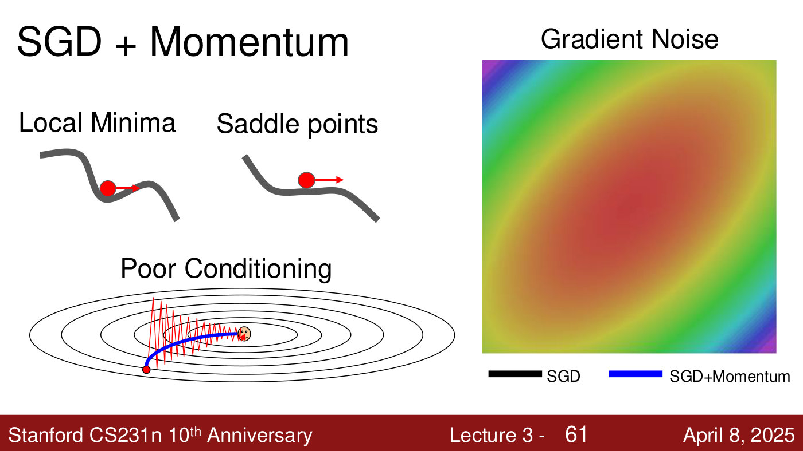

*Slide 61 — momentum against SGD's three problems: it rolls through a local minimum and over a saddle point, and in the poorly conditioned valley it arcs to the minimum (blue) where SGD zig-zags (red). The "Gradient Noise" panel's paths are not in the PDF. [Deck](https://cs231n.stanford.edu/slides/2025/lecture_3.pdf)*

Plain SGD, with $x_t$ the parameters at step $t$, $\alpha$ the learning rate and $\nabla f(x_t)$ the
gradient, is (slide 62):

$$x_{t+1} = x_t - \alpha \nabla f(x_t)$$

SGD with momentum keeps a **velocity** $v$, a running mean of gradients, and steps along it
instead (slides 63–64):

$$v_{t+1} = \rho v_t + \nabla f(x_t)$$

$$x_{t+1} = x_t - \alpha v_{t+1}$$

```python
vx = 0
while True:
  dx = compute_gradient(x)
  vx = rho * vx + dx
  x -= learning_rate * vx
```

$\rho$ sets how much the past velocity counts against the current gradient; it is typically 0.9 or
0.99 (slide 63 calls it "friction", slide 64 "momentum"); a high $\rho$ makes the new velocity
depend more on the old one (≈44:40–45:26). The deck cites Sutskever et al., "On the importance of
initialization and momentum in deep learning", ICML 2013. An
alternative formulation, $v_{t+1} = \rho v_t - \alpha \nabla f(x_t)$ and $x_{t+1} = x_t + v_{t+1}$,
gives the same sequence of $x$ (slide 65); the lecturer leaves the proof to the slide (≈48:30–49:16).

Questions afterwards (≈46:12–48:30): a ball that rolls exactly along the ridge of a saddle could
stay stuck, but that is very unlikely, the noise of SGD tends to knock it off, and practitioners
run several seeds anyway. Momentum can overshoot and so may converge more slowly, but on average
it finds a better minimum; and some models train better with plain SGD. Which optimiser is best is
largely empirical.

## RMSProp

RMSProp (Tieleman and Hinton, 2012; "out of Geoffrey Hinton's group", ≈49:16) keeps a running
average of the **squared** gradient, decayed like momentum, and divides each step by its square
root (slides 66–67):

```python
grad_squared = 0
while True:
  dx = compute_gradient(x)
  grad_squared = decay_rate * grad_squared + (1 - decay_rate) * dx * dx
  x -= learning_rate * dx / (np.sqrt(grad_squared) + 1e-7)
```

This "adds element-wise scaling of the gradient based on the historical sum of squares in each
dimension", giving **per-parameter** or **adaptive learning rates** (slides 66–67). Where the
gradient has been large the denominator is large and the step shrinks; where it has been small the
step grows. So "progress along 'steep' directions is damped; progress along 'flat' directions is
accelerated" (slide 69; ≈50:47–52:17) — exactly the change of direction a narrow valley needs.

Slide 70's comparison of SGD, SGD with momentum and RMSProp is an animation; the PDF shows only the
loss surface and the legend. The lecturer describes it: momentum overshoots and comes back, SGD is
slow, and RMSProp quickly turns toward the centre, moving less along the steep direction and more
along the flat one (≈52:17–53:03).

## Adam

**Adam** (Kingma and Ba, ICLR 2015) is "by far the most popular optimizer" in modern deep learning
and combines momentum with RMSProp (≈53:03–53:48). Its first moment is a momentum-style running
average of the gradient; its second moment is RMSProp's running average of the squared gradient;
the step divides one by the square root of the other (slides 71–72). With bias correction it reads
(slide 73):

```python
first_moment = 0
second_moment = 0
for t in range(1, num_iterations):
  dx = compute_gradient(x)
  first_moment = beta1 * first_moment  + (1 - beta1) * dx
  second_moment = beta2 * second_moment + (1 - beta2) * dx * dx
  first_unbias = first_moment / (1 - beta1 ** t)
  second_unbias = second_moment / (1 - beta2 ** t)
  x -= learning_rate * first_unbias / (np.sqrt(second_unbias) + 1e-7))
```

(The extra closing parenthesis on the last line is as printed, on every Adam and AdamW listing in the deck.)

**Why the bias correction.** The deck asks what happens at the first timestep (slide 72). Both
moments start at zero and $\beta_2$ is close to 1, so after one step the second moment is tiny; if
the gradient is small, the denominator is close to zero and the first step is very large, which is
not wanted (≈54:35–55:22). Dividing by $1 - \beta_1^t$ and $1 - \beta_2^t$ corrects "for the fact
that first and second moment estimates start at zero" (slide 73), and matters less as $t$ grows
(≈56:07). The homework implements it.

Adam with $\beta_1 = 0.9$, $\beta_2 = 0.999$ and a learning rate of $10^{-3}$ or $5 \times 10^{-4}$
"is a great starting point for many models!" (slide 74). Slide 75's comparison adds Adam to the
earlier optimisers; it too is an animation missing from the PDF. The lecturer says it shows Adam
behaving as a combination of RMSProp and SGD with momentum (≈56:54).

## AdamW: weight decay

How should regularization interact with the optimiser? "It depends!" (slides 76–77). **Standard
Adam computes L2 regularization inside the gradient**, so the regularization term is "used during
moment calculations!" (slide 78). **AdamW adds weight decay at the end of the update**, "computed
after the moments!" (slide 79). The lecturer's summary: weight decay means adding the L2 term at the
end rather than inside the velocity and moment calculations, and under many settings AdamW works
slightly better (≈56:54–57:41).

The chart, from a fast.ai post, plots ImageNet accuracy against training epoch: the weight-decay
curve ends at about 0.94 and the L2 curve at about 0.93, with weight decay ahead for most of
training (slide 80). The lecturer adds that Meta's Llama series all use AdamW, presumably because
it does slightly better for them (≈57:41–58:27). Asked why split one optimiser into two parts, he
explains that the velocities and moments should follow the loss landscape, not the weight values,
so the regularization term is kept out of them; in the end it is empirical (≈58:27–59:12).

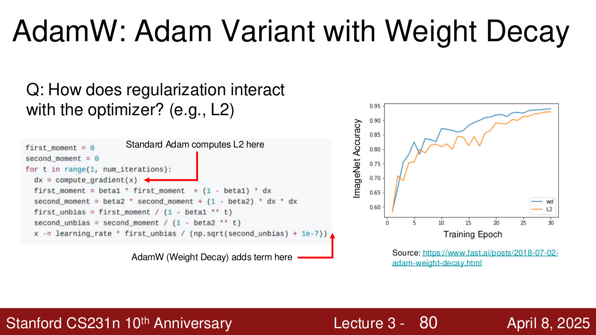

*Slide 80 — where each variant applies regularization, and ImageNet accuracy over 30 epochs for weight decay ("wd", blue) and L2 (orange); wd ends at about 0.94 against about 0.93. Chart from fast.ai. [Deck](https://cs231n.stanford.edu/slides/2025/lecture_3.pdf)*

## Learning rates and schedules

SGD, SGD with momentum, RMSProp, Adam and AdamW all have the **learning rate** as a hyperparameter
(slides 81–82). A very high learning rate makes the loss blow up; a low one converges slowly; a
high one drops quickly and then stalls at a plateau, bouncing around a minimum it cannot get
lower into; a good one falls quickly and keeps improving (≈59:12–59:59).

Which is best? "In reality, all of these could be good learning rates" (slide 83), because the
learning rate can change during training; nearly every modern model varies it (≈59:59).

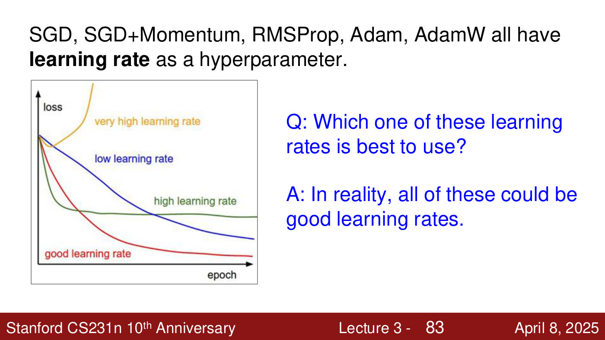

*Slide 83 — loss against epoch for four learning rates: very high (orange) blows up, low (blue) is slow, high (green) plateaus, good (red) keeps falling. "All of these could be good learning rates." [Deck](https://cs231n.stanford.edu/slides/2025/lecture_3.pdf)*

**Step decay** reduces the learning rate at a few fixed points: for ResNets, multiply it by 0.1
after epochs 30, 60 and 90 (slide 84). Each drop lets training get lower once the old rate is too
high to make progress (≈59:59–1:00:46).

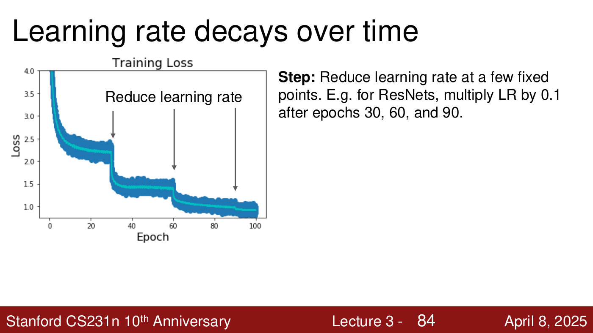

*Slide 84 — step decay: the training loss plateaus near 2.2, 1.4 and 1.0 and drops sharply each time the learning rate is cut, at epochs 30, 60 and 90. [Deck](https://cs231n.stanford.edu/slides/2025/lecture_3.pdf)*

**Cosine decay** follows half a cosine wave from the initial learning rate $\alpha_0$ down to zero
over $T$ epochs, where $\alpha_t$ is the learning rate at epoch $t$ (slide 85):

$$\alpha_t = \frac{1}{2}\alpha_0\left(1 + \cos(t\pi/T)\right)$$

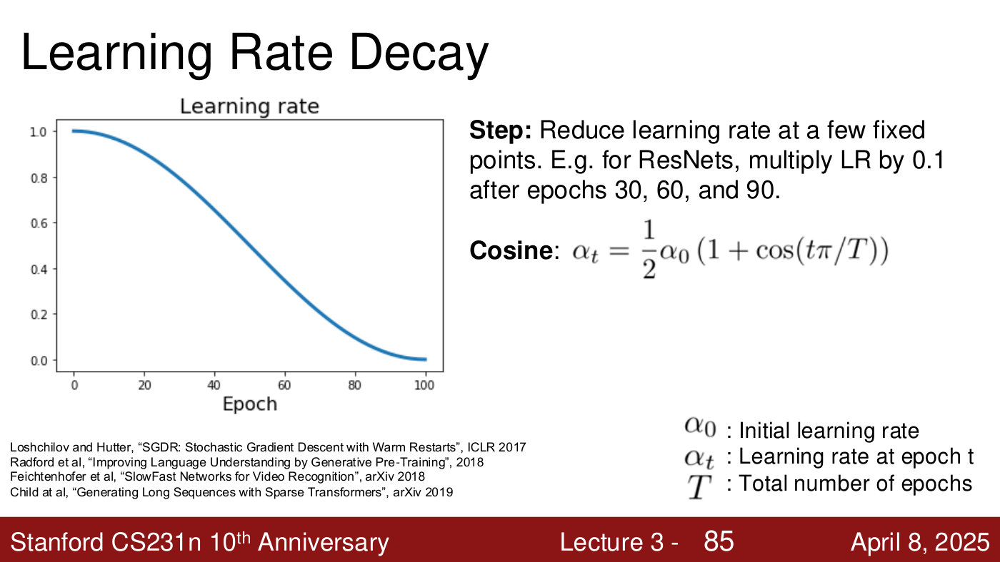

*Slide 85 — cosine decay: the learning rate follows half a cosine wave from its initial value to zero over training. [Deck](https://cs231n.stanford.edu/slides/2025/lecture_3.pdf)*

The deck cites Loshchilov and Hutter (SGDR, ICLR 2017), Radford et al. (2018), Feichtenhofer et
al. (SlowFast, 2018) and Child et al. (Sparse Transformers, 2019) for it (slide 85). The shape of
the training loss depends heavily on the schedule (≈1:01:31): under cosine decay it keeps improving
steadily through the middle of training (slide 86; ≈1:00:46).

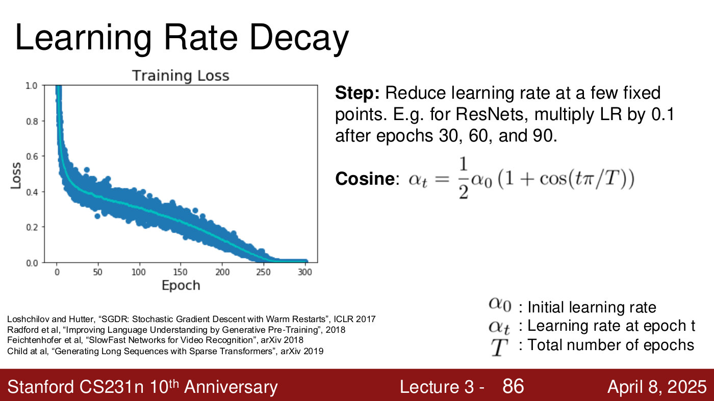

*Slide 86 — training loss under a cosine schedule: a steep early drop, steady gains through the middle, and zero by about epoch 250. [Deck](https://cs231n.stanford.edu/slides/2025/lecture_3.pdf)*

**Linear decay**, $\alpha_t = \alpha_0(1 - t/T)$, falls in a straight line (slide 87, citing BERT,
Devlin et al. 2018). **Inverse square root**, $\alpha_t = \alpha_0/\sqrt{t}$, drops steeply and then
slowly (slide 88, citing Vaswani et al., "Attention is all you need", NIPS 2017). There are endless
variations; use whichever works for the model (≈1:01:31).

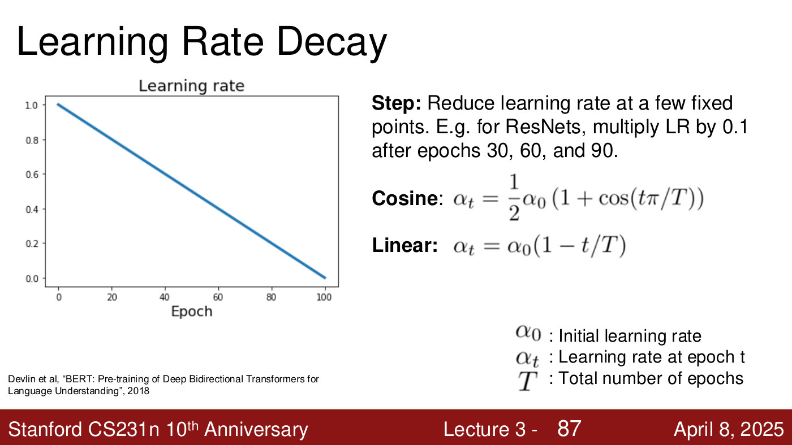

*Slide 87 — linear decay: the learning rate falls in a straight line to zero. [Deck](https://cs231n.stanford.edu/slides/2025/lecture_3.pdf)*

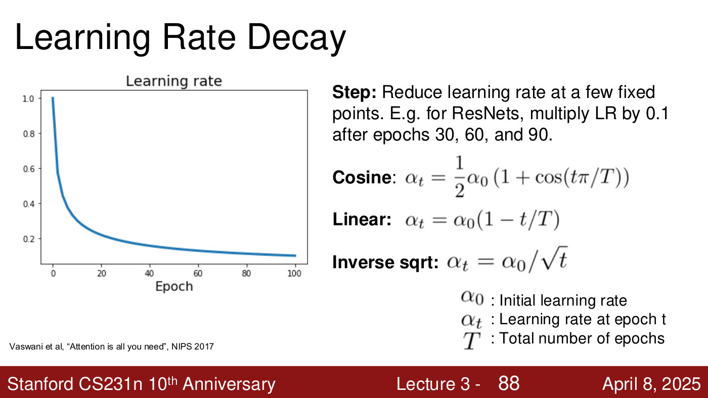

*Slide 88 — inverse square root decay: a steep early drop, then a slow tail. [Deck](https://cs231n.stanford.edu/slides/2025/lecture_3.pdf)*

**Linear warm-up.** High initial learning rates can make the loss explode, so a very popular
strategy is to increase the learning rate linearly from 0 over the first ~5,000 iterations, then
follow a schedule such as cosine or inverse square root (slide 89; ≈1:01:31–1:02:17). The slide
also gives an "empirical rule of thumb": if you increase the batch size by $N$, scale the initial
learning rate by $N$ (Goyal et al., "Accurate, Large Minibatch SGD: Training ImageNet in 1 Hour",
2017). The lecturer calls it something like a linear scaling law, says he forgets the exact name,
and stresses that it is shown empirically rather than proved (≈1:02:17–1:03:05).

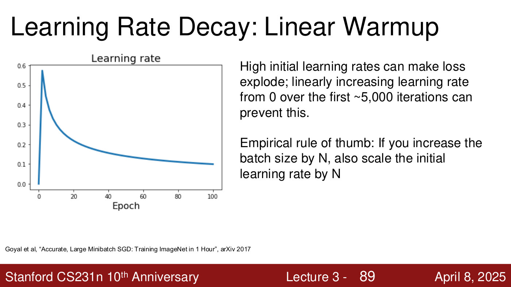

*Slide 89 — linear warm-up: the learning rate climbs from 0 to its peak in the first few epochs, then decays. [Deck](https://cs231n.stanford.edu/slides/2025/lecture_3.pdf)*

## First- and second-order optimisation

Everything so far is **first-order**: use the gradient to form a linear approximation of the loss,
and step to minimise the approximation (slide 91).

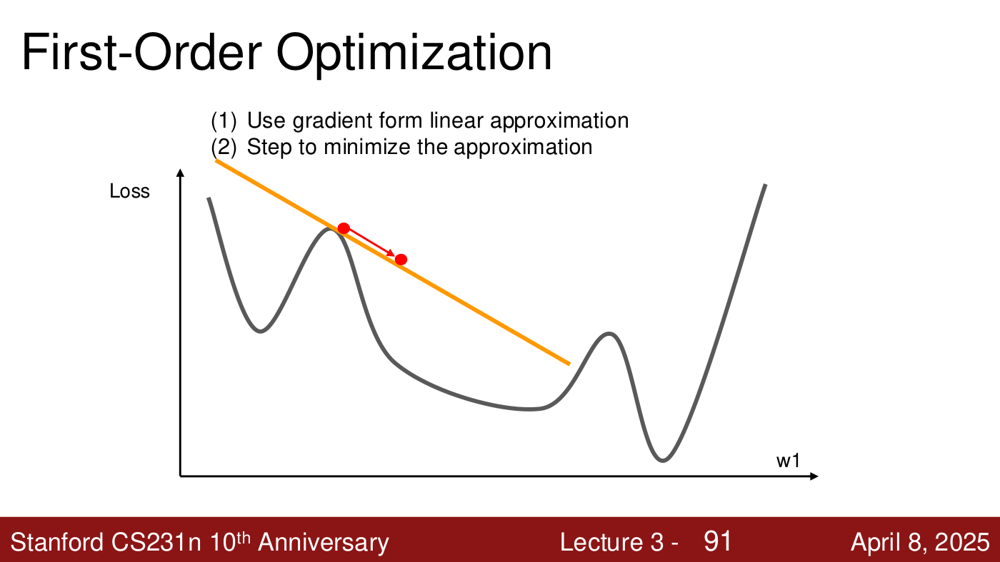

*Slide 91 — first-order: the tangent line (orange) at the current point says which way is down, and the step follows it. [Deck](https://cs231n.stanford.edu/slides/2025/lecture_3.pdf)*

**Second-order** optimisation uses the gradient and the Hessian to form a quadratic approximation,
and steps to its minimum (slide 92; ≈1:03:51–1:04:37).

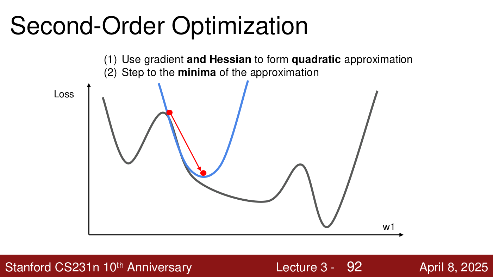

*Slide 92 — second-order: a parabola (blue) fitted at the current point, and one step straight to its minimum. [Deck](https://cs231n.stanford.edu/slides/2025/lecture_3.pdf)*

With $J(\boldsymbol{\theta})$ the loss as a function of the parameters $\boldsymbol{\theta}$,
$\boldsymbol{\theta}_ 0$ the current parameters and $\boldsymbol{H}$ the Hessian, the second-order
Taylor expansion is (slide 93)

$$J(\boldsymbol{\theta}) \approx J(\boldsymbol{\theta}_ 0) + (\boldsymbol{\theta} - \boldsymbol{\theta}_ 0)^\top \nabla_{\boldsymbol{\theta}} J(\boldsymbol{\theta}_ 0) + \frac{1}{2}(\boldsymbol{\theta} - \boldsymbol{\theta}_ 0)^\top \boldsymbol{H}(\boldsymbol{\theta} - \boldsymbol{\theta}_ 0)$$

and solving for its critical point gives the **Newton parameter update**:

$$\boldsymbol{\theta}^\ast = \boldsymbol{\theta}_ 0 - \boldsymbol{H}^{-1}\nabla_{\boldsymbol{\theta}} J(\boldsymbol{\theta}_ 0)$$

Why is this bad for deep learning? The Hessian has $O(N^2)$ elements and inverting it takes
$O(N^3)$, where $N$ is the number of parameters, tens or hundreds of millions (slide 94). In
practice the matrices do not fit in GPU memory, and the time is better spent showing the model more
data; for smaller models, though, second-order methods can work very well (≈1:04:37–1:05:24).

## In practice

The deck's advice (slide 95): **Adam(W) is a good default** in many cases, and often works even
with a constant learning rate; **SGD with momentum can outperform Adam** but may need more tuning
of the learning rate and schedule; and if you can afford full-batch updates, look beyond
first-order optimisation. The lecturer adds that a common setup is Adam or AdamW with a constant
learning rate, or with linear warm-up then cosine decay (≈1:05:24–1:06:09). SGD with momentum needs
more learning rates tried because it lacks RMSProp's correction for steep directions, while Adam
has proved itself across many domains (≈1:06:09; one word is unclear in the captions there).

## Looking ahead: neural networks

So far the score function is linear, $f = Wx$ with $x \in \mathbb{R}^{D}$ and
$W \in \mathbb{R}^{C \times D}$ for $D$ inputs and $C$ classes (slide 96). The next lecture's
**two-layer neural network** is

$$f = W_2 \max(0, W_1 x)$$

with $W_1 \in \mathbb{R}^{H \times D}$ and $W_2 \in \mathbb{R}^{C \times H}$ for a hidden size $H$;
in practice each layer also gets a learnable bias (slide 97). The $\max(0, \cdot)$ between the two
matrices is a **non-linearity**, the simplest one, ReLU (≈1:07:40).

Why non-linearity: no line separates a cluster of red points from the ring of blue points around
it (slide 98), but after a feature transform to polar coordinates, $f(x, y) = (r(x, y), \theta(x, y))$,
a vertical line does (slide 99). A network with several layers can learn such a transformation, so
that its final, linear layer can separate the data (≈1:07:40–1:08:25). The recording ends here.

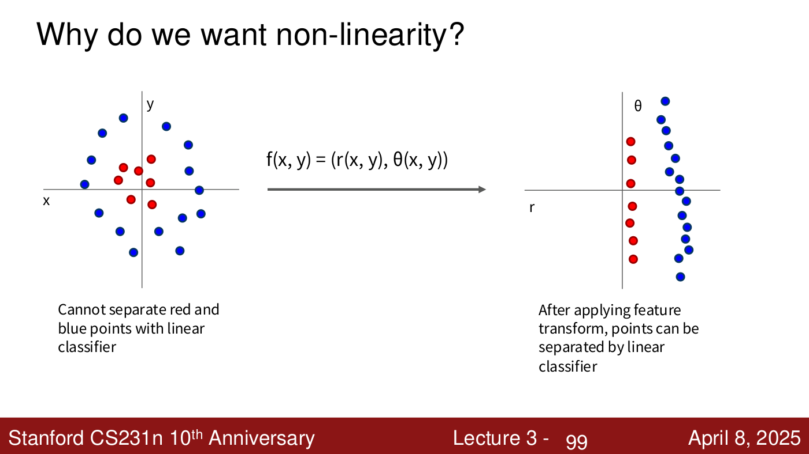

*Slide 99 — why non-linearity: red points inside a ring of blue cannot be split by a line (left), but after mapping each point to polar coordinates (r, θ) a vertical line separates them (right). [Deck](https://cs231n.stanford.edu/slides/2025/lecture_3.pdf)*

## Not presented: the rest of the deck (slides only)

Slide 100 notes that "neural network" is a broad term, and these are more accurately called
**fully-connected networks** or **multi-layer perceptrons** (MLP). Slide 101 announces the next
lecture: an introduction to neural networks, and backpropagation ("How do you calculate dx for
neural nets?"). This knowledge base does not yet cover lecture 4.

The rest is an appendix of "Slides from Previous Years" (slide 102), never presented.

### Nesterov momentum

Ordinary momentum combines the gradient at the current point with the velocity to get the step.
**Nesterov momentum** "looks ahead" to where the velocity would take it, computes the gradient
there, and mixes that with the velocity (slide 104; Nesterov 1983 and 2004; Sutskever et al. 2013).

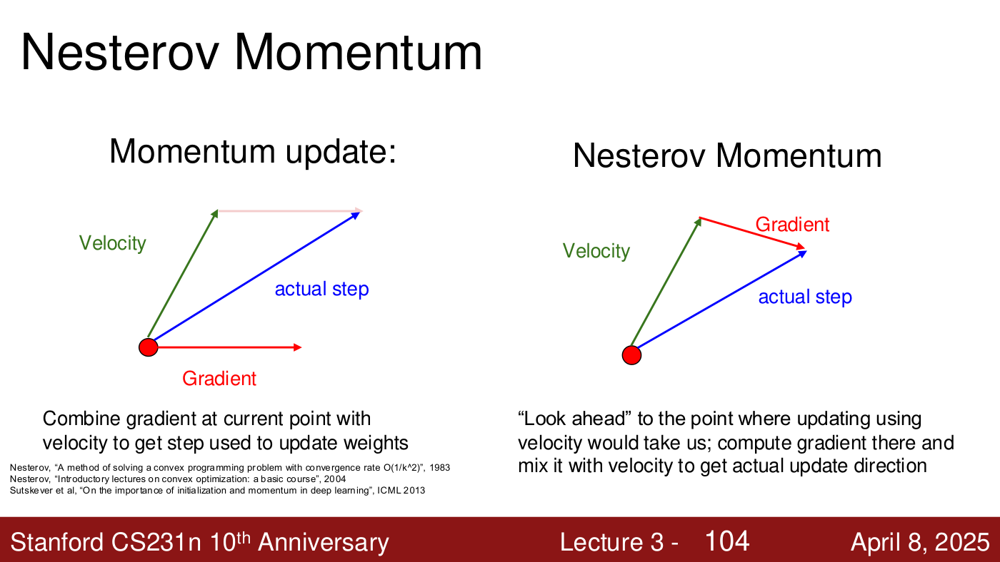

*Slide 104 — momentum adds the gradient at the current point to the velocity (left); Nesterov takes the gradient at the point the velocity leads to (right). [Deck](https://cs231n.stanford.edu/slides/2025/lecture_3.pdf)*

In equations (slide 105):

$$v_{t+1} = \rho v_t - \alpha \nabla f(x_t + \rho v_t)$$

$$x_{t+1} = x_t + v_{t+1}$$

Since one usually wants the update in terms of $x_t$ and $\nabla f(x_t)$, the change of variables
$\tilde{x}_ t = x_t + \rho v_t$ rearranges it to (slide 108)

$$v_{t+1} = \rho v_t - \alpha \nabla f(\tilde{x}_ t)$$

$$\tilde{x}_ {t+1} = \tilde{x}_ t - \rho v_t + (1 + \rho) v_{t+1} = \tilde{x}_ t + v_{t+1} + \rho (v_{t+1} - v_t)$$

Slide 109 compares SGD, SGD with momentum and Nesterov, but its paths are missing from the PDF.

### AdaGrad

**AdaGrad** (Duchi et al., JMLR 2011) is RMSProp without the decay: it adds every squared gradient
to a running sum, `grad_squared += dx * dx`, and divides the step by its square root (slide 110).
On a narrow valley, progress along steep directions is damped and along flat ones accelerated
(slides 111–112). Over a long time the step size **decays to zero**, since the sum only grows
(slides 113–114). RMSProp is "leaky AdaGrad": it replaces the sum with a decaying average
(slide 115).

### Quasi-Newton methods and L-BFGS

Instead of inverting the Hessian, which costs $O(n^3)$, **quasi-Newton** methods approximate the
inverse Hessian with rank-1 updates over time, at $O(n^2)$ each; the slide prints "BGFS" as the most popular
(slide 116), spelling it BFGS in the next line. **L-BFGS** (limited-memory BFGS) does not form or
store the full inverse Hessian. It usually works very well in full-batch, deterministic mode, but
does not transfer well to the minibatch setting, and adapting second-order methods to large-scale,
stochastic training is an active research area (slide 117). The appendix's version of "in practice"
suggests L-BFGS for full-batch updates, with all sources of noise disabled (slide 118).

### Softmax vs. SVM

Slide 119 repeats lecture 2's worked comparison of the two losses on one example: scores −2.85,
0.86 and 0.28 with the third class correct give a hinge loss of 1.58 and a cross-entropy loss
printed as 0.452. That value is the base-10 logarithm of 0.353; the natural logarithm gives about
1.04. See [loss functions](loss-functions.md#softmax-vs-svm).

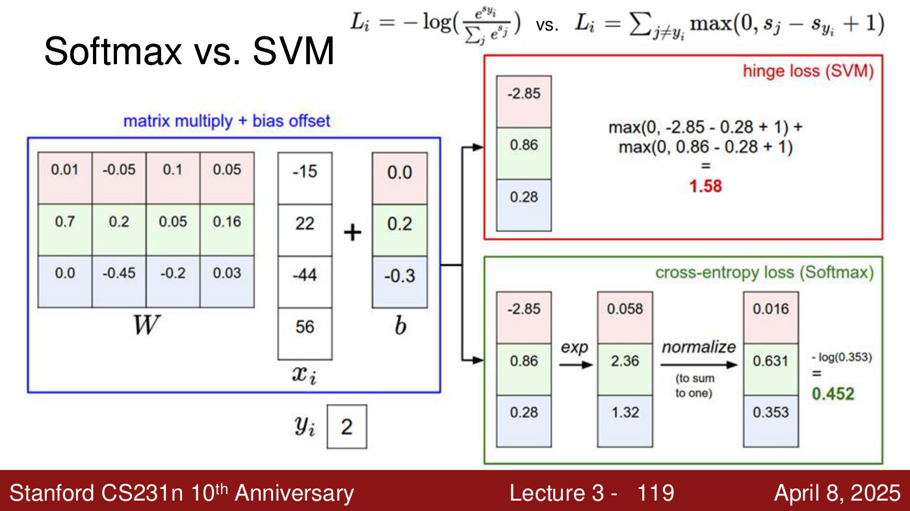

*Slide 119 — one example through both losses: hinge loss 1.58 (top) and cross-entropy loss (bottom), printed as 0.452 with a base-10 log. [Deck](https://cs231n.stanford.edu/slides/2025/lecture_3.pdf)*

### Is a W with zero loss unique?

Suppose a $W$ gives zero multiclass SVM loss, $L = 0$. Is it unique? "No! 2W is also has L = 0!"
(wording as printed; slides 120–121).

Slide 122 shows it on the car image: with the original scores the two hinge terms are
$\max(0, 1.3 - 4.9 + 1) + \max(0, 2.0 - 4.9 + 1) = 0 + 0$; with $W$ twice as large, the scores
double and $\max(0, 2.6 - 9.8 + 1) + \max(0, 4.0 - 9.8 + 1) = 0 + 0$ still. The losses row prints
2.9 and 0 for the cat and car images and leaves the frog's blank. Slide 123 then asks "How do we
choose between W and 2W?" and prints no answer.

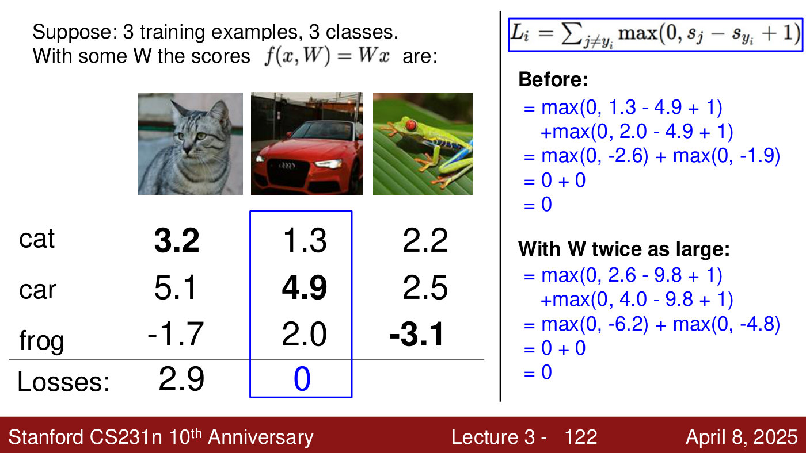

*Slide 122 — doubling W keeps the car image's SVM loss at 0: the margins −2.6 and −1.9 become −6.2 and −4.8, still below zero. [Deck](https://cs231n.stanford.edu/slides/2025/lecture_3.pdf)*

---

## Sources

- [Edited transcript](../raw/transcripts/03-regularization-optimization.md) — repunctuated, with
  restored terms listed in its header. Three passages are marked `[unclear]` there.
- [Deck, slide by slide](../raw/slides/03-regularization-optimization.md) — 119 pages, printed
  numbers 1–123; every figure described; [PDF](https://cs231n.stanford.edu/slides/2025/lecture_3.pdf).
- [Video](https://www.youtube.com/watch?v=dyNGd06MWn4).
- Reading listed on the course schedule for this lecture: the course notes,
  [Optimization](https://cs231n.github.io/optimization-1/).
- Previous lecture: [Lecture 2 — Image Classification with Linear Classifiers](02-image-classification.md).
- Topics: [regularization](regularization.md), [gradient descent](gradient-descent.md),
  [optimizers](optimizers.md), [learning-rate schedules](learning-rate-schedules.md).
