# Lecture 4 — Neural Networks and Backpropagation

**CS231N Deep Learning for Computer Vision, Stanford, Spring 2025.** Delivered April 10, 2025, by
Ehsan Adeli (per the course schedule; the recording does not name the lecturer).
[Video](https://www.youtube.com/watch?v=25zD5qJHYsk) ·
[edited transcript](../raw/transcripts/04-neural-networks-backpropagation.md) ·
deck as [text](../raw/slides/04-neural-networks-backpropagation.md) /
[PDF](https://cs231n.stanford.edu/slides/2025/lecture_4.pdf)

## What this lecture establishes

Lectures 2 and 3 built a linear classifier, a loss and a way to minimise it by following the
gradient. This lecture replaces the linear score function with a **neural network**: linear
layers with a **non-linear activation function** between them, which can separate data no single
line can, and which the lecture calls fully connected networks or multi-layer perceptrons. It then
answers the question that training such a network raises — how to get the gradient of the loss
with respect to every weight — with **computational graphs** and **backpropagation**: break the
function into simple nodes, run it forwards, then run backwards from the loss, multiplying at each
node the gradient arriving from above (the *upstream* gradient) by the node's own *local*
gradient. The lecturer calls backpropagation the process "that lets neural networks learn from
their own mistakes" and says every algorithm in the rest of the course uses a form of it
(≈0:05–0:52). The lecture works two scalar examples by hand, extracts the patterns of the common
gates, shows how frameworks such as PyTorch implement each node as a forward / backward pair,
and extends the method to vectors and matrices.

**What the recording covers.** The recording starts on the title slide, moves into a recap of
lectures 2 and 3 at ≈0:52, and ends at 1:16:19 with a spoken summary and the announcement that
the next lecture covers convolutional neural networks. Two parts of the deck are never presented
or mentioned: the administrative slides and the "Today: Deep Learning" examples (DALL-E, GPT-4,
Segment Anything, Sora) that open the lecture's main part. Both are summarised below from the
slides alone. The last part, backpropagation through a matrix multiplication, is covered in
outline in the final five minutes; its details here come mostly from the slides.

**Two printed slips.** The deck's own worked material has two errors, kept as printed in the
[slide file](../raw/slides/04-neural-networks-backpropagation.md) and pointed out where they occur
below: a sign in slide 53's expansion of the hinge loss, and the output matrix of the
matrix-multiply example, which is not the product of the two matrices printed beside it.

## Administrative notes (slides only)

Slide 3: the project proposal is due Friday 4/25, and the TAs' areas of expertise are posted on
the course website's office-hours page. Slide 4: the discussion section "tomorrow" is on
backpropagation, led by Matthew Jin with Emily Jin's help (the course schedule lists a Backprop
Review Session on April 11). The recording does not mention either slide.

## Recap of lectures 2 and 3

The recap slide (slide 6) restates the pieces so far: a dataset of pairs $(x, y)$; a score function
$s = f(x; W) = Wx$; the softmax loss for one example $i$,

$$L_i = -\log\left(\frac{e^{s_{y_i}}}{\sum_j e^{s_j}}\right)$$

where $s_j$ is the score of class $j$ and $y_i$ is the correct class; the full loss, an average
over the $N$ examples plus a regularizer,

$$L = \frac{1}{N}\sum_{i=1}^{N} L_i + R(W)$$

and, labelled as lecture 2's reading assignment, the SVM or hinge loss,

$$L_i = \sum_{j \neq y_i} \max(0, s_j - s_{y_i} + 1).$$

Students had asked why the course only uses softmax, so the lecturer spends a few minutes on the
hinge loss (≈2:23–4:45). It is one of many loss functions, widely used in the early years of
neural networks, and "unlike softmax, does not turn the scores into probabilities". It wants the
score of the correct class, $s_{y_i}$, to beat every other class's score $s_j$ by a margin — the 1
in the formula. When it does, that term of the loss is zero; when it does not, the loss grows in
proportion to the shortfall, which is what the plot on slide 6 shows: loss falling linearly as
$s_{y_i} - s_j$ rises, and flat at zero beyond the margin. The examples are in lecture 2's slides;
see [loss functions](loss-functions.md#multiclass-svm-loss-hinge-loss).

The rest of the recap is lecture 3 (≈4:45–9:26). The loss is a landscape whose every point is a
setting of the weights, and gradient descent walks downhill on it by stepping against the gradient
(slide 7). The analytic gradient is used in practice and checked against the numerical one
(slide 8). Computing the loss over a large dataset is expensive, so the gradient is estimated on
minibatches of "often 32, maybe 64, 128 or 256" examples (slide 9; ≈7:53). Lecture 3's optimisers —
SGD with momentum, RMSProp, Adam — appear on slide 10 as a loss surface with a legend; the PDF has
no optimiser paths on it, because the slide was an animation and only its background frame was
exported. Slide 11 repeats the learning-rate schedules (step, cosine, linear, inverse square
root). The lecturer adds that schedules are normally needed, "but in some of the more recent ones,
Adam and its variants, we often do not need to manually or explicitly decrease it, because that is
kind of encoded into the optimizer itself" (≈9:26). For all of this see
[lecture 3](03-regularization-optimization.md), [gradient descent](gradient-descent.md),
[optimizers](optimizers.md) and [learning-rate schedules](learning-rate-schedules.md).

## "Today: Deep Learning" (slides only, not presented)

After the recap the deck has a divider, "Today: Deep Learning" (slide 12), and nine slides of
recent results that the recording skips: it goes straight from the recap to the two-layer network
(≈9:26–10:14). They are recorded here so a reader knows what the posted deck holds; the lecture
says nothing about them.

Slide 13 shows three DALL-E 2 images with their prompts: teddy bears working on AI research on the
moon in the 1980s, rabbits attending a college seminar on human anatomy, and a cat meditating in
the Himalayas.


*Slide 13 — three DALL-E 2 images with their prompts (not presented in the recording). [Deck](https://cs231n.stanford.edu/slides/2025/lecture_4.pdf)*

Slide 14 shows a grid of nine DALL-E 2 samples beside the model's architecture diagram from Ramesh
et al. (2022): a text encoder turns the prompt into a text embedding, linked to an image embedding
by the "CLIP objective"; below, a "prior" maps the text embedding to an image embedding and a
"decoder" turns that into the image.

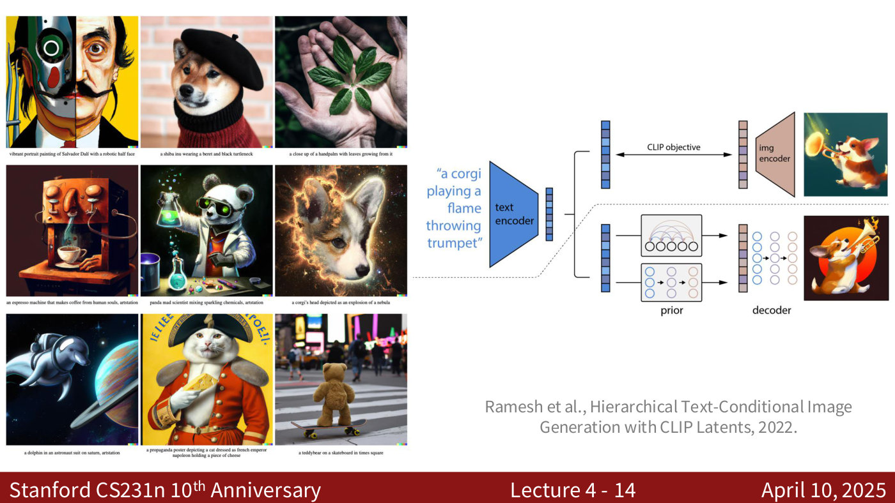

*Slide 14 — DALL-E 2 samples (left) and its architecture (right): a text encoder, a prior that maps the text embedding to an image embedding, and a decoder (not presented). [Deck](https://cs231n.stanford.edu/slides/2025/lecture_4.pdf)*

Slides 15–16 show DALL-E 3 (Betker et al., 2023) following long, detailed prompts: a furry
humanoid skunk in an animal-hide jacket, and a graphic-novel street scene whose four captions point
to the parts of the image each sentence of the prompt produced.


*Slide 15 — DALL-E 3 rendering a long, detailed prompt (not presented). [Deck](https://cs231n.stanford.edu/slides/2025/lecture_4.pdf)*


*Slide 16 — DALL-E 3: each sentence of the prompt, pointed at the part of the image it produced (not presented). [Deck](https://cs231n.stanford.edu/slides/2025/lecture_4.pdf)*

Slide 17 shows GPT-4 answering questions about images: what is unusual about a photograph of a man
ironing on a board attached to a taxi, and why a meme about "pictures of the earth from space"
showing chicken nuggets arranged like a world map is funny.

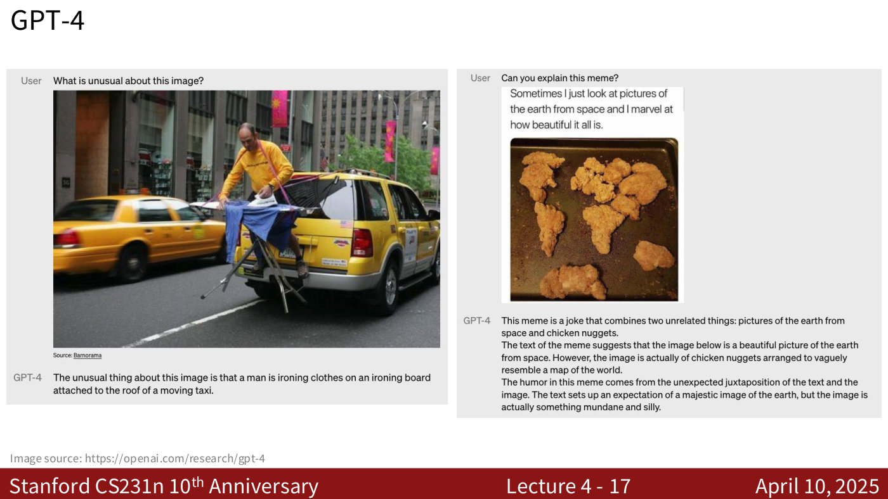

*Slide 17 — GPT-4 explaining an unusual photograph and a meme (not presented). [Deck](https://cs231n.stanford.edu/slides/2025/lecture_4.pdf)*

Slide 18 shows the Segment Anything Model (Kirillov et al., 2023) producing masks for crowded
scenes, in rows labelled 300–400, 400–500 and more than 500 masks.

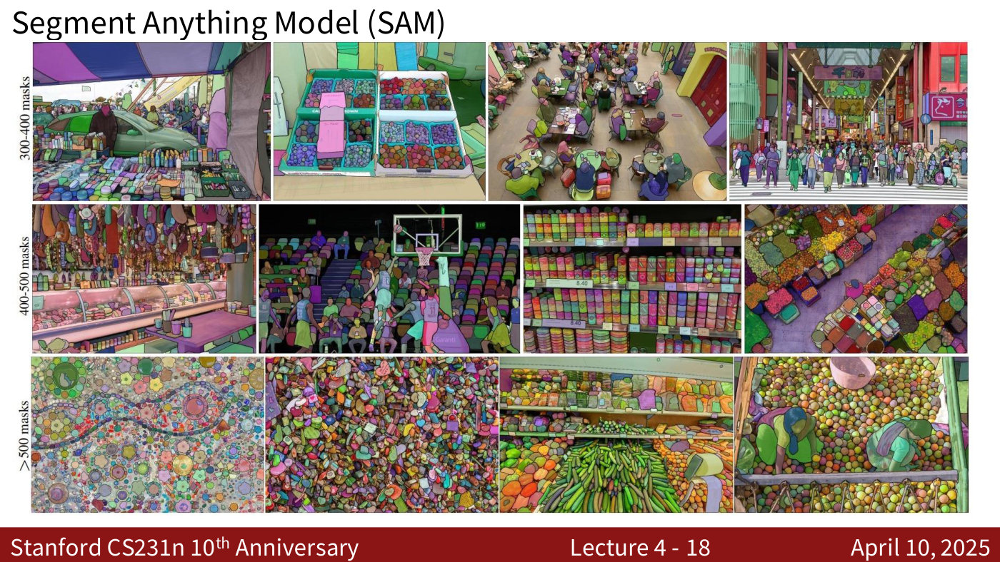

*Slide 18 — Segment Anything masks for scenes with 300 to more than 500 segments (not presented). [Deck](https://cs231n.stanford.edu/slides/2025/lecture_4.pdf)*

Slides 19–21 show Sora video frames: a woman walking down a neon-lit street at night (slide 19,
a full-page frame); animating a DALL-E image and editing a video's setting from text (slide 20);
and the same prompt rendered with base, $4\times$ and $32\times$ compute, the image sharpening as compute grows
(slide 21).


*Slide 19 — a full-page frame of a Sora-generated video (not presented). [Deck](https://cs231n.stanford.edu/slides/2025/lecture_4.pdf)*


*Slide 20 — Sora animating a DALL-E image and editing a video's setting from text (not presented). [Deck](https://cs231n.stanford.edu/slides/2025/lecture_4.pdf)*

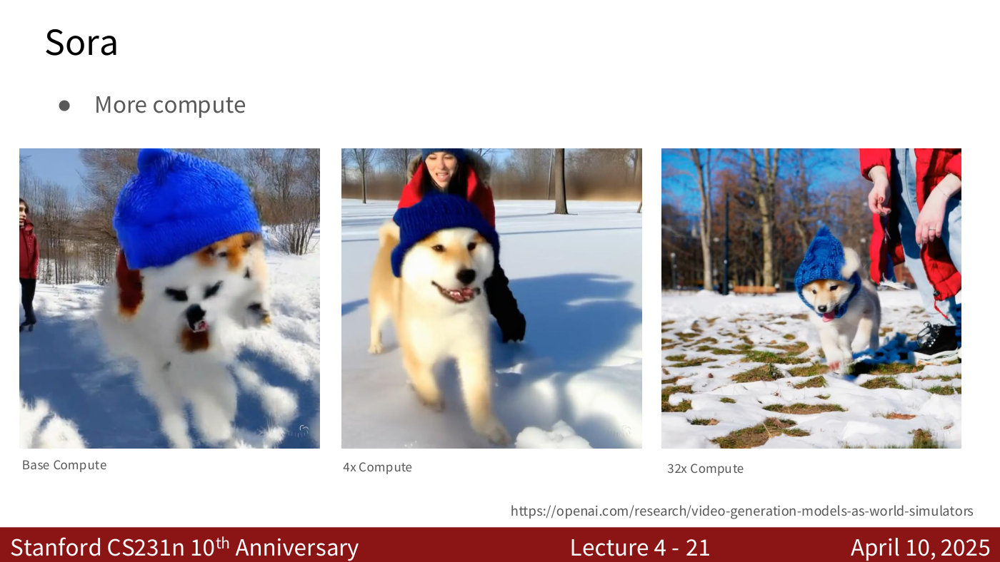

*Slide 21 — the same Sora prompt at base compute, four times as much and 32 times as much (not presented). [Deck](https://cs231n.stanford.edu/slides/2025/lecture_4.pdf)*

## From linear classifiers to neural networks

### The two-layer network

So far the score function has been linear, $f = Wx$, with input $x \in \mathbb{R}^{D}$ and weights
$W \in \mathbb{R}^{C \times D}$, where $D$ is the number of input features and $C$ the number of
classes (slide 23). The lecturer calls this "the most basic neural network that could be
defined. It's just one layer" (≈10:14). A **2-layer neural network** puts a second weight matrix
on top, with a maximum in between (slide 24):

$$f = W_2 \max(0, W_1 x)$$

with $W_1 \in \mathbb{R}^{H \times D}$ and $W_2 \in \mathbb{R}^{C \times H}$. The new dimension $H$
is the number of neurons in the **hidden layer**, the vector $\max(0, W_1 x)$ between the two
matrices. The maximum is taken elementwise, and it is what makes the function non-linear between
the two linear transformations: "a very, very important part of the process" (≈11:48). In practice
each layer also adds a learnable bias, left out of the formulas for simplicity (slide 24;
≈12:35).

### Why non-linearity?

Some data cannot be separated by any line. Slide 26 shows seven red points clustered at the origin
inside a ring of fifteen blue ones: no linear classifier separates them. Mapping each point to
polar coordinates, $f(x, y) = (r(x, y), \theta(x, y))$, lines the red points up at small radius
$r$ and the blue at larger $r$, where a vertical line separates them. That is a non-linear
transformation into a new space in which the problem becomes linear, "and this is just one
example" (≈12:35–13:20). A network's hidden layers can learn such a transformation, so that its
final, linear layer can do the separating.

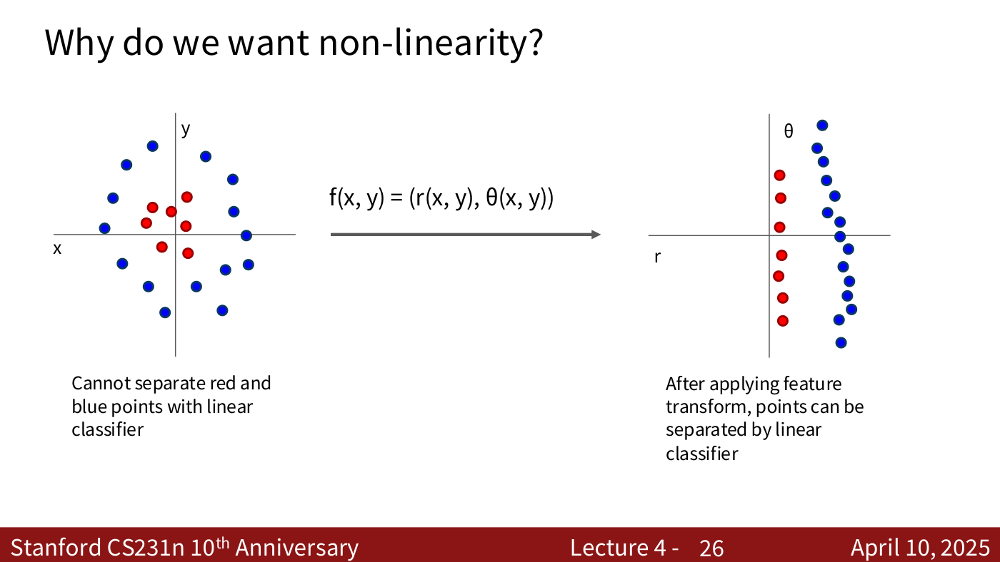

*Slide 26 — why non-linearity: no line separates the seven red points from the ring of fifteen blue ones (left); after mapping each point to polar coordinates (r, θ), a vertical line does (right). [Deck](https://cs231n.stanford.edu/slides/2025/lecture_4.pdf)*

### Fully connected networks, and deeper ones

"Neural network" is a very broad term; networks built only from weight layers like these are
more accurately called **fully-connected networks** or sometimes **multi-layer perceptrons** (MLPs)
(slide 27; ≈14:07). More layers can be stacked. A **3-layer network** is

$$f = W_3 \max(0, W_2 \max(0, W_1 x))$$

with $W_1 \in \mathbb{R}^{H_1 \times D}$, $W_2 \in \mathbb{R}^{H_2 \times H_1}$ and
$W_3 \in \mathbb{R}^{C \times H_2}$, so each matrix's input size matches the previous one's output
size (slide 28; ≈14:54).

### Hierarchical computation: many templates instead of ten

For CIFAR-10 the two-layer network maps an image of $x \in \mathbb{R}^{3072}$ to a hidden layer of
100 neurons and then to 10 class scores (slide 29). Lecture 2 read each row of a linear
classifier's $W$ as a **template** for one class. With a hidden layer the network can learn 100
templates instead of 10, and it can share them between classes (slide 30). The lecturer's reading,
offered "from a very high-level understanding point of view", is that the hidden neurons can
become templates for *parts* of objects rather than whole objects: bird, cat, deer, dog, frog and
horse all have eyes, so one template could be shared by all of them (≈15:40–16:27). The lectures on
visualizing what networks learn come back to this (≈17:14).

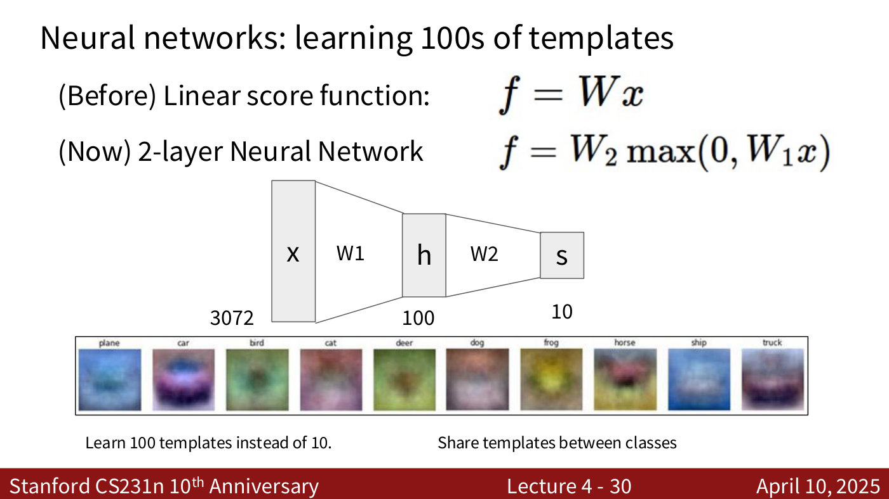

*Slide 30 — the two-layer network as sizes: a 3072-number image x, a 100-neuron hidden layer h, 10 class scores s. The strip is the 10 templates a linear classifier learns; the hidden layer can learn 100. [Deck](https://cs231n.stanford.edu/slides/2025/lecture_4.pdf)*

### The activation function, and why the max matters

The $\max(0, z)$ is called the **activation function** (slide 31). The slide asks what happens
without one. Then $f = W_2 W_1 x$, and the product $W_2 W_1$ is just another matrix
$W_3 \in \mathbb{R}^{C \times H}$, so $f = W_3 x$: "we end up with a linear classifier again!"
(slide 32). A student gives the answer in the room, and the lecturer confirms it: everything "could
be lumped together", so some non-linearity is needed "to give us the power to solve nonlinear
problems" (≈17:59).

### Activation functions

Slide 33 plots eight activation functions and says, in red, "ReLU is a good default choice for most
problems". Writing $x$ for the function's input:

| Name | Formula as printed |
| --- | --- |
| ReLU | $\max(0, x)$ |
| Leaky ReLU | $\max(0.1x, x)$ |
| ELU | $x$ for $x \geq 0$; $\alpha(e^{x} - 1)$ for $x \lt 0$ |
| GELU | $x \cdot \Phi(x)$ |
| SiLU | $x \cdot \sigma(x)$ |
| Sigmoid | $\sigma(x) = \frac{1}{1+e^{-x}}$ |
| Tanh | $\tanh(x) = \frac{e^{x} - e^{-x}}{e^{x} + e^{-x}}$ |

(The slide shows ELU with a parameter $\alpha$ and GELU with a function $\Phi$, and defines
neither.)

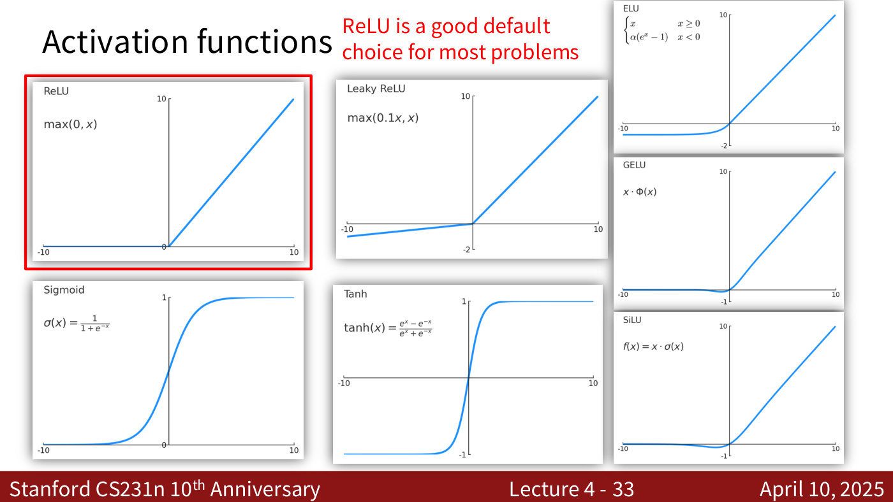

*Slide 33 — eight activation functions plotted from −10 to 10. ReLU, boxed in red, is the recommended default. [Deck](https://cs231n.stanford.edu/slides/2025/lecture_4.pdf)*

The lecturer's commentary (≈18:46–21:14): ReLU, the rectified linear unit, is very popular, but it
"sometimes creates dead neurons, because it makes everything equal to zero if it's not positive".
Leaky ReLU and ELU (exponential linear unit) avoid dead neurons, and ELU "is a little bit better
because it has a better zero-centered function". GELU (Gaussian error linear unit; the lecturer has
heard it pronounced both "jello" and "yellow") is used more in transformers. SiLU (sigmoid linear
unit), also called Swish, is used in some modern CNN architectures, in some of Google's models and
in EfficientNet. Sigmoid and tanh "squash values into a narrow range, and that sometimes results in
vanishing gradients", so they are not used in the middle of networks; they appear in the later
layers, for example to binarize the outputs.

Students asked how to choose among them (≈22:46–25:53). The answer is that it is mostly
empirical: start with ReLU, or with the function standard for that kind of architecture (CNN,
transformer), and treat the choice like any other hyperparameter. What they share is that they are
non-linear, which is their purpose, and differentiable, because the network is trained by
gradients. What separates them is the problems above (vanishing gradients) and properties such as
being zero-centred and smooth, which "makes it much faster to get converging networks". Commonly
the same activation is used across the whole network, except sometimes a sigmoid or tanh at the
output.

### Architectures and the forward pass

Slide 34 names architectures by their weight layers. Three inputs, one hidden layer of four neurons
and two outputs, every neuron joined to every neuron of the next layer, is a "2-layer Neural Net",
or "1-hidden-layer Neural Net". Two hidden layers of four and one output is a "3-layer Neural Net",
or "2-hidden-layer Neural Net". The connections between consecutive layers are the
"fully-connected" layers.

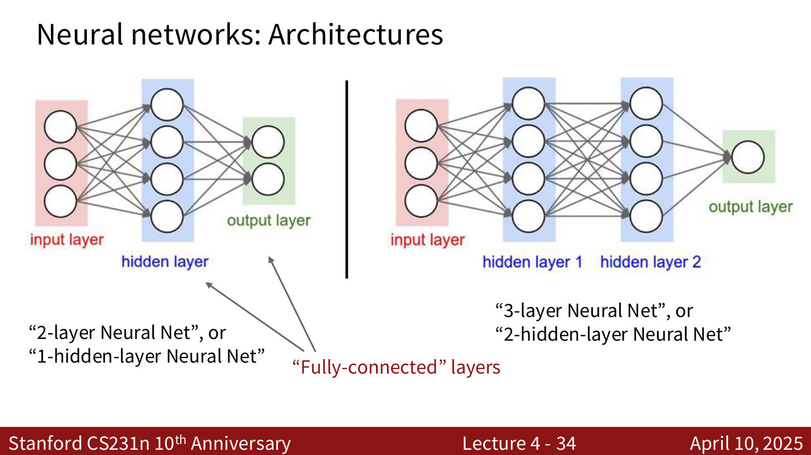

*Slide 34 — layers are counted by weight layers: one hidden layer makes a "2-layer" net, two hidden layers a "3-layer" net. Every neuron connects to every neuron in the next layer. [Deck](https://cs231n.stanford.edu/slides/2025/lecture_4.pdf)*

The forward pass of that 3-layer network, with the sigmoid as activation, is a few lines of NumPy
(slide 35; ≈22:00–22:46):

```python
# forward-pass of a 3-layer neural network:
f = lambda x: 1.0/(1.0 + np.exp(-x)) # activation function (use sigmoid)
x = np.random.randn(3, 1) # random input vector of three numbers (3x1)
h1 = f(np.dot(W1, x) + b1) # calculate first hidden layer activations (4x1)
h2 = f(np.dot(W2, h1) + b2) # calculate second hidden layer activations (4x1)
out = np.dot(W3, h2) + b3 # output neuron (1x1)
```

### Training a two-layer network in about 20 lines

Slide 36 shows a complete training loop, and slides 37–40 box its four parts in turn (≈25:53–28:13):

```python
import numpy as np
from numpy.random import randn

N, D_in, H, D_out = 64, 1000, 100, 10
x, y = randn(N, D_in), randn(N, D_out)
w1, w2 = randn(D_in, H), randn(H, D_out)

for t in range(2000):
  h = 1 / (1 + np.exp(-x.dot(w1)))
  y_pred = h.dot(w2)
  loss = np.square(y_pred - y).sum()
  print(t, loss)

  grad_y_pred = 2.0 * (y_pred - y)
  grad_w2 = h.T.dot(grad_y_pred)
  grad_h = grad_y_pred.dot(w2.T)
  grad_w1 = x.T.dot(grad_h * h * (1 - h))

  w1 -= 1e-4 * grad_w1
  w2 -= 1e-4 * grad_w2
```

The first block **defines the network**: $N$ is the number of samples, `D_in` the input
dimension, `D_out` the output dimension and $H$ the number of hidden neurons, with random data and
randomly initialised weights. The **forward pass** applies the weights layer by layer (a sigmoid
hidden layer here), produces the prediction `y_pred`, and computes the loss, the summed squared
difference from `y`. The third block **calculates the analytical gradients**, and the last takes
one **gradient descent** step on both weight matrices. The lecturer singles out the gradient block
as "the most important part here, which we haven't gone into very much", and the rest of the
lecture is about how to produce those lines (≈27:27–28:13).

## Choosing the network's size

More hidden neurons give the network more capacity. Slide 41 shows the same two-class data
separated by networks with 3, 6 and 20 hidden neurons: the boundary goes from a smooth curve to one
that bends around individual points, under the caption "more neurons = more capacity" (≈28:13).
The lecturer compares the 20-neuron picture to the one-nearest-neighbour classifier of lecture 2:
too much capacity overfits, and the network will not generalize to unseen data (≈29:00).

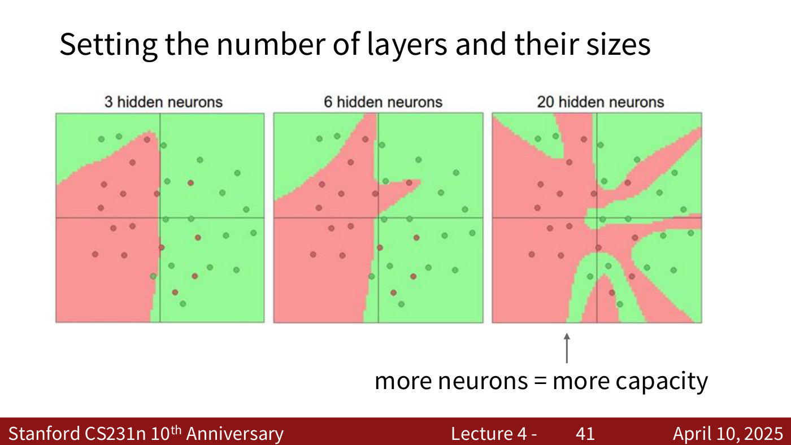

*Slide 41 — the same data separated by networks with 3, 6 and 20 hidden neurons: more neurons, more capacity, and a boundary that bends around individual points. [Deck](https://cs231n.stanford.edu/slides/2025/lecture_4.pdf)*

The rule of thumb on slide 42 is **"Do not use size of neural network as a regularizer. Use
stronger regularization instead"**. It shows one network at regularization strengths
$\lambda = 0.001$, $0.01$ and $0.1$, in the regularized loss

$$L(W) = \frac{1}{N}\sum_{i=1}^{N} L_i(f(x_i, W), y_i) + \lambda R(W)$$

and the boundary smooths from finger-like protrusions to a nearly straight line as $\lambda$
grows. The slide links a web demo built with ConvNetJS, and the TensorFlow Playground.
The network size is not usually tuned as a hyperparameter, though different sizes are tried;
"what we often do is go with a bit of a bigger network than we need" and tune the regularization
strength instead (≈29:48–30:34).

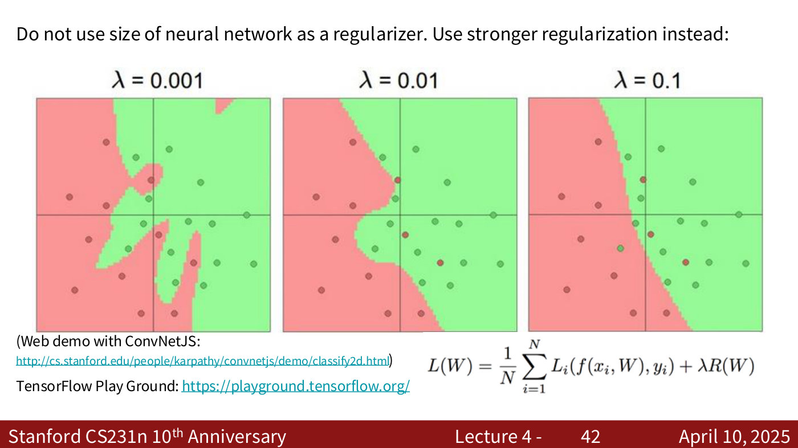

*Slide 42 — one network at regularization strengths λ = 0.001, 0.01 and 0.1: stronger regularization smooths the boundary, down to a nearly straight line. [Deck](https://cs231n.stanford.edu/slides/2025/lecture_4.pdf)*

Four student questions follow (≈30:34–35:11):

- **Why does a larger $\lambda$ underfit?** $\lambda$ sets how much the regularizer contributes to
  the loss. The regularizer acts on the weights, so a larger contribution constrains them more,
  and "less freedom equals more generic boundaries" (≈31:20).
- **Does regularization always prevent overfitting?** It is a balance. The first part of the loss
  is about predicting the right output and the second only about the weights, so "a regularizer is
  always good, but nothing is good if you use too much of it" (≈32:06).
- **Why change the regularization rather than the size?** One practice is to increase the number of
  parameters until the network starts to overfit, the point at which it "is actually
  understanding the patterns in the data and is now able to memorize the data", and then reduce
  the overfitting by regularizing. For a new problem, start with a smaller network, grow it, and
  correct with the regularizer (≈32:51–33:37). This is not quite the "bit of a bigger network than
  we need" of a minute earlier; the recording gives both.
- **How many neurons, and is there theory?** It is empirical: look at networks trained on similar
  data, start in that range and experiment. There is research on choosing activation functions,
  depths and other hyperparameters, but each method makes assumptions that may not hold for a
  given problem (≈33:37–35:11).

See [hyperparameters and validation](hyperparameters-and-validation.md) and
[regularization](regularization.md).

## Biological inspiration, and its limits

The lecturer introduces the biology with a warning: the inspirations "are very loose", and a
neuroscientist should not take the examples as ground truth (≈35:58). Slide 43 is an illustration
of neurons firing. In a neuron, impulses arrive through the **dendrites** at the **cell body**,
which aggregates them, and the **axon** carries the result away to other neurons. An artificial
neuron does the same thing with numbers. It weights its inputs $x_i$ by $w_i$, sums them with a
bias $b$, and passes the result through an activation function $f$, producing
$f\left(\sum_i w_i x_i + b\right)$; slide 46 draws the two side by side, with the sigmoid
$\frac{1}{1+e^{-x}}$ as the example activation (≈35:58–37:32). The activation function is what
creates the "impulses", increasing or decreasing the values passed on (≈36:45).

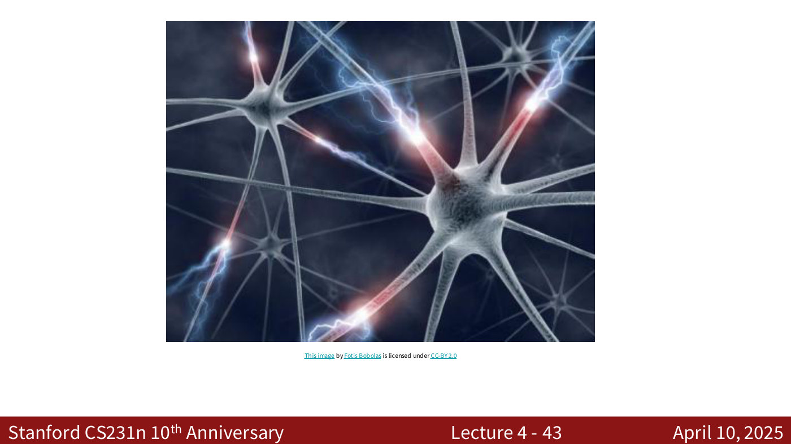

*Slide 43 — an illustration of biological neurons (CC-BY 2.0, Fotis Bobolas). [Deck](https://cs231n.stanford.edu/slides/2025/lecture_4.pdf)*

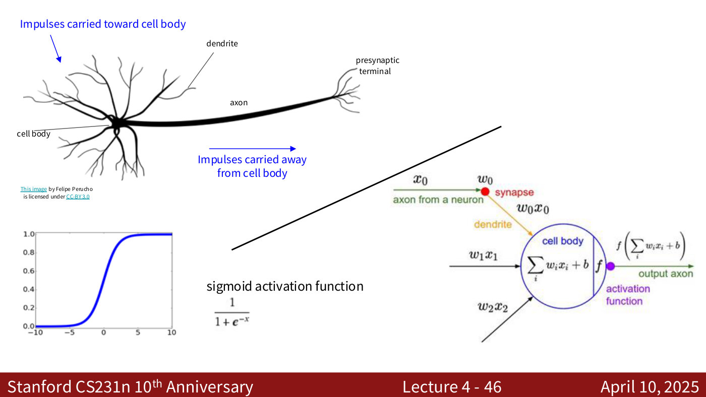

*Slide 46 — the biological neuron (dendrites, cell body, axon) beside the artificial one: weighted inputs summed with a bias and passed through an activation function f, here the sigmoid plotted at lower left. [Deck](https://cs231n.stanford.edu/slides/2025/lecture_4.pdf)*

Biological neurons have complex connectivity patterns, while the neurons of a network are
organised into regular layers "for computational efficiency" (slide 48; ≈37:32). Networks with
random connections can work too: slide 49 shows the randomly wired networks of Xie et al. (ICCV
2019). The lecturer adds that such work produces results "almost comparable" with the regular
networks the class builds (≈37:32–38:19).

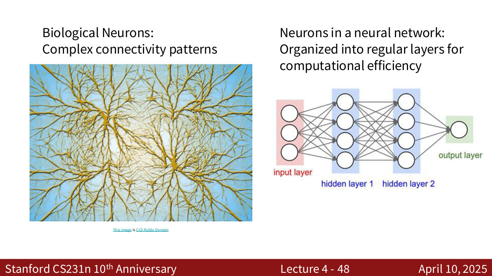

*Slide 48 — biological neurons' complex connectivity (left) against the regular layers of a neural network (right). [Deck](https://cs231n.stanford.edu/slides/2025/lecture_4.pdf)*

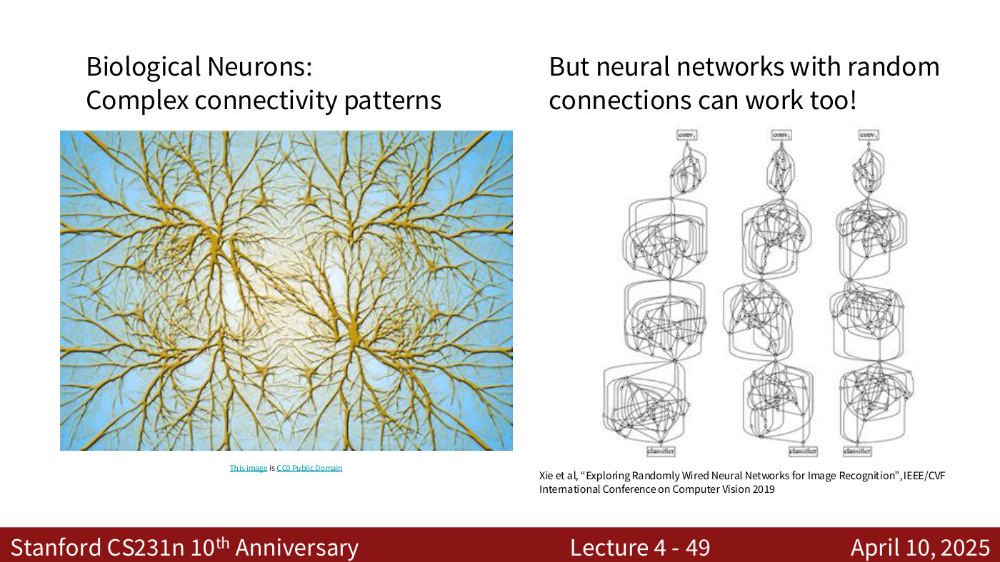

*Slide 49 — randomly wired networks (Xie et al., 2019) also work. [Deck](https://cs231n.stanford.edu/slides/2025/lecture_4.pdf)*

Slide 50, "Be very careful with your brain analogies!", lists how biological neurons differ: there
are many different types; dendrites can perform complex non-linear computations; and synapses are
not a single weight but a complex non-linear dynamical system (citing "Dendritic Computation.
London and Hausser"). "I can't warn you enough about being careful with your brain analogies"
(≈38:19).

## The problem: computing the gradients

Plugged into a loss, the two-layer network gives (slide 51; ≈38:19–39:56) a non-linear score
function, the hinge loss on its predictions, an L2 regularizer, and the total loss:

$$s = f(x; W_1, W_2) = W_2 \max(0, W_1 x)$$

$$L_i = \sum_{j \neq y_i} \max(0, s_j - s_{y_i} + 1)$$

$$R(W) = \sum_k W_k^2$$

$$L = \frac{1}{N}\sum_{i=1}^{N} L_i + \lambda R(W_1) + \lambda R(W_2)$$

"If we can compute $\frac{\partial L}{\partial W_1}$, $\frac{\partial L}{\partial W_2}$ then we can learn
$W_1$ and $W_2$" (slide 52).

**The bad idea: derive the gradient on paper.** Slide 53 writes out the gradient for the linear
classifier with hinge loss and L2 regularization, and lists three problems. It is very tedious,
with lots of matrix calculus. Changing the loss, say from hinge to softmax, means re-deriving
everything from scratch. And it is not feasible for very complex models (≈39:56–40:43).

*The slide's expansion contains a sign slip.* It substitutes $s_j = W_{j,:} \cdot x$ into the
hinge loss and prints the term as $W_{j,:} \cdot x + W_{y_i,:} \cdot x + 1$, in all three places it
appears. From $s_j - s_{y_i} + 1$ the term should read $W_{j,:} \cdot x - W_{y_i,:} \cdot x + 1$.
Here $W_{j,:}$ is row $j$ of $W$. The slide's point, that this is tedious, is unaffected.

**The better idea: computational graphs and backpropagation.** A computational graph lays out
every operation from the inputs and parameters to the loss (≈41:29–42:14). For the linear
classifier, $x$ and $W$ feed a multiply node that produces the scores $s$; the scores feed a
hinge-loss node; $W$ also feeds a regularization node $R$; and an add node combines the two into
$L$ (slide 54).

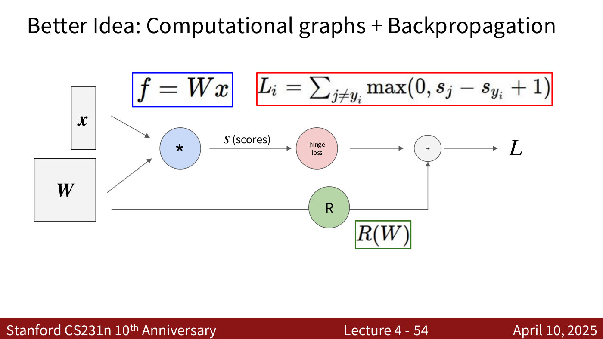

*Slide 54 — the linear classifier with hinge loss and regularization as a computational graph: x and W multiply into scores s, and the hinge loss and R(W) add into L. [Deck](https://cs231n.stanford.edu/slides/2025/lecture_4.pdf)*

The same framework covers networks far too large to differentiate by hand: AlexNet, from input image
through its weights to the loss (slide 55); a very large, deep graph shared by Andrej Karpathy
(slide 56); and the Neural Turing Machine, which the lecturer describes as a model for temporal and
sequential data that is unrolled many times over (slide 57; ≈42:14–43:02). Doing this by hand
"would be intractable and not feasible".

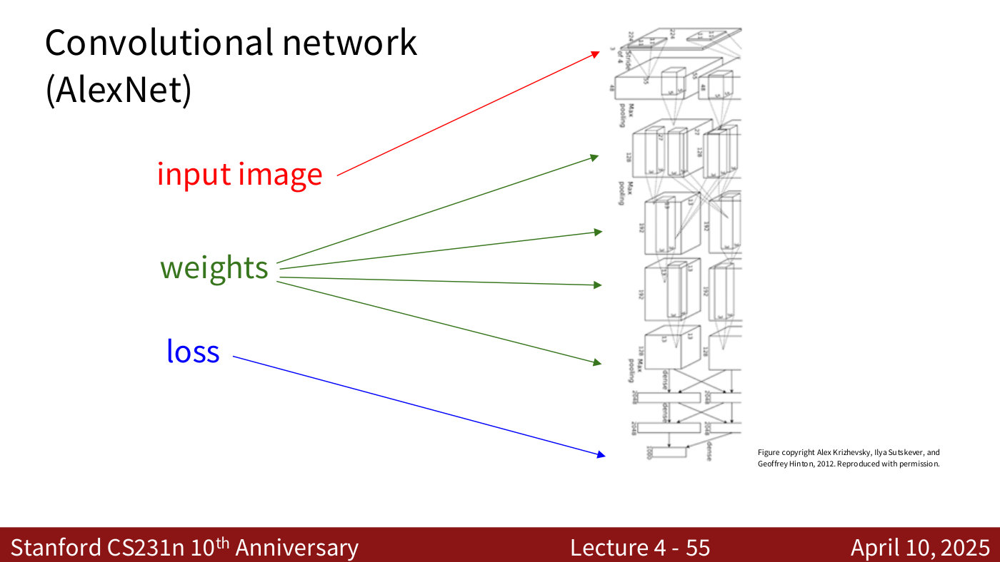

*Slide 55 — AlexNet as a computational graph, from input image through its weights to the loss. [Deck](https://cs231n.stanford.edu/slides/2025/lecture_4.pdf)*

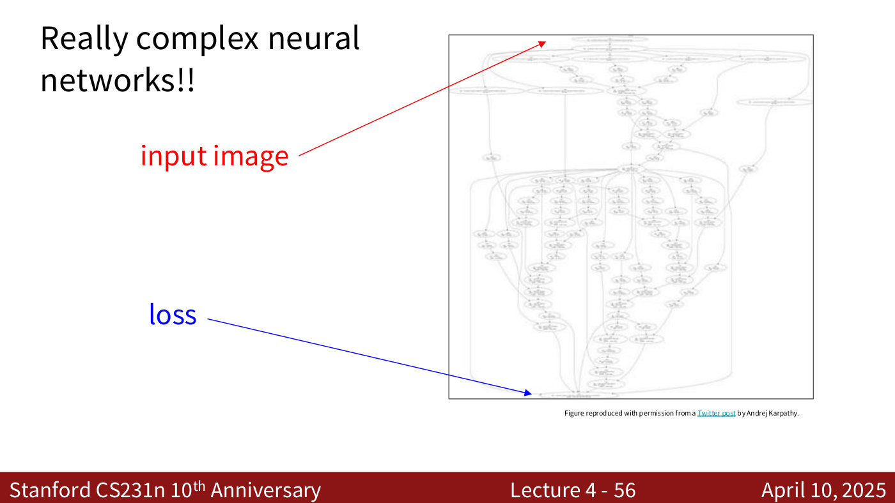

*Slide 56 — a very large computational graph (from a post by Andrej Karpathy): far too big to differentiate by hand. [Deck](https://cs231n.stanford.edu/slides/2025/lecture_4.pdf)*

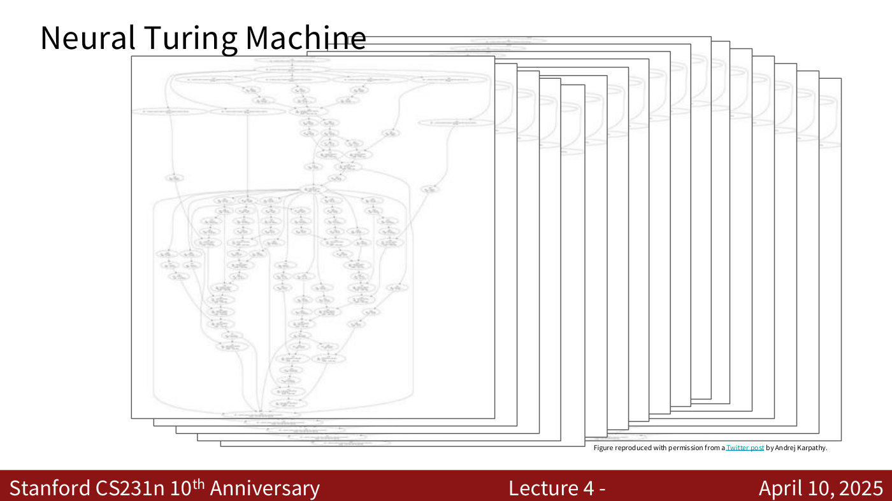

*Slide 57 — the Neural Turing Machine's graph, unrolled many times over. [Deck](https://cs231n.stanford.edu/slides/2025/lecture_4.pdf)*

## Backpropagation: a simple example

Take $f(x, y, z) = (x + y)z$ with $x = -2$, $y = 5$ and $z = -4$ (slides 59–61; ≈43:48). The graph
has two nodes: an add node producing $q = x + y$ and a multiply node producing $f = qz$.

**Forward pass.** $q = -2 + 5 = 3$ and $f = 3 \times (-4) = -12$ (slide 61).

**Local derivatives.** Each node's derivatives are simple (slides 62–63; ≈44:35–45:20). For the
add node, $\frac{\partial q}{\partial x} = 1$ and $\frac{\partial q}{\partial y} = 1$. For the
multiply node, $\frac{\partial f}{\partial q} = z$ and $\frac{\partial f}{\partial z} = q$: "kind of
a swap between z and q". The goal is $\frac{\partial f}{\partial x}$,
$\frac{\partial f}{\partial y}$ and $\frac{\partial f}{\partial z}$ (slide 64).

**Backward pass.** Start at the end of the graph and work backwards; it is "a recursive process"
(≈46:08–46:58):

1. $\frac{\partial f}{\partial f} = 1$: the derivative of the output with respect to itself is
   always one (slides 65–66).
2. $\frac{\partial f}{\partial z} = q = 3$ (slides 67–68).
3. $\frac{\partial f}{\partial q} = z = -4$ (slides 69–70).
4. $y$ is not connected to $f$ directly, so use the **chain rule** through $q$ (slides 71–72;
   ≈48:30–50:03):
   $\frac{\partial f}{\partial y} = \frac{\partial f}{\partial q}\frac{\partial q}{\partial y} = (-4)(1) = -4$.
5. Likewise $\frac{\partial f}{\partial x} = \frac{\partial f}{\partial q}\frac{\partial q}{\partial x} = -4$
   (slide 73).

In the chain rule, $\frac{\partial f}{\partial q}$ is the **upstream gradient**: "the gradient that
comes from the end of the network to the current node". $\frac{\partial q}{\partial y}$ is the
**local gradient**: "the gradient of the output of the node with respect to its input" (slide 74;
≈48:30–49:15).

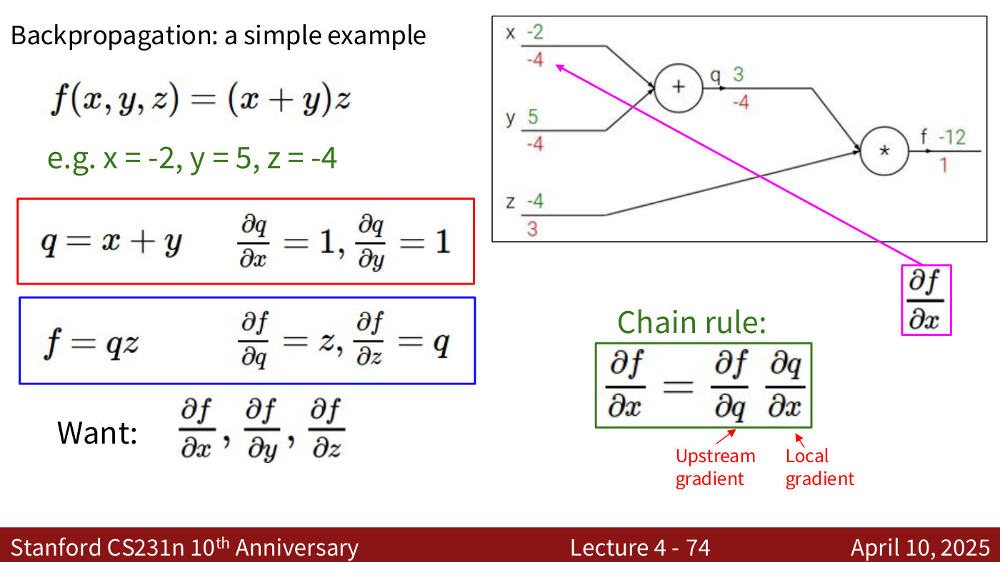

*Slide 74 — the finished backward pass for f = (x + y)z. Forward values are in green (x = −2, y = 5, q = 3, z = −4, f = −12), gradients in red beneath them (1 at f, 3 at z, −4 at q, y and x). [Deck](https://cs231n.stanford.edu/slides/2025/lecture_4.pdf)*

### What one node does

Seen from a single node $f$ with inputs $x$, $y$ and output $z$, backpropagation is entirely local
(≈50:03–52:22). The node always knows its **local gradients**,
$\frac{\partial z}{\partial x}$ and $\frac{\partial z}{\partial y}$, because it knows its own
function. During the backward pass it receives the **upstream gradient**
$\frac{\partial L}{\partial z}$, the gradient of the final loss $L$ with respect to its output,
already computed by the nodes after it. It multiplies the two to get the **downstream
gradients**

$$\frac{\partial L}{\partial x} = \frac{\partial L}{\partial z}\frac{\partial z}{\partial x}
\qquad
\frac{\partial L}{\partial y} = \frac{\partial L}{\partial z}\frac{\partial z}{\partial y}$$

and passes each to the node that produced that input, where it becomes the upstream gradient
(slide 80). This is "one of the most fundamental operations in all of neural networks" (≈52:22).

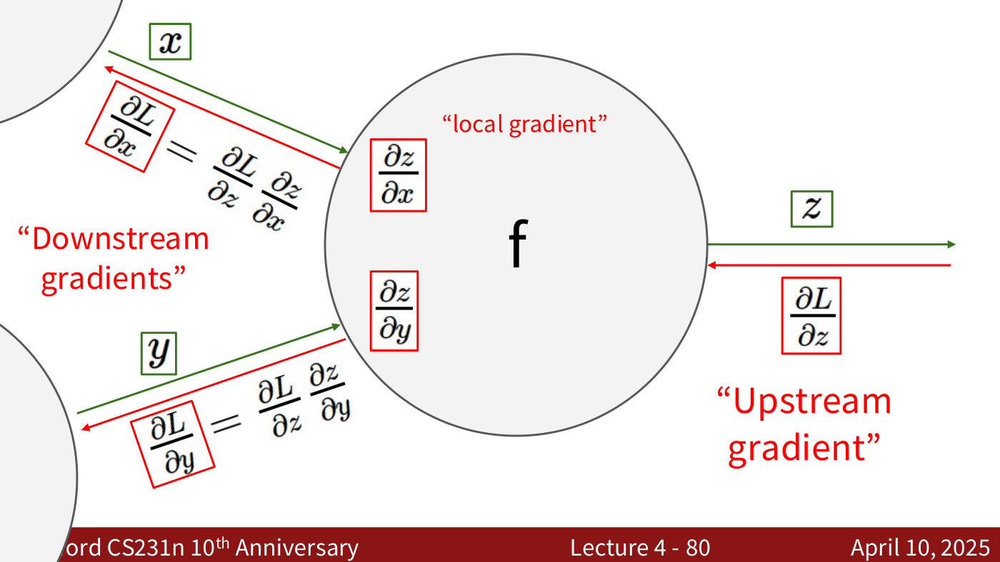

*Slide 80 — one node seen locally: it knows its local gradients, receives the upstream gradient ∂L/∂z, and multiplies them to send downstream gradients to the nodes that produced x and y. [Deck](https://cs231n.stanford.edu/slides/2025/lecture_4.pdf)*

Asked for the intuition, the lecturer steps back (≈52:22–53:53): gradient descent needs the
gradient of the loss with respect to every weight. Backpropagation moves the gradient of $L$ back
to every value in the network "without sitting down and writing the function for the entire
network": with 100 layers, nobody writes out the function for all 100 by hand.

## Another example: a sigmoid neuron

The second example is a neuron with two weighted inputs, a bias and a sigmoid (slide 81;
≈53:53–54:39):

$$f(w, x) = \frac{1}{1+e^{-(w_0 x_0 + w_1 x_1 + w_2)}}$$

broken into nodes: two multiplies ($w_0 x_0$ and $w_1 x_1$), two adds (their sum, then $+ w_2$), a
multiply by $-1$, an $\exp$, an add of 1, and a reciprocal $1/x$. The values are $w_0 = 2$,
$x_0 = -1$, $w_1 = -3$, $x_1 = -2$, $w_2 = -3$ (slide 82). Four derivative rules cover every node
(slide 84; ≈54:39–55:27):

$$f(x) = e^{x} \rightarrow \frac{df}{dx} = e^{x} \qquad f_a(x) = ax \rightarrow \frac{df}{dx} = a$$

$$f(x) = \frac{1}{x} \rightarrow \frac{df}{dx} = -\frac{1}{x^{2}} \qquad f_c(x) = c + x \rightarrow \frac{df}{dx} = 1$$

The forward pass (slide 83) and the backward pass (slide 85 onwards; ≈55:27–58:30) give the
values below. Each gradient is the upstream gradient times the local gradient of the node it has
just passed back through, which the slides write as "[upstream gradient] × [local gradient]".

| Output of | Forward value | Gradient | Computed as |
| --- | --- | --- | --- |
| $1/x$ (the output) | 0.73 | 1.00 | start: the output's gradient with respect to itself |
| $+1$ | 1.37 | $-0.53$ | back through $1/x$: $(1.00)(-1/1.37^2)$ |
| $\exp$ | 0.37 | $-0.53$ | back through $+1$: $(-0.53)(1)$ |
| $\times(-1)$ | $-1.00$ | $-0.20$ | back through $\exp$: $(-0.53)(e^{-1})$ |
| the add of $w_2$ | 1.00 | 0.20 | back through $\times(-1)$: $(-0.20)(-1)$ |
| the first add | 4.00 | 0.20 | back through an add: $(0.20)(1)$ |
| $w_0 x_0$ | $-2.00$ | 0.20 | back through an add: $(0.20)(1)$ |
| $w_1 x_1$ | 6.00 | 0.20 | back through an add: $(0.20)(1)$ |

The add nodes pass 0.20 unchanged to all their inputs, including $w_2$. At the multiply nodes the
local gradient with respect to one input is the value of the other input. So $w_0$ gets
$0.2 \times (-1) = -0.2$ and $x_0$ gets $0.2 \times 2 = 0.4$ (slide 96; ≈57:44–58:30), and in the
same way $w_1$ gets $-0.40$ and $x_1$ gets $-0.60$ (printed with the flat code below).

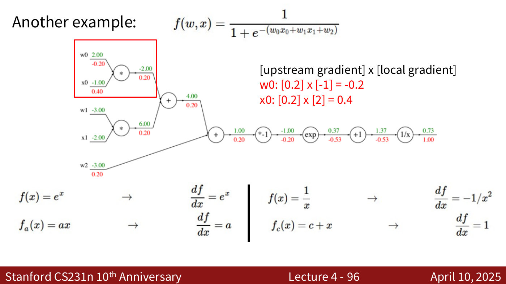

*Slide 96 — the sigmoid example near the end of its backward pass: green forward values above each edge, red gradients below, and the four derivative rules used along the way. [Deck](https://cs231n.stanford.edu/slides/2025/lecture_4.pdf)*

The slides round to two decimals at every step; recomputed at full precision, the chain gives
$-0.534$, $-0.197$ and $0.197$ for the 1.37, −1.00 and 1.00 edges, which round to the printed
values.

### The sigmoid as one gate

The graph is not unique. The last four nodes compute the **sigmoid** function
$\sigma(x) = \frac{1}{1+e^{-x}}$, so they can be grouped into one sigmoid gate (slide 97; ≈59:17):
"Computational graph representation may not be unique. Choose one where local gradients at each
node can be easily expressed!" The sigmoid is useful here because its local gradient depends only
on the sigmoid itself (slide 98):

$$\frac{d\sigma(x)}{dx} = \frac{e^{-x}}{(1+e^{-x})^{2}} = \left(\frac{1+e^{-x}-1}{1+e^{-x}}\right)\left(\frac{1}{1+e^{-x}}\right) = (1-\sigma(x))\thinspace\sigma(x)$$

With the gate's input 1.00 and output 0.73, the downstream gradient is
$[1.00] \times [(1 - 0.73)(0.73)] = 0.2$ (slide 100), the same value the step-by-step pass reached
(≈1:00:04; the captions garble the number there, and the slide prints 0.2). Recomputed, it is
$0.197$.

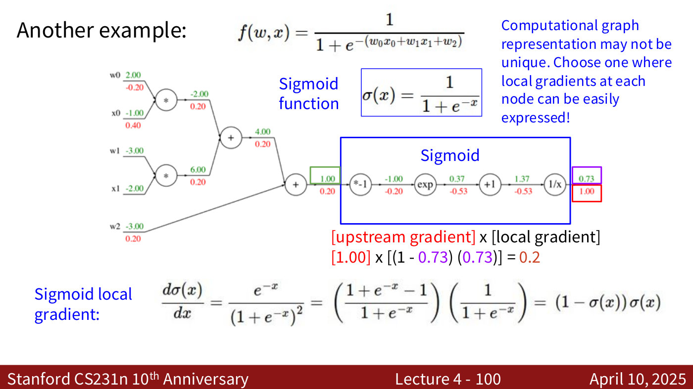

*Slide 100 — the last four nodes grouped as one sigmoid gate: its local gradient (1 − σ)σ, evaluated at the output 0.73, gives the same 0.2 as stepping through each node. [Deck](https://cs231n.stanford.edu/slides/2025/lecture_4.pdf)*

## Patterns in gradient flow

Four gates come up often enough to memorise (≈1:00:50–1:01:38). On the slide, green numbers are
forward values and red numbers gradients:

- **Add gate: gradient distributor.** Inputs 3 and 4, output 7, upstream gradient 2: both inputs
  get 2, because the local gradients of a sum are all 1.
- **Mul gate: "swap multiplier".** Inputs 2 and 3, output 6, upstream gradient 5: the first input
  gets $5 \times 3 = 15$ and the second $2 \times 5 = 10$. Each input's gradient is the upstream
  gradient times the *other* input.
- **Copy gate: gradient adder.** One value 7 used twice, with gradients 4 and 2 coming back: the
  input's gradient is $4 + 2 = 6$.
- **Max gate: gradient router.** Inputs 4 and 5, output 5, upstream gradient 9: the larger input
  (5) gets all 9 and the other gets 0. The lecturer notes this is "very similar to the ReLU
  function" (slide 104).

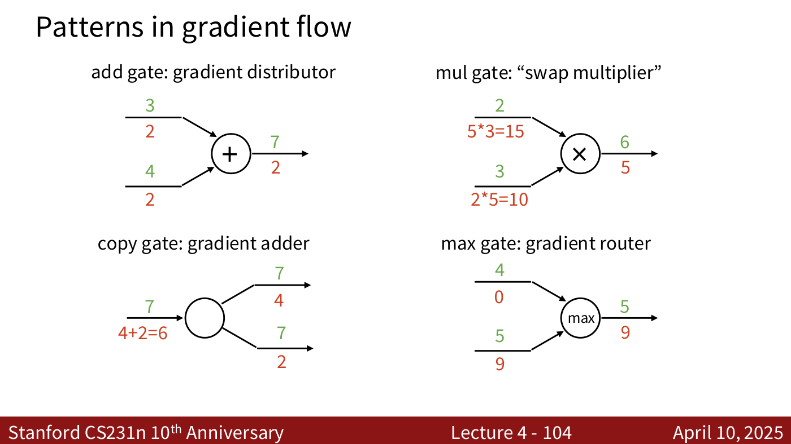

*Slide 104 — four gates to memorise. Add distributes the gradient, mul swaps the inputs as multipliers, copy adds the incoming gradients, max routes all of it to the larger input. [Deck](https://cs231n.stanford.edu/slides/2025/lecture_4.pdf)*

## Implementing backpropagation

### "Flat" code

Once the graph is laid out, the code writes itself (≈1:01:38–1:02:26). For the sigmoid neuron, the
forward pass computes each intermediate value in order, and the backward pass walks the same steps
in reverse, one line per gradient:

```python
def f(w0, x0, w1, x1, w2):
  s0 = w0 * x0
  s1 = w1 * x1
  s2 = s0 + s1
  s3 = s2 + w2
  L = sigmoid(s3)

  grad_L = 1.0
  grad_s3 = grad_L * (1 - L) * L
  grad_w2 = grad_s3
  grad_s2 = grad_s3
  grad_s0 = grad_s2
  grad_s1 = grad_s2
  grad_w1 = grad_s1 * x1
  grad_x1 = grad_s1 * w1
  grad_w0 = grad_s0 * x0
  grad_x0 = grad_s0 * w0
```

That is slide 105's code, beside the graph with every value filled in, including the gradients of
$w_1$ and $x_1$. Slides 106–111 box each piece against its node: the base case `grad_L = 1.0` at the output, the
sigmoid gate's $(1 - L)L$, the two add gates copying their gradient to both inputs, and the two
multiply gates swapping their inputs.

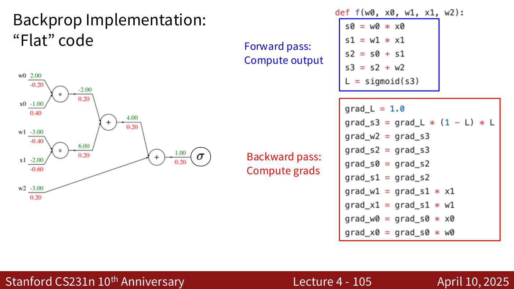

*Slide 105 — "flat" backprop code beside its graph: the forward pass computes the output, then the backward pass walks the graph in reverse, one line per gradient. [Deck](https://cs231n.stanford.edu/slides/2025/lecture_4.pdf)*

### A modular forward / backward API

Rather than writing a flat program for each network, every operation becomes a node object with a
`forward` and a `backward` method. Slide 115 shows "actual PyTorch code" for a multiply gate on
scalars (≈1:03:12):

```python
class Multiply(torch.autograd.Function):
  @staticmethod
  def forward(ctx, x, y):
    ctx.save_for_backward(x, y)
    z = x * y
    return z
  @staticmethod
  def backward(ctx, grad_z):
    x, y = ctx.saved_tensors
    grad_x = y * grad_z   # dz/dx * dL/dz
    grad_y = x * grad_z   # dz/dy * dL/dz
    return grad_x, grad_y
```

The forward pass must cache the inputs, because the backward pass needs them. `grad_z` is the
upstream gradient, and the backward pass multiplies it by the local gradients.

PyTorch's operators are written this way (≈1:03:57). Slide 116 shows a listing of its operator
source files, and slides 117–119 show its sigmoid layer: the forward function is "actually defined
elsewhere", in a C++ kernel computing `1 / (1 + std::exp((-a)))`, and the backward function
computes exactly the local gradient above, `*gradInput_data = *gradOutput_data * (1. - z) * z;`,
where `z` is the saved output.

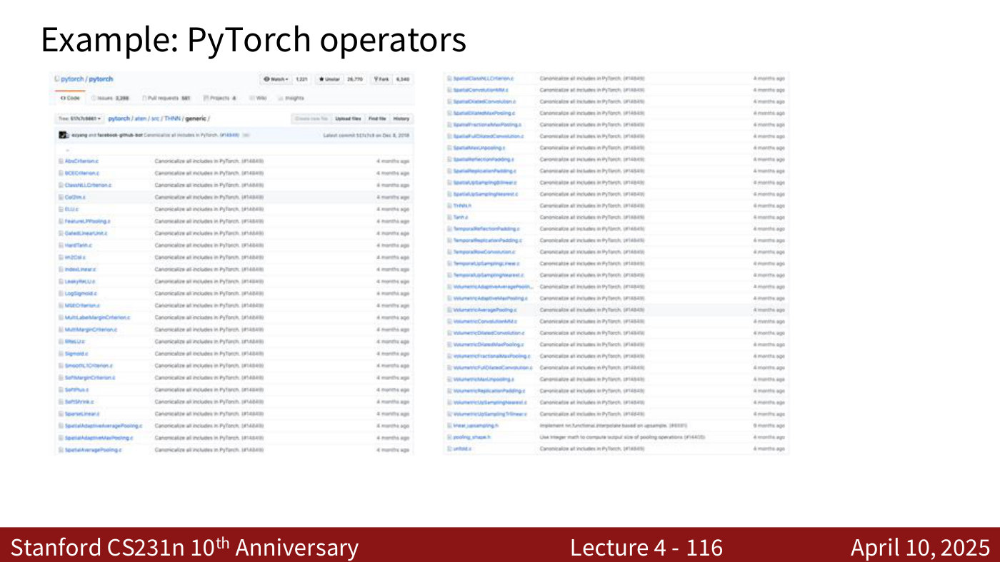

*Slide 116 — a listing of PyTorch's operator source files (pytorch/pytorch, aten/src/THNN/generic). [Deck](https://cs231n.stanford.edu/slides/2025/lecture_4.pdf)*

## Backprop with vectors and matrices

Every example so far used scalars; real networks use vectors and matrices (slide 120; ≈1:03:57).

### Derivatives of vectors

Slide 123 sets out the three cases (≈1:04:42–1:06:13). For a scalar $y$ of a scalar $x$, the
derivative $\frac{\partial y}{\partial x} \in \mathbb{R}$ says how much $y$ changes if $x$ changes
by a small amount. For a scalar $y$ of a vector $x \in \mathbb{R}^N$, the derivative is the
**gradient**, $\frac{\partial y}{\partial x} \in \mathbb{R}^N$ with
$\left(\frac{\partial y}{\partial x}\right)_ {n} = \frac{\partial y}{\partial x_n}$: for each element of
$x$, how much $y$ changes. For a vector $y \in \mathbb{R}^M$ of a vector $x \in \mathbb{R}^N$, it is
the **Jacobian**, which the slide writes as $\frac{\partial y}{\partial x} \in \mathbb{R}^{N \times M}$
with entries $\left(\frac{\partial y}{\partial x}\right)_ {n,m} = \frac{\partial y_m}{\partial x_n}$:
for each element of $x$, how much each element of $y$ changes. (The deck arranges the Jacobian with
one row per input element; the next slides' shapes follow that convention.)

### A node with vector inputs

Now let $x$, $y$ and $z$ be vectors of sizes $D_x$, $D_y$ and $D_z$ (≈1:06:13–1:08:35).
The loss $L$ is still a scalar, since it is the one value being minimised. So the upstream gradient
$\frac{\partial L}{\partial z}$ is a vector of size $D_z$: for each element of $z$, how much it
influences $L$. The local gradients $\frac{\partial z}{\partial x}$ and
$\frac{\partial z}{\partial y}$ are now **Jacobian matrices**, of sizes $[D_x \times D_z]$ and
$[D_y \times D_z]$, and each downstream gradient is a matrix–vector product:

$$\frac{\partial L}{\partial x} = \frac{\partial z}{\partial x}\frac{\partial L}{\partial z}
\qquad
\frac{\partial L}{\partial y} = \frac{\partial z}{\partial y}\frac{\partial L}{\partial z}$$

Slide 130 draws the node with all of these sizes. Each downstream gradient has the size of its
input: "Gradients of variables wrt loss have same dims as the original variable" (slide 131).

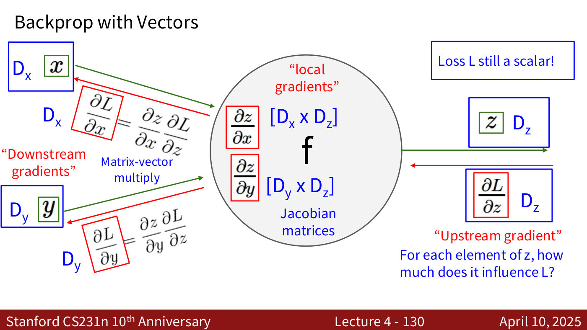

*Slide 130 — backprop with vectors: the upstream gradient has z's size, each local gradient is a Jacobian matrix, and each downstream gradient is a matrix–vector product with its input's size. [Deck](https://cs231n.stanford.edu/slides/2025/lecture_4.pdf)*

### Example: elementwise ReLU

Take $f(x) = \max(0, x)$ applied elementwise to a 4-vector (slides 132–137; ≈1:08:35–1:10:53).
With input $x = [1, -2, 3, -1]$, the output is $z = [1, 0, 3, 0]$. Suppose the upstream gradient is
$\frac{\partial L}{\partial z} = [4, -1, 5, 9]$. Each output depends only on the matching input, so
the Jacobian is diagonal, with 1 where the input was positive and 0 elsewhere:
$\mathrm{diag}(1, 0, 1, 0)$. Multiplying it by the upstream gradient gives
$\frac{\partial L}{\partial x} = [4, 0, 5, 0]$ (slide 137).

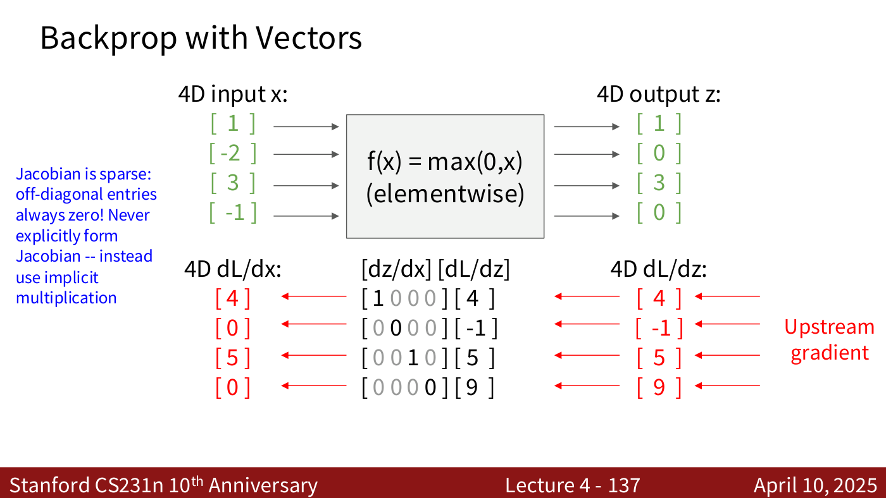

*Slide 137 — elementwise ReLU. The Jacobian is diagonal (1 where the input was positive, 0 elsewhere), so the downstream gradient [4, 0, 5, 0] just zeroes the upstream entries where the input was negative. [Deck](https://cs231n.stanford.edu/slides/2025/lecture_4.pdf)*

The Jacobian is sparse, with every off-diagonal entry always zero, so: "Never explicitly form
Jacobian — instead use implicit multiplication" (slide 137). For ReLU the rule is simply (slide 138)

$$\left(\frac{\partial L}{\partial x}\right)_ {i} = \begin{cases} \left(\frac{\partial L}{\partial z}\right)_ {i} & \text{if } x_i \gt 0 \cr 0 & \text{otherwise} \end{cases}$$

"So we don't really store that matrix and do not calculate it, because we know how the function
operates" (≈1:10:08–1:10:53).

### Matrices and tensors

The same holds when the inputs and outputs are matrices or tensors (slide 142;
≈1:10:53–1:11:40). If $x$ is $[D_x \times M_x]$ and $z$ is $[D_z \times M_z]$, the upstream
gradient has $z$'s shape and $\frac{\partial L}{\partial x}$ always has $x$'s shape. But the local
Jacobian $\frac{\partial z}{\partial x}$ now has $(D_x \times M_x) \times (D_z \times M_z)$ entries:
"a huge matrix by itself".

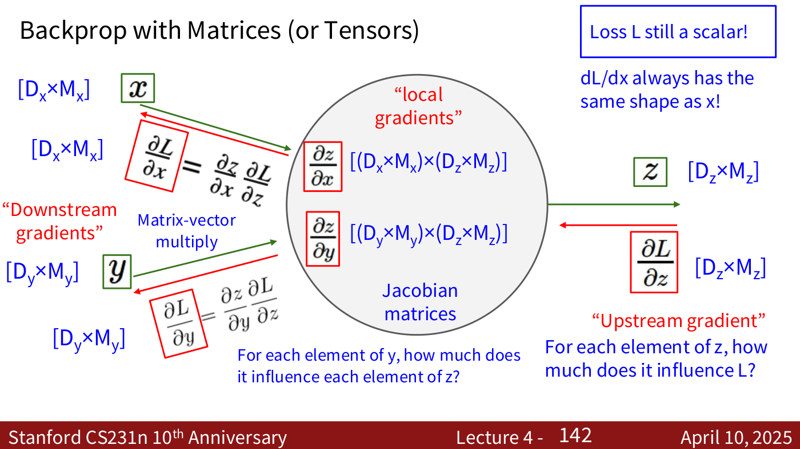

*Slide 142 — with matrix inputs and outputs, each local Jacobian has (input size) × (output size) entries, while ∂L/∂x keeps x's shape. [Deck](https://cs231n.stanford.edu/slides/2025/lecture_4.pdf)*

### Example: matrix multiplication

The matrix-multiply node computes $y = xw$ for $x$ of shape $[N \times D]$ and $w$ of shape
$[D \times M]$:

$$y_{n,m} = \sum_{d} x_{n,d} w_{d,m}$$

Its Jacobians would have shapes $[(N \times D) \times (N \times M)]$ for $x$ and
$[(D \times M) \times (N \times M)]$ for $w$. With a minibatch of $N = 64$ and $D = M = 4096$,
"each Jacobian takes ~256 GB of memory! Must work with them implicitly!" (slide 144; ≈1:12:27).
That checks out: $(64 \times 4096)^2 \approx 6.9 \times 10^{10}$ entries at 4 bytes each is exactly
256 GiB.

The way out is to ask which entries affect which (≈1:13:12–1:15:30). One element $x_{n,d}$ affects
only row $n$ of $y$ (slide 146), so

$$\frac{\partial L}{\partial x_{n,d}} = \sum_{m} \frac{\partial L}{\partial y_{n,m}} \frac{\partial y_{n,m}}{\partial x_{n,d}}.$$

And $x_{n,d}$ affects $y_{n,m}$ by $w_{d,m}$, the same "swap multiplier" as the scalar multiply
gate (slide 148):

$$\frac{\partial L}{\partial x_{n,d}} = \sum_{m} \frac{\partial L}{\partial y_{n,m}}\thinspace w_{d,m}.$$

Collected over all $n$ and $d$, this is a single matrix product, and the same reasoning gives the
gradient for $w$ (slide 149):

$$\frac{\partial L}{\partial x} = \left(\frac{\partial L}{\partial y}\right) w^{T} \qquad \frac{\partial L}{\partial w} = x^{T}\left(\frac{\partial L}{\partial y}\right)$$

with shapes $[N \times D] = [N \times M][M \times D]$ and $[D \times M] = [D \times N][N \times M]$.
"These formulas are easy to remember: they are the only way to make shapes match up!" (slide 150).
In the lecturer's words, "for x we include the entire W, for W we include the entire x"
(≈1:15:30). The course notes derive this in the linear-backprop handout
([PDF](https://cs231n.stanford.edu/handouts/linear-backprop.pdf), linked on slide 143).

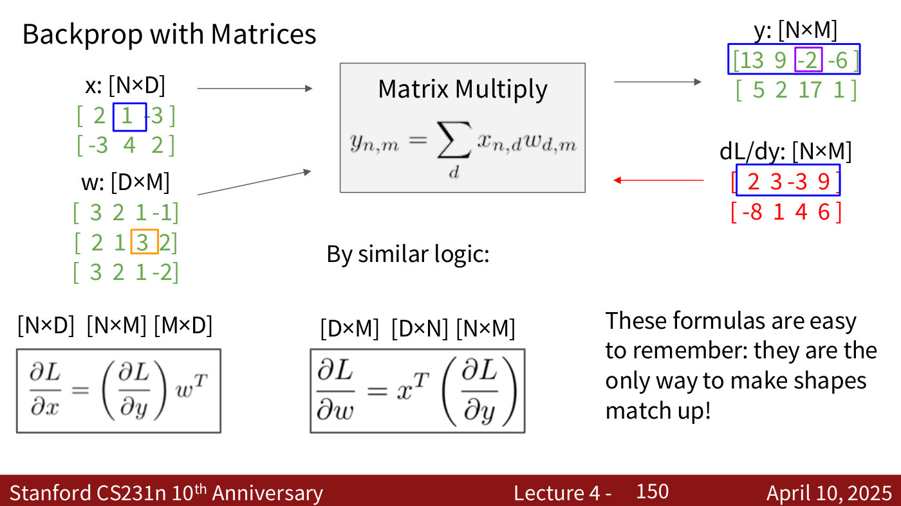

*Slide 150 — the matrix multiply's backward pass, ∂L/∂x = (∂L/∂y)wᵀ and ∂L/∂w = xᵀ(∂L/∂y), the only products whose shapes match. The printed y is not x times w; see below. [Deck](https://cs231n.stanford.edu/slides/2025/lecture_4.pdf)*

*The example's numbers contain a slip.* Slides 143–150 print $x = [[2, 1, -3], [-3, 4, 2]]$,
$w = [[3, 2, 1, -1], [2, 1, 3, 2], [3, 2, 1, -2]]$ and $y = [[13, 9, -2, -6], [5, 2, 17, 1]]$. But
the product of that $x$ and $w$ is $[[-1, -1, 2, 6], [5, 2, 11, 7]]$; only the first two entries of
the second row agree. The slides use the numbers only to point at entries, and the relations above
hold whatever the values, so the argument is unaffected. Do not use the printed $y$ as a worked
answer. (The upstream gradient printed is $\frac{\partial L}{\partial y} = [[2, 3, -3, 9], [-8, 1, 4, 6]]$;
the slides do not compute the resulting gradients.)

## Summary and next time

Slide 151 summarises (≈1:16:19). Fully connected neural networks are stacks of linear functions
and non-linear activation functions, with much more representational power than linear
classifiers. Backpropagation is the recursive application of the chain rule along a computational
graph to compute the gradients of all inputs, parameters and intermediates. Implementations keep a
graph whose nodes implement a `forward()` / `backward()` API. The forward pass computes each
operation's result and saves what the gradient computation will need; the backward pass applies
the chain rule to compute the gradient of the loss with respect to the inputs.

Next time: convolutional neural networks (slide 152).

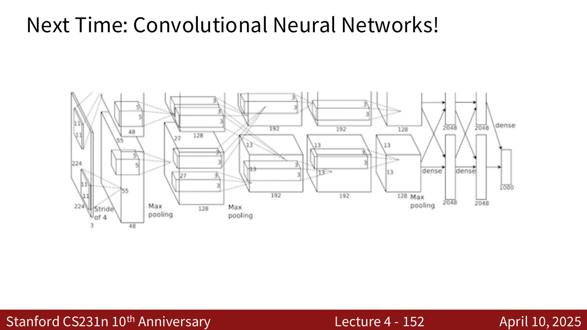

*Slide 152 — the AlexNet architecture, announcing next lecture's convolutional networks. [Deck](https://cs231n.stanford.edu/slides/2025/lecture_4.pdf)*

---

## Sources

- [Edited transcript](../raw/transcripts/04-neural-networks-backpropagation.md) — repunctuated,
  with restored terms listed in its header. One passage is marked `[unclear]` there (≈1:00:04).
- [Deck, slide by slide](../raw/slides/04-neural-networks-backpropagation.md) — 147 pages, printed
  numbers 1–152; every figure described; [PDF](https://cs231n.stanford.edu/slides/2025/lecture_4.pdf).
- [Video](https://www.youtube.com/watch?v=25zD5qJHYsk).
- Readings listed on the course schedule for this lecture: the course notes,
  [Backprop](http://cs231n.github.io/optimization-2); the
  [linear backprop example](https://cs231n.stanford.edu/handouts/linear-backprop.pdf) and
  [derivatives notes](https://cs231n.stanford.edu/handouts/derivatives.pdf) handouts;
  [Efficient BackProp](https://cs231n.stanford.edu/papers/lecun-98b.pdf) (LeCun et al.); and,
  suggested, [Why Momentum Really Works](https://distill.pub/2017/momentum/).
- Previous lecture: [Lecture 3 — Regularization and Optimization](03-regularization-optimization.md).
- Topics: [neural networks](neural-networks.md), [backpropagation](backpropagation.md),
  [regularization](regularization.md), [loss functions](loss-functions.md),
  [gradient descent](gradient-descent.md).
