# Lecture 5 — Image Classification with CNNs

**CS231N Deep Learning for Computer Vision, Stanford, Spring 2025.** Delivered April 15, 2025, by
Justin Johnson (per the course schedule; he introduces himself at the start of the recording).
[Video](https://www.youtube.com/watch?v=f3g1zGdxptI) ·
[edited transcript](../raw/transcripts/05-image-classification-cnns.md) ·
deck as [text](../raw/slides/05-image-classification-cnns.md) /
[PDF](https://cs231n.stanford.edu/slides/2025/lecture_5.pdf)

## What this lecture establishes

Lectures 2–4 built a complete recipe for deep learning: encode a problem as tensors, write a
computational graph from inputs to outputs, choose a loss, and minimise it by gradient descent
with gradients from backpropagation. But the only graph built so far flattens an image into one
long vector, which throws away the fact that images are two-dimensional. This lecture opens the
course's second part, *perceiving and understanding the visual world*, by adding two new
operators that respect that structure: the **convolution layer**, which slides small learned
filters across the image and computes a dot product at every position, and the **pooling
layer**, which cheaply downsamples each feature plane. Stacked with activation functions and
followed by fully connected layers, they make a **convolutional network (ConvNet, CNN)**. The
lecture places this against the hand-designed image features that came before, sketches the
history from 1998 to the transformers that have since displaced ConvNets for many tasks, and
works through the arithmetic every ConvNet designer needs: output sizes, padding, stride,
receptive fields, parameter counts and compute. It closes with the property both operators
share, **translation equivariance** (≈12:18–13:50, ≈1:07:34).

See the topic page [convolutional networks](convolutional-networks.md) for the concepts gathered
in one place.

**What the recording covers.** The recording opens at 0:05 with the lecturer introducing himself
and ends at 1:07:34 with the summary and the announcement that the next lecture covers CNN
architectures. It follows the deck in order. It never presents the two administrative slides or
the deck's appendix of "Slides from Previous Years", which repeats the convolution and pooling
material in an older notation and adds a history of neural networks from the Mark I Perceptron
to the Neocognitron. Both are summarised below from the slides alone.

**Printed slips.** The deck's own material has four, kept as printed in the
[slide file](../raw/slides/05-image-classification-cnns.md) and pointed out where they occur below:
a ship score that leaves out its bias in the recap, two swapped size labels in the first pooling
diagram, a pooling summary that calls itself a conv layer, and a softmax loss printed with minus
signs in its exponents.

## Administrative notes (slides only)

Slide 2: Assignment 1 is due Wednesday 4/23 at 11:59pm. It covers k-nearest neighbour, linear
classifiers (SVM and softmax), a two-layer neural network, and image features. Slide 3: the
project proposal is due Friday 4/25, and the TAs' areas of expertise are posted on the course
website's office-hours page. The recording does not mention either slide.

## The lecturer

Justin Johnson calls himself "the fourth mystery instructor in this class". He did his PhD at
Stanford from 2012 to 2018 with Fei-Fei Li, working on deep learning for computer vision. While
there he helped start CS231N with Andrej Karpathy, Fei-Fei Li and others, and taught it in "2015,
16, 17 and 18 and 19". He then worked at Facebook AI Research, and as a faculty member at the
University of Michigan taught "basically the same class" a few more times. Most recently he has
been building a startup, World Labs, with Fei-Fei Li (≈0:05–0:50). The deck's timeline of the
same career (slide 4) says he taught CS231N at Stanford from 2015 to 2018 and the same course at
Michigan from 2019 to 2022.

## Recap: the deep-learning basics

The lecturer begins by stepping back over the first four lectures, which he calls "basically all
the fundamentals of deep learning" (≈0:50–1:35).

**Linear classifiers.** Image classification was meant as a toy problem showing the first step
of any deep-learning problem: formalise it as tensors in and tensors out. The input is a
three-dimensional grid of pixel values, the output one score per category, high for categories
the image is likely to be and low for the rest. A weight matrix $W$ times the pixels gives the
scores, $f(x, W) = Wx + b$, and the course looked at it from three viewpoints: algebraic,
visual (one template per class) and geometric (hyperplanes cutting up space) (≈1:35–2:21). The
recap slide repeats lecture 2's worked example (slide 6), including its slip. The printed ship
score, 61.95, is the ship row of $W$ times the pixels before the bias is added. Adding the bias
$-1.2$ gives 60.75. The cat and dog scores are correct. This is the same slip as in
[lecture 2](02-image-classification.md)'s worked example, whose figure the recap reuses.

**Loss and optimisation.** A loss function says how well a given $W$ solves the problem on a
dataset. The course used the softmax loss and the SVM loss (≈2:21–3:07; slide 7). Optimisation
is then a search over the landscape whose horizontal plane is every possible $W$ and whose
height is the loss: slide down it to a point of low loss. The optimizers covered were SGD
(usually with momentum), RMSProp and Adam (≈3:07–3:53). Slide 8 shows the loss surface and a
legend of those optimizers but no paths, because, as in [lecture 3](03-regularization-optimization.md),
the paths were an animation that the PDF does not hold. An aside: the day before this lecture,
ICLR 2025 gave its Test of Time Award to the Adam paper, published at ICLR ten years earlier in
2015. The lecturer offers it as a way to connect what students learned in this class with what
is happening now in the field (≈3:53–4:38). See [optimizers](optimizers.md).

**Why linear classifiers are not enough.** From the visual viewpoint, a linear classifier has to
summarise everything about a category in a single template. The learned car template is "a red
blob, but cars don't have to be red". From the geometric viewpoint, it can only carve space with
hyperplanes, and nothing guarantees the categories are linearly separable (≈4:38–6:55; slide 9).
Neural networks fix this by stacking two weight matrices with a non-linearity between them,
$f = W_2 \max(0, W_1 x)$. The algebra barely changes, but the classifier becomes "much, much
more powerful" (≈6:55–7:42; slide 10). See [neural networks](neural-networks.md).

**Computational graphs and backpropagation.** Training needs the gradient of the loss with
respect to every parameter. A computational graph organises the computation as nodes, each a
small primitive such as a matrix multiply or a ReLU. Data flows forward from the inputs and
weights to the loss, and gradients flow backward (≈7:42–8:29; slide 11). Backpropagation turns
that global problem into a local one. Each node only needs to compute its outputs from its inputs
on the forward pass, and its downstream gradients from the upstream gradient on the backward
pass. Any nodes that follow this API can be stitched into arbitrarily complex graphs, and "the
gradients just come for free" (≈8:29–10:00; slide 12). The same holds for tensors. The
upstream gradient always has the shape of the node's output and each downstream gradient the
shape of the corresponding input, because the loss is a scalar: the gradient says, for each
element, how much the loss wiggles when that element wiggles (≈10:00–10:46; slides 13–14). See
[backpropagation](backpropagation.md).

**The recipe.** Put together, this is a recipe that powers "pretty much anything involving a
neural network". Encode the problem as tensors, write a computational graph from input tensors
to output tensors, collect a dataset of input–output pairs, write down a loss, and optimise it
with gradient descent and backpropagation (≈10:46–11:32). The deck's appendix states it as five
numbered steps (slide 132).

## Where the course goes next

The course has four parts (slide 5): deep-learning basics (lectures 2–4), perceiving and
understanding the visual world (lectures 5–12), generative and interactive visual intelligence
(lectures 13–16), and human-centred applications and implications (lectures 17–18). This lecture
begins the second part, which applies the general framework to images (≈11:32–12:18).

The lecturer says convolutional networks are "a pretty small lift" on top of what the course
already has. So far the class has seen only two or three kinds of node: fully connected layers
(a matrix multiply), activation functions such as ReLU, and the loss functions themselves. To
build convolutional networks, it needs only two more: the convolution layer, which takes most of
the lecture, and the pooling layer (≈12:18–13:50). Slide 18 lays out the four operators in a
grid: the fully connected layer and the activation function, "we have already seen these", and
the convolution and pooling layers as "today: image-specific operators".

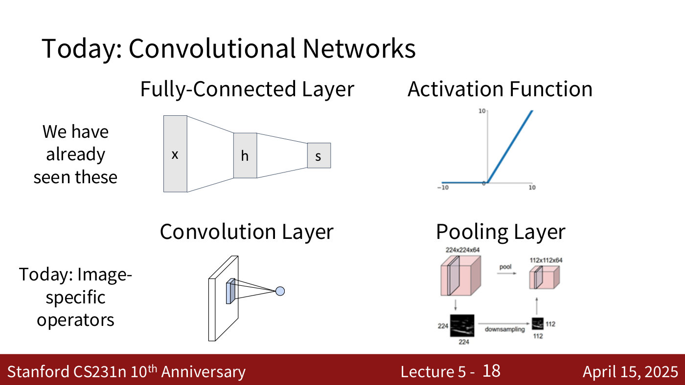

*Slide 18 — the four operators of a ConvNet: the two already seen (fully connected layer, activation function) and today's two image-specific ones (convolution, pooling). [Deck](https://cs231n.stanford.edu/slides/2025/lecture_5.pdf)*

## Before ConvNets: hand-designed image features

Image classification takes an input image and predicts one of $K$ category labels. The linear
classifiers and fully connected networks of lectures 2–4 already do this, but they work in
**pixel space**: the input $x$ in $f(x) = Wx$ is the literal pixel values (≈13:50–14:37;
slide 20).

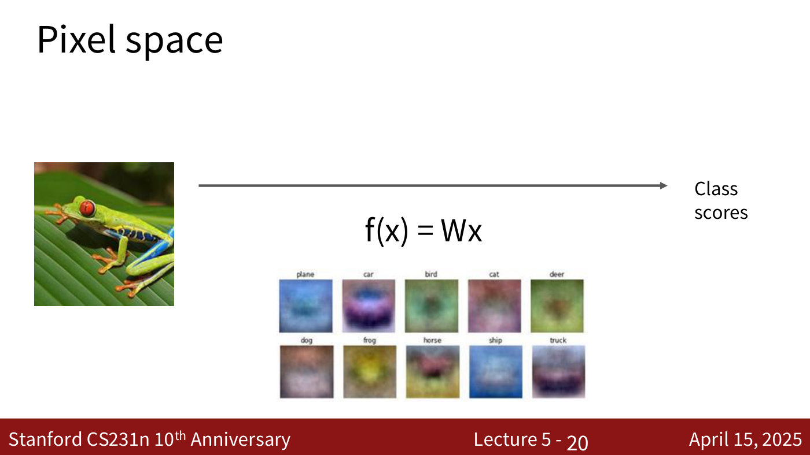

*Slide 20 — pixel space: the linear classifier f(x) = Wx applied directly to the frog's pixels. [Deck](https://cs231n.stanford.edu/slides/2025/lecture_5.pdf)*

The common alternative "back in the dark ages before neural networks came about and saved us
from all this tedium", from about the early 2000s to 2010 or 2011, was a **feature
representation**. Humans design a function that converts pixels into some other representation
they believe captures what matters, and that becomes the $x$ fed to the linear classifier
(≈14:37–15:23; slide 21). The lecturer does not go into detail, "because spoiler alert, they got
deprecated like 10 years ago", but gives a flavour of three.

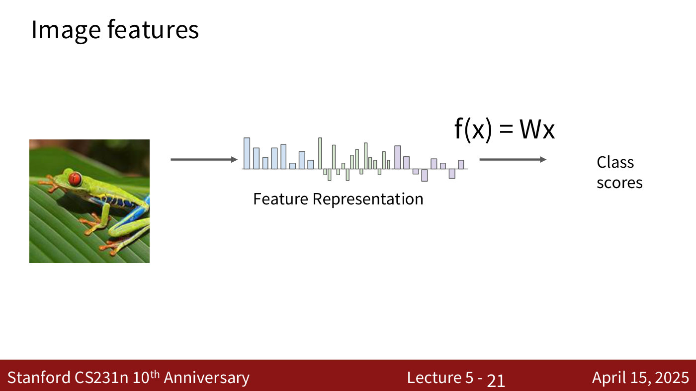

*Slide 21 — image features: a hand-designed feature representation sits between the pixels and the linear classifier. [Deck](https://cs231n.stanford.edu/slides/2025/lecture_5.pdf)*

A **colour histogram** discretises the space of colours into buckets and counts how many pixels
fall into each. It looks only at colour and destroys all spatial structure: red in one corner
and red in the opposite corner give the same feature. Someone building an apple detector who
wants to tell ripe from unripe might think the amount of red and green is what a classifier
needs (≈16:09–17:42; slide 22).

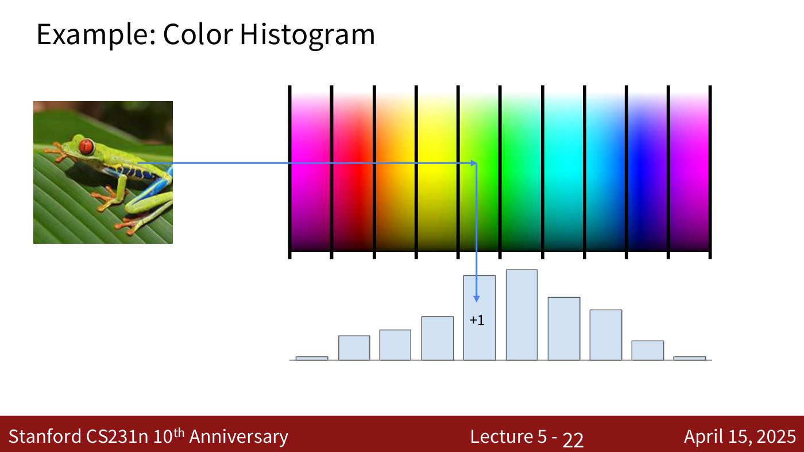

*Slide 22 — colour histogram: each pixel's hue falls into one of 10 bins (here the yellow-green one, +1), and the counts are the feature, with no spatial information. [Deck](https://cs231n.stanford.edu/slides/2025/lecture_5.pdf)*

A **histogram of oriented gradients (HoG)** is "sort of the dual": it throws away colour and
keeps only structure, recording at every point the local direction of the edges. On the frog it
picks up the diagonal structure of the leaves and the circles around the eyes (≈17:42–18:28).
The slide gives the recipe: divide the image into $8 \times 8$-pixel regions and quantise the edge
direction in each into 9 bins. A $320 \times 240$ image is then $40 \times 30$ regions with 9 numbers each, a
feature vector of $30 \times 40 \times 9$ = 10,800 numbers. It cites Lowe (ICCV 1999) and Dalal and Triggs
(CVPR 2005) (slide 23).

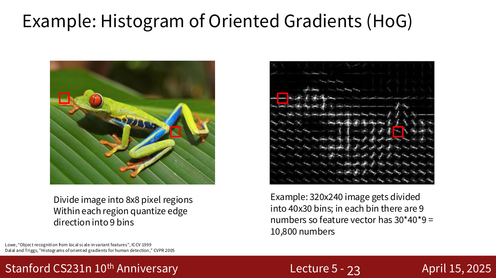

*Slide 23 — histogram of oriented gradients: edge directions in 8x8-pixel regions, quantised into 9 bins; the right-hand image outlines the frog in oriented strokes. [Deck](https://cs231n.stanford.edu/slides/2025/lecture_5.pdf)*

A **bag of words** representation, which the recording passes over, builds a "codebook" of
"visual words" by extracting random patches from training images and clustering them, then
encodes each image as a histogram of how often each visual word appears. It cites Fei-Fei and
Perona (CVPR 2005) (slide 24).

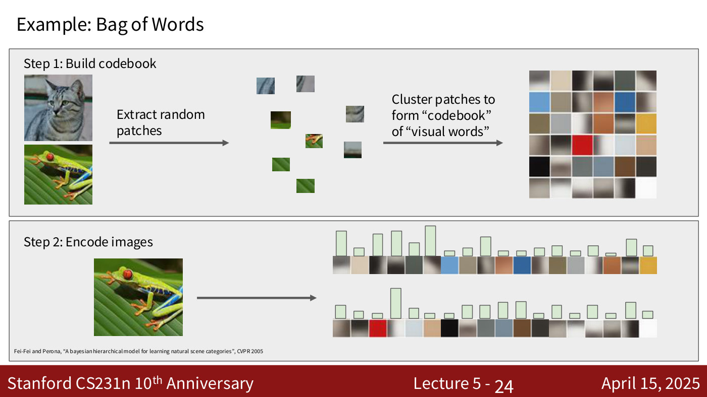

*Slide 24 — bag of words: cluster random patches into a codebook of visual words, then describe an image by how often each word occurs. [Deck](https://cs231n.stanford.edu/slides/2025/lecture_5.pdf)*

In practice the usual answer to "which feature is best?" was "just stack them all together":
extract several feature representations and concatenate them into one big feature vector, then
put any classifier on top (≈18:28; slide 25).

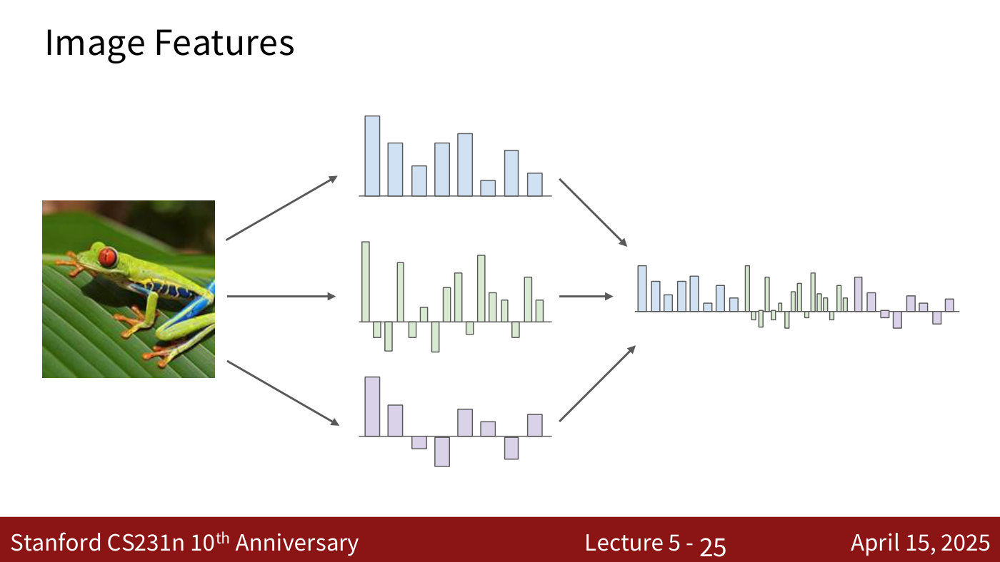

*Slide 25 — the usual practice: compute several feature types and concatenate them into one vector. [Deck](https://cs231n.stanford.edu/slides/2025/lecture_5.pdf)*

**Features versus end-to-end learning.** Seen from a step back, the two systems "don't look
that different". Both take raw pixels in and put scores out. The difference is which part a
human designs and which part is learned. With hand-designed features, the feature extractor is
"a bunch of really hairy C code or hairy MATLAB code" and only the classifier on top is learned.
A neural network learns every part, from pixels to scores, by gradient descent on the training
data. The lecturer's summary: "gradient descent is probably a better programmer than you and
lots of data probably knows more about your problem than you do". A human might have the wrong
intuition about what matters, or be unable to write down the perfect feature extractor. This
end-to-end approach "has basically won over the past decade and a half" (≈18:28–20:43;
slide 26).

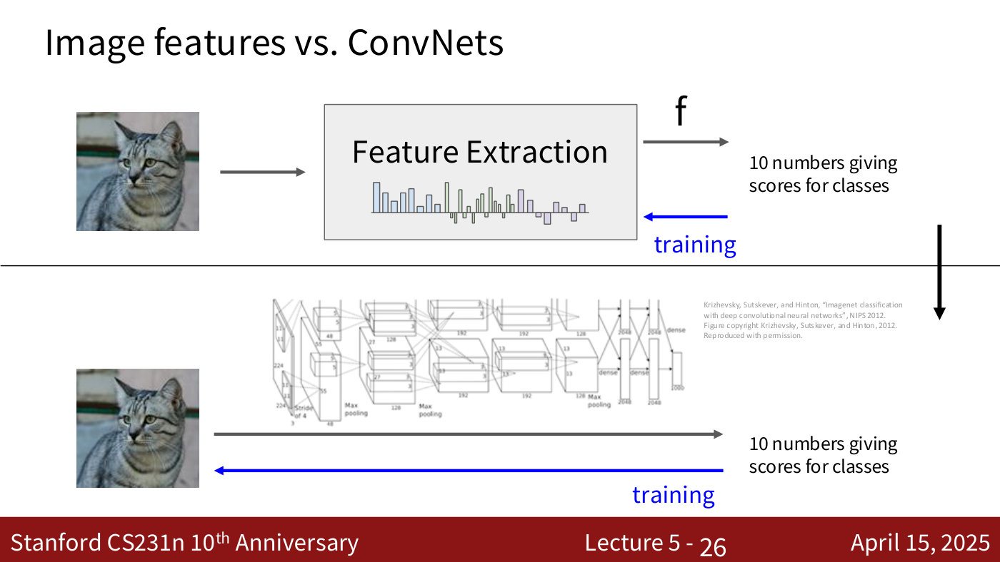

*Slide 26 — the contrast the lecture turns on: hand-designed feature extraction with only the classifier trained (top) vs. a ConvNet trained end to end (bottom); the blue arrows show how far training reaches. [Deck](https://cs231n.stanford.edu/slides/2025/lecture_5.pdf)*

The human designer still matters, but designs something different. Instead of one particular
function, you design a whole category of functions, defined by the computational graph: which
operators, in what order, with matrices of what size. The weights are left free to be learned
(≈20:43–22:15).

## The problem with fully connected networks on images

The only architecture so far flattens the image into a vector, then alternates matrix multiplies
and ReLUs. That "destroys the spatial structure of the images". Images are two-dimensional, the
two-dimensional structure matters for their content, and stretching a $32 \times 32 \times 3$ image into a
3072-vector ignores it (≈21:28–23:00; slide 28). Convolutional networks answer this with
computational primitives that respect the two-dimensional structure.

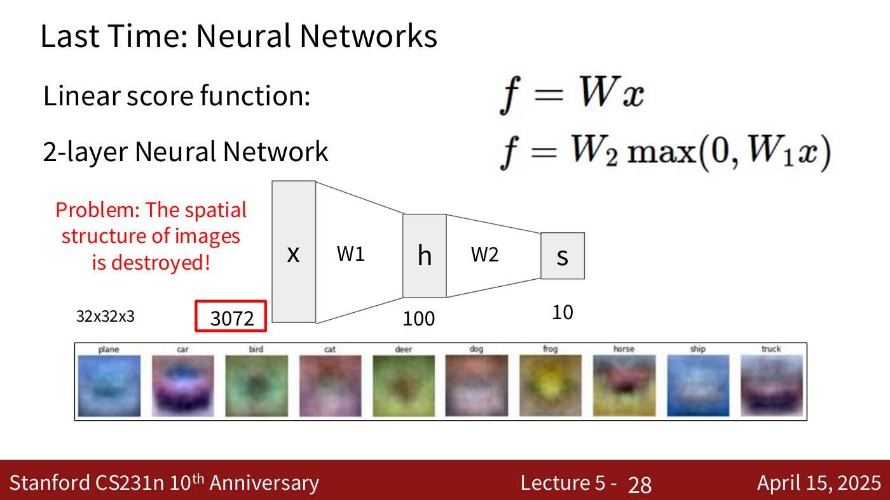

*Slide 28 — the problem with a fully connected network on images: the 32x32x3 image is flattened to 3072 numbers and its spatial structure is lost. [Deck](https://cs231n.stanford.edu/slides/2025/lecture_5.pdf)*

## Convolutional networks: structure and history

A convolutional network is built from linear layers, non-linearities, convolution layers,
pooling layers and sometimes a few others. Its usual shape is a body of interleaved convolution,
pooling and non-linearity layers that extracts a useful feature representation, followed by one
or more fully connected layers, a multi-layer perceptron classifier on top of those features.
Crucially, the whole thing is trained end to end by gradient descent on the training loss
(≈23:00–23:46). Slide 31 labels the two halves on the 1998 network of LeCun et al.: "Convolution
and pooling operators extract features while respecting 2D image structure", and
"Fully-Connected layers form an MLP at the end to predict scores".

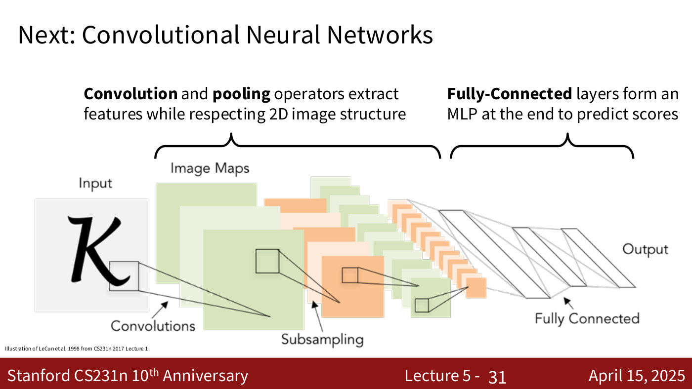

*Slide 31 — the shape of a ConvNet, on LeCun et al.'s 1998 network: convolution and subsampling layers extract features, fully connected layers at the end predict scores. [Deck](https://cs231n.stanford.edu/slides/2025/lecture_5.pdf)*

**1998 and 2012.** That drawing comes from Yann LeCun, Léon Bottou and others, who built
convolutional networks for digit classification in 1998. "It actually worked pretty well, but it
was really expensive": there were no GPUs. The paper is "Gradient-based learning applied to
document recognition" [LeCun, Bottou, Bengio, Haffner 1998] (slide 33). The architecture
"basically looks pretty similar" to those used well into the 2010s (≈23:46–24:33). AlexNet in
2012 "again doesn't look that different" from LeCun's network. It is bigger, with more layers and
more units, but still trained end to end with backpropagation on fairly simple losses. What had
changed was that GPUs were available and that there was more data, from the internet and
ImageNet (≈24:33–25:20; slide 34). See [ImageNet](imagenet.md) and [lecture 1](01-introduction.md).

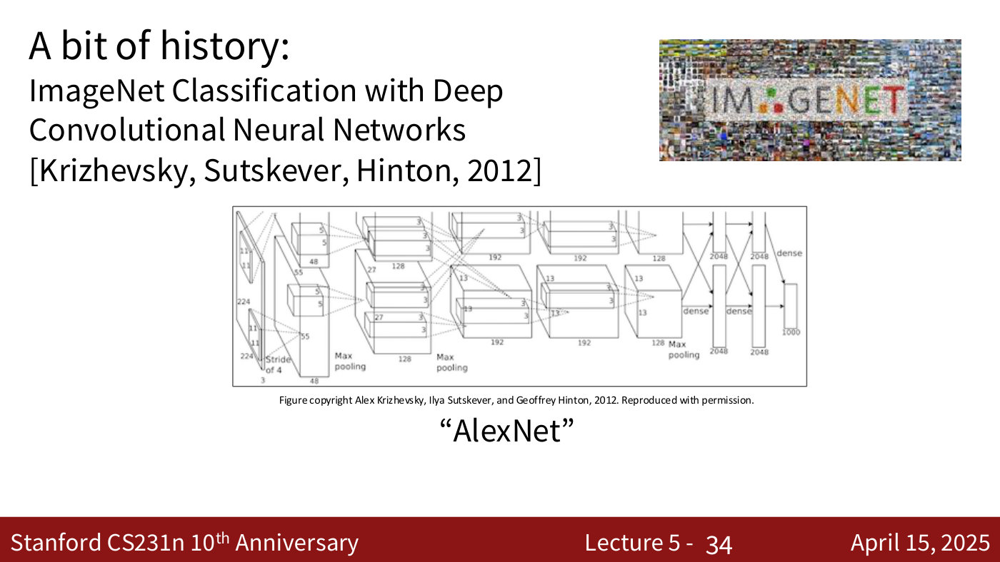

*Slide 34 — AlexNet (Krizhevsky, Sutskever and Hinton, 2012). [Deck](https://cs231n.stanford.edu/slides/2025/lecture_5.pdf)*

**About 2012 to 2020: ConvNets dominate.** For almost any problem with an image, the best
performer was almost certainly a ConvNet (≈25:20–26:06). The deck's examples are detection,
which draws a labelled box around every object (Faster R-CNN, Ren, He, Girshick and Sun 2015,
slide 35), and segmentation, which labels every pixel (Farabet et al. 2012, also slide 35). The
slide heads both halves "Detection"; the lecturer calls the second segmentation.

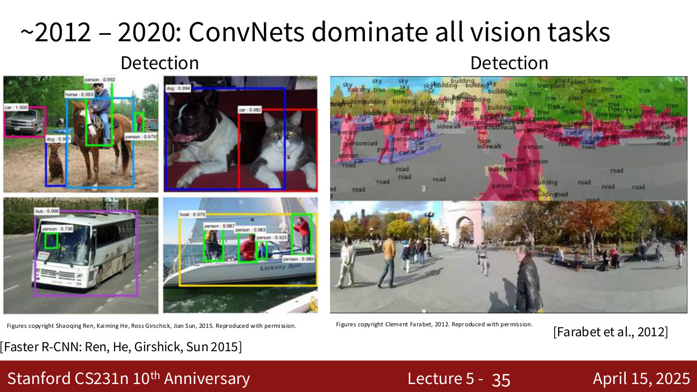

*Slide 35 — ConvNets in detection (Faster R-CNN boxes with confidences, left) and per-pixel scene labelling (Farabet et al., right). [Deck](https://cs231n.stanford.edu/slides/2025/lecture_5.pdf)*

They also include image captioning, image to text, where some of the first widely successful
approaches were built on ConvNets (slide 36; Vinyals et al. 2015 and Karpathy and Fei-Fei 2015,
the captions generated by the lecturer with Neuraltalk2) (≈26:06–26:52).

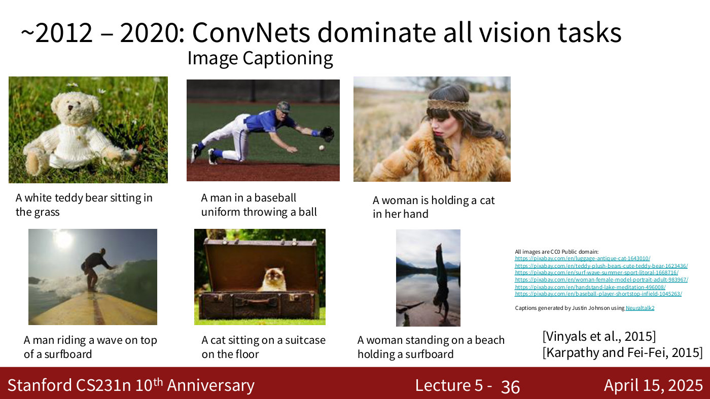

*Slide 36 — image captioning: captions generated by the lecturer with Neuraltalk2 under six photographs. [Deck](https://cs231n.stanford.edu/slides/2025/lecture_5.pdf)*

The last example is text-to-image generation, its inverse (slide 37). The lecturer calls the
figure "from the Stable Diffusion paper that came out back in 2021"; the slide cites Rombach et
al., "High-Resolution Image Synthesis with Latent Diffusion Models", CVPR 2022. The first
versions of this that worked well were also convolutional (≈26:52–27:38). Later lectures return
to detection, segmentation and generation.

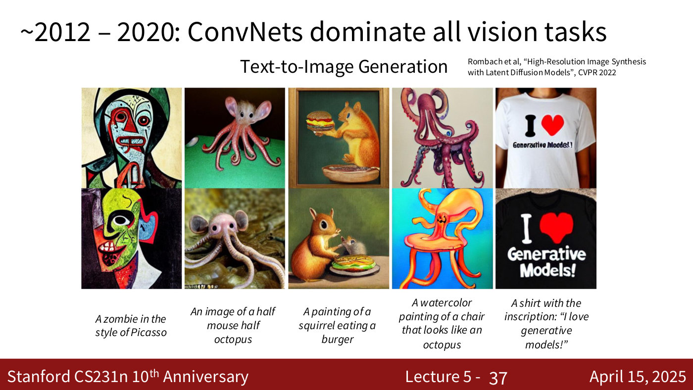

*Slide 37 — text-to-image generation with latent diffusion (Rombach et al., CVPR 2022): five prompts, two samples each. [Deck](https://cs231n.stanford.edu/slides/2025/lecture_5.pdf)*

ConvNets were so central that when the class began in 2015 it was called "Convolutional Neural
Networks for Visual Recognition". At the time, convolutional networks were "basically synonymous
with computer vision", the field benefiting most from deep learning (≈27:38–28:24; slide 38).

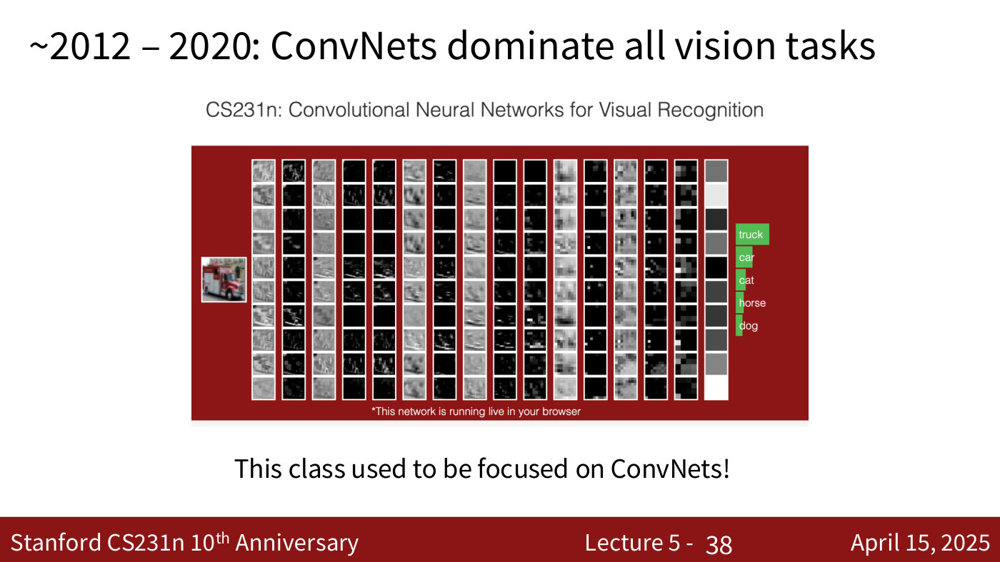

*Slide 38 — the class's original name, Convolutional Neural Networks for Visual Recognition, and its in-browser ConvNet demo classifying a fire truck. [Deck](https://cs231n.stanford.edu/slides/2025/lecture_5.pdf)*

**2021 to the present: transformers.** The class has since been renamed. In 2020, "it wasn't
COVID, it was transformers". Transformers were published in 2017 for text (Vaswani et al.,
NeurIPS 2017). A 2021 paper applied nearly the same architecture to images (Dosovitskiy et al.,
ICLR 2021, the Vision Transformer). For many problems ConvNets used to solve, swapping the CNN
for a transformer and keeping everything else gives better performance, and transformers scale
better with more data and compute (≈28:24–29:57; slide 41, "Wait until Lecture 8!").

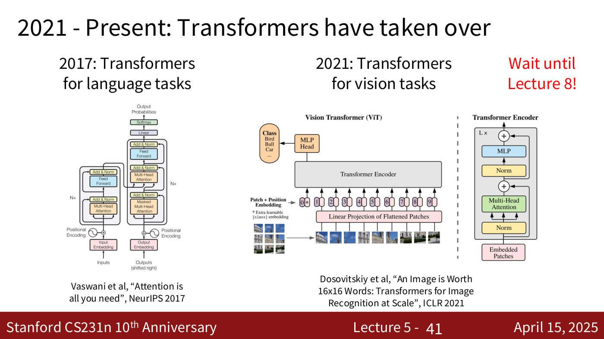

*Slide 41 — transformers for language (2017) and for vision (the Vision Transformer, 2021), the architecture that displaced ConvNets for many tasks. [Deck](https://cs231n.stanford.edu/slides/2025/lecture_5.pdf)*

So why still learn ConvNets? The lecturer gives four reasons. They have historical significance.
They still get used a lot in practice. They build intuition about what matters for images. And
they are "not completely dead": many systems are hybrids that mix convolutions and transformers
(≈29:57–30:42).

## The fully connected layer as template matching

A fully connected layer takes a $32 \times 32 \times 3$ image, stretches it into a 3072-vector and multiplies
by a weight matrix to get 10 scores (≈30:42–31:28; slide 47). The slide shows the matrix as
$10 \times 3072$ and calls each output "the result of taking a dot product between a row of W and the input
(a 3072-dimensional dot product)". The lecturer asks the class to read each output as a dot
product, and a dot product as a **template match**. The dot product of two vectors is high when
they point the same way and zero when they are orthogonal. So a fully connected layer holds a
set of templates, each the same size as the whole input, and outputs the match score of each
against the entire input (≈31:28–32:14).

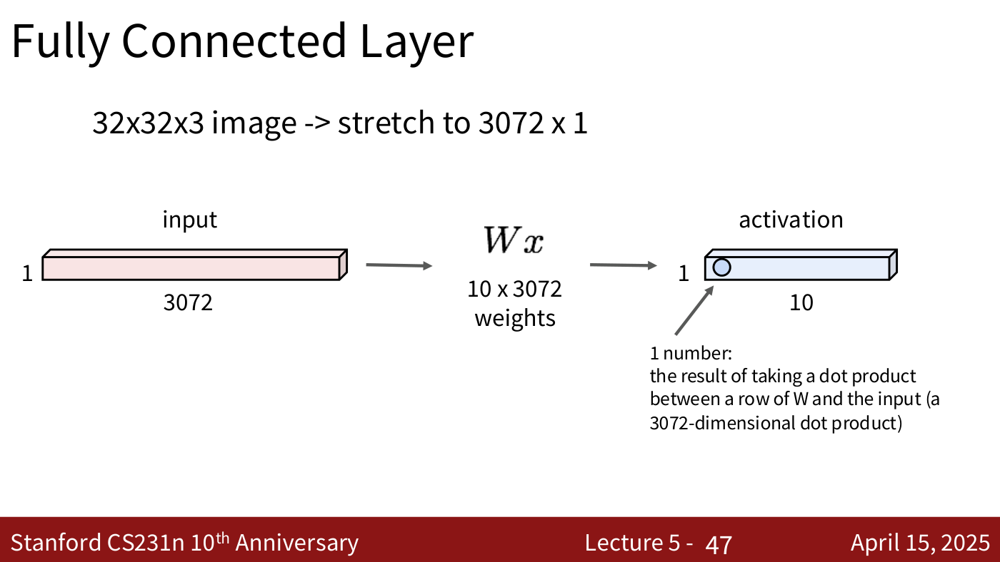

*Slide 47 — the fully connected layer: each of the 10 outputs is a 3072-dimensional dot product between one row of W and the whole flattened image. [Deck](https://cs231n.stanford.edu/slides/2025/lecture_5.pdf)*

That viewpoint generalises directly. A convolution layer still learns a bank of templates and
still computes template-matching scores, but each template now covers only a small part of the
input (≈32:14–33:00).

## The convolution layer

**Filters span the full depth.** Instead of flattening, keep the image as a three-dimensional
tensor: 3 channels (also called depth), 32 wide and 32 high (≈33:00; slide 48). A filter is "a
tiny little sub-image", here $5 \times 5$ pixels. It is spatially smaller than the image but always has
the same number of channels as the input, here 3 (slide 50: "Filters always extend the full
depth of the input volume").

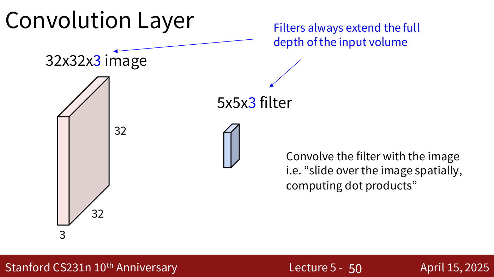

*Slide 50 — a 5x5x3 filter beside a 32x32x3 image: the filter always spans the input's full depth. [Deck](https://cs231n.stanford.edu/slides/2025/lecture_5.pdf)*

**One output is one dot product plus a bias.** Place the $5 \times 5 \times 3$ filter on a $5 \times 5 \times 3$ chunk of the
image and take the inner product. The result is a single number saying how well that chunk
matches the template, "a 5\*5\*3 = 75-dimensional dot product + bias", written $w^T x + b$ with $w$
the filter, $x$ the chunk and $b$ a bias (≈33:00–33:47; slide 51).

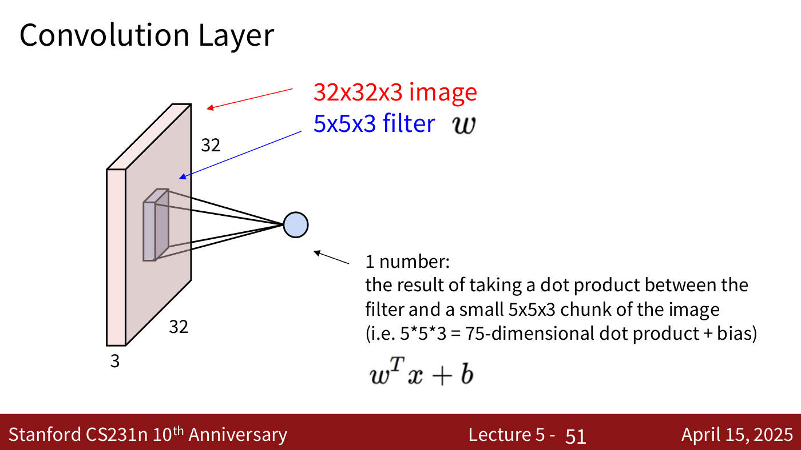

*Slide 51 — one output of a convolution: the dot product of the filter with one 5x5x3 chunk of the image, plus a bias. [Deck](https://cs231n.stanford.edu/slides/2025/lecture_5.pdf)*

**Sliding gives an activation map.** Repeat this at every position of the image (slide 55
shows the filter stepping along the top row) and collect the scores into a plane. Each point of
the plane says how well the matching piece of the input aligned with the filter. Sliding a $5 \times 5$
filter over a $32 \times 32$ image gives a $28 \times 28 \times 1$ **activation map** (≈33:47–34:33; slide 56). "Of course, this is
deep learning. We want a lot of compute": add a second filter, slide it the same way, and get a
second plane (≈34:33–35:19; slide 57).

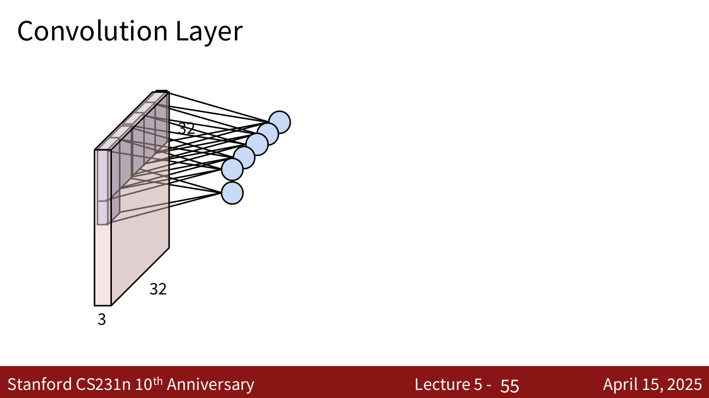

*Slide 55 — sliding the filter along the top row of the image, one output per position. [Deck](https://cs231n.stanford.edu/slides/2025/lecture_5.pdf)*

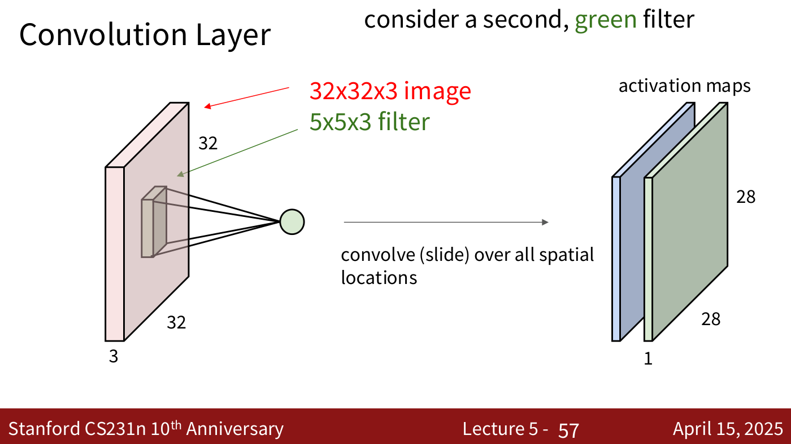

*Slide 57 — a second (green) filter gives a second 28x28 activation map. [Deck](https://cs231n.stanford.edu/slides/2025/lecture_5.pdf)*

**Many filters, one bias each.** With six filters, each $3 \times 5 \times 5$, the filters form one
four-dimensional tensor of shape $6 \times 3 \times 5 \times 5$. The layer slides every filter everywhere and stacks
the six response planes into a $6 \times 28 \times 28$ output, whose $28 \times 28$ are spatial dimensions and whose 6
is a channel dimension. As a linear layer has one bias per row, a convolution layer has one
scalar bias per filter, so here a six-dimensional bias vector (≈35:19–36:51). Slide 60 gives the
two ways to read the output: six activation maps, each $1 \times 28 \times 28$, or a $28 \times 28$ grid with a
six-dimensional vector at each point.

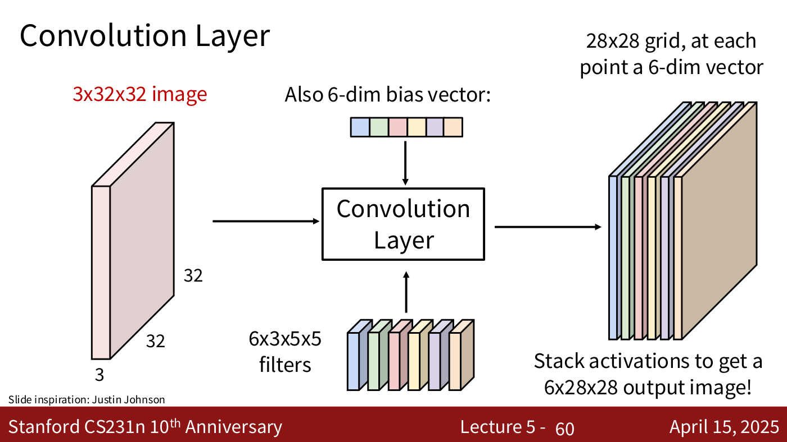

*Slide 60 — six 3x5x5 filters and a six-dimensional bias turn a 3x32x32 image into a 6x28x28 output: six activation maps, or a 28x28 grid of six-dimensional vectors. [Deck](https://cs231n.stanford.edu/slides/2025/lecture_5.pdf)*

**Questions from the class** (the students are inaudible; the questions are as the lecturer
restates them, ≈36:51–40:42):

- *Is the 3 the RGB channels?* Yes.
- *Where do the filters come from?* "Back to the miracle of gradient descent and
  backpropagation." No human chooses them. They are initialised randomly and learned on whatever
  problem is being solved. The layer is computationally expensive, and the expectation is that
  data and compute fill it in.
- *How do you set the filter size of 5?* It is an architectural hyperparameter, typically set by
  cross-validation. See [hyperparameters and validation](hyperparameters-and-validation.md).
- *Can one layer have filters of different sizes?* "Sort of yes and no." A single convolution
  layer usually has a fixed filter size, because that makes efficient GPU kernels easier to
  write. But a larger graph can combine convolutions of different sizes, as the next lecture's
  architectures (the lecturer mentions Inception) do.
- *What is learned, and what is set?* The number and size of the filters are hyperparameters,
  fixed before training because they set the shapes of the tensors. The values inside the
  filters are parameters, randomly initialised and then changed by gradient descent.
- *What gradient is computed?* As always, the gradient of the loss, here with respect to every
  scalar in every filter.
- *What happens to the bias?* Each bias entry is added to every inner product of its filter, so
  it is broadcast across the whole spatial extent of that filter's activation map.
- *Do the filters change during training?* Yes: every optimizer step updates them, in the usual
  loop of data, forward, loss, backward, step.

**Batches and general shapes.** Convolution layers usually work on a batch of images, which
makes every tensor four-dimensional (≈40:42–41:29). A batch of two $3 \times 32 \times 32$ images through six
$3 \times 5 \times 5$ filters gives a $2 \times 6 \times 28 \times 28$ batch of outputs (slide 61). In general (slide 62, ≈41:29–43:01)
the input is $N \times C_{in} \times H \times W$: $N$ images, each with $C_{in}$ channels and
spatial size $H \times W$. The filters are $C_{out} \times C_{in} \times K_w \times K_h$: $C_{out}$
filters, the number of output channels, each of shape $C_{in} \times K_w \times K_h$, with $K_w$
and $K_h$ the kernel width and height. There is a $C_{out}$-dimensional bias. The output is
$N \times C_{out} \times H' \times W'$: one output per image, made of $C_{out}$ planes, one per
filter.

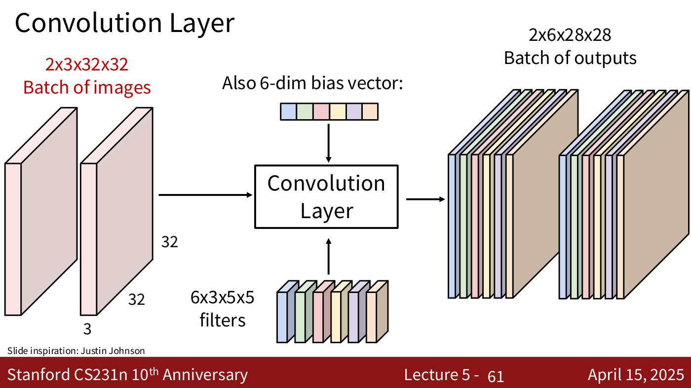

*Slide 61 — the same layer on a batch of two images: 2x3x32x32 in, 2x6x28x28 out. [Deck](https://cs231n.stanford.edu/slides/2025/lecture_5.pdf)*

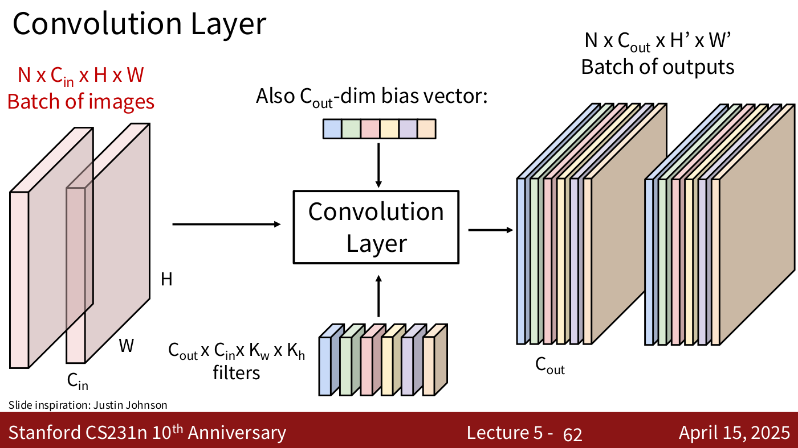

*Slide 62 — the general shapes: a batch of N images with C_in channels in, C_out filters and biases, N x C_out x H' x W' out. [Deck](https://cs231n.stanford.edu/slides/2025/lecture_5.pdf)*

## Stacking convolutions needs a non-linearity

A convolutional network is a computational graph that stacks convolution layers (≈43:01). The
example starts from a $3 \times 32 \times 32$ image, applies six $5 \times 5 \times 3$ filters to get $6 \times 28 \times 28$, then ten $5 \times 5 \times 6$
filters to get $10 \times 24 \times 24$ (slide 64). The second layer's filters have depth 6 because they must
match the six channels coming in.

The lecturer asks the class to spot what is wrong with this design. The students' answers,
which he repeats, include sizing (the feature maps shrink, "not the one I had in mind" but fixed
in a few slides), memory ("You just got to buy a bigger GPU") and a growing number of filters
("I don't think that's a problem necessarily"). One answer at ≈43:48 is unclear in the captions.
The answer he wanted is "everything's linear". Convolution is a dot product, so it is linear, and
a composition of linear operators is still linear. Two convolution layers stacked directly
therefore have no more representational power than one. The fix is the same as for fully
connected networks: put an activation function between the layers (≈43:48–45:21; slide 65, which
adds ReLU after each convolution). So in general a ConvNet is a stack of convolution layers,
non-linearities and other layers.

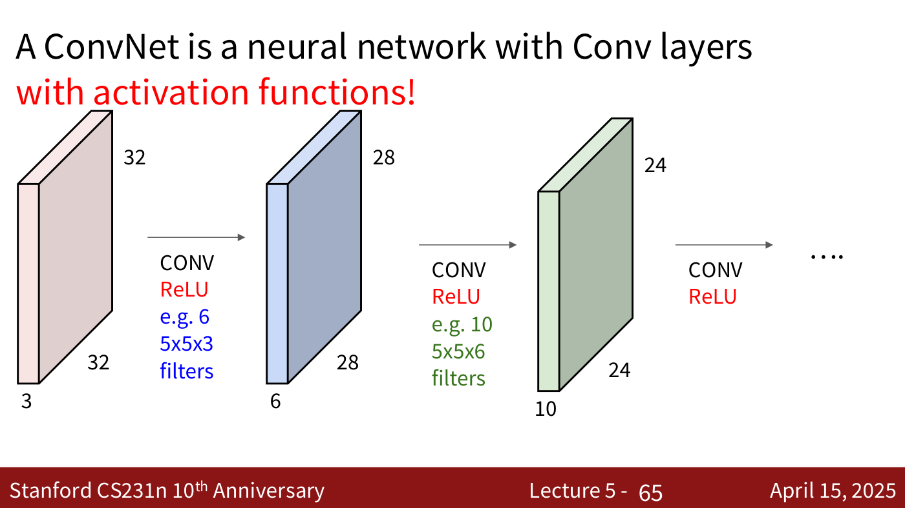

*Slide 65 — a ConvNet stacks convolutions with an activation function after each: 3x32x32 to 6x28x28 to 10x24x24. [Deck](https://cs231n.stanford.edu/slides/2025/lecture_5.pdf)*

## What convolution filters learn

A linear classifier learns one whole-image template per class (slide 66), and a fully connected
network learns a bank of whole-image templates (slide 67). A convolution filter is the same idea
cut down to a small chunk of image, so the first layer's filters can be shown directly as
images (≈45:21–46:07).

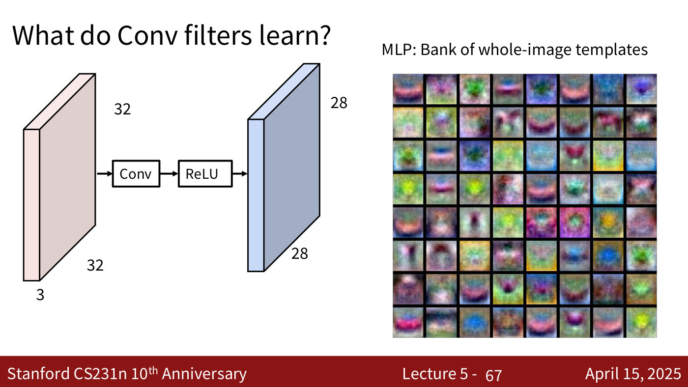

*Slide 67 — what a fully connected network learns: a bank of whole-image templates. [Deck](https://cs231n.stanford.edu/slides/2025/lecture_5.pdf)*

Slide 68 shows the 64 first-layer filters, each $3 \times 11 \times 11$, of an AlexNet trained for ImageNet
classification. The lecturer says that "just about all convolutional networks end up learning
filters that look something like this", whatever the architecture, data or task, "as long as
they're reasonable tasks". They come in two kinds. Some look for colours, especially opposing
colours: a contrast between green and red, or pink and green blobs. The others look for spatial
structure: vertical, horizontal and diagonal edges (≈46:07–46:53). The slide's caption is "local
image templates (Often learns oriented edges, opposing colors)".

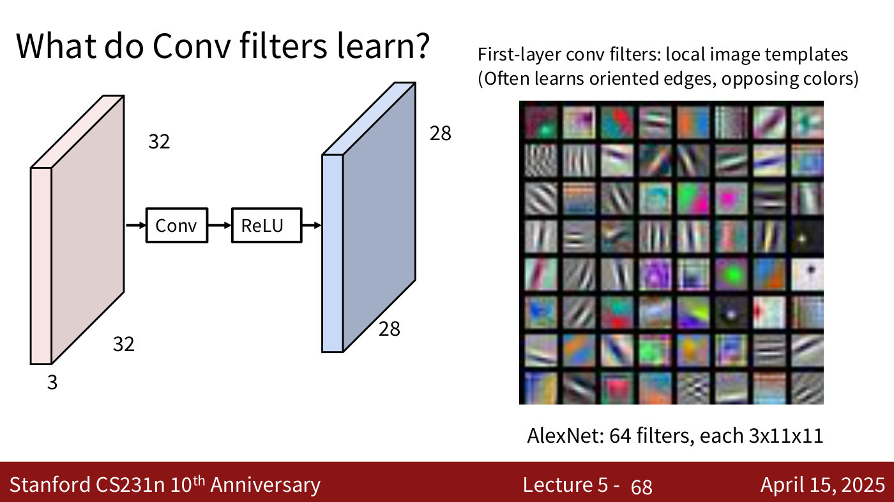

*Slide 68 — AlexNet's 64 first-layer filters, each 3x11x11: oriented edges and opposing colours, the pattern almost every ConvNet learns. [Deck](https://cs231n.stanford.edu/slides/2025/lecture_5.pdf)*

Higher layers are harder to visualise and "tend to learn larger structures", such as eyes and
letters. In slide 69's visualisation of a sixth convolution layer of an ImageNet model, from
Springenberg et al. (ICLR 2015), each row is one filter and each column a piece of an input
image that filter responded strongly to. One filter seems to respond to eyes, one to pieces of
text, one to wheels or circles or the top halves of circles. The lecturer presents the figure
"without too much explanation". Nobody designs these filters by hand: "this all gets driven via
gradient descent" (≈46:53–48:25).

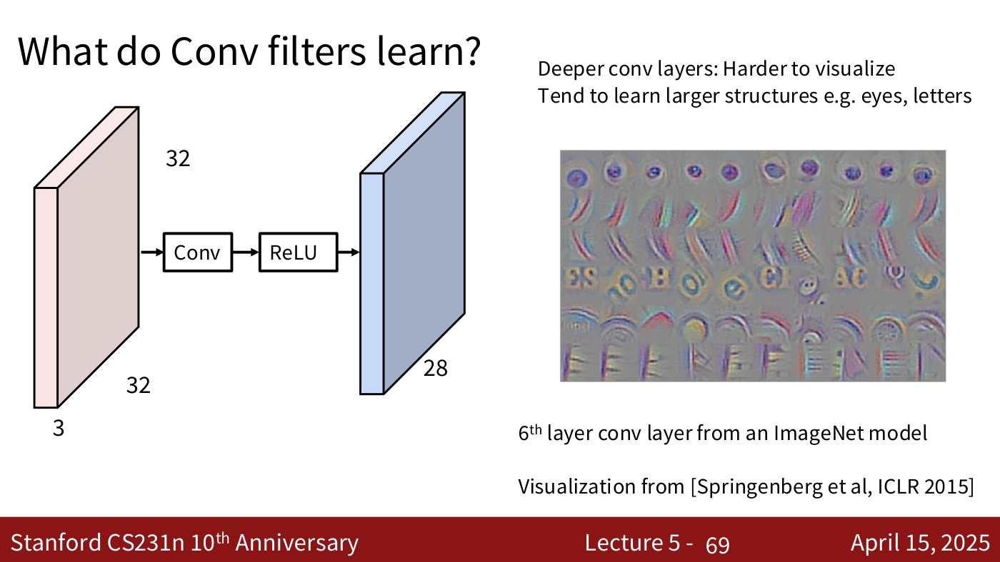

*Slide 69 — a sixth convolution layer (Springenberg et al.): each row is one filter, each column an image patch it responds to strongly; eyes, text, circles. [Deck](https://cs231n.stanford.edu/slides/2025/lecture_5.pdf)*

More questions (≈48:25–49:56):

- *Could the original image be reconstructed from all the filter responses?* "Actually, it turns
  out you can do that," again by gradient descent, covered in a later lecture.
- *How do different filters end up different?* Random initialisation, different for each filter.
  If all filters started equal, the loss would send the same gradient to each and they would stay
  equal. Initialising them differently breaks the symmetry.
- *Who chooses the sequence of layers and channels?* The human designer of the network. This is
  architecture design, the subject of the next lecture.
- *Why do deeper layers see larger structures?* Because of receptive fields, below.

## Spatial dimensions and padding

To see the spatial sizes, the lecturer turns the picture 90 degrees and drops the channel
dimension "into the board" (≈49:56). A $3 \times 3$ filter slides over a $7 \times 7$ input in five positions
along each row, so the output is $5 \times 5$ (slide 75). In general, for an input of width $W$ and a
filter of width $K$,

$$\text{output} = W - K + 1.$$

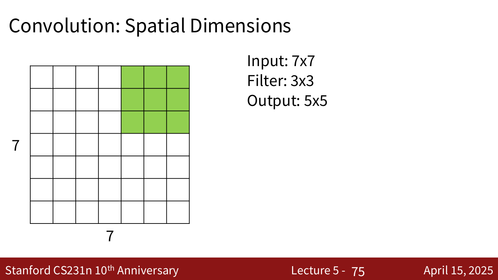

*Slide 75 — a 3x3 filter fits in five positions across a 7x7 input, so the output is 5x5: W − K + 1. [Deck](https://cs231n.stanford.edu/slides/2025/lecture_5.pdf)*

That means feature maps shrink with every layer, the problem a student had already raised. Some
architectures live with it, but it is simpler to keep sizes the same (≈50:42). The fix is
**padding**: surround the input with extra zeros before convolving. Padding of $P$ adds $2P$ to
the output, so the output is $W - K + 1 + 2P$, and a $3 \times 3$ convolution with $P = 1$ keeps the size
unchanged (≈50:42–51:27; slide 79). From a signal-processing point of view the zeros do "cause
problems on the borders, but it seems to be okay in a lot of cases" (≈51:27). The common setting
is an odd $K$ with $P = (K - 1)/2$, which keeps the output the same size as the input
(≈51:27–52:13).

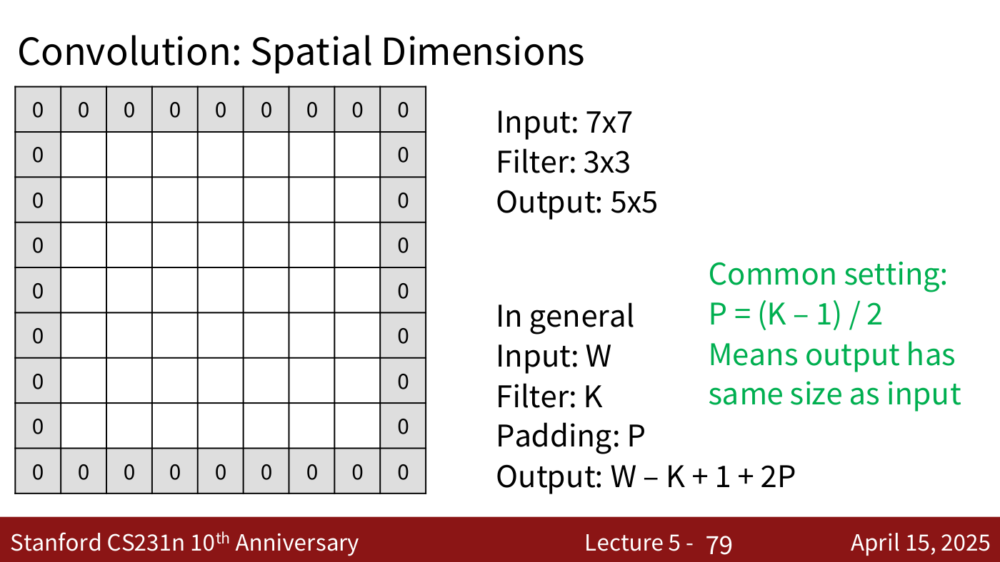

*Slide 79 — zero padding: one ring of zeros (P = 1) keeps a 3x3 convolution's output at 7x7; in general the output is W − K + 1 + 2P. [Deck](https://cs231n.stanford.edu/slides/2025/lecture_5.pdf)*

## Receptive fields

With kernel size $K$, each output element depends on a $K \times K$ region of the layer below,
its **receptive field** (slide 80). Stacking convolutions magnifies this. Each entry of the third
layer depends on a local region of the second, each of which depends on a local region of the
first, so the region of the original image that can influence one output grows with depth. The
lecturer calls this the **effective receptive field**: "how many pixels in the original image had
the opportunity to influence one activation" downstream (≈52:13–53:46). Slide 81 traces one
output back through three $3 \times 3$ convolutions to a $7 \times 7$ region of the input. It states the rule:
each convolution adds $K - 1$, so after $L$ layers the receptive field is $1 + L(K - 1)$. It also
warns to distinguish the receptive field "in the input" from the receptive field "in the
previous layer".

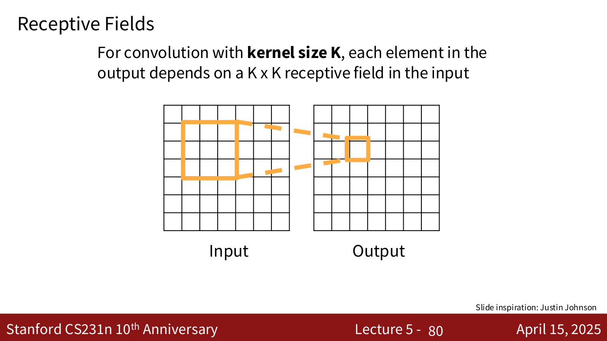

*Slide 80 — the receptive field: each output cell depends on a K x K region of the input. [Deck](https://cs231n.stanford.edu/slides/2025/lecture_5.pdf)*

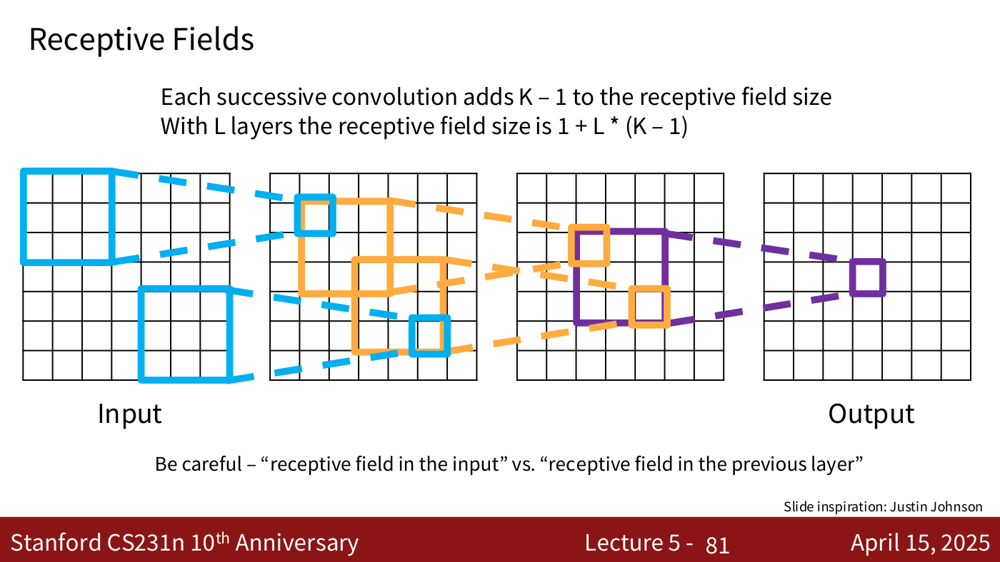

*Slide 81 — receptive fields grow with depth: one output cell traced back through three 3x3 convolutions covers 7x7 of the input, 1 + L(K − 1). [Deck](https://cs231n.stanford.edu/slides/2025/lecture_5.pdf)*

This explains why deeper layers see larger structures, and it raises a problem. The receptive
field grows only linearly with depth, but classification should eventually aggregate information
from the whole image, which would take a lot of layers. The deck's solution is to downsample
inside the network (≈53:46).

## Strided convolution

**Stride** places the filter only at every $S$-th position. A $3 \times 3$ filter over a $7 \times 7$ input with
stride 2 fits in three positions per row, giving a $3 \times 3$ output (≈53:46–54:31). With input width
$W$, filter size $K$, padding $P$ and stride $S$, the output width is

$$\frac{W - K + 2P}{S} + 1.$$

The lecturer reads it term by term: bigger kernels shrink the output, padding adds back some of
the lost size, the stride divides it, and the $+1$ is "some fence post math" (≈54:31; slide 87).

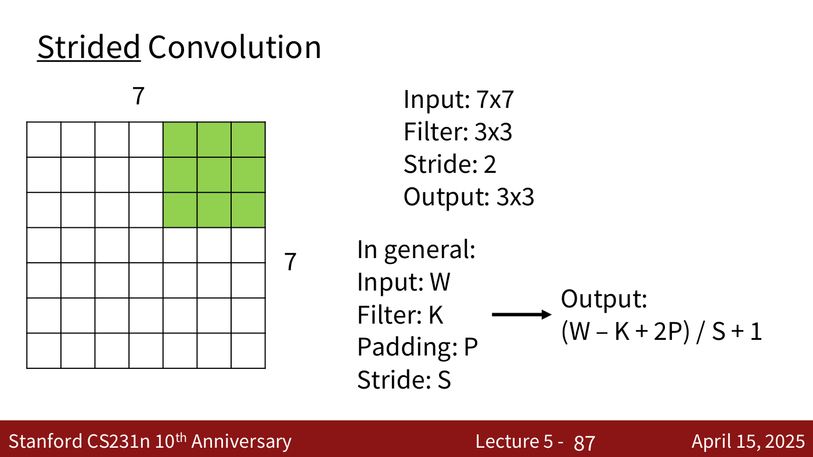

*Slide 87 — stride 2: a 3x3 filter over a 7x7 input fits three times per row; in general the output is (W − K + 2P)/S + 1. [Deck](https://cs231n.stanford.edu/slides/2025/lecture_5.pdf)*

A strided convolution downsamples inside the network, usually by a factor of two. If each of a
stack of convolution layers halves the feature map, the effective receptive field grows
exponentially with depth rather than linearly. A few layers can then see the whole image
(≈55:17).

## Worked example: size, parameters and compute

Take an input volume of $3 \times 32 \times 32$ and a convolution layer of 10 filters, each $5 \times 5$, with stride 1
and padding 2 (≈55:17–56:04; slides 88–93).

**Output size.** There are 10 filters, so 10 output channels. The spatial size is
$(32 + 2 \cdot 2 - 5)/1 + 1 = 32$, so the output is $10 \times 32 \times 32$. This is the same-size pattern
again: an odd kernel $2K + 1$ (here 5) with padding $K$ (here 2) keeps the spatial size
(≈56:04–56:51).

**Parameters.** Each filter has $3 \times 5 \times 5 = 75$ weights plus one bias, so 76 learnable
parameters. Ten filters make 760 (≈56:51). The deck prints both steps, $3 \times 5 \times 5 + 1 = 76$ and $10 \times 76 = 760$.

**Compute.** The output has $10 \times 32 \times 32 = 10{,}240$ entries ("about 10,000"). Each
is a dot product of a $3 \times 5 \times 5$ filter with a $3 \times 5 \times 5$ chunk of the input, 75 multiply-adds. In total
that is $75 \times 10{,}240 = 768{,}000$ multiply-add operations, which slide 93 prints as 768K
(≈57:38–58:23). The captions are garbled where the lecturer first announces the number
("it's a lot seven").

These counts recompute exactly from the printed numbers.

## Convolution summary, PyTorch and other convolutions

The lecturer skips the one-slide summary, "more for you to look at later" (≈58:23). Slide 94
summarises the layer. The input is $C_{in} \times H \times W$. The hyperparameters are the
kernel size $K_H \times K_W$, the number of filters $C_{out}$, the padding $P$ and the stride
$S$. The weight matrix is $C_{out} \times C_{in} \times K_H \times K_W$, giving $C_{out}$ filters
of size $C_{in} \times K_H \times K_W$, plus a $C_{out}$-dimensional bias. The output is
$C_{out} \times H' \times W'$ with

$$H' = \frac{H - K + 2P}{S} + 1, \qquad W' = \frac{W - K + 2P}{S} + 1.$$

Its common settings are small square filters ($K_H = K_W$), "same" padding $P = (K - 1)/2$, and
channel counts $C_{in}$ and $C_{out}$ of 32, 64, 128 or 256 (powers of 2). Typical layers are a
$3 \times 3$ conv ($K = 3$, $P = 1$, $S = 1$), a $5 \times 5$ conv ($K = 5$, $P = 2$, $S = 1$), a $1 \times 1$ conv
($K = 1$, $P = 0$, $S = 1$), and downsampling by 2 ($K = 3$, $P = 1$, $S = 2$).

PyTorch's `torch.nn.Conv2d` takes these same hyperparameters, plus two the lecture does not
cover, groups and dilation. "Dilation isn't really used so much anymore. Groups still get used
sometimes" (≈58:23; slide 95).

Convolution is not limited to images. In **1D convolution** the input is $C_{in} \times W$ and
the weights $C_{out} \times C_{in} \times K$: a filter slides along one dimension (slide 97). In
**3D convolution** the input is $C_{in} \times H \times W \times D$, with a $C_{in}$-dimensional
vector at each point of a volume, and the weights are $C_{out} \times C_{in} \times K \times K \times K$: the filter slides through 3D space (≈58:23–59:09; slide 98).

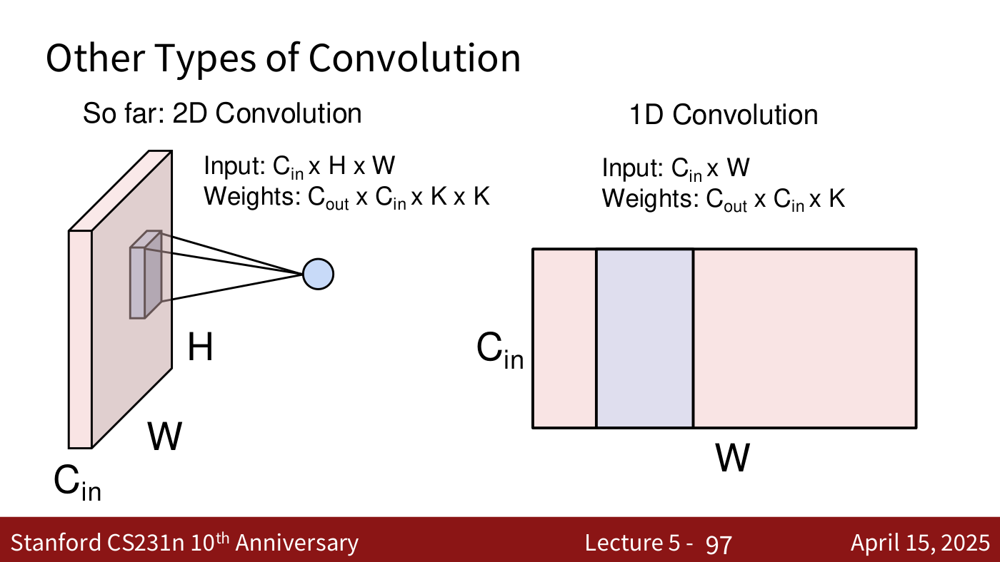

*Slide 97 — 1D convolution: a filter slides along one axis of a C_in x W signal. [Deck](https://cs231n.stanford.edu/slides/2025/lecture_5.pdf)*

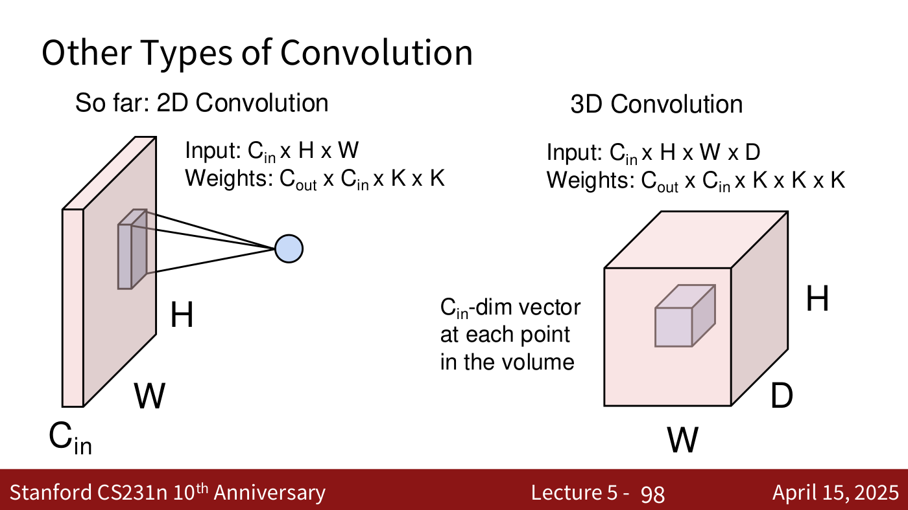

*Slide 98 — 3D convolution: a K x K x K filter slides through a volume with a C_in-dimensional vector at each point. [Deck](https://cs231n.stanford.edu/slides/2025/lecture_5.pdf)*

## Pooling

**Pooling layers** are another way to downsample, and a very cheap one. Strided convolution
downsamples too, but convolution is where most of a ConvNet's FLOPs go (≈59:09–59:56). A pooling
layer treats a $C \times H \times W$ input as $C$ separate feature planes. It pulls each plane
out, downsamples it on its own, and restacks the results, so the number of channels stays the
same and the spatial size changes. Its hyperparameters are the kernel size, the stride and the
pooling function (≈59:56–1:00:44).

The first diagram of this, on slide 101, has its two size labels swapped. It prints "64 x 112 x
112" over the larger cube and "64 x 224 x 224" over the smaller one, though the images beneath
show 224 being downsampled to 112. Slides 18, 100 and 121 label the same figure correctly: a
$224 \times 224 \times 64$ input pooled to $112 \times 112 \times 64$. The lecturer first reads the printed labels ("64 by 112
by 112") and then calls the input 64 by 224 by 224 (≈59:56).

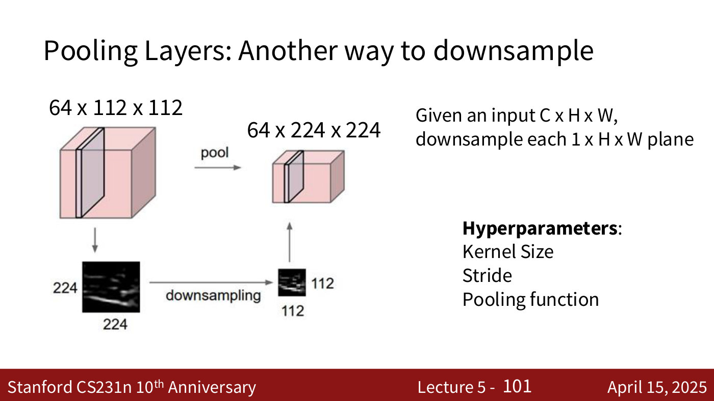

*Slide 101 — pooling downsamples each channel plane on its own. The two cube labels are printed the wrong way round: the larger cube is the 64 x 224 x 224 input, the smaller the 64 x 112 x 112 output. [Deck](https://cs231n.stanford.edu/slides/2025/lecture_5.pdf)*

**Max pooling** is one of the most common choices. Divide each depth slice into non-overlapping
regions, a kernel size of $2 \times 2$ with stride 2, and keep the largest entry of each. On the slide's
$4 \times 4$ example, whose four $2 \times 2$ tiles hold {1, 1, 5, 6}, {2, 4, 7, 8}, {3, 2, 1, 2} and {1, 0, 3, 4},
the output is 6, 8, 3, 4 (≈1:00:44–1:01:29; slide 102). The slide adds that max pooling "Gives
invariance to small spatial shifts" and has "No learnable parameters". Other pooling functions
include average pooling and, in the captions, an unclear third ("anti-alias downpooling")
(≈1:01:29).

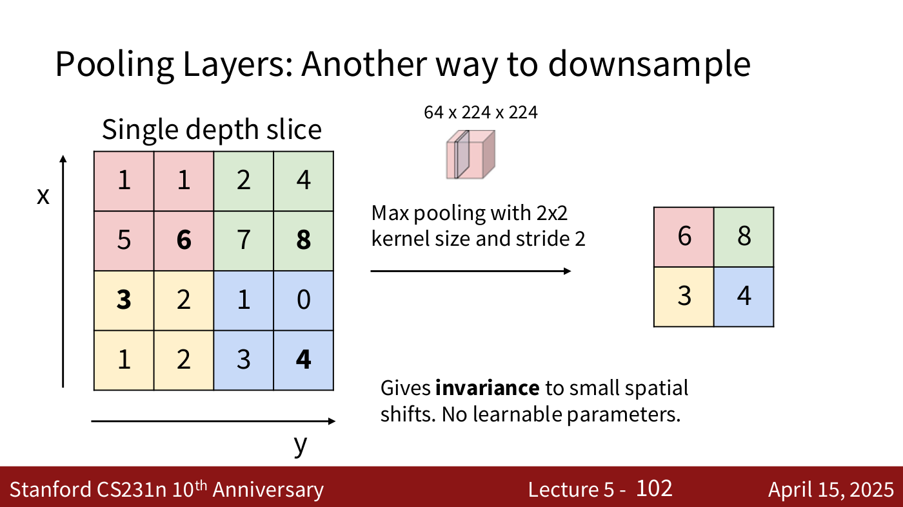

*Slide 102 — 2x2 max pooling with stride 2: each coloured tile keeps its largest value, 6, 8, 3 and 4. [Deck](https://cs231n.stanford.edu/slides/2025/lecture_5.pdf)*

Questions about pooling (≈1:01:29–1:04:32):

- *Is padding used?* Typically not. Nothing forbids it, but zero-padding a max pool is "basically
  equivalent to a ReLU", which would be redundant if the network already uses one. The lecturer
  is not sure whether PyTorch's pooling layers have a padding flag.
- *Is the stride tuned?* It is an architectural hyperparameter, but usually not tuned much. By far
  the most common setting is $2 \times 2$ with stride 2, to downsample by exactly two; sometimes $4 \times 4$ with
  stride 2.
- *Must all input images be the same size?* In everything so far, yes. The fixes are to resize
  every image to one size, to pad them to one size ("padded rather than warped"), or, in more
  sophisticated training setups, **aspect-ratio bucketing**: group the training images by aspect
  ratio, so each forward–backward pass sees one resolution while successive iterations see
  different ones.
- *Where do pooling layers go?* Interspersed with the convolutions. A prototypical ConvNet is conv,
  pool, conv, conv, pool, conv, conv, pool, fully connected, fully connected.
- *Does pooling add non-linearity?* Max pooling does, so some networks drop the ReLU around a
  convolution that is followed by max pooling. Average pooling is linear, so a ReLU is still
  wanted.

Slide 103 summarises pooling. The input is $C \times H \times W$, with hyperparameters kernel
size $K$, stride $S$ and pooling function (max or average). The output is $C \times H' \times W'$ with $H' = (H - K)/S + 1$ and $W' = (W - K)/S + 1$, and there are no learnable parameters.
The common setting is max pooling with $K = 2$, $S = 2$, which gives $2\times$ downsampling. The
lecturer: "basically the same hyperparameters as convolution, except you've got this extra
pooling function" (≈1:04:32).

## Translation equivariance

At the start of the lecture, the goal was operators that respect the spatial structure of images.
**Translation equivariance** is one way to make that precise, and both convolution and pooling
have it (≈1:04:32–1:05:19). Take two routes from an image. Along one, apply a convolution or
pooling and then translate (shift) the result. Along the other, translate the image first and
then apply the convolution or pooling. The two give the same result, "subject to some boundary
conditions, blah blah blah blah blah, in the limit of infinitely large images" (≈1:05:19–1:06:04).
The slide writes this as Conv(Translate(X)) = Translate(Conv(X)) and draws the four arrows as a
square (slide 106). The lecturer adds that a mathematician would call it a commutative diagram,
"and mathematicians love those things" (≈1:07:34).

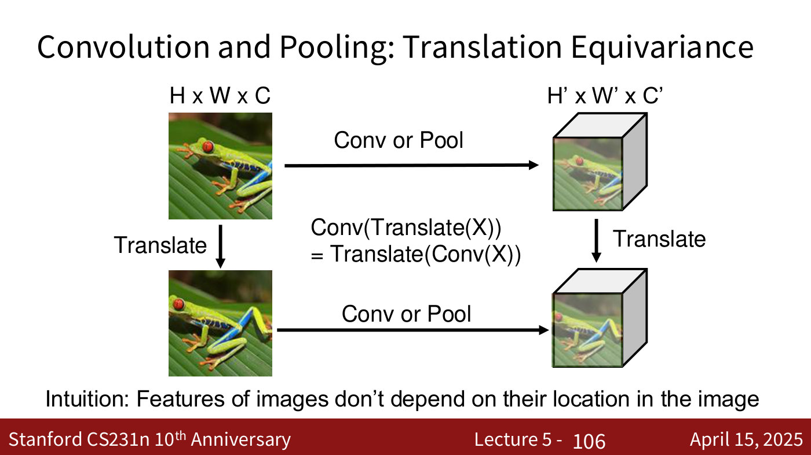

*Slide 106 — translation equivariance as a commutative square: convolving then translating gives the same result as translating then convolving. [Deck](https://cs231n.stanford.edu/slides/2025/lecture_5.pdf)*

The intuition, printed on the slide, is that "Features of images don't depend on their location
in the image". What a network extracts should depend on what is in the image, not where. Looking
one way the lecturer sees people and benches, and looking the other way he sees people and
benches, and he wants both processed the same way. Equivariance builds that intuition about
images into the design of the operators, rather than into hand-designed feature extraction as
at the start of the lecture (≈1:06:04–1:06:49).

A student asked why you would translate at all. "You don't, this is not something you're actually
going to do." It is "a mathematical curiosity" that happens to be true, not a step inside a
network (≈1:06:49–1:07:34).

## Summary and next time

The lecture covered why convolutional networks are interesting and the two new operators,
convolution and pooling. The summary slide (slide 107) shows the four building blocks: the fully
connected layer, the activation function, the convolution layer and the pooling layer. The next
lecture, [lecture 6](06-training-cnns-architectures.md), stitches these together into CNN
architectures (≈1:07:34). Slide 108 previews that with
four unnamed diagrams: the 1998 network of slides 29–33, the AlexNet figure of slide 34, a
module whose $1 \times 1$, $3 \times 3$ and $5 \times 5$ convolutions and $3 \times 3$ max pooling run in parallel into a "Filter
concatenation", and a long chain of $3 \times 3$ convolutions with curved arcs skipping over pairs of
layers.

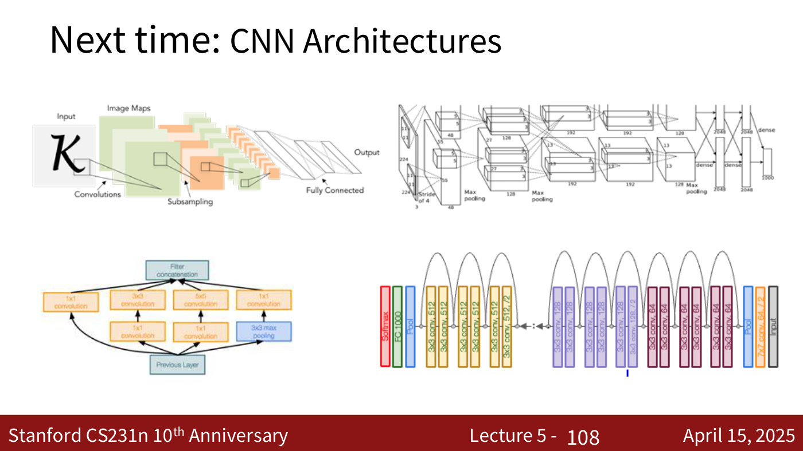

*Slide 108 — next time: four architecture diagrams previewing the lecture on CNN architectures. [Deck](https://cs231n.stanford.edu/slides/2025/lecture_5.pdf)*

## Appendix: slides from previous years (slides only)

The deck ends with 33 slides labelled "Appendix (Slides from Previous Years)" (slide 109). None
is presented in the recording. Most repeat the lecture's material in an older form. **Beware a
change of notation:** in the appendix, $K$ is the *number of filters* and $F$ the filter size,
where the main lecture uses $K$ for the kernel size and $C_{out}$ for the number of filters.

**Convolution layer summary** (slides 111–112). The input is $W_1 \times H_1 \times C$. The layer
needs four hyperparameters: the number of filters $K$, the filter size $F$, the stride $S$ and the
zero padding $P$. It produces $W_2 \times H_2 \times K$ with $W_2 = (W_1 - F + 2P)/S + 1$ and
$H_2 = (H_1 - F + 2P)/S + 1$. It has $F^2 C K$ weights and $K$ biases. Common settings: $K$ a
power of 2 (32, 64, 128, 512), with $F = 3, S = 1, P = 1$, or $F = 5, S = 1, P = 2$, or
$F = 5, S = 2$ and $P$ "? (whatever fits)", or $F = 1, S = 1, P = 0$.

**$1 \times 1$ convolutions** "make perfect sense" (slide 114). A $1 \times 1$ convolution with 32 filters turns a
$56 \times 56 \times 64$ volume into $56 \times 56 \times 32$. Each filter is $1 \times 1 \times 64$ and performs a 64-dimensional dot product
through the depth at one position.

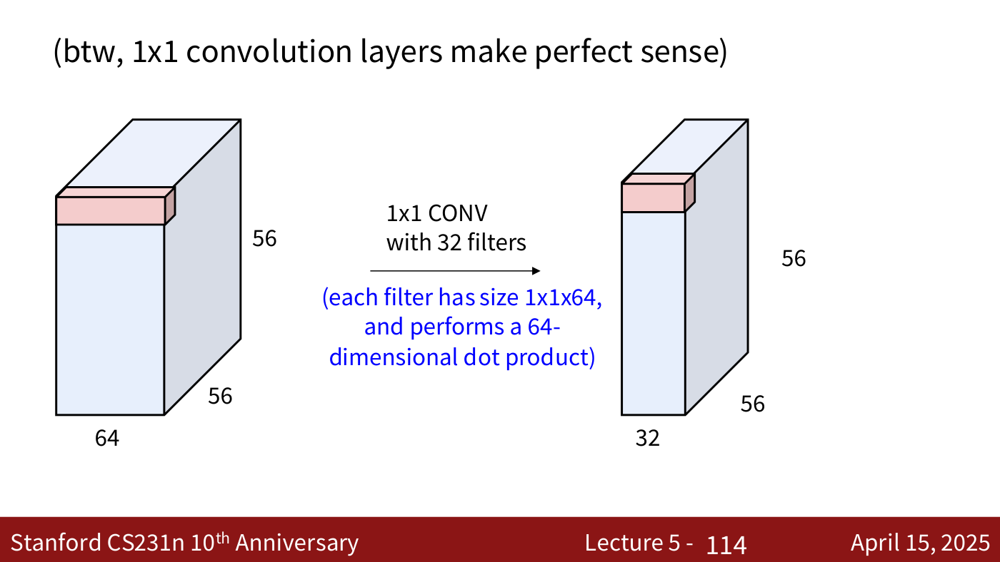

*Slide 114 — a 1x1 convolution with 32 filters: each output is a 64-dimensional dot product through the depth at one position (56x56x64 to 56x56x32). [Deck](https://cs231n.stanford.edu/slides/2025/lecture_5.pdf)*

**PyTorch** (slide 115) repeats the `Conv2d` documentation with the four hyperparameters.

**The neuron view of a convolution layer.** Slide 116 repeats the 75-dimensional dot product.
Slide 117 sets it beside a diagram of a biological neuron model (the analogy of
[lecture 4](04-neural-networks-backpropagation.md)) with the line "It's just a neuron with local
connectivity...". With 5 filters, a convolution layer
on a $32 \times 32 \times 3$ image is a $28 \times 28 \times 5$ grid of neurons, and "There will be 5 different neurons all
looking at the same region in the input volume" (slide 118). By contrast, in a fully connected
layer "Each neuron looks at the full input volume" (slide 119).

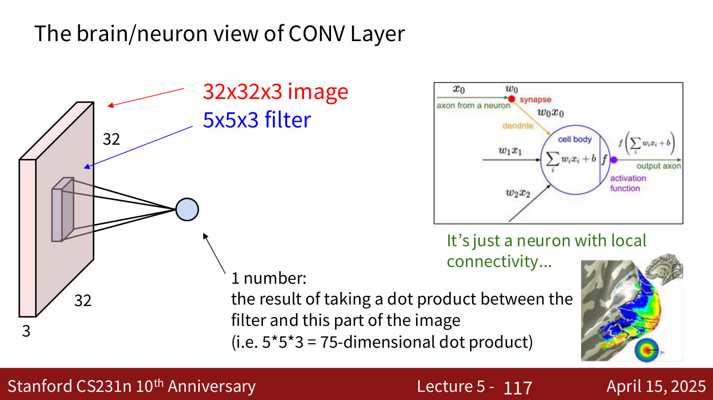

*Slide 117 — the neuron view: one convolution output is a neuron with local connectivity. [Deck](https://cs231n.stanford.edu/slides/2025/lecture_5.pdf)*

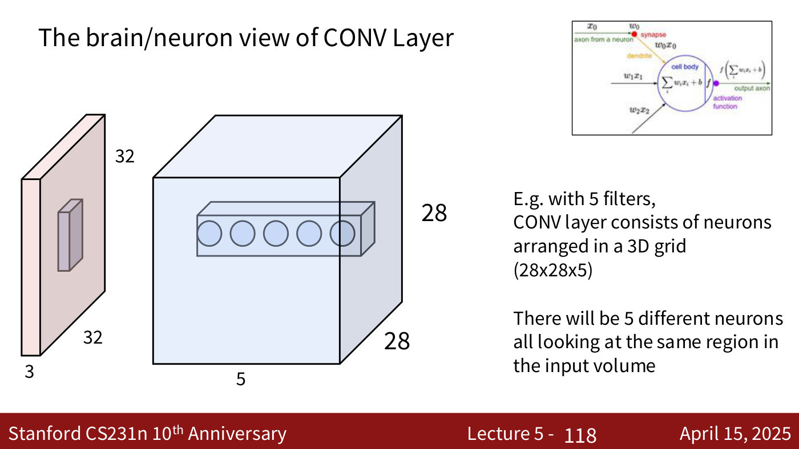

*Slide 118 — five filters make a 28x28x5 grid of neurons; the five along the depth all look at the same input region. [Deck](https://cs231n.stanford.edu/slides/2025/lecture_5.pdf)*

**ConvNet activations** (slide 120). A photograph of a car passes through a chain of CONV, RELU,
CONV, RELU, POOL blocks, repeated three times, shown as columns of activation maps, and then an
FC layer. The output bar chart ranks car far above truck, airplane, ship and horse. Slide 126
reuses it for "Fully Connected Layer (FC layer)": neurons "that connect to the entire input
volume, as in ordinary Neural Networks".

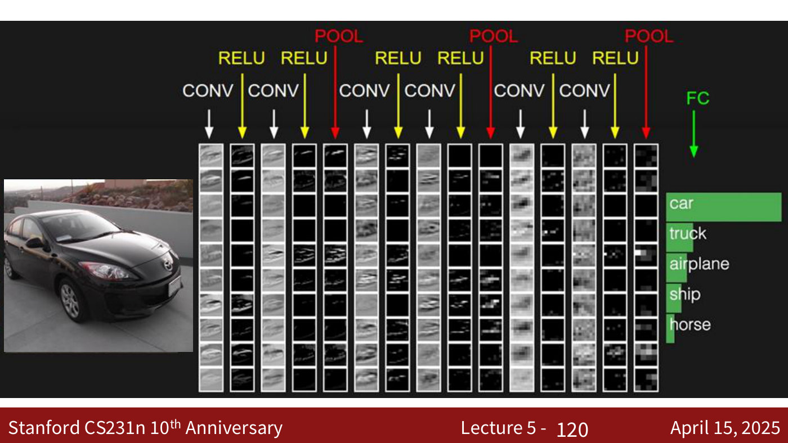

*Slide 120 — activations of a ConvNet on a car photograph, layer by layer (CONV, RELU, POOL), ending in class scores with car on top. [Deck](https://cs231n.stanford.edu/slides/2025/lecture_5.pdf)*

**Pooling** (slides 121–124). Pooling "makes the representations smaller and more manageable" and
"operates over each activation map independently". It is the same $224 \times 224 \times 64$ → $112 \times 112 \times 64$
figure, here labelled correctly, and the same max-pooling example, with "No learnable parameters"
and "Introduces spatial invariance". The pooling summary on slide 124 has a printed slip: under
the heading "Pooling layer: summary" it says "Conv layer needs 2 hyperparameters", then lists the
pooling layer's two, the spatial extent $F$ and the stride $S$. It gives $W_2 = (W_1 - F)/S + 1$,
$H_2 = (H_1 - F)/S + 1$, an unchanged depth $C$, and 0 parameters.

**Architecture summary** (slide 125). ConvNets stack CONV, POOL and FC layers. The trend is
towards smaller filters and deeper architectures, and towards getting rid of POOL and FC layers
(just CONV). Historically, architectures looked like
`[(CONV-RELU)*N-POOL?]*M-(FC-RELU)*K,SOFTMAX`, with $N$ usually up to about 5, $M$ large, and
$K$ between 0 and 2. "But recent advances such as ResNet/GoogLeNet have challenged this
paradigm."

**The ConvNetJS demo** (slide 127). A screenshot of Andrej Karpathy's in-browser demo trains a
ConvNet on CIFAR-10 in JavaScript. Its description gives the state of the art at the time as about
90% accuracy and human performance as about 94%, and says it uses Adadelta by default. Its network
visualisation shows a $32 \times 32 \times 3$ input and a conv layer of $32 \times 32 \times 16$ with $5 \times 5 \times 3$ filters at stride 1,
whose parameter count is printed as $16 \times 5 \times 5 \times 3$ + 16 = 1216.

![Slide 127 — [ConvNetJS demo: training on CIFAR-10]](../raw/images/05-image-classification-cnns/slide-127.jpg)

*Slide 127 — the ConvNetJS CIFAR-10 demo, with its conv layer's activations, gradients and 1216 parameters. [Deck](https://cs231n.stanford.edu/slides/2025/lecture_5.pdf)*

**The deep-learning recipe** (slides 128–132) in five steps:
(1) encode the problem as $y = f(x)$ with $x$ and $y$ grids of numbers, and get a dataset of
$(x, y)$ pairs;
(2) define a loss function that measures the correctness of predictions with a single number;
(3) define a computational graph that predicts $y$ from $x$ using learnable weights;
(4) compute gradients with backpropagation;
(5) find the weights that minimise the loss with optimization algorithms.
Slide 129 illustrates step 2 with the softmax loss, but prints it with minus signs in both
exponents, $-\log\left(e^{-s_y} / \sum_i e^{-s_i}\right)$. With those signs the loss would be
lowest when the correct score $s_y$ goes to $-\infty$, while the slide's own caption says scores
for $y$ should go to $+\infty$. The softmax loss on slide 7, and in
[lecture 2](02-image-classification.md), has no minus signs in the exponents. See
[loss functions](loss-functions.md).

**A bit of history.** The last nine slides trace neural networks and their biological
inspiration. Some of this material overlaps [lecture 1](01-introduction.md)'s history, with
different figures.

Slide 133: Frank Rosenblatt's Mark I Perceptron, about 1957, "the first implementation of the
perceptron algorithm". A camera with $20 \times 20$ cadmium sulfide photocells produced a 400-pixel image,
and the machine recognised letters of the alphabet. It computes $f(x) = 1$ if $w \cdot x + b$ is
positive and 0 otherwise, with the update rule
$w_i(t+1) = w_i(t) + \alpha (d_j - y_j(t)) x_{j,i}$. A photograph shows the machine's control
panel.

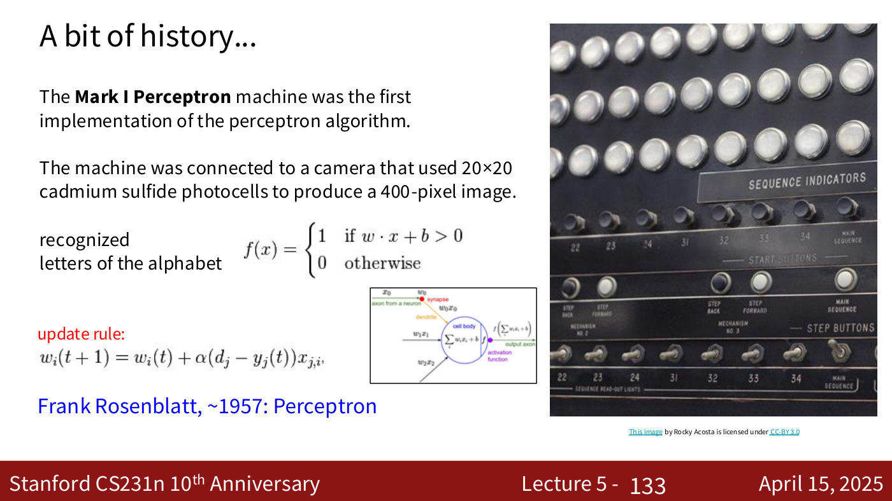

*Slide 133 — the Mark I Perceptron (Rosenblatt, about 1957) and its update rule. [Deck](https://cs231n.stanford.edu/slides/2025/lecture_5.pdf)*

Slide 134: Widrow and Hoff's Adaline/Madaline, about 1960. Input lines pass through adjustable
weights ("a's are adjustable") into a sum and a quantizer. The slide shows a photograph of the
hardware and a circuit schematic, reproduced from a 1960 Stanford Electronics Laboratories
technical report.

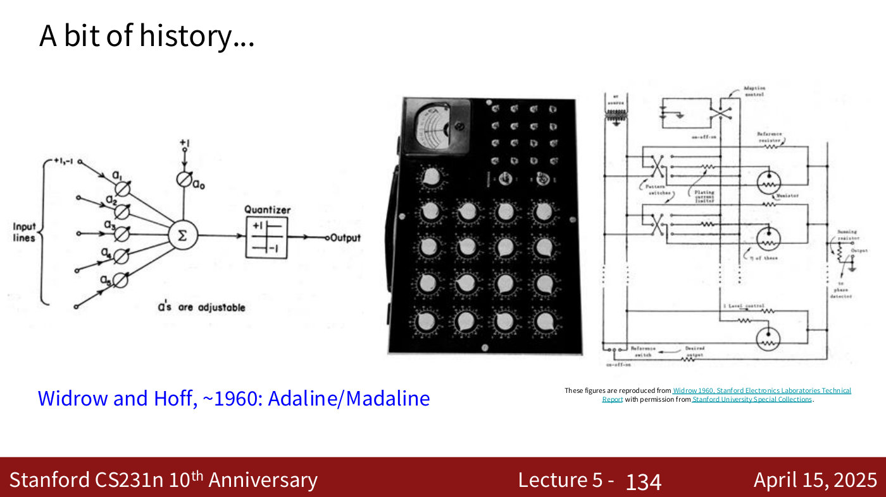

*Slide 134 — Widrow and Hoff's Adaline/Madaline, about 1960. [Deck](https://cs231n.stanford.edu/slides/2025/lecture_5.pdf)*

Slide 135: Rumelhart et al., 1986, "First time back-propagation became popular". It shows a
three-layer network with weight $w_{ji}$ from unit $i$ to unit $j$, and the chain-rule step
$\partial E_p / \partial w_{ji} = (\partial E_p / \partial o_{pj})(\partial o_{pj} / \partial w_{ji})$, labelled "recognizable math".

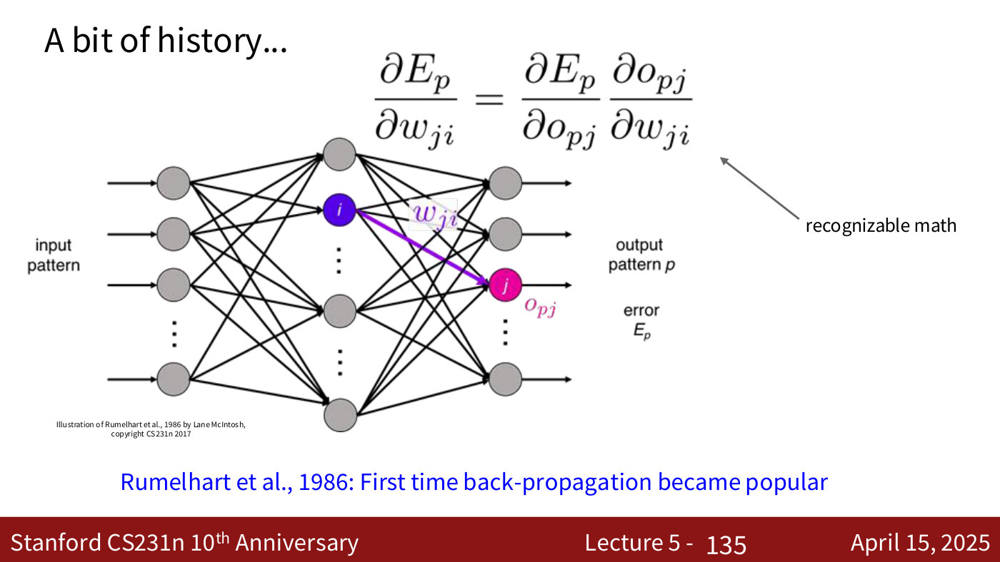

*Slide 135 — Rumelhart et al., 1986: the first time backpropagation became popular. [Deck](https://cs231n.stanford.edu/slides/2025/lecture_5.pdf)*

Slide 136: Hinton and Salakhutdinov, 2006, "Reinvigorated research in Deep Learning". Restricted
Boltzmann machines are pretrained layer by layer (2000, 1000, 500 and 30 units), unrolled into an
autoencoder whose decoder uses the transposed weights, and fine-tuned with backprop.

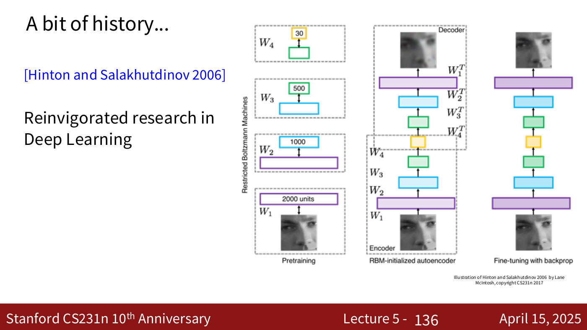

*Slide 136 — Hinton and Salakhutdinov, 2006: RBM pretraining, unrolling into an autoencoder, fine-tuning with backprop. [Deck](https://cs231n.stanford.edu/slides/2025/lecture_5.pdf)*

Slide 137: the first strong results. In speech recognition these were Mohamed, Dahl and Hinton
(2010) and Dahl, Yu, Deng and Acero (2012), a deep neural network feeding an HMM. In vision it
was Krizhevsky, Sutskever and Hinton (2012), shown with its network and its learned first-layer
filters.

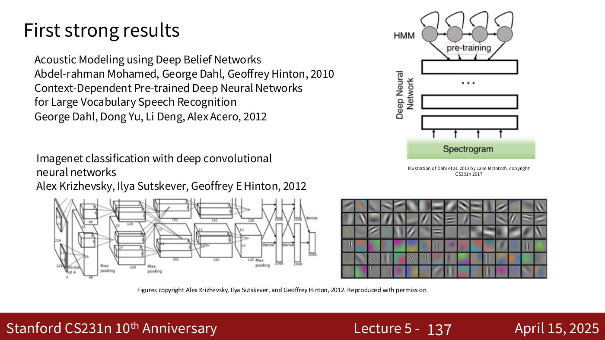

*Slide 137 — the first strong results: deep networks for speech (2010, 2012) and AlexNet for vision (2012). [Deck](https://cs231n.stanford.edu/slides/2025/lecture_5.pdf)*

Slide 138: Hubel and Wiesel, "Receptive fields of single neurones in the cat's striate cortex"
(1959), "Receptive fields, binocular interaction and functional architecture in the cat's visual
cortex" (1962), and 1968. The figure shows moving bars and spots shown to a cat on a screen while
the electrical signal from its brain is recorded, with a sharply peaked response to an oriented
bar and a broad one to a small ellipse.

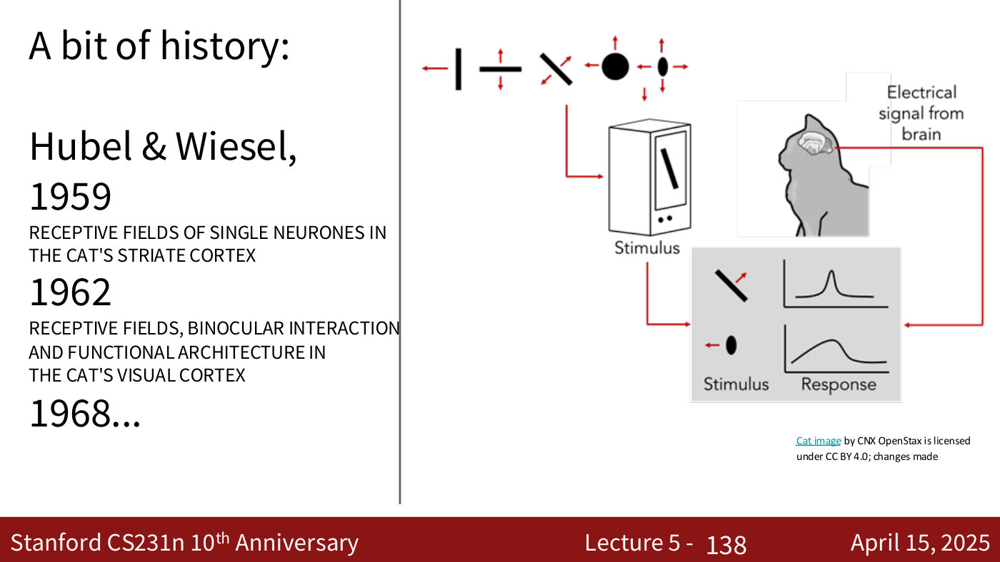

*Slide 138 — Hubel and Wiesel's experiment: stimuli shown to a cat, responses recorded from its visual cortex. [Deck](https://cs231n.stanford.edu/slides/2025/lecture_5.pdf)*

Slide 139: topographical mapping in the cortex: "nearby cells in cortex represent nearby regions
in the visual field". It shows retinotopy maps of the human visual cortex (V1, V2, V3, hV4, VO1).

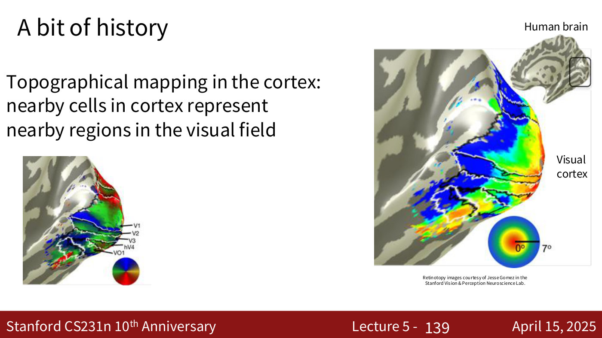

*Slide 139 — retinotopy: nearby cells in the visual cortex represent nearby regions of the visual field. [Deck](https://cs231n.stanford.edu/slides/2025/lecture_5.pdf)*

Slide 140: hierarchical organization in early visual pathways. Retinal ganglion cells,
with concentric receptive fields (a + centre and a − ring), feed LGN and V1 simple cells. Simple cells respond to
light orientation, complex cells to orientation and movement, and hypercomplex cells to movement
with an end point: a bar that ends inside the receptive field gets a response, and one that
crosses it does not.

*Slide 140 — hierarchical organization: simple, complex and hypercomplex cells; a bar ending inside the field gets a response, one crossing it does not. [Deck](https://cs231n.stanford.edu/slides/2025/lecture_5.pdf)*

Slide 141: Fukushima's Neocognitron, 1980, a "sandwich" architecture of alternating S and C
layers (SCSCSC…). In the slide's words, its "simple cells: modifiable parameters" and its "complex
cells: perform pooling".

*Slide 141 — Fukushima's Neocognitron (1980): alternating simple and complex (pooling) layers. [Deck](https://cs231n.stanford.edu/slides/2025/lecture_5.pdf)*

## Summary

- Fully connected networks on raw pixels throw away the two-dimensional structure of images.
  Hand-designed features (colour histograms, HoG, bag of words) once supplied that structure.
  ConvNets instead learn everything end to end, building the structure into their operators.
- A convolution layer slides $C_{out}$ learned filters, each spanning the input's full depth,
  across the input. It computes a dot product plus bias at each position, and stacks the
  resulting activation maps into $C_{out}$ output channels. Its filters are parameters; their
  number, size, padding and stride are hyperparameters.
- The output size is $(W - K + 2P)/S + 1$. "Same" padding $P = (K - 1)/2$ keeps the size, and
  stride 2 halves it.
- Stacked convolutions need non-linearities between them. Their receptive field grows by $K - 1$
  per layer, and exponentially when layers downsample.
- Pooling downsamples each channel independently, most often max pooling $2 \times 2$ with stride 2, and
  has no learnable parameters.
- Convolution and pooling are translation equivariant: shifting the input shifts the output.
- ConvNets dominated computer vision from about 2012 to 2020. Transformers have since displaced
  them for many tasks, but they remain in use, often in hybrids.
