# Lecture 6 — Training CNNs and CNN Architectures

**CS231N Deep Learning for Computer Vision, Stanford, Spring 2025.** Delivered April 17, 2025, by
Zane Durante, one of the course's co-instructors (he introduces himself at the start of the
recording). The catalog lists the lecture as "CNN Architectures"; its title slide reads "Training
CNNs and CNN Architectures".
[Video](https://www.youtube.com/watch?v=aVJy4O5TOk8) ·
[edited transcript](../raw/transcripts/06-training-cnns-architectures.md) ·
deck as [text](../raw/slides/06-training-cnns-architectures.md) /
[PDF](https://cs231n.stanford.edu/slides/2025/lecture_6.pdf)

## What this lecture establishes

Lecture 5 introduced the convolution and pooling layers. This lecture finishes the toolkit and
then shows how to use it, in two halves (≈0:05–0:52). The first half is **how to build a CNN**:
the remaining layers (normalization layers and dropout), the activation functions in use today,
how the layers are assembled into the architectures that won ImageNet — **VGG**, with its stacks
of small $3 \times 3$ convolutions, and **ResNet**, whose residual connections made networks of
more than 100 layers trainable — and how to initialise their weights so that activations neither
vanish nor explode. The second half is **how to train one**: normalizing the input images,
augmenting the training data, **transfer learning** from a network pretrained on a large dataset,
and a step-by-step recipe for choosing hyperparameters (≈45:26–46:12). The second half is, in the
lecturer's words, "much less dense than the first part": mainly practical tips (≈45:26).

The topic pages [CNN architectures](cnn-architectures.md),
[normalization layers](normalization-layers.md),
[weight initialization](weight-initialization.md),
[data preprocessing and augmentation](data-augmentation.md) and
[transfer learning](transfer-learning.md) gather these concepts in one place, and
[regularization](regularization.md#dropout) covers dropout.

**What the recording covers.** The recording opens at 0:05 with the lecturer's introduction and
the overview of the lecture's two halves, and ends at about 1:10:50 after the summary. It follows
the deck in order and never presents the course-logistics slide (summarised below from the slide
alone). Two passages depart from the slides. In the middle of data augmentation, a student
question takes the lecturer back to weight initialization (≈51:34–53:10). And near the end of
transfer learning he answers questions about LoRA and about ResNet's paired convolutions, which
no slide shows (≈1:04:40–1:06:59).

**What the slides leave unlabelled.** The chart of ImageNet challenge winners prints no y-axis
title, and the training curves near the end print no tick values; where the lecturer or another
slide says what an axis measures, this page says so and cites it. The deck prints four oddities,
pointed out where they occur below: a LayerNorm annotation that says its statistics are calculated
"per batch" although its own shapes give one pair per sample; VGG stacks whose drawn layers do not
add up to 16 and 19; a ResNet diagram whose last stage repeats the first stage's label; and a
pointer to "Lecture 13" for more on visualising features, which in this offering is lecture 9's
topic. None of the deck's worked arithmetic is wrong.

## Administrative notes (slides only)

The recording does not present slide 2, which announces that Assignment 1 is due "next Wednesday"
(4/23) at 11:59 PM, and that the project proposal is due "Friday next week" (4/25). The course
website is authoritative for any later change; see [course logistics](course-logistics.md).

## The lecturer

Zane Durante is one of the course's co-instructors and a fourth-year PhD student at Stanford,
co-advised by Ehsan Adeli and Fei-Fei Li. He also gave lecture 3, on regularization and
optimization, where he had not introduced himself (≈0:05).

## Two broad sets of topics

The deck organises the lecture as two lists of four topics (slide 3). **How to build CNNs?**
covers layers in CNNs, activation functions, CNN architectures and weight initialization. **How
to train CNNs?** covers data preprocessing, data augmentation, transfer learning and
hyperparameter selection. The overview returns between topics with the current one in red, and
the summary repeats the eight (slides 96–97). By "how to build CNNs" the lecturer means how to
define an architecture so that it is set up to be trained (≈0:52).

## Recap: convolution and pooling

A convolution layer has a fixed number of filters, six on the recap slide, each with the same
depth as its input: three for an RGB image of $32 \times 32$ pixels (slide 6). Each filter slides
across the image; at every position it takes the dot product of its values with the image values
under it and adds a bias, which gives one value of that filter's activation map. Six filters of
size 3x5x5 give six activation maps of 1x28x28, stacked into a 6x28x28 output, usually followed
by a non-linearity such as ReLU (≈0:52–1:39). A student asks why the output depth is six when the
image's is three. Depth matches the input only inside a filter. A second convolution layer would
need filters of depth six, because they must span all six activation maps (≈1:39–2:24).

A pooling layer also slides a window across its input, but simply takes the maximum (max pooling)
or the average (average pooling) of each window. With $2 \times 2$ windows and stride 2 on a
$4 \times 4$ slice, max pooling gives 6, 8, 3, 4 and average pooling 3.25, 5.25, 2, 2 (slide 7).
Both are commonly used, and when creating a new architecture one would try both and see which
performs better. The point is to consolidate the height and width dimensions (≈2:24–3:12).

## The components of a CNN

Slide 8 lays out six components. The course has now covered three: convolution layers, pooling
layers and fully connected layers (one matrix multiply followed by an activation function, from
lecture 4). This lecture adds the rest: **normalization layers**, **dropout**, which is a
regularization technique built into the architecture itself and used "sometimes", and a second
look at **activation functions**, the ones used historically and in modern deep learning
(≈3:12–3:59).

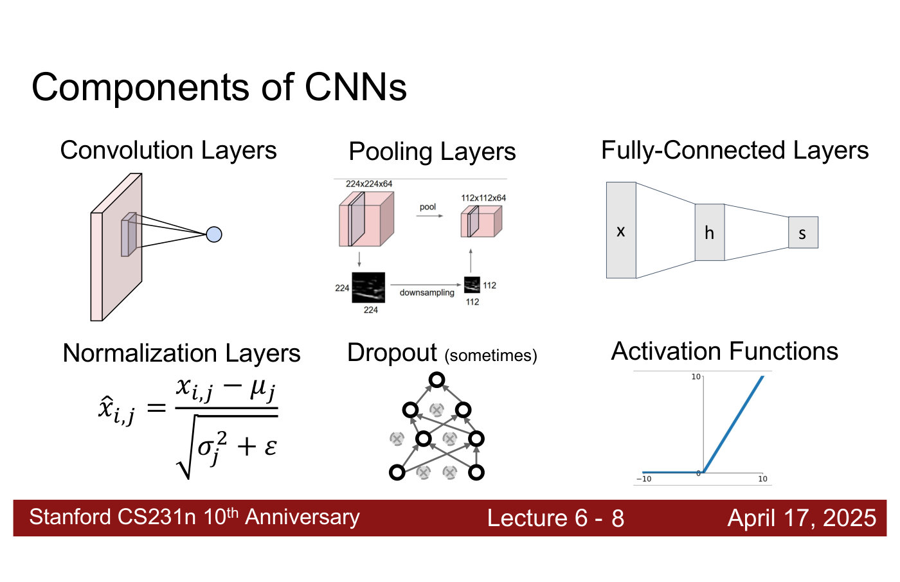

*Slide 8 — the six components of a CNN: convolution, pooling and fully connected layers (lecture 5), and normalization layers, dropout ("sometimes") and activation functions (this lecture). [Deck](https://cs231n.stanford.edu/slides/2025/lecture_6.pdf)*

## Normalization layers

Every normalization layer does the same two things. First it normalizes its input to a unit
Gaussian, mean zero and standard deviation one. Then it **scales and shifts** the result with
learned parameters: it multiplies by a value that sets the new standard deviation and adds a
value that sets the new mean, so the model learns the distribution it wants at that point
(≈3:59–4:45; slide 10). Slide 8 writes the normalization step as

$$\hat{x}_ {i,j} = \frac{x_{i,j} - \mu_j}{\sqrt{\sigma_j^2 + \varepsilon}}$$

where $\mu_j$ and $\sigma_j^2$ are a mean and a variance and $\varepsilon$ is a small constant
that keeps the denominator away from zero (the slide does not define the symbols). What
distinguishes the different normalization layers is **which values the statistics are computed
over**, and which values they are applied to (≈4:45).

### LayerNorm

LayerNorm (Ba, Kiros and Hinton, 2016) is, the lecturer says, the most commonly used
normalization layer today, especially in transformers (≈4:45). Take a batch $x$ of $N$ samples,
each a vector of dimension $D$. LayerNorm computes one mean and one standard deviation **for each
sample separately**, along its $D$ dimensions; then it applies learned scale and shift parameters,
learned by gradient descent like any other weights (≈4:45–5:31). Slide 11 gives the shapes: $x$
is N x D; the statistics $\mu, \sigma$ are N x 1, one pair per sample; and the learned parameters
$\gamma, \beta$ are 1 x D, applied to each sample. The output is

$$y = \gamma \frac{x - \mu}{\sigma} + \beta$$

An annotation on the slide calls these "Statistics calculated per batch". The shape it points
at, N x 1, is one mean and one standard deviation per sample, which is how the lecturer describes
LayerNorm; statistics computed across the batch are batch norm's, below.

### Batch, layer, instance and group norm

A figure from the Group Normalization paper (Wu and He, 2018) compares four layers on a
convolutional activation, drawn as a cube with axes for the batch ($N$), the channels ($C$) and
the spatial dimensions ($H, W$). In each, the blue cells are the set over which one mean and one
standard deviation are computed and to which they are applied (slide 12). The lecturer recommends
it as the way to understand all of them: "if you can understand this diagram, I think you
understand what all of the different normalization layers are doing" (≈8:35).

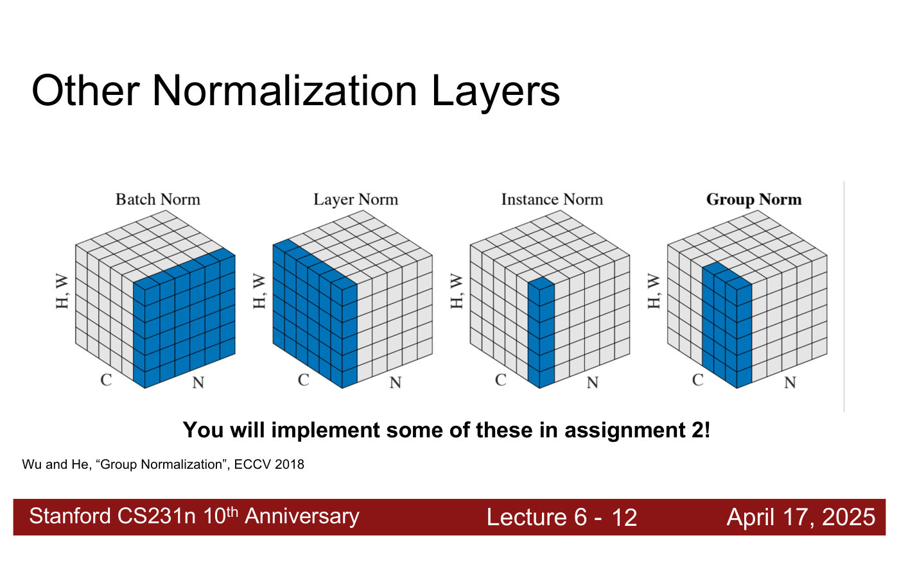

*Slide 12 — four normalization layers on one cube (N batch, C channels, H, W spatial). Blue marks one set of statistics: batch norm one channel across the batch, layer norm one sample across all channels, instance norm one channel of one sample, group norm a group of channels of one sample. From Wu and He, ECCV 2018. [Deck](https://cs231n.stanford.edu/slides/2025/lecture_6.pdf)*

**Layer norm** takes one sample at a time and computes its statistics across all its channels,
heights and widths. **Batch norm** takes one channel at a time and computes its statistics across
every sample in the minibatch and all spatial positions, so each channel gets one mean and one
standard deviation. **Instance norm** is more granular still, one channel of one sample.
**Group norm**, which that paper introduced, takes one sample and a group of channels. The
lecturer adds that group norm is "not so commonly used these days" (≈6:16–7:48). The slide notes
that students will implement some of these in Assignment 2.

Three student questions follow. For layer norm, is one mean and one standard deviation computed
for each image? Yes, each separately. For batch norm that is not the case: the statistics are
computed per channel over all the data in the minibatch fed into the model at one gradient step
(≈7:48–8:35). And "channel" means the depth: the number of values at each spatial location
(≈8:35). The key idea, the lecturer sums up, is computing statistics, applying them to the input,
and learning a scale and shift (≈9:22). See [normalization layers](normalization-layers.md).

## Dropout

Dropout is the last layer the course needs before the architectures, and it is a
**regularization** layer (≈9:22). Its idea is to add randomness during training and take it away
at test time: the model finds the training data harder to fit, and generalises better. Concretely,
in each forward pass the layer randomly sets some neurons' outputs to zero. Its one parameter, a
fixed hyperparameter, is the probability of dropping, and 0.5 is common (slide 15); the lecturer
adds that 0.25 is also commonly used (≈10:07). A dropped value contributes nothing downstream, so
with masking it need not even be computed (≈10:07–10:53).

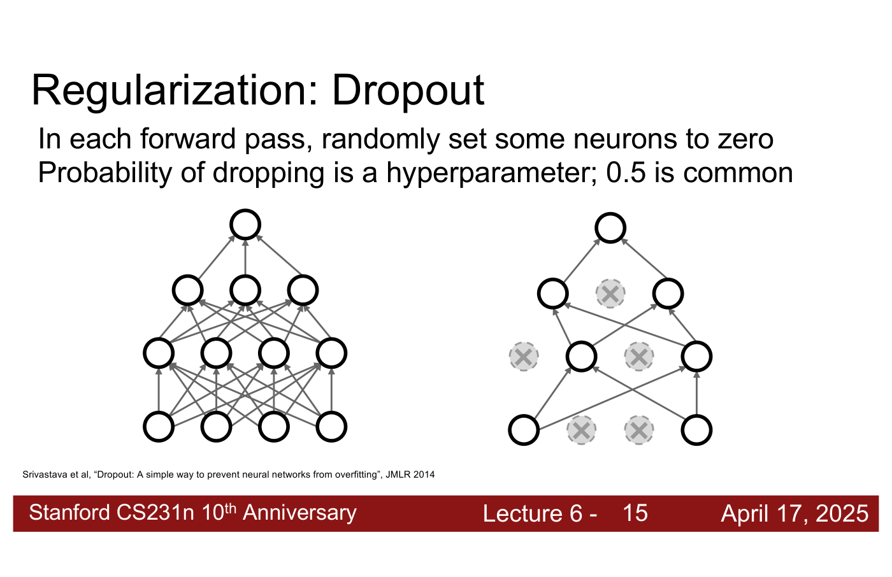

*Slide 15 — a small network before (left) and after (right) dropout: dropped neurons are dashed and crossed, and only connections between surviving neurons remain. [Deck](https://cs231n.stanford.edu/slides/2025/lecture_6.pdf)*

Why it works is "more of an empirical thing" than a well-studied theoretical one, but two views
give intuition (≈10:53). The first is that dropout forces the network to have a **redundant
representation** and prevents co-adaptation of features (slide 16). Suppose the layer before a
network's output detects features such as "has an ear", "has a tail", "is furry", "has claws" and
"mischievous look", and these feed a cat score. If any of them may be missing during training, the
model cannot over-rely on particular features appearing together — an ear plus fur, say, which in
its training set happen always to mean a cat — and has to learn a broader set of
correspondences, which generalises better (≈10:53–12:25). The second view is that dropout trains
a large **ensemble** of models that share parameters, each binary mask being one model; a fully
connected layer of 4096 units has $2^{4096} \sim 10^{1233}$ possible masks, against "only
$\sim 10^{82}$ atoms in the universe" (slide 17).

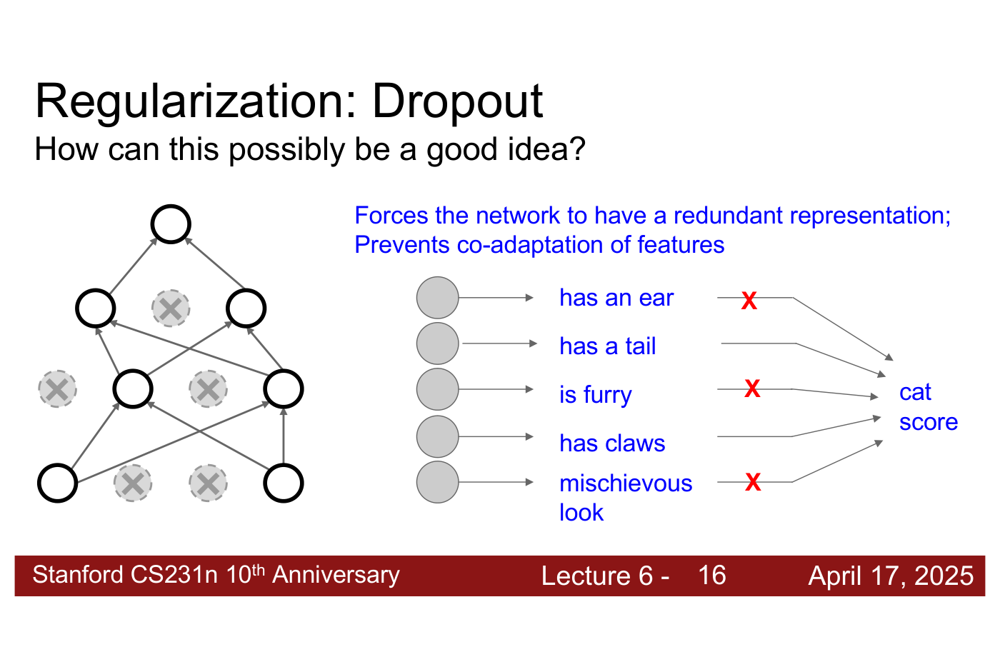

*Slide 16 — why dropout helps: features such as "has an ear" and "is furry" feed a cat score, and dropping some (red X) stops the network relying on any one combination. [Deck](https://cs231n.stanford.edu/slides/2025/lecture_6.pdf)*

Students ask several questions (≈12:25–15:28). Which features are dropped, if the class were
"tree" instead of "cat"? None is chosen: the dropping is completely random, half the features at
each step when the probability is 0.5. How can the model know the answer from a subset such as tail
and claws? It cannot always; dropout makes the model worse on the training data, and better at
test time. What happens in backpropagation? A zeroed value works like a ReLU's zero: its gradient
is zero, nothing further back in the graph receives gradient through it, and the weights tied to
a dropped activation are not updated at that step. And could one add noise to the image instead?
Yes, which is data augmentation, later in the lecture.

**At test time nothing is dropped.** All neurons are always active, so the activations must be
scaled so that each neuron's "output at test time = expected output at training time" (slide 18).
Otherwise each node sees "a significantly higher number of inputs" than it did in training,
and the magnitude of its input changes (≈13:55–15:28). Slide 19's code puts the two halves
together. In training, after each hidden layer's ReLU it draws a mask `U1 = np.random.rand(*H1.shape) < p`
and multiplies the activations by it ("drop in train time"); at test time `predict` multiplies each
hidden layer's activations by `p` ("scale at test time"). In that code `p = 0.5` is defined as the
"probability of keeping a unit active. higher = less dropout", so the test-time factor is the
probability of keeping a unit; the lecturer calls it "the probability of dropout" (≈13:55, ≈14:41),
which is the same number at 0.5. The slide labels this "Vanilla Dropout: Not recommended
implementation (see notes below)", but the notes it refers to are not on the slide.

Dropout is one instance of a pattern the lecture returns to under data augmentation: add
randomness at training time, average it out at test time. See
[regularization](regularization.md#dropout).

## Activation functions

Activation functions are there to **introduce non-linearities** (slide 22). Convolutions and
fully connected layers without activations are linear operations, multiplications and additions,
so without them the whole network would be linear (≈16:13).

### Sigmoid, and why it is no longer used

The sigmoid, $\sigma(x) = 1/(1 + e^{-x})$, squashes numbers to $[0, 1]$, and was historically
popular because it can be read as a saturating "firing rate" of a neuron. Its key problem is that
"many layers of sigmoids → smaller and smaller gradients" (slide 23). Empirically, the gradients
are fairly large at the end of the network and get smaller and smaller as backpropagation goes
through each sigmoid towards the early layers (≈16:13–17:00). Asked where the sigmoid has a small
gradient, a student answers: for very negative and very positive inputs (≈17:00). The curve is
flat at both ends, so almost all of the input range has a near-zero gradient, and only a narrow
range in the middle does not; "large positive or negative values can 'kill' the gradients"
(slide 24; ≈17:00–17:45).

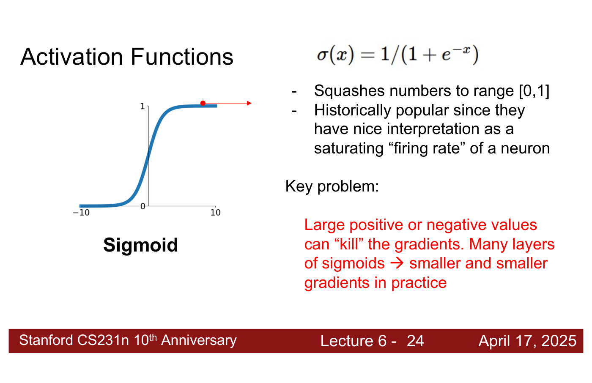

*Slide 24 — the sigmoid is flat for large positive or negative inputs, so its gradient there is near zero, and stacked layers shrink it further. [Deck](https://cs231n.stanford.edu/slides/2025/lecture_6.pdf)*

### ReLU

ReLU, the rectified linear unit, computes $f(x) = \max(0, x)$. It does not saturate in the
positive region, is very computationally efficient, and converged about six times faster than
sigmoid in practice in Krizhevsky et al. 2012 (slide 25). Its gradient is one for every positive
input. For the negative half it is still zero, which is better than a gradient near zero almost
everywhere, and computing a max is much cheaper than a sigmoid: for those two reasons ReLUs became
very popular (≈17:45–18:30). Its drawbacks are that its output is not zero-centred and that ReLUs
"die" for $x \lt 0$ (slide 26): any negative input gets a zero gradient (≈18:30).

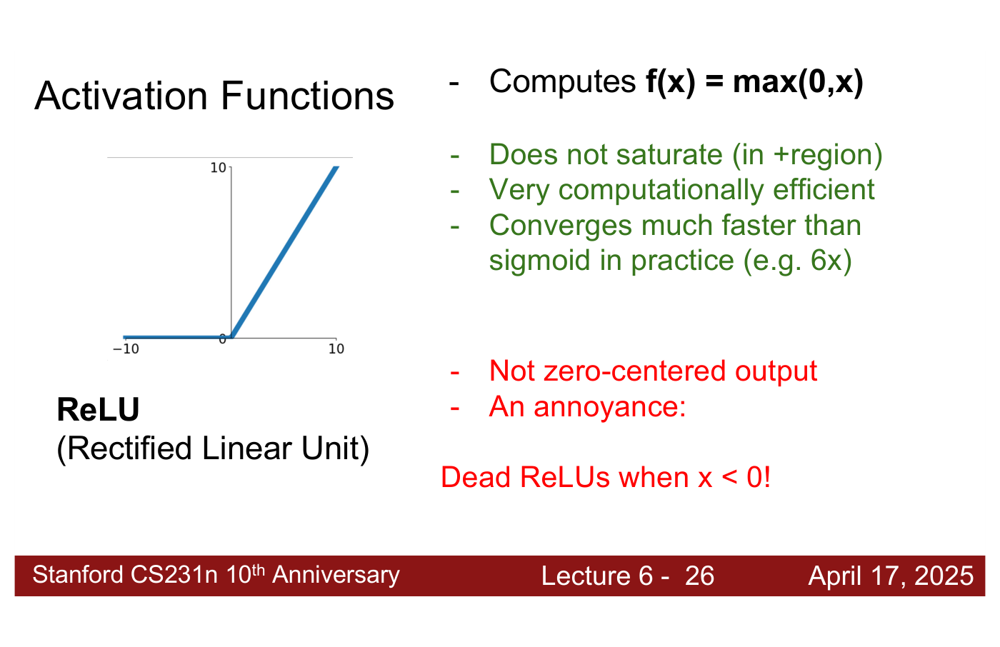

*Slide 26 — ReLU, max(0, x): no saturation for positive inputs and cheap to compute, but not zero-centred, and a zero gradient ("dead ReLUs") for negative inputs. [Deck](https://cs231n.stanford.edu/slides/2025/lecture_6.pdf)*

### GELU and SiLU

More recent activation functions avoid that by not being flat near zero (≈18:30). **GELU**, the
Gaussian error linear unit (Hendrycks et al., 2016), computes $f(x) = x \cdot \Phi(x)$, where
$\Phi(x)$ is the cumulative distribution function of the unit Gaussian: the area under the
Gaussian curve up to $x$ (slide 27; ≈19:19–20:06). For very negative $x$, $\Phi(x)$ is close to
0, so GELU approaches ReLU's zero; for very positive $x$ it is close to 1, so GELU approaches
$x$. It converges to ReLU at both extremes but smooths out ReLU's sharp change of derivative from
0 to 1 at zero, and it has non-zero gradients just below zero. The slide lists its very nice
behaviour around 0, and smoothness that "facilitates training in practice", against a higher
computational cost than ReLU and gradients that still go to zero for large negative values. It
is the main activation function in transformers today (≈20:06).

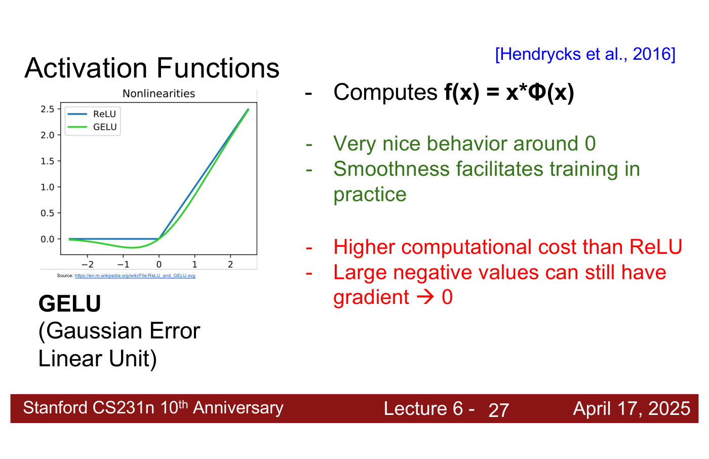

*Slide 27 — GELU (green) against ReLU (blue) from −2.5 to 2.5: GELU dips slightly below zero for negative inputs and runs just under ReLU for positive ones, smoothing the corner at zero. [Deck](https://cs231n.stanford.edu/slides/2025/lecture_6.pdf)*

**SiLU** computes $x \cdot \sigma(x)$. It has the same limits, because the sigmoid is close to 0
for very negative inputs and close to 1 for very positive ones, which is why its shape is so like
GELU's (≈20:51). Slide 28's "activation function zoo" plots five functions: ReLU;
Leaky ReLU, $\max(0.1x, x)$; ELU, $x$ for $x \geq 0$ and $\alpha(e^x - 1)$ for $x \lt 0$; GELU; and SiLU.
"If you look at all of them and you kind of squint, a lot of these kind of look the same":
something relatively flat on the negative side that approaches $f(x) = x$ (≈20:06–20:51). See
[neural networks](neural-networks.md#activation-functions) for lecture 4's account of the same
functions.

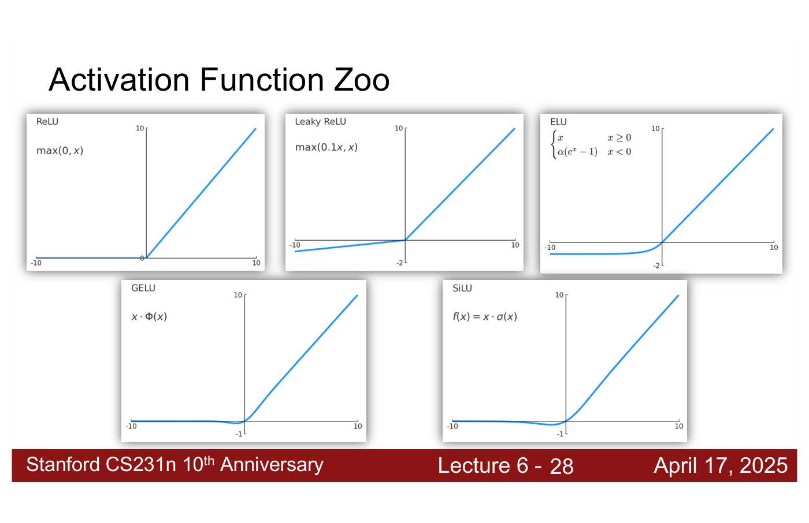

*Slide 28 — ReLU, Leaky ReLU, ELU, GELU and SiLU. Squint, the lecturer says, and they look alike: flat-ish on the left, approaching f(x) = x on the right. [Deck](https://cs231n.stanford.edu/slides/2025/lecture_6.pdf)*

### Where activations go

"Generally placed after linear operators (feedforward/linear layer, convolutional layer, etc.)"
(slide 30). Feedforward, linear and fully connected layers are all names for the same layer: a
matrix multiply followed by an activation function. A convolutional layer is followed by one too
(≈20:51–21:37).

## CNN architectures

With every component in hand, the lecture turns to how they were put together into
state-of-the-art architectures (≈21:37). See [CNN architectures](cnn-architectures.md).

### The ImageNet challenge winners

Slide 32 plots the winners of the ImageNet Large Scale Visual Recognition Challenge (ILSVRC) by
year. The blue bars are the error rate, the lecturer says (≈21:37); the slide gives the axis no
title, and slide 35 calls two of these values "top 5 error". The bars read 28.2 (2010, Lin et
al.), 25.8 (2011, Sanchez and Perronnin), 16.4 (2012, Krizhevsky et al., AlexNet), 11.7 (2013,
Zeiler and Fergus), 7.3 (2014, Simonyan and Zisserman, VGG), 6.7 (2014, Szegedy et al.,
GoogLeNet), 3.6 (2015, He et al., ResNet), 3 (2016, Shao et al.) and 2.3 (2017, Hu et al.,
SENet), with a human bar at 5.1 (Russakovsky et al.). The orange triangles are each winner's
number of layers: "shallow" in 2010–2011, 8 layers in 2012 and 2013, 19 for VGG and 22 for
GoogLeNet in 2014, and 152 from 2015 on. At the point where the error first drops below the human
figure, the depth jumps (≈21:37–22:22). Slide 44 labels the last three years the "Revolution of
Depth". See [ImageNet](imagenet.md) for the challenge itself.

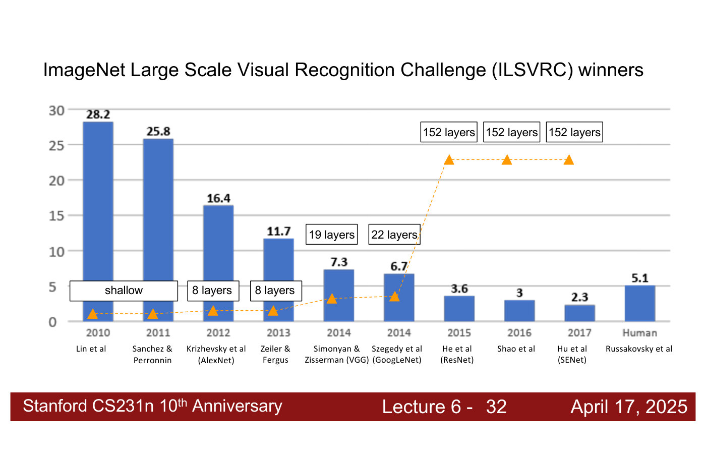

*Slide 32 — the challenge winners by year: blue bars the error rate (no axis title on the slide), orange triangles the number of layers. The error falls below the human bar (5.1) in 2015, when depth jumps to 152 layers. [Deck](https://cs231n.stanford.edu/slides/2025/lecture_6.pdf)*

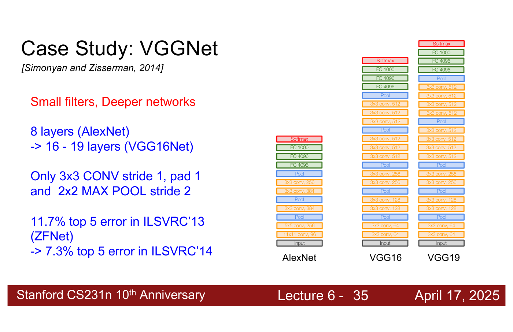

*Slide 35 — AlexNet, VGG16 and VGG19 as stacks of layers, bottom to top: orange 3x3 convolutions, blue pooling, green fully connected. As drawn, the VGG stacks have 15 and 17 weight layers (see above). [Deck](https://cs231n.stanford.edu/slides/2025/lecture_6.pdf)*

### AlexNet and VGG

AlexNet was the first CNN-based model to work really well on ImageNet, trained with GPUs; lecture
1 covers its history, so this lecture compares it with **VGG** (Simonyan and Zisserman, 2014),
"a really standard and commonly used architecture in the 2010s" (≈22:22). The comparison is drawn
as block diagrams, the field's usual way to plot architectures: each block a layer, or a group
of layers stacked together, which gives intuition about the differences at a glance (≈22:22–23:08).

Slide 35 draws AlexNet, VGG16 and VGG19 side by side. VGG's design is "small filters, deeper
networks": 8 layers in AlexNet against 16–19 in VGG, using "only 3x3 CONV stride 1, pad 1 and
2x2 MAX POOL stride 2", which took the challenge from 11.7% top-5 error (ZFNet, 2013) to 7.3%
(2014). The orange blocks are the $3 \times 3$ convolutions: stride 1, so they visit every
location, and padding 1, so they do not shrink the activation as they go. Max pooling layers sit
between groups of them, and after the last pooling layer come two fully connected layers of
dimension 4096 and one of 1000, because ImageNet has a thousand categories and the final layer
always has one score per class (≈23:08–23:54). VGG looks "like a scaled-up version of AlexNet",
with more layers and groups of up to three or four convolutions before each pooling layer. It is
"pretty remarkable", the lecturer says, that models with basically three types of layer
performed so much better than anything tried before (≈23:54–24:40). The drawn stacks do not add
up to their names. Counting conv and FC boxes, AlexNet's has 5 + 3 = 8 weight layers, as the slide
says, but VGG16's has 12 + 3 = 15 and VGG19's 14 + 3 = 17: each draws only two "3x3 conv, 256"
boxes.

### Why $3 \times 3$ filters: the receptive field

Why did VGG choose $3 \times 3$ convolutions, in groups of three or four (slide 36)? The deck
answers with a question: what is the **effective receptive field** of three $3 \times 3$
convolution layers with stride 1? The receptive field of a value is the part of the input image
that was used to compute it (≈24:40–25:26; see
[convolutional networks](convolutional-networks.md#receptive-fields)). Each value in the third
activation map, A3, looks at a $3 \times 3$ grid in A2; each of those looks at a $3 \times 3$
grid in A1; and each of those at a $3 \times 3$ grid of the input. Slides 37–41 build the
picture one layer at a time: the region is $3 \times 3$ in A2, $5 \times 5$ in A1 and $7 \times 7$
in the input. A student gives the answer, 7 by 7 (≈25:26–26:13). Each $3 \times 3$ layer with
stride 1 adds two to the receptive field, one on each side, so stacking them grows it by two per
layer (≈26:13).

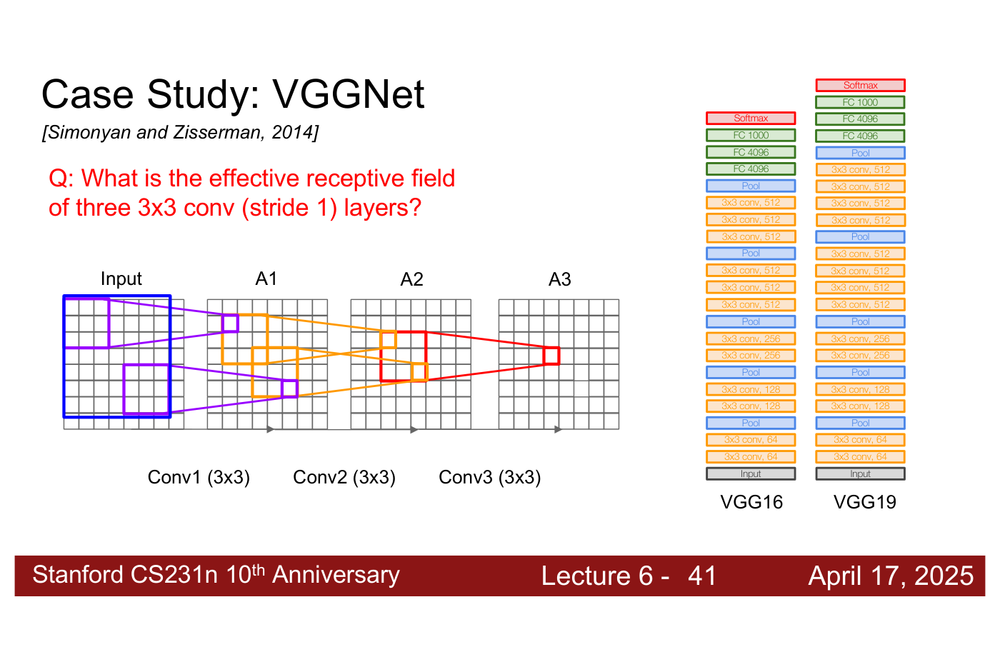

*Slide 41 — the receptive field of three stacked 3x3 convolutions: one value in A3 sees 3x3 in A2, 5x5 in A1 and 7x7 (blue) in the input. [Deck](https://cs231n.stanford.edu/slides/2025/lecture_6.pdf)*

So a stack of three $3 \times 3$ stride-1 layers has the same effective receptive field as one
$7 \times 7$ layer, but it is deeper, with more non-linearities, and it has **fewer parameters**
(slides 42–43). With $C$ channels in and out of every layer, one $3 \times 3$ layer has
$3^2 C^2$ weights, so three have

$$3 \cdot (3^2 C^2) = 27C^2 \quad \text{against} \quad 7^2 C^2 = 49C^2$$

for the single $7 \times 7$ layer (slide 43; biases not counted). Fewer parameters, and the model
can capture more complex, more non-linear relationships in its input: maybe why stacking small
filters beats sliding one larger filter (≈27:45–28:30). The spoken version of the parameter count
is partly garbled in the captions (≈27:45).

A student asks how much of this is justification after the fact. The lecturer says it depends on
the architecture. He cannot speak for VGG's authors, who as far as he knows have not said publicly
whether the reasoning drove the design; for ResNet, by contrast, he knows that a hypothesis led to
the work (≈27:00–27:45).

### ResNet: deeper plain networks do worse

ResNet (He et al., 2015) started from an empirical finding and a thought experiment
(≈28:30–29:16). What happens when you keep stacking layers on a "plain" convolutional network
(slide 45)? On slide 47's curves of test error and training error against iterations, a 56-layer
plain network ends above a 20-layer one on **both**. A lower test error alone could be blamed on
overfitting, but the shallower network also has the lower training error, so "the deeper model
performs worse, but it's not caused by overfitting!" (≈29:16–30:04).

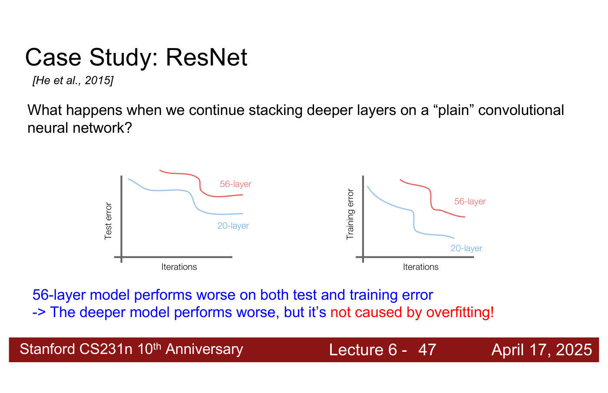

*Slide 47 — a 56-layer plain network (red) ends above a 20-layer one (blue) in both test error (left) and training error (right), so the deeper model's problem is not overfitting. [Deck](https://cs231n.stanford.edu/slides/2025/lecture_6.pdf)*

A deeper model has more representation power, more parameters, than a shallower one (slide 48).
In principle it can represent anything the shallower model can: set half its layers to the
identity function, so that they do nothing, and it is exactly a model half its size. The set of
functions a deeper network can represent is a superset of the shallower network's
(≈30:04–30:53). So the deck's hypothesis is that "the problem is an *optimization* problem,
**deeper models are harder to optimize**" (slide 48).

What should the deeper model learn to be at least as good as the shallower one? "A solution by
construction is copying the learned layers from the shallower model and setting additional
layers to identity mapping" (slide 49): with one of its layers set to an identity function, a
two-layer model should be at least as good as a one-layer one (≈30:53–31:40).

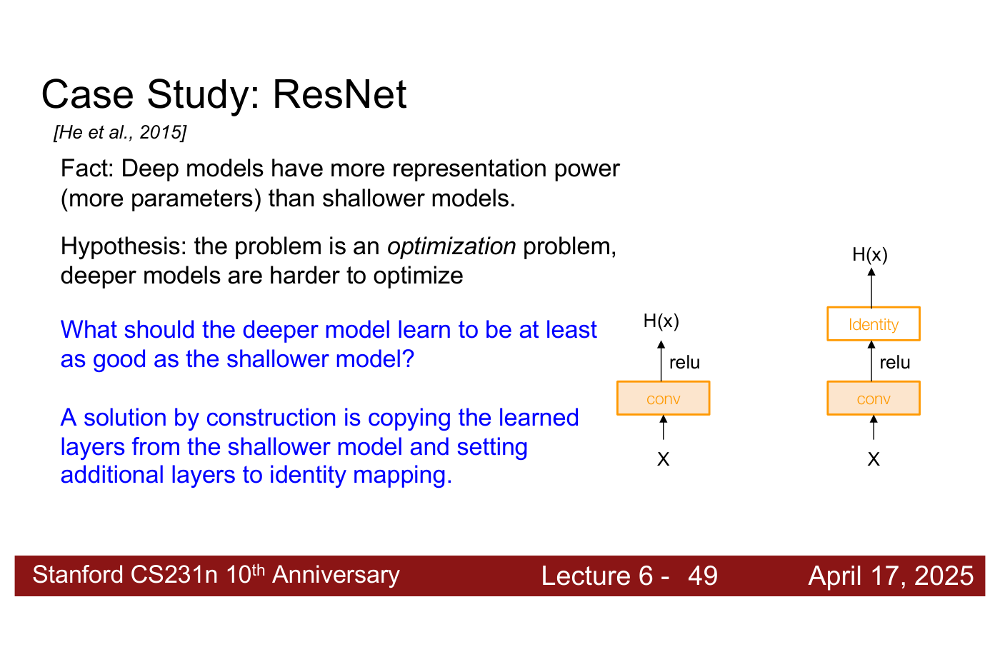

*Slide 49 — a deeper model can copy a shallower one by adding a layer set to the identity mapping. [Deck](https://cs231n.stanford.edu/slides/2025/lecture_6.pdf)*

### Residual blocks

So build that option into the architecture. Instead of having layers fit a desired underlying
mapping $H(x)$ directly, have them fit a **residual mapping** (slide 50). Copy the input $x$ past
two convolution layers and add it to their output $F(x)$:

$$H(x) = F(x) + x$$

If the layers learn $F(x) = 0$ — all-zero filters — the block outputs $x$: an identity mapping
for free (slide 51). In practice the filters only need to learn small values, because the layers
fit the **residual** $F(x) = H(x) - x$, the difference between the desired output and the copied
input, instead of the whole mapping (slide 52; ≈31:40–33:12). Copying values from an earlier
layer and adding them to a later one is called a **residual connection**, and the unit is a
**residual block** (≈33:12).

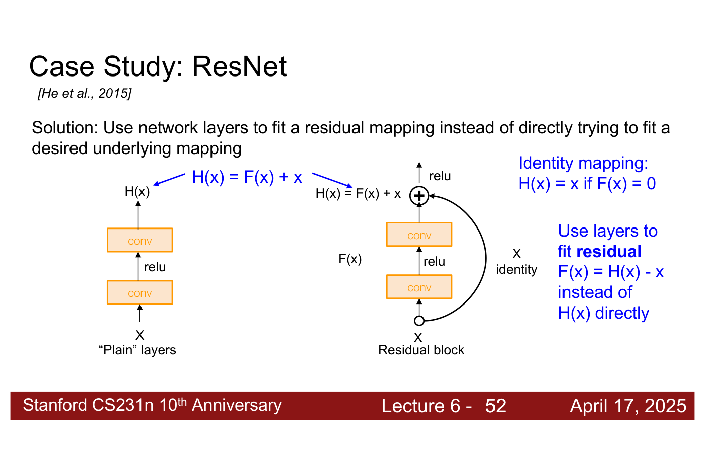

*Slide 52 — a plain block fits H(x) directly; a residual block fits F(x) = H(x) − x with two conv layers and adds the input back along the identity shortcut. [Deck](https://cs231n.stanford.edu/slides/2025/lecture_6.pdf)*

The lecturer restates the intuition. Larger plain networks reached worse training and test error
because they were harder to optimise, so the fix was a model that could easily imitate a
shallower one, by building the copy into the architecture rather than learning an identity
mapping with convolutions. Empirically it worked extremely well (≈33:12–33:58).

Questions follow (≈33:58–36:15). What does the block carry? The input $x$, which is the output of
an earlier layer (or the image, at the start of the network), passes unchanged around two
convolution layers and is added to their output $F(x)$. Would more data have let plain networks
train? No: "it was really an optimization problem". Residual blocks help a model use more data, and
transformers use them for exactly the same reason. Would plain networks have caught up if trained
longer? No: they did not converge to the shallower model's performance however long they trained,
being stuck in what the lecturer calls essentially local minima. He adds that exactly why
residual connections avoid this is still an active area of research, and largely an empirical
finding with some intuition behind it.

### The full ResNet architecture

A ResNet stacks residual blocks, each with two $3 \times 3$ convolution layers, with a ReLU
after the first convolution and another after the addition (slide 53; ≈36:15–37:00). Periodically
it doubles the number of filters and downsamples spatially with stride 2, halving each spatial
dimension (slide 54): "3x3 conv, 64 filters" in the first stage, then "3x3 conv, 128 filters, /2
spatially with stride 2". The slide adds "Reduce the activation volume by half". (Twice the
channels at half the height and half the width is half as many values.) As activations pass
through the network they become smaller spatially and deeper, until at the end they are a vector
used for classification (≈40:03–40:49). Before the residual blocks there is one larger convolution
layer, the **stem** ("7x7 conv, 64, / 2"), which "empirically shown that it did better": a purely
empirical choice (slide 55; ≈40:49).

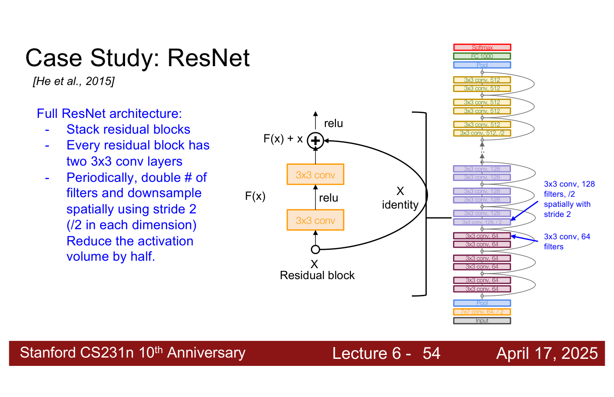

*Slide 54 — the full ResNet: residual blocks of two 3x3 convolutions, with the filters doubled and the spatial size halved (stride 2) at the start of each stage. [Deck](https://cs231n.stanford.edu/slides/2025/lecture_6.pdf)*

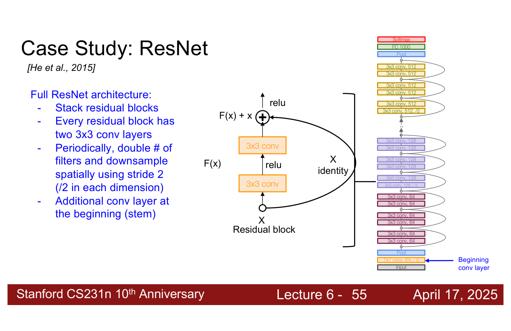

*Slide 55 — the same stack with the stem marked: one 7x7 convolution with 64 filters and stride 2 before the residual blocks. [Deck](https://cs231n.stanford.edu/slides/2025/lecture_6.pdf)*

ResNet came as a whole family, with total depths of 18, 34, 50, 101 or 152 layers for ImageNet
(slide 56). Performance rose with depth, but by less and less: from 101 to 152 layers it improved
by maybe 1% (≈37:00–37:45). The 152-layer model won the ILSVRC'15 classification task with 3.57%
top-5 error and "swept all classification and detection competitions in ILSVRC'15 and COCO'15"
(slide 57). It was the first time models of more than 100 layers trained successfully, and for a
while almost every task in computer vision used a ResNet (≈41:35). The stack on slide 57 labels its last group
"3x3 conv, 64", repeating the first group's label; slides 53–56 print "3x3 conv, 512" there.

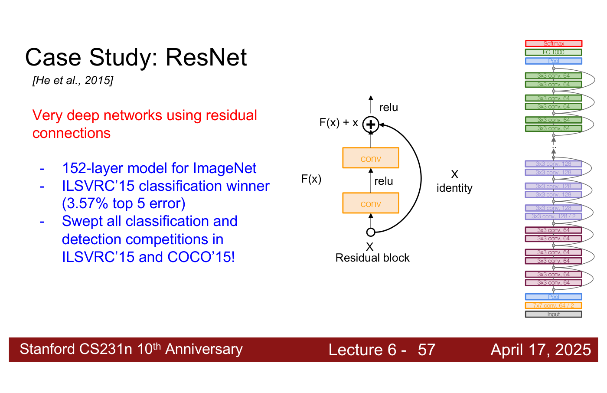

*Slide 57 — the 152-layer ResNet won ILSVRC'15 with 3.57% top-5 error. The top group's "3x3 conv, 64" label is printed so; slides 53–56 print 512 there. [Deck](https://cs231n.stanford.edu/slides/2025/lecture_6.pdf)*

Four more questions (≈37:45–40:03, ≈1:05:27–1:06:59):

**Why 152?** The lecturer does not know. Generally one trains the smallest model, adds layers
while performance keeps rising, and stops when it no longer does — probably why they stopped at
152 — and GPU memory also limits how large a model a given compute setup can train. Each depth is
a separate training run (≈37:45–38:32).

**Do residual blocks change the intuition that deeper layers learn higher-level features?** No.
Each block still produces a higher-level representation, but instead of learning it directly the
block learns the delta from its input (≈38:32–39:18).

**Does the addition need tensors of the same size?** Yes, which is part of why the $3 \times 3$
convolutions with stride 1 and padding 1 are convenient: they keep the size. After a pooling
layer a naive addition no longer works, so residual connections sit within a stage, before a pool
(≈39:18–40:03).

**Why two convolution layers of each size instead of one?** The same reason as VGG's: three
$3 \times 3$ layers see the same region as one $7 \times 7$ layer but, with three activation
functions instead of one, model more non-linear relationships. "A larger set of smaller filters
is more expressive than a smaller set of larger filters" (≈1:06:13).

## Weight initialization

The last step in setting a network up for training is choosing the initial values of its weights.
Values that are too small or too large cause significant problems during training (≈41:35–42:23).

The deck's experiment is a six-layer fully connected network with hidden size 4096 and ReLU
activations, run forward on random inputs (slide 60). With weights drawn from a unit Gaussian
and multiplied by 0.01, the activations shrink layer by layer. Slide 61's histograms of the six
layers' activations have means 0.26, 0.12, 0.05, 0.02, 0.01 and 0.00 and standard deviations
0.37, 0.17, 0.08, 0.03, 0.02 and 0.01: "all activations tend to zero for deeper network layers".
The means are positive because the outputs are ReLUs, and ideally they and the standard deviations
would stay the same in every layer, because that makes the optimisation much nicer to solve
(≈42:23–43:09).

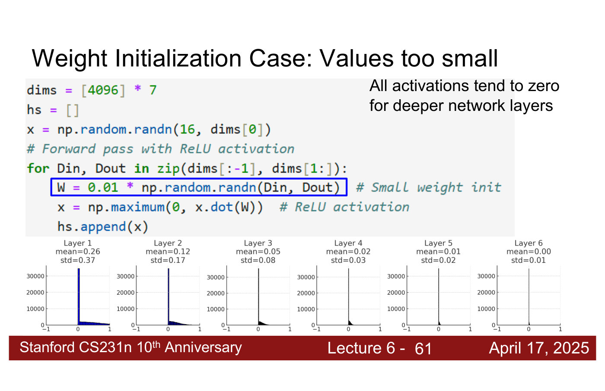

*Slide 61 — weights scaled by 0.01: across six 4096-wide ReLU layers the activations' mean falls from 0.26 to 0.00 and their std from 0.37 to 0.01. [Deck](https://cs231n.stanford.edu/slides/2025/lecture_6.pdf)*

Asked what happens if the weights are too large, a student answers that the activations grow at
each layer (≈43:09). Raising the scale from 0.01 to 0.05 (slide 62) makes them "blow up quickly":
slide 63's means are 1.27, 2.89, 6.50, 14.55, 33.07 and 74.50, with standard deviations 1.86, 4.25,
9.56, 21.42, 48.32 and 109.24. In a 152-layer ResNet that "becomes quite an issue very quickly"
(≈43:09–43:54).

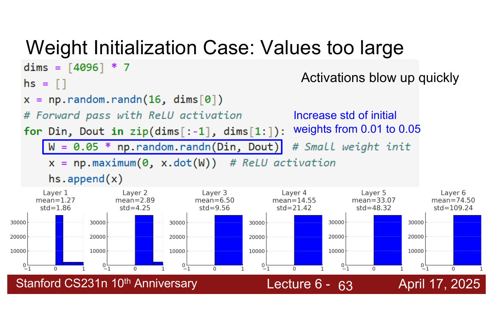

*Slide 63 — weights scaled by 0.05: the activations blow up, mean from 1.27 to 74.50 and std from 1.86 to 109.24 over six layers. [Deck](https://cs231n.stanford.edu/slides/2025/lecture_6.pdf)*

The right scale "depends on the size of the layer" (slide 64): initialization schemes are a
function of the layer's dimension, so a 4096-dimensional fully connected layer gets a different
value from a 2048-dimensional one (≈43:54). The one the lecture teaches is **Kaiming / MSRA
initialization** (He et al., "Delving Deep into Rectifiers", ICCV 2015): draw from a unit
Gaussian and multiply by $\sqrt{2 / D_{\text{in}}}$, where $D_{\text{in}}$ is the layer's input
dimension, "ReLU correction: std = sqrt(2 / Din)" (slide 65). With it, slide 65's six histograms
look nearly identical, with means 0.57, 0.57, 0.56, 0.55, 0.55, 0.55 and standard deviations 0.83,
0.83, 0.83, 0.81, 0.81, 0.81: "'Just right': Activations are nicely scaled for all layers!". The
lecturer had guessed the right scale for this network at "0.022 or something" (≈43:54); for
$D_{\text{in}} = 4096$, $\sqrt{2/4096} \approx 0.0221$.

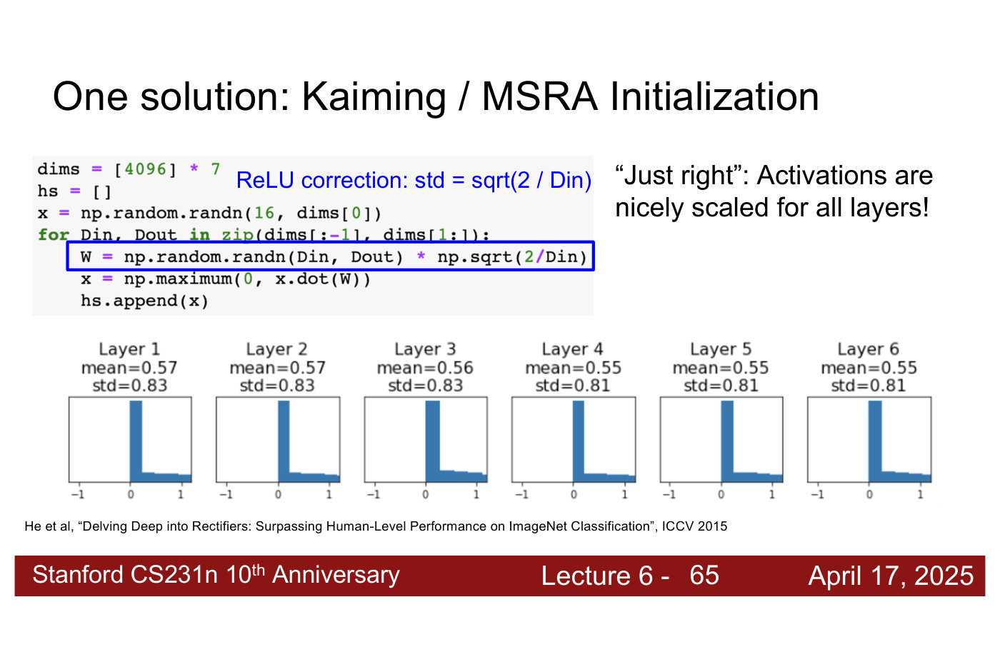

*Slide 65 — std = sqrt(2 / Din): the six histograms are nearly identical, mean 0.55–0.57 and std 0.81–0.83 in every layer. [Deck](https://cs231n.stanford.edu/slides/2025/lecture_6.pdf)*

The paper shows that with a ReLU activation this keeps the mean and standard deviation roughly
constant through the layers. The lecture does not derive it: "you can almost think of this as a
magic formula where if you plug it in, you get the desired properties", and the paper is linked
for the derivation (≈44:40–45:26). Kaiming He, the lecturer notes, is also the first author of
ResNet, and one of the most widely cited computer scientists of the last 10 or 15 years
(≈44:40). For any given setup one could also find a good value by testing (≈45:26).

Three questions extend it (≈46:12–48:28, ≈51:34–53:10). **For CNNs** the same formula applies,
with the dimension being the number of values in each operation: for a $3 \times 3$ kernel over
six channels, $3 \cdot 3 \cdot 6$. Some layers use different schemes (≈46:12). **Why do
activations explode** when the initialization is too large? A ReLU does not cap its output, and
each layer multiplies by another set of large random values. The lecturer compares it to a
recurrence relation whose factor you would want to be one: here what matters is the dimension of
the vector being multiplied, and removing the negative half of a wide distribution at each ReLU
pushes the outputs ever more positive. He had no slides for this and points to the paper
(≈46:57–48:28). A student suggests that **normalization** would solve the blow-up; the lecturer
agrees that it would solve that particular issue but that the network might still be harder to
optimise, and suggests a follow-up post on Ed (≈48:28).

The third question comes back during data augmentation: **how do we know the initialization is
just right?** Because the means and standard deviations stay roughly constant through the layers,
rather than collapsing to zero or blowing up. In practice people use the formula; only a new kind
of layer that nobody has used before would call for trying several schemes and seeing what works
best. For linear and convolutional layers, Kaiming initialization is the default (≈51:34–53:10).
See [weight initialization](weight-initialization.md).

## Data preprocessing

For images, preprocessing is easy (≈48:28–49:16). Compute the mean and standard deviation of each
colour channel — red, green and blue — over the dataset, and normalize every input image by
subtracting the per-channel mean and dividing by the per-channel standard deviation: "center and
scale for each channel" (slide 67). That is three means and three standard deviations, and almost
all modern models do it. The slide writes it as

```python
norm_pixel[i,j,c] = (pixel[i,j,c] - np.mean(pixel[:,:,c])) / np.std(pixel[:,:,c])
```

It requires pre-computing the statistics for your dataset, so people often use statistics already
computed. The most common choice is ImageNet's means and standard deviations, applied even when
the model is not trained on ImageNet. It is dataset-dependent, and different models use different
values. Every input image gets the operation before the model sees it (≈49:16–50:03). See
[data preprocessing and augmentation](data-augmentation.md#data-preprocessing).

## Data augmentation

Earlier a student had suggested adding noise to the image instead of to the activations;
augmentation is how (≈50:03). Like dropout it follows a common pattern for regularization:
"Training: Add some kind of randomness, $y = f_W(x, z)$; Testing: Average out randomness
(sometimes approximate)", $y = f(x) = E_z[f(x, z)] = \int p(z) f(x, z) \thinspace dz$ (slide
69). Dropout is the example on slide 70: randomly drop activations in training, use all of them
at test time and scale by $p$ (≈50:03–50:49). The slide does not define $z$; for dropout it plays
the part of the random mask.

In the pipeline on slide 71, an image and its label ("cat") are loaded from the dataset, the image
is transformed (here, mirrored), and the transformed image goes through the CNN to compute the
loss. Augmentation is used for training computer vision models "basically always in modern deep
learning". The transformations make the image look different while keeping it recognisably the
same category, so the dataset effectively grows: the model sees different versions of each image,
all with the same label. Generalisation improves, and the training loss is higher, because the
model is not seeing the same example over and over and finds it harder to memorise (≈50:49–51:34).

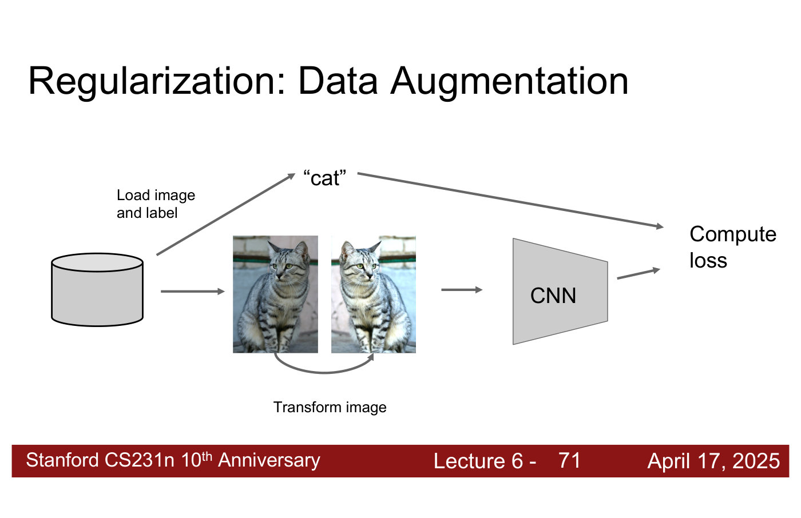

*Slide 71 — augmentation in the training pipeline: load an image and its label, transform the image (here a horizontal flip), then run the CNN and compute the loss against the unchanged label. [Deck](https://cs231n.stanford.edu/slides/2025/lecture_6.pdf)*

**Horizontal flips** (slide 72) suit everyday objects, which are mostly symmetrical, but would be a
very bad augmentation for a model that reads text, which comes out mirrored. Vertical flips make
sense for images from a microscope or taken from overhead, but not for everyday objects: a cat is
almost always seen upright, unless your dataset has cats in all orientations (≈53:10–53:56).

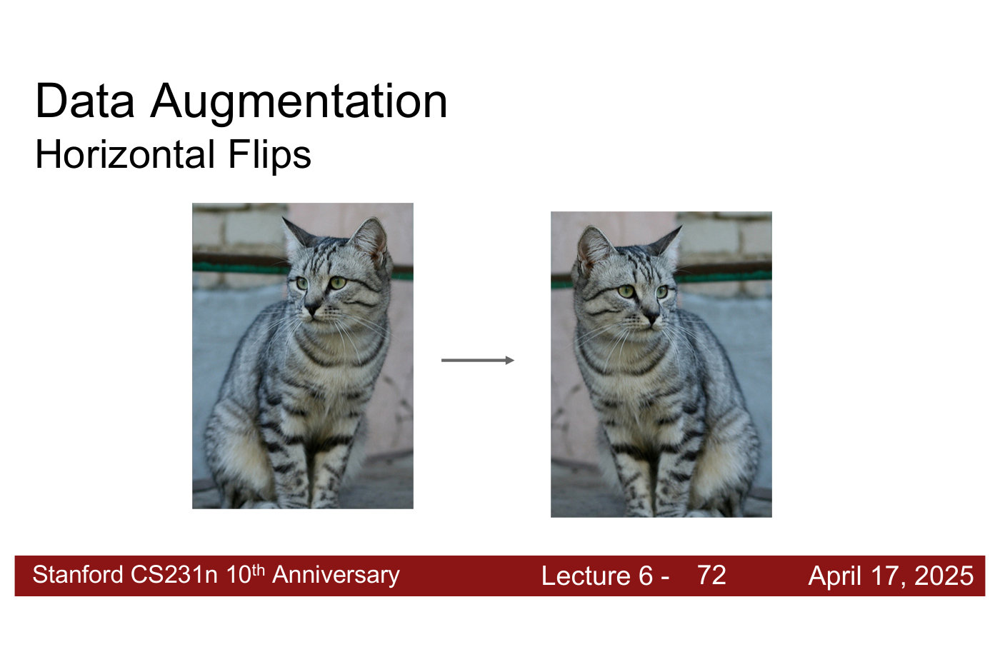

*Slide 72 — a horizontal flip: still a cat. [Deck](https://cs231n.stanford.edu/slides/2025/lecture_6.pdf)*

**Random crops and scales** (slide 73) are what ResNet and many other image models use. In
training, ResNet picks a random $L$ in $[256, 480]$, resizes the image so that its short side is
$L$ — preserving its aspect ratio — and samples a random $224 \times 224$ patch. An
$800 \times 600$ image with $L = 256$ has its short side, 600, resized to 256 and its long side scaled to
match (≈53:56–55:29). This "random resized crop", as most libraries call it, is by far the most
commonly used augmentation (≈55:29).

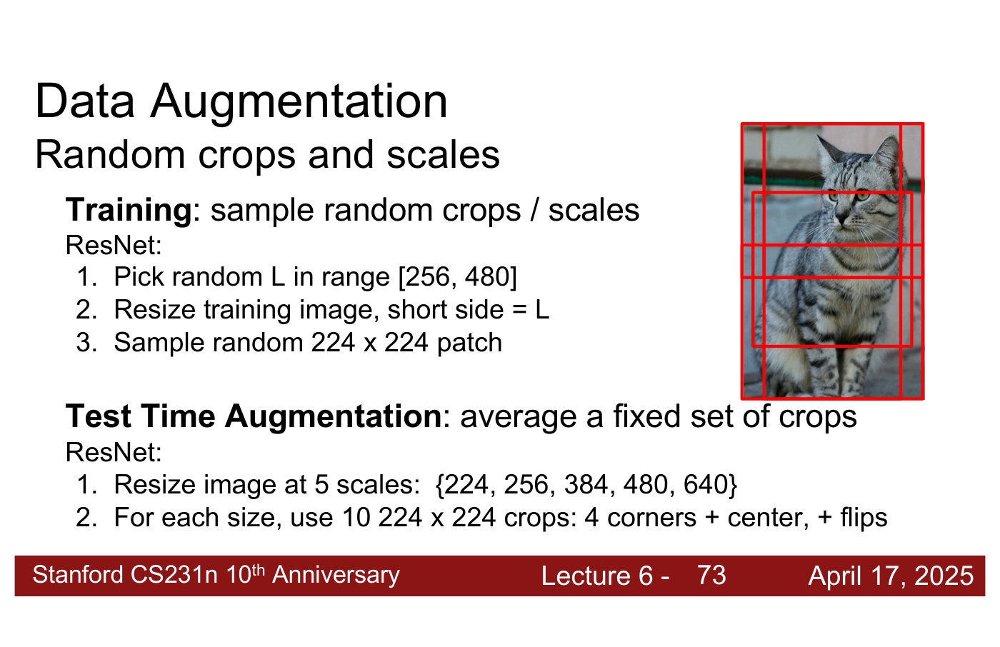

*Slide 73 — ResNet's random crops and scales in training (short side resized to L in [256, 480], then a random 224 x 224 patch) and its fixed crops for test-time augmentation; the red boxes are example crop windows. [Deck](https://cs231n.stanford.edu/slides/2025/lecture_6.pdf)*

**Test-time augmentation** averages the model's predictions over a fixed set of crops: ResNet
resizes the image to five scales, {224, 256, 384, 480, 640}, and at each uses ten
$224 \times 224$ crops, four corners and the centre plus their flips (slide 73). Returns diminish, but it can
give a 1–2% boost, "a really great trick" for almost any computer vision problem where every
percentage point matters (≈55:29–56:14).

**Colour jitter** (slide 74) randomizes contrast and brightness, so the colours look more muted or
brighter. For every augmentation, the lecturer tries a range of values and keeps those that leave
the images still looking normal, in distribution, to a human: different from the original but
still easy to recognise (≈56:14–57:00).

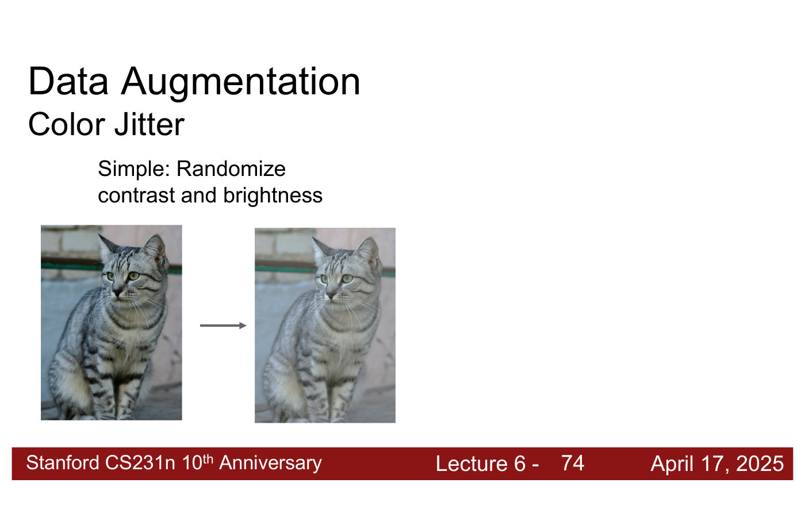

*Slide 74 — colour jitter: the same photo with lower contrast and a washed-out look. [Deck](https://cs231n.stanford.edu/slides/2025/lecture_6.pdf)*

**Cutout** (DeVries and Taylor, 2017) sets random image regions to zero in training and uses the
full image at test time (slide 75). The slide reports that it "works very well for small datasets
like CIFAR, less common for large datasets like ImageNet". The lecturer, too, thinks it less
commonly used, but it shows how creative augmentation can be: if the camera in your setting will
be occluded, it makes the model more resilient to things blocking parts of objects. The general
question is which transformations keep the data recognisable to a human while making the training
examples harder for the model to memorise (≈57:00–57:46). See
[data preprocessing and augmentation](data-augmentation.md).

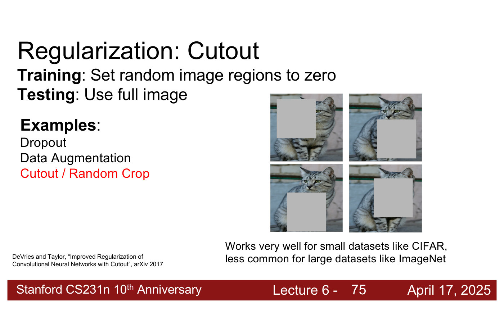

*Slide 75 — cutout: grey squares blank random regions in training, and the full image is used at test time. It works well on small datasets like CIFAR. [Deck](https://cs231n.stanford.edu/slides/2025/lecture_6.pdf)*

## Transfer learning

The last topics are "extremely practical", the exact things to do for a course project and in any
other computer vision work (≈57:46). What if you do not have a lot of data (slide 77)? ImageNet's
original version had a million images, and almost nobody has that for their own problem. You can
still train CNNs, but you have to be smart about it (≈57:46–58:33).

The reason it works is in the features a trained network learns. The early layers detect edges,
patterns and small shapes: the deck shows AlexNet's first-layer filters, "AlexNet: 64 x 3 x 11 x
11" (slide 78). At the other end, take the vector a network produces just before its class scores,
the 4096- or 2048-dimensional layer, and compare images by the L2 distance between their vectors.
An image's nearest neighbours in that feature space are images of the same category (slide 79):
flowers, elephants, ships, jack-o'-lanterns and dogs. It is like the nearest-neighbour classifier
of lecture 2, except on features instead of pixels, and it means a linear or $k$-nearest-neighbour
classifier built on those features would classify very well (≈58:33–1:00:05; see
[k-nearest neighbours](k-nearest-neighbors.md)). Both slides add "(More on this in Lecture 13)".
In this offering's schedule, lecture 13 is Generative Models 1 and visualizing is part of
lecture 9 (see the [course roadmap](course-logistics.md#course-roadmap)); the pointer appears to
date from an earlier offering.

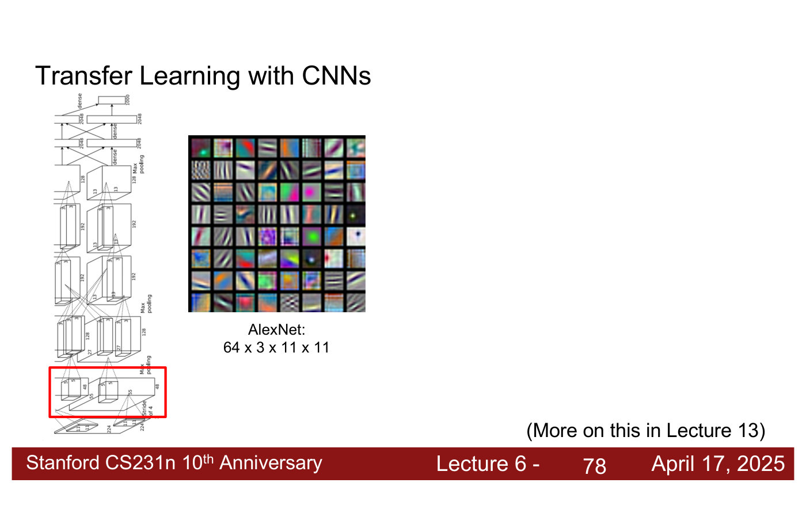

*Slide 78 — AlexNet's first layer (boxed in the network diagram) and its filters, 64 x 3 x 11 x 11: oriented edges, colour blobs and gratings. [Deck](https://cs231n.stanford.edu/slides/2025/lecture_6.pdf)*

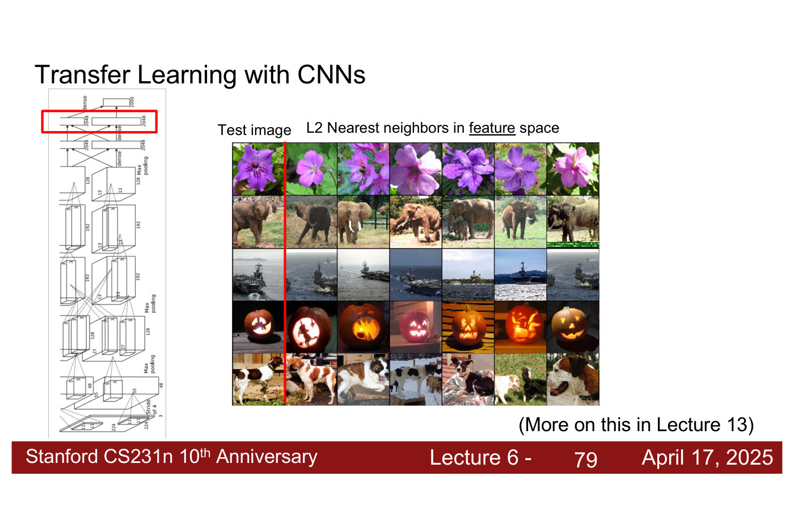

*Slide 79 — test images (left of the red line) and their six nearest neighbours by L2 distance in the feature space of the boxed last hidden layer: flowers, elephants, ships, jack-o'-lanterns and dogs. [Deck](https://cs231n.stanford.edu/slides/2025/lecture_6.pdf)*

So, in three steps (slides 80–82; DeCAF, Donahue et al., ICML 2014, and Razavian et al., "CNN
Features Off-the-Shelf", CVPR Workshops 2014). **First**, train on ImageNet or internet-scale data,
or take a model someone else trained. **Second**, for a small dataset with $C$ classes, freeze
every layer of the pretrained model and replace the last one, FC-1000, with an FC-C layer:
"reinitialize this and train" (≈1:00:05–1:00:51). The frozen network is a predefined feature
extractor, much like the hand-designed features of computer vision's older paradigm, such as
colour histograms, that a model was then trained on top of (≈1:00:51; see
[image classification](image-classification.md#hand-designed-features-and-end-to-end-learning)).
**Third**, with a bigger dataset, "initialize from pretrained model, then finetune everything":
"with bigger dataset, it's better to train more layers" (slide 82). That is what the lecturer
does for almost every problem he works on. With a million or ten million training examples of his
own, he starts from a model trained on billions, which he would not have the compute for, and
finetunes the whole model (≈1:00:51–1:01:37).

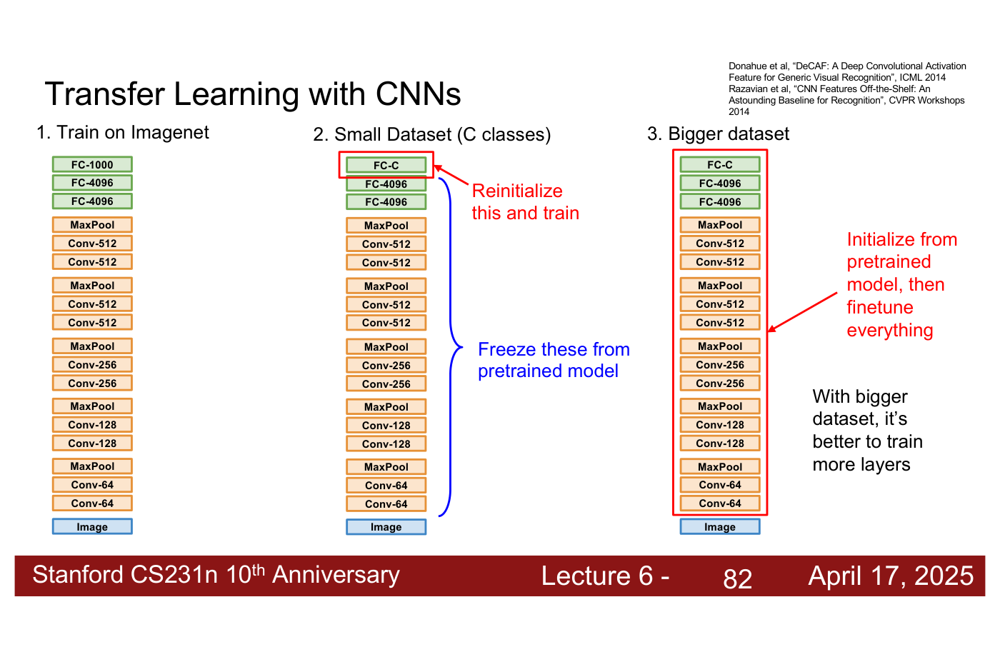

*Slide 82 — three steps: train on ImageNet; for a small dataset, freeze everything and retrain a new final FC-C layer; for a bigger one, initialise from the pretrained model and finetune everything. [Deck](https://cs231n.stanford.edu/slides/2025/lecture_6.pdf)*

Concretely, for the second strategy and a model trained on ImageNet: the new final layer outputs
the number of classes in your dataset instead of a thousand and is initialised randomly, with
Kaiming initialization; every other layer keeps its values and is never changed by gradient
descent. Each image goes through the frozen model to give a 4096-dimensional vector, and only the
mapping from that vector to the classes is trained, almost like training a linear classifier on
those vectors (≈1:01:37–1:02:22).

Will the model carry ImageNet's biases? Definitely. A frozen ImageNet model does best on datasets
that look like ImageNet, everyday things such as laptops, classrooms and people, and much worse on
photos of Mars. So pick a pretrained model whose training data has the same kinds of objects or
locations as yours (≈1:02:22–1:03:55).

Slides 83–85 fill in a table, with an annotation that the layers near the input are "more
generic" and those near the output "more specific":

| | very similar dataset | very different dataset |
| --- | --- | --- |
| **very little data** | Use Linear Classifier on final layer | Try another model or collect more data :( |
| **quite a lot of data** | Finetune all model layers | Either finetune all model layers or train from scratch! |

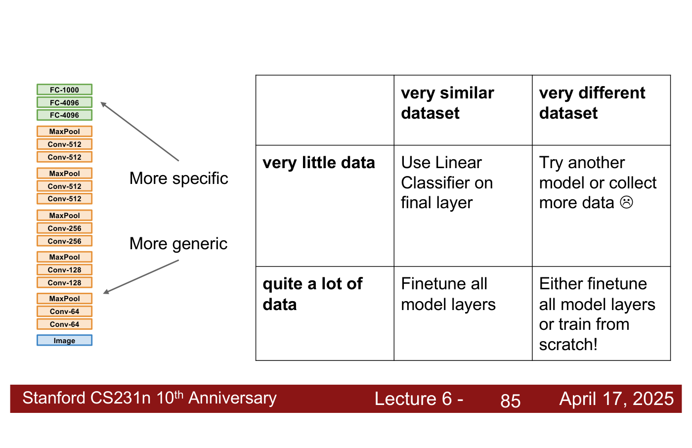

*Slide 85 — the four-case table beside the network, whose layers near the input are more generic and near the output more specific. [Deck](https://cs231n.stanford.edu/slides/2025/lecture_6.pdf)*

The left column is strategies two and three (≈1:03:55). With a very different dataset and a lot of
data, you might start from scratch, or might do better initialising from the pretrained model:
"you would test", since there is no guaranteed way to know. With a very different dataset and very
little data, try to find a model trained on something closer. Out-of-domain generalization is an
active area of research, and certain models generalise better (language models, he thinks, learn
many different domains well), but there is no general technique that always works. It is by far
the hardest setting in which to train a model; the strategies work well in practice for the other
three cases (≈1:03:55–1:04:40).

Can you train something between the last layer and all of them? Yes, people have done a lot of
work on training a subset of the layers. There is also **LoRA**, which the transformers lecture
may cover: it finetunes all the layers, but instead of changing their values directly it learns
low-rank differences from the original layers, with a very small number of parameters, "sort of
like how a ResNet, you're learning the difference" (≈1:04:40–1:05:27).

The takeaway for projects (slide 86): if your dataset has fewer than about a million images, find
a very large dataset with similar data, train a big model there (or get one), and transfer learn
to your dataset. Frameworks provide "model zoos" of pretrained models so that you do not need to
train your own: PyTorch's torchvision (<https://github.com/pytorch/vision>) and Hugging Face's
PyTorch image models (<https://github.com/huggingface/pytorch-image-models>) (≈1:06:13–1:06:59).
See [transfer learning](transfer-learning.md).

## Choosing hyperparameters

The deck gives a recipe in seven steps (slides 88–89, 94). Step 1: check the initial loss. Step
2: overfit a small sample. Step 3: find a learning rate that makes the loss go down — with the
previous step's architecture, all the training data and a small weight decay, find one that makes
the loss drop significantly within about 100 iterations; good values to try are "1e-1, 1e-2, 1e-3,
1e-4, 1e-5" (slide 88). Step 4: a coarse grid of hyperparameters, training each for about 1–5
epochs. Step 5: refine the grid and train longer. Step 6: look at the loss and accuracy curves.
Step 7: go to step 5. The recording does not discuss step 1; see
[loss functions](loss-functions.md) for the softmax loss's expected value at initialisation.

**Overfit a small sample** is "the default debugging strategy in deep learning", and step one
whenever code is not working. Take a single training example and check that the training loss goes
to essentially zero: a model should be able to memorise one example, and if it cannot, there is a
bug, or the model is the wrong kind for the problem. It also shows which learning rates work, and
the neighbourhood to explore (≈1:06:59–1:07:45). Then try a coarse grid, learning rates first,
and keep the one whose training loss decreases most steadily over maybe one epoch, or longer
(≈1:07:45); then look at other hyperparameters (≈1:08:31).

Then read the accuracy curves, training and validation against time (slides 90–93). If both are
still going up, "you need to train longer" (slide 90). If training accuracy keeps rising while
validation accuracy falls, a "huge train / val gap means overfitting! Increase regularization or
get more data" (slide 92), and the best model so far is the one at the validation peak. If there is
"no gap between train / val", that "means underfitting: train longer, can possibly use a bigger
model" (slide 93). The aim is to train until validation accuracy is maximised, until training
accuracy starts to diverge from it, and to repeat the loop (≈1:08:31–1:09:17). Speaking to these
curves, the lecturer twice says "loss" for what the slides plot as accuracy — "the training loss is
going up, but your validation loss is going down", "your validation loss has been maximized" —
and then corrects himself to "validation accuracy" (≈1:08:31–1:09:17).

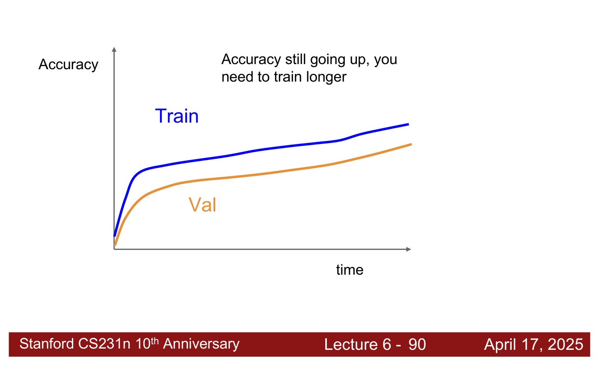

*Slide 90 — training (blue) and validation (orange) accuracy both still rising: train longer. [Deck](https://cs231n.stanford.edu/slides/2025/lecture_6.pdf)*

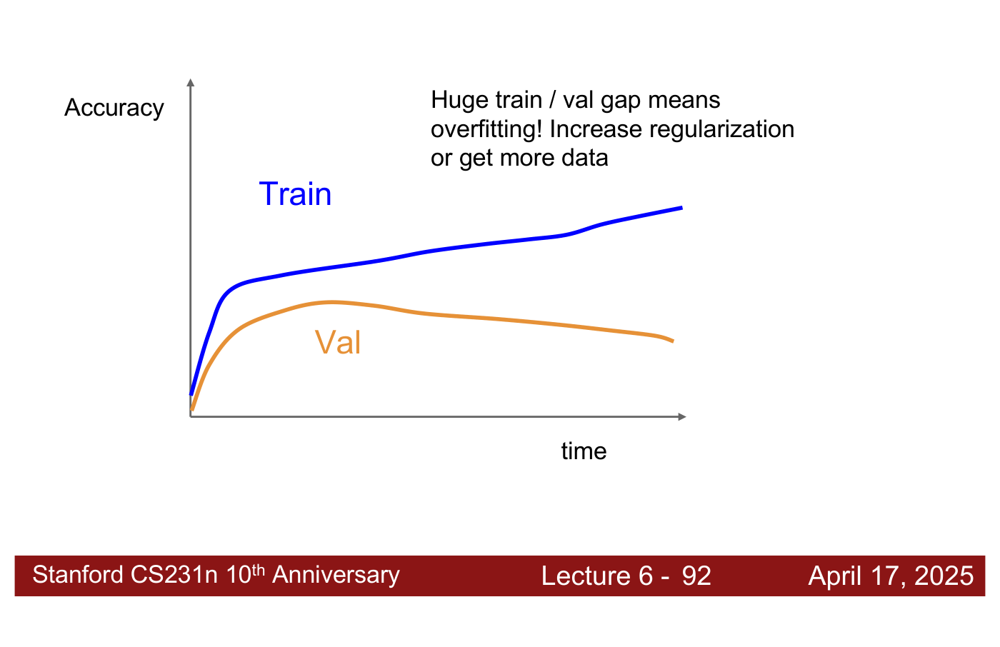

*Slide 92 — training accuracy keeps rising while validation accuracy peaks and falls: a huge train/val gap means overfitting. [Deck](https://cs231n.stanford.edu/slides/2025/lecture_6.pdf)*

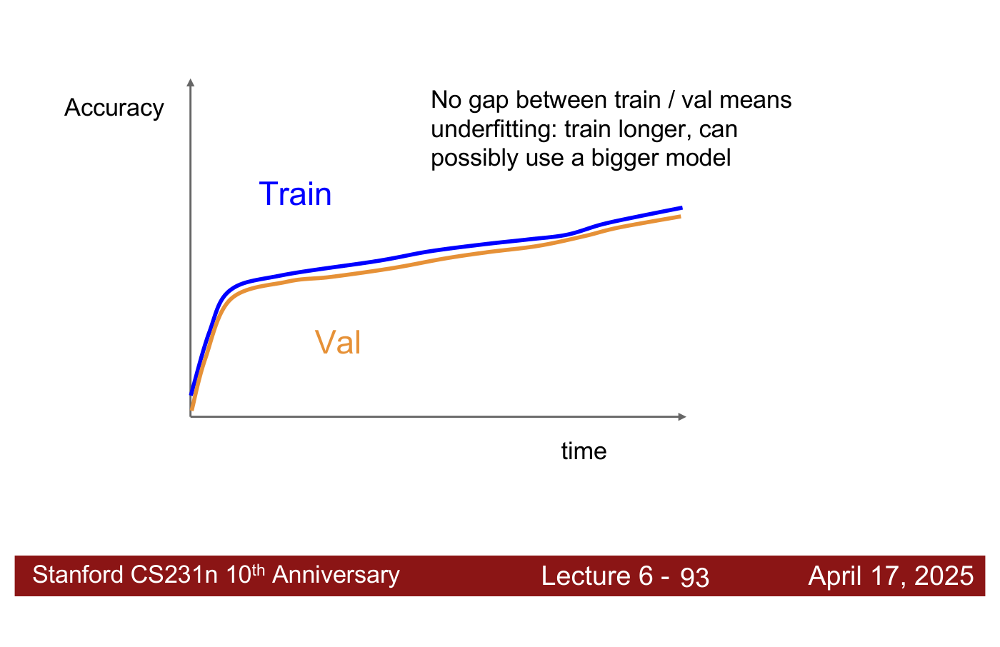

*Slide 93 — no gap between training and validation accuracy: underfitting, so train longer or use a bigger model. [Deck](https://cs231n.stanford.edu/slides/2025/lecture_6.pdf)*

**Random search beats grid search** (Bergstra and Bengio, 2012; slide 95). With nine trials on a
grid over one important and one unimportant hyperparameter, only three distinct values of the
important one are ever tried; nine random trials try nine. Some hyperparameters barely affect
performance, so a grid wastes trials re-checking values of an unimportant one, while random
values search the important one much more thoroughly. In practice, define a range for each
hyperparameter, sample values from those ranges at random, and keep running until you have the
best model (≈1:09:17–1:10:04). See
[hyperparameters and validation](hyperparameters-and-validation.md#hyperparameters-from-lecture-6).

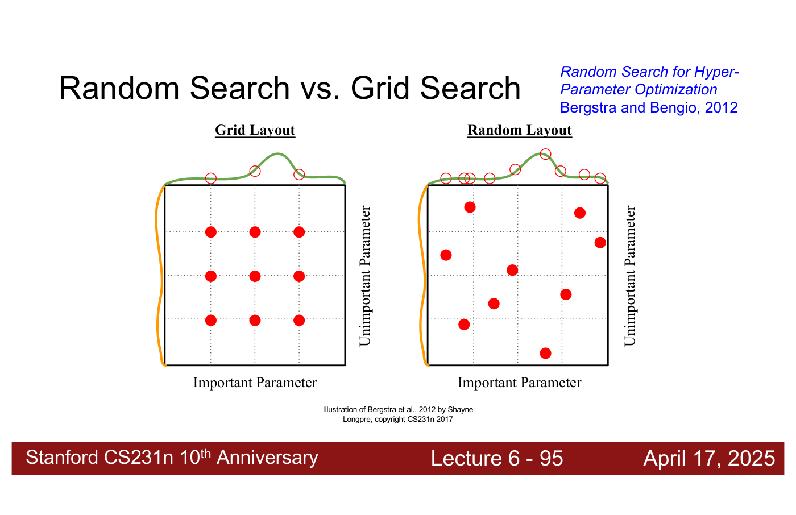

*Slide 95 — nine trials on a 3x3 grid test only three values of the important parameter; nine random trials test nine, one near the peak. Illustration of Bergstra and Bengio, 2012. [Deck](https://cs231n.stanford.edu/slides/2025/lecture_6.pdf)*

## Summary

The lecture reviewed eight topics at a high level (slides 96–97; ≈1:10:04–1:10:50). For building
CNNs: the layers (convolution, fully connected, normalization, dropout), activation functions
(ReLU, GELU and others), CNN architectures (VGG, ResNets) and weight initialization (maintaining
the activation distribution). For training them: data preprocessing (subtract the mean, divide by
the standard deviation), data augmentation (cropping, jitter), transfer learning (train on
ImageNet first) and hyperparameter selection (checking losses, random search).

## Related pages

- [CNN architectures](cnn-architectures.md) — VGG, ResNet and the ImageNet winners.
- [Normalization layers](normalization-layers.md) — LayerNorm, batch, instance and group norm.
- [Weight initialization](weight-initialization.md) — too small, too large, Kaiming.
- [Data preprocessing and augmentation](data-augmentation.md) — per-channel normalization, flips,
  crops, jitter, cutout, test-time augmentation.
- [Transfer learning](transfer-learning.md) — freezing, finetuning and the four-case table.
- [Regularization](regularization.md#dropout) — dropout, and the train-randomly, test-on-average
  pattern.
- [Neural networks](neural-networks.md#activation-functions) — activation functions.
- [Convolutional networks](convolutional-networks.md) — the layers this lecture assembles.
- [Hyperparameters and validation](hyperparameters-and-validation.md) — the seven-step recipe and
  random search.
- Previous lecture: [Lecture 5 — Image Classification with CNNs](05-image-classification-cnns.md).
