# Lecture 7 — Recurrent Neural Networks

**CS231N Deep Learning for Computer Vision, Stanford, Spring 2025.** Delivered April 22, 2025, by
the lecturer of lecture 6, Zane Durante: he opens with clarifications of points from "when I gave
lecture last time" (≈0:05).
[Video](https://www.youtube.com/watch?v=kG2lAPBF7zA) ·
[edited transcript](../raw/transcripts/07-recurrent-neural-networks.md) ·
deck as [text](../raw/slides/07-recurrent-neural-networks.md) /
[PDF](https://cs231n.stanford.edu/slides/2025/lecture_7.pdf)

## What this lecture establishes

Every network in the course so far took a fixed-size input and produced a fixed-size output. This
lecture is about **sequences** of variable length, and about the models people used for them
"before the era of transformers": **recurrent neural networks** (RNNs) and their variants
(≈4:43; slide 13). An RNN keeps an internal **hidden state** that it updates at every time step
from the new input and the previous state, using **the same weights at every step**. The lecture
builds one by hand, shows how it is trained with **backpropagation through time** and its
truncated form, trains a **character-level language model**, looks inside one at
**interpretable cells**, and surveys RNNs in vision: **image captioning**, visual question
answering, visual dialog and navigation. It then shows why vanilla RNNs are hard to train over long
sequences (**vanishing and exploding gradients**), how **gradient clipping** handles the second,
and how the **LSTM**'s cell state eases the first, a design the lecturer relates to ResNet's skip
connections. It closes on modern recurrent models (state space models such as Mamba) and their
advantages over transformers.

The lecturer sets the level for two parts: for the LSTM, "you won't need to know about the details
of how LSTMs operate" (≈57:58), and image captioning "won't be in any of the assignments"
(≈51:52).

The topic pages [recurrent neural networks](recurrent-neural-networks.md),
[LSTM](lstm.md), [character-level language models](language-models.md) and
[image captioning and visual question answering](image-captioning.md) gather these concepts in
one place.

**What the recording covers.** The recording opens at 0:05 with two clarifications of lecture 6
and never presents the course-logistics slide (summarised below from the slide alone). It then
follows the deck to the summary and "next time" slide, ending shortly after 1:11:03. The minimal
character-level RNN listing (slide 67) is described only as "112 lines of Python" (≈39:30), and
the deck's name for the vanilla RNN, the "Elman RNN" (slide 28), is never spoken. Several question
and answer passages go beyond the slides: whether an RNN could use different weights at each time
step (≈31:01–31:48), how chunked backpropagation works (≈31:48–35:36), why an embedding layer is
used (≈39:30–40:16), what starts generation and how language models are labelled (≈42:35–43:21),
and greedy decoding, sampling and beam search (≈43:21–44:53).

**Printed slips and oddities, kept as printed in the slide file.** Slide 65's softmax row is wrong
in its first two columns: from the printed scores $(1.0, 2.2, -3.0, 4.1)$ the softmax is about
$(.04, .13, .00, .84)$, not the printed $(.03, .84, .00, .13)$, and from $(0.5, 0.3, -1.0, 1.2)$
it is about $(.25, .20, .06, .50)$, not $(.25, .20, .50, .05)$; the lecturer acknowledges the
problem in the recording (see [sampling](#sampling-at-test-time)). Slide 66's $4 \times 4$
weight matrix ends rows 2 and 3 in $w_{14}$ where the pattern needs $w_{24}$ and $w_{34}$.
Slide 106 writes the input weights $W_{xh}$ in one line and $W_{hx}$ in the next. Slide 110
writes the second factor of its chain as $\partial h_t / \partial h_{t-1}$ where the chain
starting at step $T$ means $\partial h_T / \partial h_{T-1}$. Slide 116's gradient-clipping
code computes the *squared* norm, `np.sum(grad * grad)`, and calls it the norm. And slide 129
labels ResNet's last stage "3x3 conv, 64", as lecture 6's slide 57 does.

## Administrative notes (slides only)

Slide 2, not presented in the recording: Assignment 1 is due "tomorrow" (4/23) at 11:59PM, and the
project proposal is due "this Friday" (4/25).

## Clarifications from last time

The lecture opens with two points raised on Ed after lecture 6 (≈0:05; slide 3).

**Dropout's test-time scaling.** Dropout has a hyperparameter $p$ that, depending on the
implementation, is either the fraction of neurons dropped or the fraction kept; "generally it's
the number of ones you drop out", and that is what $p$ means "in most libraries" (≈0:05–0:51).
Whichever convention is used, the aim at test time is that each neuron's output equals its
expected output at training time (slide 5): "if you dropped 25% of your activations during
training time, at test time you would scale by 75%" (≈0:51). The confusion in lecture 6 came from
its code, repeated here on slides 5 and 6, which uses `p` as "probability of keeping a unit
active" and multiplies by `p` at test time (≈0:51). See
[regularization](regularization.md#dropout).

**Can normalization fix bad weight initialization?** A student asked in lecture 6 whether a
normalization layer removes the problems caused by badly initialized weights. The answer is a toy
experiment (slides 7–10; ≈0:51–2:24): a two-layer network with ReLU learns the "quadrant function"
of a 2D input, outputting 1, 2, 3 or 4 for the quadrant the point lies in. Four runs are plotted,
training and test loss over 1,000 epochs on a log scale: good (Kaiming) or bad (too-large standard
deviation) initialization, each with and without LayerNorm (≈1:38).

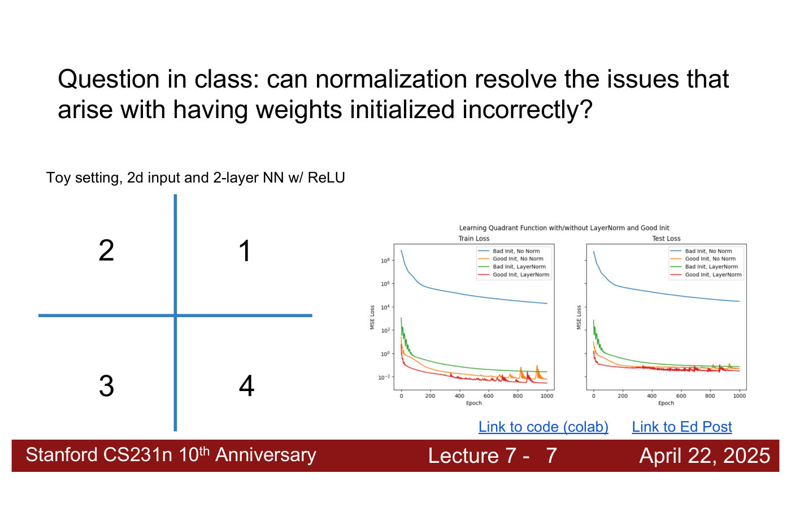

*Slide 7 — training and test MSE (log scale) over 1,000 epochs for the quadrant function: bad initialization without normalization (blue) stays near 10⁴, while adding LayerNorm (green) brings it down to about 10⁻², still above the good-initialization runs (orange, red). [Deck](https://cs231n.stanford.edu/slides/2025/lecture_7.pdf)*

Bad initialization without normalization (blue) starts near $5 \times 10^{8}$ and is still around
$10^{4}$ after 1,000 epochs; with LayerNorm (green) it falls to a few hundredths, a "significant
reduction in error" (slide 8). But a "performance gap still exists" between that run and good
initialization with LayerNorm (slide 9): "to get the best performance you still need good weight
initialization" (≈1:38), and "you can't get by this weight initialization issue with just
normalization" (≈2:24). Whether LayerNorm helps at all depends on the problem (slide 10). For the
quadrant function it does, because LayerNorm does not change which quadrant an input is in, so the
exact 2D position is not needed. For other functions in the accompanying code, where the exact
coordinate matters, LayerNorm hurts, "because you lose some information about the exact spatial
location of your input" when subtracting the mean and dividing by the standard deviation (≈2:24).
See [normalization layers](normalization-layers.md#normalization-and-initialization).

## Recap, and a tool for tuning hyperparameters

Slide 11 sums up the course so far on training non-recurrent networks: one-time setup (activation
functions, preprocessing, weight initialization, normalization, transfer learning), training
dynamics (babysitting the learning process, parameter updates, hyperparameter optimization) and
evaluation (validation performance, test-time augmentation) (≈2:24–3:57).

For the second and third of these the lecturer recommends Weights and Biases, "something I use in
basically all my projects" (≈3:57). Slide 12 shows its web page for a sweep of 211 runs: a
parallel-coordinates plot of batch size, dropout and accuracy, one line per run coloured by
accuracy, and accuracy curves of the first runs. Reading the plot, "generally the lower values of
dropout will achieve higher accuracy" (≈3:57). TensorBoard is another such tool (≈4:43).

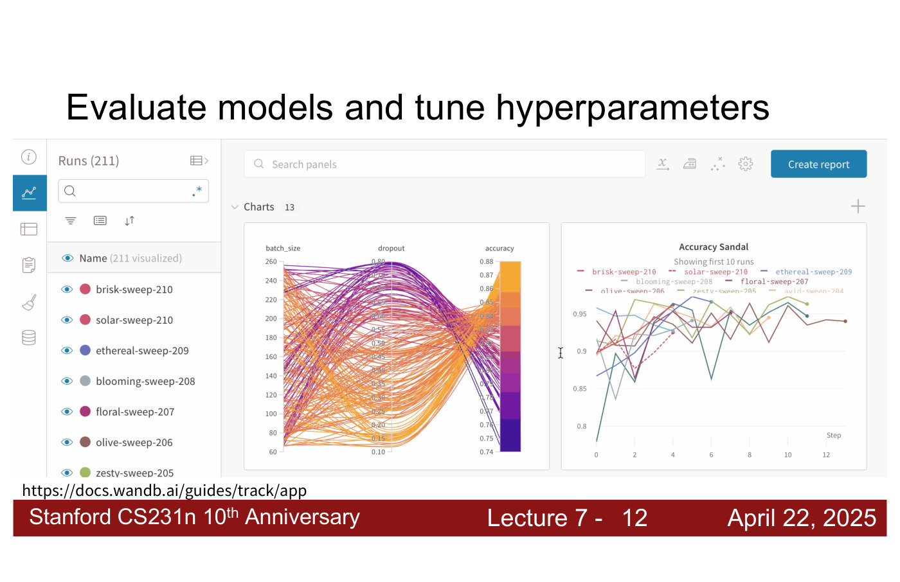

*Slide 12 — a Weights and Biases sweep: each line of the parallel-coordinates plot is one run, passing through its batch size and dropout to its accuracy, coloured from purple (low accuracy) to orange (high). [Deck](https://cs231n.stanford.edu/slides/2025/lecture_7.pdf)*

## Sequence modeling

The rest of the lecture is about inputs that are sequences of variable length (slide 13): the
simple models used before transformers, RNNs and some variants, and their relation to modern
state space models such as Mamba, whose "key concepts from RNNs are still being used today"
(≈4:43–5:30).

Slides 14–18 lay out the shapes a sequence task can take, each drawn as inputs (pink) feeding
hidden boxes (green) that produce outputs (blue) (≈5:30–7:03). A vanilla neural network is
**one to one**: one fixed-size input, one fixed-size output. **One to many** takes a fixed input
and outputs a sequence, as in image captioning, from an image to a sequence of words. **Many to
one** takes a sequence and outputs one label: the slide's example is action prediction from video
frames, which the lecturer describes as classifying "what this is a video of". **Many to many**
maps a sequence to a sequence, and the two need not have the same length: video captioning takes
a variable number of frames and outputs a caption of variable length. And **many to many** with
one output per input, such as video classification on the frame level, is the setting the
lecture uses to explain how RNNs work (≈7:03).

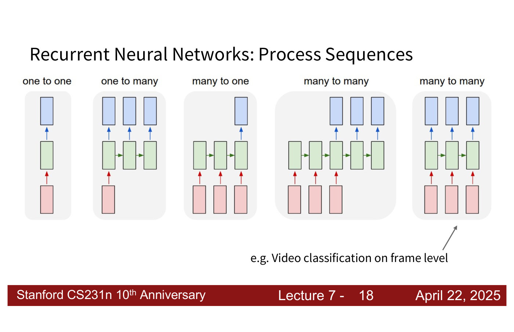

*Slide 18 — the five sequence shapes: one to one (a vanilla network), one to many (captioning), many to one (action prediction), many to many with different lengths (video captioning) and many to many with one output per input (frame-level video classification). [Deck](https://cs231n.stanford.edu/slides/2025/lecture_7.pdf)*

## The recurrent neural network

What makes an RNN recurrent is drawn as an arrow that loops from the RNN block back into itself
(slide 21). The key idea is that "RNNs have an 'internal state' that is updated as a sequence is
processed" (slide 22): every new input produces a new hidden state, which depends on that input
and on the previous hidden state (≈7:03–7:50).

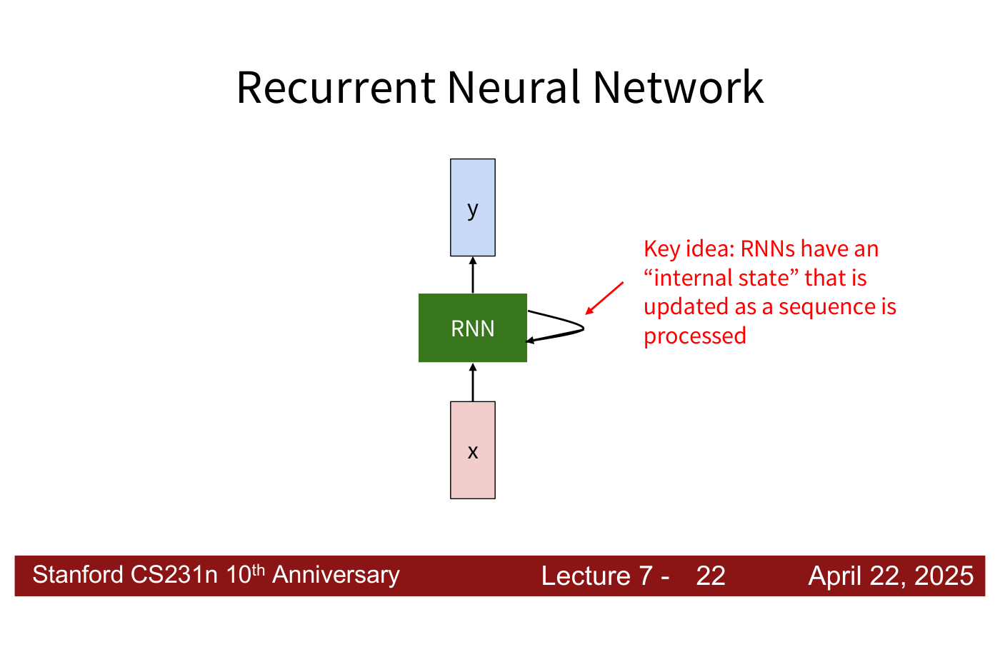

*Slide 22 — the RNN as one block with a loop: the arrow from the RNN back into itself is the internal state carried from one step to the next. [Deck](https://cs231n.stanford.edu/slides/2025/lecture_7.pdf)*

Because the loop hides the order of operations, RNNs are often drawn **unrolled** over time
instead (slides 23 and 26; ≈7:50–8:37): one copy of the block per time step, each taking that
step's input $x_t$ and the previous step's hidden state, and producing an output $y_t$ and a new
hidden state $h_t$. The first copy needs a starting state $h_0$, which "you can initialize to
whatever you want"; "in principle usually this is a learned input vector" (≈10:57–11:42).

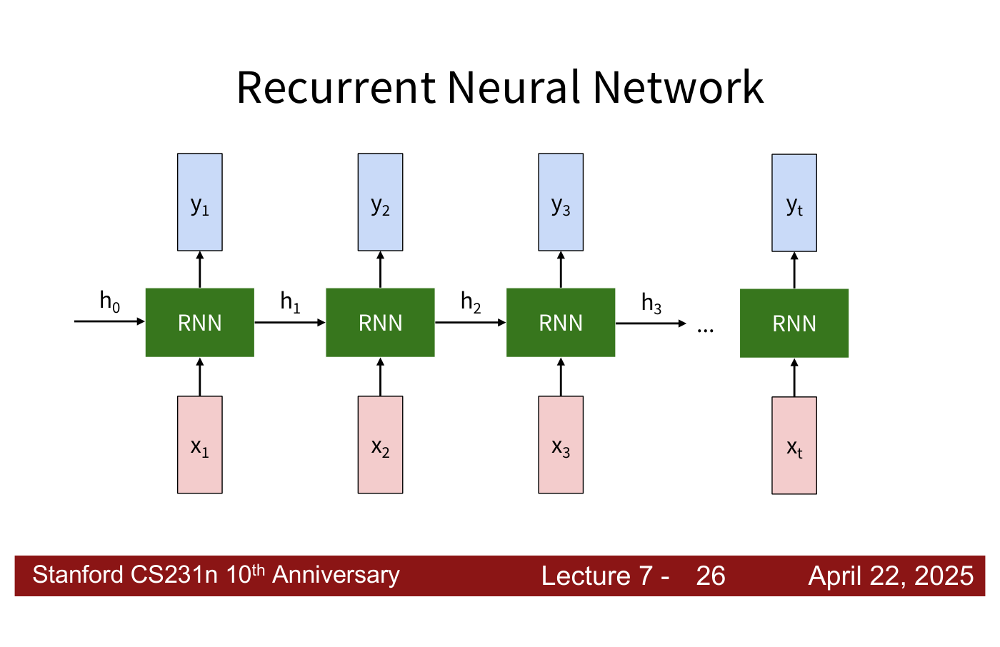

*Slide 26 — the unrolled RNN: inputs x₁, x₂, x₃, …, xₜ below, outputs above, and the hidden states h₀, h₁, h₂, h₃ passed from each step to the next. [Deck](https://cs231n.stanford.edu/slides/2025/lecture_7.pdf)*

In equations, the RNN processes a sequence of vectors $x$ by applying a recurrence formula at every
time step (slide 24):

$$h_t = f_W(h_{t-1}, x_t)$$

where $h_t$ is the new state, $h_{t-1}$ the old state, $x_t$ the input vector at time step $t$,
and $f_W$ "some function with parameters $W$", typically a weight matrix followed by an
activation function, as in the network layers of earlier lectures (≈8:37–9:25). A second
function with its own parameters turns the hidden state into the output (slide 25):

$$y_t = f_{W_{hy}}(h_t)$$

$W_{hy}$ does two things: it changes the dimension from the hidden state's, "which can be whatever
we want", to the output's, and it applies a learned transformation (≈9:25–10:57). The point to
notice is that "the same function and the same set of parameters are used at every time step"
(slide 27; ≈11:42).

Three questions follow (≈10:57–13:15). The weights are shared across time steps, with one set for
updating the hidden state and another for producing the output. Old outputs can feed into the new
hidden state "under some formulations", most commonly in language modelling and other
autoregressive tasks, where the previous values are used as the next input. And $h_0$ and $x_1$
enter the first step through different weights.

### The vanilla RNN

The **vanilla RNN** — the slide adds "or an 'Elman RNN' after Prof. Jeffrey Elman" — makes the
hidden state a single vector $h$ (slide 28):

$$h_t = \tanh(W_{hh} h_{t-1} + W_{xh} x_t)$$

$$y_t = W_{hy} h_t$$

Here $W_{hh}$ maps the previous hidden state, $W_{xh}$ maps the input, and $W_{hy}$ maps the
hidden state to the output; "often, we also have an output function: $f_y$" wrapped around the
last product (slide 28). The activation is **tanh**, $\tanh(x) = \frac{e^x - e^{-x}}{e^x + e^{-x}}$,
because it is bounded between $-1$ and $1$, so values stay in range when the operation is applied
over and over, and because it is zero-centred and represents both positive and negative values
(≈13:15).

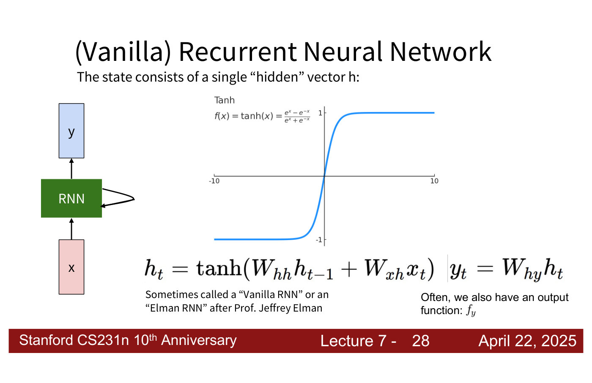

*Slide 28 — the vanilla (Elman) RNN: the tanh curve, flat at −1 and 1 beyond about ±3, and the two equations for hₜ and yₜ. [Deck](https://cs231n.stanford.edu/slides/2025/lecture_7.pdf)*

## A hand-built RNN: detecting repeated 1s

To show exactly what each weight matrix does, the lecturer builds an RNN by hand, with no training
(slides 29–38; ≈14:04–23:19). The task is many to many: the input is a sequence of 0s and 1s, and
the output is 1 whenever the current and previous inputs are both 1, and 0 otherwise. For the
input 0, 1, 0, 1, 1, 1, 0, 1, 1 the target is 0, 0, 0, 0, 1, 1, 0, 0, 1 (slide 29).

What must the hidden state capture (slide 29)? "Previous input and current value for x" (slide 30;
≈14:50). So the hidden state is a three-entry vector — the current input, the previous input, and
a constant 1 that makes the output easy to compute — initialized to $(0, 0, 1)$, as if two 0s had
already been seen (slide 31; ≈15:36). Both activation functions are ReLU "for simplicity"
(slide 31; ≈16:22):

$$h_t = \mathrm{ReLU}(W_{hh} h_{t-1} + W_{xh} x_t)$$

$$y_t = \mathrm{ReLU}(W_{hy} h_t)$$

The weights are set as follows (slides 32–37, which call the output weights `w_yh` in the code and
$W_{hy}$ in the equations):

$$W_{xh} = \begin{pmatrix} 1 \cr 0 \cr 0 \end{pmatrix}, \qquad W_{hh} = \begin{pmatrix} 0 & 0 & 0 \cr 1 & 0 & 0 \cr 0 & 0 & 1 \end{pmatrix}, \qquad W_{hy} = \begin{pmatrix} 1 & 1 & -1 \end{pmatrix}$$

$W_{xh} x_t$ puts the input in the top entry: $(0, 0, 0)$ when $x = 0$ and $(1, 0, 0)$ when
$x = 1$ (slide 33; ≈17:08–17:56). In $W_{hh}$, the top row is all zeros, so the top entry comes
only from the input (slide 34); the second row copies the old "current" value down to become the
new "previous" (slide 35); and the third row keeps the 1 (slide 36) (≈17:56–19:28). The output is
then $\max(\text{current} + \text{previous} - 1, 0)$ (slide 37): two 1s give $\max(1, 0) = 1$, and
any other pair gives 0 (≈20:16–21:02). Running the code on the example reproduces the target
column exactly; "and it just works! But how do we find the Ws in practice?" (slide 38).

Asked how one would construct such matrices in general, the lecturer answers: "the same way we're
always finding the weight matrices in this class", by gradient descent, now across many time steps
(≈21:48). Starting from these hand-set weights and training for another task would be "sort of
like transfer learning", though "in practice I don't think it would work very well at all",
because real hidden states are much larger (≈21:48–22:34). In general, one weight matrix
multiplies the current input and the other the previous hidden state, as here (≈23:19).

## Computational graphs and backpropagation through time

Unrolled, an RNN is a computational graph in which the same function $f_W$, with the same weight
matrix $W$, is applied at every step: $h_0$ and $x_1$ give $h_1$, $h_1$ and $x_2$ give $h_2$, and so
on to $h_T$ (slides 39–42). The slide's caption is "Re-use the same weight matrix at every
time-step" (slide 42; ≈24:06).

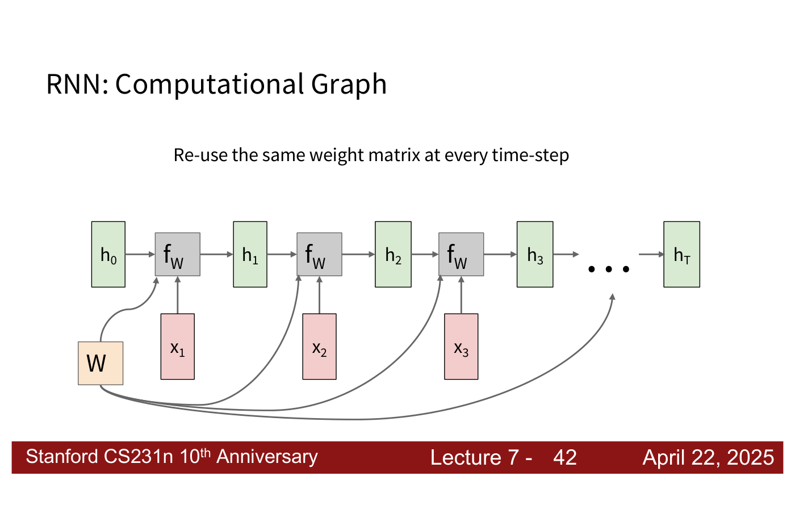

*Slide 42 — the computational graph: one f_W per step, with curved arrows showing that the single weight matrix W feeds every one of them. [Deck](https://cs231n.stanford.edu/slides/2025/lecture_7.pdf)*

**Many to many.** Each hidden state produces an output $y_t$ and a loss $L_t$, and the per-step
losses are summed into the total loss $L$ (slides 43–45; ≈24:06–24:52). To get the gradient for
$W$, "you can calculate the gradient for each time step separately and then you're going to sum
them all together" (≈24:52): conceptually, treat each step as if it had its own copy of $W$, then
merge the gradients, "because it's just the same weight matrix that's being multiplied"
(≈25:38).

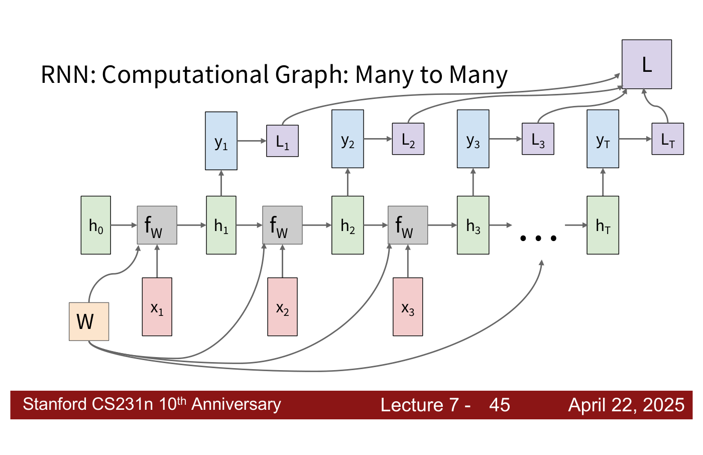

*Slide 45 — many to many: an output yₜ and a loss Lₜ at every step, summed into one loss L. [Deck](https://cs231n.stanford.edu/slides/2025/lecture_7.pdf)*

**Many to one.** A single output $y$ and a single loss (slide 46). The output can come from the
final hidden state alone, or from every hidden state (slide 47): for video classification it may
make sense to use all of them, combined by average or max pooling (≈25:38–26:26).

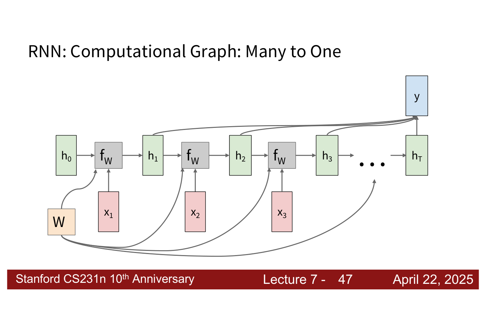

*Slide 47 — many to one: one output y, drawn here with arrows from every hidden state, not only the last. [Deck](https://cs231n.stanford.edu/slides/2025/lecture_7.pdf)*

**One to many.** Only the first step has a real input $x$ (slide 48), but $f_W$ still expects an
input vector at every step, so what goes in (slide 49)? "You could just put zeros" (slide 50),
"or you could put the previous output here" (slide 51), feeding $y_1$ in at step 2, $y_2$ at step 3,
and so on (≈26:26–27:13).

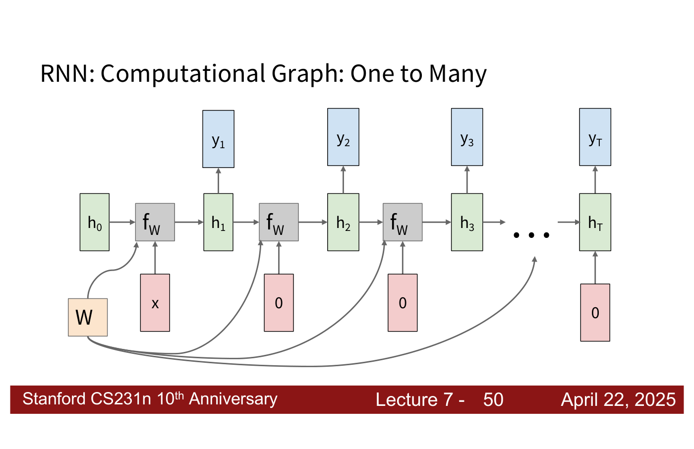

*Slide 50 — one to many with zeros as the inputs after the first step. [Deck](https://cs231n.stanford.edu/slides/2025/lecture_7.pdf)*

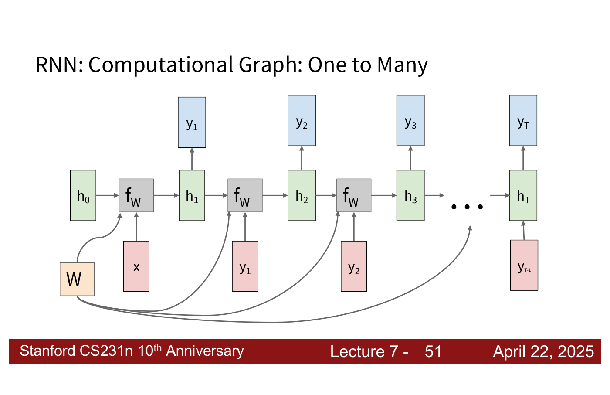

*Slide 51 — one to many with the previous output fed back as the next input: y₁ goes in at step 2, y₂ at step 3, and y(T−1) at the last step. [Deck](https://cs231n.stanford.edu/slides/2025/lecture_7.pdf)*

Could an RNN use a different $W$ at each time step? Then "you're no longer modeling it as a
recurrence relation": it would be one layer per time step, the length of the sequence would have
to be known ahead of time, and for sequences of variable length "I think it would not work very
well" (≈31:01–31:48).

### Backpropagation through time

Training the many-to-many graph means going "forward through entire sequence to compute loss, then
backward through entire sequence to compute gradient" (slide 54). This is **backpropagation
through time**: the same weight matrix is applied at many time steps, and the gradient from each
step is summed (≈27:58). Its practical problem is memory: the activations and gradients of every
time step must be kept until they are summed, which grows with the length of the sequence and runs
out of GPU memory (≈27:13–27:58).

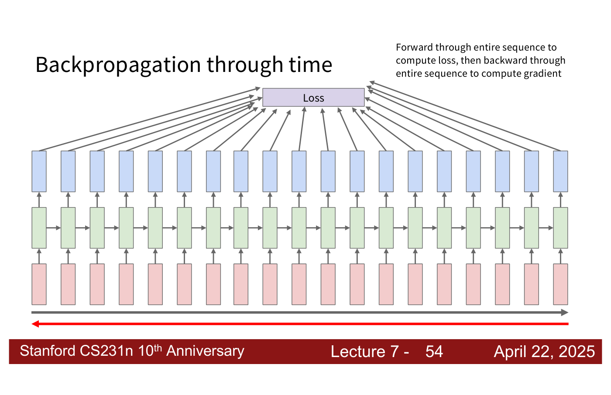

*Slide 54 — backpropagation through time over 19 steps: every output feeds one loss, the forward pass runs the whole sequence left to right (grey), and the backward pass runs it right to left (red). [Deck](https://cs231n.stanford.edu/slides/2025/lecture_7.pdf)*

**Truncated backpropagation through time** runs forward and backward through chunks of the
sequence instead of the whole sequence (slide 55): fix a window, and treat each chunk as if it were
all the model had seen. The next chunk starts from the last hidden state of the previous one, so
hidden states are carried "forward in time forever", but the model only backpropagates "for some
smaller number of steps" (slides 56–57); "we're initializing the hidden state with whatever the
output was in our final step, but the gradients are no longer carrying over" (≈27:58–29:30).

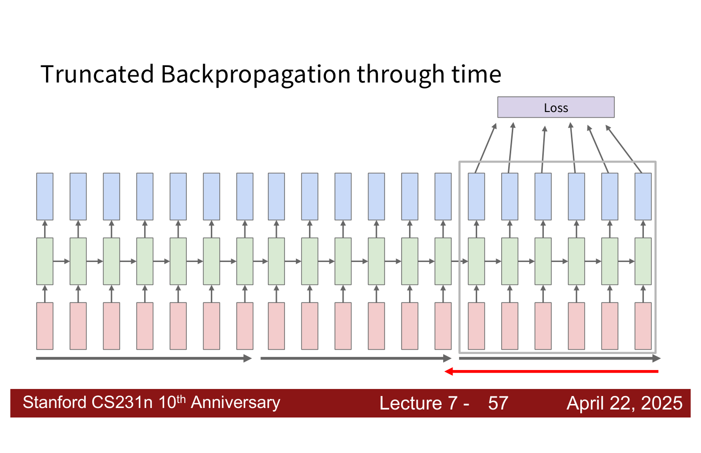

*Slide 57 — truncated backpropagation through time: the forward pass (grey) continues through the whole sequence chunk by chunk, but the loss and the backward pass (red) cover only the current chunk, the last six steps in the grey box. [Deck](https://cs231n.stanford.edu/slides/2025/lecture_7.pdf)*

With a single output at the very end, there is no loss per time step, but gradients are still
computed at each step from the upstream gradient (slide 58; ≈29:30–31:01). From the loss on the
last output one gets the gradient with respect to the last hidden state; $W_{hh}$ then says how
the previous hidden state contributed to it, and applying that rule step after step gives the
gradient for every earlier state and for $W_{hh}$ itself (≈30:16–31:01).

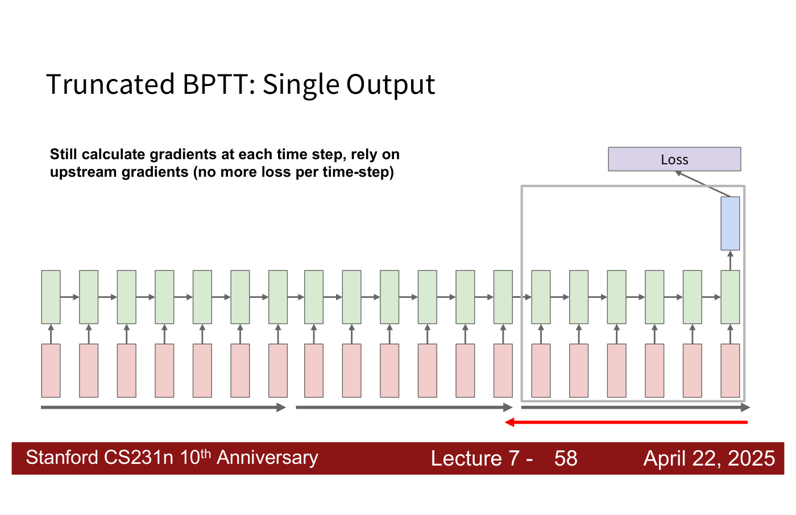

*Slide 58 — truncated backpropagation with a single output: only the last step has an output and a loss, and gradients flow back through the hidden states of the boxed chunk. [Deck](https://cs231n.stanford.edu/slides/2025/lecture_7.pdf)*

A student asked how this works with chunks (≈31:48–35:36), and the answer, given partly over an
inaudible exchange, goes further than the slides. As captioned, the lecturer describes going back
chunk by chunk and keeping one value in memory at each chunk boundary, the gradient with respect to
the first hidden state of the chunk, applying an update for each chunk, "so you have three different
updates rather than just one update", which is why "this isn't a perfect calculation" (≈32:34–35:36).
He compares it to distributed training, where gradients computed separately on each GPU are applied
to the same weights (≈35:36), and agrees that "it would be better if you could fit it all in
memory" (≈35:36). That description passes a gradient across chunk boundaries, while slides 56–58
draw the backward pass inside the last chunk only and he had said earlier that "the gradients are
no longer carrying over" (≈28:44); the recording does not reconcile the two.

## A character-level language model

The "more practical example" is a **character-level language model** (slides 59–61; ≈36:23–37:56).
The vocabulary is the four characters h, e, l, o, and the training sequence is "hello". Each input
character is a **one-hot** vector — a 1 at the character's index and 0s elsewhere — so "h" is
$(1, 0, 0, 0)$ (slide 59). The hidden layer follows the vanilla recurrence
$h_t = \tanh(W_{hh} h_{t-1} + W_{xh} x_t)$ (slide 60), and an output layer gives a score for each
of the four characters at every step (slide 61). The target at each step is the next character:
"e" after "h", "l" after "e", "l" after "l", "o" after the second "l".

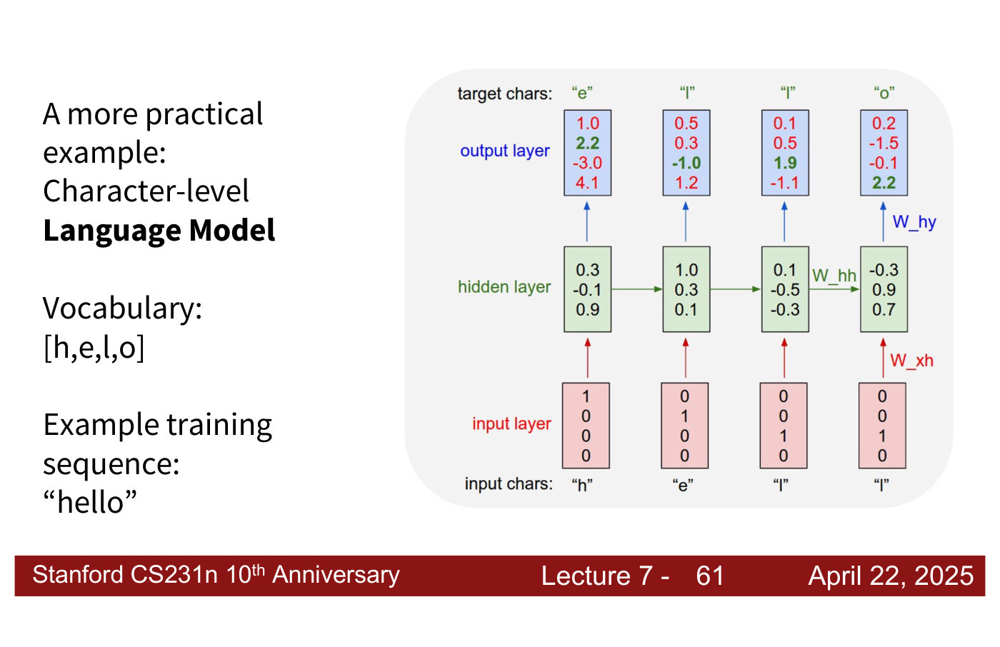

*Slide 61 — training on "hello": one-hot inputs h, e, l, l, three-number hidden states joined by W_hh, and four output scores per step. The bold green score is the target character's: 2.2 for "e" at the first step, below the 4.1 given to "o". [Deck](https://cs231n.stanford.edu/slides/2025/lecture_7.pdf)*

The output scores are logits for a softmax over the vocabulary. At the first step the target "e"
scores 2.2, which "is lower than 4.1", so "this is maybe not so great of an output at this time
step" (≈37:08–37:56). Training is "a time step-wise classification problem", and "that's exactly
what, in general, these language models are doing: time step-wise classification based on
softmax" (≈37:56). Asked how such models are labelled, the lecturer points out that they need no
labels: they predict the next token, so they can be trained on any text (≈43:21).

### Sampling at test time

At test time the model generates text by sampling one character at a time and feeding it back in as
the next input (slides 62–65; ≈37:56): the first input "h" produces a softmax over the four
characters, a character is sampled from it, and that character is the next input.

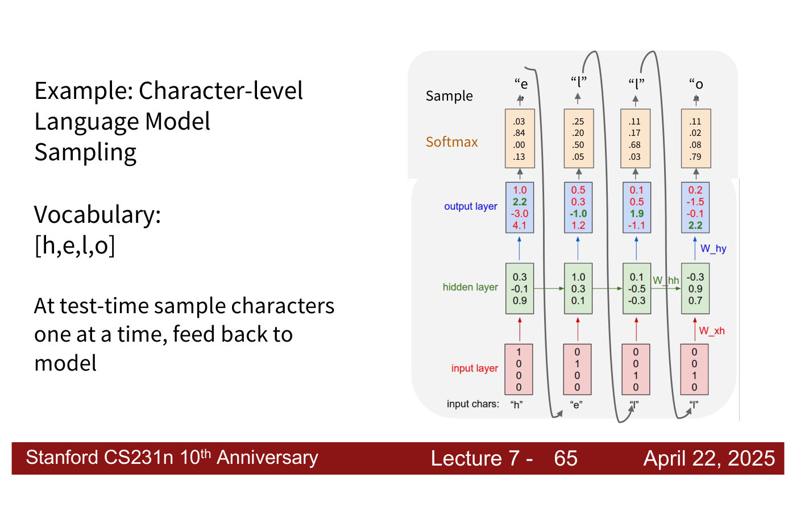

*Slide 65 — sampling: each step's softmax (orange) is sampled, giving "e", "l", "l", "o", and each sample is fed back as the next input. The first two softmax columns are misprinted: from their scores they should read about (.04, .13, .00, .84) and (.25, .20, .06, .50). [Deck](https://cs231n.stanford.edu/slides/2025/lecture_7.pdf)*

The printed probabilities in slide 65's first two columns do not follow from the scores beneath
them. The scores $(1.0, 2.2, -3.0, 4.1)$ give a softmax of about $(.04, .13, .00, .84)$, most of the
mass on "o", but the slide prints $(.03, .84, .00, .13)$, with .84 on "e"; the scores
$(0.5, 0.3, -1.0, 1.2)$ give about $(.25, .20, .06, .50)$, but the slide prints
$(.25, .20, .50, .05)$. The third and fourth columns are right. In the recording a student's
question (inaudible) prompts the lecturer to say "this is incorrect, actually. This one should be
higher probability. … We've had these slides for quite a few years and I guess no one noticed it"
(≈38:42), and later, "I guess this example is not so good, but imagine the probabilities are
correct here" (≈43:21).

Always taking the most probable character is **greedy decoding**, and it would always produce the
same output for the same input (≈43:21–44:07). "In practice they sample based on a distribution,
the distribution given by the probabilities output by your softmax", so a lower-probability
character is sometimes chosen. **Beam search** instead tries several continuations and keeps the
one with the highest overall probability for the sequence; how to sample from these models is "a
whole active area of research" (≈44:07). Generation needs some first input: one could start from a
random character, and language models usually use a predetermined start token (≈42:35).

### The embedding layer

Multiplying a weight matrix by a one-hot vector "just extracts a column from the weight matrix"
(slide 66):

$$\begin{pmatrix} w_{11} & w_{12} & w_{13} & w_{14} \cr w_{21} & w_{22} & w_{23} & w_{24} \cr w_{31} & w_{32} & w_{33} & w_{34} \cr w_{41} & w_{42} & w_{43} & w_{44} \end{pmatrix} \begin{pmatrix} 1 \cr 0 \cr 0 \cr 0 \end{pmatrix} = \begin{pmatrix} w_{11} \cr w_{21} \cr w_{31} \cr w_{41} \end{pmatrix}$$

(the slide prints the last entry of rows 2 and 3 as $w_{14}$, a slip; the product is right). So
"we often put a separate embedding layer between the input and hidden layers" (slide 66): a
learned matrix with one vector per possible input, from which the input selects its own. The
lecturer describes it as "a giant matrix" from which "we grab the first row, or in this case we
grab the second row", based on the input (≈38:42), where the slide speaks of columns; the two are
the same operation with the matrix transposed. Asked why to use one, he says "generally it's better
to have vectors as input to our models", the embedding vectors are learned (initialized small, for
instance with Kaiming initialization), and "optimization-wise the embedding works better" than
feeding a one with a bunch of zeros (≈39:30–40:16).

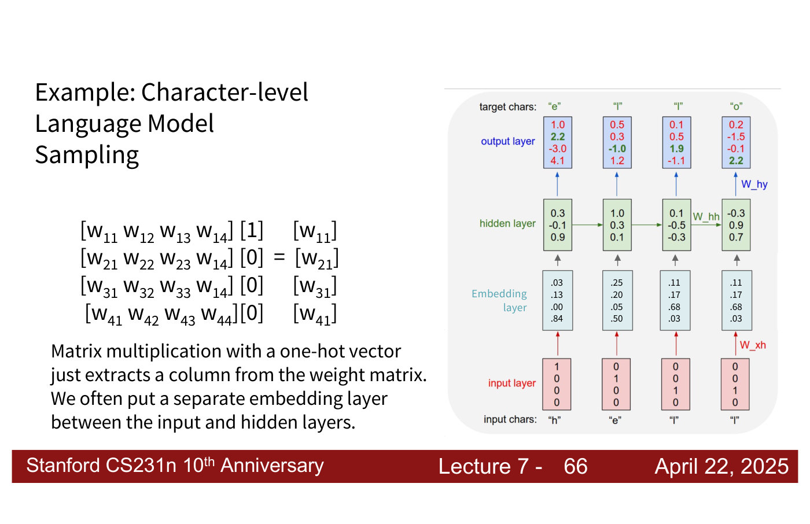

*Slide 66 — the same network with an embedding layer (light blue) between the one-hot inputs and the hidden layer; both "l" inputs get the same embedding. At left, a one-hot vector picking out the first column of a weight matrix. [Deck](https://cs231n.stanford.edu/slides/2025/lecture_7.pdf)*

## What character-level RNNs generate

The whole model fits in "112 lines of Python" (slide 67, Andrej Karpathy's min-char-rnn gist;
≈39:30), and it can be trained on many kinds of text. The listing on the slide is a vanilla RNN
with a hidden layer of 100 neurons, unrolled for 25 steps at a time; it computes the hidden state
with tanh as above, clips every gradient to the range $-5$ to $5$ "to mitigate exploding
gradients", samples text every 100 iterations, and updates with Adagrad (slide 67). Trained on Shakespeare's sonnets
(slide 68), it was the subject of "a blog post by a former instructor of this course, Andrej
Karpathy, back in 2015, which talked about how these RNNs are sort of unreasonably effective"
(≈39:30).

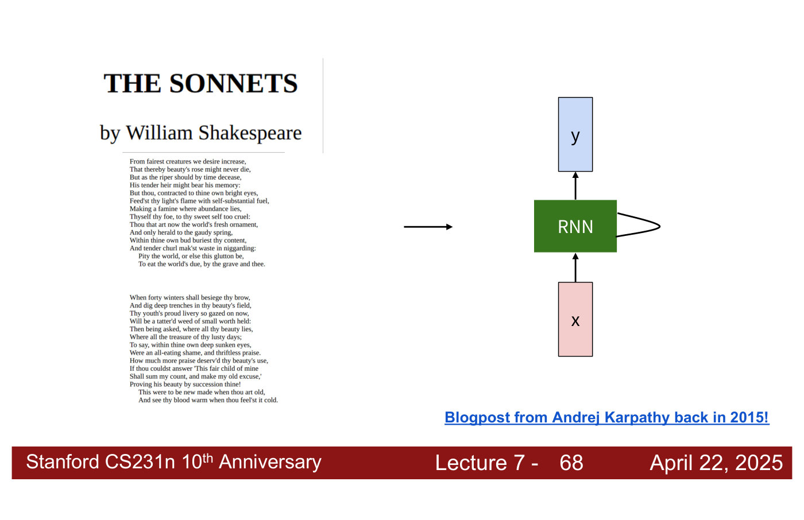

*Slide 68 — the text of Shakespeare's sonnets as the input to a character-level RNN. [Deck](https://cs231n.stanford.edu/slides/2025/lecture_7.pdf)*

As training goes on, the samples become more coherent (slide 69; ≈41:01). At first they are
gibberish ("tyntd-iafhatawiaoihrdemot lytdws e ,tfti, astai f ogoh…"); after more training they
contain English-looking words; and after more still they read as plausible prose, the later
samples featuring characters named Natasha, Pierre and Princess Mary (the slide does not say what
text this model was trained on). Slide 70's samples are laid out like a play, with speakers such as
PANDARUS, VIOLA and KING LEAR: the model has learned the style, "how you should, you know, have
someone's name", though the longer it generates "the less and less sense" it makes (≈41:01).

Trained on the Linux kernel's source code (slide 74), it generates C code (slide 75) that "looks
pretty good. I don't know if this would compile, but it looks reasonable" (≈41:48). The lecturer
connects this to today's coding tools (slide 76: OpenAI Codex, GitHub Copilot, Cursor), which were
trained on a similar task over existing code, predicting the next token, "a group of characters",
instead of the next character (≈41:48–42:35).


*Slide 74 — the training data for the generated C code: the Linux kernel source tree on GitHub. [Deck](https://cs231n.stanford.edu/slides/2025/lecture_7.pdf)*

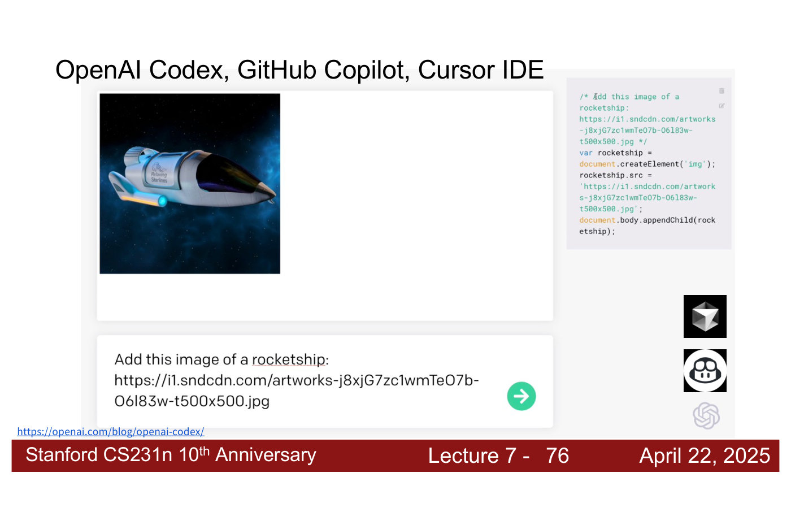

*Slide 76 — a code-generation demo: the comment "Add this image of a rocketship" becomes three lines of JavaScript that add the image to the page. [Deck](https://cs231n.stanford.edu/slides/2025/lecture_7.pdf)*

## Searching for interpretable cells

Because the hidden state is a vector of activations, one can look at a single entry, a "cell", as
the model reads text, and colour each character by that cell's value at that step (slides 77–83;
≈45:39–47:59). The models shown use tanh, so values run from $-1$ to $1$; "minus one means it's
visualized as red here and very close to one would be blue" (≈45:39). These figures are from
Karpathy, Johnson and Fei-Fei, "Visualizing and Understanding Recurrent Networks", ICLR Workshop
2016.

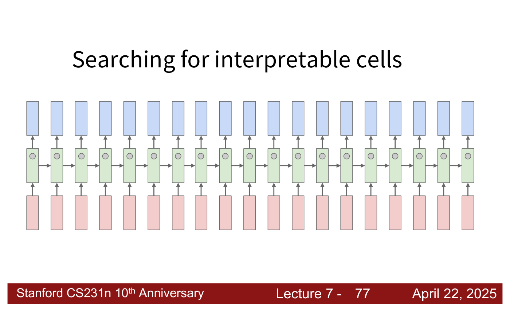

*Slide 77 — the idea: pick one cell of the hidden state (the grey dot in each green box) and watch its value at every step. [Deck](https://cs231n.stanford.edu/slides/2025/lecture_7.pdf)*

Many cells show nothing: slide 78's "not really showing anything. It's random. A lot of them won't
be interpretable" (≈46:25).

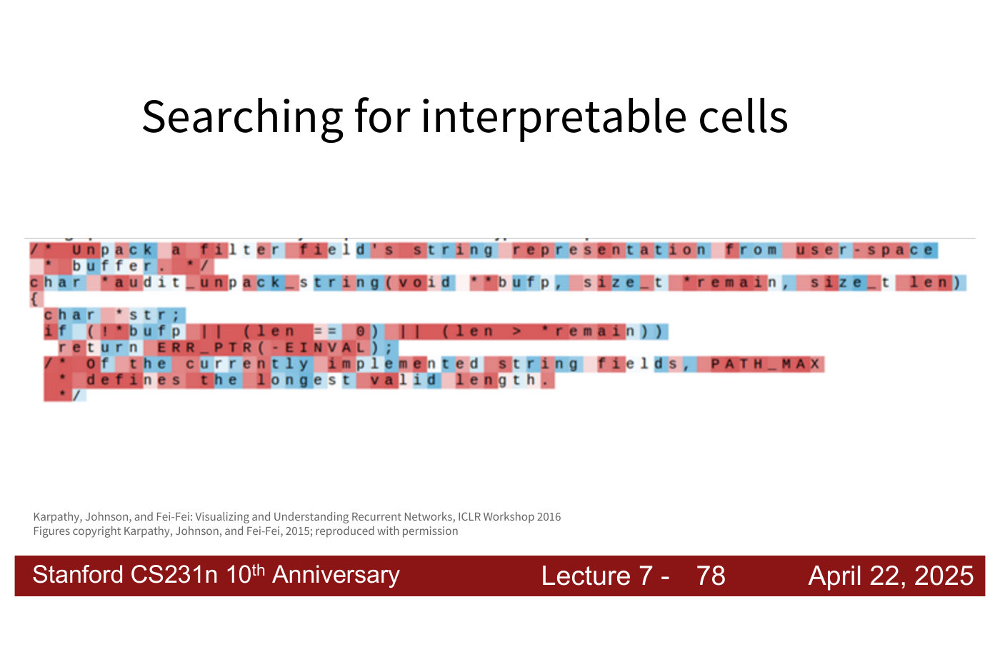

*Slide 78 — a cell with no visible pattern on C source code. [Deck](https://cs231n.stanford.edu/slides/2025/lecture_7.pdf)*

But some track something clear. The quote detection cell on slide 79 "turns on basically as soon as
the quote starts and it ends when the quote ends": the model has to track that an end quote is
coming (≈46:25).

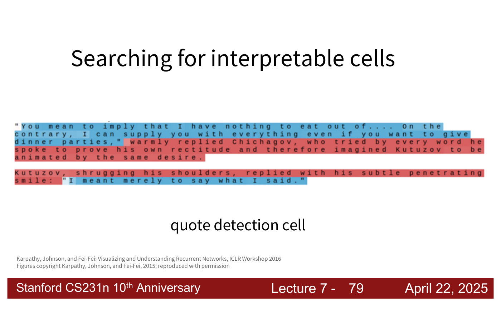

*Slide 79 — the quote detection cell: text inside quotation marks is blue, the narration between quotes red. [Deck](https://cs231n.stanford.edu/slides/2025/lecture_7.pdf)*

The line length tracking cell on slide 80 "starts at a very high value and then it becomes a very
low value as you near where the model thinks there'll be a new line character" (≈46:25–47:13).

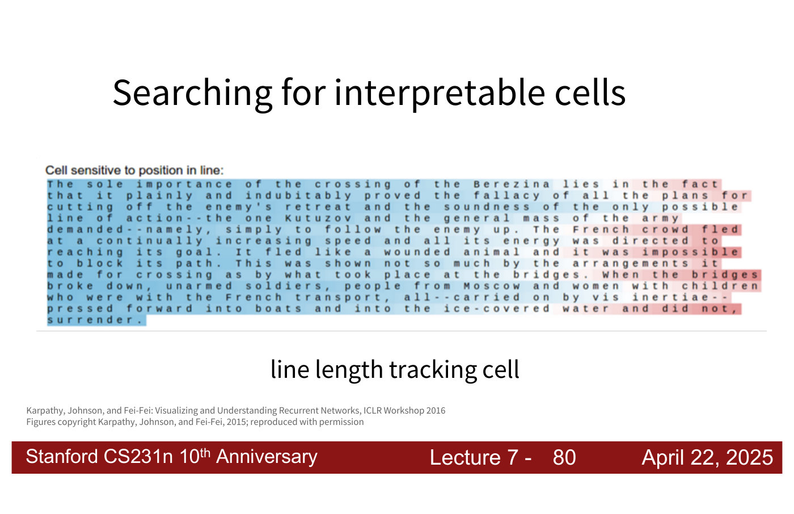

*Slide 80 — the line length tracking cell: blue at the start of each line, fading to red at its end. [Deck](https://cs231n.stanford.edu/slides/2025/lecture_7.pdf)*

On C code, the if statement cell on slide 81 tracks the conditions of `if` statements (≈47:13).

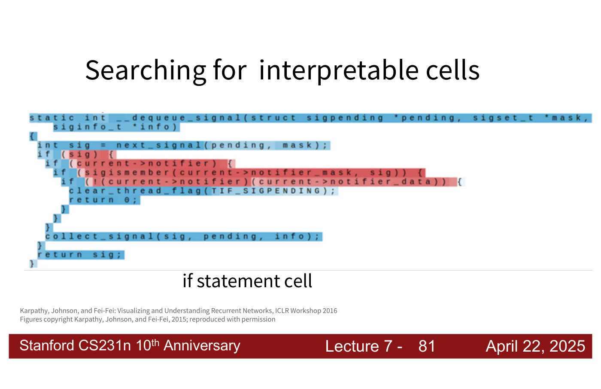

*Slide 81 — the if statement cell: the conditions inside each `if (…)` stand out in red. [Deck](https://cs231n.stanford.edu/slides/2025/lecture_7.pdf)*

The quote/comment cell on slide 82 turns on inside comments and quotes, "because it needs to know to
output the end of comment character" (≈47:13).

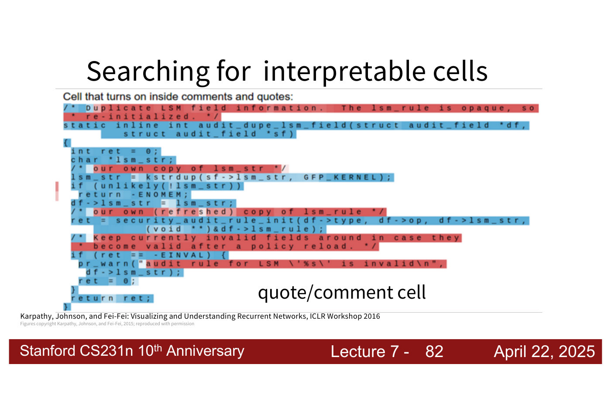

*Slide 82 — the quote/comment cell: comment blocks and the string literal are red, the rest of the code blue. [Deck](https://cs231n.stanford.edu/slides/2025/lecture_7.pdf)*

And the code depth cell on slide 83 "activates more and more" at each level of nesting (≈47:13).

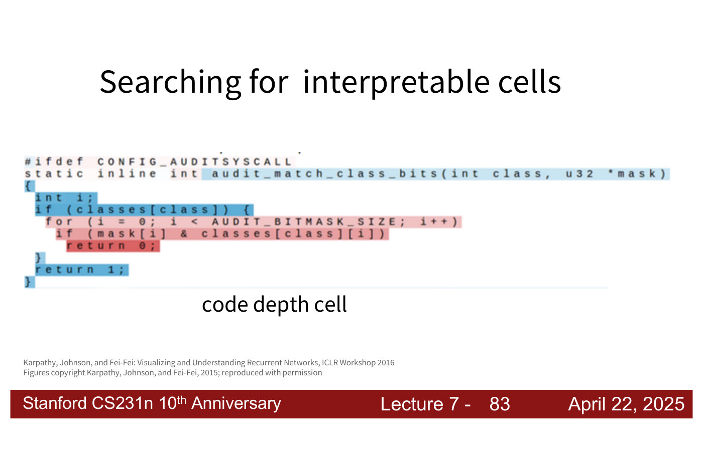

*Slide 83 — the code depth cell: the deeper the nesting, the stronger the red, strongest at the `return 0;` inside the inner `if`. [Deck](https://cs231n.stanford.edu/slides/2025/lecture_7.pdf)*

These are single activations mapped straight onto the input characters, "without needing to do any
fancy tricks", and the RNN is "internally doing a very similar process" to the hand-built example,
where the hidden state was assigned to track the current and previous inputs (≈47:13–47:59).

## RNN tradeoffs

Slide 84 weighs RNNs (≈47:59–50:18). Their advantages: they can process input of any length, with no
context length, unlike transformer language models with their maximum context window; the
computation for step $t$ can in theory use information from many steps back, if the hidden state
captures it; the model size does not increase for longer input; and the same weights are applied at
every time step, so inputs are processed symmetrically. Their disadvantages: recurrent computation
is slow, because each hidden state needs the previous one — not a problem at inference, where a
transformer also generates one token at a time, but at training time it makes the steps hard to
batch and so hard to scale to a lot of data — and in practice it is difficult to access information
from many steps back, because everything has to be crammed into a fixed-size hidden state
(≈49:32–50:18).

## RNNs in computer vision

### Image captioning

Image captioning combines a **convolutional network**, which encodes the image, with a
**recurrent network**, which generates the caption one word at a time from a start token until it
produces an end token (slides 85–86; ≈50:18–51:04). Slide 85's figure is from Karpathy and Fei-Fei,
"Deep Visual-Semantic Alignments for Generating Image Descriptions", CVPR 2015, and the slide lists
four other papers of the time (Mao et al.; Vinyals et al., "Show and Tell"; Donahue et al.; Chen and
Zitnick).

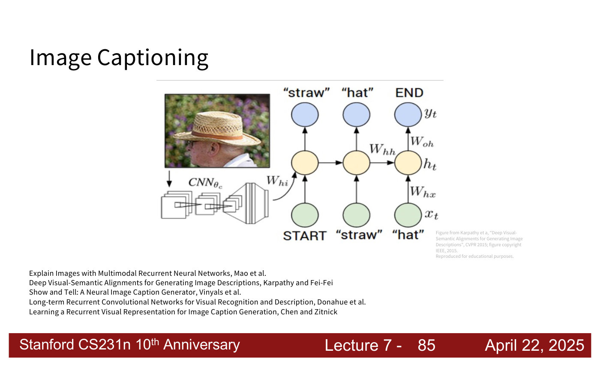

*Slide 85 — image captioning: a CNN encodes the photograph, and an RNN generates "straw", "hat", END from the inputs START, "straw", "hat", each generated word becoming the next input. [Deck](https://cs231n.stanford.edu/slides/2025/lecture_7.pdf)*

At test time (slides 87–96; ≈51:04–52:38), the test image goes through a CNN pretrained on ImageNet
(slide 88). Its last two layers, FC-1000 and softmax, are removed (slide 89): "we're not going to
use the class labels, but we're going to use this second to last layer", the common strategy for
good visual representations seen in [transfer learning](transfer-learning.md) (≈51:52). The
4096-dimensional feature $v$ from that layer enters the RNN's first hidden state through a new
weight matrix $W_{ih}$, so the hidden-state update gains a term (slide 91):

$$\text{before:} \quad h = \tanh(W_{xh} \ast x + W_{hh} \ast h)$$

$$\text{now:} \quad h = \tanh(W_{xh} \ast x + W_{hh} \ast h + W_{ih} \ast v)$$

The first input is the start token $x_0$. A word is sampled from the output $y_0$ ("straw",
slide 92) and fed in as the next input, giving $h_1$ and $y_1$ (slide 93); "hat" is sampled from
$y_1$ and fed in (slides 94–95); and when the end token is sampled, the caption is finished
(slide 96; ≈52:38).

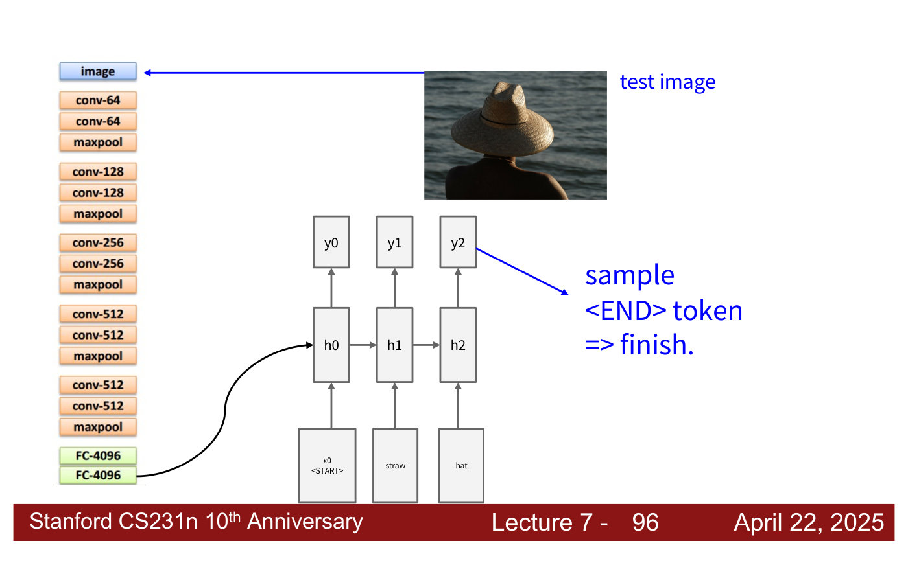

*Slide 96 — captioning at test time: a VGG-style CNN with its last two layers removed feeds the first hidden state; each sampled word ("straw", "hat") becomes the next input, until the END token is sampled. [Deck](https://cs231n.stanford.edu/slides/2025/lecture_7.pdf)*

The CNN on slides 88–96 is not named. Its drawn stack has 10 convolution layers in five groups of
two (64, 128, 256, 512, 512 channels), each followed by max pooling, then FC-4096, FC-4096, FC-1000
and softmax: 13 weight layers as drawn.

### Results and failure cases

These models "worked very well for the time" (≈52:38). Slide 97 shows eight captions generated
with neuraltalk2 that fit their photographs, such as "A cat sitting on a suitcase on the floor"
and "Two giraffes standing in a grassy field".

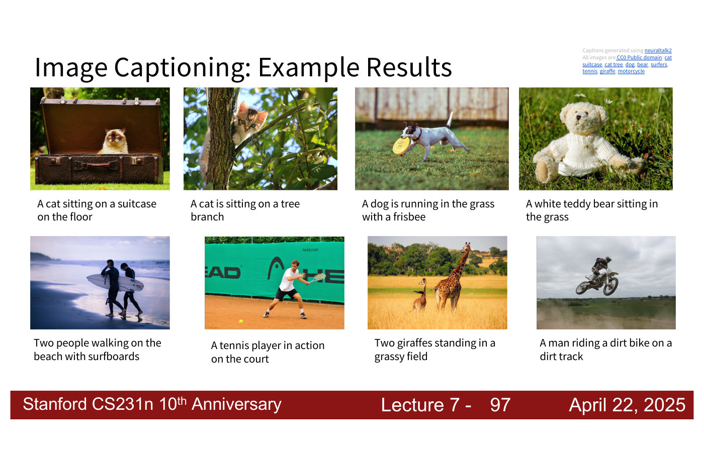

*Slide 97 — eight good captions, among them "A dog is running in the grass with a frisbee" and "A tennis player in action on the court". [Deck](https://cs231n.stanford.edu/slides/2025/lecture_7.pdf)*

Slide 98 shows five failures, and the lecturer explains each by what usually appears in such scenes
in the training data (≈52:38–54:54). A hand cupped around a phone above a laptop "very much looks
like how they might hold a mouse"; a woman wearing fur is "holding a cat"; a person doing a
handstand by a lake is "standing on a beach holding a surfboard" because "they see a beach so they
assume there's a surfboard"; a spider web becomes "a bird perched on a tree branch"; and a baseball
player catching the ball is "throwing a ball". This kind of **hallucination**, of objects commonly
present in a scene but not in this one, "is still extremely common with vision language models
today" (≈53:23). It comes from bias in the dataset: actions and objects co-occur with certain
scenes, so the model learns to associate them without learning to disentangle them, and because it
is trained only to output the caption, nothing makes it explain why (≈54:09).

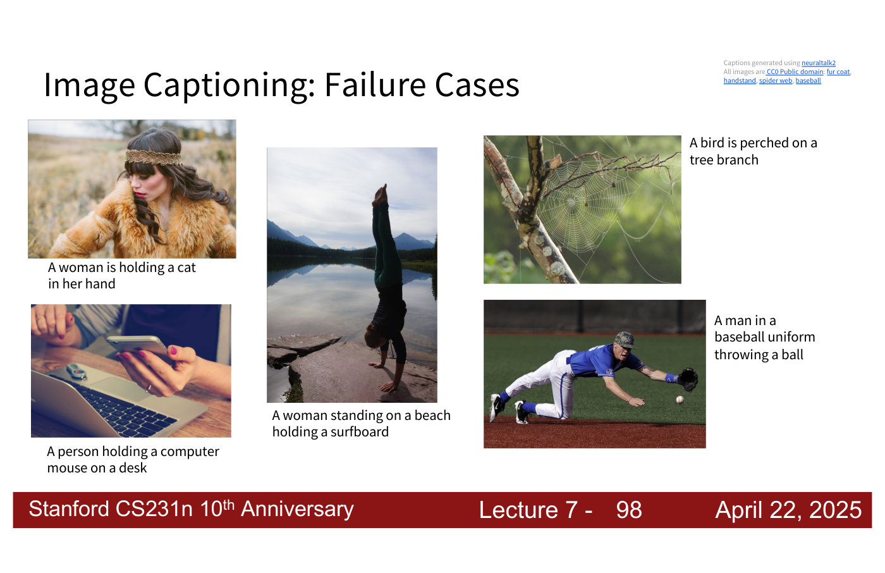

*Slide 98 — five failures: a woman in a fur coat captioned as holding a cat, a phone as a computer mouse, a handstand by a lake as a woman with a surfboard on a beach, a spider web as a perched bird, and a catch as a throw. [Deck](https://cs231n.stanford.edu/slides/2025/lecture_7.pdf)*

### Visual question answering, visual dialog and navigation

**Visual question answering** asks a question about an image (slide 99; Agrawal et al., ICCV 2015;
Zhu et al., Visual 7W, CVPR 2016). The lecturer describes two formulations (≈54:54–55:40). A
captioning-style model can be given the question and score each candidate answer by multiplying the
probabilities of its characters or tokens. More commonly, the question and each candidate answer
are inputs, and the model is a classifier over the answers, a four-way classifier when there are
four.

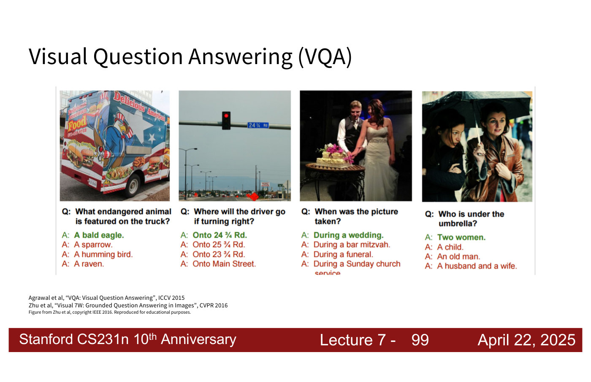

*Slide 99 — four photographs, each with a question and four candidate answers, the correct one in green: "What endangered animal is featured on the truck?" — "A bald eagle." [Deck](https://cs231n.stanford.edu/slides/2025/lecture_7.pdf)*

**Visual dialog** is a conversation about an image (slide 101; Das et al., CVPR 2017). "At the time
these were all considered very separate tasks. These days you have sort of one model that can do
almost all of these" (≈55:40).

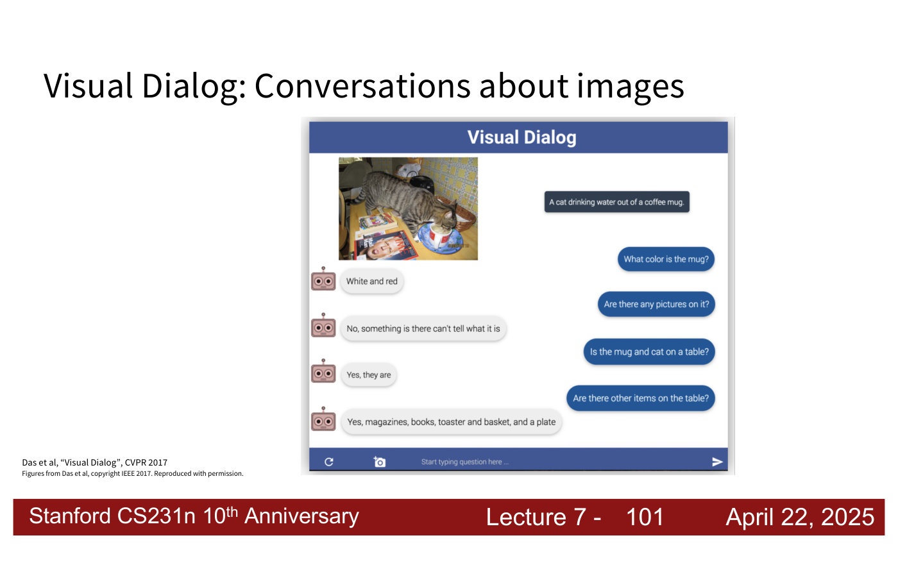

*Slide 101 — a visual dialog about a photograph of a cat drinking from a mug: "What color is the mug?" — "White and red". [Deck](https://cs231n.stanford.edu/slides/2025/lecture_7.pdf)*

**Visual language navigation**: an agent "encodes instructions in language and uses an RNN to
generate a series of movements as the visual input changes after each move" (slide 102; Wang et
al., CVPR 2018; ≈56:25).

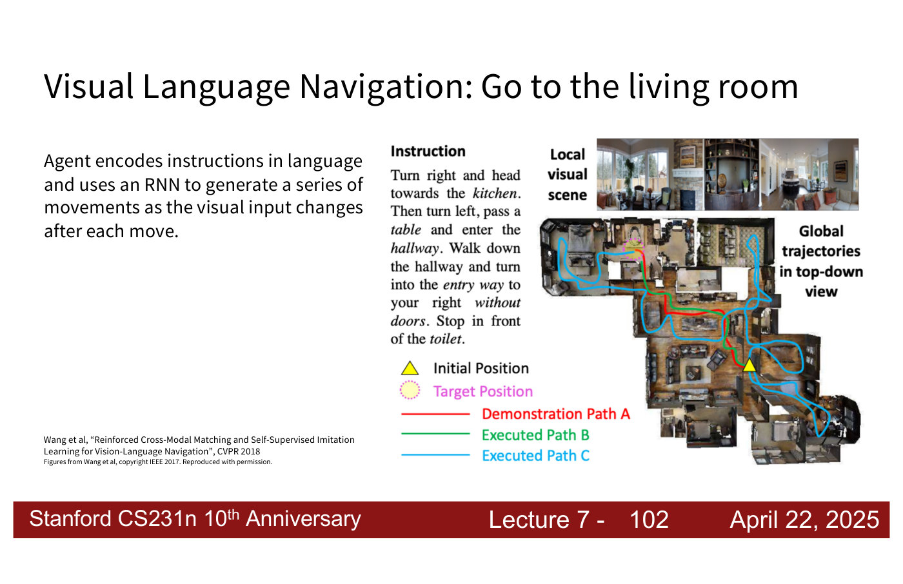

*Slide 102 — navigation from a written instruction: the demonstration path (red) and an executed path (green) go fairly directly to the target, while another executed path (blue) wanders through several rooms. [Deck](https://cs231n.stanford.edu/slides/2025/lecture_7.pdf)*

## Multilayer RNNs

Just as CNNs and fully connected networks stack layers, RNNs can too, "and in practice most of the
RNNs I showed were multilayer RNNs" (slide 104; ≈56:25–57:58). Each layer keeps its own hidden
state, which depends on its own previous hidden state; the first layer takes the input $x$, and each
higher layer takes the output of the layer below. The result is a grid over depth and time, and
computing the top-right value requires every hidden state in the grid first, which makes training
"a very involved process and not very efficient" (≈57:58). The weights are shared across time within
a layer, and each layer has its own set (≈1:00:18).

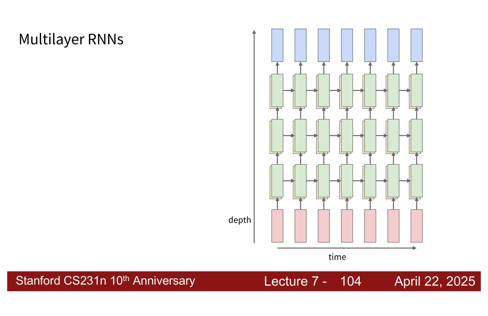

*Slide 104 — a three-layer RNN over seven time steps: hidden states pass right in time within each layer and up in depth between layers. [Deck](https://cs231n.stanford.edu/slides/2025/lecture_7.pdf)*

## Vanilla RNN gradient flow

The lecturer introduces the LSTM (slide 105; ≈57:58) as a variant that seeks to alleviate "some key
disadvantages" of RNNs, and first shows what they are (slides 106–117; ≈58:44–1:04:10).

The vanilla update can be written with the two weight matrices side by side as one matrix $W$
multiplying the stacked vector of $h_{t-1}$ and $x_t$ (slide 106):

$$h_t = \tanh(W_{hh} h_{t-1} + W_{xh} x_t) = \tanh\left(W \begin{pmatrix} h_{t-1} \cr x_t \end{pmatrix}\right)$$

The lecturer calls the combined $W$ a shorthand and describes its two blocks as "diagonally
positioned" with "a lot of zeros", because $W_{hh}$ does not interact with $x_t$ (≈59:31); the
slide prints them side by side as a single row of two blocks, $W_{hh}$ then $W_{hx}$, multiplying
the stacked vector.

Backpropagating from $h_t$ to $h_{t-1}$ "multiplies by $W$ (actually $W_{hh}^T$)" (slide 107), and
the Jacobian of one step is (slide 108):

$$\frac{\partial h_t}{\partial h_{t-1}} = \tanh'(W_{hh} h_{t-1} + W_{xh} x_t) W_{hh}$$

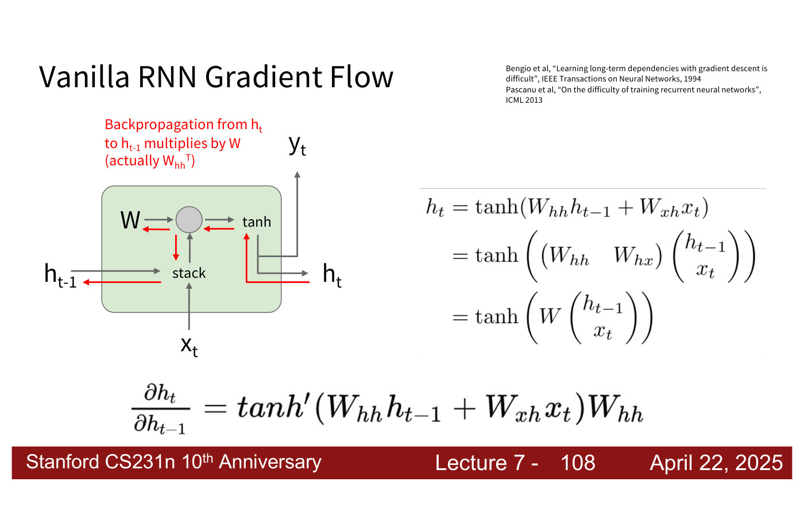

*Slide 108 — one step of a vanilla RNN: the red path is the gradient from hₜ back to h(t−1), through tanh and the multiplication by W. [Deck](https://cs231n.stanford.edu/slides/2025/lecture_7.pdf)*

Over many steps the total loss is the sum of the per-step losses, so
$\frac{\partial L}{\partial W} = \sum_{t=1}^{T} \frac{\partial L_t}{\partial W}$ (slide 109). The
gradient of the last step's loss $L_T$ must go back through every intermediate hidden state, and by
the chain rule it is a product of one-step Jacobians (slides 110–111; ≈1:01:03–1:02:36):

$$\frac{\partial L_T}{\partial W} = \frac{\partial L_T}{\partial h_T} \left( \prod_{t=2}^{T} \frac{\partial h_t}{\partial h_{t-1}} \right) \frac{\partial h_1}{\partial W}$$

Substituting the one-step Jacobian gives (slide 113):

$$\frac{\partial L_T}{\partial W} = \frac{\partial L_T}{\partial h_T} \left( \prod_{t=2}^{T} \tanh'(W_{hh} h_{t-1} + W_{xh} x_t) \right) W_{hh}^{T-1} \frac{\partial h_1}{\partial W}$$

Two things go wrong. First, the derivative of tanh has a maximum of 1 and is "almost always $\lt 1$"
(slide 113), so the product of many such factors shrinks: **vanishing gradients** (≈1:02:36–1:03:23).

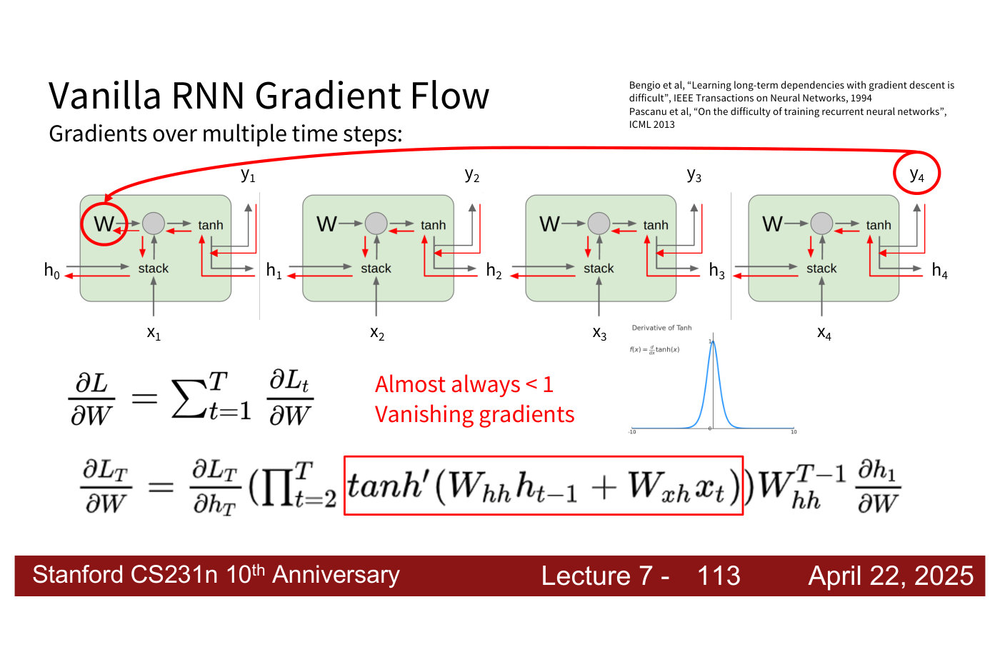

*Slide 113 — the gradient over many steps: a product of tanh derivatives, each at most 1 (the bell-shaped curve at right) and "almost always < 1", times W_hh raised to the power T−1. [Deck](https://cs231n.stanford.edu/slides/2025/lecture_7.pdf)*

Second, even with no non-linearity (slides 114–115), the gradient contains $W_{hh}^{T-1}$, the same
matrix multiplied in at every step. Its largest singular value is the most it can stretch a unit
vector (≈1:03:23). If that value is greater than 1, the gradients explode; if it is less than 1, they
vanish (slide 115).

**Exploding gradients** have a simple fix, **gradient clipping**: "scale gradient if its norm is
too big" (slide 116; ≈1:03:23–1:04:10). The slide's code is

```python
grad_norm = np.sum(grad * grad)
if grad_norm > threshold:
  grad *= (threshold / grad_norm)
```

As printed, `grad_norm` is the sum of the squared entries, the squared norm, with no square root,
while the text calls it the norm. "Too big of a gradient is not too much of an issue" (≈1:04:10).

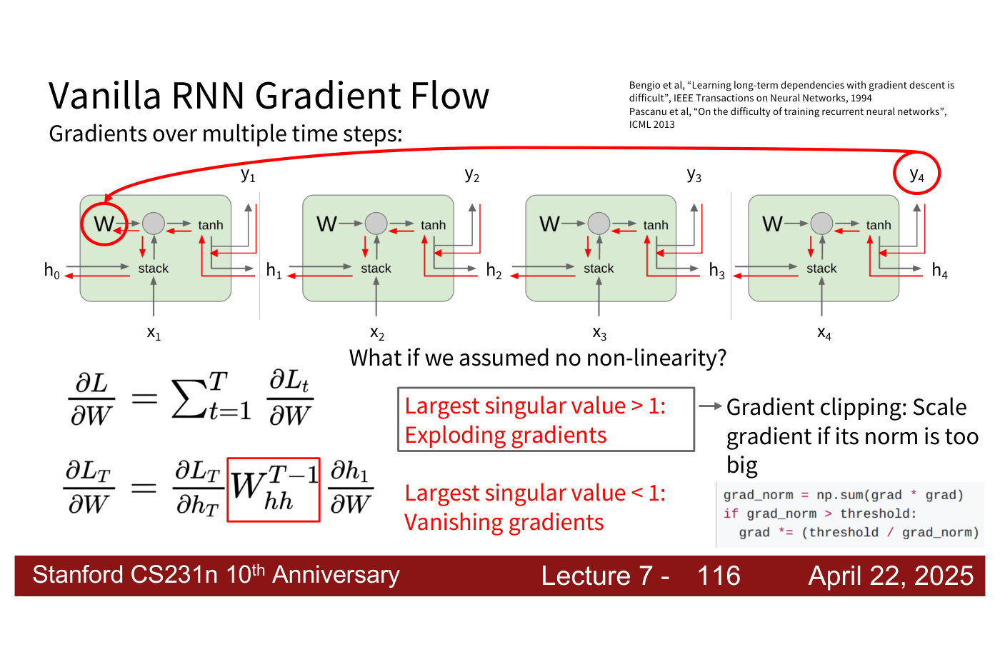

*Slide 116 — largest singular value above 1 means exploding gradients, controlled by gradient clipping; below 1 means vanishing gradients. [Deck](https://cs231n.stanford.edu/slides/2025/lecture_7.pdf)*

**Vanishing gradients** need a change of architecture (slide 117). They are "the main issue with
why people don't just use really long RNNs in practice", because of tanh and because the weight
matrix usually either expands or shrinks the activations at every step (≈1:04:10).

## Long Short Term Memory (LSTM)

The LSTM (Hochreiter and Schmidhuber, "Long Short Term Memory", Neural Computation 1997) was
"proposed actually a while ago in the 1990s but saw a lot of success for quite some time until the
transformer revolution" (≈57:58). Slides 105 and 118–119 set its equations beside the vanilla RNN's
update, the tanh of $W$ times the stacked $h_{t-1}$ and $x_t$:

$$\begin{pmatrix} i \cr f \cr o \cr g \end{pmatrix} = \begin{pmatrix} \sigma \cr \sigma \cr \sigma \cr \tanh \end{pmatrix} W \begin{pmatrix} h_{t-1} \cr x_t \end{pmatrix}$$

$$c_t = f \odot c_{t-1} + i \odot g$$

$$h_t = o \odot \tanh(c_t)$$

Here $\sigma$ is the sigmoid, $\odot$ is elementwise multiplication, $c_t$ is the **cell state**,
$h_t$ is the **hidden state**, and $i, f, o, g$ are the **four gates** (slide 119). One matrix $W$
of size $4h \times 2h$ multiplies the stacked "vector from below ($x$)" and "vector from before
($h$)", and the result of size $4h$ is split into four parts: three pass through a sigmoid and one
through tanh (slide 120). The gates are defined on slides 121–124:

- $i$, the **input gate**: whether to write to the cell;
- $f$, the **forget gate**: whether to erase the cell;
- $o$, the **output gate**: how much to reveal the cell;
- $g$, the "gate gate (?)": how much to write to the cell.

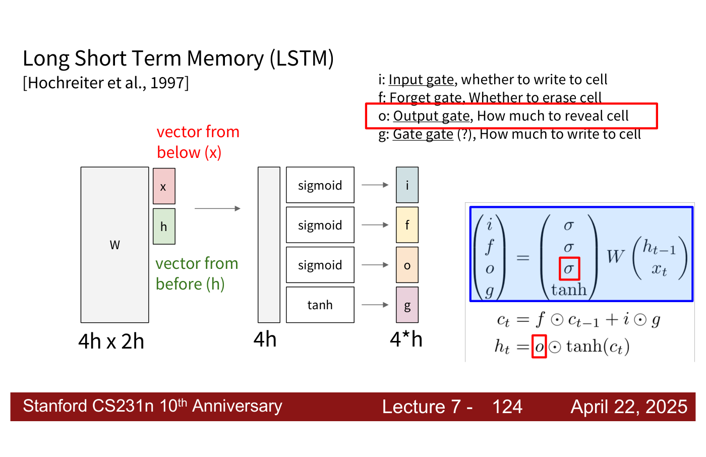

*Slide 124 — the LSTM's gates: one 4h x 2h matrix multiplies the stacked x and h, and the result is split into i, f, o (sigmoids) and g (tanh), with each gate's role written above. [Deck](https://cs231n.stanford.edu/slides/2025/lecture_7.pdf)*

The lecturer keeps to the high-level idea, "because it's actually quite complicated" (≈1:04:56):
instead of one hidden state, the LSTM precomputes four values that decide how to change the hidden
state and what to pass through a second pathway, where "it's easier to pass information". The cell
diagram (slide 125) shows that pathway along the top: $c_{t-1}$ is multiplied elementwise by $f$,
then $i \odot g$ is added to give $c_t$, which passes through tanh and is multiplied by $o$ to give
$h_t$.

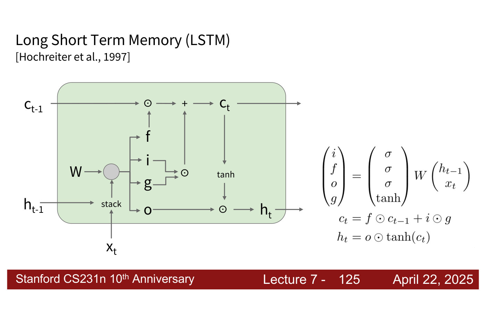

*Slide 125 — one LSTM cell: the cell state runs along the top, where f scales c(t−1) and i ⊙ g is added; below, W turns h(t−1) and xₜ into the four gates; hₜ is o times tanh(cₜ). [Deck](https://cs231n.stanford.edu/slides/2025/lecture_7.pdf)*

### Gradient flow through the cell state

"Backpropagation from $c_t$ to $c_{t-1}$ [is] only elementwise multiplication by $f$, no matrix
multiply by $W$" (slide 126). The top pathway is "like a highway, where the goal is to not have any
activation functions", so the gradients avoid the vanishing caused by tanh, and "as long as we're
not basically forgetting all the information at each time step, we're able to pass information more
easily" (≈1:05:41–1:06:28). Chained over time steps, the cell states give "uninterrupted gradient
flow" from the last cell back to the first (slide 127).

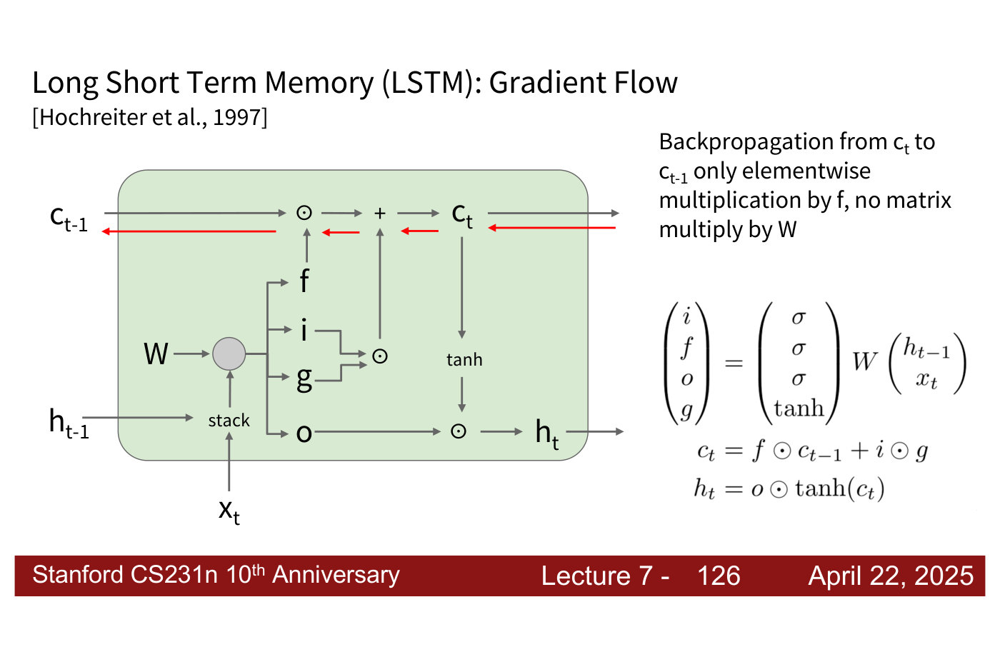

*Slide 126 — the gradient from cₜ to c(t−1) (red) runs along the cell-state line only, through one elementwise multiplication by f and no multiplication by W. [Deck](https://cs231n.stanford.edu/slides/2025/lecture_7.pdf)*

Do LSTMs solve the vanishing gradient problem (slide 128; ≈1:07:14)? They make it easier for the
RNN to preserve information over many time steps: "if the f = 1 and the i = 0, then the information
of that cell is preserved indefinitely", whereas a vanilla RNN has to learn a recurrent weight
matrix that preserves information at every step. But the "LSTM doesn't guarantee that there is no
vanishing/exploding gradient, but it does provide an easier way for the model to learn
long-distance dependencies". It "works very well empirically", and people would more often train an
LSTM than a vanilla RNN if they took the recurrent route, though these have "significantly fallen out
of fashion" (≈1:07:14–1:08:00). The LSTM is not implemented in the course, but it is "a really
commonly used baseline still in some deep learning papers" (≈1:06:28).

### Similar to ResNet

Adding values directly and skipping activation functions is "highly related" to ResNet's skip
connections, where a value is copied over and added after a block of convolutions (slide 129;
≈1:08:00–1:08:45). The LSTM does it over a long sequence of time steps rather than many layers of
depth, "a parallel, but it's a little different". In between sit **Highway Networks** (slide 130;
Srivastava et al., ICML DL Workshop 2015), where a learned gate $g$ mixes a layer's output with its
input:

$$g = T(x, W_T)$$

$$y = g \odot H(x, W_H) + (1 - g) \odot x$$

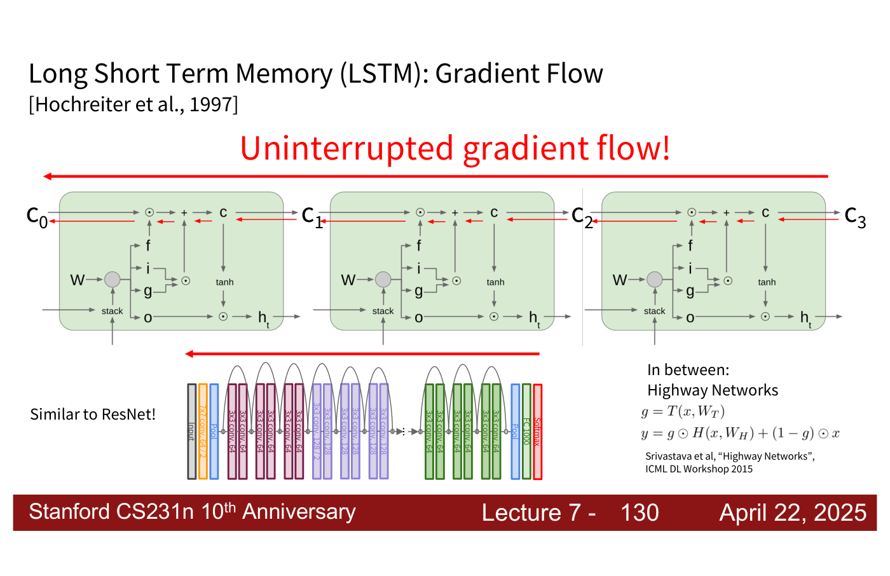

*Slide 130 — uninterrupted gradient flow along the LSTM's cell states (top), compared with ResNet's skip connections (bottom) and Highway Networks' gated version. ResNet's last stage is labelled "3x3 conv, 64", as in lecture 6. [Deck](https://cs231n.stanford.edu/slides/2025/lecture_7.pdf)*

See [CNN architectures](cnn-architectures.md#resnet-residual-connections) for ResNet itself.

## Modern RNNs

RNNs "have sort of made a bit of a resurgence in the last year or two", sometimes called **state
space models**, because of two advantages (slide 131; ≈1:08:45–1:10:18). They have unlimited context
length, while transformers' limited context length is "becoming more and more of an issue", with
workarounds such as RoPE. And their compute scales linearly with sequence length, because no
operation looks across the entire input sequence as in a transformer, whose compute scales
quadratically. The lecturer shouts out **RWKV** and **Mamba**, both highlighting linear-time sequence
modelling, and frames the research question as "how can you get the performance of transformers with
the scaling of RNNs?" (≈1:10:18). Slide 131's chart, "RWKV Scaling", plots accuracy against compute
(exaFLOP, log scale) for BLOOM, Pythia, OPT and RWKV: RWKV tracks Pythia and OPT closely, ending
highest at about 58, and BLOOM lies below the other three.

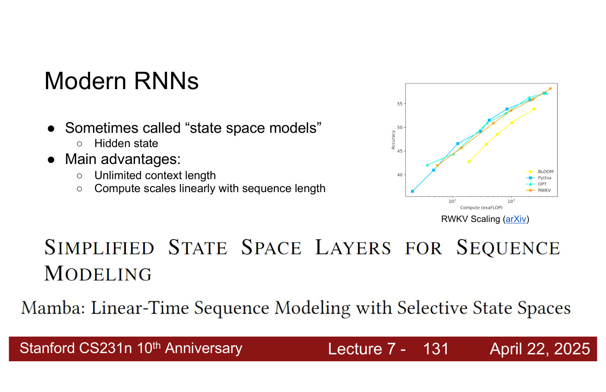

*Slide 131 — modern RNNs: "RWKV Scaling", accuracy against compute for four language models, with RWKV level with Pythia and OPT and BLOOM lowest; below, the titles of the S5 ("Simplified State Space Layers") and Mamba papers. [Deck](https://cs231n.stanford.edu/slides/2025/lecture_7.pdf)*

## Summary

Slide 132 (≈1:10:18–1:11:03): RNNs allow a lot of flexibility in architecture design. Vanilla RNNs
are simple but don't work very well. More complex variants (e.g. LSTMs, Mamba) introduce ways to
selectively pass information forward. The backward flow of gradients in an RNN can explode or vanish;
exploding is controlled with gradient clipping, and backpropagation through time is often needed.
Better and simpler architectures are a hot topic of current research, as are new paradigms for
reasoning over sequences. Next time: attention and transformers (slide 133).

## Related pages

- [Recurrent neural networks](recurrent-neural-networks.md) — sequence tasks, the recurrence,
  backpropagation through time, gradient flow, tradeoffs and modern RNNs.
- [LSTM](lstm.md) — gates, cell state and why its gradients flow more easily.
- [Character-level language models](language-models.md) — training, sampling, embeddings, generated
  text and interpretable cells.
- [Image captioning and visual question answering](image-captioning.md) — CNN plus RNN captioning,
  its failures, VQA, visual dialog and navigation.
- [Backpropagation](backpropagation.md) — the chain rule this lecture applies through time.
- [Normalization layers](normalization-layers.md#normalization-and-initialization) and
  [regularization](regularization.md#dropout) — the two clarifications of lecture 6.
- [CNN architectures](cnn-architectures.md#resnet-residual-connections) — ResNet's skip connections.
- Previous lecture: [Lecture 6 — Training CNNs and CNN Architectures](06-training-cnns-architectures.md).
