# Lecture 8 — Attention and Transformers

**CS231N Deep Learning for Computer Vision, Stanford, Spring 2025.** Delivered April 24, 2025.
The lecturer is not named in the recording or on the deck.
[Video](https://www.youtube.com/watch?v=RQowiOF_FvQ) ·
[edited transcript](../raw/transcripts/08-attention-transformers.md) ·
deck as [text](../raw/slides/08-attention-transformers.md) /
[PDF](https://cs231n.stanford.edu/slides/2025/lecture_8.pdf)

## What this lecture establishes

The lecture introduces two things (slide 4; ≈0:50). **Attention** is "a new primitive that
operates on sets of vectors", and the **Transformer** is "a neural network architecture that uses
attention everywhere". The lecturer's spoiler is that transformers are "basically the architecture
that we use for almost all problems in deep learning today" (≈1:36). Because attention grew out of
recurrent networks, the lecture follows that history (slide 5; ≈2:22). It starts from
**sequence-to-sequence translation with RNNs**, whose encoder squeezes the whole input into one
fixed-size context vector. **Attention** removes that bottleneck by letting the decoder look back
at every encoder state at every step. The lecture then pulls the mechanism out of the RNN as a
general **attention layer** with queries, keys and values, and specialises it to
**cross-attention**, **self-attention**, **masked** and **multi-headed** self-attention. It shows
that self-attention is just four matrix multiplies with quadratic cost in the sequence length, and
compares it with recurrence and convolution as ways of processing sequences. Finally it builds the
**Transformer block** (self-attention and a per-vector MLP, each wrapped in a residual connection
and layer normalization) and applies stacks of them to **language modelling** and to images, the
**Vision Transformer (ViT)**. The slides add four later changes to the block — pre-norm, RMSNorm,
SwiGLU and mixture of experts — which the recording leaves as reading.

The topic pages [attention](attention.md) and [transformers](transformers.md) gather these
concepts in one place.

**What the recording covers.** The recording opens at 0:04 with the recap and never presents the
administrative slide (summarised below from the slide alone). It follows the deck in order and
ends at 1:06:08 with the summary. Four parts of the deck are not walked through, so the slides are
the only source for them:

The matrix-shape and memory slides (68–78) are covered only by the lecturer's summary that
self-attention is four matrix multiplies (≈56:07–57:40) and his remark on its quadratic cost
(≈59:58); he says "there's some stuff there that we can skip" (≈57:40). The GPT-2 and GPT-3 sizes
on slides 94–95 are not mentioned. The language-modelling slides (96–99) get one sentence ("as
we've already seen", ≈1:04:36) besides the masking passage (≈54:33). And the "Tweaking
Transformers" slides (110–120) are left "as extra reading" because "we're running out of time"
(≈1:05:22).

Several passages are spoken only: the question and answer on initialising the decoder
(≈14:38–17:44), the paper's recent award (≈26:12), a search-engine analogy for keys and values
(≈40:46–41:34), a remark on "decoder-only attention" (≈48:26–49:11), and arguments that
parallelism is what lets computation scale and that attention's quadratic cost "is actually a good
thing" (≈1:00:44–1:02:18).

**Printed slips and oddities, kept as printed in the slide file.** Slide 62's faded output line
reads Y = AX where slides 47–61 print Y = AV (slide 63 repeats it). The multi-head slides
(66–78) keep the single-head scale $\sqrt{D_Q}$, although $D_Q$ is not among their inputs and each
head's queries have dimension $D_H$. Slide 77's "1.192 TB" mixes units (see
[the cost section](#self-attention-is-four-matrix-multiplies)). Slide 82 prints $O(N)$ memory for
self-attention, which slide 78 gives only with Flash Attention. Slide 111 prints "identify
function" for identity function. And slide 113's RMSNorm averages over "N" entries of a vector
whose shape it gives as D. The worked values that can be recomputed check out: the example
attention weights on slides 18 and 22 each sum to 1, slide 104's patch has 768 values, and slide
115's SwiGLU keeps the classic MLP's parameter count.

## Administrative notes (slides only)

Slide 2, not presented in the recording: Assignment 2 was released "yesterday" (4/23), and project
proposals are due "tomorrow" (4/25). See [course logistics](course-logistics.md).

## Recap: processing sequences

Last lecture's recurrent networks process sequences, which opens up problems beyond the
one-to-one pattern of image classification (slide 3; ≈0:04–0:50): one to many (image captioning,
input an image and output a sentence), many to one (classify a sequence of video frames) and many
to many. The two figures of slide 4 preview where the lecture is going: on the left, the
self-attention diagram built later in the lecture, and on the right, two Transformer blocks
stacked. Slide 5 adds the framing: "Transformers are used everywhere today! But they developed as
an offshoot of RNNs so let's start there."

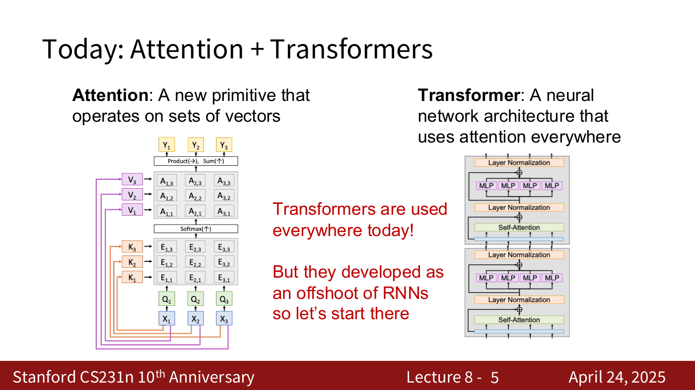

*Slide 5 — the two things this lecture builds: attention (left, queries Q, keys K and values V combined through a grid of similarities and a softmax) and the Transformer (right, a stack of blocks of self-attention, layer normalization and MLPs). [Deck](https://cs231n.stanford.edu/slides/2025/lecture_8.pdf)*

The lecturer stresses that transformers did not feel like a sudden break when they appeared: the
ideas of attention and self-attention "had actually been around in the field for several years at
that time", and they developed out of recurrent neural networks (≈2:22).

## Sequence to sequence with RNNs

The motivating problem is machine translation, English to Italian (slide 6; ≈3:07). The input is a
sequence $x_1, \dots, x_T$ and the output a sequence $y_1, \dots, y_{T'}$. The two lengths can
differ, and the words need not correspond one to one or come in the same order. The approach,
cited to Sutskever et al. (NeurIPS 2014), uses two recurrent networks (≈3:53–6:58).

The **encoder** reads the input one token per step:

$$h_t = f_W(x_t, h_{t-1})$$

where $x_t$ is the input at step $t$ and $h_t$ the hidden state. The lecturer's example sentence
is "we see the sky", chosen short "to fit on slides and still have all the boxes show up"
(≈3:53–4:39). From the final hidden state the model predicts an **initial decoder state** $s_0$
and a **context vector** $c$, "often $c = h_T$" (slide 7). Because of the recurrence, the last
hidden state has seen the whole input, so it can be thought of as summarising it (≈5:25).

The **decoder** is a second RNN, with the same basic architecture but its own weights (≈5:25–6:11):

$$s_t = g_U(y_{t-1}, s_{t-1}, c)$$

At every step it takes the previous output token $y_{t-1}$, its previous state $s_{t-1}$ and the
same context vector $c$, and produces the next output token, starting from a [START] token and
ending with [STOP] (slides 8–10: "vediamo il cielo"). "I don't speak Italian," the lecturer says,
"so I'm not going to try to pronounce these" (≈6:11).

The **problem** is that the "input sequence bottlenecks through fixed sized c. What if T=1000?"
(slide 11). The context vector's size is fixed when the network is designed — "128 floats, 1024
floats" — and does not grow with the input (≈6:58–7:43). Four words may fit in it; "a whole
paragraph, or a whole book" will not. The **solution**: "Look back at the whole input sequence on
each step of the output" (slide 12; ≈7:43–8:30). One way of telling the story, the lecturer says,
is that attention and transformers "all came from trying to solve this bottleneck problem in
recurrent neural networks" (≈8:30).

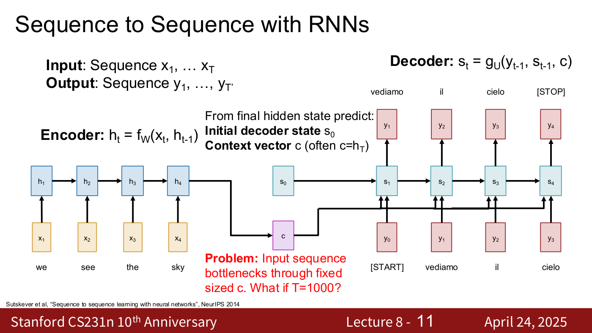

*Slide 11 — the encoder (blue h₁…h₄ over "we see the sky") hands the decoder (s₁…s₄) one context vector c, the purple box every decoder step reads; that single fixed-size vector is the bottleneck. [Deck](https://cs231n.stanford.edu/slides/2025/lecture_8.pdf)*

## Sequence to sequence with RNNs and attention

The encoder stays the same, and the decoder still needs an initial state $s_0$ (slide 13; ≈9:16).
What changes is how the context vector is made: at each decoder step, the decoder looks back at
all the encoder states. The deck cites Bahdanau et al., "Neural machine translation by jointly
learning to align and translate", ICLR 2015.

**Alignment scores.** First compute a scalar score for each encoder state, saying how well it
matches the current decoder state (slide 14):

$$e_{t,i} = f_{att}(s_{t-1}, h_i)$$

Here $f_{att}$ "is a Linear Layer": it concatenates the decoder state with one encoder state and
"squashes that down into a scalar", and is learned by gradient descent with everything else
(≈10:01–10:47). With four input tokens there are four scores $e_{11}, \dots, e_{14}$ for the first
step.

**Attention weights.** The scores are unbounded, so a softmax turns them into a distribution over
the input positions (slide 15; ≈10:47–11:33):

$$0 \lt a_{t,i} \lt 1, \qquad \sum_i a_{t,i} = 1$$

**Context vector.** The new context vector is the weighted sum of the encoder hidden states
(slide 16; ≈12:19):

$$c_t = \sum_i a_{t,i} h_i$$

and the decoder uses it in place of the fixed $c$ (slide 17):

$$s_t = g_U(y_{t-1}, s_{t-1}, c_t)$$

where $g_U$ "is an RNN unit (e.g. LSTM, GRU)". The decoder RNN itself is unchanged; "all we did is
compute the context vector in a different way" (≈13:05).

**Intuition.** The context vector "attends to the relevant part of the input sequence" (slide 18).
"vediamo" means "we see", so the slide suggests that perhaps $a_{11} = a_{12} = 0.45$ and
$a_{13} = a_{14} = 0.05$: when producing "vediamo" the network should look at "we see" and not
care about "the sky" (≈13:53). Nothing tells it to: "All differentiable! No supervision on
attention weights. Backprop through everything" (slide 19). The only loss is still the
cross-entropy on the output tokens, and in learning to predict them the network learns for itself
where to attend. Supervising the alignment directly would need training data that is hard to get
(≈14:38).

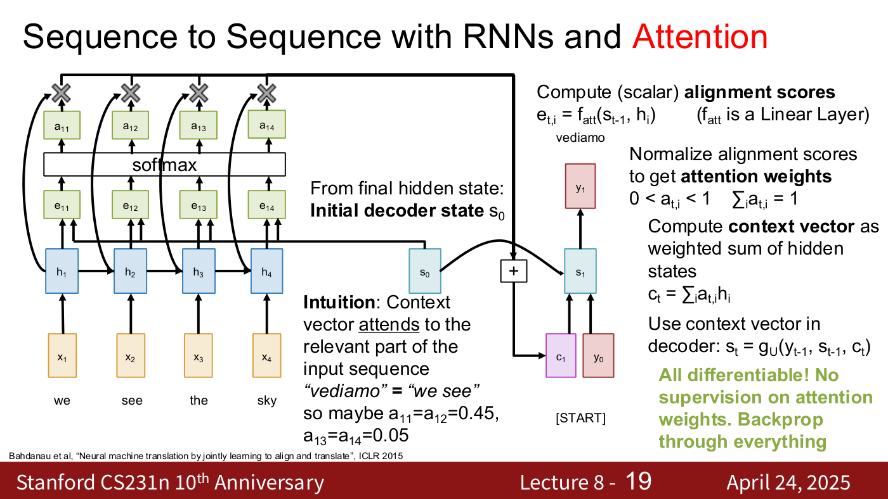

*Slide 19 — one decoder step with attention: s₀ is scored against every encoder state (green e₁₁…e₁₄), the softmax turns the scores into weights a₁₁…a₁₄, and the weighted sum of h₁…h₄ (the ✕ nodes and the "+") becomes the context vector c₁ that feeds s₁. [Deck](https://cs231n.stanford.edu/slides/2025/lecture_8.pdf)*

**Questions on this step** (≈14:38–17:44). Asked how the decoder is initialised, the lecturer
separates two meanings. The decoder's *weights* are initialised randomly and trained like any
others. Its *initial hidden state* needs some rule: sometimes the encoder's last hidden state, a
learned projection of it, or even all zeros, any of which works "as long as you train the network
to expect that kind of input". He also says that "there's a connection from s0 to s1 that we're
not drawing … I think I just dropped the s0 arrow" (≈16:58), although the exported slides 17–19 do
draw a curved arrow from $s_0$ into $s_1$. Asked why the mechanism should work, he answers that
in language there is often a correspondence between output and input words, so the network is
given a way to pick out the relevant input, but is never told how to use it (≈16:58–17:44).

**Repeat at every step.** For the second decoder step, $s_1$ is compared against all the encoder
states with the same $f_{att}$, giving new scores $e_{2,i}$, new weights $a_{2,i}$ and a new
context vector $c_2$ (slides 20–21; ≈17:44–19:15). For "il", which means "the", the slide suggests
$a_{21} = a_{22} = 0.05$, $a_{23} = 0.8$ and $a_{24} = 0.1$, high weight on a single input word
(slide 22; ≈19:15–20:01).

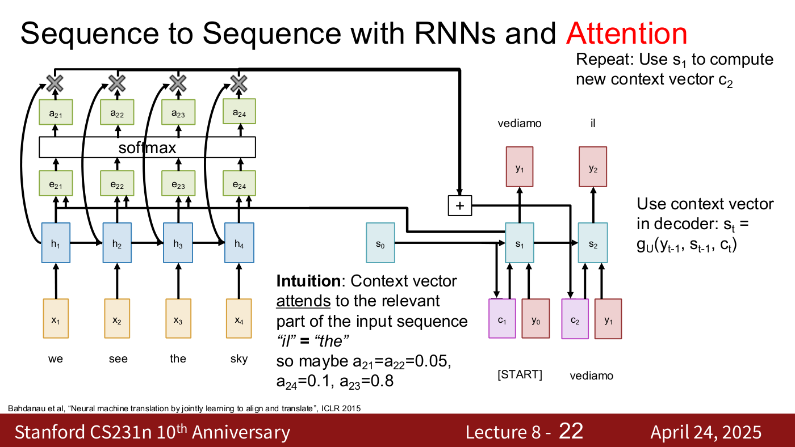

*Slide 22 — the second step reuses the same machinery with s₁ as the query: new weights a₂₁…a₂₄ give a new context vector c₂ for producing "il", with most weight expected on "the". [Deck](https://cs231n.stanford.edu/slides/2025/lecture_8.pdf)*

The result: "Use a different context vector in each timestep of decoder". The "input sequence [is]
not bottlenecked through single vector", and "at each timestep of decoder, context vector 'looks
at' different parts of the input sequence" (slide 23; ≈20:01–20:47). It is called attention
because the network attends to different parts of the input at each moment of its output.

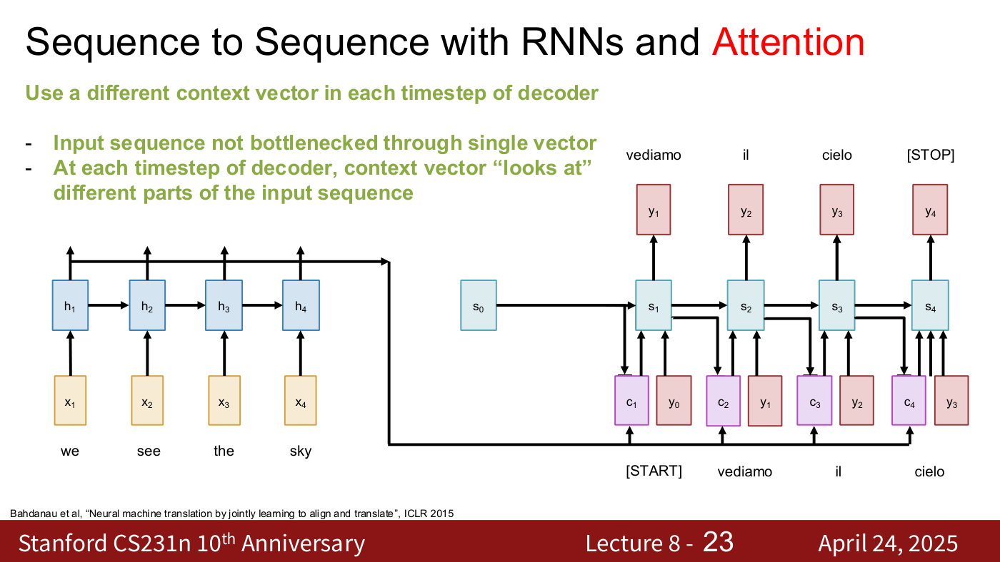

*Slide 23 — the whole decoder with the attention machinery collapsed: each decoder state s₁…s₄ gets its own context vector c₁…c₄ computed from all of h₁…h₄. [Deck](https://cs231n.stanford.edu/slides/2025/lecture_8.pdf)*

## Visualising attention weights

Attention also lets us see what the network looked at (≈20:47–21:33). Each output word's weights
are a distribution over the input words, so stacking them gives a matrix: one row per output word,
one column per input word (slides 24–27, figures from Bahdanau et al.). The example is English to
French: "The agreement on the European Economic Area was signed in August 1992." becomes "L'accord
sur la zone économique européenne a été signé en août 1992." (slide 25).

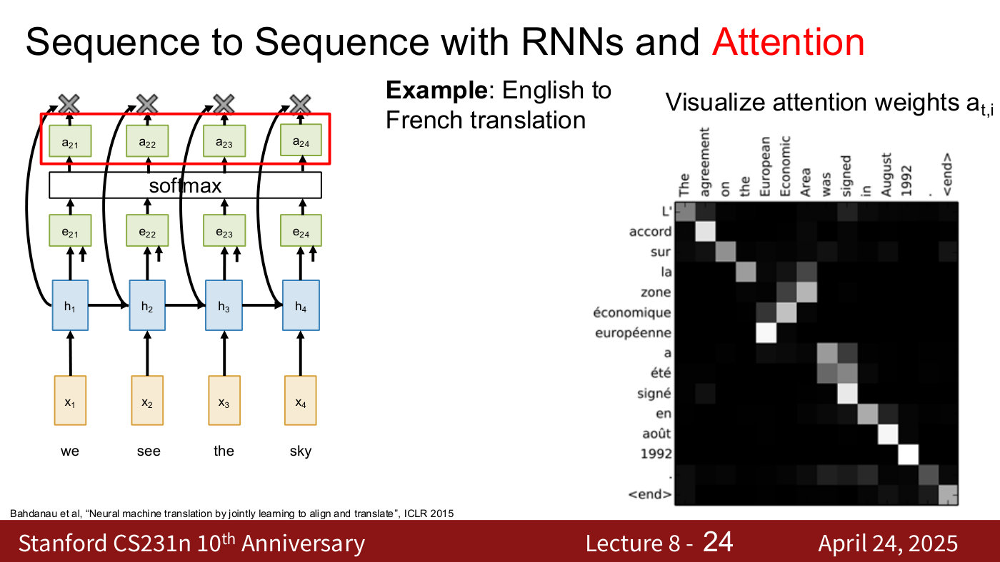

*Slide 24 — the red box marks one step's weights a₂₁…a₂₄; the heatmap at right stacks such rows, one per French output word, over the English input words, with bright cells for high weight. [Deck](https://cs231n.stanford.edu/slides/2025/lecture_8.pdf)*

The first row puts its weight on "The"; the second, "accord", on "agreement" (≈22:18–23:05).
"Diagonal attention means words correspond in order" (slide 26): "The agreement on the" maps to
"L'accord sur la", and "August 1992" to "en août 1992" (≈23:05–23:51). (At ≈23:05 the lecturer
says these words correspond to "the first four words of the input sequence", meaning the
output.) In the middle, "Attention figures out other word orders" (slide 27): "European Economic
Area" becomes "zone économique européenne", and the weights run along a backward diagonal
(≈24:38). The lecturer also points out a small 2 by 2 block there, where two French words did not
"disentangle perfectly" from two English ones (≈25:25).

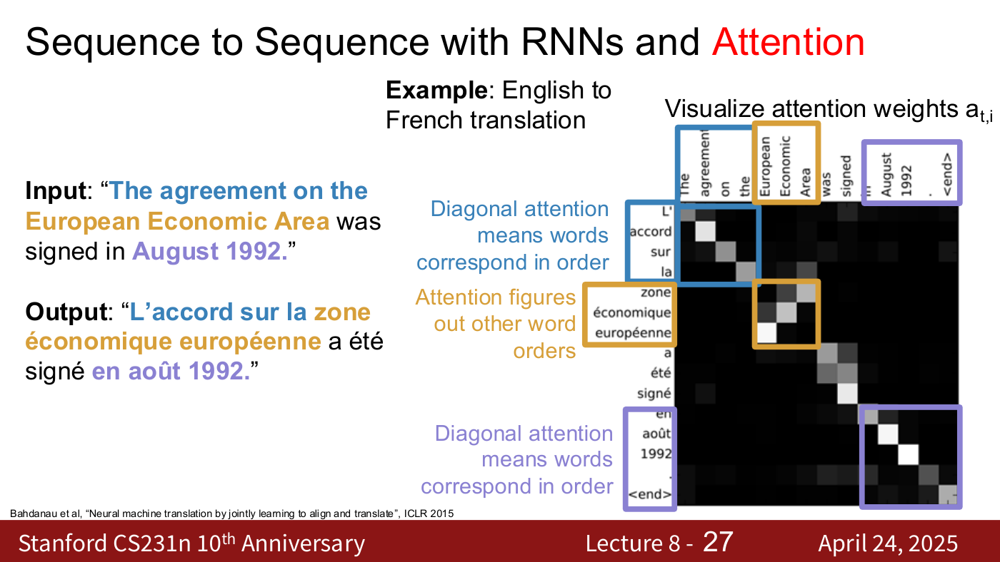

*Slide 27 — look at the gold box: "zone économique européenne" attends to "Area", "Economic", "European" in reverse order, the anti-diagonal; the blue and purple boxes are the in-order diagonals. [Deck](https://cs231n.stanford.edu/slides/2025/lecture_8.pdf)*

Asked how the network figures out the grammar, the lecturer answers "that's the mystery of deep
learning" (≈23:51). It was told nothing about grammar, only given input–output pairs and a
mechanism that its designers thought might help, and gradient descent found how to use it
(≈23:51–24:38). This was "the initial usage of attention in machine learning", from the 2015
paper, which "just won the runner-up Test of Time award at ICLR 2025" (≈25:25–26:12; the award is
spoken only).

## The attention layer

"There's a general operator hiding here" (slide 28; ≈26:12). Attention fixed the RNN, but it is
useful on its own, so the lecture pulls it out of the RNN. In the translation model, the
**query vectors** are the decoder RNN states, the **data vectors** are the encoder RNN states, and
the **output vectors** are the context vectors: "Each query attends to all data vectors and gives
one output vector" (slide 29; ≈26:58–29:16). The lecturer admits this is tricky, "a lot of boxes,
and we're changing the words that we're using to define the boxes", and walks through it twice
(≈28:30).

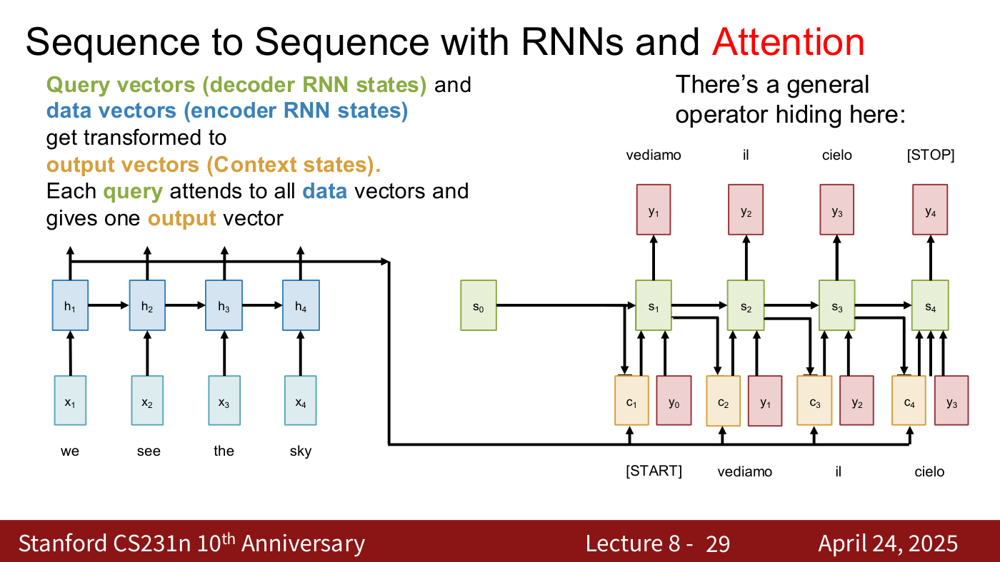

*Slide 29 — the same model recoloured by role: green decoder states are the queries, blue encoder states the data vectors, and the peach context vectors the outputs. [Deck](https://cs231n.stanford.edu/slides/2025/lecture_8.pdf)*

Written as a layer of its own (slides 30–34; ≈30:01–31:33), the inputs are a **query vector**
$q$ of dimension $D_Q$ and **data vectors** $X$ of shape $[N_X \times D_X]$. The computation is:

$$e_i = f_{att}(q, X_i) \qquad a = \mathrm{softmax}(e) \qquad y = \sum_i a_i X_i$$

the similarities $e$ and weights $a$ having $N_X$ entries and the output $y$ dimension $D_X$.
Where the query vectors come from, "the attention operator doesn't care" (≈30:47).

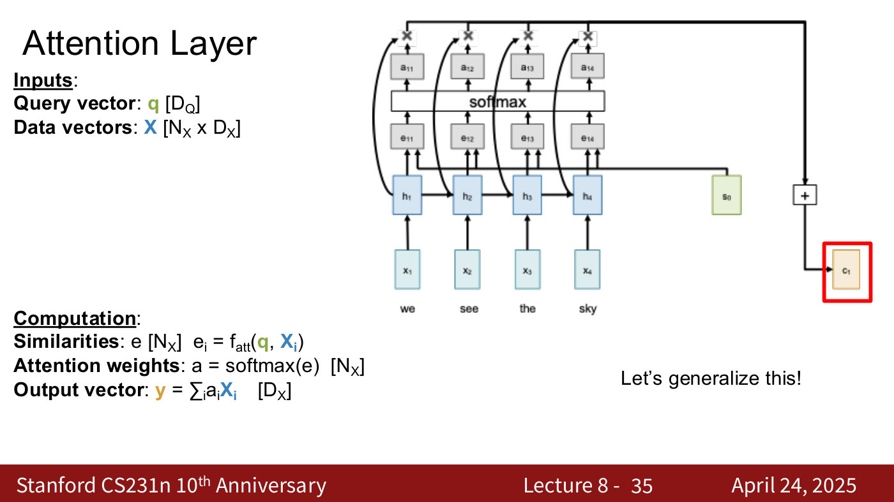

*Slide 35 — the attention layer written beside the RNN diagram it came from, with the output vector y (the context vector c₁) boxed in red; "Let's generalize this!" [Deck](https://cs231n.stanford.edu/slides/2025/lecture_8.pdf)*

The lecture then generalises it in four steps (slides 36–40).

**Dot-product similarity.** $f_{att}$ could be "any function of two vectors that outputs a
scalar", but the simplest is a dot product, which turns out to be good enough (slide 36;
≈31:33–32:19):

$$e_i = q \cdot X_i$$

**Scaled dot product.** In practice the dot product is divided by the square root of the vector
dimension (slide 37):

$$e_i = q \cdot X_i / \sqrt{D_X}$$

The slide's reason is that "large similarities will cause softmax to saturate and give vanishing
gradients" (slide 38). It recalls $a \cdot b = |a||b| \cos(\text{angle})$, and for constant vectors
$a$ and $b$ of dimension $D$, $|a| = (\sum_i a^2)^{1/2} = a\sqrt{D}$, so the size of a dot product
grows with the dimension. The lecturer's spoken example compares constant all-ones vectors of
dimension 10 and 100, which give more squashed probability scores at the higher dimension, then
vanishing gradients (≈32:19–33:06). Scaling by the square root of the dimension gives "nicer
gradient flow through the softmax for a wider range of dimensions of vectors". This matters
because networks keep getting bigger, and bigger vectors mean "more compute, more capacity"
(≈33:06–33:52).

**Multiple queries.** Rather than one query at a time, process a set of them together: queries
$Q$ of shape $[N_Q \times D_Q]$ (slide 39; ≈33:52–36:10). All the query–data dot products are then
one matrix multiply, and the softmax runs over one axis of the result:

$$E = QX^T / \sqrt{D_X} \quad [N_Q \times N_X], \qquad E_{ij} = Q_i \cdot X_j / \sqrt{D_X}$$

$$A = \mathrm{softmax}(E, \text{dim}=1) \quad [N_Q \times N_X]$$

$$Y = AX \quad [N_Q \times D_X], \qquad Y_i = \sum_j A_{ij} X_j$$

Each entry of a matrix product is a dot product of a row of one matrix and a column of the other,
which is exactly what the similarities need, and the weighted combinations of data vectors are a
second matrix multiply (≈35:24–37:42). (Here the lecturer pauses: "oh man, am I going to get the
rows and the columns the right way?", ≈36:56.)

**Separate keys and values.** In that formula the data vectors $X$ do two jobs: they are compared
with the queries, and they are what gets combined into the output. The last generalisation
separates the two uses, and lets the network learn each (≈37:42–39:14). Two learnable matrices
project every data vector into a **key**, compared with the queries, and a **value**, which is
combined into the output (slide 40):

$$K = XW_K \quad [N_X \times D_Q], \qquad V = XW_V \quad [N_X \times D_V]$$

$$E = QK^T / \sqrt{D_Q} \quad [N_Q \times N_X], \qquad E_{ij} = Q_i \cdot K_j / \sqrt{D_Q}$$

$$A = \mathrm{softmax}(E, \text{dim}=1) \quad [N_Q \times N_X]$$

$$Y = AV \quad [N_Q \times D_V], \qquad Y_i = \sum_j A_{ij} V_j$$

The key matrix $W_K$ is $[D_X \times D_Q]$, because keys are compared with queries and must have
the same dimension; the value matrix $W_V$ is $[D_X \times D_V]$, and the value dimension "in
principle could be different" (≈40:00). This also answers an earlier question: the query and data
vectors no longer need the same size (≈33:52).

The lecturer's intuition is a search engine (≈40:46–41:34). You type a query such as "what is the
best school in the world" into Google, "or these days ChatGPT". The query is matched against keys
on the back end, but what you want back, the value, is different from the query: "Stanford". So
"the query is what I'm looking for", the key is what it is matched against, and the value is what
comes back. Asked how the network divides a data vector into keys and values, he says "we don't
have to say how": $W_K$ and $W_V$ are learned by gradient descent, and might be thought of as two
ways of filtering the information in a data vector (≈43:04–44:35).

### The cross-attention layer, step by step

Slides 41–46 draw the layer without the RNN (≈41:34–44:35). Four query vectors $Q_1, \dots, Q_4$
and three data vectors $X_1, X_2, X_3$ come in. Each data vector is projected to a key and a value,
and every key is compared with every query, filling a $3 \times 4$ grid of similarities
$E_{i,j}$ (query $i$'s column, key $j$'s row). The "Softmax normalizes each column: each query
predicts a distribution over the keys" (slide 44). Finally "Each output is a linear combination
of all values, weighted by attention weights" (slide 45). On the slides each query's similarities
form a column of the grid, while in the matrix $E$ of shape $[N_Q \times N_X]$ they form a row,
which $\text{dim}=1$ normalises. The lecturer first says the softmax runs "over each row", then
corrects himself: "we want each column to be a distribution, because for each query we want a
distribution over the keys" (≈42:19–43:04).

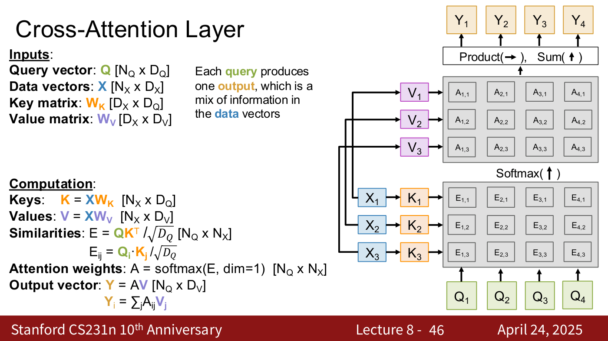

*Slide 46 — the cross-attention layer: four queries (green, bottom) and three data vectors (blue, left) projected to keys and values; each column of the similarity grid is one query, softmaxed upwards, and each output Y is that column's mix of the values V. [Deck](https://cs231n.stanford.edu/slides/2025/lecture_8.pdf)*

This is the **cross-attention layer** (slide 46): it has two sets of inputs, query vectors and data
vectors, possibly from different sources and of different numbers, and two learnable matrices.
"Each query produces one output, which is a mix of information in the data vectors"
(≈44:35–45:21).

## The self-attention layer

More common still is **self-attention**, with only one set of input vectors (slide 47;
≈45:21–46:55). Each input vector is projected to a query, a key and a value, and "each input
produces one output, which is a mix of information from all inputs". The inputs are $N$ vectors
$X$ of shape $[N \times D_{in}]$, with three learnable matrices $W_Q$, $W_K$, $W_V$, each
$[D_{in} \times D_{out}]$:

$$Q = XW_Q, \qquad K = XW_K, \qquad V = XW_V \qquad [N \times D_{out}]$$

$$E = QK^T / \sqrt{D_Q} \quad [N \times N], \qquad E_{ij} = Q_i \cdot K_j / \sqrt{D_Q}$$

$$A = \mathrm{softmax}(E, \text{dim}=1) \quad [N \times N]$$

$$Y = AV \quad [N \times D_{out}], \qquad Y_i = \sum_j A_{ij} V_j$$

"Shapes get a little simpler": $N$ input vectors of dimension $D_{in}$, and "almost always
$D_Q = D_V = D_{out}$" (slide 47). The rest of the computation is the same as cross-attention; the
keys, queries and values just happen to come from projections of the same vectors (≈46:55).

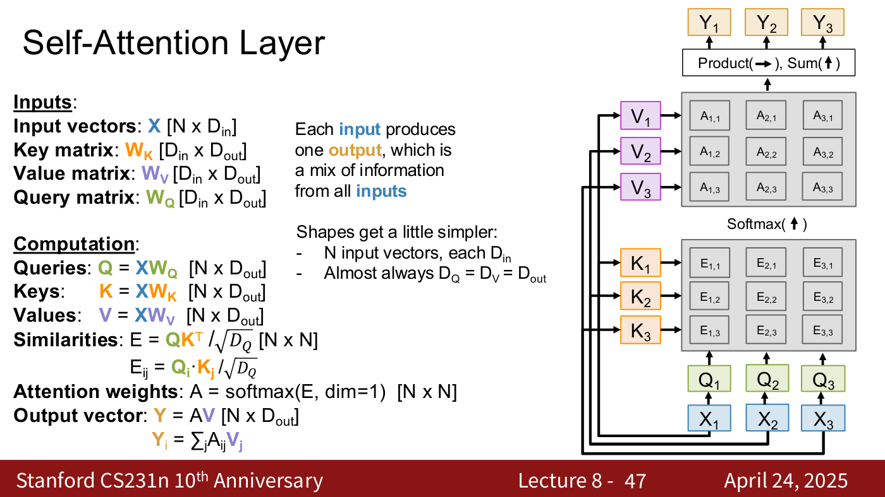

*Slide 47 — self-attention: each input X₁…X₃ (blue, bottom) produces its own query, key and value, so the grids are 3-by-3 and there is one output Y per input. [Deck](https://cs231n.stanford.edu/slides/2025/lecture_8.pdf)*

Slides 48–51 rebuild the figure step by step: from each input compute a query, key and value;
compute the similarity between each query and each key; normalise over each column so that each
query has a distribution over keys; and compute the outputs as linear combinations of the values.
The three projections are "often fused to one matmul":
$[Q \thinspace K \thinspace V] = X [W_Q \thinspace W_K \thinspace W_V]$, of shape
$[N \times 3D_{out}] = [N \times D_{in}] [D_{in} \times 3D_{out}]$ (slide 48), because hardware is
more efficient at a few large matrix multiplies than at many small ones (≈47:40–48:26).

Asked what $D_{in}$ and $D_{out}$ are, the lecturer calls them architectural hyperparameters, as
for a linear layer; they could in principle differ, but "in practice they're almost always the
same" (≈46:55–47:40). He also remarks that where transformers are described as encoder and decoder,
this layer "would be the decoder-only attention", which he calls "the most commonly used flavor of
attention nowadays", and that in this generalisation it "can no longer be used in that decoder in
the RNN" of the translation example (≈48:26–49:11; spoken only).

**Self- or cross-attention?** Use cross-attention when a problem naturally has two kinds of things
to compare: an input and an output sentence in translation, or pieces of an image and the words
being generated in captioning. Use self-attention when there is one: in image classification
"there's only an image", and parts of the image are compared with each other. The point is to
reuse "the same machinery and the same computational primitives" across problems
(≈49:11–50:43).

## Permutation equivariance and positional encoding

What happens if the inputs are shuffled (slides 52–57; ≈50:43–52:15)? The queries, keys and values
are the same but permuted, because each is a projection of its own input. The similarities are dot
products, so they are the same but permuted. The softmax does not care about the order of its
inputs, so the attention weights are the same but permuted. And the outputs, linear combinations
of the values, are the same but permuted. Self-attention is therefore **permutation equivariant**
(slide 57):

$$F(\sigma(X)) = \sigma(F(X))$$

where $F$ is the layer and $\sigma$ a permutation of the inputs. "This means that Self-Attention
works on sets of vectors": they happen to be packed into a matrix in some order, but the outputs
do not depend on that order (≈52:15). The lecturer links it to convolution's equivariance from an
earlier lecture (≈51:29).

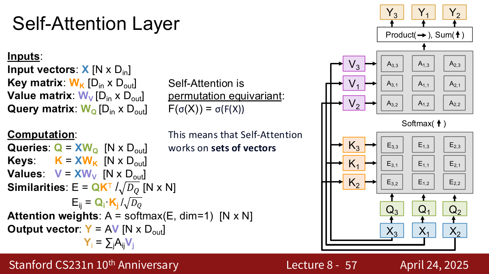

*Slide 57 — permutation equivariance: feed the inputs in the order X₃, X₁, X₂ and every query, key, similarity, weight and output comes out the same, permuted the same way. [Deck](https://cs231n.stanford.edu/slides/2025/lecture_8.pdf)*

A student asks whether shuffled inputs would train to the same result. The lecturer clarifies that
he is not talking about training: with the weights fixed, shuffling the inputs gives the same
output vectors, shuffled the same way (≈53:01).

"Problem: Self-Attention does not know the order of the sequence" (slide 58). "Solution: Add
positional encoding to each input; this is a vector that is a fixed function of the index"
(slide 59), drawn as a box $E(i)$ under each input $X_i$. The lecturer describes it as
concatenating "an additional piece of data onto each of the input vectors, called a positional
embedding", which tells the network "this one's at index one, this one's at index two", and says
"there's a bunch of different mechanisms for that" without naming any (≈52:15–53:01).

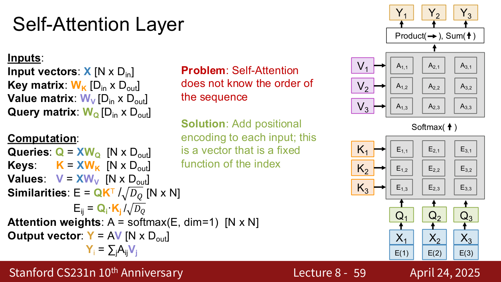

*Slide 59 — the fix for order-blindness: a positional encoding E(1), E(2), E(3) attached to each input X₁, X₂, X₃. [Deck](https://cs231n.stanford.edu/slides/2025/lecture_8.pdf)*

## Masked self-attention

In full self-attention every input looks at every other. **Masked self-attention** restricts which
inputs each vector may look at: "Override similarities with -inf" (slide 60; ≈53:47–54:33). A
$-\infty$ similarity becomes 0 after the softmax, so the output does not depend on the value at
that position. Its use is language modelling, "where you want to predict the next word": "Don't let
vectors 'look ahead' in the sequence" (slide 61). With the input "Attention is very" and the target
"is very cool", the first output may depend only on the first word and the second only on the
first two, so that the network cannot "look ahead in the sequence and cheat" (≈54:33–55:20). With
masking, the language-modelling task of the last lecture can be done "natively with this
self-attention block", with no RNN at all (≈54:33).

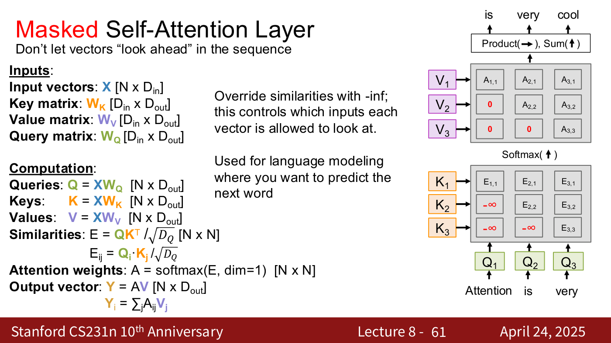

*Slide 61 — masking: the red −∞ entries in the similarity grid become red 0s in the attention weights, so query 1 ("Attention") sees only key 1 and query 2 ("is") only keys 1 and 2. [Deck](https://cs231n.stanford.edu/slides/2025/lecture_8.pdf)*

On the slide the masked entries are $E_{1,2}$, $E_{1,3}$ and $E_{2,3}$, those where the key comes
after the query.

## Multi-headed self-attention

"Run H copies of Self-Attention in parallel" (slides 62–67; ≈55:20–56:07). With $H = 3$, three
"independent self-attention layers (called heads), each with their own weights" all read the same
inputs. "Stack up the H independent outputs for each input X", and an "output projection fuses
data from each head". The lecturer's reason is capacity: "it's more FLOPs, it's more parameters. In
deep learning we always want more and bigger" (≈55:20). This is "basically the format that we
always see in practice" (≈56:07).

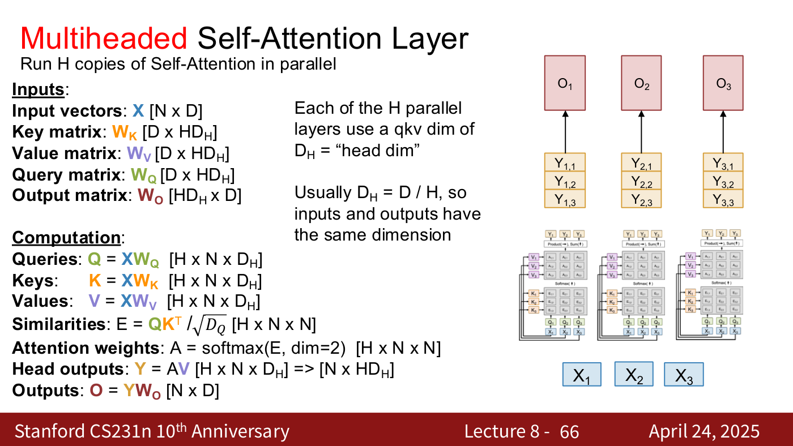

*Slide 66 — three heads run side by side on X₁…X₃; each input's three head outputs (orange stacks Yᵢ,₁…Yᵢ,₃) are fused by the output projection into one output O. [Deck](https://cs231n.stanford.edu/slides/2025/lecture_8.pdf)*

In equations (slide 66), with $X$ of shape $[N \times D]$, the projections $W_Q$, $W_K$, $W_V$ of
shape $[D \times HD_H]$ and an output matrix $W_O$ of shape $[HD_H \times D]$:

$$Q = XW_Q, \qquad K = XW_K, \qquad V = XW_V \qquad [H \times N \times D_H]$$

$$E = QK^T / \sqrt{D_Q} \quad [H \times N \times N], \qquad A = \mathrm{softmax}(E, \text{dim}=2) \quad [H \times N \times N]$$

$$Y = AV \quad [H \times N \times D_H] \Rightarrow [N \times HD_H], \qquad O = YW_O \quad [N \times D]$$

"Each of the H parallel layers use a qkv dim of $D_H$ = 'head dim'", and "usually $D_H = D/H$, so
inputs and outputs have the same dimension" (slide 66). The slide's scale is printed
$\sqrt{D_Q}$, carried over from the single-head slides, where each head's query dimension is
$D_H$. "In practice, compute all H heads in parallel using batched matrix multiply operations"
(slide 67), with no loop over heads (≈56:07).

Two questions follow (≈57:40). The heads all see exactly the same inputs; "the only thing
different between the different heads is the weights", which are initialised randomly and
differently, so the heads learn to process the inputs in different ways.

## Self-attention is four matrix multiplies

However many vectors are flying around, the layer is "basically just four big batched matrix
multiplies" (slides 68–72; ≈56:07–57:40):

1. **QKV projection**: $[N \times D] [D \times 3HD_H] \Rightarrow [N \times 3HD_H]$, then split and
   reshape into $Q$, $K$, $V$, each $[H \times N \times D_H]$.
2. **QK similarity**: $[H \times N \times D_H] [H \times D_H \times N] \Rightarrow [H \times N \times N]$.
3. **V-weighting**: $[H \times N \times N] [H \times N \times D_H] \Rightarrow [H \times N \times D_H]$,
   reshaped to $[N \times HD_H]$.
4. **Output projection**: $[N \times HD_H] [HD_H \times D] \Rightarrow [N \times D]$.

Matrix multiplies are "a really scalable, powerful primitive" that can be distributed, optimised
and run in parallel (≈56:53–57:40).

The cost questions are on the slides only. Compute grows as $O(N^2)$ with the number of vectors
$N$, from steps 2 and 3 (slides 73–74), and so does memory (slides 75–76). "If N=100K, H=64 then
HxNxN attention weights take 1.192 TB! GPUs don't have that much memory…" (slide 77). That is
$64 \times 10^{10} = 6.4 \times 10^{11}$ weights; the slide does not say how many bytes each takes.
At 2 bytes each the total is $1.28 \times 10^{12}$ bytes, which is 1,192 GiB, so the printed
"1.192 TB" divides a GiB count by 1,000 and its units are mixed (1.28 TB in decimal units). The way
out is **Flash Attention** (Dao et al., 2022): the algorithm "computes 2+3 at the same time without
storing the full attention matrix", making memory $O(N)$ "and large N possible" (slide 78).

## Three ways of processing sequences

The lecture now has three primitives for sequences (slides 79–82; ≈58:26–59:58).

A **recurrent neural network** "works on 1D ordered sequences". It is theoretically good at long
sequences, with $O(N)$ compute and memory for a sequence of length $N$, but it is not
parallelisable: hidden states must be computed one after another (slide 80). That makes RNNs
"very difficult to scale, very difficult to make very big" (≈58:26).

**Convolution** "works on N-dimensional grids", 1D to 4D as well as images. It is parallelisable,
because every position of the kernel can be computed at once, but bad for long sequences: it
"need[s] to stack many layers to build up large receptive fields" (slide 81; ≈58:26–59:13).

**Self-attention** "works on sets of vectors". It is great for long sequences, since "each output
depends directly on all inputs", and highly parallel, "it's just 4 matmuls", but expensive: the
slide prints $O(N^2)$ compute and $O(N)$ memory "for sequence of length N" (slide 82). The $O(N)$
memory is what slide 78 gives with Flash Attention; slides 76–77 give $O(N^2)$ without it, and so
does the lecturer, who says it has "N squared compute … and N squared [unclear] memory" (≈59:58).
His remedy for the cost: "you can solve that by buying more GPUs" (≈59:58–1:00:44).

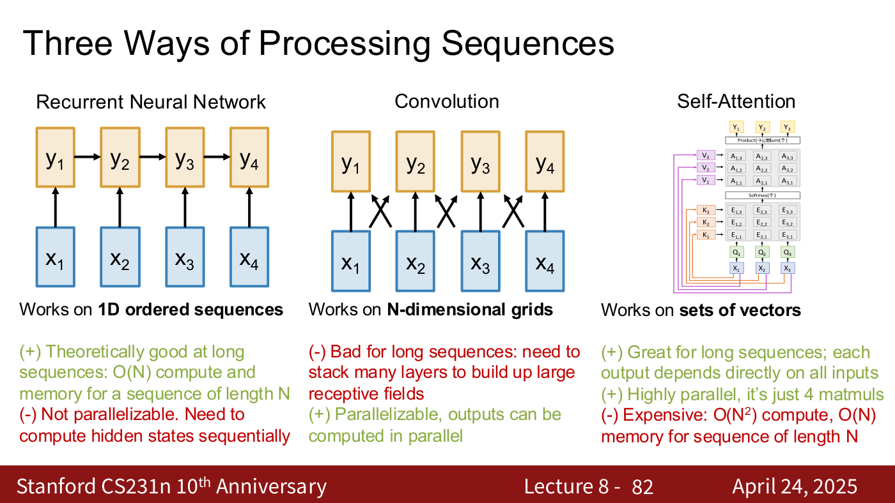

*Slide 82 — the three primitives side by side: an RNN chains its outputs left to right, a convolution mixes each position with its neighbours, and self-attention lets every output read every input. [Deck](https://cs231n.stanford.edu/slides/2025/lecture_8.pdf)*

Which to use? Slide 83 answers with the title of Vaswani et al. (NeurIPS 2017): "Attention is All
You Need". "It turns out that of the three, you can get a long way using only attention"
(≈1:00:44).

Two questions extend this. Why does parallelism matter? Because it has become very hard to make
individual processors faster, but easy to get many of them; the way computation has scaled "over
the last two decades" is by algorithms that use 10, 100 or a million processors at once — "I want
to blanket the entire Stanford campus with processors" (≈1:00:44–1:01:31). And is the $N^2$ a
trade-off? "I think the N squared is actually a good thing." More compute means "more ability to
think, more ability to process", so it is "more expensive, but that's not necessarily a bad thing"
(≈1:01:31–1:02:18).

## The Transformer

The **Transformer block** takes a set of vectors $x$ and outputs a set of vectors $y$ (slides
84–91; ≈1:02:18–1:03:48). Bottom to top:

1. All vectors interact through (multi-headed) **self-attention** (slide 85).
2. A **residual connection** adds the block's input to the self-attention output (slide 86), "for
   all the same reasons that we wanted to use residual connections in ResNets" (≈1:02:18).
3. **Layer normalization** normalises every vector (slide 87), because normalization makes
   architectures train more stably, as in ResNets and CNNs (≈1:03:03).
4. An **MLP** runs independently on each vector (slide 88): "usually a two-layer MLP; classic setup
   is D => 4D => D", "also sometimes called FFN (Feed-Forward Network)".
5. A second **residual connection** around the MLP (slide 89).
6. **Another layer norm** (slide 90), giving the outputs $y_1, \dots, y_4$.

Slide 87 recalls layer normalization (Ba et al., 2016). Given vectors $h_1, \dots, h_N$ of shape
$D$, a scale $\gamma$ and a shift $\beta$ of shape $D$:

$$\mu_i = \Big(\sum_j h_{i,j}\Big) / D \qquad \sigma_i = \Big(\sum_j (h_{i,j} - \mu_i)^2 / D\Big)^{1/2}$$

$$z_i = (h_i - \mu_i) / \sigma_i \qquad y_i = \gamma \ast z_i + \beta$$

where $\mu_i$ and $\sigma_i$ are scalars computed over the entries of vector $i$ alone.

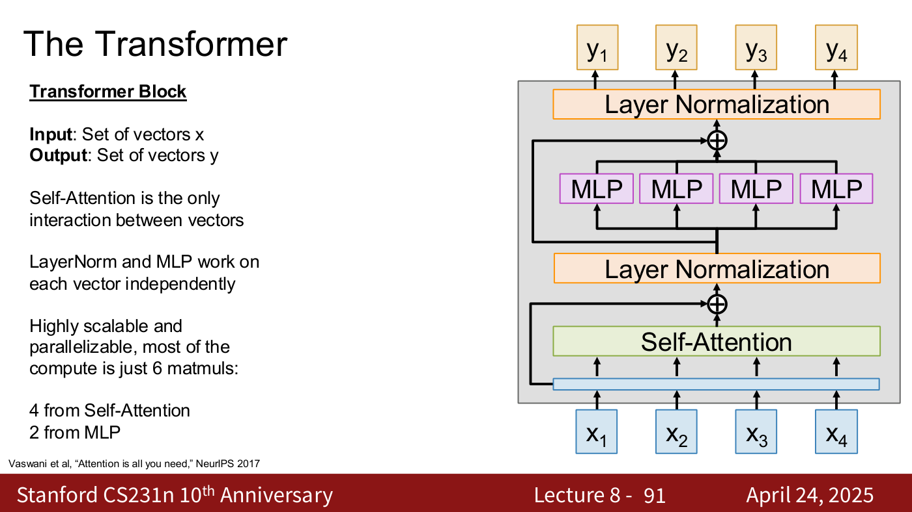

*Slide 91 — one Transformer block (grey): self-attention and a row of per-vector MLPs, each wrapped in a residual connection (the line to the ⊕) and followed by layer normalization. [Deck](https://cs231n.stanford.edu/slides/2025/lecture_8.pdf)*

The two halves divide the work (slide 91; ≈1:03:03–1:03:48). "Self-Attention is the only
interaction between vectors"; "LayerNorm and MLP work on each vector independently". The block is
"highly scalable and parallelizable, most of the compute is just 6 matmuls: 4 from Self-Attention,
2 from MLP".

"A Transformer is just a stack of identical Transformer blocks!" They "have not changed much since
2017… but have gotten a lot bigger" (slide 92). The slides give three sizes, where $D$ is the
vector dimension, $H$ the number of heads and $N$ the sequence length (slides 93–95):

| Model | Blocks | $D$ | $H$ | $N$ | Parameters |
| --- | --- | --- | --- | --- | --- |
| Original [Vaswani et al., 2017] | 12 | 1024 | 16 | 512 | 213M |
| GPT-2 [Radford et al., 2019] | 48 | 1600 | 25 | 1024 | 1.5B |
| GPT-3 [Brown et al., 2020] | 96 | 12288 | 96 | 2048 | 175B |

The lecturer mentions only the first, as "something like 12 blocks, 200 million parameters";
"now people are training transformers with hundreds of blocks and trillions of parameters", the
same architecture scaled "across many orders of magnitude" over eight years (≈1:03:48).

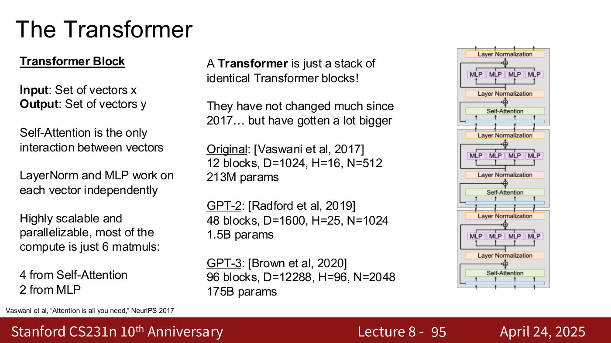

*Slide 95 — a Transformer is a stack of identical blocks (three drawn); the sizes beside it grow from 213M parameters (2017) to GPT-3's 175B. [Deck](https://cs231n.stanford.edu/slides/2025/lecture_8.pdf)*

## Transformers for language modelling

This section is on the slides only; the recording says just that transformers "can be used both
for language modeling, as we've already seen, and also for images" (≈1:04:36), the masking passage
having shown how (≈54:33). Slides 96–99 build a language model in four steps:

The model learns an **embedding matrix** at the start to convert words into vectors: "given vocab
size V and model dimension D, it's a lookup table of shape [V x D]" (slide 96). Inside each
transformer block it uses **masked attention**, "so each token can only see the ones before it"
(slide 97). At the end it learns a **projection matrix** of shape $[D \times V]$ "to project each
D-dim vector to a V-dim vector of scores for each element of the vocabulary" (slide 98). And it is
trained "to predict next token using softmax + cross-entropy loss" (slide 99). On the slide the
inputs "Attention is all you" produce the outputs "is all you need", each position predicting the
next word.

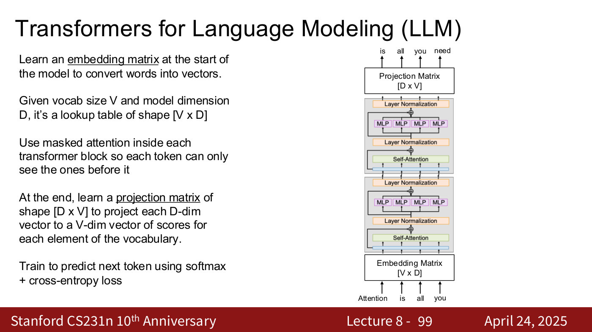

*Slide 99 — a transformer language model: words go through an embedding matrix [V x D], a stack of masked transformer blocks and a projection matrix [D x V], and each position predicts the next word. [Deck](https://cs231n.stanford.edu/slides/2025/lecture_8.pdf)*

## Vision Transformers (ViT)

The same architecture applies to images (slides 100–109, citing Dosovitskiy et al., "An Image is
Worth 16x16 Words: Transformers for Image Recognition at Scale", ICLR 2021; ≈1:04:36). Take an
input image, for example $224 \times 224 \times 3$, and break it into patches, for example
$16 \times 16 \times 3$. Flatten each patch and apply a linear transform from 768 values to $D$
(slide 102). The slide asks: "Any other way to describe this operation?" Its answer: "16x16 conv
with stride 16, 3 input channels, D output channels" (slide 104).

The $D$-dimensional vector of each patch is an input vector to the Transformer (slide 105).
Positional encoding tells the transformer "the 2D position of each patch" (slide 106). There is no
masking: "each image patch can look at all other image patches" (slide 107). The Transformer gives
an output vector per patch (slide 108). For classification, "average pool NxD vectors to 1xD,
apply a linear layer D=>C to predict class scores" (slide 109), $C$ being the number of classes.

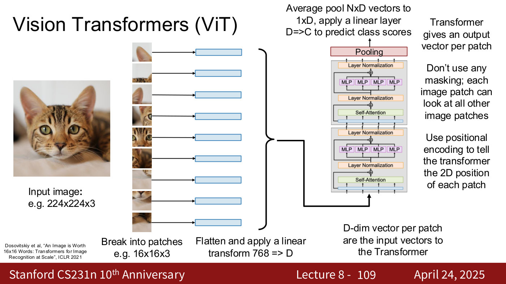

*Slide 109 — the Vision Transformer: the image is cut into patches (nine drawn), each patch becomes one D-dim vector, the Transformer gives one output per patch, and pooling plus a linear layer give the class scores. [Deck](https://cs231n.stanford.edu/slides/2025/lecture_8.pdf)*

"So this same architecture of a transformer can be applied both to language and to images and to a
lot of other things as well" (≈1:04:36).

## Tweaking Transformers (slides only)

"The Transformer architecture has not changed much since 2017. But a few changes have become
common" (slide 110). The recording leaves these "as extra reading" (≈1:05:22), so this section
comes from the slides alone.

**Pre-norm.** In the block of slides 84–93, layer normalization "is outside the residual
connections". The slide calls this "kind of weird, the model can't actually learn the identify
function" (printed "identify"; slide 111). "Solution: Move layer normalization before the
Self-Attention and MLP, inside the residual connections. Training is more stable." (slide 112,
citing Baevski & Auli, arXiv 2018). In the pre-norm drawing each normalization sits at the start
of its residual branch, and nothing follows the last addition.

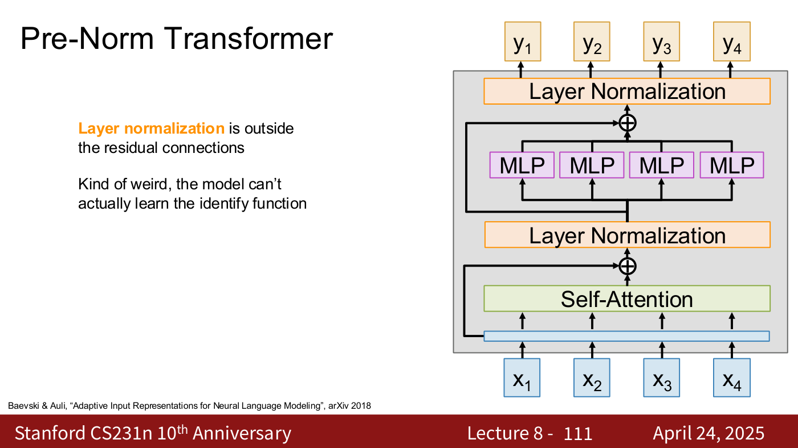

*Slide 111 — the original (post-norm) block: each Layer Normalization sits after a residual addition, on the main path. [Deck](https://cs231n.stanford.edu/slides/2025/lecture_8.pdf)*

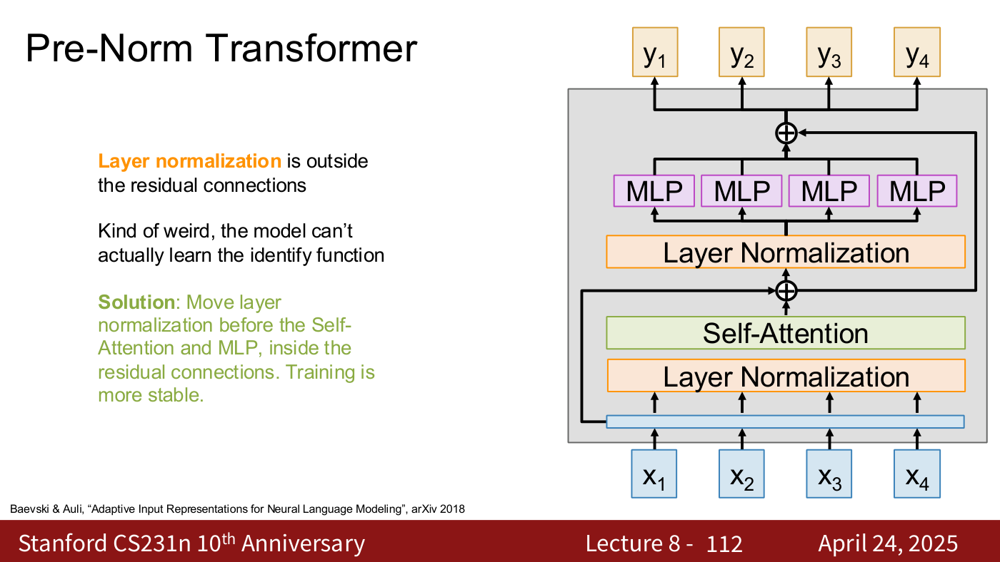

*Slide 112 — the pre-norm block: each Layer Normalization moves inside its residual branch, before self-attention and before the MLPs, so the residual path from x to y passes through no normalization. [Deck](https://cs231n.stanford.edu/slides/2025/lecture_8.pdf)*

**RMSNorm.** "Replace Layer Normalization with Root-Mean-Square Normalization (RMSNorm)" (slide
113, citing Zhang and Sennrich, NeurIPS 2019). For an input $x$ of shape $D$ and a weight
$\gamma$ of shape $D$:

$$y_i = \frac{x_i}{RMS(x)} \ast \gamma_i \qquad RMS(x) = \sqrt{\varepsilon + \frac{1}{N} \sum_{i=1}^{N} x_i^2}$$

"Training is a bit more stable." The slide writes the average over $N$ entries although it gives
the shape of $x$ as $D$, and elsewhere in the deck $N$ is the number of vectors; the sum
presumably runs over the $D$ entries of $x$. Unlike slide 87's layer normalization, the formula
subtracts no mean and adds no shift.

**SwiGLU MLP** (slides 114–116, citing Shazeer, "GLU Variants Improve Transformers", 2020). The
classic MLP has weights $W_1$ of shape $[D \times 4D]$ and $W_2$ of shape $[4D \times D]$, with

$$Y = \sigma(XW_1)W_2$$

for $X$ of shape $[N \times D]$. SwiGLU has three weight matrices, $W_1$ and $W_2$ of shape
$[D \times H]$ and $W_3$ of shape $[H \times D]$, and multiplies two projections elementwise:

$$Y = (\sigma(XW_1) \odot XW_2)W_3$$

"Setting H = 8D/3 keeps same total params" (slide 115). That checks out: the classic MLP has
$4D^2 + 4D^2 = 8D^2$ weights, and SwiGLU has $3DH = 8D^2$. The slides do not define $\sigma$
further. Slide 116 quotes, beside the paper's citation: "We offer no explanation as to why these
architectures seem to work; we attribute their success, as all else, to divine benevolence."

**Mixture of Experts (MoE)** (slides 117–119, citing Shazeer et al., "Outrageously Large Neural
Networks: The Sparsely-Gated Mixture-of-Experts Layer", 2017). "Learn E separate sets of MLP
weights in each block; each MLP is an expert": $W_1$ grows from $[D \times 4D]$ to
$[E \times D \times 4D]$ and $W_2$ from $[4D \times D]$ to $[E \times 4D \times D]$. "Each token
gets routed to A < E of the experts. These are the active experts." This "increases params by E,
but only increases compute by A" (slide 118). The slide adds: "All of the biggest LLMs today (e.g.
GPT4o, GPT4.5, Claude 3.7, Gemini 2.5 Pro, etc) almost certainly use MoE and have > 1T params; but
they don't publish details anymore" (slide 119).

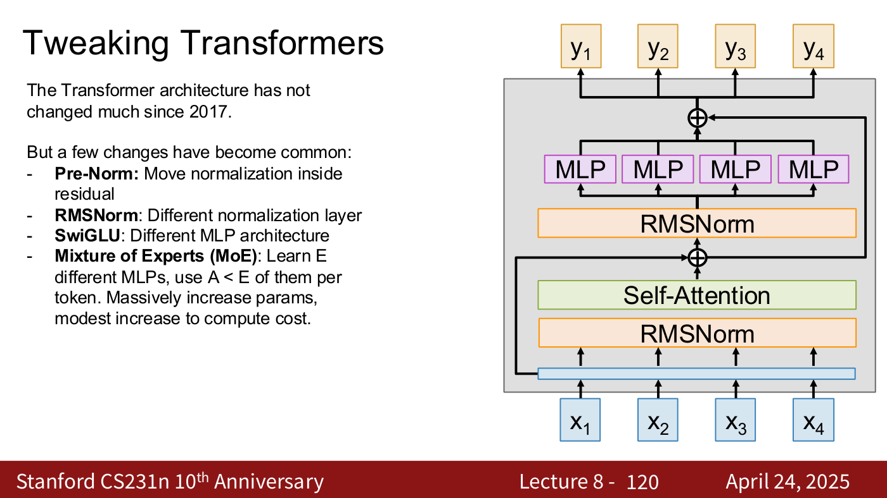

*Slide 120 — the four common changes, and the block they lead to: pre-norm with RMSNorm in place of Layer Normalization. [Deck](https://cs231n.stanford.edu/slides/2025/lecture_8.pdf)*

Slide 120 sums up: pre-norm moves normalization inside the residual; RMSNorm is a different
normalization layer; SwiGLU a different MLP architecture; and mixture of experts learns $E$
different MLPs and uses $A \lt E$ of them per token, to "massively increase params" with a "modest
increase to compute cost".

## Summary

Attention is "a new primitive that operates on sets of vectors", and the Transformer "a neural
network architecture that uses attention everywhere". "Transformers are the backbone of all large
AI models today! Used for language, vision, speech, …" (slide 121). In the lecturer's words,
attention is "highly scalable, highly parallelizable, highly flexible", "basically just a couple
of matrix multiplies", and transformers "have been with us for 8 years now, and I don't see them
really dying anytime soon" (≈1:05:22–1:06:08). Next time: detection, segmentation and
visualisation (slide 122).

## Related pages

- [Attention](attention.md) — sequence-to-sequence attention, the attention layer, queries, keys
  and values, cross-, self-, masked and multi-headed attention, and its cost.
- [Transformers](transformers.md) — the Transformer block, its sizes, language models, the Vision
  Transformer, and the later tweaks.
- [Recurrent neural networks](recurrent-neural-networks.md#sequence-to-sequence-and-the-bottleneck) —
  the sequence-to-sequence model whose bottleneck attention removes.
- [Character-level language models](language-models.md#transformer-language-models) — the RNN
  language model of lecture 7, and its transformer counterpart.
- [Normalization layers](normalization-layers.md#layer-normalization-in-transformers) — layer
  normalization in the Transformer block, pre-norm and RMSNorm.
- [CNN architectures](cnn-architectures.md#resnet-residual-connections) — the residual connections
  the Transformer block reuses.
- [Convolutional networks](convolutional-networks.md) — convolution as one of three ways to process
  sequences, and the ViT patch embedding as a strided convolution.
- [Course logistics](course-logistics.md) — slide 2's dates.
- Previous lecture: [Lecture 7 — Recurrent Neural Networks](07-recurrent-neural-networks.md).
