# Lecture 9 — Detection, Segmentation, Visualization, and Understanding

**CS231N Deep Learning for Computer Vision, Stanford, Spring 2025.** Delivered April 29, 2025. The lecturer is not named in the recording or on the deck, and refers to the lecturer of lecture 8 as "Justin" (≈1:37, ≈1:12:14). [Video](https://www.youtube.com/watch?v=PTypu6GqEd4) · [edited transcript](../raw/transcripts/09-detection-segmentation-visualization.md) · deck as [text](../raw/slides/09-detection-segmentation-visualization.md) / [PDF](https://cs231n.stanford.edu/slides/2025/lecture_9.pdf)

## What this lecture establishes

The lecture has two halves. The first moves beyond image classification to the tasks that say *where* things are. **Semantic segmentation** labels every pixel with a class, and is solved with **fully convolutional networks** that downsample and then upsample inside the network, with unpooling or the **transposed convolution**, and with **U-Net**, which copies high-resolution features across to the upsampling side. **Object detection** outputs a class and a bounding box for every object. It goes from a single object (classification plus box regression under one multitask loss) through **region proposals** and **R-CNN**, **Fast R-CNN** and the **region proposal network**, to **single-stage detectors** such as YOLO and to **DETR**, which detects objects with a transformer. **Instance segmentation** adds a mask for each detected object, as in **Mask R-CNN**. The second half, **visualization and understanding**, asks what a trained network has learned and which pixels drove a decision. It covers linear-classifier templates, first-layer filters, **saliency maps** from the gradient of a class score with respect to the pixels, **class activation mapping (CAM)** and **Grad-CAM**, and the attention maps a Vision Transformer provides on its own. The lecture opens with a recap of the Vision Transformer and walks through the four transformer tweaks that lecture 8 left as reading.

The lecturer frames the tasks historically: "these days we're solving much, much harder tasks, and nobody cares about object detection anymore because now we can just do it with one line of code, but over the past 10, 15 years there has been a lot of advances", worth knowing "just so if you have to design something new yourself, you know where to look and how to design your models" (≈15:42–16:29).

The topic pages [image segmentation](image-segmentation.md), [object detection](object-detection.md) and [visualizing what networks learn](visualizing-networks.md) gather these concepts in one place.

**What the recording covers.** The recording opens at 0:05 with the recap and never presents the administrative slide (summarised below from the slide alone). It recaps the Transformer and the Vision Transformer (≈0:05–8:39), walks through the "Tweaking Transformers" slides (≈8:39–13:24) and takes questions until ≈15:42. It then follows the deck through semantic segmentation (≈17:15–32:45), object detection (≈32:45–57:30, with a long run of questions on DETR from ≈52:03), instance segmentation (≈57:30–1:01:20) and, in "the last piece that I want to spend 10 minutes on" (≈1:01:20), visualization. It ends at 1:13:01 with "next session we'll have the lecture around video understanding." The deck's "Additional Reading Material" at the end is not presented: convolution as matrix multiplication, cropping features with RoI Pool and RoI Align, the R-CNN timing charts, Faster R-CNN's four losses and two stages, the detection trade-offs, and intermediate features via guided backpropagation. The lecturer points to it once, for why transposed convolution is called transposed (≈31:08–31:54), and names guided backpropagation in one sentence (≈1:03:41). Those sections below are marked "(slides only)".

**Printed slips.** The deck carries six, each transcribed as printed in the slide file with an `[Ed:]` line. The recap's encoder diagram labels its inputs x0, x1, x2, x2, with x2 repeated (slide 3). The comparison of three ways of processing sequences repeats lecture 8's "O(N) memory" for self-attention, which lecture 8 gives only with Flash Attention (slide 4; lecture 8, slides 78 and 82). The pre-norm slide prints "identify function" for identity function (slide 21), and the RMSNorm slide averages over N entries of a vector whose shape it gives as D (slide 23); both slips come from lecture 8's slides 111 and 113. The encoder–decoder segmentation network labels its low-resolution stage "Low-res: D3 x H/4 x W/4", the same size as the medium-resolution stages on either side (slides 43, 44 and 59). And the recalled linear-classifier example prints the ship score as 61.95, which leaves out the bias: with $b = -1.2$ the score is 60.75 (slide 127; the same slip as lecture 2, slides 60 and 62).

## Administrative notes (slides only)

Slide 2, not presented in the recording: "Make sure to start Assignment 2 early. It is the longest of the three assignments, and the midterm and project milestone deadlines follow closely after the Assignment 2 deadline", and a link to an Ed post on "the best Colab practices to avoid unnecessary bugs and delays". See [course logistics](course-logistics.md).

## Recap: the Transformer and the Vision Transformer

Last time, the lecturer recalls, the course moved "from sequence to sequence models, RNNs, to transformers" (≈0:05). A transformer **encoder** is a number of layers of multi-headed self-attention, layer normalization and MLPs that encodes a sequence; when the output is itself a sequence, a decoder of similar architecture takes the encoded tokens as input and generates it (≈0:50–1:37). The recap slide draws both: an encoder stack ("x N") that turns image tokens into output tokens $c$, and a decoder that generates the caption "person wearing hat" from "[START]", with masked self-attention over its own outputs and a multi-head attention block that takes keys and values from the encoder's $c$ tokens (slide 3).

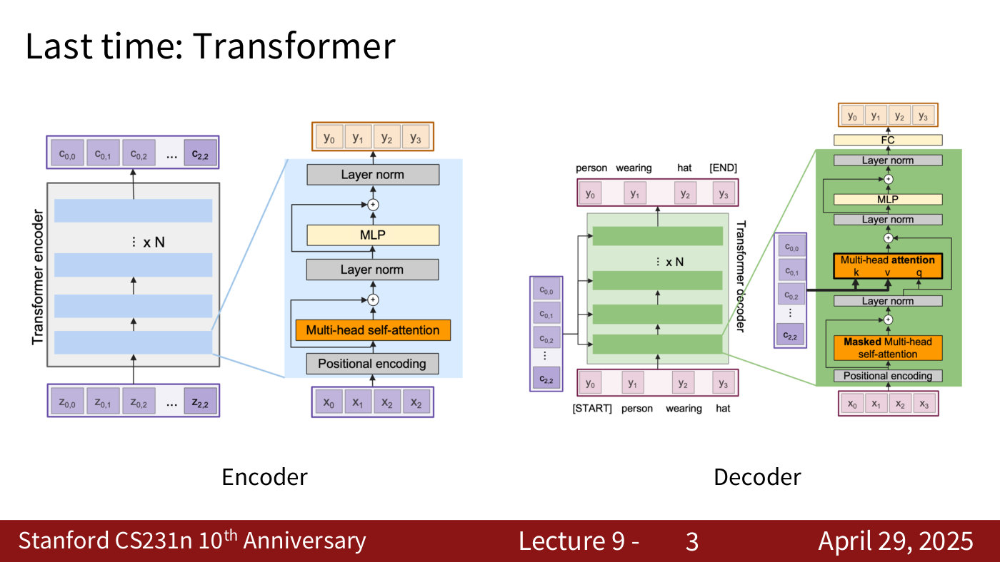

*Slide 3 — the encoder (left) turns image tokens z into output tokens c; the decoder (right) generates "person wearing hat" one word at a time, attending to the c tokens through the multi-head attention block marked k, v, q. [Deck](https://cs231n.stanford.edu/slides/2025/lecture_9.pdf)*

Of the three ways of processing sequences lecture 8 compared — recurrence, convolution and self-attention — self-attention is what "we work with in many of the applications these days": it is more expensive in computation and memory, "but that comes with much better modeling of the sequence" (≈1:37–2:24; slide 4 repeats lecture 8's slide 82; see [attention](attention.md#attention-compared-with-recurrence-and-convolution)).

**Vision Transformers.** To process an image with a transformer, "we split the image into patches, basically creating a kind of sequence" (≈3:11). The slides cut a $224 \times 224 \times 3$ cat photograph into patches (drawn as a $3 \times 3$ grid), give each patch of shape $3 \times 16 \times 16$ a linear projection to a $D$-dimensional vector, and add a positional embedding, a "learned D-dim vector per position" (slides 5–9). Turning the image into patches loses "the 2D position" of each patch, which is why the positional embedding is needed; it can be a sequence of numbers 1, 2, 3 or a 2D version from x and y coordinates (≈3:58–4:44). The vectors then go through a transformer that is "Exact same as NLP Transformer!" (slide 10), and the transformer gives one output vector per input (≈4:44–5:30).

For classification, one "special extra input" is added: a **classification token** of $D$ dimensions, learned, whose output vector is linearly projected to a $C$-dimensional vector of class scores (slides 11–12; ≈5:30–6:16). Asked whether the class token is like a bias, the lecturer answers that it is "completely a trainable parameter by itself": the self-attention layers fuse information between all the tokens and the class token, so when the loss is applied to its output it comes to represent the class probabilities (≈13:24–14:09).

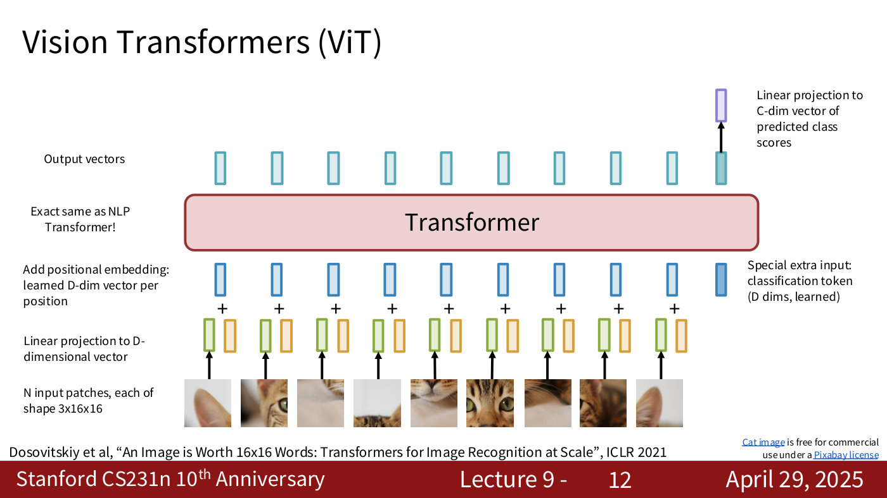

*Slide 12 — the class-token version of the ViT: nine patch vectors plus one learned classification token (far right) go through the Transformer, and only the class token's output is projected to class scores. [Deck](https://cs231n.stanford.edu/slides/2025/lecture_9.pdf)*

The other version, lecture 8's, keeps no class token: each patch gives an output vector, and the slides "Average pool NxD vectors to 1xD, apply a linear layer D=>C to predict class scores" (slides 13–19, which repeat lecture 8's slides 100–109; ≈7:03–7:51). No masking is used, because "we see the entire image all together", unlike language, where the model should not use future information (slide 17; ≈7:03). Either version is trained "the exact same" way as before: a loss function on the class probabilities, and backpropagation (≈7:51). See [transformers](transformers.md#vision-transformers).

## Tweaking transformers

Lecture 8 left its "Tweaking Transformers" slides as reading; this lecture walks through them (slides 20–29; ≈8:39–13:24). The architecture "has not changed much since 2017. But a few changes have become common" (slide 20), introduced, the lecturer says, "for better performance and also making the training a little bit more stable" (≈8:39). See [transformers](transformers.md#later-changes-to-the-block) and [normalization layers](normalization-layers.md#layer-normalization-in-transformers).

**Pre-norm.** In the original block, "Layer normalization (in orange) is outside the residual connections. Kind of weird, the model can't actually learn the identify function" (slide 21, printed "identify" for identity). The lecturer: whatever comes out of the residual addition is normalized, so the block "can't replicate any form of identity function anymore that ResNets really wanted to do" (≈9:28). The solution is to "Move layer normalization before the Self-Attention and MLP, inside the residual connections. Training is more stable" (slide 22). Asked later why moving the layer norm helps the block learn the identity, the lecturer points back at the old block: "right after that residual connection the feature values are changed because you have a normalization. You will never have the identity in the features" (≈14:57–15:42).

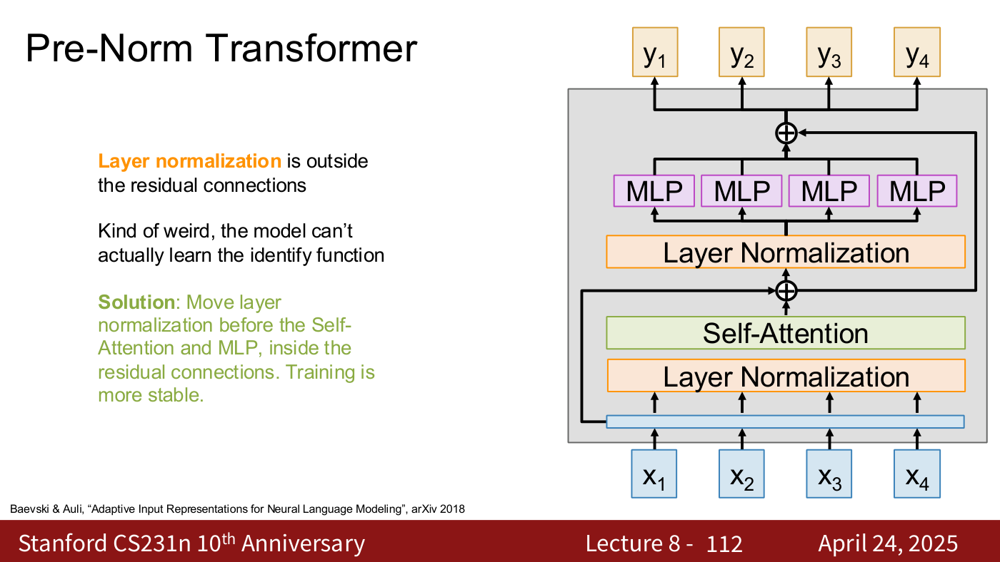

*Lecture 8, slide 112 (repeated as slide 22 here) — the pre-norm block: each layer normalization sits on the branch into self-attention or the MLPs, and the skip paths carry no normalization. [Lecture 8 deck](https://cs231n.stanford.edu/slides/2025/lecture_8.pdf)*

**RMSNorm.** Slide 23 replaces layer normalization with root-mean-square normalization. For an input $x$ and a learned weight $\gamma$, both of shape $D$,

$$y_i = \frac{x_i}{\mathrm{RMS}(x)} \ast \gamma_i, \qquad \mathrm{RMS}(x) = \sqrt{\varepsilon + \frac{1}{N} \sum_{i=1}^{N} x_i^2}$$

where $\varepsilon$ is a small constant. As printed, the average runs over $N$ entries although the vector has $D$; $N$ is not defined on the slide (the same slip as lecture 8, slide 113). "Training is a bit more stable" (slide 23). The lecturer calls it "a very basic type of normalization" that does not use the mean of the features, adopted mostly because it is "empirically shown" to make training more stable (≈9:28–10:13).

**SwiGLU.** The classic MLP takes $X$ of shape $N \times D$ to $Y = \sigma(X W_1) W_2$, with $W_1$ of shape $D \times 4D$ and $W_2$ of shape $4D \times D$, where $\sigma$ is the non-linearity (slide 24). The SwiGLU MLP adds a third weight matrix and a gate (slide 25):

$$Y = \left(\sigma(X W_1) \odot X W_2\right) W_3$$

with $W_1$ and $W_2$ of shape $D \times H$, $W_3$ of shape $H \times D$, and $\odot$ the elementwise product. "Setting H = 8D/3 keeps same total params": SwiGLU then has $3DH = 8D^2$ weights, the same as the classic MLP's $D \cdot 4D + 4D \cdot D = 8D^2$. The lecturer calls it a "gated nonlinearity" that creates "a better nonlinearity for a small architecture": with the hidden size set to "8 divided by 3" times $D$ it "keeps the same size of the network in terms of the number of parameters, but it does learn higher dimensional nonlinearities" (≈10:13–11:51).

**Mixture of experts.** "Learn E separate sets of MLP weights in each block; each MLP is an expert": $W_1$ becomes $E \times D \times 4D$ and $W_2$ becomes $E \times 4D \times D$ (slide 26). "Each token gets routed to A < E of the experts. These are the active experts", which "Increases params by E, But only increases compute by A" (slide 27). The lecturer: "through a router, the tokens will be routed to A of those E experts" (≈11:51), and the experts run in parallel, adding parameters "without increasing too much on the compute" (≈12:38). Slide 28 says that "All of the biggest LLMs today (e.g. GPT4o, GPT4.5, Claude 3.7, Gemini 2.5 Pro, etc) almost certainly use MoE and have > 1T params; but they don't publish details anymore"; the lecturer puts it as "they are used in all LLMs these days … up to the level that we know" (≈12:38). Asked what different experts learn, the lecturer says they are trained in parallel and initialized differently, so each often learns one aspect; if the network has to cover several probability distributions, "you often have the power to separate those modes of data" (≈14:09–14:57). The number of experts is a hyperparameter, "often predefined" (≈14:57).

Slide 29 summarises the four: "Pre-Norm: Move normalization inside residual"; "RMSNorm: Different normalization layer"; "SwiGLU: Different MLP architecture"; "Mixture of Experts (MoE): Learn E different MLPs, use A < E of them per token. Massively increase params, modest increase to compute cost."

## Computer vision tasks

The agenda for the rest of the lecture is three computer vision tasks — semantic segmentation, object detection and instance segmentation — and then visualization and understanding: model layers, saliency maps, CAM and Grad-CAM (slide 30). The tasks are those of lecture 1 (slide 31, lecture 1's four-task figure): classification gives one label for the image ("No spatial extent"), semantic segmentation a label per pixel ("No objects, just pixels"), and object detection and instance segmentation handle multiple objects, with a box or a mask for each (≈15:42–17:15; see [computer vision tasks](computer-vision-tasks.md)). Visualization matters "in many applications": with medical data "often the visualization and understanding is more important than the classification itself or detection of tumor, for example. You want to know where, why" (≈16:29).

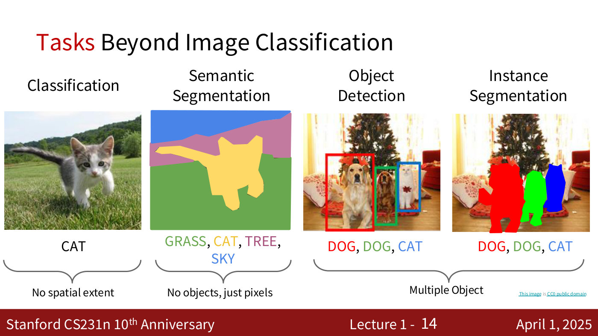

*Lecture 1, part 2, slide 14 (repeated as slides 31, 33, 66, 67, 113 and 125 here) — classification, semantic segmentation, object detection and instance segmentation on the same two photographs. [Lecture 1 part 2 deck](https://cs231n.stanford.edu/slides/2025/lecture_1_part_2.pdf)*

## Semantic segmentation

Semantic segmentation assigns "a label to every single pixel inside the image" (≈17:15). Its training data is paired: "for each training image, each pixel is labeled with a semantic category", and at test time the model must "classify each pixel of a new image" (slide 34). It does not distinguish instances: "Don't differentiate instances, only care about pixels" (slide 65), so the two cows in the deck's photograph become one "Cow" region. See [image segmentation](image-segmentation.md).

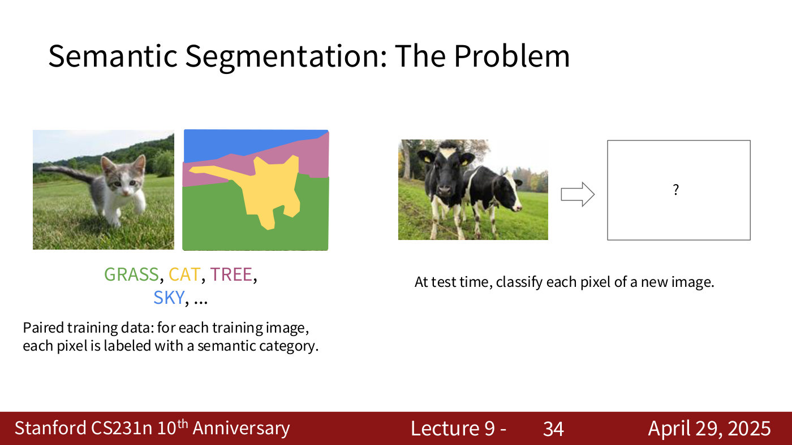

*Slide 34 — Semantic Segmentation: The Problem. [Deck](https://cs231n.stanford.edu/slides/2025/lecture_9.pdf)*

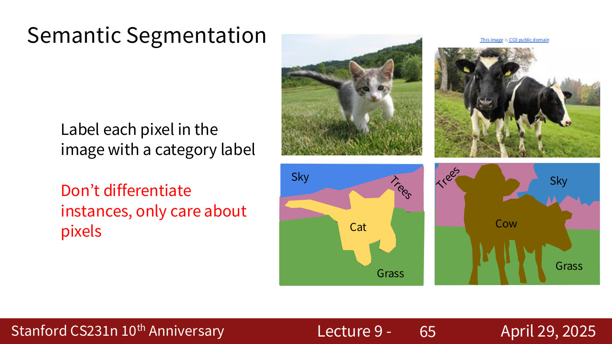

*Slide 65 — Semantic Segmentation. [Deck](https://cs231n.stanford.edu/slides/2025/lecture_9.pdf)*

### Sliding window

Looking at one pixel alone, "it's hard to say what object that specific pixel represents, because there's no context" (≈18:02–18:48); slide 36 puts it as "Impossible to classify without context". So take a patch around each pixel, the pixel in the centre and its surroundings, and train a CNN to classify the centre pixel (slides 37–38; Farabet et al., TPAMI 2013; Pinheiro and Collobert, ICML 2014). Any classification architecture will do — "a CNN, could be a ResNet, could be a ViT" (≈19:35). The problem: "Very inefficient! Not reusing shared features between overlapping patches" (slide 39); running a full network for every pixel "will take forever" (≈19:35).

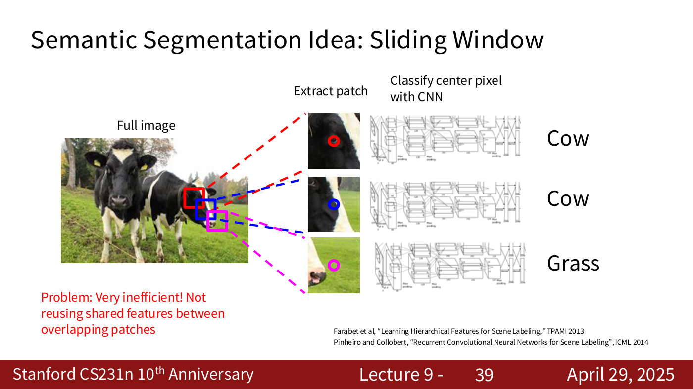

*Slide 39 — Semantic Segmentation Idea: Sliding Window. [Deck](https://cs231n.stanford.edu/slides/2025/lecture_9.pdf)*

### Fully convolutional networks

The alternative is one network that "takes the image as the input and outputs the entire pixel map" (≈19:35). The intuitive version encodes the whole image with a convolutional network and segments on top, but "classification architectures often reduce feature spatial sizes to go deeper, but semantic segmentation requires the output size to be the same as input size" (slide 40). So design a network "with only convolutional layers without downsampling operators to make predictions for pixels all at once": an input of $3 \times H \times W$ goes through convolutions of $D \times H \times W$ to scores of $C \times H \times W$, and an argmax over the $C$ classes gives the $H \times W$ prediction (slide 41). The network has to stay "inflated" at image size, with no fully connected layers, which is what is called a fully convolutional network, or FCN (≈20:20). Its problem: "convolutions at original image resolution will be very expensive" (slide 42); there are "so many parameters to optimize, especially in the early years that we didn't have powerful GPUs" (≈21:07).

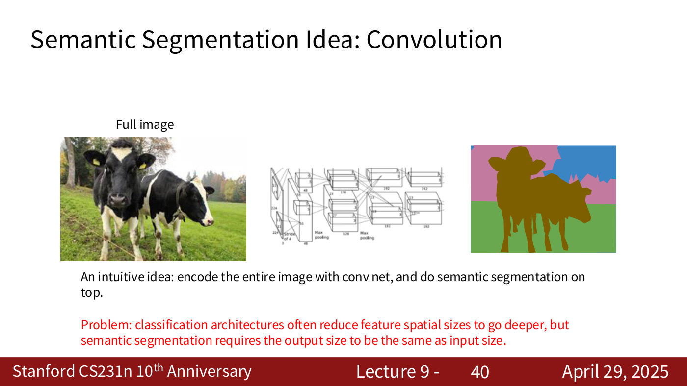

*Slide 40 — Semantic Segmentation Idea: Convolution. [Deck](https://cs231n.stanford.edu/slides/2025/lecture_9.pdf)*

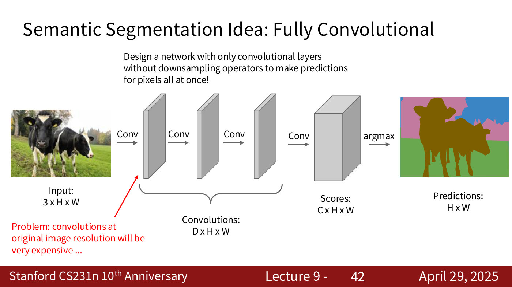

*Slide 42 — Semantic Segmentation Idea: Fully Convolutional. [Deck](https://cs231n.stanford.edu/slides/2025/lecture_9.pdf)*

The solution is to "Design network as a bunch of convolutional layers, with downsampling and upsampling inside the network" (slide 43; Long, Shelhamer and Darrell, CVPR 2015; Noh et al., ICCV 2015). The drawing goes from high resolution ($D_1$ channels at $H/2 \times W/2$) to medium ($D_2$ at $H/4 \times W/4$) and low, then back up through medium and high to a $C \times H \times W$ output. In the middle the representation is "low resolution but somehow thick in terms of the number of channels" (≈21:52). As printed, the low-resolution stage is labelled "D3 x H/4 x W/4", the same size as the medium-resolution stages beside it (slides 43, 44 and 59).

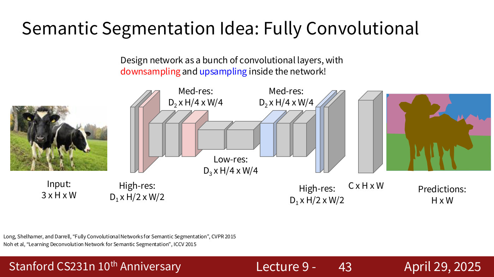

*Slide 43 — the encoder–decoder segmentation network: blocks shrink through downsampling (pink-shaded) and grow back through upsampling (blue-shaded) to a C x H x W score map. The low-res stage is printed with the same H/4 x W/4 as the med-res stages. [Deck](https://cs231n.stanford.edu/slides/2025/lecture_9.pdf)*

Downsampling is familiar: "Pooling, strided convolution" (slide 44). Upsampling is the open question ("Upsampling: ???", slide 44): "on the upsampling side, we don't really know how to do the upsampling", so new operations "that reverse downsampling" had to be invented (≈22:38).

### Training with a per-pixel loss

How should a network that "starts from an image and ends with an image" be trained (≈22:38–23:25)? A student answers with the mean classification loss over the pixels, and the lecturer agrees: "every single pixel is doing a classification", so the loss is "a sigma over all pixels of the image" of a simple softmax loss, and the network is trained by backpropagation (≈23:25–24:11). This is spoken only; no slide shows the loss. Training is fully supervised, so it needs ground-truth label maps, and "early years there has been a lot of work ... manually labeling the pixels"; "these days we don't need that because we have tools" (≈24:11–24:58).

### Upsampling: unpooling

Unpooling has no parameters; "it's just an operation" (≈26:31). **Nearest neighbor** copies each input value into the corresponding $2 \times 2$ block, and **bed of nails** puts each value in one corner of its block and zeros elsewhere (slide 45; ≈24:58–25:44). Slide 45's input is the $2 \times 2$ grid 1 2 / 3 4:

| Nearest neighbor | | | | | Bed of nails | | | |
| --- | --- | --- | --- | --- | --- | --- | --- | --- |
| 1 | 1 | 2 | 2 | | 1 | 0 | 2 | 0 |
| 1 | 1 | 2 | 2 | | 0 | 0 | 0 | 0 |
| 3 | 3 | 4 | 4 | | 3 | 0 | 4 | 0 |
| 3 | 3 | 4 | 4 | | 0 | 0 | 0 | 0 |

With bed of nails the zeros are filled in afterwards: "through multiple layers of convolution these values will start appearing" (≈25:44). **Max unpooling** pairs each upsampling layer with a max-pooling layer on the downsampling side: max pooling remembers which element was the maximum, and max unpooling puts each value back at that position (slide 46). "We save the locations in the encoding part, and in the decoding part, in the upsampling step, we reuse those saved coordinates" (≈25:44–26:31).

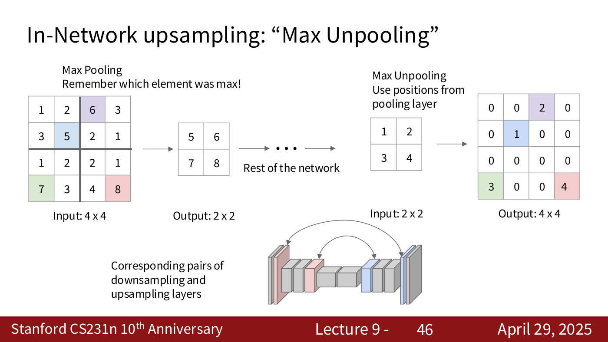

*Slide 46 — max pooling remembers where each maximum was (coloured cells); max unpooling puts each value back in that position and fills the rest with zeros. [Deck](https://cs231n.stanford.edu/slides/2025/lecture_9.pdf)*

### Learnable upsampling: transposed convolution

Learned upsampling starts from the convolution layer (slides 47–52; ≈26:31–27:17). A $3 \times 3$ convolution with stride 1 and pad 1 takes a dot product between the filter and the input at every position, so a $4 \times 4$ input gives a $4 \times 4$ output. With stride 2 the "Filter moves 2 pixels in the input for every one pixel in the output", so the output is $2 \times 2$: "Stride gives ratio between movement in input and output. We can interpret strided convolution as 'learnable downsampling'" (slide 52).

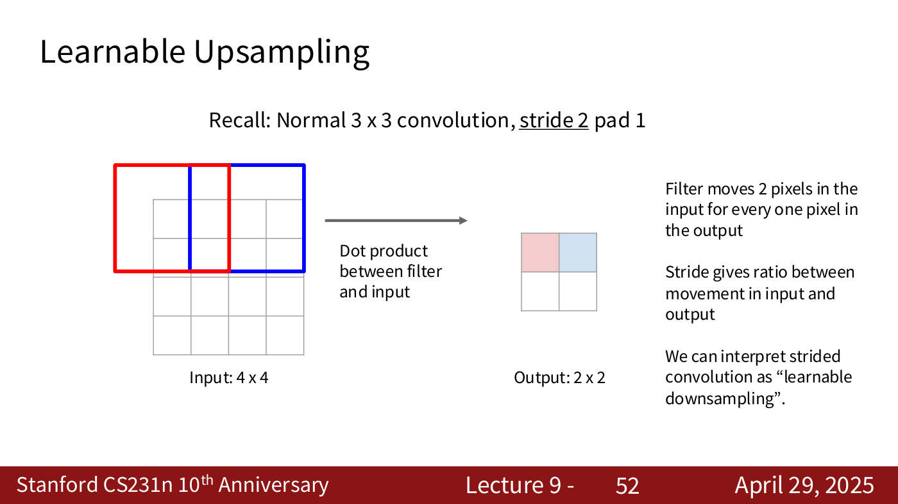

*Slide 52 — a 3 x 3 convolution with stride 2: the filter moves 2 pixels in the input for every pixel in the output, so a 4 x 4 input gives a 2 x 2 output. [Deck](https://cs231n.stanford.edu/slides/2025/lecture_9.pdf)*

The **transposed convolution** reverses the roles (slides 53–56; ≈27:17–28:02). In a $3 \times 3$ transposed convolution with stride 2 and pad 1, a $2 \times 2$ input gives a $4 \times 4$ output: each input value gives the weight for a copy of the filter placed in the output, the "Filter moves 2 pixels in the output for every one pixel in the input", and where the copies overlap the values are summed ("Sum where output overlaps", slide 56). "For the overlaps, you often sum over the values" (≈27:17–28:02).

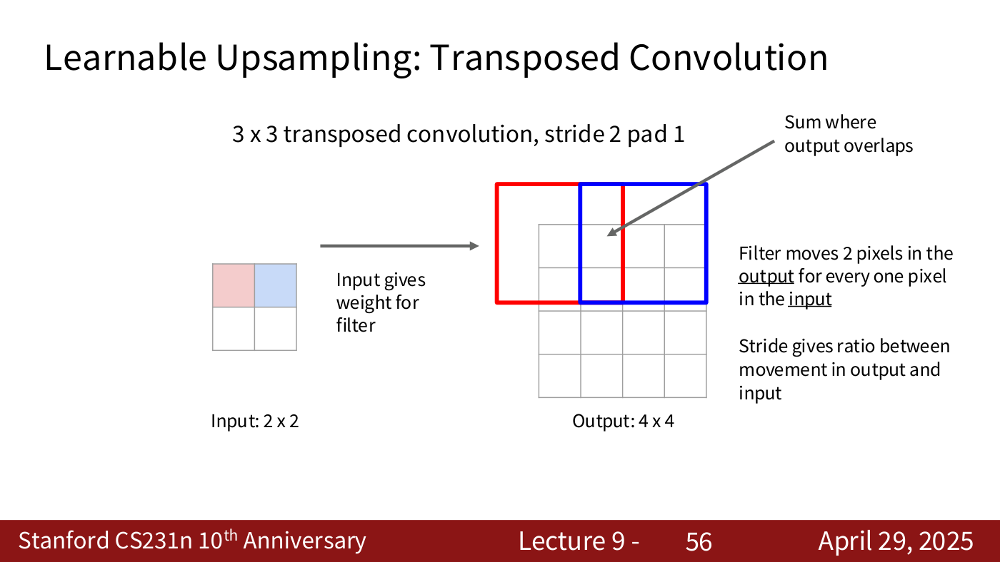

*Slide 56 — transposed convolution: each input value weights a copy of the 3 x 3 filter in the output, the copies move 2 pixels per input pixel, and the overlaps are summed. [Deck](https://cs231n.stanford.edu/slides/2025/lecture_9.pdf)*

The 1D example makes this concrete (slide 58; ≈28:02). An input of two values $a$ and $b$ and a filter $x, y, z$ give the output $ax, ay, az + bx, by, bz$: "Output contains copies of the filter weighted by the input, summing at where at overlaps in the output" (printed so). The filter is learned like any other convolution filter: "All of the filters are trained" (≈31:54). Slide 59 then answers slide 44's question: "Upsampling: Unpooling or strided transposed convolution".

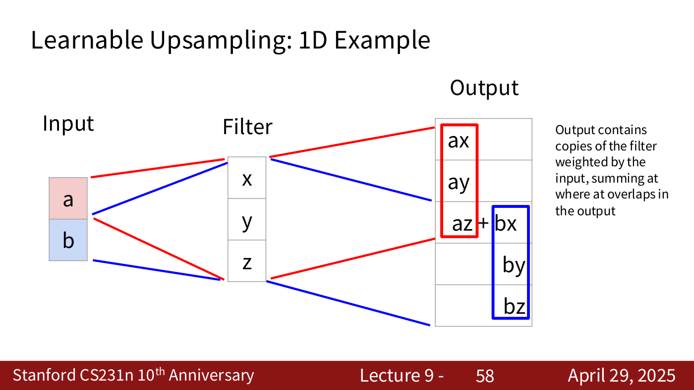

*Slide 58 — the 1D example: inputs a and b each weight a copy of the filter x, y, z, and the overlapping middle output is az + bx. [Deck](https://cs231n.stanford.edu/slides/2025/lecture_9.pdf)*

**Why "transposed" (slides only).** The lecturer refers this question to "the additional slides" (≈31:54). There, convolution is written as a matrix multiplication, $\vec{x} \ast \vec{a} = X\vec{a}$. For a 1D convolution with kernel size 3, stride 2 and padding 1 (slide 151):

$$\begin{bmatrix} x & y & z & 0 & 0 & 0 \cr 0 & 0 & x & y & z & 0 \end{bmatrix} \begin{bmatrix} 0 \cr a \cr b \cr c \cr d \cr 0 \end{bmatrix} = \begin{bmatrix} ay + bz \cr bx + cy + dz \end{bmatrix}$$

"Transposed convolution multiplies by the transpose of the same matrix", $\vec{x} \ast^T \vec{a} = X^T\vec{a}$ (slide 152, a 1D transposed convolution with kernel size 3, stride 2, padding 0):

$$\begin{bmatrix} x & 0 \cr y & 0 \cr z & x \cr 0 & y \cr 0 & z \cr 0 & 0 \end{bmatrix} \begin{bmatrix} a \cr b \end{bmatrix} = \begin{bmatrix} ax \cr ay \cr az + bx \cr by \cr bz \cr 0 \end{bmatrix}$$

which is slide 58's output with a trailing zero. In the lecture this is said in one sentence: the transposed convolution does "the convolution on the transposed version of the input, and it actually generates a larger output … it's the reverse of the regular convolution" (≈31:08–31:54).

### U-Net

U-Net (Ronneberger et al., 2015) is "the same architecture as I showed here", drawn as a U (≈28:49): a **downsampling phase** that "Increases field of view" and "Lose[s] Spatial Information" (slide 61), and an **upsampling phase** that creates a "High Resolution Mapping" (slide 62). The figure (slide 60) starts from a $572 \times 572$ "input image tile" with 1 channel, doubles the channels from 64 to 1024 while max pooling halves the size, and comes back up through 2x2 up-convolutions to a $388 \times 388$ "output segmentation map" with 2 channels; four grey "copy and crop" arrows join each level of the left side to the same level of the right.

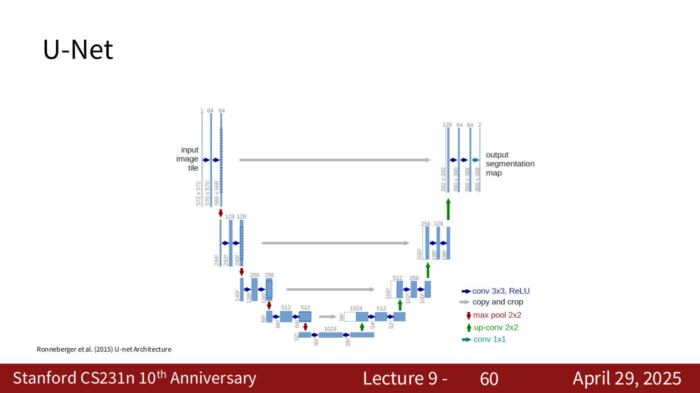

*Slide 60 — U-Net: the contracting path (left) halves the size and doubles the channels at each level, the expanding path (right) goes back up, and grey copy-and-crop arrows join the two sides level by level. [Deck](https://cs231n.stanford.edu/slides/2025/lecture_9.pdf)*

Those arrows are U-Net's one difference from the plain encoder–decoder: "Concatenate with high-resolution feature maps from the downsampling Phase" (slide 63). When the network downsamples it loses resolution, and upsampling without that information gives outputs where "sometimes boundaries are faded"; copying the encoder's feature maps into the decoder layers keeps "this structural information within the image" and makes the outputs "much sharper" (≈30:20–31:08). U-Net "or its variants" still give state-of-the-art results in medical segmentation "if you don't want to use any foundation model" (≈29:35).

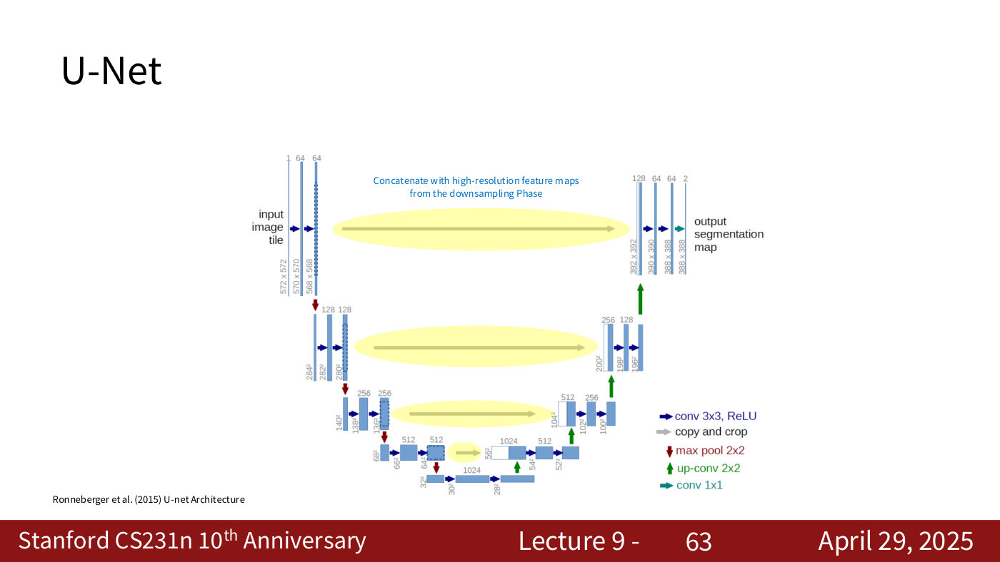

*Slide 63 — the skip connections highlighted: each level of the upsampling path concatenates the high-resolution feature maps from the same level of the downsampling path. [Deck](https://cs231n.stanford.edu/slides/2025/lecture_9.pdf)*

### Summary

Slide 64 lines up the three approaches as pictures: classifying the centre of a sliding window, a fully convolutional network at full resolution, and the encoder–decoder network (≈31:08). The lecturer says that "to save time I actually removed some of the slides from this part and I have it in the backup slides" (≈31:08). Semantic segmentation only labels pixels, so "if there are two instances of the same object, we have no idea which one is which" (slide 65; ≈32:45), which leads to instance segmentation and, first, to object detection.

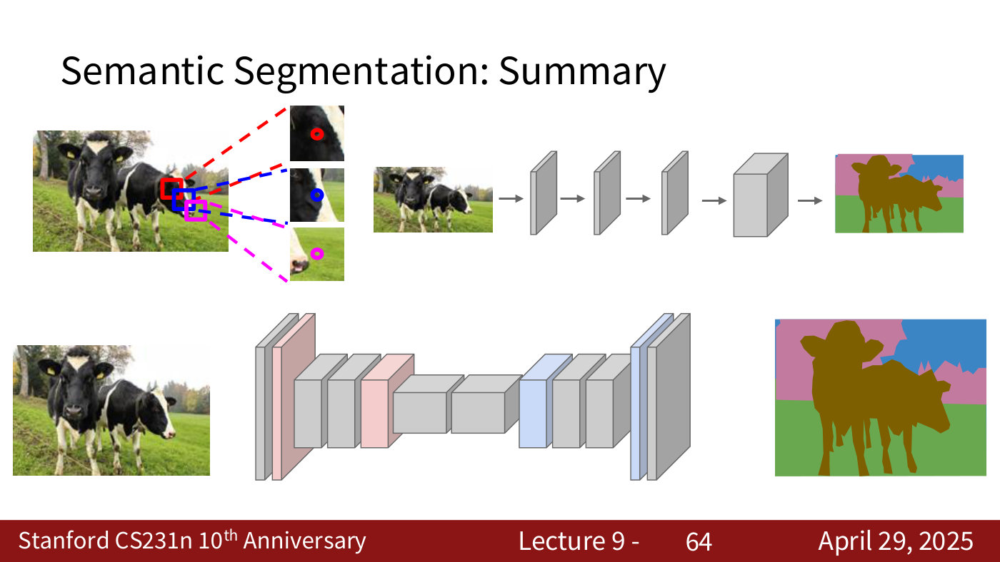

*Slide 64 — Semantic Segmentation: Summary. [Deck](https://cs231n.stanford.edu/slides/2025/lecture_9.pdf)*

## Object detection

Object detection has been "besides image classification, or after image classification, one of the core computer vision problems", with many algorithms proposed; the lecture will "fly over some of them and highlight a couple of important ones" (slides 66–67; ≈33:32–34:18). See [object detection](object-detection.md).

### A single object: classification plus localization

With one object, detection is classification plus localization (slides 68–70; ≈34:18–35:48). A CNN maps the image to a 4096-dimensional vector. One fully connected layer, 4096 to 1000, gives the class scores ("Cat: 0.9, Dog: 0.05, Car: 0.01, …"), and a second, 4096 to 4, gives the box coordinates $(x, y, w, h)$. The class scores are trained with a softmax loss against the correct label, and the box with an L2 loss against the correct box $(x', y', w', h')$: "Treat localization as a regression problem!" (slide 69). The two are added into a **multitask loss** (slide 70): "we are solving two tasks at the same time", so "we add the loss values and generate a compound loss function" (≈35:03).

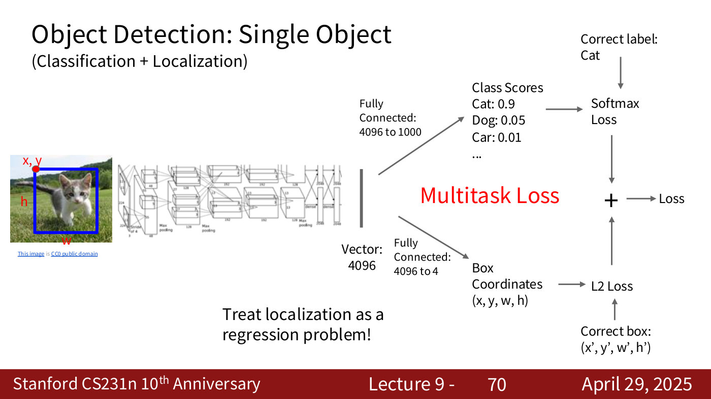

*Slide 70 — Object Detection: Single Object. [Deck](https://cs231n.stanford.edu/slides/2025/lecture_9.pdf)*

### Multiple objects

"Each image needs a different number of outputs!": one cat is 4 numbers, two dogs and a cat 12 numbers, a goose and its goslings "Many numbers!" (slides 71–72). Regressing them directly "is not really scalable" (≈35:48). One fix is to classify crops: "Apply a CNN to many different crops of the image, CNN classifies each crop as object or background", answering "Dog? Cat? Background?" for each (slides 73–76). The problem: "Need to apply CNN to huge number of locations, scales, and aspect ratios, very computationally expensive!" (slide 77); a sliding window would try boxes "from coordinate 0, 0 to all combinations of x, y, h and w" (≈36:34–37:20).

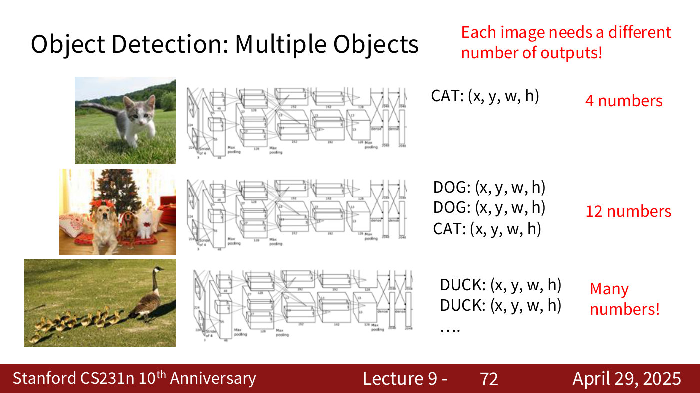

*Slide 72 — Object Detection: Multiple Objects. [Deck](https://cs231n.stanford.edu/slides/2025/lecture_9.pdf)*

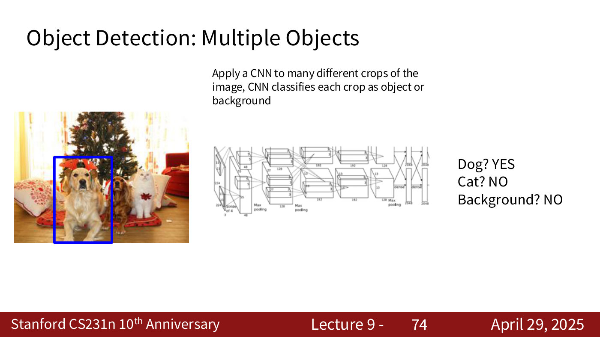

*Slide 74 — Object Detection: Multiple Objects. [Deck](https://cs231n.stanford.edu/slides/2025/lecture_9.pdf)*

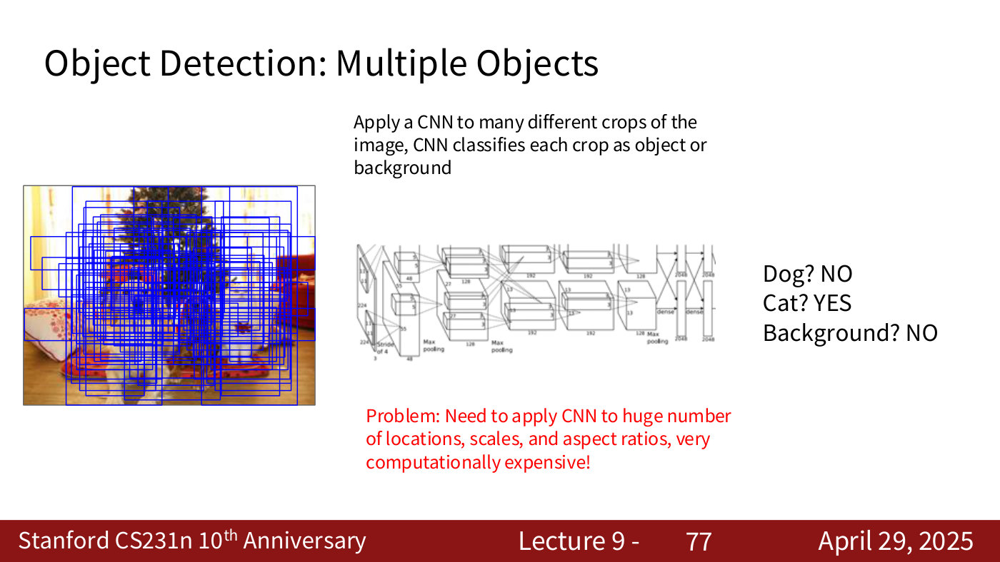

*Slide 77 — Object Detection: Multiple Objects. [Deck](https://cs231n.stanford.edu/slides/2025/lecture_9.pdf)*

### Region proposals and R-CNN

Region proposals "Find 'blobby' image regions that are likely to contain objects" and are "Relatively fast to run; e.g. Selective Search gives 2000 region proposals in a few seconds on CPU" (slide 78; Alexe et al. 2012, Uijlings et al. 2013, Cheng et al. 2014, Zitnick and Dollár 2014). Much research up to 2014 went into "finding regions that have high probability of having the object in them" (≈37:20).

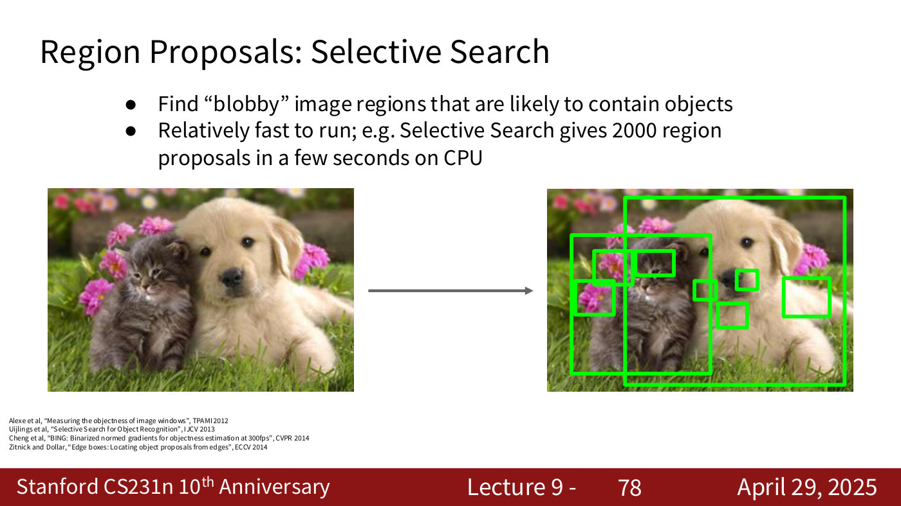

*Slide 78 — Region Proposals: Selective Search. [Deck](https://cs231n.stanford.edu/slides/2025/lecture_9.pdf)*

**R-CNN** (Girshick et al., CVPR 2014) takes about 2,000 regions of interest from a proposal method, warps each to $224 \times 224$ pixels, forwards each through an ImageNet-pretrained ConvNet, classifies each with SVMs, and predicts "corrections" to each box, "4 numbers: (dx, dy, dw, dh)" (slides 79–84). The lecturer describes it as running a CNN on each patch, classifying it, and refining the box "if I have to change the coordinates a little bit" (≈38:05–38:51). The problem: "Very slow! Need to do ~2k independent forward passes for each image!" (slide 85; ≈38:51).

### Fast R-CNN

The idea behind **Fast R-CNN** (Girshick, ICCV 2015): "Pass the image through convnet before cropping! Crop the conv feature instead!" (slide 86). This works because convolutions preserve spatial information: "we always have a way to track where in the pixel space they are" (≈38:51–39:38). The whole image goes once through a "Backbone" network (AlexNet, VGG, ResNet and so on) to "conv5" features. The regions of interest from the proposal method are cropped and resized there, and a small per-region network outputs an object category (linear + softmax) and a box offset (linear) for each (slides 88–92; ≈39:38–40:25). Asked whether the number of proposed regions is predefined, the lecturer says "the short answer to that is yes" (≈40:25).

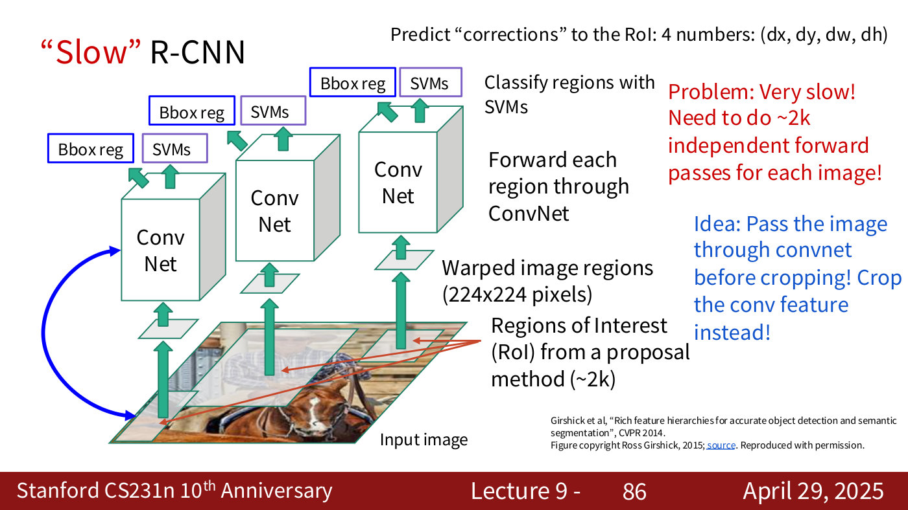

*Slide 86 — R-CNN: about 2,000 warped regions, each through its own ConvNet, then SVMs and box regression; the blue arrow is the idea that leads to Fast R-CNN. [Deck](https://cs231n.stanford.edu/slides/2025/lecture_9.pdf)*

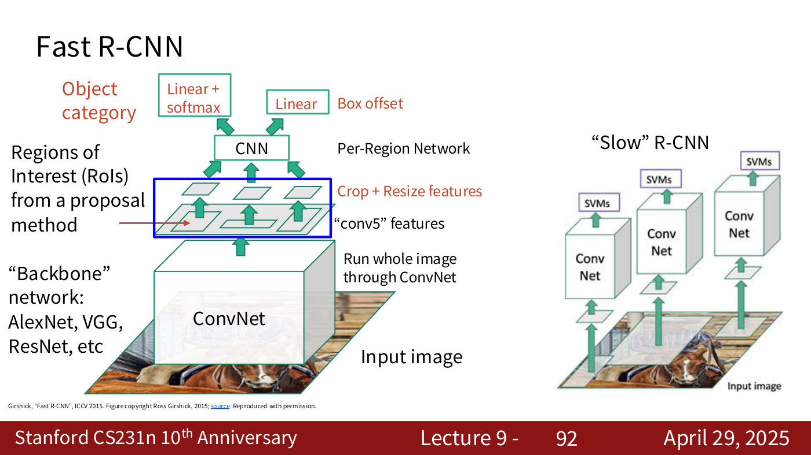

*Slide 92 — Fast R-CNN (left) runs the backbone once and crops the conv5 features (blue box) for each region, against R-CNN's one ConvNet per region (right). [Deck](https://cs231n.stanford.edu/slides/2025/lecture_9.pdf)*

**Cropping features: RoI Pool and RoI Align (slides only).** The appendix shows how the crop works. A proposal on a $3 \times 640 \times 480$ input image is projected onto image features of $512 \times 20 \times 15$, "snapped" to grid cells, divided into a $2 \times 2$ grid of roughly equal subregions, and max-pooled within each subregion. The region features are then $512 \times 2 \times 2$ ("In practice e.g 512 x 7 x 7"), "always the same size even if input regions have different sizes!" (slides 153–158; Girshick, ICCV 2015). The snapping leaves the "Region features slightly misaligned" (slide 159). **RoI Align** (He et al., Mask R-CNN, ICCV 2017) does no snapping: it samples at regular points in each subregion using bilinear interpolation and then max-pools (slides 160–164). The feature at a point $(x, y)$ is a combination of the features $f_{i,j}$ at its four neighbouring grid cells $(x_i, y_j)$ (slide 163):

$$f_{xy} = \sum_{i,j=1}^{2} f_{i,j} \max(0, 1 - |x - x_i|) \max(0, 1 - |y - y_j|)$$

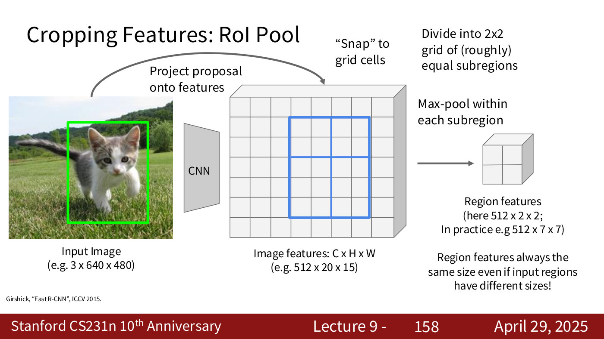

*Slide 158 — RoI Pool: the projected proposal is snapped to grid cells, split into 2 x 2 subregions and max-pooled, so every region gives features of the same size. [Deck](https://cs231n.stanford.edu/slides/2025/lecture_9.pdf)*

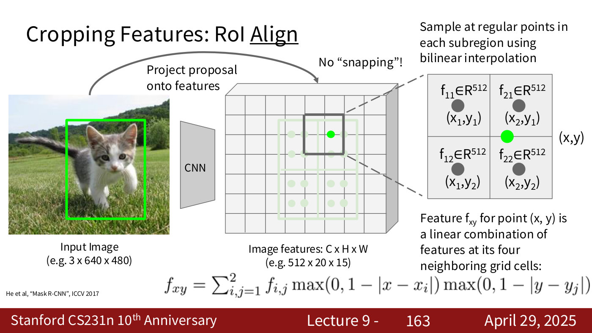

*Slide 163 — RoI Align's bilinear sampling: the feature at a sample point (green) is a weighted combination of the four neighbouring grid-cell features f11, f12, f21 and f22. [Deck](https://cs231n.stanford.edu/slides/2025/lecture_9.pdf)*

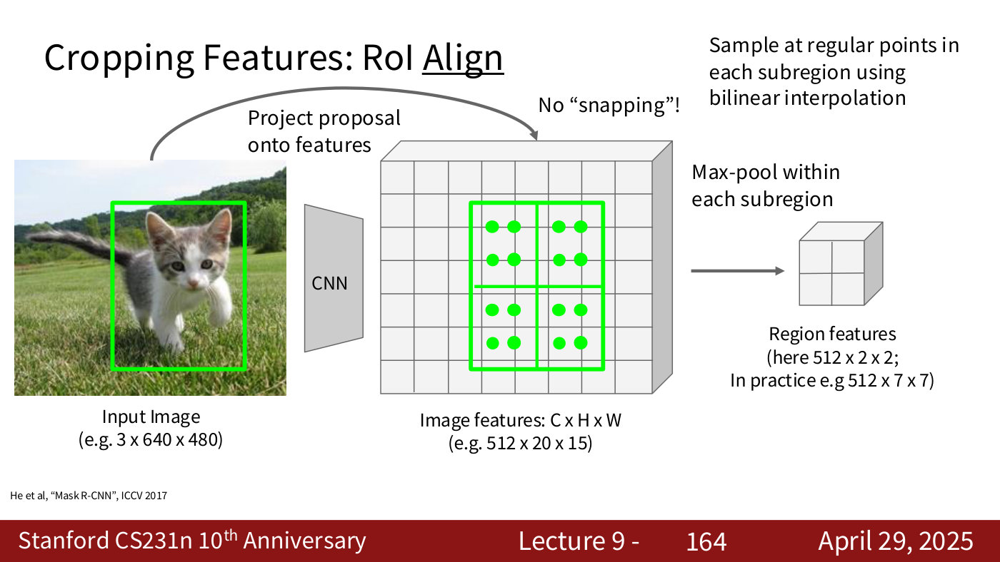

*Slide 164 — Cropping Features: RoI Align. [Deck](https://cs231n.stanford.edu/slides/2025/lecture_9.pdf)*

**How much faster (slides only).** Slide 165 compares R-CNN, SPP-Net and Fast R-CNN (Girshick et al. 2014; He et al., ECCV 2014; Girshick 2015):

| | Training time (hours) | Test time including region proposals (s) | Test time excluding region proposals (s) |
| --- | --- | --- | --- |
| R-CNN | 84 | 49 | 47 |
| SPP-Net | 25.5 | 4.3 | 2.3 |
| Fast R-CNN | 8.75 | 2.3 | 0.32 |

Slide 166 points at Fast R-CNN's 0.32 seconds against its 2.3: "Problem: Runtime dominated by region proposals!"

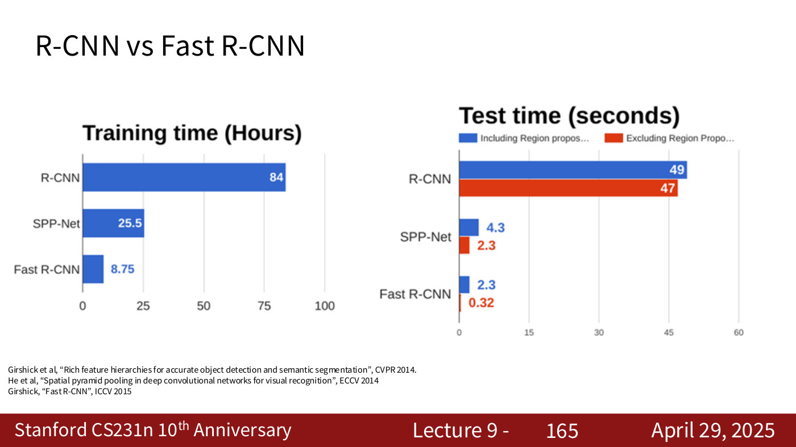

*Slide 165 — R-CNN vs Fast R-CNN. [Deck](https://cs231n.stanford.edu/slides/2025/lecture_9.pdf)*

### Region proposal networks and Faster R-CNN

A **region proposal network** predicts the proposals from the CNN's features (slides 93–98; ≈41:10–43:31). A $3 \times 640 \times 480$ input image gives image features of $512 \times 20 \times 15$. The network imagines "an anchor box of fixed size at each point in the feature map", and a convolution predicts at each point "whether the corresponding anchor contains an object (binary classification)", an output of $1 \times 20 \times 15$ (slides 94–95). "For positive boxes, also predict a corrections from the anchor to the ground-truth box (regress 4 numbers per pixel)", a further $4 \times 20 \times 15$ (slide 96). "In practice use K different anchor boxes of different size / scale at each point", giving $K \times 20 \times 15$ objectness scores and $4K \times 20 \times 15$ box transforms; then "Sort the K\*20\*15 boxes by their 'objectness' score, take top ~300 as our proposals" (slides 97–98). The lecturer describes the network as starting from boxes "in different locations in the image" and refining, through layers of convolution, those with a high probability of containing an object, supervised by the object labels and locations, and leaves "all of the details about the coordinates … and all of these dimensionalities for you to pick up afterwards" (≈41:10–42:43). "Back to your question", the top $k$ boxes by objectness are taken as the proposals (≈42:43).

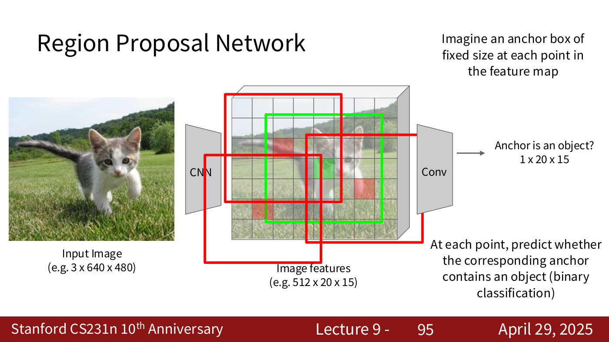

*Slide 95 — Region Proposal Network. [Deck](https://cs231n.stanford.edu/slides/2025/lecture_9.pdf)*

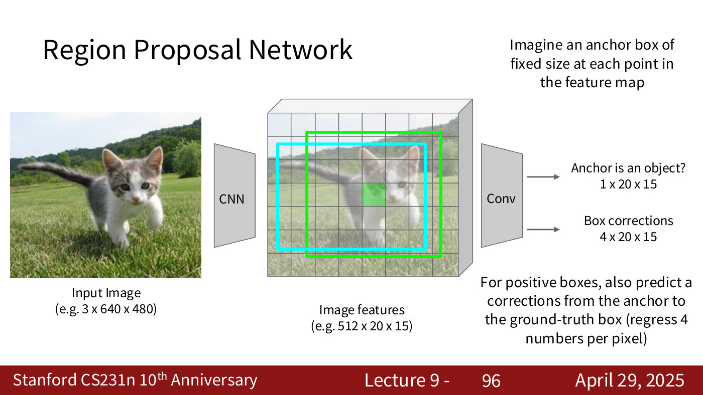

*Slide 96 — Region Proposal Network. [Deck](https://cs231n.stanford.edu/slides/2025/lecture_9.pdf)*

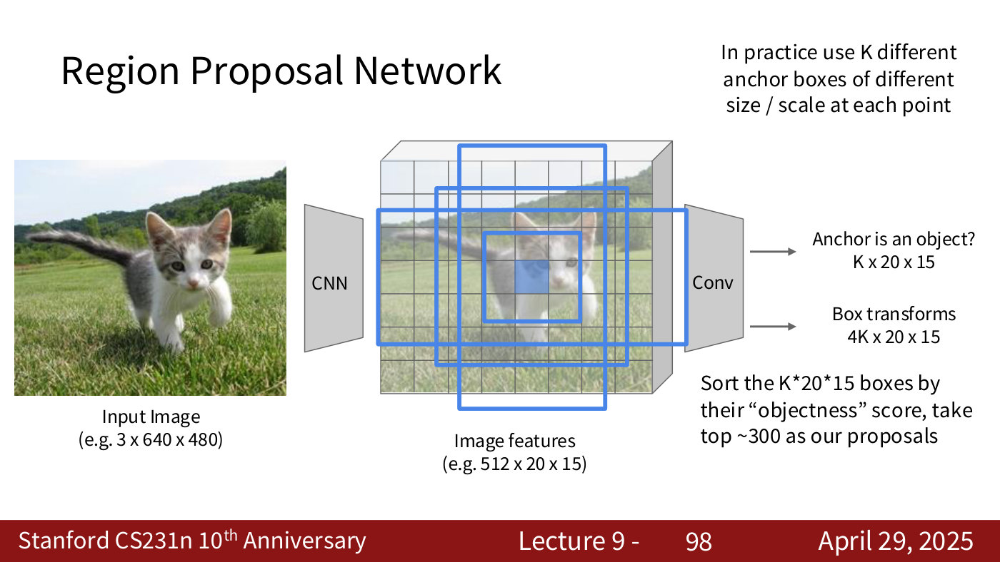

*Slide 98 — the region proposal network: K anchors of different shapes at each of the 20 x 15 feature positions, an objectness score and 4 box transforms for each, and the top ~300 kept as proposals. [Deck](https://cs231n.stanford.edu/slides/2025/lecture_9.pdf)*

**Faster R-CNN (mostly slides only).** Slide 114 draws the resulting detector, and the appendix gives it in detail: "Insert Region Proposal Network (RPN) to predict proposals from features. Otherwise same as Fast R-CNN: Crop features for each proposal, classify each one" (slide 167; Ren et al., NIPS 2015). It is trained "Jointly … with 4 losses": RPN object or not, RPN box coordinates, final classification score and final box coordinates (slide 168). Its test time is 0.2 seconds against R-CNN's 49, SPP-Net's 4.3 and Fast R-CNN's 2.3 (slide 169). Slide 170 lists what the slides gloss over — "Ignore overlapping proposals with non-max suppression", "How are anchors determined?", "How do we sample positive / negative samples for training the RPN?", "How to parameterize bounding box regression?" — as questions with no printed answers. Faster R-CNN is "a Two-stage object detector": the first stage runs once per image (backbone network, region proposal network), and the second once per region (crop features with RoI pool or align, predict object class, predict box offset) (slide 171). Slide 172 asks "Do we really need the second stage?" and prints no answer.

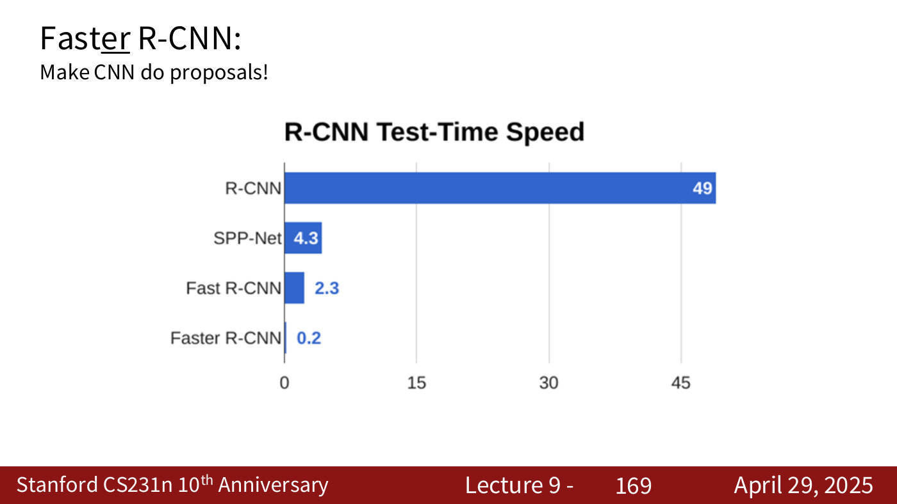

*Slide 169 — Faster R-CNN: Make CNN do proposals!. [Deck](https://cs231n.stanford.edu/slides/2025/lecture_9.pdf)*

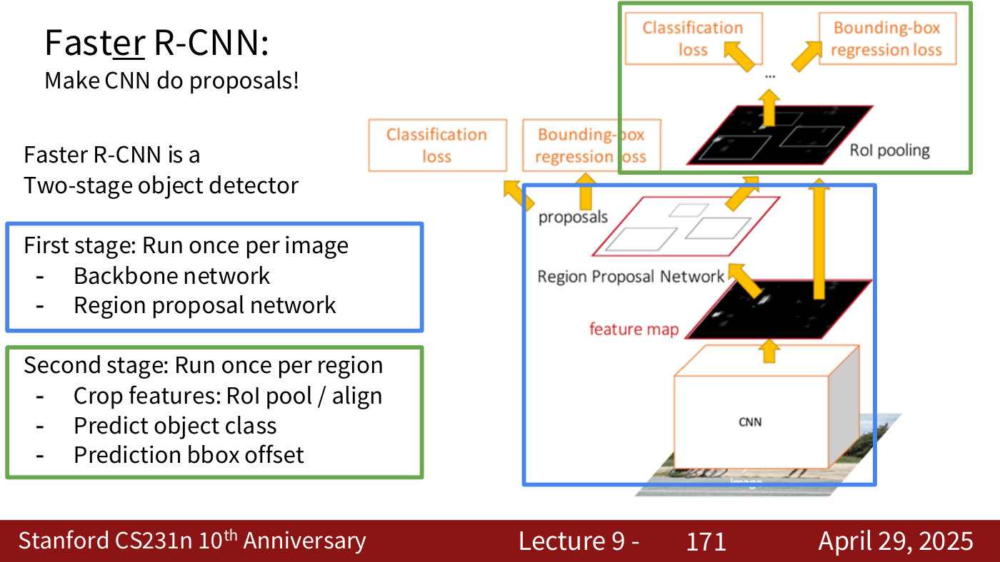

*Slide 171 — Faster R-CNN: Make CNN do proposals!. [Deck](https://cs231n.stanford.edu/slides/2025/lecture_9.pdf)*

In the recording the lecturer says that these algorithms — named here as "R-CNN" and "Mask R-CNN", although Mask R-CNN has not yet been presented — "are not being used anymore these days because they are very heavy computationally", since they need "two separate networks", a region proposal network and a classification and box-refinement network, "at least two passes" per image (≈43:31–44:18).

### Single-stage detectors: YOLO

Single-stage detectors (YOLO, SSD, RetinaNet; Redmon et al., CVPR 2016; Liu et al., ECCV 2016; Lin et al., ICCV 2017) divide the image into a $7 \times 7$ grid and imagine a set of $B$ base boxes centred at each grid cell, $B = 3$ in the drawing (slide 99). Within each grid cell they "Regress from each of the B base boxes to a final box with 5 numbers: (dx, dy, dh, dw, confidence)" and "Predict scores for each of C classes (including background as a class)". The output is $7 \times 7 \times (5B + C)$, and it "Looks a lot like RPN, but category-specific!"

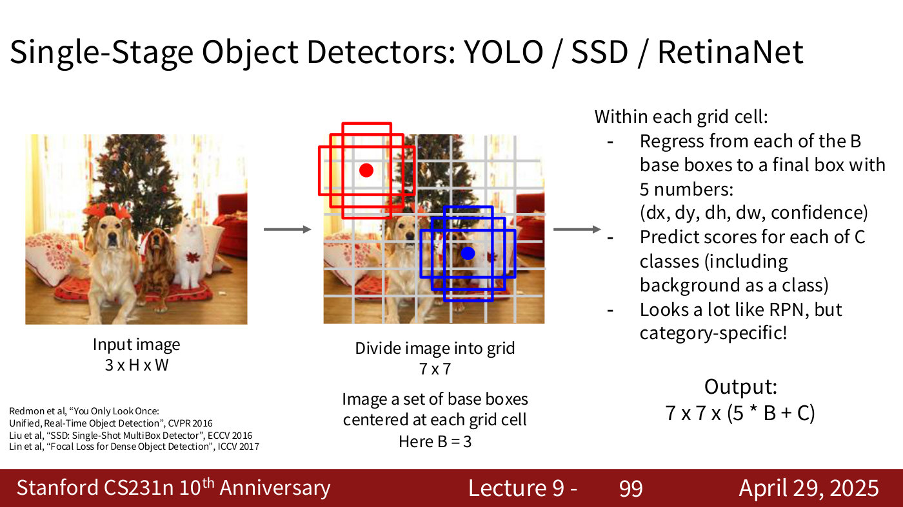

*Slide 99 — single-stage detection: a 7 x 7 grid with B = 3 base boxes at each cell, each regressed to a final box with a confidence, plus C class scores per cell. [Deck](https://cs231n.stanford.edu/slides/2025/lecture_9.pdf)*

**YOLO**, "you look only once", generates all the bounding boxes "with one single pass on the image" (≈45:04). It divides the image into an $S \times S$ grid, $7 \times 7$ in the example (≈45:04–45:51). For each cell it outputs "P(object): probability that the box contains an object", "B bounding boxes (x, y, h, w)" and "P(class): probability of belonging to a class" (slide 102), here with $B = 2$ (slides 103–104). Run for every cell at once, this gives "Many bounding boxes with different object probabilities", with the probability drawn as the weight of each box's edges (slide 105; ≈46:38). Thresholding and non-maximal suppression keep the most probable boxes, here a dog, a bicycle and a car (slide 106; ≈46:38–47:25). Asked how the cloud of boxes on slide 105 arises, the lecturer repeats that each grid cell generates $B$ boxes, each with a probability, and putting them together for all cells gives "so many boxes" (≈48:12). YOLO, convolution-heavy in its earlier versions, is "a fast object detector" that many industrial applications still use as the base for object detection, and newer versions are used "in medicine, robotics and also in many industrial applications" (≈44:18–48:12).

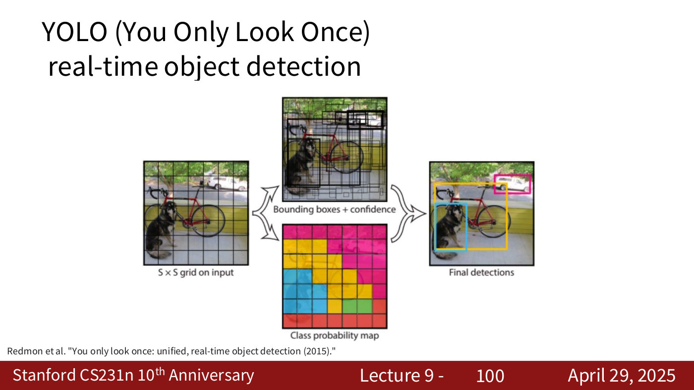

*Slide 100 — YOLO (You Only Look Once) real-time object detection. [Deck](https://cs231n.stanford.edu/slides/2025/lecture_9.pdf)*

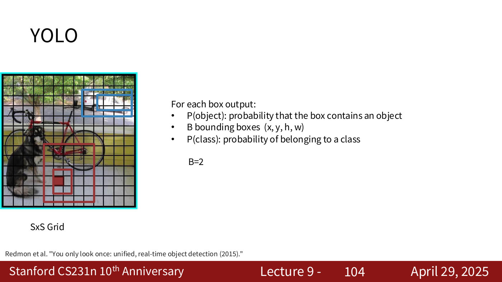

*Slide 104 — YOLO. [Deck](https://cs231n.stanford.edu/slides/2025/lecture_9.pdf)*

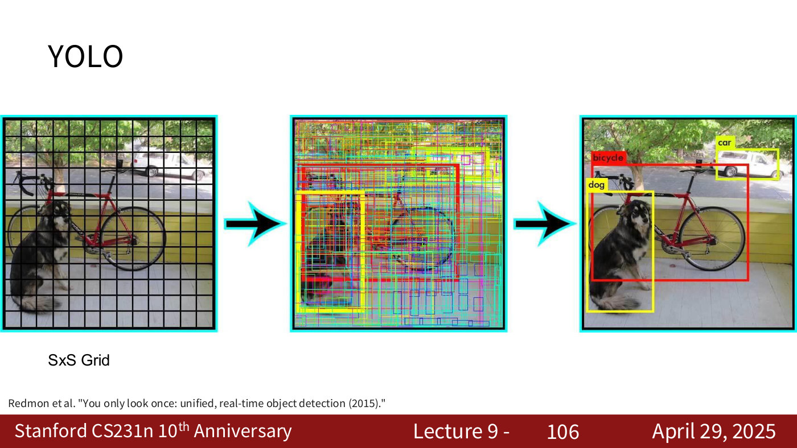

*Slide 106 — YOLO: the S x S grid gives many boxes with different object probabilities, which thresholding and non-maximal suppression reduce to the final dog, bicycle and car. [Deck](https://cs231n.stanford.edu/slides/2025/lecture_9.pdf)*

### DETR: detection with transformers

**DETR**, "Object Detection with Transformers" (Carion et al., ECCV 2020), is a "Simple object detection pipeline: directly output a set of boxes from a Transformer", with "No anchors, no regression of box transforms". It is trained to "Match predicted boxes to GT boxes with bipartite matching; train to regress box coordinates" (slide 107). The lecturer calls the paper "almost 5 years ago … now kind of deprecated. Nobody uses this for real applications", but "a very good example of how to use transformers for object detection" (≈49:00–49:46).

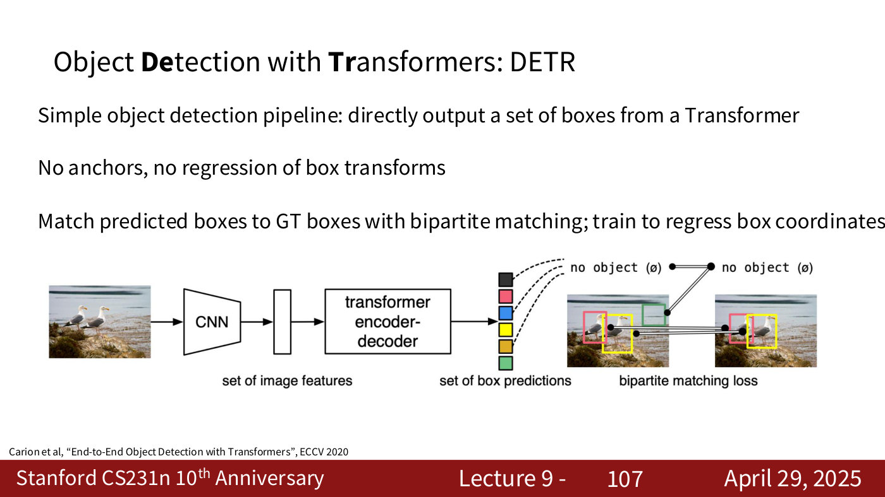

*Slide 107 — DETR: CNN features go through a transformer encoder-decoder that outputs a set of box predictions, each matched to a ground-truth box or to no object by bipartite matching. [Deck](https://cs231n.stanford.edu/slides/2025/lecture_9.pdf)*

The image goes through a CNN backbone to a set of image features, a positional encoding is added, and a transformer encoder produces output tokens (slides 108–110; ≈49:46–50:32). "The smart part for this algorithm" is the decoder (slide 111; ≈50:32): it takes the encoder's output tokens and a set of **object queries**, "trainable parameters themselves". With 10 or 20 queries "I'm seeking up to 20 objects to be detected in that image". Through self-attention and cross-attention with the encoder output, the decoder produces one output per query, and a feed-forward network (FFN) turns each into either a class and a box or "no object" (slide 112; ≈51:17–52:03).

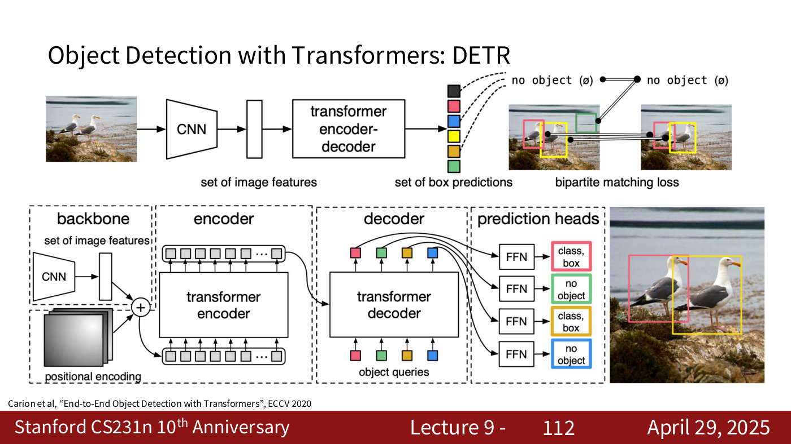

*Slide 112 — DETR in detail: backbone features plus positional encoding go through the encoder; the decoder turns each learned object query into a class and box, or no object, through an FFN. [Deck](https://cs231n.stanford.edu/slides/2025/lecture_9.pdf)*

Most of the questions in the lecture are about DETR (≈52:03–57:30). The queries are not boxes or image patches: "they are queries … asking the question that I actually want an object to be output in place of this input query", initialised and learned like other parameters (≈52:03, ≈54:24). Nothing in the query says what or where to look; the classes come from the supervision with class labels, and the boxes are supervised with "the L2 loss of the ground truth boxes" (≈52:50–53:37; slide 107 names a bipartite matching loss). Nothing explicit stops two queries producing the same box, but the self-attention and cross-attention layers make the queries interact, so "each of those queries match with one of the output" (≈55:11). DETR needs no pixel-level segmentation, only class labels and boxes (≈55:57). A fully supervised model like this cannot detect an unseen class, apart from "no object"; zero-shot extensions exist but are "beyond this topic" (≈55:57–56:44). With more objects in the scene than queries, it outputs the boxes it is most confident about, so "you often want to add more queries" (≈56:44–57:30).

### Choosing a detector (slides only)

Object detection has "Lots of variables": the backbone network (VGG16, ResNet-101, Inception V2, Inception V3, Inception ResNet, MobileNet), the "meta-architecture" (two-stage Faster R-CNN, single-stage YOLO or SSD, hybrid R-FCN), the image size and the number of region proposals. The takeaways: "Faster R-CNN is slower but more accurate", "SSD is much faster but not as accurate", and "Bigger / Deeper backbones work better" (slides 173–174; Huang et al., CVPR 2017; Zou et al., "Object Detection in 20 Years: A Survey", 2019).

## Instance segmentation: Mask R-CNN

Instance segmentation needs both: the pixels of each object, and which object they belong to (slide 113; ≈32:45, ≈57:30). It is "not too hard" given a detector (≈57:30). Start from the two-stage detector (slide 114): a CNN, a region proposal network that gives boxes, and per-region classification and box refinement. **Mask R-CNN** (He et al., ICCV 2017) makes it "more multitask" with one more output: "Add a small mask network that operates on each RoI and predicts a 28x28 binary mask" (slide 115; ≈58:15–59:01). The head crops each region from the CNN and RPN features with RoI Align to $256 \times 14 \times 14$, predicts "Classification Scores: C" and "Box coordinates (per class): 4 \* C", and through two convolutions predicts "a mask for each of C classes", $C \times 28 \times 28$ (slides 116–117). The lecturer: "we add another layer of convolution that generates the mask for that object at the pixel level" (≈59:01).

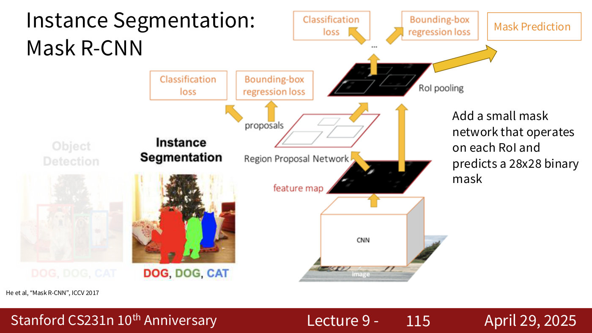

*Slide 115 — Instance Segmentation: Mask R-CNN. [Deck](https://cs231n.stanford.edu/slides/2025/lecture_9.pdf)*

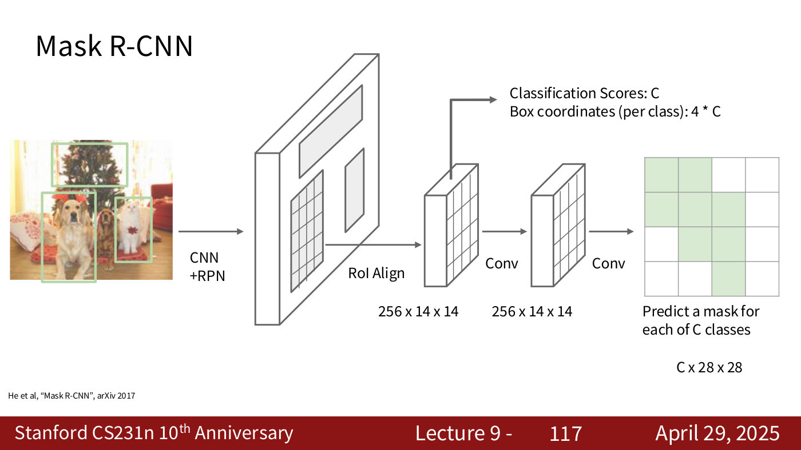

*Slide 117 — the Mask R-CNN head: RoI Align gives 256 x 14 x 14 features per region, which predict class scores and per-class boxes and, through two convolutions, a 28 x 28 mask for each class. [Deck](https://cs231n.stanford.edu/slides/2025/lecture_9.pdf)*

The training target for each box is the object's mask cropped to that box: a chair, the bed, the child in the bedroom photograph (slides 118–121; ≈59:01–59:48). The results "have been very, very good" (≈59:48): masks for motorbikes, riders, an elephant and people (slide 122), and Mask R-CNN "Also does pose", drawing a skeleton over each person (slide 123).

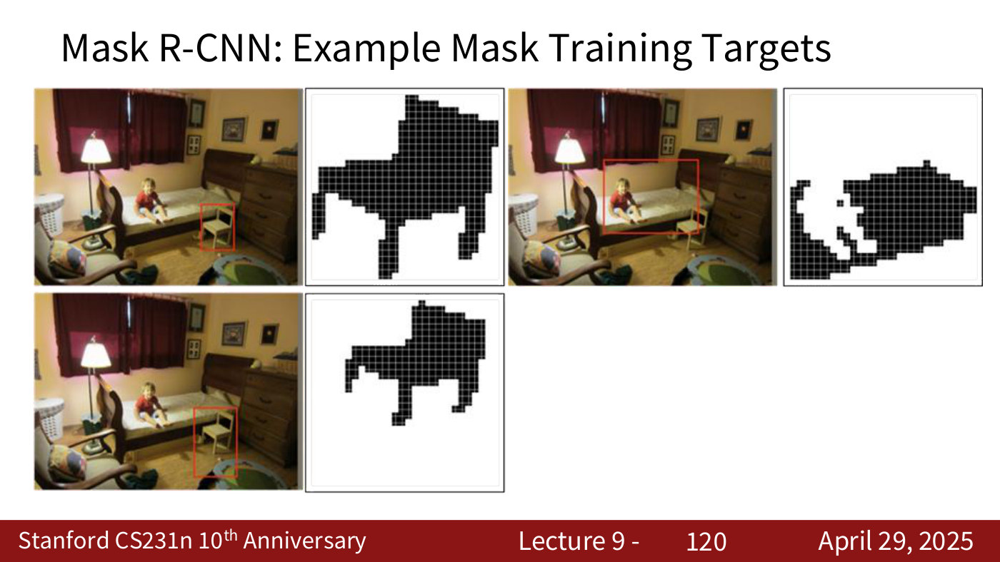

*Slide 120 — Mask R-CNN: Example Mask Training Targets. [Deck](https://cs231n.stanford.edu/slides/2025/lecture_9.pdf)*

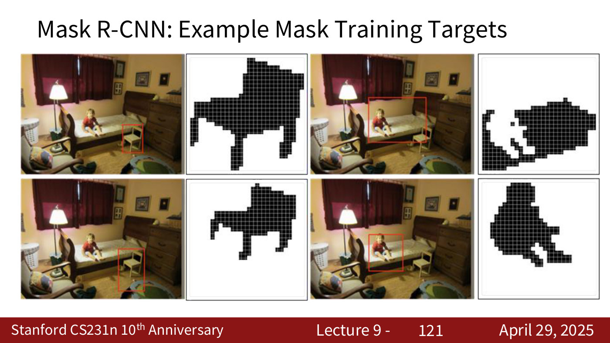

*Slide 121 — Mask R-CNN: Example Mask Training Targets. [Deck](https://cs231n.stanford.edu/slides/2025/lecture_9.pdf)*

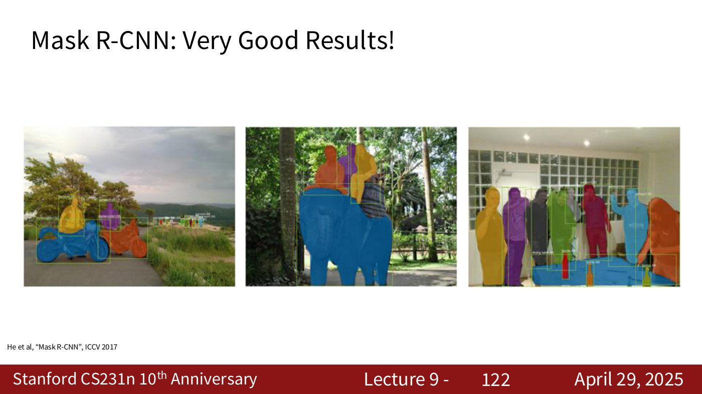

*Slide 122 — Mask R-CNN: Very Good Results!. [Deck](https://cs231n.stanford.edu/slides/2025/lecture_9.pdf)*

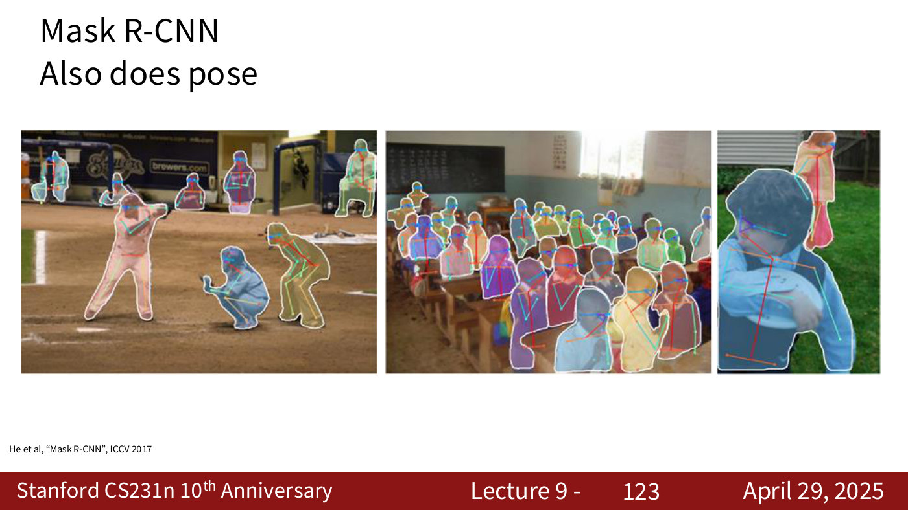

*Slide 123 — Mask R-CNN: Also does pose. [Deck](https://cs231n.stanford.edu/slides/2025/lecture_9.pdf)*

Slide 124 lists open-source implementations — the TensorFlow Detection API and Detectron2 (PyTorch), each with Faster R-CNN, Mask R-CNN and others — and advises "Finetune on your own dataset with pre-trained models" (≈59:48–1:00:33). These tasks remain worth knowing because applications still need them, for example quality control "separating rotten tomatoes and good tomatoes in an industrial pipeline", where the system must detect the objects and classify each (slide 125; ≈1:00:33–1:01:20).

## Visualization and understanding

Visualizing neural networks "has been a big lecture by itself", and it "helped us gain understanding into what the networks are learning"; the lecture summarises "the most important ones … that you may need to use in your applications" (slide 126; ≈1:01:20–1:02:09). The years the lecturer gives for when the topic was most active are garbled in the captions (≈1:01:20). See [visualizing what networks learn](visualizing-networks.md).

**Linear-classifier templates.** Lecture 2's linear classifier learned "a template for each of those classes", such as a front-facing car (slide 127, lecture 2's slide 62; ≈1:02:09; see [linear classifiers](linear-classifiers.md#three-ways-to-read-it)). As printed, slide 127's ship score is 61.95, which leaves out the bias $b = -1.2$; the score with the bias is 60.75.

**First-layer filters.** The same can be done for a network's filters (slides 128–129; ≈1:02:54–1:03:41). The first-layer filters of AlexNet ($64 \times 3 \times 11 \times 11$) and of ResNet-18, ResNet-101 and DenseNet-121 ($64 \times 3 \times 7 \times 7$ each) show "basic shapes, orientations or simple shapes". This works only "for the layers that we have few channels": three input channels can be shown as an RGB image, but the middle layers of a CNN have many channels, so "it's not easy to visualize those in something that we can see". In later stages the network learns "more holistic and bigger patterns", which can be visualized with guided backpropagation (≈1:03:41; see below). Lecture 6 showed AlexNet's filters with a pointer to this lecture ([lecture 6](06-training-cnns-architectures.md#transfer-learning)).

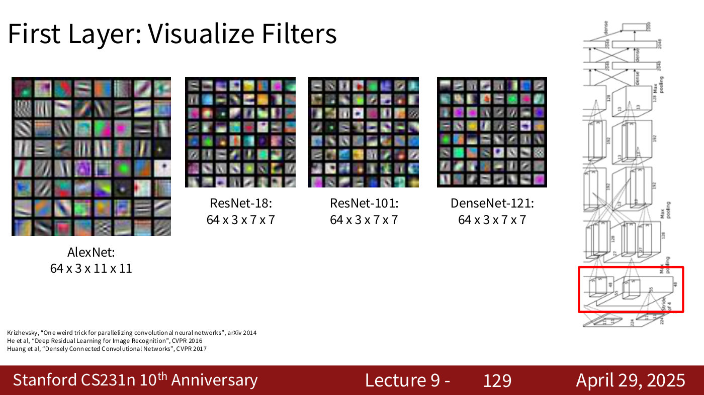

*Slide 129 — First Layer: Visualize Filters. [Deck](https://cs231n.stanford.edu/slides/2025/lecture_9.pdf)*

### Saliency maps

"Which pixel matters?" In a medical application, "nobody cares about knowing if there is tumor or not. Everybody cares about where in the image the tumor is" (≈1:04:28). Training took the derivative of the class score with respect to the weights; a saliency map takes it with respect to the pixels instead. Changing a pixel the gradient marks would change the dog score, so "these are the pixels that matter in order to classify dog on this image" (≈1:05:14–1:06:02). The recipe: "Compute gradient of (unnormalized) class score with respect to image pixels, take absolute value and max over RGB channels" (slide 131; Simonyan, Vedaldi and Zisserman, ICLR Workshop 2014). Slide 132 shows the maps for five images — a sailboat, a dog, a fruit held in a hand, a tractor, two fish — each brightest over the object. See [backpropagation](backpropagation.md).

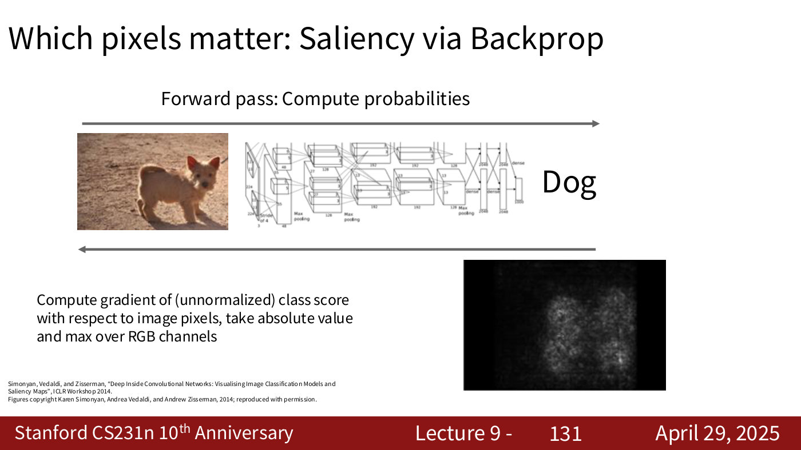

*Slide 131 — a saliency map: the gradient of the dog score with respect to each pixel, its absolute value maxed over the colour channels, is brightest over the dog. [Deck](https://cs231n.stanford.edu/slides/2025/lecture_9.pdf)*

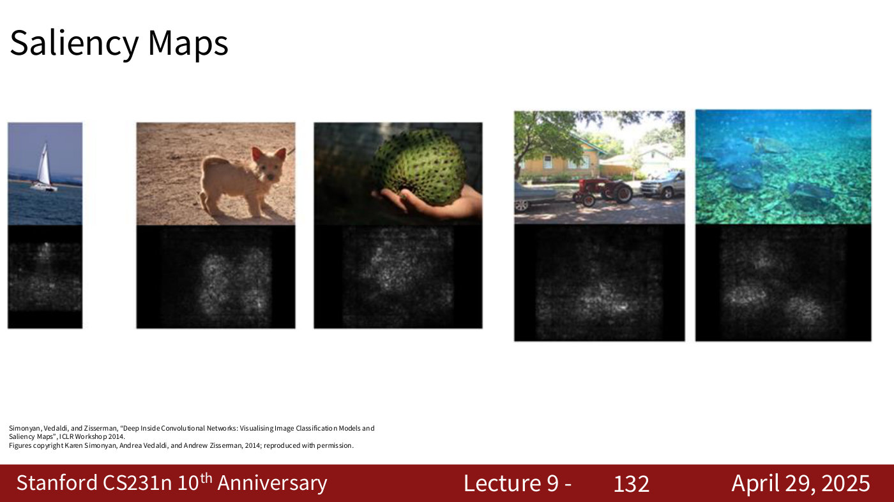

*Slide 132 — Saliency Maps. [Deck](https://cs231n.stanford.edu/slides/2025/lecture_9.pdf)*

### Class activation mapping (CAM)

Sometimes "you want to see for each of the classes how the activations work" (≈1:06:49). **Class activation mapping** (Zhou et al., CVPR 2016) applies to a network whose last CNN features $f \in \mathbb{R}^{H \times W \times K}$ are global-average-pooled to $F \in \mathbb{R}^{K}$ and mapped by one fully connected layer with weights $w \in \mathbb{R}^{K \times C}$ to the class scores $S \in \mathbb{R}^{C}$ (slide 133). Then (slides 134–139):

$$F_k = \frac{1}{HW} \sum_{h,w} f_{h,w,k}$$

$$S_c = \sum_k w_{k,c} F_k = \frac{1}{HW} \sum_k w_{k,c} \sum_{h,w} f_{h,w,k} = \frac{1}{HW} \sum_{h,w} \sum_k w_{k,c} f_{h,w,k}$$

The inner sum is the class activation map $M \in \mathbb{R}^{C,H,W}$:

$$M_{c,h,w} = \sum_k w_{k,c} f_{h,w,k}$$

so each class score is the spatial average of its map. "If we extend the math, basically we simply can highlight the class scores in a weighted sum form", which lets "class predictions" be traced "all the way back to the feature maps and specific locations", and through the convolution layers to the image (≈1:08:20).

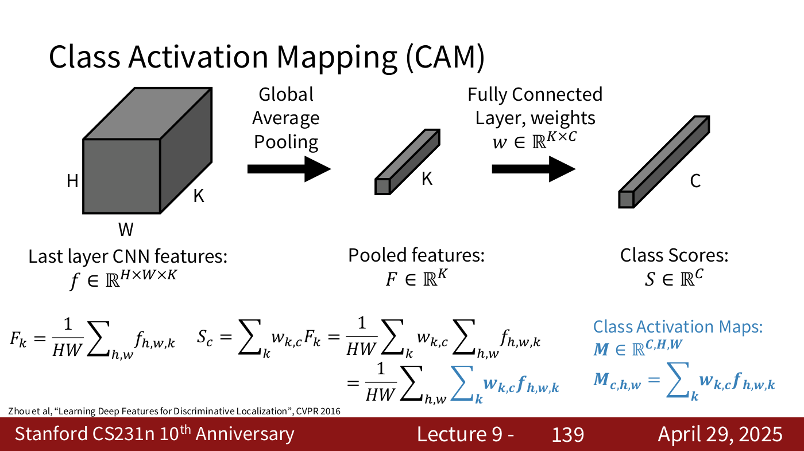

*Slide 139 — CAM: the last-layer features f (H x W x K) are average-pooled to F and weighted by w into the class scores S; moving the sum over positions outside gives the class activation map M for each class. [Deck](https://cs231n.stanford.edu/slides/2025/lecture_9.pdf)*

For one photograph of a domed building, the top five predictions — palace 0.459, dome 0.195, church 0.146, altar 0.091, monastery 0.051 — each get their own map, and the class "barbell" lights up the plates in three weight-lifting photographs (scores 0.761, 0.447 and 0.999) (slide 140; ≈1:09:06–1:09:54). The problem: "Can only apply to last conv layer" (slide 141; ≈1:09:54).

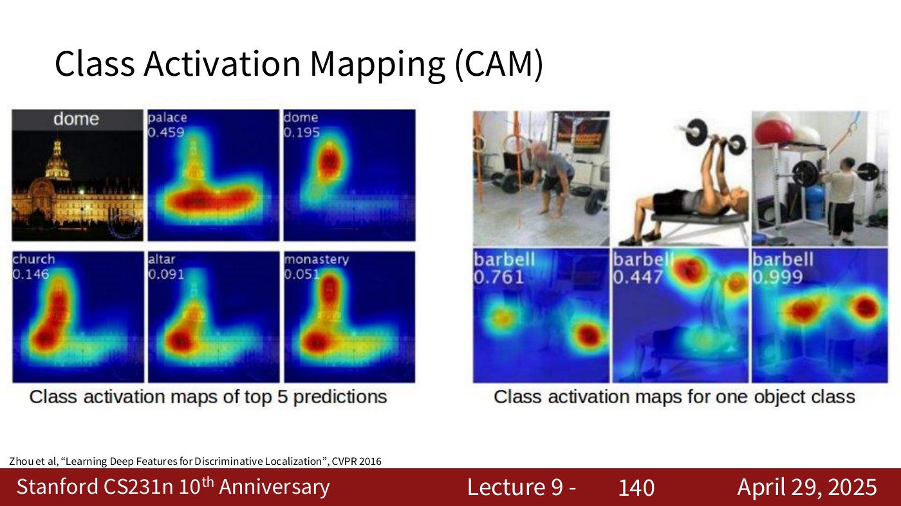

*Slide 140 — class activation maps: one map per top-5 class for a domed building (left), and the barbell class lighting up the plates in three photographs (right). [Deck](https://cs231n.stanford.edu/slides/2025/lecture_9.pdf)*

### Grad-CAM

**Grad-CAM**, gradient-weighted class activation mapping (Selvaraju et al., CVPR 2017), works at any layer (slides 142–145):

1. "Pick any layer, with activations" $A \in \mathbb{R}^{H \times W \times K}$.
2. Compute the gradient of the class score $S_c$ with respect to $A$: $\partial S_c / \partial A \in \mathbb{R}^{H \times W \times K}$.
3. "Global Average Pool the gradients to get weights" $\alpha \in \mathbb{R}^{K}$: $\alpha_k = \frac{1}{HW} \sum_{h,w} \partial S_c / \partial A_{h,w,k}$.
4. Compute the activation map $M^c \in \mathbb{R}^{H,W}$: $M^c_{h,w} = \mathrm{ReLU}\left(\sum_k \alpha_k A_{h,w,k}\right)$.

Instead of the product of $W$ and the features, "we go all the way back with the gradients and create a weight based on the gradients", and the ReLU passes only the positive contributions (≈1:10:40–1:11:28). This matters because "in most of the CNN algorithms we don't have just one convolution layer at the end; we always have some operations, fully connected and so on" between it and the scores (≈1:11:28). Slide 146 compares the methods on one photograph of a bulldog and a cat, for "Cat" and for "Dog": guided backpropagation, Grad-CAM, guided Grad-CAM, an occlusion map and Grad-CAM on a ResNet, with each Grad-CAM heat map over the animal named (≈1:12:14).

*Slide 146 — Grad-CAM for Cat (top) and Dog (bottom) on one photograph: guided backprop, Grad-CAM, guided Grad-CAM, occlusion and ResNet Grad-CAM, each heat map over the named animal. [Deck](https://cs231n.stanford.edu/slides/2025/lecture_9.pdf)*

### Visualizing ViT features

Transformers "inherently come with the activation maps": like the attention matrix between output and input words that lecture 8 showed, "for each of the outputs we can create these maps in the pixel space" (slide 147; ≈1:12:14–1:13:01). Slide 147 shows feature maps beside photographs and heat maps over images labelled "basketball (95.13%)", "beacon (99.81%)", "American_black_bear (92.99%)" and "basketball (87.74%)" (Chen et al., ICLR 2022; Paul and Chen, AAAI 2022). "With ViTs and transformers this is much easier … but with CNNs we often use Grad-CAM or these types of algorithms" (≈1:13:01). See [attention](attention.md).

*Slide 147 — Visualizing ViT features. [Deck](https://cs231n.stanford.edu/slides/2025/lecture_9.pdf)*

### Intermediate features via guided backpropagation (slides only)

The appendix shows the method the lecturer names at ≈1:03:41. "Pick a single intermediate neuron, e.g. one value in 128 x 13 x 13 conv5 feature map", and "Compute gradient of neuron value with respect to image pixels" (slides 175–176; Zeiler and Fergus, ECCV 2014; Springenberg et al., ICLR Workshop 2015). "Images come out nicer if you only backprop positive gradients through each ReLU (guided backprop)" (slide 176). The slide's ReLU example shows the difference. The forward pass takes

$$\begin{bmatrix} 1 & -1 & 5 \cr 2 & -5 & -7 \cr -3 & 2 & 4 \end{bmatrix} \to \begin{bmatrix} 1 & 0 & 5 \cr 2 & 0 & 0 \cr 0 & 2 & 4 \end{bmatrix}$$

and the upstream gradient is

$$\begin{bmatrix} -2 & 3 & -1 \cr 6 & -3 & 1 \cr 2 & -1 & 3 \end{bmatrix}$$

Ordinary backpropagation passes it only where the forward input was positive, and guided backpropagation also zeroes the negative gradients:

$$\text{backprop: } \begin{bmatrix} -2 & 0 & -1 \cr 6 & 0 & 0 \cr 0 & -1 & 3 \end{bmatrix} \qquad \text{guided backprop: } \begin{bmatrix} 0 & 0 & 0 \cr 6 & 0 & 0 \cr 0 & 0 & 3 \end{bmatrix}$$

Slides 177–178 set the maximally activating patches of twelve neurons, one neuron per row, beside their guided-backprop images: eyes and noses, curved strokes, text, wheels and circles, faces, dog heads.

*Slide 176 — the ReLU forward pass (top), ordinary backpropagation (middle) and guided backpropagation (bottom), which also zeroes the negative gradients. [Deck](https://cs231n.stanford.edu/slides/2025/lecture_9.pdf)*

*Slide 177 — Intermediate features via (guided) backprop. [Deck](https://cs231n.stanford.edu/slides/2025/lecture_9.pdf)*

*Slide 178 — Intermediate features via (guided) backprop. [Deck](https://cs231n.stanford.edu/slides/2025/lecture_9.pdf)*

## Next time

"Next session we'll have the lecture around video understanding" (slide 149; ≈1:13:01).

## Related pages

- [Image segmentation](image-segmentation.md) — semantic segmentation, fully convolutional networks, unpooling, transposed convolution, U-Net, instance segmentation with Mask R-CNN.
- [Object detection](object-detection.md) — single-object detection and the multitask loss, region proposals, R-CNN, Fast R-CNN, RoI Pool and RoI Align, region proposal networks, Faster R-CNN, YOLO, DETR.
- [Visualizing what networks learn](visualizing-networks.md) — templates, filters, saliency maps, CAM, Grad-CAM, guided backpropagation, ViT attention maps.
- [Computer vision tasks](computer-vision-tasks.md) — the four tasks as lecture 1 defines them.
- [Transformers](transformers.md) — the Vision Transformer and the tweaks this lecture walks through.
- [Attention](attention.md) — the attention maps a ViT provides, and DETR's cross-attention.
- [Normalization layers](normalization-layers.md#layer-normalization-in-transformers) — pre-norm and RMSNorm.
- [Convolutional networks](convolutional-networks.md) — strided convolution, which transposed convolution reverses.
- [Loss functions](loss-functions.md) — the softmax loss used per pixel and in the multitask loss.
- [Linear classifiers](linear-classifiers.md) — the templates slide 127 recalls.
- [Transfer learning](transfer-learning.md) — pretrained backbones and fine-tuning detectors.
- [Course logistics](course-logistics.md) — slide 2's reminders.
- Previous lecture: [Lecture 8 — Attention and Transformers](08-attention-transformers.md).
