# Lecture 10 — Video Understanding

**CS231N Deep Learning for Computer Vision, Stanford, Spring 2025.** Delivered May 1, 2025, as a guest lecture by **Ruohan Gao**. A member of the course staff, whom the guest calls "Zane", introduces the guest as an assistant professor of computer science at the University of Maryland, College Park, who leads the Multisensory Machine Intelligence Lab there and was "previously an instructor for CS231N from 2022 to 2023" during a postdoc (≈0:05). The deck's own slide says "I taught CS231N at Stanford from 2021-2023", and lists a Ph.D. at UT Austin, a postdoc at Stanford and "Some time at Meta" (slide 2). [Video](https://www.youtube.com/watch?v=wElqklprhPE) · [edited transcript](../raw/transcripts/10-video-understanding.md) · deck as [text](../raw/slides/10-video-understanding.md) / [PDF](https://cs231n.stanford.edu/slides/2025/lecture_10.pdf)

## What this lecture establishes

A video is a sequence of images: a 4D tensor with a time dimension added to the image's channels, height and width. The main task is **video classification**, which usually means recognizing *actions* rather than objects. Videos are large, so models train on short, low-frame-rate, low-resolution **clips** and average their predictions over many clips at test time. The lecture builds up the ways a network can combine information over time. The **single-frame CNN** classifies frames independently and is "a very strong baseline". **Late fusion** combines per-frame features at the end, and **early fusion** collapses time in the first layer. **3D CNNs** use 3D convolution and pooling to fuse space and time slowly, and gain temporal shift-invariance in the process. **C3D** is "the VGG of 3D CNNs" and is expensive. **Two-stream networks** add an explicit motion input, optical flow. CNN features fed to an **RNN**, and **recurrent convolutional networks**, model longer-term structure. The **nonlocal block** brings self-attention to space-time, **I3D** inflates 2D image architectures and their weights to 3D, and **video transformers** follow. The last part surveys visualization of video models, temporal and spatio-temporal action detection, audio-visual learning (including the lecturer's work on visually guided sound separation), efficient video understanding, egocentric video and video with LLMs.

The topic page [video understanding](video-understanding.md) gathers these models in one place.

**What the recording covers.** The guest begins at ≈0:51 and follows the deck in order: recall of image tasks (≈0:51–3:10), video as 2D plus time and why video is big (≈3:10–8:35), the single-frame, late-fusion, early-fusion and 3D CNNs with a toy comparison of their receptive fields (≈8:35–26:23), 2D against 3D convolution (≈26:23–31:50), Sports-1M and C3D (≈31:50–39:29), motion and two-stream networks (≈39:29–44:54), long-term structure with RNNs and recurrent convolutional networks (≈44:54–51:09), the nonlocal block (≈51:09–54:14), I3D (≈54:14–58:07), video transformers (≈58:07–59:39), visualization (≈59:39–1:01:12) and action detection (≈1:01:12–1:02:44). "In the final 10 minutes" it moves through audio, efficiency, egocentric video and LLMs (≈1:02:44 to the end, ≈1:08:45). The recording does not reach the last slide ("Next time"). The deck's size-and-receptive-field tables and the C3D cost table are walked through in words only, so their exact values come from the slides. The captions say nothing about the deck's McGurk slides, and the "Apply Eye Makeup" visualization is not spoken; both are described below from the slides alone. Five student questions and two audience answers are inaudible; the lecturer's replies are summarised where they add something.

## From images to video

The lecture opens from what the course has covered so far. Image classification assigns one label to a 2D image (slide 3), and the last lecture added semantic segmentation, object detection and instance segmentation (slide 4; ≈1:38). Those tools can say that a frame shows a living room, put boxes on the dog and the baby and segment them (≈2:24), as the labelled video frame of slide 5 shows. "But … our world is not just static like this" (≈2:24).

![Slide 5 — [Video frame: living room with dog and baby, labelled]](../raw/images/10-video-understanding/slide-5.jpg)

*Slide 5 — what image models already give for one frame of the lecture's running example: a scene label ("Living room") and the dog and baby boxed and segmented. [Deck](https://cs231n.stanford.edu/slides/2025/lecture_10.pdf)*

**Video is 2D plus time.** "A video is a sequence of images": a 4D tensor $T \times 3 \times H \times W$, or $3 \times T \times H \times W$, where $T$ is the number of frames and $H$ and $W$ the height and width (slide 7; ≈3:10). The lecture treats a video "as a volume of images, of video frames" (≈3:10).

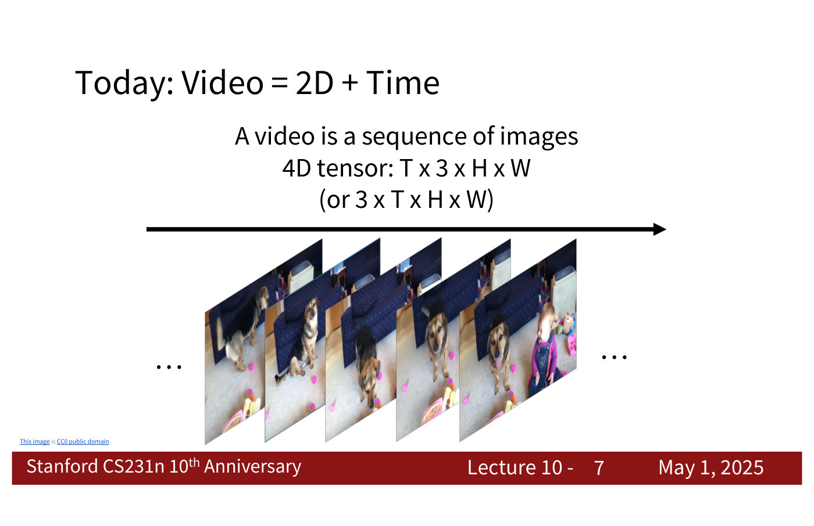

*Slide 7 — Today: Video = 2D + Time. [Deck](https://cs231n.stanford.edu/slides/2025/lecture_10.pdf)*

**Video classification.** The example task takes a video of a person running and chooses among labels such as swimming, running, jumping, eating and standing (slide 8). The same tools apply as for images, a feature extractor and the cross-entropy loss, so the question becomes how to get features from video (≈3:55). What is recognized differs: images are mostly classified by objects and scenes, videos usually by *actions*, "what activities the person or some animals are doing" (slide 9; ≈4:41).

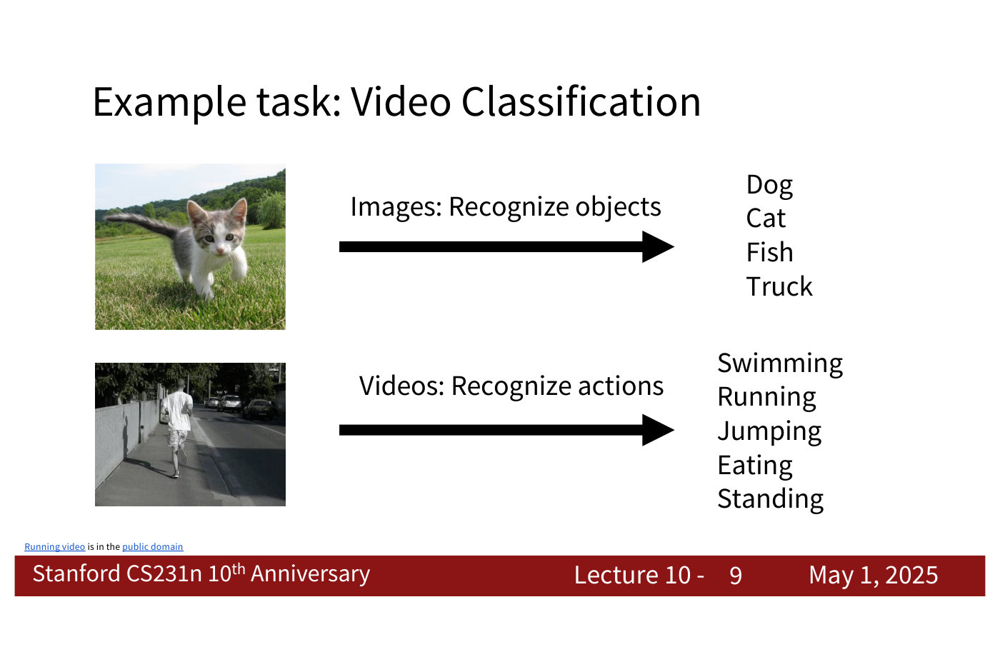

*Slide 9 — Example task: Video Classification. [Deck](https://cs231n.stanford.edu/slides/2025/lecture_10.pdf)*

## Videos are big: train on clips

Video runs at about 30 frames per second, and uncompressed at 3 bytes per pixel it takes about 1.5 GB per minute at standard definition ($640 \times 480$) and about 10 GB per minute at HD ($1920 \times 1080$) (slide 10; ≈5:28). These are binary gigabytes: $640 \times 480 \times 3$ bytes $\times\ 30 \times 60$ is about 1.66 billion bytes, or 1.54 GB in units of $2^{30}$. Such data cannot be fed straight to a GPU, which must also hold the network's weights and activations (≈6:14).

The solution is to make the input smaller in both time and space: "Train on short clips: low fps and low spatial resolution", for example $T = 16$ frames at $H = W = 112$, which is 3.2 seconds at 5 frames per second and 588 KB (slide 11; ≈6:14–7:02). Five frames a second is enough because "there is a lot of redundancy in the video frames" (≈7:02).

**Training and testing on clips.** A long video is not classified whole. In training, the model learns "to classify short clips with low FPS", sampled from the raw video with a sliding window; at test time it runs on several clips and the predictions are averaged (slide 14; ≈7:48). Slide 14 draws this on a strip of 17 frames: each training clip takes every third frame of a 7-frame window, and the test clips are five overlapping 7-frame windows.

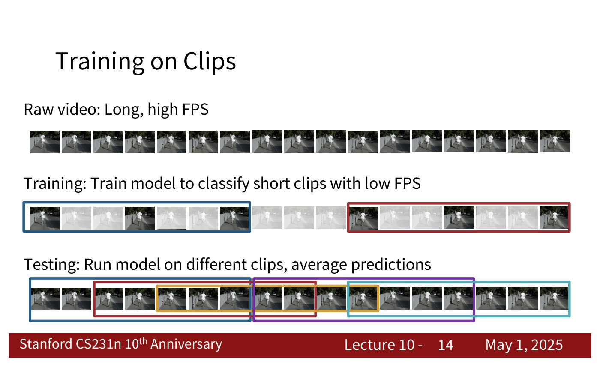

*Slide 14 — top row, the raw video; middle row, two training clips (blue and dark red), each keeping every third frame of its window; bottom row, five overlapping test clips whose predictions are averaged. [Deck](https://cs231n.stanford.edu/slides/2025/lecture_10.pdf)*

## Combining frames: single frame, late fusion, early fusion, 3D CNN

### Single-frame CNN

The simplest video classifier is an image classifier: "train normal 2D CNN to classify video frames independently", and average the predicted probabilities at test time (slide 15). For a video with little change from frame to frame, such as the runner, every frame may say "running" and the average does too. It is "usually a very, very strong baseline", and "if you are trying to design some video classifier you should always run this first" (≈9:22).

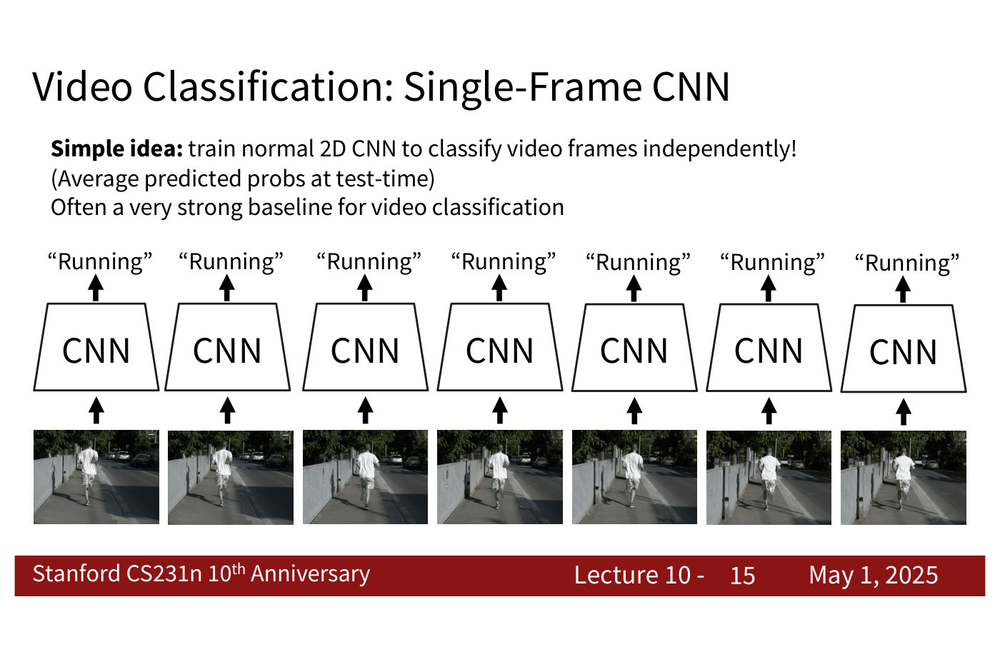

*Slide 15 — Video Classification: Single-Frame CNN. [Deck](https://cs231n.stanford.edu/slides/2025/lecture_10.pdf)*

Asked how to choose the frames, the lecturer calls it "a very important question" and "an active area of research" (≈10:09). One simple way is to sample uniformly, for instance one frame a minute from a one-hour video, run the image classifier and average; smarter strategies exist, such as sampling one frame and using its result to decide where to sample next, and some appear later in the lecture (≈10:09–10:55; see [efficient video understanding](#efficient-video-understanding)).

### Late fusion

Late fusion runs a 2D CNN on each frame and combines the features at the end. "Intuition: Get high-level appearance of each frame, and combine them" (slide 16). With fully connected layers, the $T$ frame feature maps, each $D \times H' \times W'$, are flattened and concatenated into a clip feature of size $TDH'W'$, which an MLP maps to the $C$ class scores (slide 16; ≈10:55–12:29). It is called late fusion "because … we process them very independently, and then at the very late stage we concatenate the feature vectors" (≈12:29). Its drawback is the size of that first fully connected layer: the concatenated vector grows with $T$, and mapping it down "is going to introduce a lot of parameters" (≈12:29–13:14).

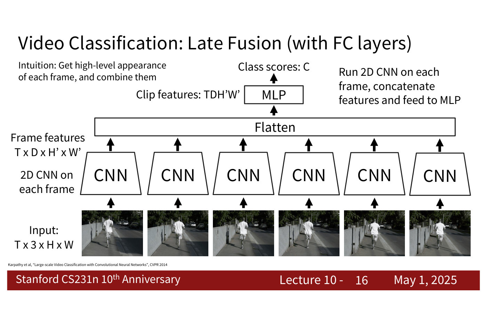

*Slide 16 — late fusion with FC layers: one 2D CNN per frame, the frame features flattened together into one TDH'W' vector, then an MLP. [Deck](https://cs231n.stanford.edu/slides/2025/lecture_10.pdf)*

The cheaper version pools instead of concatenating: "Average Pool over space and time" reduces the frame features to a clip feature of size $D$, and a linear layer maps $D$ to $C$ (slide 17; ≈13:14–14:02). The feature no longer grows with $T$, but pooling "can also get rid of information that may be important" (≈14:02).

**What late fusion loses.** "Problem: Hard to compare low-level motion between frames" (slide 18). Slide 18 circles the runner's feet in each frame: their moving up and down is the cue that says "running", but by the late stage of a 2D CNN the feature maps carry high-level information rather than this low-level motion, so it is "most likely lost there" (≈14:47–16:19).

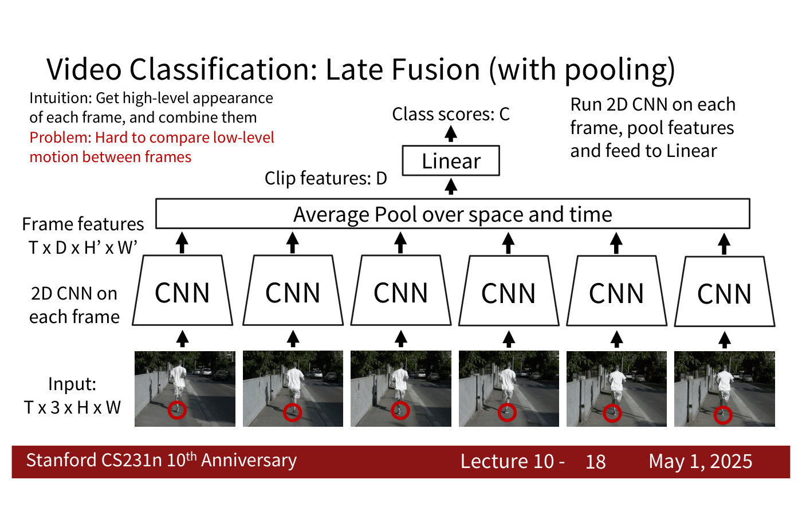

*Slide 18 — the red circles mark the runner's feet, the low-level motion that per-frame features computed independently are unlikely to keep. [Deck](https://cs231n.stanford.edu/slides/2025/lecture_10.pdf)*

### Early fusion

Early fusion compares frames in the very first layer. The input is reshaped from $T \times 3 \times H \times W$ to $3T \times H \times W$, and the first 2D convolution maps those $3T$ channels to $D$, so it "collapses all temporal information"; the rest of the network is a standard 2D CNN (slide 19; ≈16:19–17:05). (The lecturer says "from 3D to D" at ≈16:19, where the slide has 3T.) The weakness is the mirror image of late fusion's: "One layer of temporal processing may not be enough!" (slide 20). Trying "to capture everything in a single layer" is "too ambitious" (≈17:53).

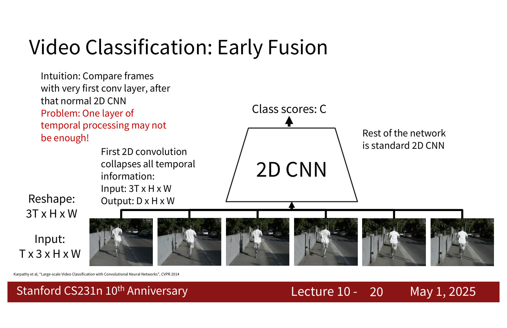

*Slide 20 — Video Classification: Early Fusion. [Deck](https://cs231n.stanford.edu/slides/2025/lecture_10.pdf)*

In answer to a question, the lecturer adds that in late fusion with pooling, each frame gives a $D$-dimensional feature and the pooling (mean or max) is over those $T$ features, so the result is still $D$: "it's pooling over the features, not the frames" (≈17:05).

### 3D CNN: slow fusion

Between the two is the **3D CNN**: "Use 3D versions of convolution and pooling to slowly fuse temporal information over the course of the network" (slide 21; Ji et al., 2010, and Karpathy et al., 2014). Every layer is a 4D tensor $D \times T \times H \times W$ (slide 21), and the network will "gradually shrink the temporal dimension and the spatial dimension" (≈18:38).

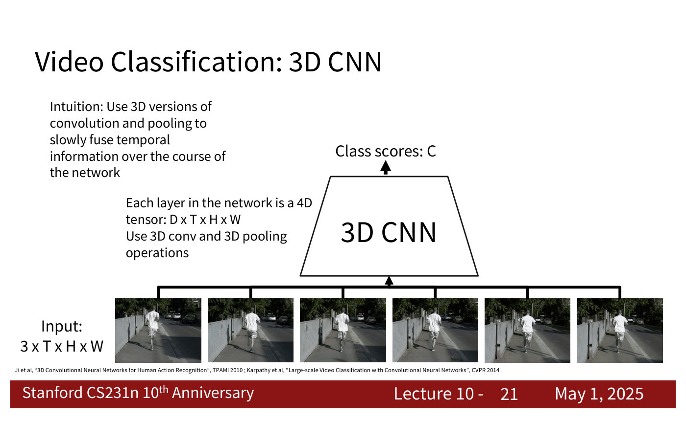

*Slide 21 — Video Classification: 3D CNN. [Deck](https://cs231n.stanford.edu/slides/2025/lecture_10.pdf)*

**3D convolution.** Recall the 2D convolution of [lecture 5](05-image-classification-cnns.md): a $5 \times 5 \times 3$ filter slides over the spatial positions of a $32 \times 32 \times 3$ image, taking a dot product through the full depth at each position, and gives a $28 \times 28 \times 1$ activation map (slide 22; ≈18:38–19:24). A 3D convolution has one more dimension. Its input is $C \times T \times H \times W$; the drawing shows the $T \times H \times W$ cube and leaves out $C$, "because we can only show things in 3D, right, we cannot show things in 4D", so each grid point holds $C$ features (slide 23; ≈20:11). The filter is a small cube that slides over time, height and width and extends through all the channels (≈20:58). Slide 23 draws a chain of cubes labelled "6x6x6 conv", "5x5x5 conv" and "4x4x4 conv", then an FC layer and the class scores.

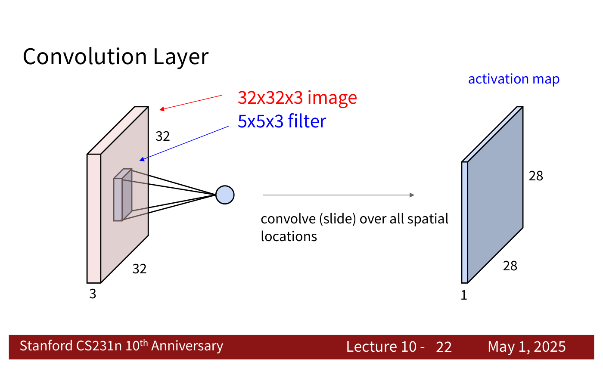

*Slide 22 — Convolution Layer. [Deck](https://cs231n.stanford.edu/slides/2025/lecture_10.pdf)*

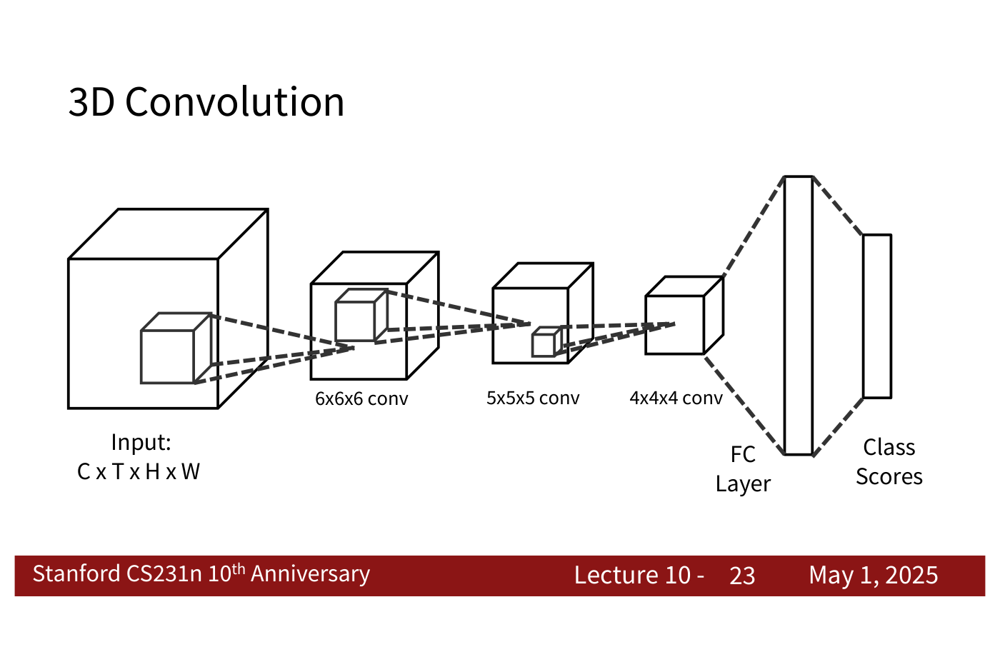

*Slide 23 — 3D Convolution. [Deck](https://cs231n.stanford.edu/slides/2025/lecture_10.pdf)*

### The three compared: sizes and receptive fields

A toy example makes the difference concrete, with "small example architectures, in practice much bigger" (slides 24–31; ≈21:44–26:23). Each network takes a $3 \times 20 \times 64 \times 64$ clip (3 channels, 20 frames, $64 \times 64$ pixels) and has two convolutions with a $4 \times 4$ pooling between them, then global average pooling. The tables give each layer's output size ($C \times T \times H \times W$) and its receptive field ($T \times H \times W$), the extent of the input one output value depends on (slide 30):

| | Late fusion | | Early fusion | | 3D CNN | |
| --- | --- | --- | --- | --- | --- | --- |
| **Layer** | **Size** | **Receptive field** | **Size** | **Receptive field** | **Size** | **Receptive field** |
| Input | 3 x 20 x 64 x 64 | | 3 x 20 x 64 x 64 | | 3 x 20 x 64 x 64 | |
| Conv (3x3, or 3x3x3) | 12 x 20 x 64 x 64 | 1 x 3 x 3 | 12 x 64 x 64 | 20 x 3 x 3 | 12 x 20 x 64 x 64 | 3 x 3 x 3 |
| Pool (4x4, or 4x4x4) | 12 x 20 x 16 x 16 | 1 x 6 x 6 | 12 x 16 x 16 | 20 x 6 x 6 | 12 x 5 x 16 x 16 | 6 x 6 x 6 |
| Conv (3x3, or 3x3x3) | 24 x 20 x 16 x 16 | 1 x 14 x 14 | 24 x 16 x 16 | 20 x 14 x 14 | 24 x 5 x 16 x 16 | 14 x 14 x 14 |
| GlobalAvgPool | 24 x 1 x 1 x 1 | 20 x 64 x 64 | 24 x 1 x 1 | 20 x 64 x 64 | 24 x 1 x 1 | 20 x 64 x 64 |

The early-fusion network's first layer is printed "Conv2D(3x3, 3\*20->12)": it takes all 60 input channels at once, which is why its later sizes have no $T$. (The 3D CNN's last size is printed "24 x 1 x 1", a dimension short; it is $24 \times 1 \times 1 \times 1$.)

The slides sum each up in a phrase. Late fusion builds "slowly in space, All-at-once in time at end": its 2D layers never touch the time dimension, which stays at 20 with a temporal receptive field of 1 until the global pooling takes in all 20 frames at once (≈22:31–23:17). Early fusion builds "slowly in space, All-at-once in time at start": its first layer already sees all 20 frames (≈23:17–24:51). The 3D CNN builds "slowly in space, Build slowly in time" — "Slow Fusion" — with a temporal receptive field of 3, then 6, then 14 frames (≈24:51–25:37).

Slides 25–28 draw how a receptive field grows with depth, as rows of dots for one dimension of the late-fusion network: an output of the $3 \times 3$ convolution depends on 3 inputs, a pooled value on 6, and a value of the second convolution on 14 of the 20, while the global pool depends on all of them (slide 28).

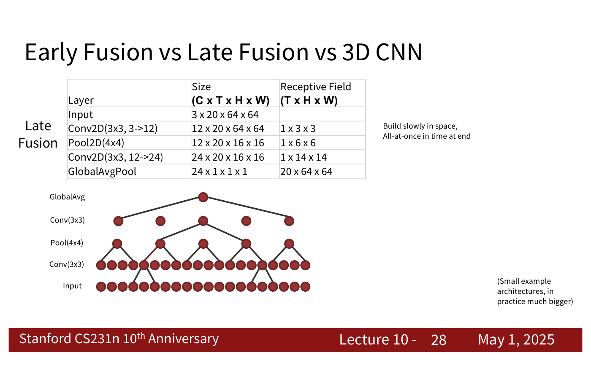

*Slide 28 — the late-fusion network's sizes and receptive fields; in the dot diagram, red marks the inputs that the top value depends on, which by the global average pool is every input. [Deck](https://cs231n.stanford.edu/slides/2025/lecture_10.pdf)*

### Why 3D convolution: temporal shift-invariance

Early fusion and the 3D CNN both build a receptive field over time, so "what is the difference?" (slide 31; ≈25:37). The difference is in the filter (slides 32–36; ≈26:23–29:30).

In early fusion the 2D filter has weight $C_{out} \times C_{in} \times T \times 3 \times 3$: it is local in space but "extends fully in time" ($T = 16$ in the drawing), and it slides only over $x$ and $y$, giving a $C_{out} \times H \times W$ output (slide 32; ≈26:23). The shortcoming: "No temporal shift-invariance! Needs to learn separate filters for the same motion at different times in the clip" (slide 33). The lecturer's example is a change from blue to orange. If it happens at time step 4 in one clip and at time step 15 in another, a filter spanning the whole clip has to learn each as a separate pattern (≈27:09–27:56). "How to recognize blue to orange transitions anywhere in space and time?" (slide 34)

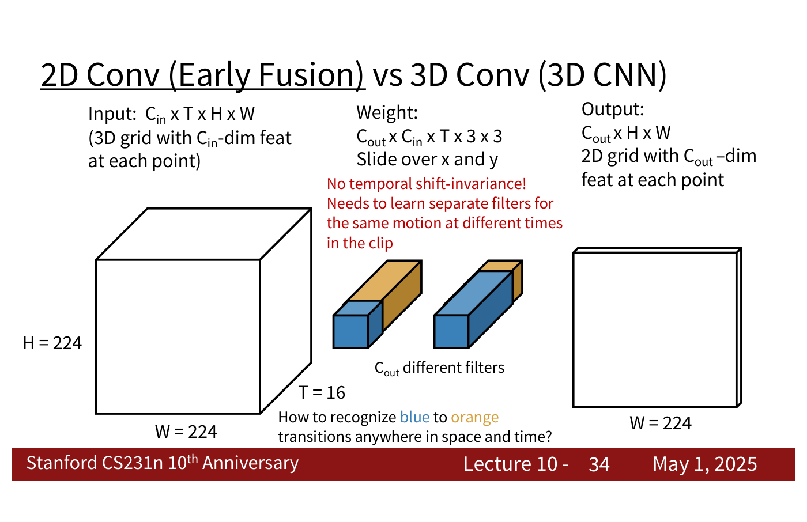

*Slide 34 — early fusion's filter spans all 16 frames, so the same blue-to-orange change at two different times needs two different filters. [Deck](https://cs231n.stanford.edu/slides/2025/lecture_10.pdf)*

In the 3D CNN the filter is $C_{out} \times C_{in} \times 3 \times 3 \times 3$, a small cube three frames deep, and the output keeps its time dimension, $C_{out} \times T \times H \times W$ (slide 35). It is "Temporal shift-invariant since each filter slides over time!" (slide 36). The same filter recognizes the blue-to-orange transition "at every moment in time", just as a 2D filter recognizes a cat wherever it is in the image, so separate filters are not needed and the network is "more representation efficient" (≈27:56–29:30).

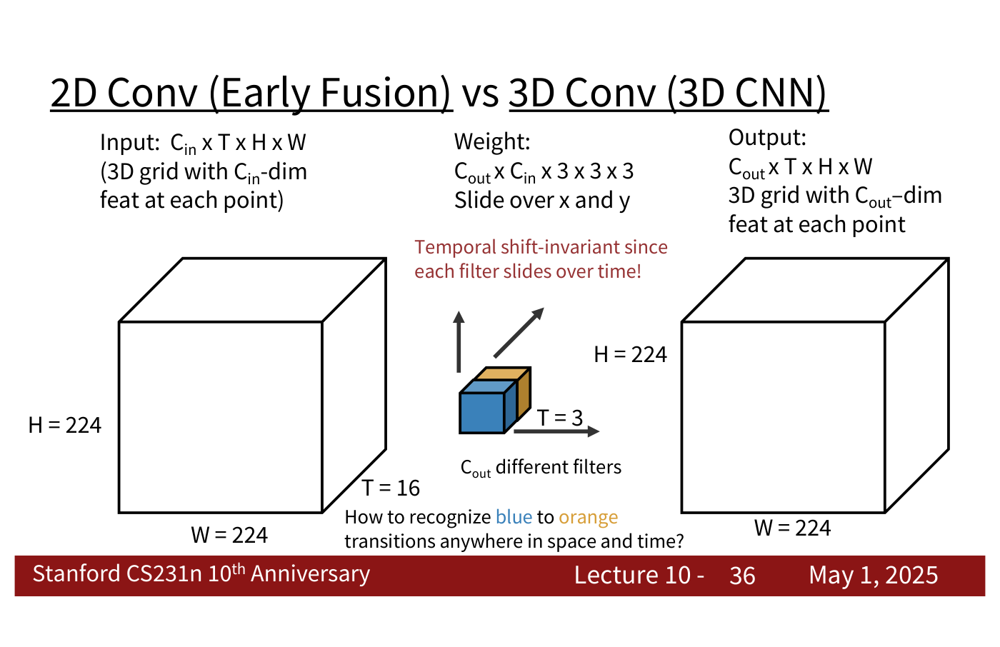

*Slide 36 — the 3D filter is only three frames deep and slides along time as well as space, so one filter detects the blue-to-orange change wherever it happens. [Deck](https://cs231n.stanford.edu/slides/2025/lecture_10.pdf)*

**What the filters learn.** The first-layer filters of a 3D CNN have shape $3 \times 4 \times 5 \times 5$ (RGB, 4 frames, $5 \times 5$ in space), so they "can visualize as video clips" (slide 37). Some look like an image classifier's colour patterns and edges; others change over time from one colour or edge pattern to another, and some learn motion in different directions (≈30:16–31:03). The PDF holds one still of this mosaic, not the clips.

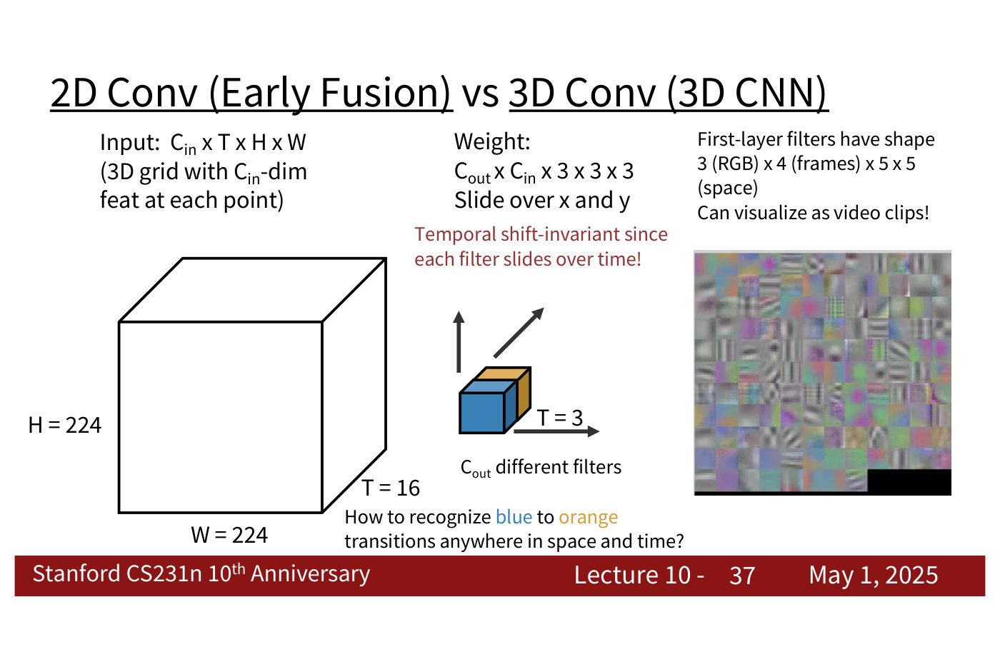

*Slide 37 — 2D Conv (Early Fusion) vs 3D Conv (3D CNN). [Deck](https://cs231n.stanford.edu/slides/2025/lecture_10.pdf)*

Asked about the difference again, the lecturer sums it up: 3D convolution has the temporal dimension in the convolution operation itself, and in practice it builds the receptive field gradually over space and time (≈31:03–31:50).

## Sports-1M and how the three compare

**Sports-1M** is "1 million YouTube videos annotated with labels for 487 different types of sports" (slide 38; Karpathy et al., CVPR 2014). The categories are very fine-grained: there are both "marathon" and "ultramarathon", and "I actually don't know the difference between them" (≈32:35). Slide 38 shows five video frames with the ground-truth label (blue) and the model's five top predictions below, green when correct and red when not; the correct label is ranked first for three of the five and second for the other two.

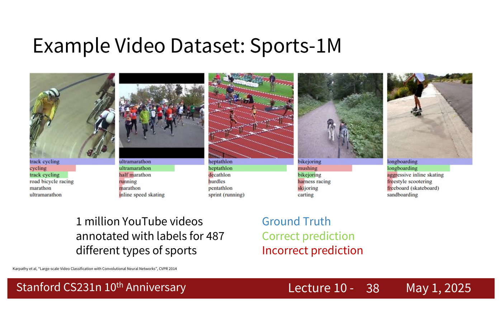

*Slide 38 — Example Video Dataset: Sports-1M. [Deck](https://cs231n.stanford.edu/slides/2025/lecture_10.pdf)*

On Sports-1M top-5 accuracy, the single-frame model scores 77.7, early fusion 76.8, late fusion 78.7 and the 3D CNN 80.2 (slides 39 and 42). The lecture calls the single-frame result "very shocking": "Single Frame model works well – always try this first!" (slide 39; ≈32:35–33:20). Early fusion does slightly worse than the single frame, late fusion slightly better, and the 3D CNN gives "a 2%, two to 3% kind of boost" (≈33:20). But "3D CNNs have improved a lot since 2014!" (slide 39), and the 3D CNN shown is that of 2014 (≈34:06).

Asked how the single-frame model is trained, the lecturer explains that it treats videos as images in both training and testing: it is an image classifier "training on a lot of frames from videos. It's not a single frame per video" (≈34:06).

The data set also shows why video data sets are hard to share. Sports-1M was released as a list of YouTube URLs, and since people modify and delete their videos, "maybe half of the videos on the list are already gone", so "this data set is not very stable" (≈34:53).

## C3D: the VGG of 3D CNNs

**C3D** (Tran et al., ICCV 2015) is a "3D CNN that uses all 3x3x3 conv and 2x2x2 pooling (except Pool1 which is 1x2x2)" (slide 40). Apart from the first layer it is the VGG architecture with an extra dimension, "so that's why it's called the VGG of 3D CNNs" (≈35:39–36:26). On a $3 \times 16 \times 112 \times 112$ clip it has eight 3D convolutions in five stages (64, 128, 256, 256, 512, 512, 512 and 512 channels), five poolings that take the clip to $512 \times 1 \times 3 \times 3$, and fully connected layers FC6 and FC7 of 4096 and FC8 of $C$ (slide 40).

Training it in 2014 needed compute "not so many people had access to". It was trained at Facebook, and the released model, "pretrained on Sports-1M", was used by many people as a video feature extractor: take a video, extract C3D features, train another classifier on them (slide 40; ≈36:26–37:12).

Asked how many frames such models take, the lecturer explains that each is trained on clips of a predefined length, such as 16 or 32 frames; combining the clip-level predictions is a separate step (≈37:12–37:58).

**The cost.** "3x3x3 conv is very expensive!" AlexNet takes 0.7 GFLOP for one forward pass, VGG-16 13.6 GFLOP and C3D 39.5 GFLOP, "2.9x VGG!" (slide 41; ≈37:58–38:43). The per-layer column on slide 41 adds up to the 39.5, with the most in Conv2 and Conv3b (11.10 each). In return, C3D reaches 84.4 top-5 accuracy on Sports-1M, about 4 points above the 2014 3D CNN (slide 42; ≈38:43).

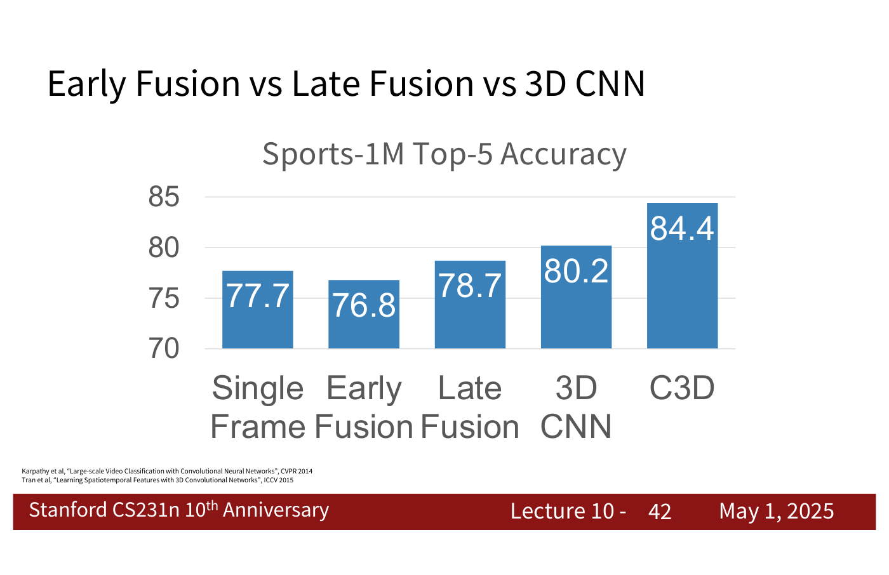

*Slide 42 — Early Fusion vs Late Fusion vs 3D CNN. [Deck](https://cs231n.stanford.edu/slides/2025/lecture_10.pdf)*

3D CNNs can be improved the same ways as 2D ones, for instance with residual connections, and there has been much work on video architectures (≈39:29).

## Motion: optical flow and two-stream networks

Space and time are "very different things", so perhaps motion should be modelled explicitly (≈39:29). Humans do "an incredible job processing motion": "We can easily recognize actions using only motion information" (slide 43; Johansson, 1973). The lecturer plays a clip of a few moving points and the audience can tell what the people are doing "just from these very few points", with no appearance information at all (≈40:17–41:02). The PDF holds a single dark frame with two dots, so the clip itself is described only by the lecturer.

**Optical flow** measures motion explicitly. It "gives a displacement field $F$ between images $I_t$ and $I_{t+1}$" that "tells where each pixel will move in the next frame" (slide 45; ≈41:02–41:50):

$$F(x, y) = (dx, dy)$$

$$I_{t+1}(x+dx, y+dy) = I_t(x, y)$$

Here $(x, y)$ is a pixel position, $(dx, dy)$ its displacement between frame $t$ and frame $t+1$, and $I_t$ the image at frame $t$: the pixel at $(x, y)$ in frame $t$ is found at $(x + dx, y + dy)$ in the next frame. There are many ways to compute flow from a pair of frames, under assumptions such as that "brightness stays constant as things move" (≈42:38). Because the field has two components, it can be shown as two images, horizontal flow $dx$ and vertical flow $dy$, and "Optical Flow highlights local motion" (slide 46; ≈42:38–43:23).

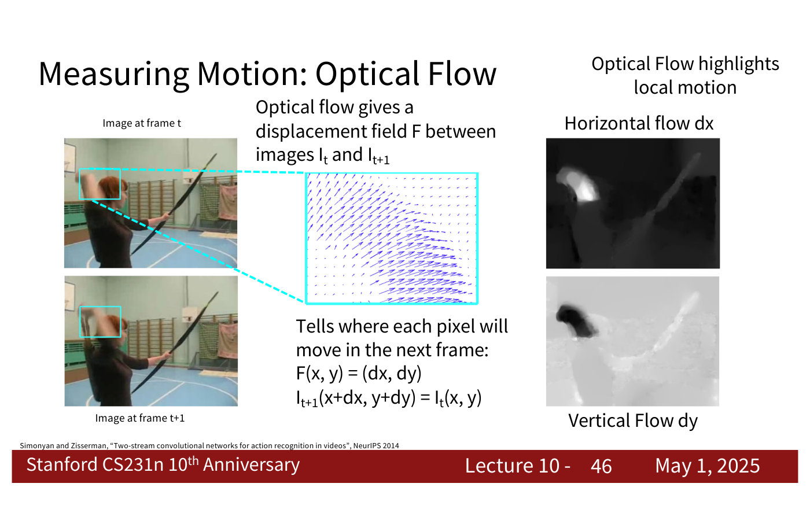

*Slide 46 — the flow field between two frames of a gymnast swinging a bow, and its horizontal (dx) and vertical (dy) components as images: the moving arm stands out bright in one and dark in the other. [Deck](https://cs231n.stanford.edu/slides/2025/lecture_10.pdf)*

**Two-stream networks** (Simonyan and Zisserman, NeurIPS 2014) separate motion from appearance (slide 47; ≈43:23–44:09). A spatial stream classifies a single image, $3 \times H \times W$. A temporal stream takes a stack of optical flow, $[2(T-1)] \times H \times W$: the horizontal and vertical flow between each pair of adjacent frames, which its first 2D convolution processes all at once ("Early fusion"). Each stream is a CNN of five convolutions and two fully connected layers ending in a softmax, and the two streams' class scores are fused (slide 47).

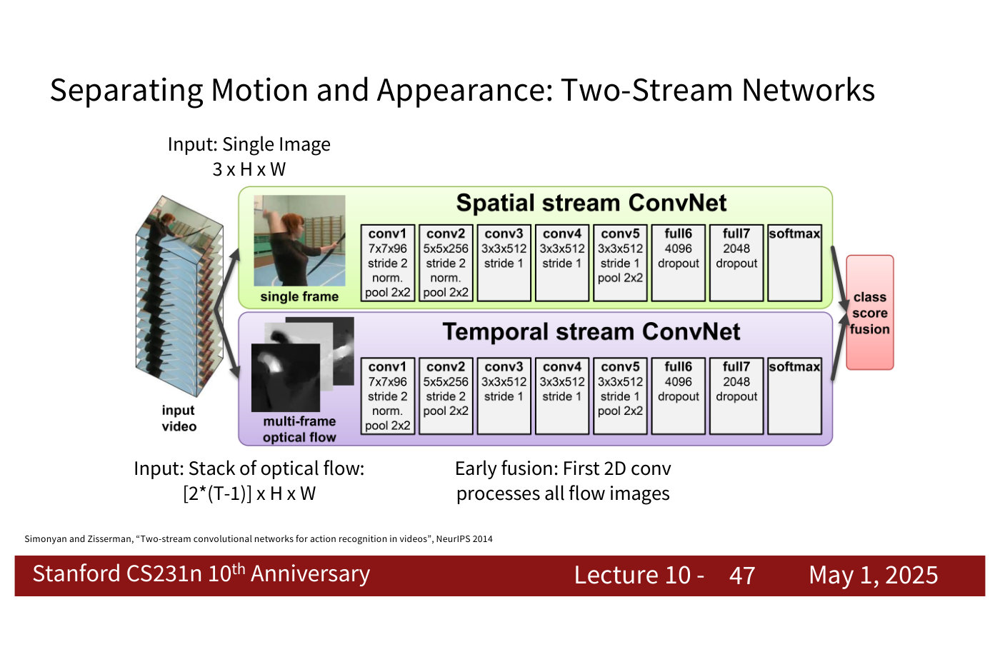

*Slide 47 — the spatial stream (green) sees one frame, the temporal stream (purple) a stack of optical-flow images; their class scores are fused at the end. [Deck](https://cs231n.stanford.edu/slides/2025/lecture_10.pdf)*

On UCF-101, a data set with 101 action categories, the 3D CNN scores 65.4, the spatial stream alone 73, the temporal stream alone 83.7, and the two streams together 86.9 when fused by averaging and 88 when fused by an SVM (slide 48; ≈44:09). The surprise is that "using only motion actually works very well" — better than appearance alone. The lecturer's hypothesis is that the motion stream is less prone to overfitting: an appearance stream sees a lot of background that may not matter for the action, while the motion stream carries "the very key information, right, the movements" (≈44:09–44:54).

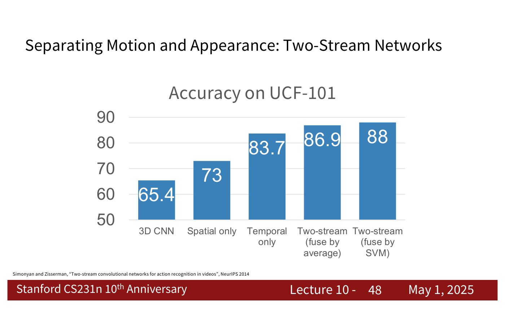

*Slide 48 — Separating Motion and Appearance: Two-Stream Networks. [Deck](https://cs231n.stanford.edu/slides/2025/lecture_10.pdf)*

## Long-term temporal structure

"So far all our temporal CNNs only model local motion between frames in very short clips of ~2-5 seconds. What about long-term structure?" (slide 49). Slide 50 draws two events on a time line farther apart than one 3D CNN's span of about five seconds, and asks: "We know how to handle sequences! How about recurrent networks?" (≈44:54–45:40)

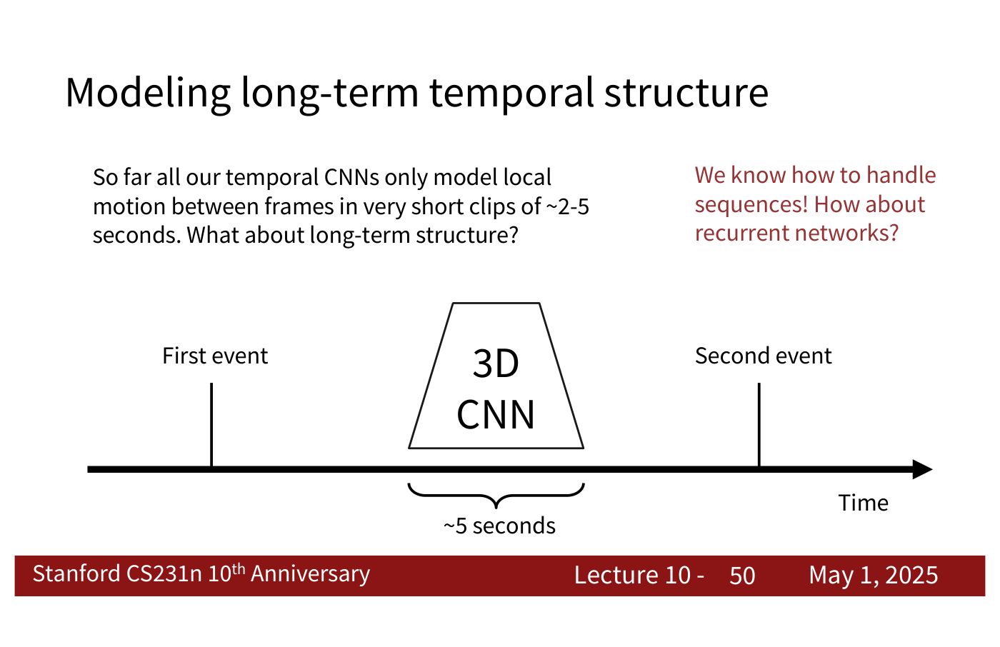

*Slide 50 — Modeling long-term temporal structure. [Deck](https://cs231n.stanford.edu/slides/2025/lecture_10.pdf)*

**CNN features into an RNN.** Extract a feature vector from each clip or frame with a CNN (2D or 3D), then "process local features using recurrent network (e.g. LSTM)" (slides 51–52; ≈45:40–46:27). For one label per video the RNN is **many to one**, with one output at the end (slide 53); for a label per frame it is **many to many** (slide 54; ≈46:27). These are the sequence shapes of [lecture 7](07-recurrent-neural-networks.md).

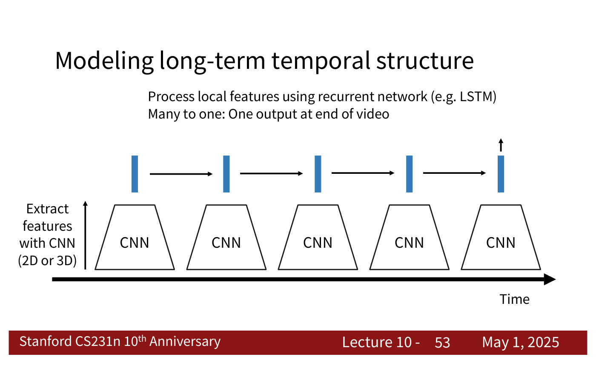

*Slide 53 — Modeling long-term temporal structure. [Deck](https://cs231n.stanford.edu/slides/2025/lecture_10.pdf)*

The idea was explored as early as 2011 (Baccouche et al.), "way ahead of its time, right, because AlexNet was introduced in 2012", and was popularized by a 2015 paper (Donahue et al.) (slide 55; ≈47:15). Training the CNN and RNN end to end is very hard, so "Sometimes don't backprop to CNN to save memory; pretrain and use it as a feature extractor": backpropagate only through the recurrent part, for instance on C3D features (slide 55; ≈47:15–48:02).

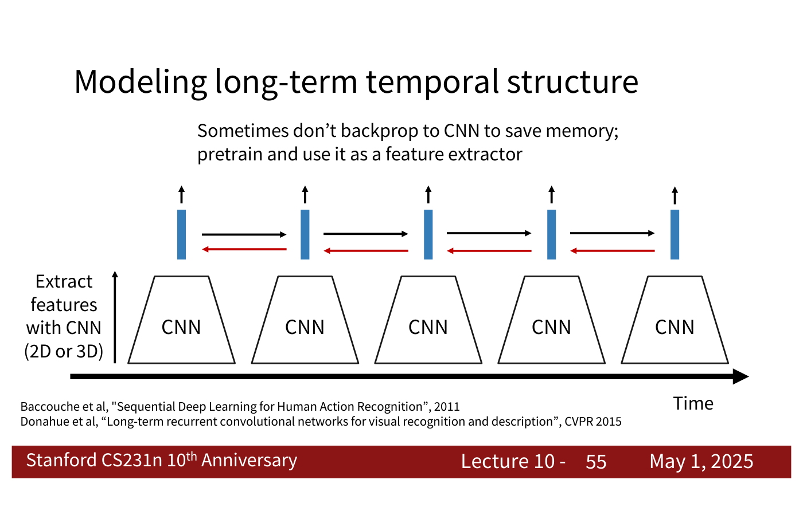

*Slide 55 — the red arrows are the backward pass: gradients flow only through the recurrent layer and stop at the CNN features, which come from a pretrained, frozen CNN. [Deck](https://cs231n.stanford.edu/slides/2025/lecture_10.pdf)*

The two approaches have complementary strengths: "Inside CNN: Each value is a function of a fixed temporal window (local temporal structure)", while "Inside RNN: Each vector is a function of all previous vectors (global temporal structure)". "Can we merge both approaches?" (slide 56; ≈48:02).

### Recurrent convolutional networks

The answer borrows from the multi-layer RNN, where each hidden state depends on the same layer at the previous time step and on the previous layer at the same time step (slide 57, which repeats lecture 7's multi-layer RNN; ≈48:02). A **recurrent convolutional network** builds the same grid out of feature maps (Ballas et al., ICLR 2016). The "entire network uses 2D feature maps: C x H x W", and each depends on two inputs, "1. Same layer, previous timestep" and "2. Prev layer, same timestep", with different weights at each layer shared across time (slide 58; ≈48:48–49:34).

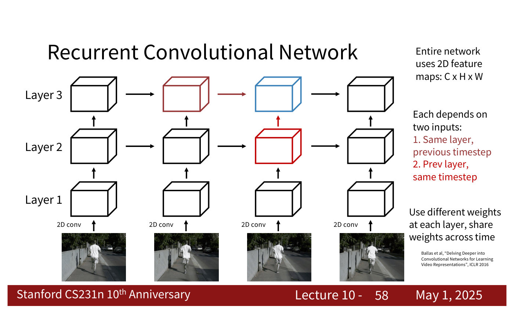

*Slide 58 — each feature map (blue outline) is computed from the same layer one step earlier (brown) and the layer below at the same step (red); weights differ between layers and are shared across time. [Deck](https://cs231n.stanford.edu/slides/2025/lecture_10.pdf)*

A recurrent network computes a new state from the old state and the current input with some function with parameters $W$ (slide 60):

$$h_t = f_W(h_{t-1}, x_t)$$

The vanilla RNN, as slide 61 recalls it, is $h_{t+1} = \tanh(W_h h_t + W_x x)$. To make it convolutional, "Replace all matrix multiply with 2D convolution!" (slide 61). The features from layer $L$ at time step $t-1$ go through a 2D convolution with weights $W_h$, the features from layer $L-1$ at time step $t$ through a 2D convolution with weights $W_x$; the two are added and passed through $\tanh$ to give the features for layer $L$ at time step $t$ (slide 61; ≈49:34–50:21). The same replacement works for the GRU and the LSTM (≈50:21).

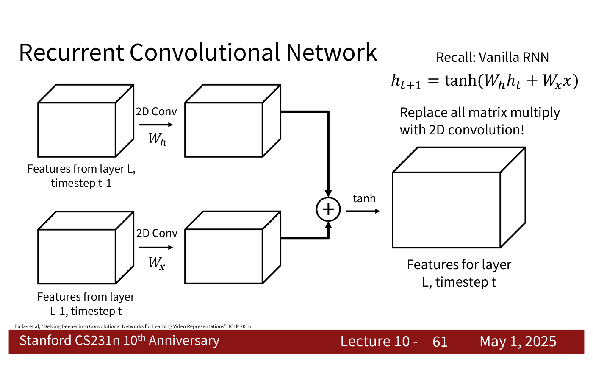

*Slide 61 — the vanilla RNN update with both matrix multiplies replaced by 2D convolutions, so the hidden state is a feature map rather than a vector. [Deck](https://cs231n.stanford.edu/slides/2025/lecture_10.pdf)*

The comparison on slides 62–63: an RNN on CNN features has "Infinite temporal extent (fully-connected)", a CNN "finite temporal extent (convolutional)", and the recurrent CNN "Infinite temporal extent (convolutional)". It combines spatial and temporal fusion, but "this model was not used too much": "Problem: RNNs are slow for long sequences (can't be parallelized)", and videos are very long (slide 63; ≈51:09).

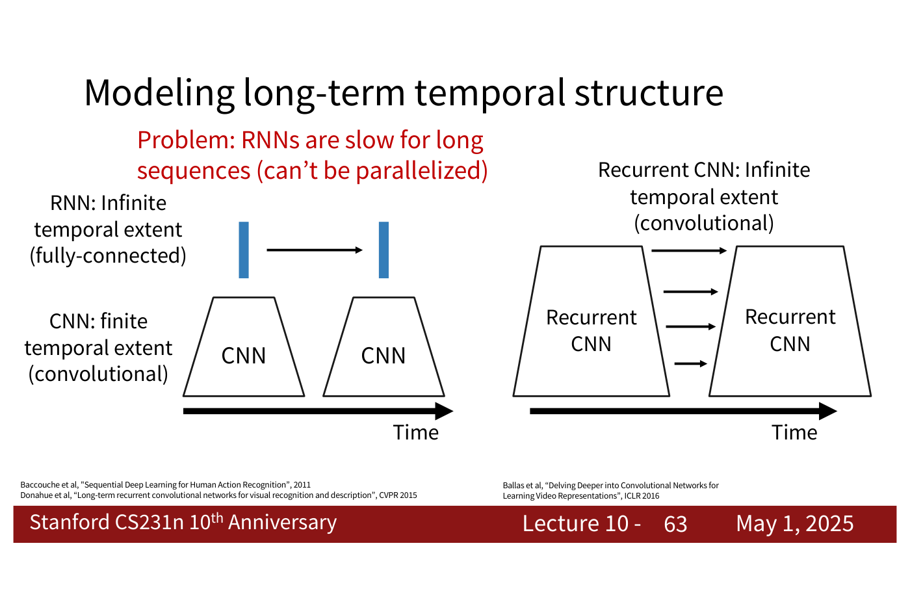

*Slide 63 — Modeling long-term temporal structure. [Deck](https://cs231n.stanford.edu/slides/2025/lecture_10.pdf)*

## Spatio-temporal self-attention: the nonlocal block

Self-attention, from [lecture 8](08-attention-transformers.md), avoids that problem, since all its alignment scores and outputs "can be done completely in parallel" (≈51:56). Slide 64 recalls it with inputs $x$ of shape $N \times D$ (slide 64):

$$k = xW_k, \quad v = xW_v, \quad q = xW_q$$

$$e_{i,j} = q_j \cdot k_i / \sqrt{D}, \quad a = \text{softmax}(e), \quad y_j = \sum_i a_{i,j} v_i$$

where $k$, $v$ and $q$ are the key, value and query vectors, $e_{i,j}$ the alignment score of query $j$ with key $i$, $a$ the attention weights (the softmax runs over $i$) and $y_j$ the output for query $j$.

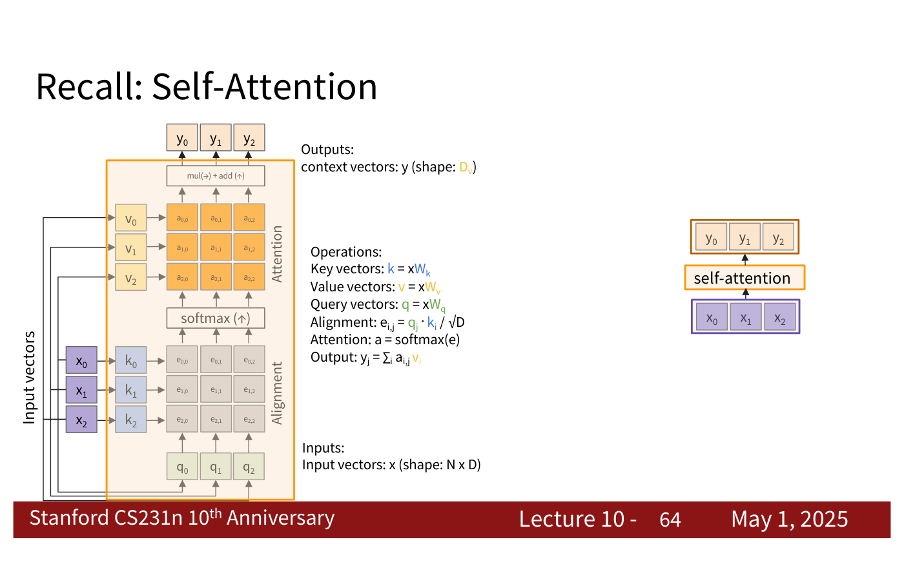

*Slide 64 — Recall: Self-Attention. [Deck](https://cs231n.stanford.edu/slides/2025/lecture_10.pdf)*

In the **nonlocal block** (Wang et al., CVPR 2018), "now we move things to 3D" (slides 65–70; ≈51:56–53:27). It takes the features of a 3D CNN, $C \times T \times H \times W$. Three $1 \times 1 \times 1$ 3D convolutions turn them into queries, keys and values, each $C' \times T \times H \times W$. Multiplying the transposed queries by the keys and applying a softmax gives the attention weights, $(THW) \times (THW)$: every space-time position attends to every other. The weights multiply the values to give a $C' \times T \times H \times W$ map, a last $1 \times 1 \times 1$ convolution maps it back to $C$ channels, and a residual connection adds the input (slide 70). It is "very similar to the self-attention operation" (≈53:27).

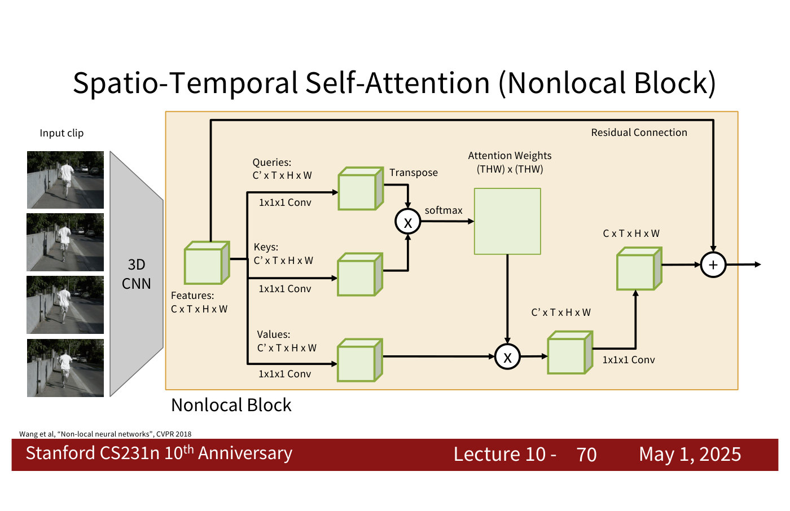

*Slide 70 — the nonlocal block: queries, keys and values from 1x1x1 convolutions; a (THW) x (THW) attention map over every pair of space-time positions; a 1x1x1 convolution back to C channels and a residual connection. [Deck](https://cs231n.stanford.edu/slides/2025/lecture_10.pdf)*

Because the block stands on its own, "We can add nonlocal blocks into existing 3D CNN architectures", alternating 3D CNN stages with nonlocal blocks, each of which "is very powerful to fuse across both space and time" (slide 71; ≈53:27–54:14). "But what is the best 3D CNN architecture?" (slide 71)

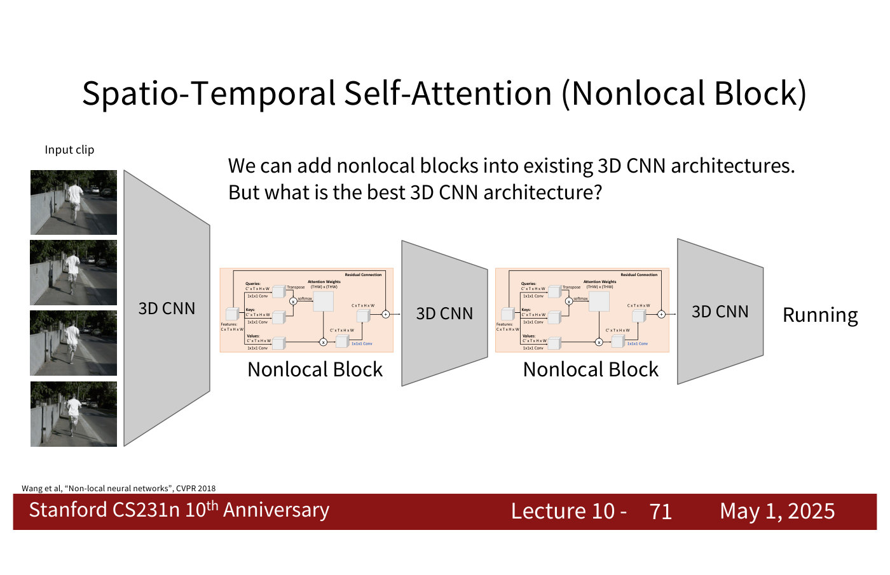

*Slide 71 — Spatio-Temporal Self-Attention (Nonlocal Block). [Deck](https://cs231n.stanford.edu/slides/2025/lecture_10.pdf)*

## Inflating 2D networks to 3D (I3D)

"There has been a lot of work on architectures for images. Can we reuse image architectures for video?" (slide 72; Carreira and Zisserman, CVPR 2017). The I3D idea is to take a 2D CNN architecture and "Replace each 2D $K_h \times K_w$ conv/pool layer with a 3D $K_t \times K_h \times K_w$ version" (slide 72; ≈54:14–55:00). Applied to the Inception block, every $1 \times 1$, $3 \times 3$ and $5 \times 5$ convolution and the $3 \times 3$ max pool become $1 \times 1 \times 1$, $3 \times 3 \times 3$ and $5 \times 5 \times 5$ (slide 74).

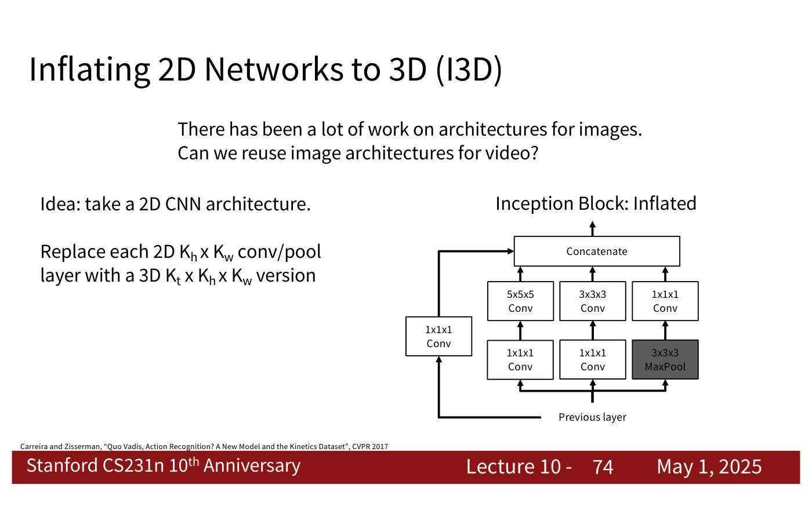

*Slide 74 — Inflating 2D Networks to 3D (I3D). [Deck](https://cs231n.stanford.edu/slides/2025/lecture_10.pdf)*

**Inflating the weights too.** Not only the architecture but the weights trained on images can be reused (≈55:45). The 2D kernel, $C_{in} \times K_h \times K_w$, is copied $K_t$ times along time and divided by $K_t$, giving a 3D kernel $C_{in} \times K_t \times K_h \times K_w$ (slide 75). Given a "constant" video, a single frame duplicated $K_t$ times, the 3D convolution then gives exactly the 2D convolution's output on that frame: each of the $K_t$ copies contributes a $1/K_t$ share, and the shares add back up (slide 75; ≈55:45–56:33). This gives video models a good initialization, and they can then be fine-tuned on video (≈57:21–58:07).

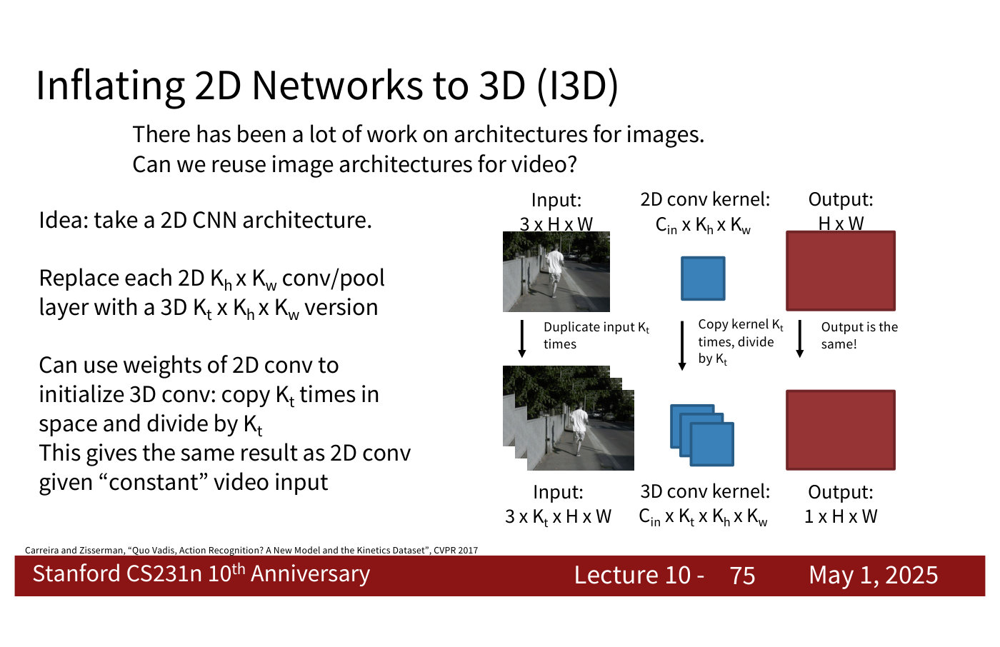

*Slide 75 — top row, a 2D convolution on one frame; bottom row, the same frame duplicated Kt times and the kernel copied Kt times and divided by Kt: the output is the same. [Deck](https://cs231n.stanford.edu/slides/2025/lecture_10.pdf)*

On Kinetics-400 top-1 accuracy, all using an Inception CNN, training from scratch against pretraining on ImageNet (slide 76):

| Model | Train from scratch | Pretrain on ImageNet |
| --- | --- | --- |
| Per-frame CNN | 57.9 | 62.2 |
| CNN+LSTM | 53.9 | 63.3 |
| Two-stream CNN | 62.8 | 65.6 |
| Inflated CNN | 68.4 | 71.1 |
| Two-stream inflated CNN | 71.6 | 74.2 |

Pretraining on ImageNet helps every model. The inflated network beats the two-stream CNN, and inflating both streams of a two-stream network improves further (≈56:33).

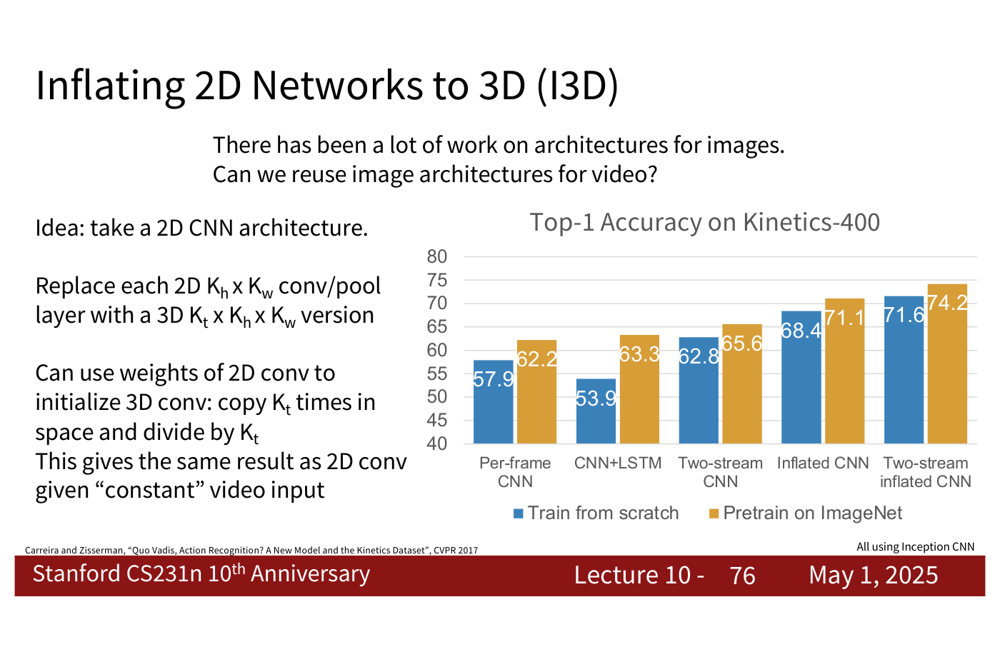

*Slide 76 — Inflating 2D Networks to 3D (I3D). [Deck](https://cs231n.stanford.edu/slides/2025/lecture_10.pdf)*

## Vision transformers for video

Many video transformers have been proposed (slide 77; ≈58:07–58:54), and the lecture names three directions without going into them ("I'm not going to talk about them here in the class"). **Factorized attention** attends over space and time separately (Bertasius et al., "Is Space-Time Attention All You Need for Video Understanding?", ICML 2021; Arnab et al., ViViT; Neimark et al., Video Transformer Network). A **pooling module** reduces the number of tokens: in the Multiscale Vision Transformers (Fan et al., ICCV 2021; MViTv2, CVPR 2022) the queries, keys and values are pooled to fewer space-time positions before attention. **Video masked autoencoders** (VideoMAE and VideoMAE V2; Feichtenhofer et al., NeurIPS 2022) give "efficient scalable pretraining" by masking most of a video's space-time cubes and reconstructing them (slide 77).

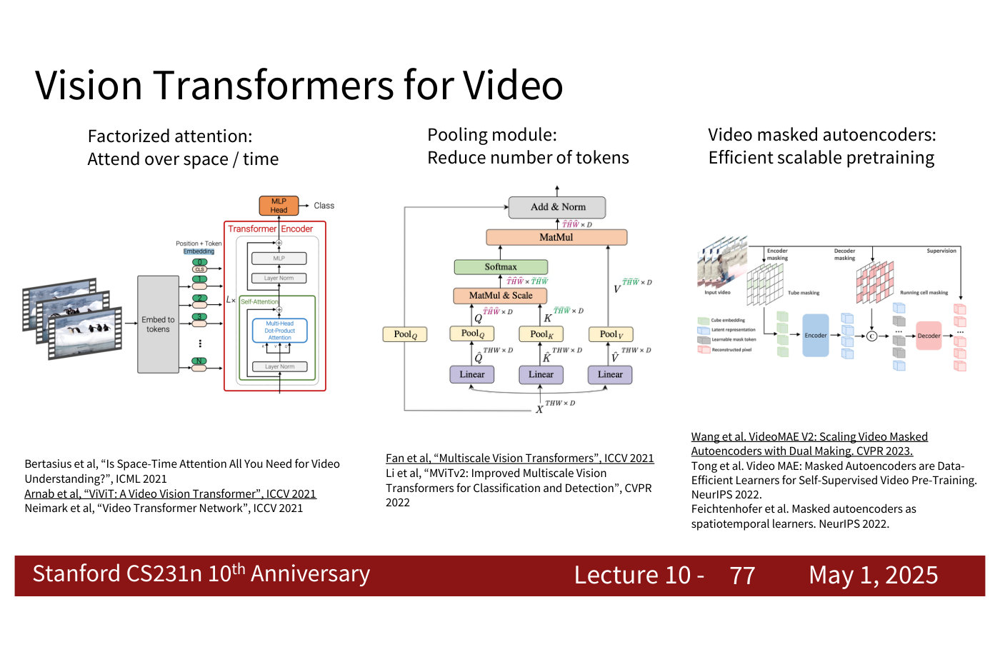

*Slide 77 — Vision Transformers for Video. [Deck](https://cs231n.stanford.edu/slides/2025/lecture_10.pdf)*

The progress on Kinetics-400 top-1 accuracy runs from the per-frame CNN's 62.2 through CNN+LSTM (63.3), the two-stream CNN (65.6), I3D (71.1) and "Inflated I3D" (74.2) to SlowFast 16x8+NL (79.8), MViTv2-L (86.1) and VideoMAE V2-g (90) (slide 78). "We are doing very well on classifying videos" (≈58:54).

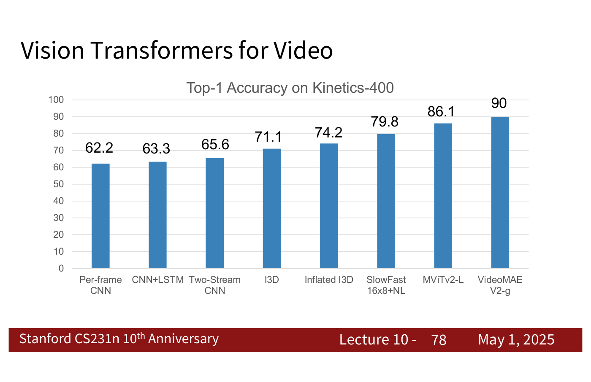

*Slide 78 — Vision Transformers for Video. [Deck](https://cs231n.stanford.edu/slides/2025/lecture_10.pdf)*

## Visualizing video models

The visualization tricks of [lecture 9](09-detection-segmentation-visualization.md) carry over (slide 79; ≈59:39). Take a two-stream network, randomly initialize an appearance image and a flow image, compute the score of one class in a forward pass, backpropagate to both inputs and run gradient ascent to maximize that score (slide 79; Feichtenhofer et al., CVPR 2018 and IJCV 2019). A term encourages spatially smooth flow, and tuning its penalty picks out "slow" against "fast" motion (slide 79; ≈1:00:25).

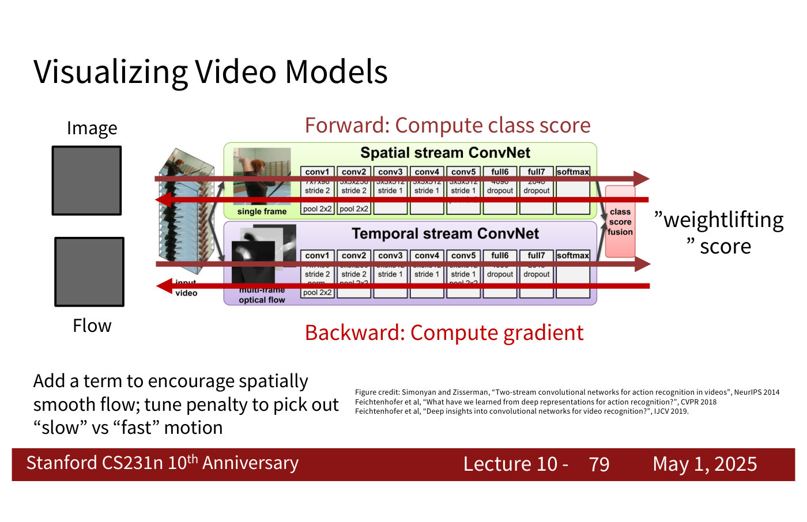

*Slide 79 — Visualizing Video Models. [Deck](https://cs231n.stanford.edu/slides/2025/lecture_10.pdf)*

"Can you guess the action?" (slide 80). The appearance image is hard to read, but the two motion images make it clear. The answer is weightlifting: the "slow" motion image shows "Bar Shaking" and the "fast" motion image "Push overhead", so "these video models, action models, are learning something about this motion" (slide 81; ≈1:00:25–1:01:12).

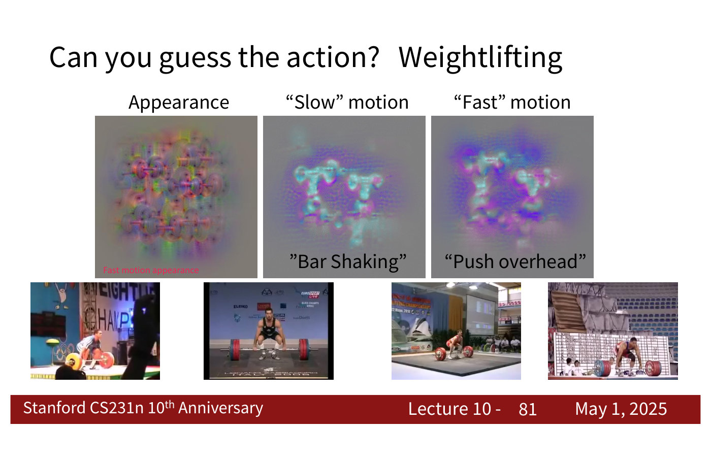

*Slide 81 — the optimized inputs for "weightlifting": appearance (left), slow motion (centre, the bar shaking) and fast motion (right, the push overhead), above frames from real weightlifting videos. [Deck](https://cs231n.stanford.edu/slides/2025/lecture_10.pdf)*

A second example, "Apply Eye Makeup", is on the slides only (slide 83).

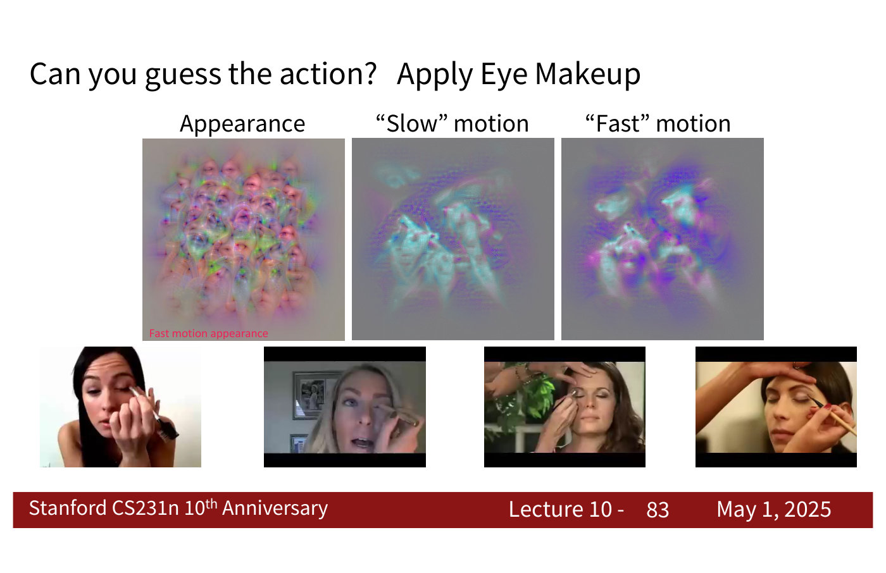

*Slide 83 — Can you guess the action? Apply Eye Makeup. [Deck](https://cs231n.stanford.edu/slides/2025/lecture_10.pdf)*

## Beyond clip classification: localizing actions

**Temporal action localization**: "Given a long untrimmed video sequence, identify frames corresponding to different actions", such as the frames where a person is running and those where they are jumping (slide 85; ≈1:01:12). It is the temporal counterpart of [object detection](object-detection.md): "Can use architecture similar to Faster R-CNN: first generate temporal proposals then classify" (slide 85; Chao et al., CVPR 2018; ≈1:01:57).

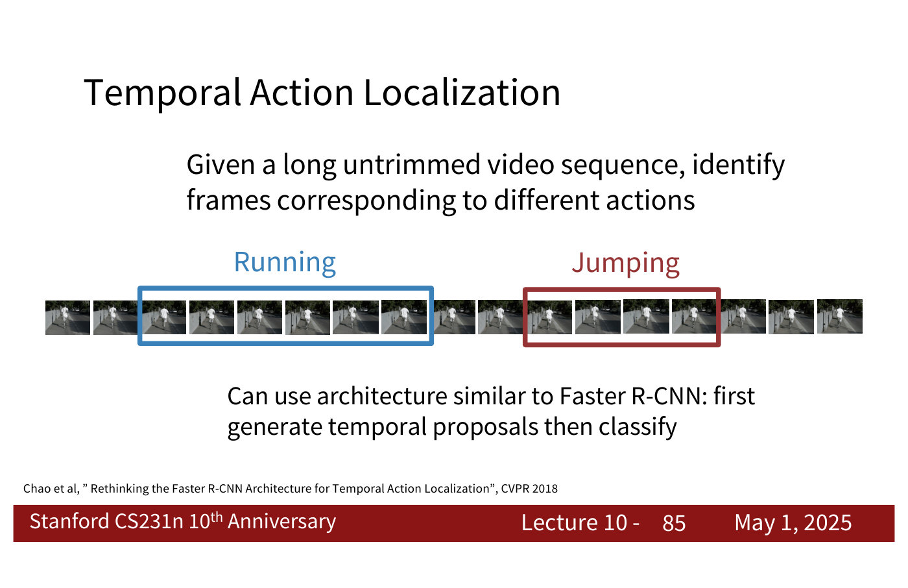

*Slide 85 — Temporal Action Localization. [Deck](https://cs231n.stanford.edu/slides/2025/lecture_10.pdf)*

**Spatio-temporal detection** localizes in both: "detect all the people in both space and time and classify the activities they are performing", with examples from the AVA data set such as "clink glass → drink" and "look at phone → answer phone" (slide 86; ≈1:01:57).

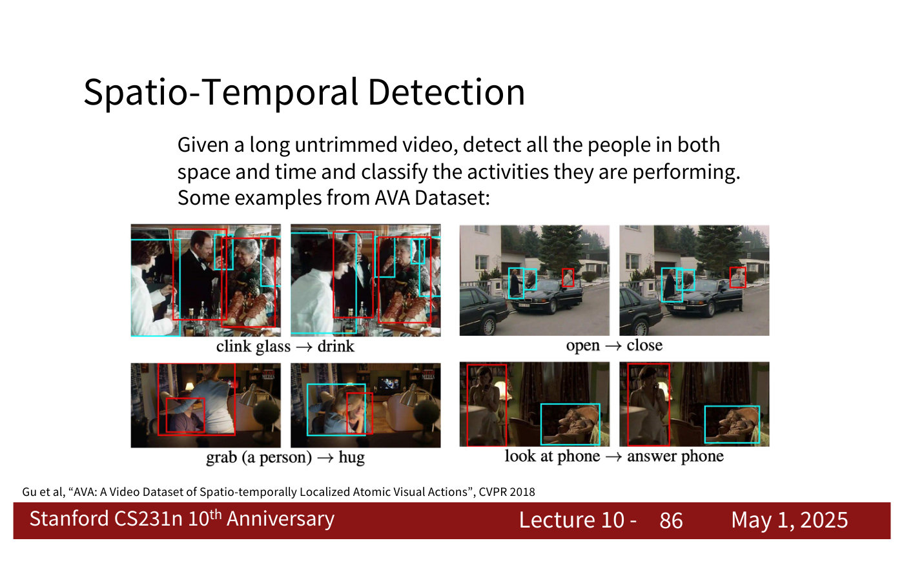

*Slide 86 — Spatio-Temporal Detection. [Deck](https://cs231n.stanford.edu/slides/2025/lecture_10.pdf)*

## Audio: another modality in video

The lecture so far has covered the temporal stream: "3D CNN, Two-Stream Neural Network, Spatial-Temporal Self-Attention" (slide 87; ≈1:01:57). Returning to the opening example video, the lecturer points out what is still missing: "There's sound, there's audio, there are other modalities in videos", which carry emotions and interactions (≈1:02:44).

**The McGurk slides (slides only).** Slides 89–91 are stills from a BBC video cited to McGurk and McDonald (1976): a man's face captioned "Ba Ba Ba …" on one slide and "Fa Fa Fa …" on the next, and two views of him side by side on the third. The captions do not mention these slides. They mark a change of speaker at ≈1:02:44, which may be the video playing, but neither the PDF nor the captions record what the video showed or what point it made, so this page does not describe it further.

**Visually guided audio source separation.** In a video with several speakers or several sounding objects, the visual stream can guide the separation of a mixed soundtrack into its sources (slide 92; ≈1:03:32). This is work the lecturer has done personally. Given a speech mixture and the video, the system separates the voice of each speaker (slides 93–95, stills from VisualVoice, Gao et al., CVPR 2021; ≈1:03:32–1:04:18). The same works for musical instruments, analysing their motion together with the audio (slide 96; ≈1:04:18): "Train on 100,000 unlabeled multi-source video clips, then separate audio for novel video" (Gao and Grauman, ICCV 2019).

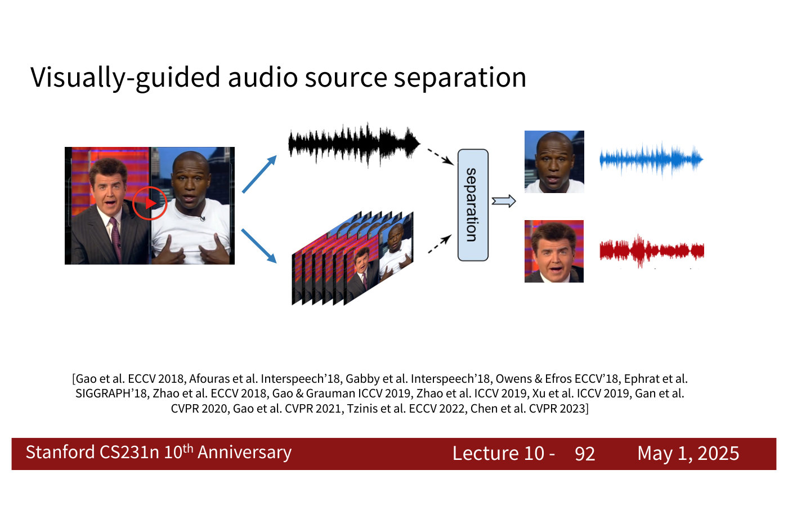

*Slide 92 — a video with mixed audio goes in; the separation network uses the frames to split the soundtrack into one waveform per visible speaker. [Deck](https://cs231n.stanford.edu/slides/2025/lecture_10.pdf)*

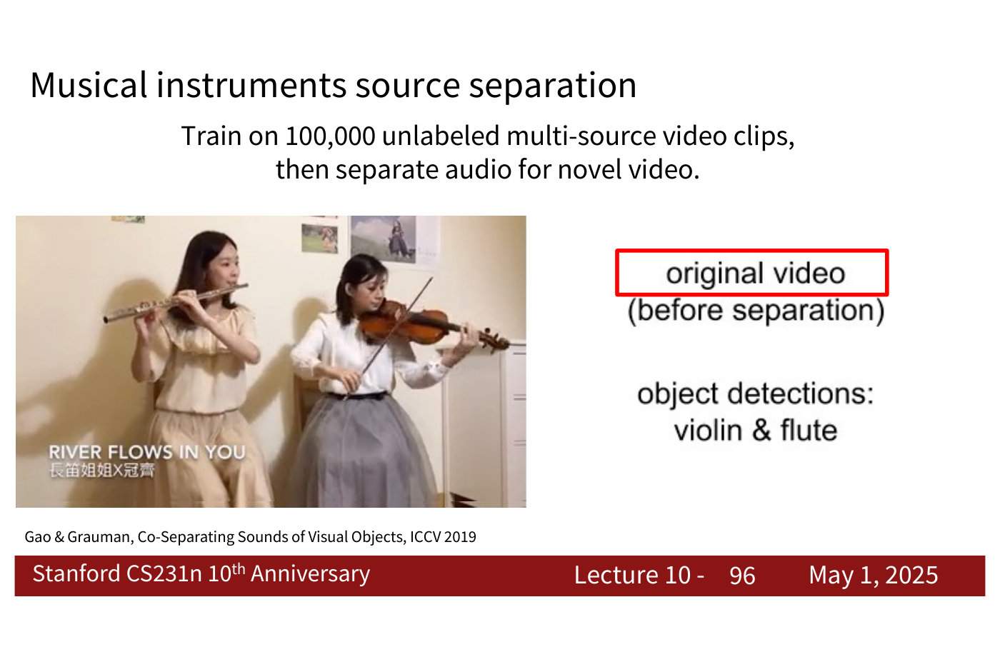

*Slide 96 — Musical instruments source separation. [Deck](https://cs231n.stanford.edu/slides/2025/lecture_10.pdf)*

**Audio-visual video understanding.** Audio is also a cue for classification. Transformer models map both image patches and audio spectrogram patches to tokens and classify them together (Nagrani et al., "Attention Bottlenecks for Multimodal Fusion", NeurIPS 2021), and masked autoencoders can reconstruct masked patches of both images and spectrograms (Georgescu et al., ICCV 2023) (slide 97; ≈1:04:18–1:05:03).

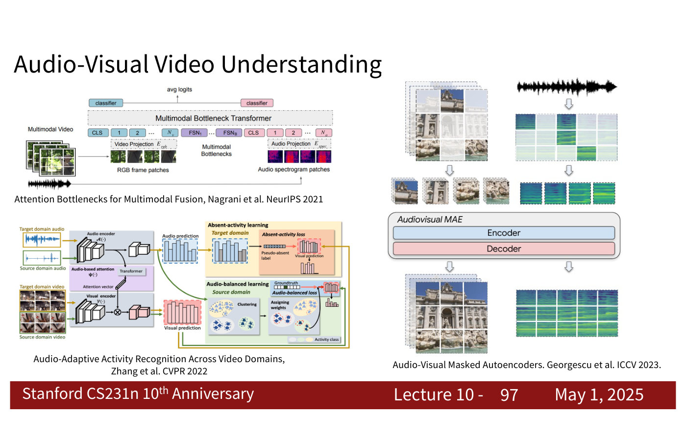

*Slide 97 — Audio-Visual Video Understanding. [Deck](https://cs231n.stanford.edu/slides/2025/lecture_10.pdf)*

## Efficient video understanding

Action recognition in long videos classifies many clips and aggregates them into a video-level prediction (slide 98; ≈1:05:03–1:05:48). Videos are long, "we cannot afford to process every clip one by one", so efficiency is a research area of its own (≈1:05:48).

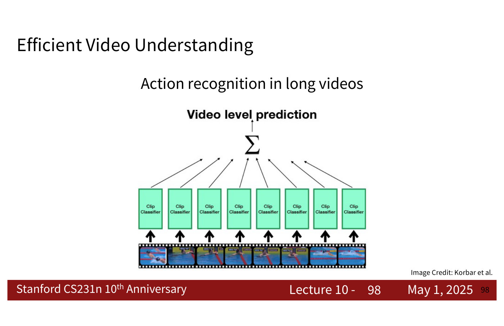

*Slide 98 — Efficient Video Understanding. [Deck](https://cs231n.stanford.edu/slides/2025/lecture_10.pdf)*

Slide 99 collects four approaches (≈1:05:48–1:06:33). X3D (Feichtenhofer, CVPR 2020) builds a more efficient 3D CNN for a single clip. SCSampler (Korbar et al., ICCV 2019) predicts which clips are the most salient and runs the clip classifier only on those. AdaMML (ICCV 2021) learns a policy that chooses which modality to use, RGB, optical flow or audio, and how much of it. MoViNets (Kondratyuk et al., CVPR 2021) are mobile video networks with causal convolutions and a stream buffer for streaming evaluation.

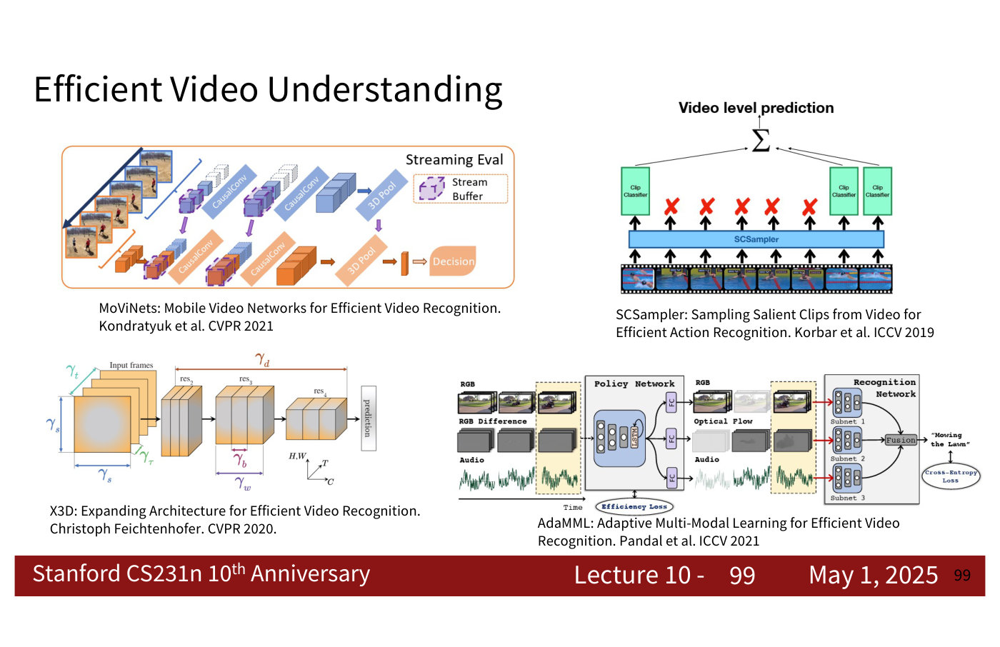

*Slide 99 — top right, SCSampler: of eight clips, only the three judged salient (green) go to the clip classifier; the five red crosses are clips skipped. [Deck](https://cs231n.stanford.edu/slides/2025/lecture_10.pdf)*

Audio can also serve "as a preview mechanism": a recurrent model looks at cheap audio features to predict where the important moments are, and uses that as a guiding cue to choose which frames to process (slide 100; Gao et al., "Listen to Look", CVPR 2020; ≈1:06:33).

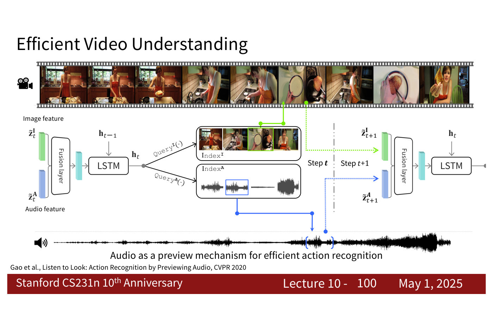

*Slide 100 — Efficient Video Understanding. [Deck](https://cs231n.stanford.edu/slides/2025/lecture_10.pdf)*

## Egocentric video and LLMs

With VR and AR smart glasses there will be many **egocentric** video streams, recorded with a microphone array as well as a camera (slide 101; ≈1:06:33–1:07:19). Using the multi-channel audio and the video together, a model can predict "who is speaking to whom and who is listening to whom", which could help a wearer understand social interactions (slide 101, "Ego-Exo Conversational Graph Prediction", Jia et al., CVPR 2024; ≈1:07:19).

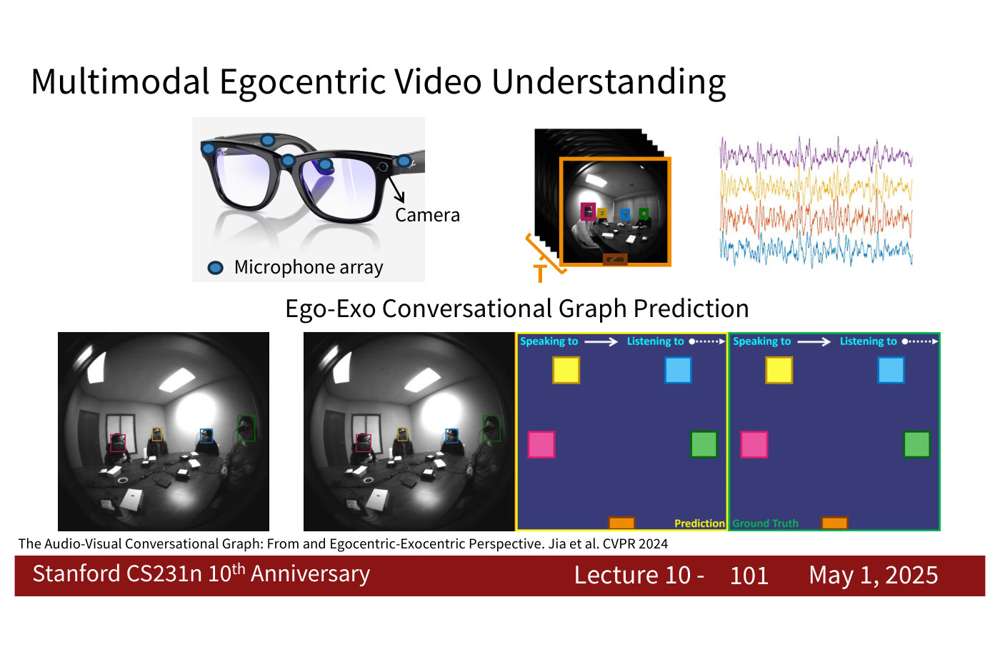

*Slide 101 — Multimodal Egocentric Video Understanding. [Deck](https://cs231n.stanford.edu/slides/2025/lecture_10.pdf)*

The final slide is **video understanding with LLMs** (slide 102; ≈1:07:19–1:08:07). Video foundation models tokenize videos and map them into an LLM's embedding space; prompted with a question about what a person is doing in a video, the model answers in text. Slide 102's examples are Video-LLaVA, Video-ChatGPT and VideoLLaMA 3.

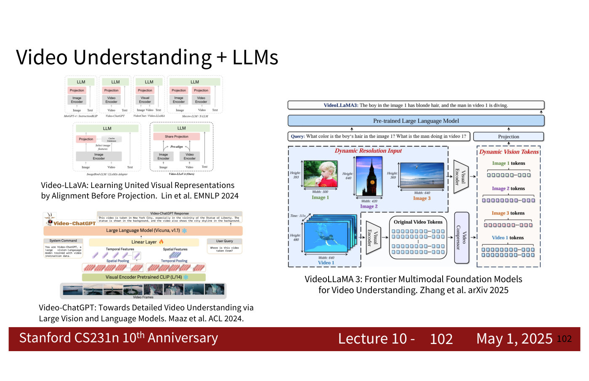

*Slide 102 — Video Understanding + LLMs. [Deck](https://cs231n.stanford.edu/slides/2025/lecture_10.pdf)*

## Printed slips and oddities

The deck carries four slips, each transcribed as printed in the slide file with an `[Ed:]` line.

The toy comparison prints the 3D CNN's global-average-pool output as "24 x 1 x 1", one dimension short of its $C \times T \times H \times W$ column; it is $24 \times 1 \times 1 \times 1$, as the late-fusion row prints it (the comparison table's 3D CNN column; repeated on the following build). The early-fusion row's "24 x 1 x 1" is consistent with its own three-dimensional sizes.

The 3D-convolution panels label the filter "Slide over x and y", copied from the early-fusion panel, although a $3 \times 3 \times 3$ filter also slides over time, as the same slides go on to say ("each filter slides over time!").

The C3D cost table heads its column "MFLOPs" but its values are GFLOPs: they add up to the 39.5 GFLOP quoted beside them. Every convolution row recomputes exactly as multiply-adds, but the three fully connected rows (0.51, 0.45 and 0.05) do not: FC6, with $512 \times 1 \times 3 \times 3 = 4608$ inputs and 4096 outputs, comes to about 0.019 GFLOP, and FC7 to about 0.017.

The I3D slide says to "copy $K_t$ times in space and divide by $K_t$". The copies are made along time, as its own figure ("Copy kernel K_t times, divide by K_t") and the $C_{in} \times K_t \times K_h \times K_w$ kernel show.

Two charts name the same Kinetics-400 results differently: 71.1 is "Inflated CNN" in the I3D chart and "I3D" in the transformer chart, and 74.2 is "Two-stream inflated CNN" in one and "Inflated I3D" in the other. Citation typos are kept as printed in the slide file ("Dual Making", "Christoph Feichtenhofers", "Gabby et al.", "Pandal et al.", "From and Egocentric-Exocentric Perspective").

Worked values that recompute: the "~1.5" and "~10 GB per minute" of uncompressed video (in binary gigabytes) and the 588 KB clip; every size and receptive field in the three toy networks; every convolution row of the C3D table and its "2.9x VGG"; and the I3D inflation.

## Next time

The deck's last slide announces "Next time: Large Scale Distributed Training" (slide 103); the recording ends before it.

## Related pages

- [Video understanding](video-understanding.md) — the video models of this lecture side by side, with their data sets and results.
- [Convolutional networks](convolutional-networks.md) — 2D convolution, which 3D convolution extends.
- [CNN architectures](cnn-architectures.md) — VGG and Inception, which C3D and I3D carry into 3D.
- [Recurrent neural networks](recurrent-neural-networks.md) — the sequence shapes and the multi-layer RNN behind CNN+RNN models and recurrent convolutional networks.
- [Attention](attention.md) — the self-attention that the nonlocal block applies to space-time.
- [Transformers](transformers.md) — the Vision Transformer that video transformers extend.
- [Transfer learning](transfer-learning.md) — pretrained C3D features, and I3D's ImageNet initialization.
- [Visualizing what networks learn](visualizing-networks.md) — gradient ascent on a class score, here for video models.
- [Object detection](object-detection.md) — Faster R-CNN, which temporal action localization adapts.
- [Computer vision tasks](computer-vision-tasks.md) — the image tasks this lecture extends to video.
- [Course logistics](course-logistics.md) — the course roadmap.
- Previous lecture: [Lecture 9 — Detection, Segmentation, Visualization, and Understanding](09-detection-segmentation-visualization.md).
