# Lecture 11 — Large-Scale Distributed Training

**CS231N Deep Learning for Computer Vision, Stanford, Spring 2025.** Delivered May 6, 2025. The lecturer is not named in the recording or on the deck. Sources: the [deck](https://cs231n.stanford.edu/slides/2025/lecture_11.pdf) (148 slides, printed numbers equal to PDF pages), its [slide-by-slide text](../raw/slides/11-large-scale-distributed-training.md), and the [edited transcript](../raw/transcripts/11-large-scale-distributed-training.md).

## What this lecture establishes

Large neural networks are no longer trained on one GPU. Ten years ago that was common, and now "the new norm is to train models on tens, hundreds, thousands, even tens of thousands of devices concurrently" (≈0:05). The lecture has two parts. The first is about the hardware: what is inside a modern GPU (the NVIDIA H100), why its matrix-multiply units, the **Tensor Cores**, are where its speed comes from, and how GPUs are stacked into servers, racks, pods and clusters, with communication getting slower at every level. The lecturer asks you to think of a whole data center as "one big computer" (≈21:41).

The second part is about algorithms for that computer. A transformer is a stack of layers working on tensors of shape (Batch, Sequence, Dim), which gives four axes to split the work along. **Data parallelism** splits the batch, and its variants **FSDP** and **HSDP** also split the weights. **Context parallelism** splits the sequence, **pipeline parallelism** splits the layers, and **tensor parallelism** splits the model dimension. **Activation checkpointing** trades extra computation for memory. **Model FLOPs utilization (MFU)** is the one number to maximize when tuning all of these. The largest training runs use all four axes at once. Meta's Llama3-405B, the lecture's running example, is the case study throughout, because its paper publishes the training details that other labs no longer share.

The topic page [distributed training](distributed-training.md) sets the strategies side by side.

**What the recording covers.** The recording opens with the title and the running example (≈0:05) and does not present the administrative slide, which reminds students of the midterm review session on Friday 5/9 and the in-class midterm on Tuesday 5/13 (slide 2; see [course logistics](course-logistics.md)). It then covers the GPU and its internals (≈2:23–11:41), the growth of GPU throughput (≈11:41–14:46), servers, racks, pods and the Llama 3 cluster (≈14:46–23:14), TPUs and other chips (≈23:14–26:17), the four axes of parallelism (≈26:17–28:35), data parallelism (≈28:35–40:51), FSDP (≈40:51–48:37), HSDP (≈48:37–52:24), activation memory and checkpointing (≈52:24–56:15), a scaling recipe (≈55:28–57:46), hardware and model FLOPs utilization (≈57:46–1:03:08), context parallelism (≈1:03:08–1:05:27), pipeline parallelism (≈1:05:27–1:09:16), tensor parallelism (≈1:09:16–1:10:50), ND parallelism (≈1:10:50–1:11:36) and the summary (≈1:11:36–1:12:21). Before context parallelism the lecturer says there are "slides here that I think are pretty nice, but it's okay if we don't go through the full details of these. You can check it offline" (≈1:03:08), so the last three strategies get a brief tour, and their details come from the slides. The final "Next time" slide is not reached. Several answers to questions are spoken only: how long big training runs last, how large a cluster is physically, how hot it gets, asynchronous SGD, and how the overlap of communication and computation is programmed.

## Running example: Llama3-405B

GPT-4's technical report "kicked off a trend of not sharing any model details". The slide quotes it: "Given both the competitive landscape and the safety implications of large-scale models like GPT-4, this report contains no further details about the architecture (including model size), hardware, training compute, dataset construction, training method, or similar." (slide 4). Llama 3, released by Meta in April 2024, is the lecture's example "not because it's the best model out there, but because it's one of the most open models out there" (≈1:37). Its paper shares many model and training details (slide 4), "not too much about the dataset, a lot about the system infrastructure" (≈1:37). Llama 4 had been released in April 2025, but without a paper yet (slide 4; ≈2:23).

## Inside a GPU: the NVIDIA H100

The lecture's first half is about the hardware, the second about how to train on lots of it (slide 5; ≈2:23).

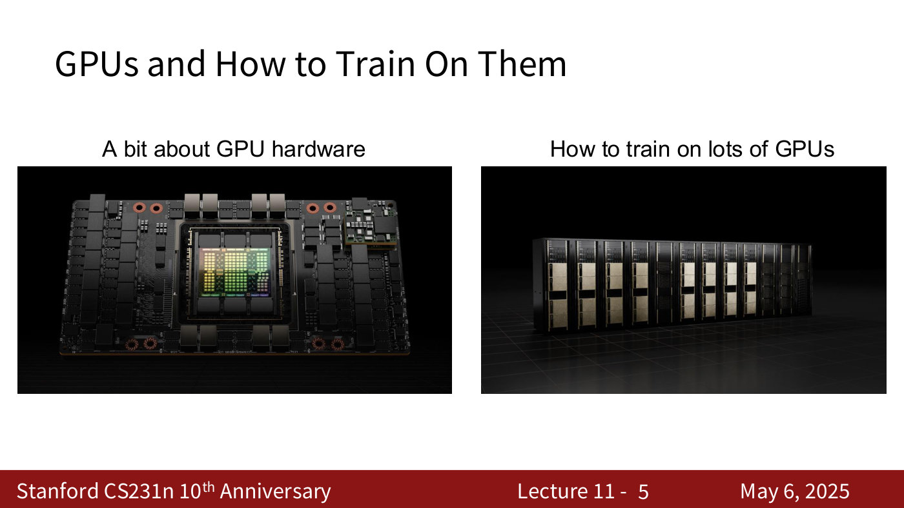

*Slide 5 — the lecture's two parts: a bit about GPU hardware (an H100 board) and how to train on lots of GPUs (a row of server racks). [Deck](https://cs231n.stanford.edu/slides/2025/lecture_11.pdf)*

A GPU is a graphics processing unit. It was originally built for computer graphics, where many pixels and pieces of geometry are processed in parallel, and it turned out to be a general parallel processor (slide 7; ≈3:10–3:56). NVIDIA built GPUs for general parallel programming from the late 2000s and "really capitalized on deep learning when it started to take off in the early 2010s" (≈3:56). The H100 is "sort of the mainstay of deep learning training right now today" (≈4:43).

**Memory around the cores.** The H100's compute cores sit in the middle of the board, with 80 GB of HBM (high-bandwidth memory) beside them. The memory reaches the cores at 3352 GB/sec (slide 9), "about 3 terabytes per second" (≈5:29).

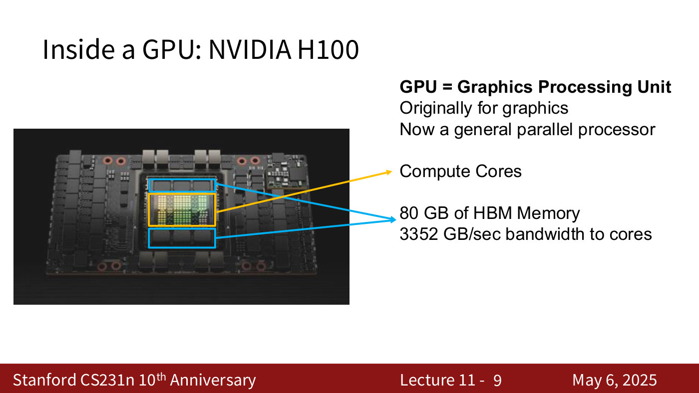

*Slide 9 — the H100 board: the compute die (yellow box) with the HBM memory stacks above and below it (blue boxes), 80 GB at 3352 GB/sec. [Deck](https://cs231n.stanford.edu/slides/2025/lecture_11.pdf)*

**Inside the die.** Closer to the cores is a 50 MB L2 cache, much smaller than the HBM but much faster to reach (slide 11; ≈5:29). The heart of the chip is 132 **streaming multiprocessors (SMs)**, "independent parallel cores" (slide 12). The lecturer compares an SM roughly to a CPU core. It can do more in parallel, but it has a slower clock and less branch prediction, so the comparison is not exact (≈5:29–6:16). The die actually has 144 SMs. Manufacturing never comes out perfect, so NVIDIA sells chips on the promise that at least 132 work, a process the lecturer calls binning (slide 12; ≈6:16–7:02).

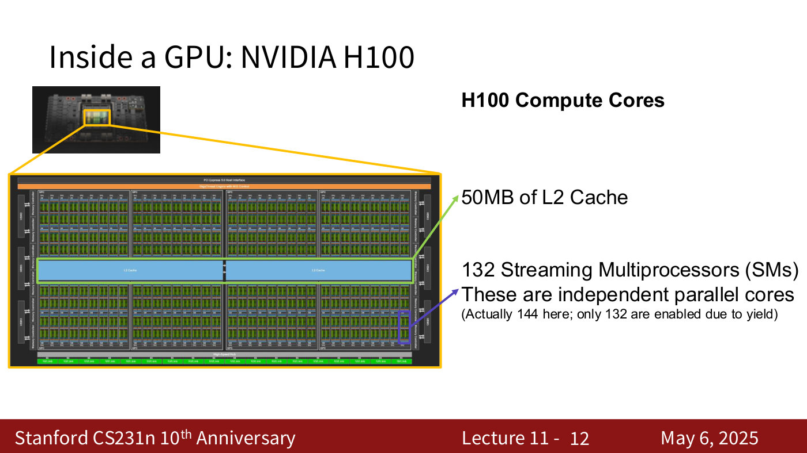

*Slide 12 — the H100 die: eight GPC blocks of SMs, the L2 cache across the middle (green outline), HBM3 at the sides, NVLink along the bottom; the purple outline marks one column of SMs. [Deck](https://cs231n.stanford.edu/slides/2025/lecture_11.pdf)*

**Inside one SM.** Each SM has 256 KB of L1 cache and 256 KB of registers (slide 14). That gives the H100 three levels of memory hierarchy: 256 KB of L1, 50 MB of L2 and 80 GB of HBM. Memory gets larger and slower the farther it is from the compute (≈7:48–8:34). "You thought you were learning deep learning, you're actually learning computer architecture" (≈7:48). Writing fast GPU kernels means moving data carefully between these levels (≈7:48).

**FP32 cores.** Each SM has 128 FP32 cores. Each computes $ax + b$ for scalars $a$, $x$ and $b$ in one clock cycle, which counts as 2 FLOPs (floating-point operations: one multiply and one add), so an SM does 256 FLOP per cycle on them (slide 15; ≈8:34).

**Tensor Cores.** Each SM also has 4 Tensor Cores, where "the real magic happens" (≈9:21). The lecturer calls the name "a little bit of a misnomer. These are actually matrix cores" (≈9:21). Each computes $AX + B$ for a block of fixed size, $[16 \times 4][4 \times 8] + [16 \times 8]$, in one clock cycle. That is $16 \cdot 4 \cdot 8 \cdot 2 = 1024$ FLOPs, so the four give 4096 FLOP per cycle per SM, against 256 from the FP32 cores (slide 16; ≈10:08). Tensor Cores work in **mixed precision**: 16-bit inputs, with multiplication in 16-bit and accumulation in 32-bit (slide 16; ≈10:53). That has a practical consequence in PyTorch: a model not cast to 16-bit runs on the FP32 cores instead, which the lecturer says is about 20 times slower than expected (≈10:53–11:41).

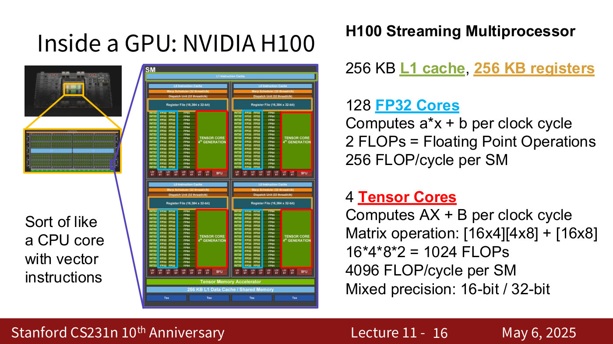

*Slide 16 — one streaming multiprocessor: four quadrants, each with its register file (orange), two columns of FP32 cores (cyan) and a Tensor Core (red); the L1 cache is outlined in green. [Deck](https://cs231n.stanford.edu/slides/2025/lecture_11.pdf)*

## GPUs have gotten much faster

A chart of peak throughput in TFLOP/sec, from April 2012 to December 2025, plots two series: FP32 (blue), which stays nearly flat, and Tensor Core (green), which rises steeply (slides 17–19). The FP32 points are K40 5, P100 10.6, V100 15.7, A100 19.5, H100 67 and B200 83.3. The Tensor Core points start with the V100, at 125, then A100 312, H100 989 and B200 5000. The chart is annotated "1000x speedup since 2013!" and "We can also train with > 1 GPU!" (slide 19).

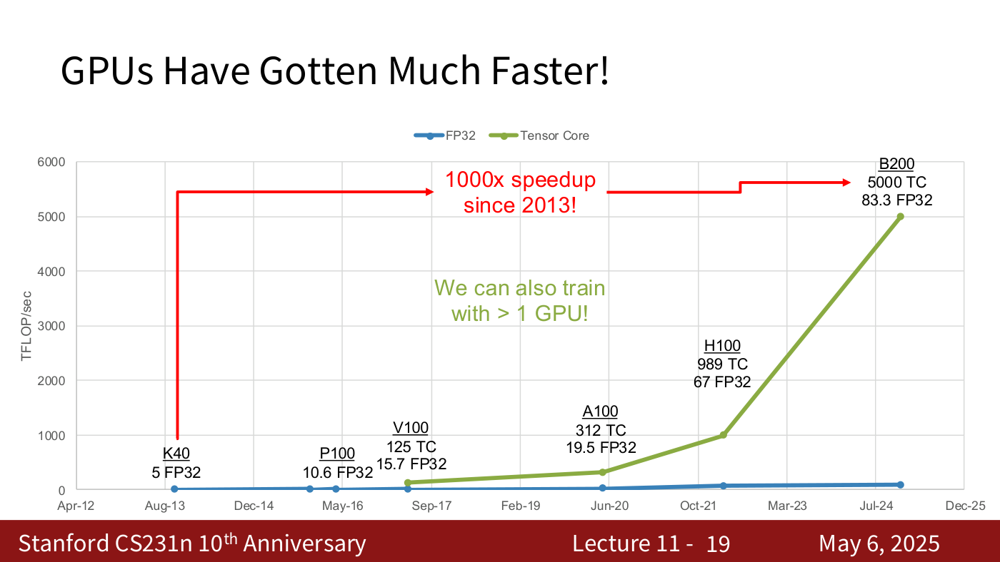

*Slide 19 — peak TFLOP/sec per device: FP32 (blue) creeps from 5 to 83.3, while Tensor Core throughput (green) climbs from the V100's 125 to the B200's 5000. [Deck](https://cs231n.stanford.edu/slides/2025/lecture_11.pdf)*

The K40, from 2013, was the GPU the lecturer used at the start of their PhD. The V100, around 2016–2017, was the first device with Tensor Cores, and since then more and bigger Tensor Cores have taken more of the chip (≈11:41–12:28). "We've been living through a 1,000-fold increase in computation over the past 12 years" at the level of one device (≈13:13), which the lecturer thinks "is the major driver of improvement in deep learning over the past decade" (≈13:59). Answering a question, the lecturer clarifies that the B200's 5,000 is teraflops on the Tensor Cores, not a count of Tensor Cores (≈13:59). And today's models are trained on thousands to hundreds of thousands of GPUs, on top of that per-device increase (≈14:46).

## From one GPU to a cluster

The memory hierarchy continues outside the GPU, and bandwidth falls at every step (≈14:46–15:32). The deck builds Meta's Llama 3 training cluster level by level, from the Llama 3 paper.

**Server.** Almost all GPU servers hold eight GPUs (≈15:32). Inside the H100 data moves at 3352 GB/sec. Between the GPUs of one server it moves at 900 GB/sec (slide 21), about 3x less (≈16:19).

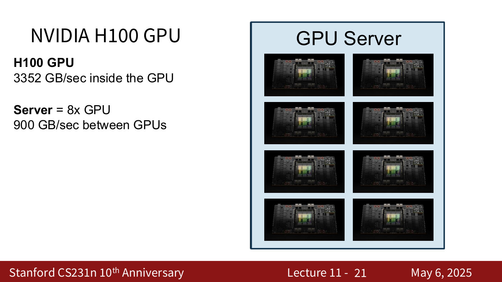

*Slide 21 — Server = 8x GPU, with 900 GB/sec between them. [Deck](https://cs231n.stanford.edu/slides/2025/lecture_11.pdf)*

**Rack.** A rack holds two servers, 16 GPUs (slide 22). A rack is "about 6 ft tall, about the size of a person" (≈16:19).

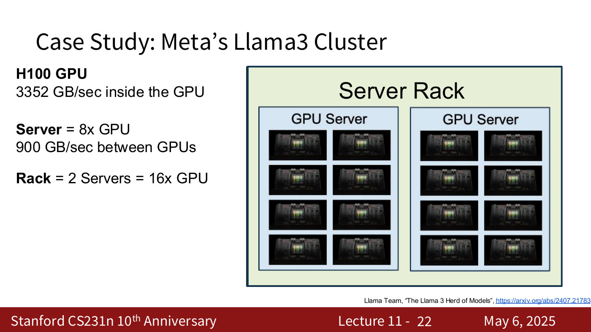

*Slide 22 — Rack = 2 Servers = 16x GPU. [Deck](https://cs231n.stanford.edu/slides/2025/lecture_11.pdf)*

**Pod.** A pod is 192 racks, 3072 GPUs, and any two GPUs in it talk at 50 GB/sec (slide 23). The lecturer calls this "another sort of 20x decrease" (≈17:06).

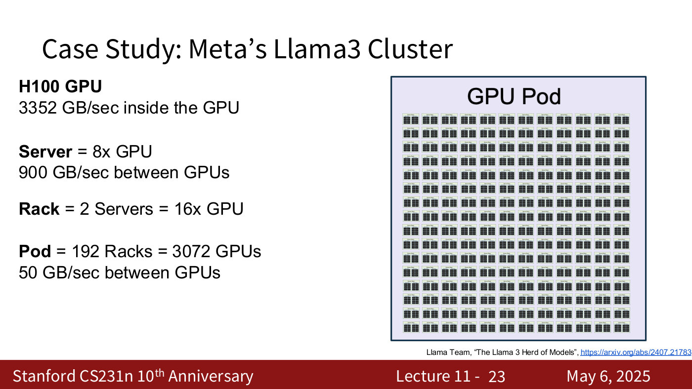

*Slide 23 — Pod = 192 Racks = 3072 GPUs: the drawing has one small rack icon for each of the 192 racks, 12 across and 16 down. [Deck](https://cs231n.stanford.edu/slides/2025/lecture_11.pdf)*

**Cluster.** The cluster is 8 pods, 24,576 GPUs, with less than 50 GB/sec between GPUs (slide 24). The lecturer could not find exact numbers for that last level (≈17:51). This is not the largest cluster in the world, and clusters of 50,000 and 100,000 GPUs exist (≈17:51).

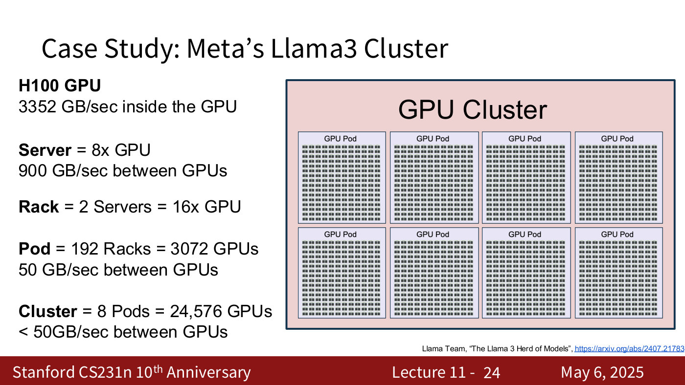

*Slide 24 — Cluster = 8 Pods = 24,576 GPUs, the last level of the hierarchy. [Deck](https://cs231n.stanford.edu/slides/2025/lecture_11.pdf)*

**One big computer.** The whole cluster's totals are 24,576 GPUs, 1.875 PB of GPU memory, 415M FP32 cores, 13M Tensor Cores and 24.3 EFLOP/sec, which is $24.3 \times 10^{18}$ FLOP per second. The goal is to "Train one giant neural network on this cluster" (slide 25). The memory total is 24,576 times 80 GB in binary units: decimally it is about 1.97 PB, and the lecturer says "1.8 petabytes" (≈21:41). The other totals follow from the per-GPU figures (see the slide file's note under slide 25). "I guarantee you 5 years from today, it will not feel like a lot of flops" (≈22:27).

Several answers to questions are spoken only. The longest training runs of the biggest models are measured in months, which the lecturer thinks has "less to do with technology and more to do with people" (≈18:38). Servers sit in racks because the rack is the standard unit data centers are built around (≈19:23). A pod of 192 racks, times eight, takes rows of racks with walkways, plus extra racks for networking and storage (≈20:08). Within a cluster the smaller units keep their faster links, and the design challenge is to use fast links where you can and "fall back gracefully" on the slower ones (≈20:54). On heat: a single gaming GPU makes a room warmer, so tens of thousands of them need "serious cooling" (≈20:54).

## Other training hardware

Google's **Tensor Processing Units (TPUs)** are custom chips. A TPU v5p does 459 TFLOP/sec in BF16 with 95GB of memory per chip, and chips are arranged in pods of 8960 (slide 26). The lecturer calls TPUs the biggest competitor to NVIDIA hardware, with specs of the same order as the H100 (≈23:14). The photograph on the slide is a v2 TPU pod of 256 chips in four racks, "a little bit taller than me" (≈23:59). TPUs cannot be bought, only used at Google or rented on Google Cloud (≈24:45). Asked whether Google trains its models on them, the lecturer answers that Google's Gemini models are "almost certainly trained on TPUs" (≈23:59).

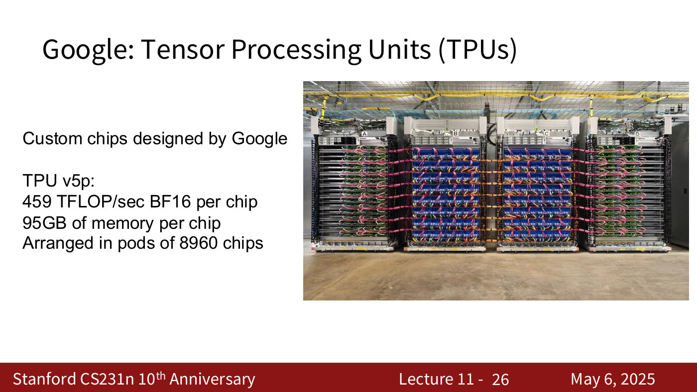

*Slide 26 — Google: Tensor Processing Units (TPUs). [Deck](https://cs231n.stanford.edu/slides/2025/lecture_11.pdf)*

Two other chips appear on the next slide. AMD's MI325X does 1300 TFLOP/sec in BF16 with 256GB of memory, and AWS's Trainium2 does 667 TFLOP/sec in BF16 with 96GB, packed in UltraServers of 64 chips (slide 27). The lecturer's assessment is that NVIDIA and TPUs are "way ahead of everyone else" in usability, performance and market share (≈24:45). The MI325X looks comparable to an H100 on paper but has not had its impact, and Anthropic uses Trainium for some of its training (≈25:32).

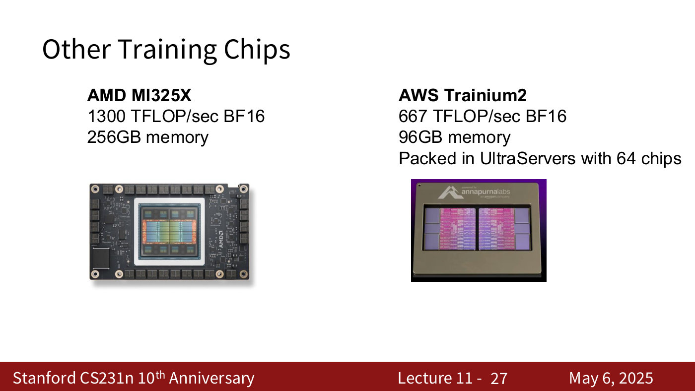

*Slide 27 — Other Training Chips. [Deck](https://cs231n.stanford.edu/slides/2025/lecture_11.pdf)*

## How to train on lots of GPUs: four axes

A computer does two things: computation and communication. The trick at cluster scale is to split the computation so all the GPUs have useful work, and to overlap the communication with the computation (≈26:17–27:04).

"A model with L layers operates on tensors of shape (Batch, Sequence, Dim)" (slide 30). Each axis gives a strategy. **Data parallelism (DP)** splits on the Batch dimension, **context parallelism (CP)** on the Sequence dimension, **pipeline parallelism (PP)** on the L (layers) dimension, and **tensor parallelism (TP)** on the Dim dimension (slide 30). The lecturer introduces this as "five degrees of parallelism" but then names these four (≈27:04–28:35). Much of it is specific to transformers, the dominant architecture for large-scale training (≈27:04).

## Data parallelism

The loss is usually averaged over a minibatch of $N$ samples. The idea is to use a minibatch of $MN$ samples, split over $M$ GPUs (slide 33). Because gradients are linear, each GPU can compute its own gradient (slide 34). Write $x_{i,j}$ for the $j$-th example on GPU $i$, $W$ for the network's weights and $\ell$ for the loss of one example. Then

$$L = \frac{1}{MN} \sum_{i=1}^{M} \sum_{j=1}^{N} \ell(x_{i,j}, W)$$

$$\frac{\partial L}{\partial W} = \frac{1}{M} \sum_{i=1}^{M} \left( \frac{1}{N} \sum_{j=1}^{N} \frac{\partial}{\partial W} \ell(x_{i,j}, W) \right)$$

The term in parentheses is the gradient each GPU computes on its own $N$ examples. The outer average is taken across the $M$ GPUs (slides 35–36). "This is not an approximation. This is exactly the same computation as we would have done on a single larger GPU" (≈30:52).

The algorithm has six steps (slides 37–42). (1) Each GPU has its own copy of the model and the optimizer. (2) Each loads its own batch of data. (3) Each runs forward to compute its loss. (4) Each runs backward to compute gradients. (5) The gradients are averaged across all GPUs. (6) Each GPU updates its own weights. The GPUs must load *different* data. "I've had bugs in my code, in students' code, where they accidentally load the same minibatch in all the GPUs" (≈31:38). Step 5 is an **all-reduce**: every GPU sends its gradients to all the others and collects theirs, which "kind of happens in sort of logarithmic time typically depending on the number of GPUs" (≈32:24–33:10). Since every GPU starts with the same weights and applies the same averaged gradient, the copies stay identical, assuming the arithmetic is deterministic (≈33:56).

"(4) and (5) can run in parallel!" (slide 43). While the GPUs compute the backward pass for one layer, they all-reduce the gradients of the layer after it, so the communication is hidden behind the computation (≈33:56–34:43). Whether the backward pass or the all-reduce is the bottleneck "depends entirely on how fast your device is, how big is your model, how big is your minibatch, how fast is the interconnect", and you benchmark it (≈35:29).

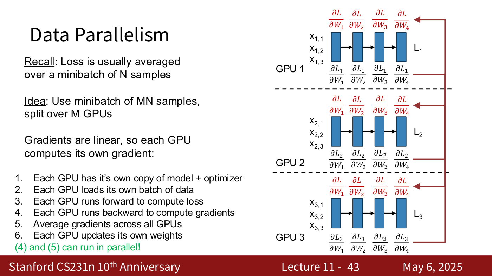

*Slide 43 — three GPUs each run the same four-layer network on their own data (x1,1 to x3,3), compute local gradients (black, under each layer) and receive the averaged gradient (red, above), with the six steps on the left. [Deck](https://cs231n.stanford.edu/slides/2025/lecture_11.pdf)*

Three spoken answers go beyond the slides. Taking separate gradient steps on each GPU and averaging the models now and then is **asynchronous SGD**. Google used it for some networks in the early 2010s, before its TPU pods. It tends to be less stable and harder to debug and reproduce, though the lecturer "would personally not be too surprised if we see a resurgence of async SGD methods" (≈35:29–36:15). The overlap of communication and computation has to be written in software, not left to the hardware, and PyTorch's `DistributedDataParallel` class does it for data parallelism (≈37:01). Inside a single GPU, programmed in CUDA, the hardware does much of the asynchronous transfer itself. Across a cluster it does not (≈37:01–37:48).

**The problem: model size.** Each weight needs 4 numbers: the weight, its gradient and Adam's two moment estimates (printed "Adam β1, β2"). At 2 bytes each, that is 8 bytes per parameter, so "1B params takes 8GB; 10B params fills up 80GB GPU" (slide 44). The lecturer adds that there are sometimes "four to five scalars" per weight, counting an exponential moving average of the weights, and that 2 bytes is a lower bound, since some are kept in higher precision (≈40:05). Every GPU holds the whole model, so about 10 billion parameters is the most an H100 could train this way (≈40:05–40:51). The solution is to split the model weights across GPUs (slide 45). See [optimizers](optimizers.md) for Adam's two moments.

## Fully sharded data parallelism (FSDP)

The deck titles these slides "FSPD", as printed; the lecture and the slides' own text say FSDP. Each weight $W_i$ is owned by one GPU, which also holds its gradients and optimizer state (slide 46). In practice $W_i$ is the weight matrix of a whole layer (≈41:38). The slides use two GPUs and a four-layer network: GPU 1 owns $W_1$ and $W_2$, GPU 2 owns $W_3$ and $W_4$ (slide 46). The source cited is Rajbhandari et al.'s ZeRO paper (printed "Rajbhandrari et al", arXiv 2019). It is "still data parallelism": each GPU still runs forward and backward on its own batch (≈42:23).

**Forward.** Before the forward pass of layer $i$, the GPU that owns $W_i$ broadcasts it to all GPUs (slide 47). All GPUs run forward for layer $i$, then delete their local copy of $W_i$ (slide 48). The next weight is fetched while the current layer computes: "Fetch $W_{i+1}$ while computing forward with $W_i$" (slide 49; ≈43:09–43:56).

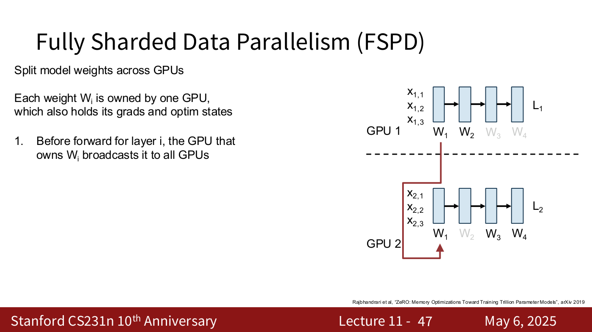

*Slide 47 — step 1 of the forward pass: GPU 1, which owns W1, broadcasts it to GPU 2 (red arrow); black labels mark the weights a GPU currently holds, grey the ones it does not. [Deck](https://cs231n.stanford.edu/slides/2025/lecture_11.pdf)*

**Backward.** Before the backward pass of layer $i$, the owner broadcasts $W_i$ again (slide 53). One optimization is to keep the last layer's weights at the end of the forward pass instead of deleting and immediately resending them (slide 54; ≈44:43). All GPUs run backward for layer $i$, computing their local gradient, and delete $W_i$ (slide 55). Then each sends its local gradient to the owning GPU and deletes it (slide 56), and the owner of $W_i$ makes the gradient update (slide 57). Instead of an all-reduce, only the owner gathers and sums the local gradients (≈45:28). The updated weights need not be sent anywhere, because they are broadcast again at the next forward pass (≈47:04).

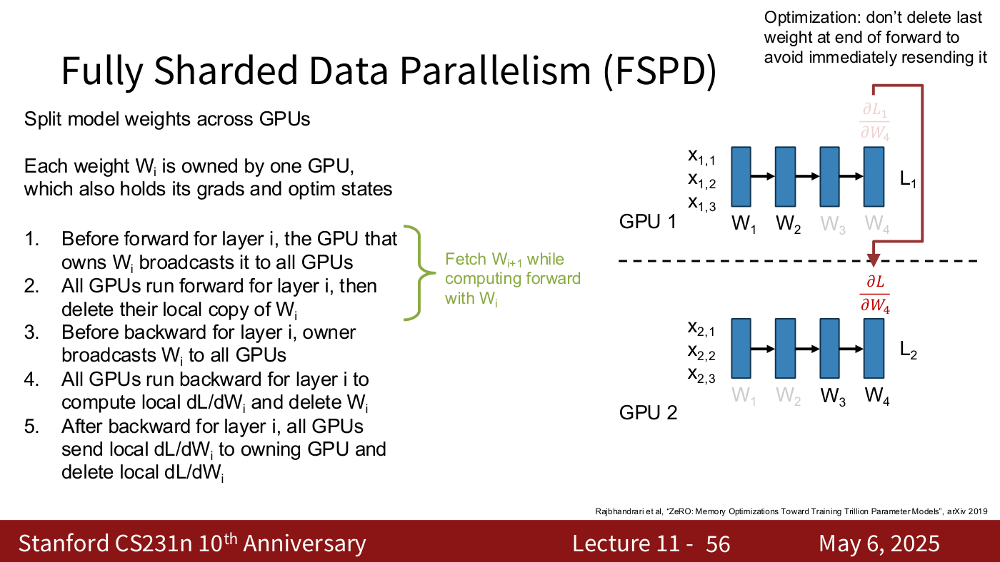

*Slide 56 — step 5 of the backward pass: GPU 1 sends its local gradient for W4 (faded, top) to GPU 2, the owner of W4, which then holds the full gradient. [Deck](https://cs231n.stanford.edu/slides/2025/lecture_11.pdf)*

**Three things at once.** In the backward pass three steps overlap on three consecutive layers: "Fetch $W_i$ while computing with $W_{i+1}$; send $dL/dW_i$ and update $W_i$ while computing with $W_{i-1}$" (slide 58). On the slides' network the moment comes when GPUs are, "All at the same time", sending gradients and updating $W_3$, running backward with $W_2$, and fetching $W_1$ (slide 61; ≈47:04–47:50).

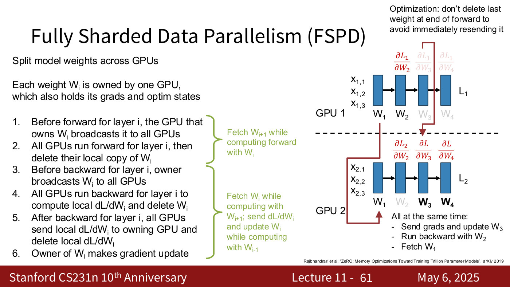

*Slide 61 — the steady state of FSDP's backward pass: one arrow sends GPU 1's gradient for W3 to its owner while the other fetches W1, as GPU 2 updates W3 and both run backward through layer 2. [Deck](https://cs231n.stanford.edu/slides/2025/lecture_11.pdf)*

When the backward pass ends, the next batch starts, its data "pre-fetched during forward+backward" (slide 64). The data loader typically runs on the servers' CPU cores (≈47:50). "These things are basically parallelization machines" (≈47:50).

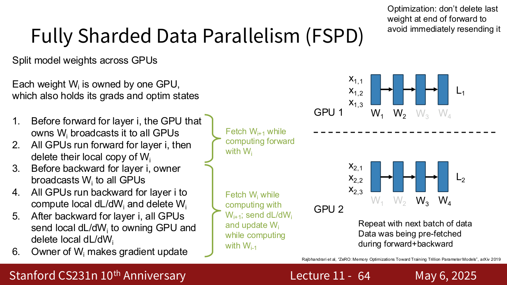

*Slide 64 — the complete FSDP algorithm: six steps, the two overlap rules (green braces) and the last-layer optimization. [Deck](https://cs231n.stanford.edu/slides/2025/lecture_11.pdf)*

## Hybrid sharded data parallelism (HSDP)

Split $N = M K$ GPUs into $M$ groups of $K$. Each group of $K$ GPUs does FSDP, splitting the model weights across all $K$, and $K$ can be $O(100)$ GPUs. Data parallelism runs across the $M$ groups (slide 65). The slides' example is $M = 2$ groups of $K = 4$ GPUs, arranged as a grid: in each group, GPU $k$ owns $W_k$ (slide 65). This is **multidimensional parallelism**, "different parallelism strategies at the same time", with the GPUs organized in a 2D grid (slide 66; ≈49:22–50:08).

Why bother: the two strategies communicate different amounts. Inside a group, FSDP sends the weights in the forward pass and the weights and their gradients in the backward pass, three times the model's size in all. Across groups, data parallelism sends only the gradients, once (slide 67; ≈50:54–51:39). So the FSDP groups belong inside a node or pod, where links are fast, and the data-parallel axis can use slower communication (slide 67). For example, the eight GPUs of one server could form an FSDP group, with servers as the data-parallel axis (≈51:39). This is "our first example of designing algorithms to take advantage of the network topology" (≈51:39–52:24).

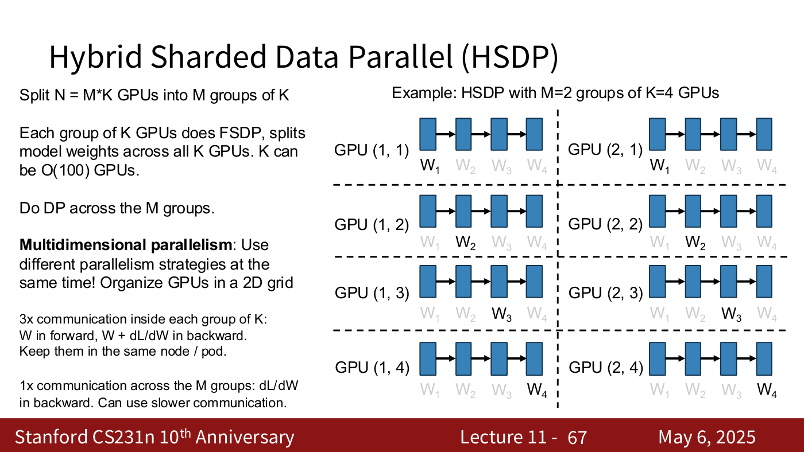

*Slide 67 — HSDP with M=2 groups of K=4 GPUs: each column is one FSDP group (row k holds Wk), the two columns are data-parallel copies, and the notes give 3x communication inside a group and 1x across groups. [Deck](https://cs231n.stanford.edu/slides/2025/lecture_11.pdf)*

## Activations fill memory

With the weights split, big models fit. A 100B-parameter model needs 4 numbers per parameter at 2 bytes each, 800GB, and split over 80 GPUs that is just 10GB per GPU (slide 68; ≈52:24). But now the activations fill memory. Llama3-405B has 126 layers, $D = 16{,}384$ and sequence length 4096. Just the hidden activations of its FFN layers take $2 \times 126 \times (4 \times 16384) \times 4096$ bytes, which the slide gives as 63GB, plus the other activations (slide 69; ≈53:11). The 63GB is in binary units, and slides 125 and 146 give the first training stage's sequence length as 8192, not 4096 (see the slips below). The solution: "Don't keep all activations in memory; recompute them on the fly!" (slide 70).

## Activation checkpointing

Think of each layer as two functions (slide 71; ≈53:11). Write $A_i$ for the activations at layer $i$ and $G_i$ for the gradient there. The forward function computes the next layer's activations, and the backward function computes the previous layer's gradient from both the activations and the upstream gradient:

$$A_{i+1} = \overrightarrow{F_i}(A_i) \qquad G_i = \overleftarrow{F_i}(A_i, G_{i+1})$$

The slides ask how much compute and memory this takes, assuming each $\overrightarrow{F_i}$ and $\overleftarrow{F_i}$ costs $O(1)$ of each (slide 72). They then step through a four-layer network with a running counter of compute, current memory and peak memory. Solid boxes are what is held in memory at each step. This connects to [backpropagation](backpropagation.md): the backward pass needs the forward pass's activations.

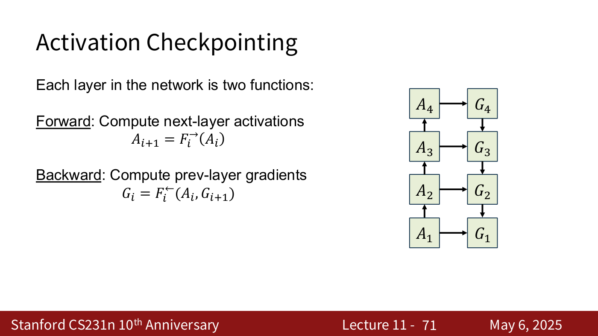

*Slide 71 — the computation as a graph: activations A1–A4 go up the left column, gradients G4–G1 come down the right, and each G_i needs its row's A_i. [Deck](https://cs231n.stanford.edu/slides/2025/lecture_11.pdf)*

**Normal forward and backward.** The forward pass stores all four activations (slide 76). The backward pass then frees each activation once its gradient has been computed. The run ends at compute 8, current memory 1 and peak memory 4 (slide 80). In general that is "Forward+backward: $O(N)$ compute, $O(N)$ memory" for $N$ layers (slide 81).

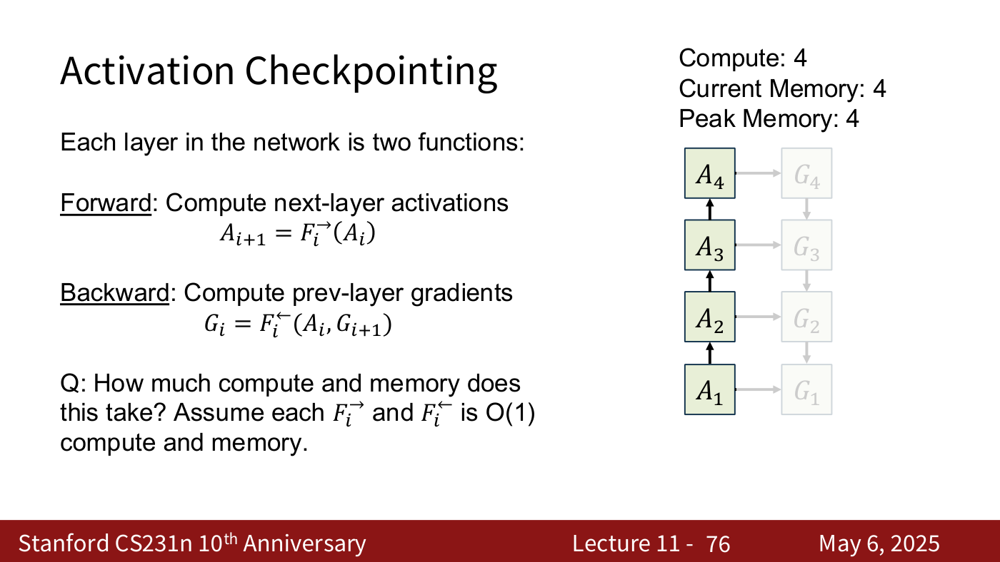

*Slide 76 — the end of a normal forward pass: all four activations are held at once (Compute 4, Peak Memory 4), and the backward pass will consume them from the top down. [Deck](https://cs231n.stanford.edu/slides/2025/lecture_11.pdf)*

**Full recomputation.** The idea is to recompute activations during the backward pass (slide 82). The forward pass keeps only the latest activation. For each later gradient, the activations are recomputed from $A_1$, holding at most two boxes at once (slides 83–96; ≈53:56–54:42). The run ends at compute 14 and peak memory 2. In general that is "Full Recomputation: $O(N^2)$ compute, $O(1)$ memory" (slide 97). The quadratic cost is the sum $(N-1) + (N-2) + \dots + 1$ of the recomputations (≈54:42). "Problem: $N^2$ compute is bad!" (slide 98).

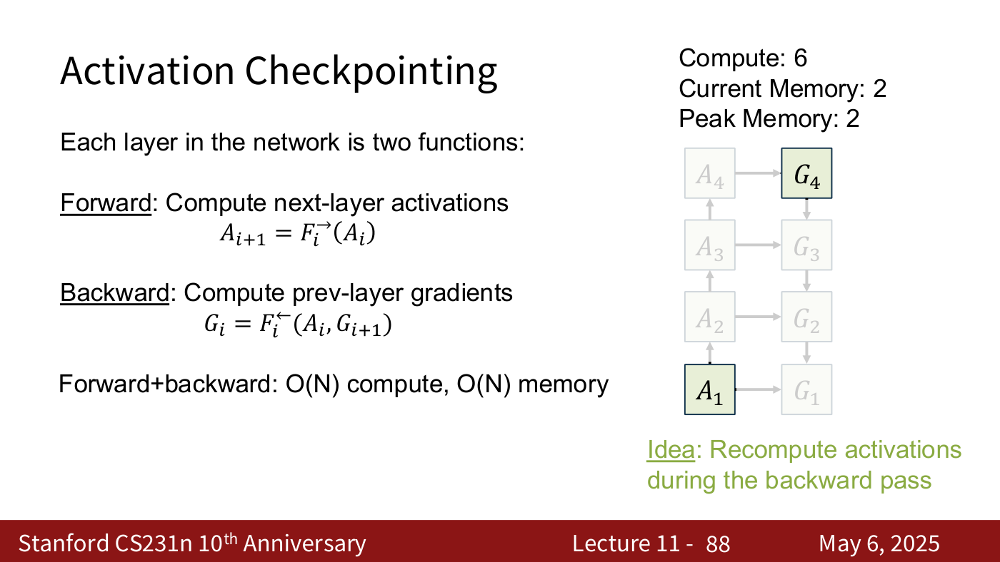

*Slide 88 — full recomputation: after the first gradient G4, A1 is recomputed from scratch to work back towards A3, so only two boxes are ever held (Compute 6, Peak Memory 2). [Deck](https://cs231n.stanford.edu/slides/2025/lecture_11.pdf)*

**Checkpoints.** "Don't recompute everything; save a checkpoint every C layers" (slide 99). Recomputation then happens only within blocks between checkpoints (≈54:42–55:28). The deck gives the costs (slides 100–101):

| Strategy | Compute | Memory |
| --- | --- | --- |
| Forward+backward | $O(N)$ | $O(N)$ |
| Full recomputation | $O(N^2)$ | $O(1)$ |
| $C$ checkpoints | $O(N^2/C)$ | $O(C)$ |
| $\sqrt{N}$ checkpoints | $O(N\sqrt{N})$ | $O(\sqrt{N})$ |

"A pretty common thing to do is to set C equal to root n" (≈55:28). The table also appears on the last build slide (slide 101), whose drawing shows the whole graph with no checkpoints marked.

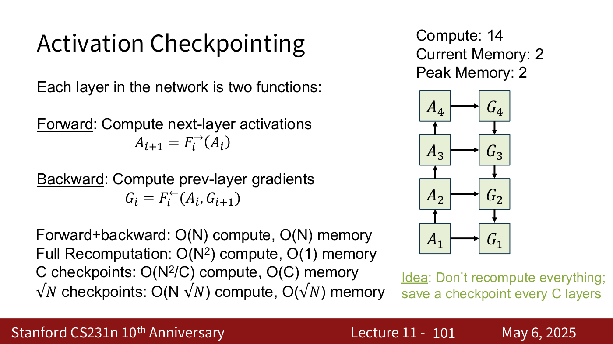

*Slide 101 — the four compute–memory trade-offs, from storing everything to checkpointing every √N layers. [Deck](https://cs231n.stanford.edu/slides/2025/lecture_11.pdf)*

## A scaling recipe

"HSDP + Activation checkpointing can take you a long way!" The slide's recipe has six steps (slide 102). (1) Use data parallelism up to about 128 GPUs and models of about 1B parameters. (2) Always set the per-GPU batch size to max out GPU memory. (3) If the model is over 1B parameters, consider FSDP. (4) Add activation checkpointing to fit larger batches per GPU. (5) With more than 256 GPUs, consider HSDP. (6) With more than 1K GPUs, models over 50B parameters, or sequence lengths over 16K, use the more advanced strategies (CP, PP, TP).

The spoken version is a little looser. HSDP comes in "maybe around 256 GPUs, maybe around 512 GPUs", and the advanced strategies at sequence lengths "more than 10,000 or so" (≈57:01). Activation checkpointing "kind of sucks because it makes everything a lot slower, but it does let you train much bigger models" (≈57:01). This recipe gets you to models of tens of billions of parameters on about a thousand GPUs (≈57:01). The lecturer chose to spend most of the time on these strategies because they are the ones students are likely to use (≈1:02:22–1:03:08). With so many knobs to tune, the answer is to maximize one metric, MFU, "your guiding light" (slide 102; ≈57:46).

## Hardware FLOPs utilization (HFU)

An H100 can theoretically do 989.4 TFLOP/sec of 16-bit matrix multiplies on its Tensor Cores (slide 103). **Hardware FLOPs utilization (HFU)** is "the fraction of theoretical matmul performance we actually achieve" (slide 104). The slide benchmarks the best case, matrix multiply alone. The PyTorch listing times `x @ x` for square bfloat16 matrices of size $N$ from 512 to 32,768, counts $2N^3$ FLOPs, and divides the achieved TFLOP/sec by 989.4. It must run with `CUDA_LAUNCH_BLOCKING=1`, "otherwise GPU kernels launch async and measurements are wrong" (slide 105). The lecturer ran it on an H100 the day before the lecture (≈58:33).

"Large matrix multiply gets ~80% HFU on H100" (slide 106; ≈59:18). The chart rises from about 2% at size 512 to about 81% at 8192 and 16384, and falls to about 70% at 32768 (slide 106). But HFU does not account for activation checkpointing or "helper" computation such as data augmentation, the optimizer and preprocessing (slide 107).

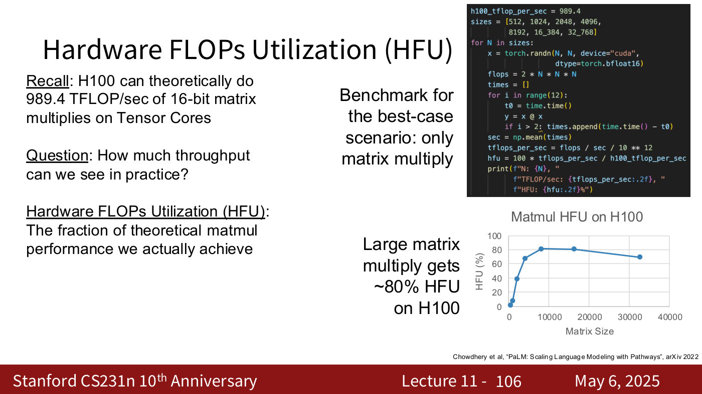

*Slide 106 — the benchmark code and its result: HFU climbs from near zero for 512 x 512 matrices to about 80% from 8192 up, then dips at 32768. [Deck](https://cs231n.stanford.edu/slides/2025/lecture_11.pdf)*

## Model FLOPs utilization (MFU)

MFU asks "What fraction of the GPU's theoretical peak FLOPs is being used for 'useful' model computation?" (slide 108). The slide's recipe follows the PaLM paper's definition (Chowdhery et al., 2022):

1. Compute $\text{FLOP}_ {\text{theoretical}}$, the total matrix-multiply FLOPs of the forward and backward pass. The backward pass can be approximated as twice the forward. Nonlinearities, normalization and elementwise operations such as residuals are ignored, since they run on the FP32 cores.
2. Look up $\text{FLOP/sec}_ {\text{theoretical}}$, the device's theoretical maximum throughput (H100: 989 TFLOP/sec).
3. Compute $t_ {\text{theoretical}} = \text{FLOP}_ {\text{theoretical}} / \text{FLOP/sec}_ {\text{theoretical}}$.
4. Measure $t_ {\text{actual}}$, the actual time for a full iteration of data loading, forward, backward and optimizer step.
5. Then $\text{MFU} = t_ {\text{theoretical}} / t_ {\text{actual}}$.

(slide 108; ≈1:00:04–1:00:49). The difference from HFU is that the measured time includes everything the training loop does, such as data loading, augmentation, communication and recomputation, while the numerator counts only the model's own FLOPs (≈59:18–1:00:49).

The slide's example is a wide MLP: 8 linear layers of width 8192 with ReLU, a batch of 8192, trained with Adam under bfloat16 autocast. Its forward FLOPs are $N \cdot L \cdot 2 D^2$ and its backward twice that, and it "gets ~49% MFU on H100" (slide 109). The lecturer says "around 50%" (≈1:00:49). The lesson is to "Optimize distributed training setup to maximize MFU!" (slide 110).

"MFU >30% is good, >40% is excellent" (slide 111; ≈1:01:35). Far below 30% suggests "some gigantic bottleneck somewhere" (≈1:01:35). The deck's table from the PaLM paper gives the MFU of four large models (slide 112):

| Model | # of Parameters (in billions) | Accelerator chips | Model FLOPS utilization |
| --- | --- | --- | --- |
| GPT-3 | 175B | V100 | 21.3% |
| Gopher | 280B | 4096 TPU v3 | 32.5% |
| Megatron-Turing NLG | 530B | 2240 A100 | 30.2% |
| PaLM | 540B | 6144 TPU v4 | 46.2% |

Llama3-405B, trained on H100s, reaches 43% BF16 MFU (430 TFLOPs per GPU) on 8,192 GPUs, and 41% (400) and 38% (380) in two configurations on 16,384 GPUs (slide 112). The lecturer describes these as "roughly in the high 30s, low 40s", and adds that "you're never going to get really much higher than that on an H100" (≈1:01:35).

Paradoxically, "More recent devices sometimes get *worse* MFU since their peak FLOPs increases much faster than their memory bandwidth". From the A100 to the H100, FLOPs grew 3.1x and memory bandwidth 2.1x (slide 113). On A100s, the lecturer says, MFU above 50% was sometimes possible (≈1:02:22).

## Context parallelism (CP)

Transformers operate on sequences, so multiple GPUs can process a single long sequence, each handling part of it (slide 116; ≈1:03:08). The question is what each part of a transformer block needs. The slides answer for a block split between two GPUs, two tokens each (slides 116–119):

- **Normalization and residual connections** are easy. They have no weights and are trivially parallelizable over the sequence (slide 117).
- **The MLP** is trivially parallelizable but has weights. Each GPU keeps a copy and the gradients are communicated as in data parallelism (slide 118).
- **Attention** is "more complex", since every token interacts with every other (slide 119; ≈1:03:55).

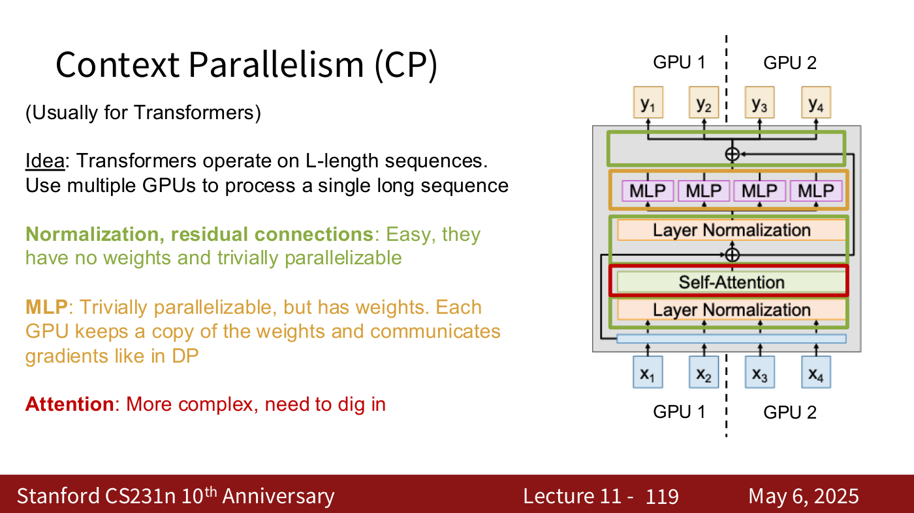

*Slide 119 — a transformer block split down the middle between two GPUs: normalization and residuals (green) and the MLP (gold) parallelize over the sequence, attention (red) does not. [Deck](https://cs231n.stanford.edu/slides/2025/lecture_11.pdf)*

Inside attention, the QKV projection is "Same as MLP": parallelize over the sequence and synchronize gradients as in data parallelism (slide 121). The attention operator itself is "Hardest to parallelize" (slide 122). See [attention](attention.md) for the operator.

**Option 1: ring attention.** "Divide into blocks and distribute over GPUs. Inner loop over keys/values, outer loop over queries. Complex to implement but can scale to very long sequences" (slide 123, citing Liu et al., 2023). The figure splits the attention matrix into one vertical strip per query. The lecturer leaves the details to the paper (≈1:03:55–1:04:41).

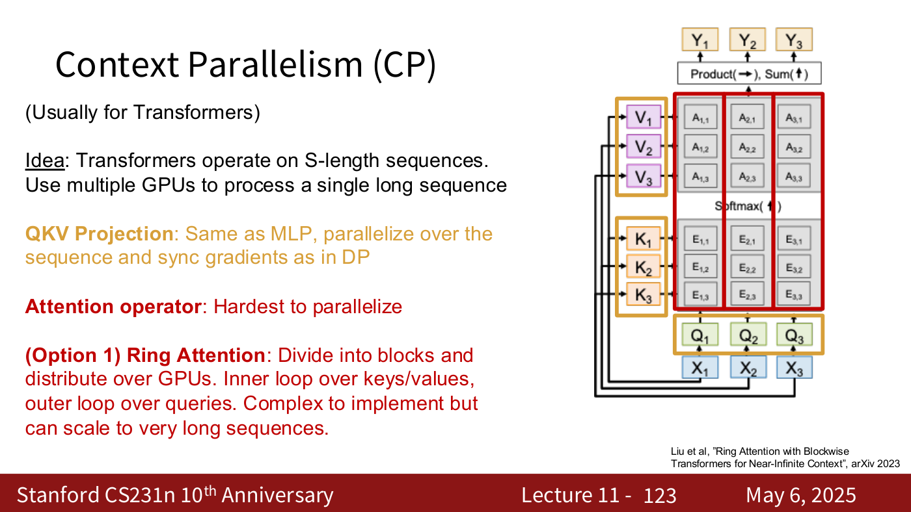

*Slide 123 — ring attention: the attention matrices are cut into blocks (red strips) that different GPUs work through, while the QKV projections (gold) split over the sequence like an MLP. [Deck](https://cs231n.stanford.edu/slides/2025/lecture_11.pdf)*

**Option 2: Ulysses.** "Don't try to distribute attention matrix, instead parallelize over heads in multihead attention. Simpler, but max parallelism = number of heads" (slide 124, citing Jacobs et al., 2023). Everything else in the transformer stays split over the sequence (≈1:04:41).

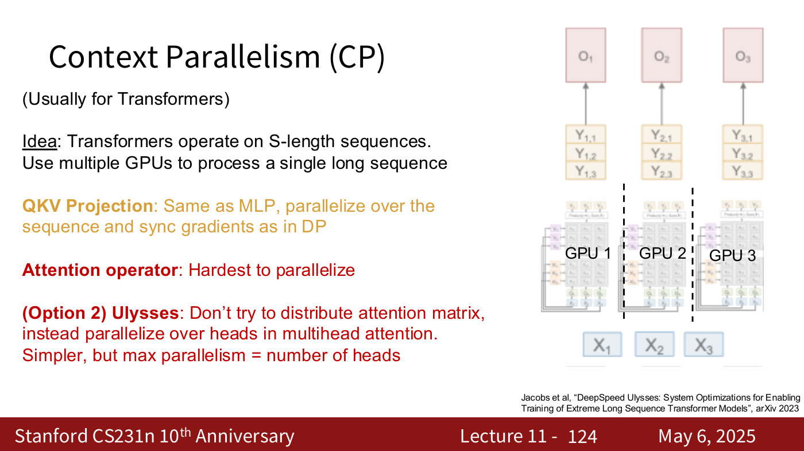

*Slide 124 — Ulysses: three faded copies of the attention diagram, one per GPU, each with its own stack of outputs (Y1,1 to Y3,3) feeding an output box O1, O2 or O3; the split is over attention heads, not over the attention matrix. [Deck](https://cs231n.stanford.edu/slides/2025/lecture_11.pdf)*

Context parallelism is "Often used for long-sequence finetuning". Llama3-405B trained in two stages. Stage 1 used $S = 8192$ with no context parallelism. Stage 2 used $S = 131{,}072$ with 16-way context parallelism, 8192 tokens per GPU (slide 125; ≈1:05:27). The lecturer puts it as a batch size of "like 1 over 16", since each GPU works on less than one sequence (≈1:05:27).

## Pipeline parallelism (PP)

"Split the layers of the model across GPUs. Copy activations between layers at GPU boundaries" (slide 128, citing Huang et al.'s GPipe, 2018). The slides put eight layers on four GPUs, two each. The problem is sequential dependency, so the "GPUs are mostly sitting idle" (slide 129). The schedule diagram shows it. GPU 1 runs forward, then GPU 2, GPU 3 and GPU 4. GPU 4 runs backward at once, and the gradients pass back up to GPU 1. Each GPU is busy for 2 of 8 time steps, so the "Max MFU with N-way PP is 1/N" (slide 130; ≈1:06:13–1:06:59). With 8-way pipeline parallelism that is about 12%, "which is terrible" (≈1:06:59). The idle region is called the **bubble** (slide 131; ≈1:06:59).

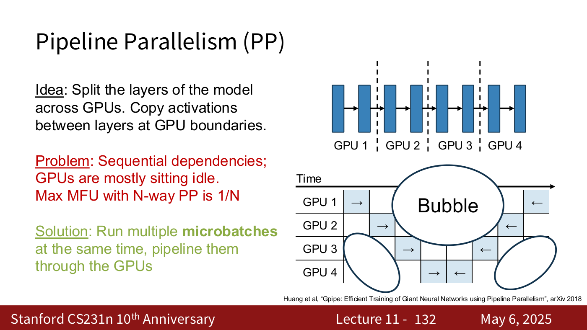

*Slide 132 — the pipeline bubble: on four GPUs one batch keeps each GPU busy for 2 of 8 time steps, and the empty cells, circled, are idle time. [Deck](https://cs231n.stanford.edu/slides/2025/lecture_11.pdf)*

The solution is to run multiple **microbatches** at the same time, pipelining them through the GPUs (slide 132). With 4-way pipeline parallelism and 4 microbatches, the schedule spans 14 time steps. GPU 1 runs the four forward passes in steps 1–4 and the four backward passes in steps 11–14, and each later GPU starts one step later. The maximum MFU rises "from 1/4 = 25% to 16/28 ≈ 57.1%" (slide 133; ≈1:07:45–1:08:31). The slide colours the microbatches blue, orange, green and red; the lecturer calls the second one yellow (≈1:07:45). More microbatches shrink the bubble, but each has to keep its activations in memory, which brings back activation checkpointing and more knobs to tune against MFU (≈1:08:31).

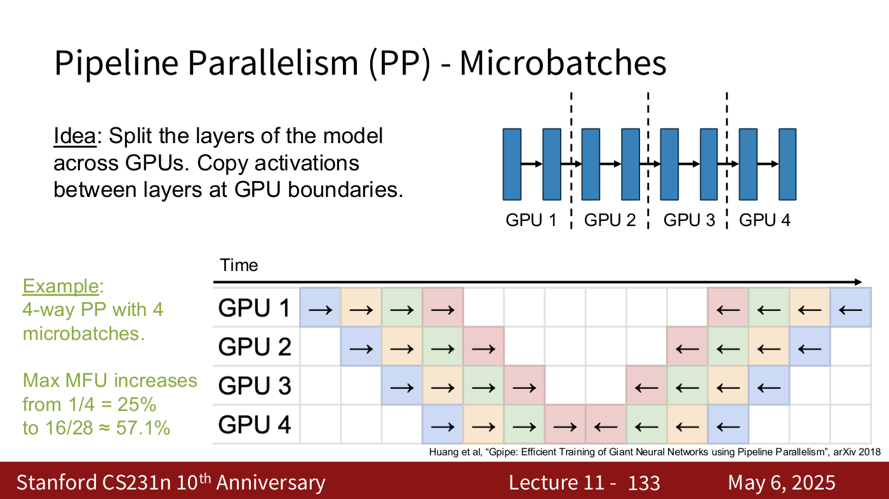

*Slide 133 — 4-way pipeline parallelism with 4 microbatches (one colour each): forward passes cascade down the GPUs, backward passes cascade back, and 32 of the 56 cells are busy. [Deck](https://cs231n.stanford.edu/slides/2025/lecture_11.pdf)*

## Tensor parallelism (TP)

"Split the weights of each linear layer across GPUs, use block matrix multiply" (slide 135). A layer computes $XW = Y$, with $X$ and $Y$ of shape $N \times D$ and $W$ of shape $D \times D$. With 4-way tensor parallelism, $W$ is split into four column blocks $W_1, \dots, W_4$, and GPU $i$ computes $XW_i = Y_i$, one column block of the output (slide 136; ≈1:09:16). Unlike FSDP, a single weight matrix is split across GPUs (≈1:09:16). The problem is that the parts of $Y$ must be gathered after the forward pass, and that cannot overlap with communication (slide 137; ≈1:10:03).

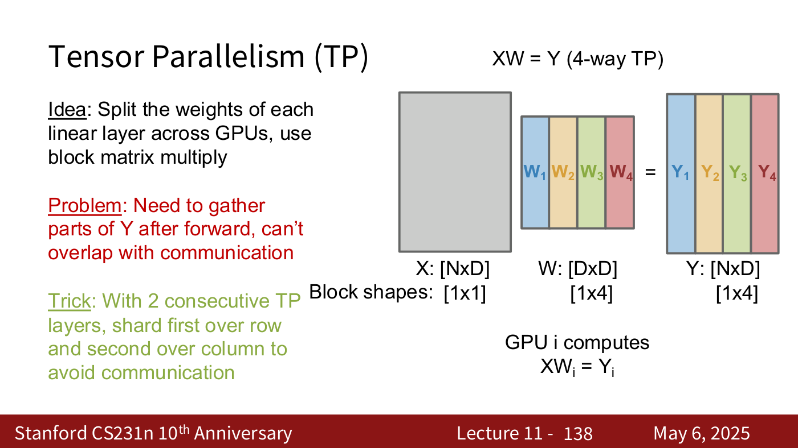

*Slide 138 — one layer, 4-way TP: W is cut into four column blocks (one colour per GPU), so each GPU produces one column block of Y, which must then be gathered. [Deck](https://cs231n.stanford.edu/slides/2025/lecture_11.pdf)*

The trick: "With 2 consecutive TP layers", shard the two matrices differently "to avoid communication" (slide 138). Take two layers, $XW = Y$ and then $YU = Z$, with $U$ of shape $D \times D$. Split $W$ into column blocks as before, so GPU $i$ holds $Y_i$, and split $U$ into row blocks $U_1, \dots, U_4$. Block matrix multiplication then gives

$$Z = Y_1 U_1 + Y_2 U_2 + Y_3 U_3 + Y_4 U_4$$

so GPU $i$ computes $Y_i U_i = Z_i$ (slides 140–142). There is "No need for communication after XW=Y! Each GPU computes one term of Z, then broadcasts to all other GPUs" (slide 143). The GPUs communicate only every two layers (≈1:10:03–1:10:50). The slide's words name the shardings the other way round from its drawing (see the slips below). This fits transformers well, because their FFN is a two-layer MLP, and the trick is common on the MLPs of big transformers (≈1:10:50).

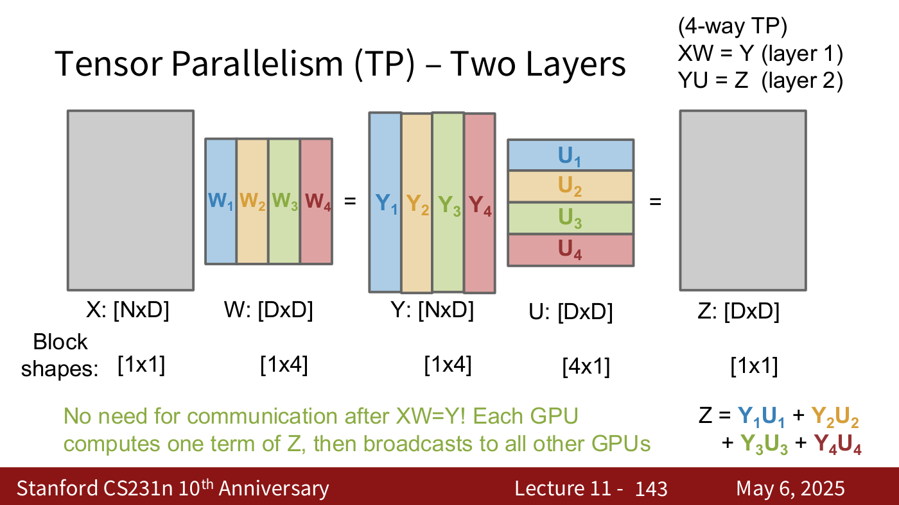

*Slide 143 — two layers, 4-way TP: W split into column blocks and U into row blocks (matching colours), so each GPU computes one term of Z (YiUi on the slide) without communicating in between. [Deck](https://cs231n.stanford.edu/slides/2025/lecture_11.pdf)*

## ND parallelism

"Q: Which to use for largest models?" "A: All of them!" (slide 145). "Use TP, CP, PP, and DP all at the same time!" The GPUs are arranged in a 4D grid, a GPU's index in the grid gives its rank along each parallelism dimension, and the setup is optimized to maximize MFU (slide 146; ≈1:10:50). The slide's diagram labels 16 GPUs with ranks along the four axes, two along each.

Llama3-405B's configurations (slide 146):

| GPUs | TP | CP | PP | DP | Seq. Len. | Batch size/DP | Tokens/Batch | TFLOPs/GPU | BF16 MFU |
| --- | --- | --- | --- | --- | --- | --- | --- | --- | --- |
| 8,192 | 8 | 1 | 16 | 64 | 8,192 | 32 | 16M | 430 | 43% |
| 16,384 | 8 | 1 | 16 | 128 | 8,192 | 16 | 16M | 400 | 41% |
| 16,384 | 8 | 16 | 16 | 8 | 131,072 | 16 | 16M | 380 | 38% |

In each row the GPU count is the product of the four degrees, for example $8 \times 16 \times 16 \times 8 = 16{,}384$, and every configuration processes about 16M tokens per batch. The biggest run, the last row, is the one the lecturer describes: "8-way tensor parallelism, 16-way context parallelism, 16-way pipeline parallelism, and 8-way data parallelism all at the same time" (≈1:11:36). The axes have different communication needs, so placing them carefully on the cluster takes advantage of its different link speeds (≈1:11:36).

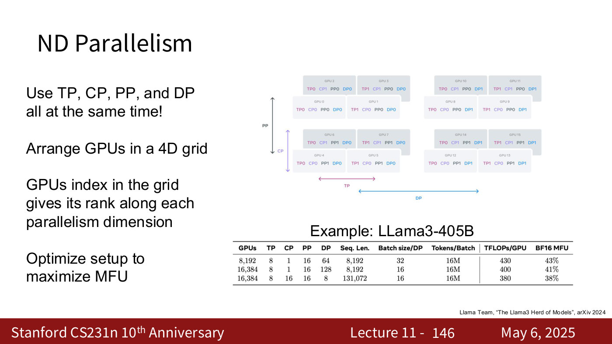

*Slide 146 — 4D parallelism: 16 GPUs, each labelled with its rank along TP, CP, PP and DP (two of each), beside Llama3-405B's three training configurations. [Deck](https://cs231n.stanford.edu/slides/2025/lecture_11.pdf)*

## Summary

The summary slide restates the lecture (slide 147). A GPU is a parallel processor with hundreds of cores, and a GPU cluster has $O(10\text{K})$ GPUs. Computation is split along different axes of a model with many layers working on tensors of shape (Batch, Seq, Dim): data parallelism splits the batch, context parallelism the sequence, pipeline parallelism the layers, and tensor parallelism the model dimension. Activation checkpointing saves memory by recomputing during the backward pass. The parallelism recipe is tuned to maximize MFU. The lecturer closes: "let me know so I can borrow your tens of thousands of GPUs" (≈1:12:21).

## Printed slips and oddities

The deck's slips are kept as printed in the slide file, each with an `[Ed:]` note:

- **Slide 25** gives the cluster's memory as "1.875 PB". That is 24,576 GPUs times 80 GB in binary units. In decimal units it is about 1.97 PB.
- **Slides 46–64** are titled "Fully Sharded Data Parallelism (FSPD)", and the ZeRO citation spells the first author "Rajbhandrari".
- **Slide 68** lists the four numbers per parameter as "param, grad, Adam β1, β1", where slide 44 has "β1, β2".
- **Slide 69's** 63GB is $2 \times 126 \times (4 \times 16384) \times 4096 = 67{,}645{,}734{,}912$ bytes in binary units (67.6 GB decimal). Its sequence length of 4096 differs from the 8192 that slides 125 and 146 give for Llama3-405B's first stage.
- **Slide 98's** checkpointing counter prints "Current Memory: 2" while one box is drawn, where slides 96–97 print 1. Slides 100–101 draw all eight boxes but keep the counter at 14, 2 and 2.
- **Slide 112's** Llama3-405B rows divide 430, 400 and 380 TFLOPs by 989.4 to 43.5%, 40.4% and 38.4%. The printed 41% for the second row does not follow from the rounded 400 shown. The table comes from the Llama 3 paper.
- **Slide 138** says to shard the first layer "over row" and the second "over column", but the drawing (slides 140–143) splits the first matrix into column blocks and the second into row blocks. The lecturer also says column chunks first, then row chunks (≈1:10:03).
- **Slides 139–143** label Z "[DxD]". With $Y$ of shape $N \times D$ and $U$ of shape $D \times D$, $Z = YU$ is $N \times D$, which is how it is drawn.

There are also a few spoken slips. The lecturer says "B100" for the B200 (≈13:59), "GPU 3, GPU 2" for the owner of $W_3$ and $W_4$ (≈41:38), and "a second group of two GPUs" for the second group of four in HSDP (≈50:08). The answer about Llama 3's activations names the model unclearly in the captions, "Llama [unclear: 35B]" (≈52:24).

## Next time

Self-supervised learning (slide 148, not reached in the recording).

## Related pages

- [Distributed training](distributed-training.md) — the strategies of this lecture side by side: what each splits, what it communicates, when to use it.
- [Optimizers](optimizers.md) — Adam's two moment estimates, which are two of the four numbers kept per weight.
- [Backpropagation](backpropagation.md) — why the backward pass needs the forward pass's activations, which activation checkpointing recomputes.
- [Gradient descent](gradient-descent.md) — minibatch SGD, which data parallelism spreads over GPUs.
- [Transformers](transformers.md) — the block that context and tensor parallelism split up.
- [Attention](attention.md) — the operator that ring attention and Ulysses parallelize.
- [Language models](language-models.md) — GPT-4 and Llama 3, the lecture's examples.
- [Course logistics](course-logistics.md) — the course roadmap, and the midterm dates on slide 2.
- Previous lecture: [Lecture 10 — Video Understanding](10-video-understanding.md).
