# Lecture 12 — Self-Supervised Learning

**CS231N Deep Learning for Computer Vision, Stanford, Spring 2025.** Delivered May 8, 2025. The lecturer is not named in the recording or on the deck. Sources: the [deck](https://cs231n.stanford.edu/slides/2025/lecture_12.pdf) (115 pages, printed numbers 1–117; printed 112 and 113 are hidden, so the last four slides are PDF pages 112–115), its [slide-by-slide text](../raw/slides/12-self-supervised-learning.md), and the [edited transcript](../raw/transcripts/12-self-supervised-learning.md).

## What this lecture establishes

The features a trained network computes are good representations of images, good enough that a linear model on top of them can classify. But training such a network the usual way needs a label for every image, and at scale that labelling is the bottleneck. **Self-supervised learning** removes it. You invent a *pretext task* whose labels come from the data itself, such as predicting how an image was rotated, filling in a masked region, or restoring colour. You train an encoder on that task over a large unlabelled data set, then reuse the encoder for the *downstream task* you actually care about, where only a few labels are available.

The lecture covers two families of pretext task. The first transforms an image and asks the network to undo or recognise the transformation: rotation prediction, relative patch location, jigsaw puzzles, inpainting, colourisation, colourisation of video (from which tracking emerges), and finally the **masked autoencoder** (MAE), which the lecturer calls one of the most used pre-training frameworks today. The second family, **contrastive representation learning**, asks for representations in which transformed copies of the same image are close together and different images are far apart. Its loss, **InfoNCE**, turns out to be a cross-entropy loss over one positive and many negative samples. **SimCLR** and **MoCo** are the two instance-level methods worked through. The deck continues to sequence-level contrastive learning (CPC), MoCo v3, DINO and DINOv2, but the recording stops before them.

The topic page [self-supervised learning](self-supervised-learning.md) sets the methods side by side.

**What the recording covers.** The recording opens with a recap of the previous lectures (≈0:05) and does not present the administrative slide, which announces the midterm on Tuesday 5/13 during lecture time, a midterm review section on Friday 5/9 at 12:30 pm, and project proposal feedback on Gradescope (slide 2; see [course logistics](course-logistics.md)). It then follows the deck: the recap and the cost of labels (≈0:05–4:00), pretext and downstream tasks (≈4:00–10:14), evaluation and the broader picture (≈10:14–14:55), rotation prediction (≈14:55–22:41), relative patch location and jigsaw puzzles (≈22:41–26:36), inpainting (≈26:36–31:13), colourisation and split-brain autoencoders (≈31:13–36:41), video colourisation and tracking (≈36:41–40:37), a run of student questions (≈40:37–46:01), masked autoencoders (≈46:01–53:43), a summary of pretext tasks with two more questions (≈53:43–58:26), contrastive learning and InfoNCE (≈58:26–1:05:27), SimCLR (≈1:05:27–1:10:54), and MoCo and MoCo v2 (≈1:10:54–1:13:17). There the lecturer says "So I will stop here" (≈1:13:17), names contrastive predictive coding, MoCo v3 and DINO "as another example that you can look at in the slides", and ends at 1:14:04. The deck's slides from contrastive predictive coding onward, and its appendix after the "Next time" slide, are therefore sourced to the slides alone; they are collected [below](#beyond-the-recording-slides-only).

## The problem: good features need labels

The lecture starts from what earlier lectures showed. Nearest neighbours in pixel space retrieve images that look alike in colour and layout but not in content. Nearest neighbours in the feature space of a trained network, using L2 distance on a fully connected layer's activations, retrieve images of the same category (slide 6; ≈0:53–1:39). The figures are from Krizhevsky et al.'s AlexNet paper, and the feature is the "4096-dim vector" of its last hidden layer. These learned representations go by many names, "features, embeddings, latent space and so on" (≈2:24), and a simple linear model can read class labels out of them (≈3:12).

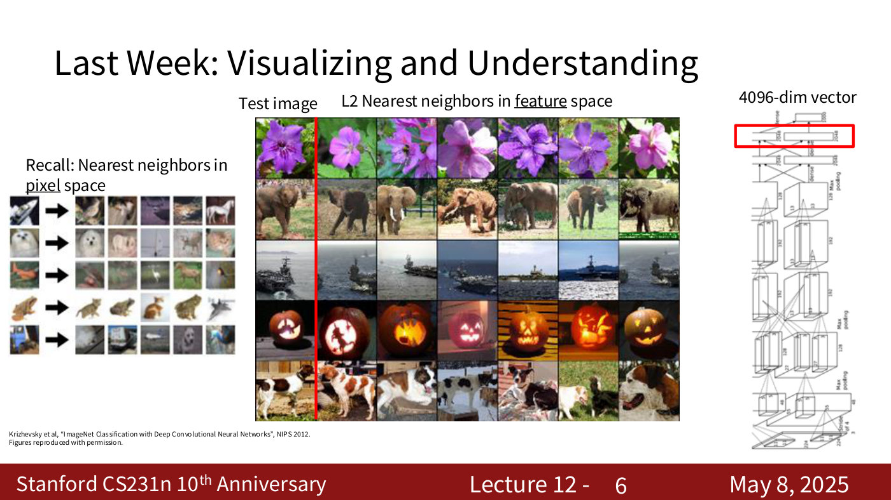

*Slide 6 — nearest neighbours in pixel space (left) retrieve look-alikes; in the feature space of a trained network (centre) they share the category. [Deck](https://cs231n.stanford.edu/slides/2025/lecture_12.pdf)*

The previous lecture's visualizations are recalled as well: heat maps over a schooner and an elephant, and two maps under photos of a dog and a fruit (slide 5). The slide does not say what each kind of map is.

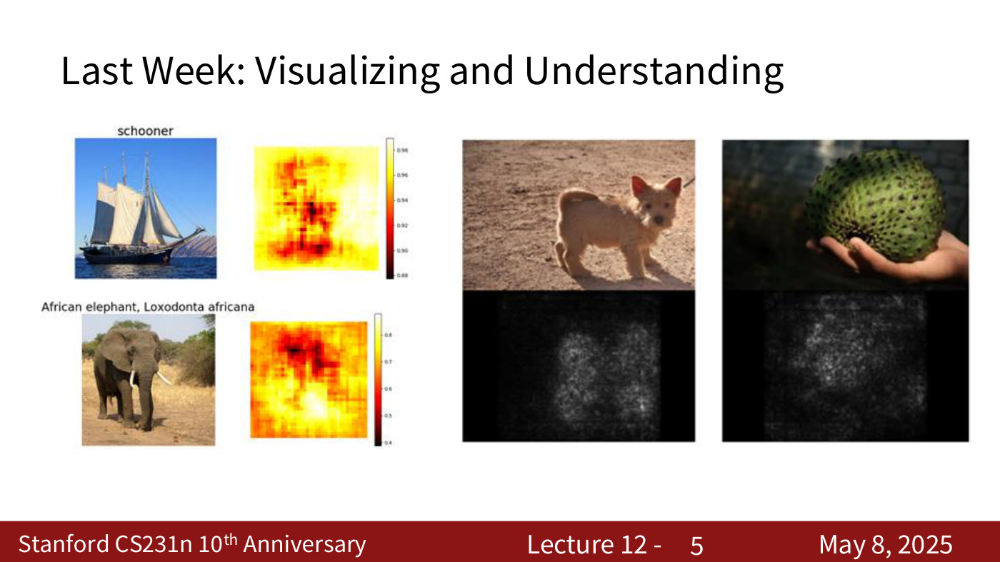

*Slide 5 — last week's visualizations recalled: heat maps over a schooner and an elephant, and maps under a dog and a fruit; the slide does not label them. [Deck](https://cs231n.stanford.edu/slides/2025/lecture_12.pdf)*

The catch is in how such a network is trained: from images to class labels, so at scale "we need a lot of labeled data" (slide 8). For segmentation "you have to label the pixels one by one in every image" (≈4:00). The slide asks: "Is there a way we can train neural networks without the need for huge manually labeled datasets?" (slide 8; ≈4:00).

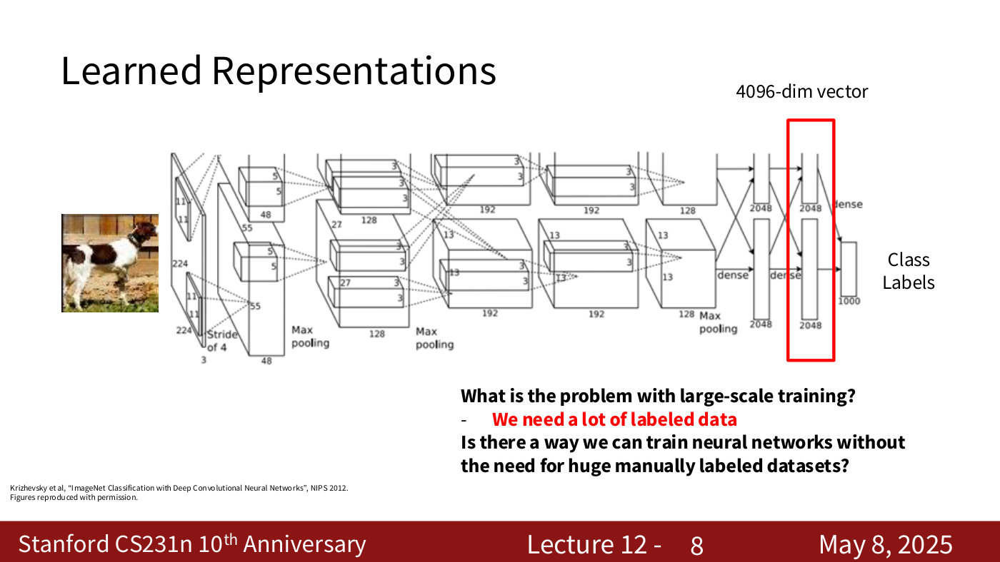

*Slide 8 — the 4096-dim feature (red box) comes from training to class labels, and that needs a lot of labelled data. [Deck](https://cs231n.stanford.edu/slides/2025/lecture_12.pdf)*

## Pretext tasks and downstream tasks

Self-supervised learning splits training into two stages (slide 9). The **pretext task** is defined "based on the data itself", needs "no manual annotation", and "could be considered an unsupervised task", "but we learn with supervised learning objectives, e.g., classification or regression." The **downstream task** is "the application you care about": "You do not have large datasets", and "the dataset is labeled." An encoder trained on a large unlabelled data set with the pretext objective is carried over to the downstream objective (slide 9; ≈4:46). The lecturer's example: train on natural images downloaded from the internet, then transfer to an industrial or medical application with few labelled images (≈5:34).

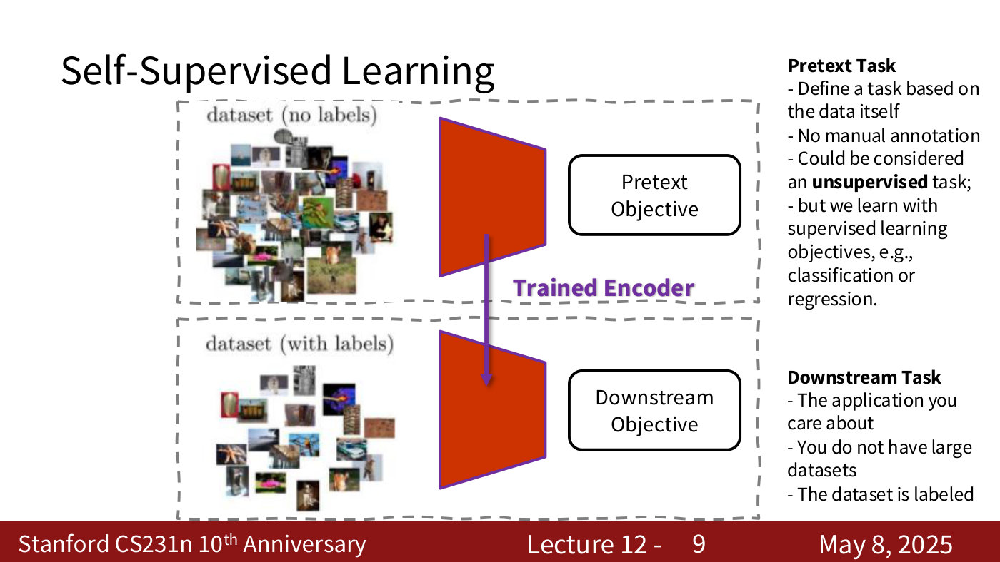

*Slide 9 — the two stages: a pretext objective on unlabelled data trains the encoder, which is carried over to the downstream objective on labelled data. [Deck](https://cs231n.stanford.edu/slides/2025/lecture_12.pdf)*

In the pretext stage the encoder produces a learned representation, and a second module, labelled "Decoder, Classifier, Regressor", maps it to "labels/outputs automatically generated from data" (slide 10). What that second module is depends on the pretext task; when it decodes back to an image, "this is more of an autoencoding framework" (≈7:06).

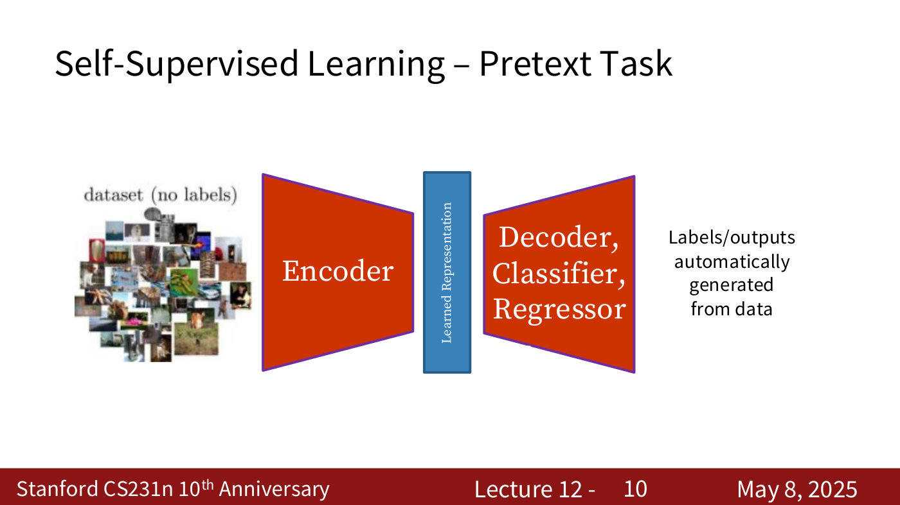

*Slide 10 — pretext task: an encoder, its learned representation, and a decoder, classifier or regressor whose targets are generated from the data. [Deck](https://cs231n.stanford.edu/slides/2025/lecture_12.pdf)*

For the downstream task the second module is dropped and a small head, drawn as an FC layer, is trained on the labels (slide 11). That head is "one layer, or even a fully connected neural network, a linear function or a fully connected neural network" (≈7:54).

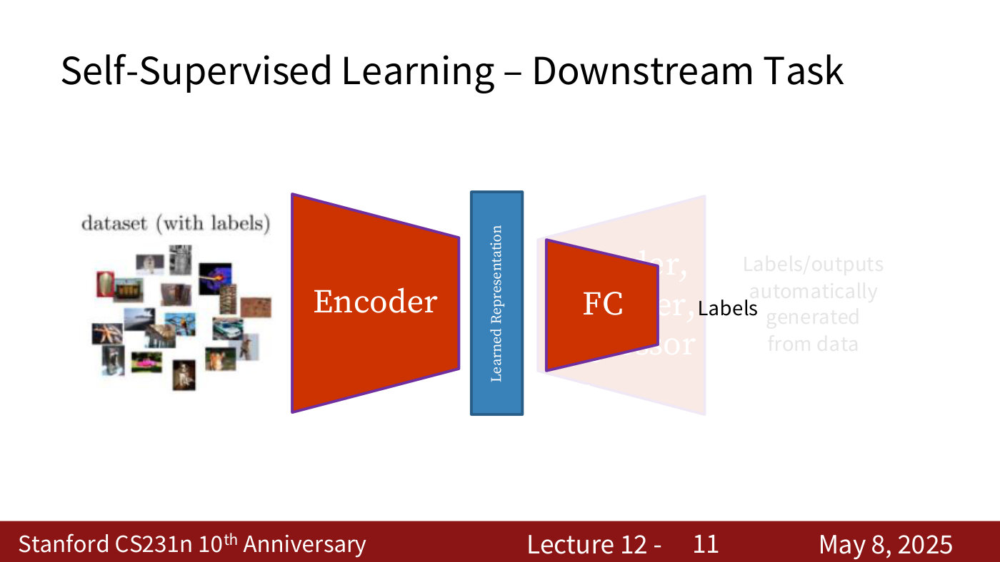

*Slide 11 — downstream task: the pretext head fades out and a small FC head is trained on the labels. [Deck](https://cs231n.stanford.edu/slides/2025/lecture_12.pdf)*

A good pretext task has two properties, both on slide 12: "Solving the pretext tasks allow the model to learn good features", and "We can automatically generate labels for the pretext tasks." The same slide shows the four the lecture covers first, on a photo of a cat: image completion, rotation prediction, a "jigsaw puzzle", and colourisation (≈8:40–9:27). As the lecturer puts it, "the labels should come from the data itself" (≈8:40).

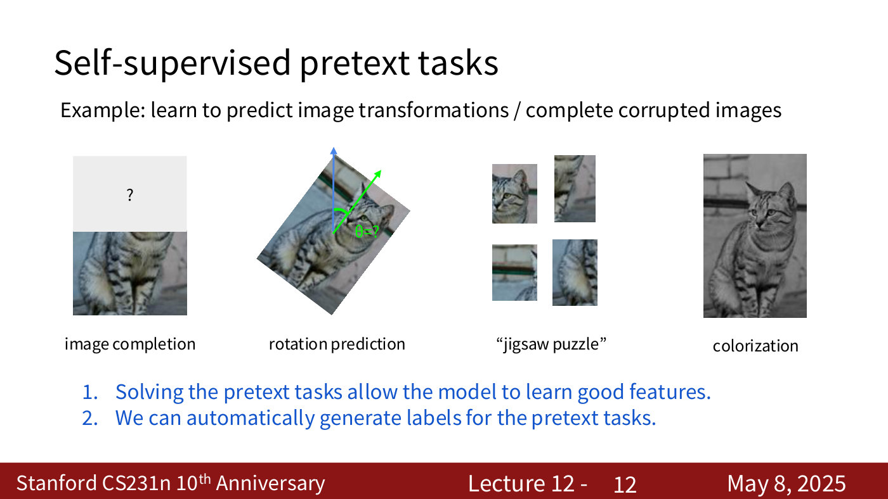

*Slide 12 — four pretext tasks on one cat photo: image completion, rotation prediction, jigsaw puzzle and colourisation. [Deck](https://cs231n.stanford.edu/slides/2025/lecture_12.pdf)*

## How to evaluate a self-supervised method

Slide 13 lists five criteria: pretext task performance; representation quality (a linear classifier on the learned representations, which the slide calls the "Linear Evaluation Protocol", clustering, and t-SNE visualisation); robustness and generalization; computational efficiency; and "Transfer Learning and Downstream Task Performance", the one the slide boxes. In the lecture, "the most important aspect that we are after is the performance on the downstream task" (≈11:49).

The evaluation pipeline has two steps (slide 15). First, learn a feature extractor (for example a convnet) from lots of unlabelled data with a pretext task, such as predicting image rotations. Second, attach a shallow network to the feature extractor and train only that network on a small amount of labelled data for the target task, then evaluate on the target task, "e.g. classification, detection". A shallow head is enough "because if the features are good enough then we don't need to do a lot of training on getting the class labels out" (≈13:22). The two ways of using the encoder downstream, linear probing and fine-tuning, are defined with the masked autoencoder [below](#masked-autoencoders-mae).

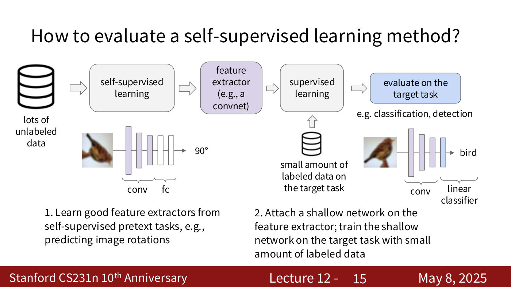

*Slide 15 — evaluation: learn a feature extractor with a pretext task, then train a shallow head on a little labelled data and evaluate on the target task. [Deck](https://cs231n.stanford.edu/slides/2025/lecture_12.pdf)*

## The broader picture

Self-supervised learning is not only a vision technique (slide 16). The slide's examples are computer vision (Doersch et al., 2015, the relative-patch task below), language modeling (the GPT-4 technical report), speech synthesis (WaveNet), and robot and reinforcement learning (Dense Object Net). In the lecturer's words, "this paradigm of self-supervised learning was actually what enabled all of these large language models" (≈13:22), and it is used in speech and increasingly in robotics, because raw data can be collected without labelling: "that's why you see so many self-driving cars in the Bay Area collecting data" (≈14:09).

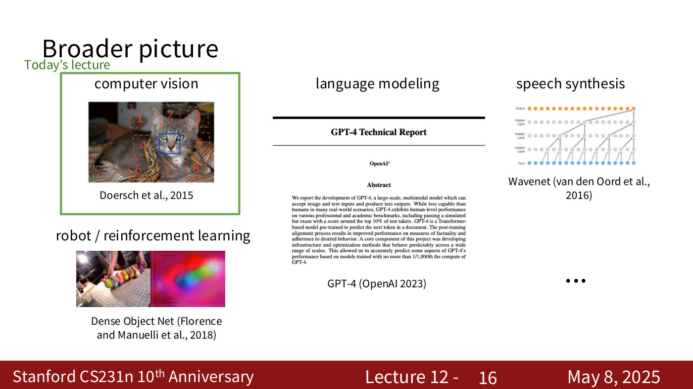

*Slide 16 — self-supervised learning beyond vision: language modeling (GPT-4), speech synthesis (WaveNet) and robot learning (Dense Object Net); the boxed panel is today's lecture. [Deck](https://cs231n.stanford.edu/slides/2025/lecture_12.pdf)*

## Pretext tasks from image transformations

### Predicting rotations

The hypothesis: "a model could recognize the correct rotation of an object only if it has the "visual commonsense" of what the object should look like unperturbed" (slide 19; ≈15:42). The examples are from Gidaris et al. (2018).

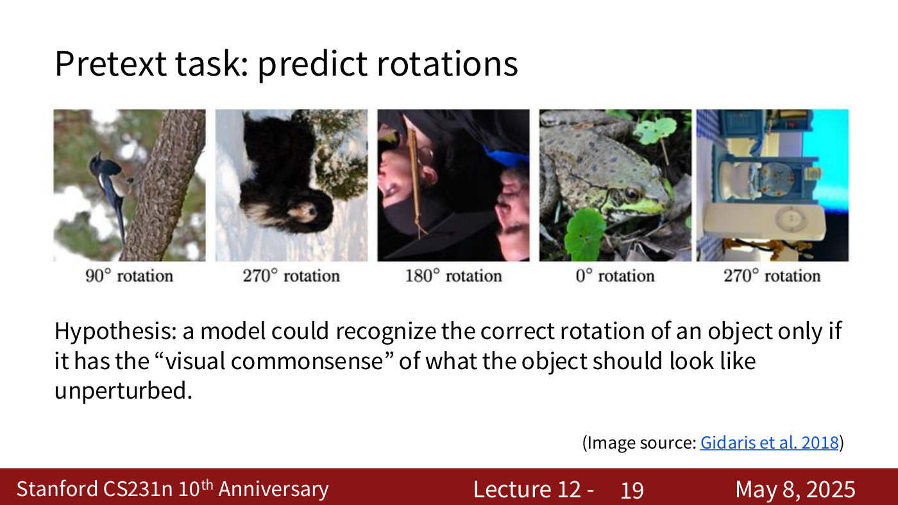

*Slide 19 — rotation prediction: each photo is captioned with the rotation that was applied. [Deck](https://cs231n.stanford.edu/slides/2025/lecture_12.pdf)*

Each image $X$ is rotated by one of four angles, $g(X, y)$ with $y = 0, 1, 2, 3$ for 0, 90, 180 and 270 degrees, and a ConvNet $F(\cdot)$ is trained to say which rotation was applied: "4-way classification" (slide 21). Because there are only four outputs, "It doesn't have to predict the exact value of the angle" (≈17:16). (The caption of ≈16:29 lists the angles as "0, [unclear: 19], 90, 180 and 270"; the slides draw four.)

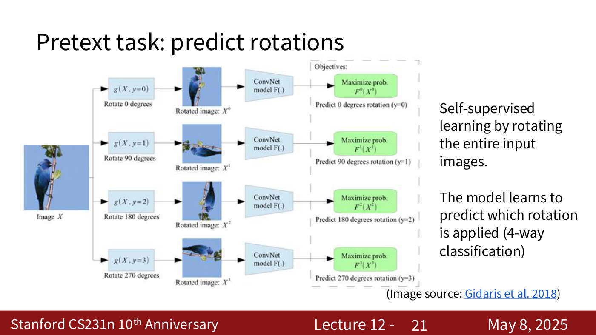

*Slide 21 — RotNet: four rotated copies of each image, one ConvNet, and a 4-way objective to say which rotation was applied. [Deck](https://cs231n.stanford.edu/slides/2025/lecture_12.pdf)*

On CIFAR10, the rotation network is pre-trained on the entire training set; then conv1 and conv2 are frozen and conv3 and the linear layers are trained on a labelled subset (slide 22; ≈18:03). Test accuracy against the number of training examples, read off the chart, is about 65 for the semi-supervised curve against 38 for the one labelled "Supervised" at 20 examples, and about 76 against 63 at 100. The curves meet between 1000 and 5000 examples, and at 5000 the supervised curve ends slightly higher (about 93 against 91.5). The lecturer's reading: the pre-trained model "starts with a good accuracy", and "If the task is simple enough, the supervised version, the fully supervised version and the one that starts with pre-training often converge to the same number, same accuracy" (≈18:03–18:48).

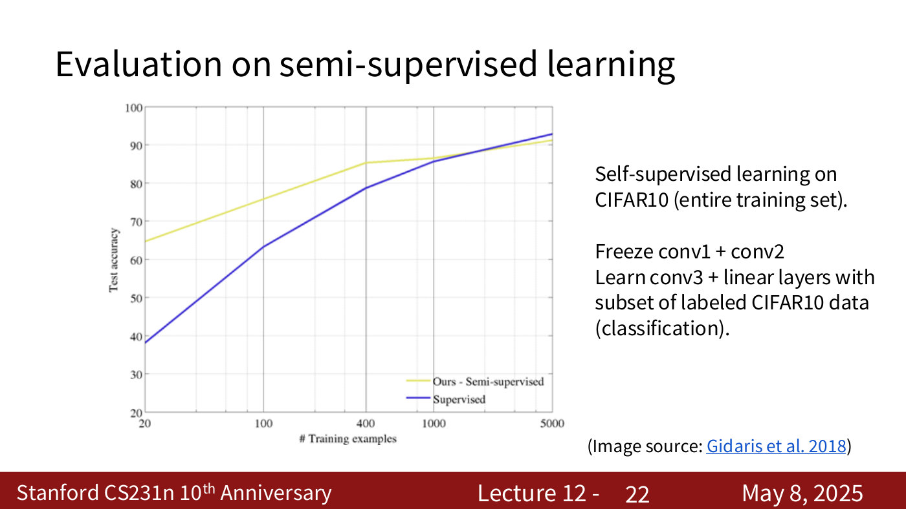

*Slide 22 — CIFAR10: the rotation-pretrained curve is far above the supervised one with few labelled examples; the curves cross between 1000 and 5000. [Deck](https://cs231n.stanford.edu/slides/2025/lecture_12.pdf)*

Transferred from ImageNet to Pascal VOC 2007 with AlexNet, rotation pre-training (RotNet) gives 72.97 %mAP for classification when all layers are fine-tuned, 54.4 %mAP for detection and 39.1 %mIoU for segmentation. Pre-training on full ImageNet labels gives 79.9, 56.8 and 48.0, and random initialization gives 53.3, 43.4 and 19.8 (slide 23). RotNet's row is the highest of the self-supervised methods in the table; only the ImageNet-labels row is above it. In the lecturer's words, against random initialization "the difference is huge", and rotation pre-training "is not equal but it's close to pre-training on the entire ImageNet" (≈21:08). The lecturer calls the data set "Pascal VOC 2017" (≈19:34); the slides print 2007.

The learned features can also be inspected by projecting them back to the image, as with the attention-based visualizations of [lecture 9](09-detection-segmentation-visualization.md) (≈21:55). Slide 24 sets attention maps of a supervised model beside those of the self-supervised model, at conv1, conv3 and conv5, for three photos. The supervised model's maps are more focused "because it's only trying to solve one single task of classification", while the self-supervised model's cover more of the image, "because it has to have a more holistic understanding of the image, because we don't know what the downstream task is" (≈21:55–22:41).

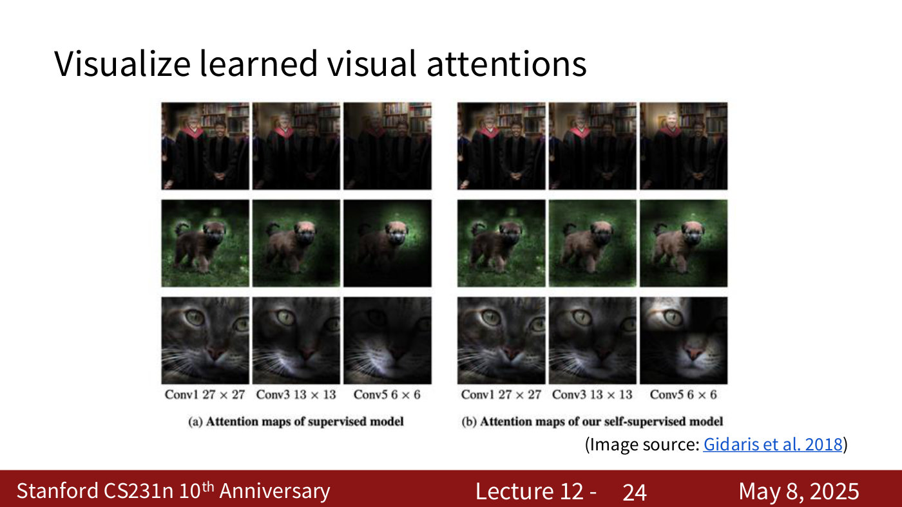

*Slide 24 — attention maps at conv1, conv3 and conv5: the supervised model (left) against the rotation-trained model (right). [Deck](https://cs231n.stanford.edu/slides/2025/lecture_12.pdf)*

### Relative patch location

Cut a 3 x 3 grid of patches around a centre patch and ask the network where a second patch sits relative to the centre (slide 25; Doersch et al., 2015). The slide's example pairs the cat's face (the centre patch) with its ear, and the answer is position 3 of 8, printed $Y = 3$. With eight possible positions, "this also turns out to be an eight-way classification task" (≈23:30). The slide ends with two unanswered examples, "Question 1" (two patches of a bus) and "Question 2" (rail tracks and a landscape); no answers are printed and none is given in the lecture.

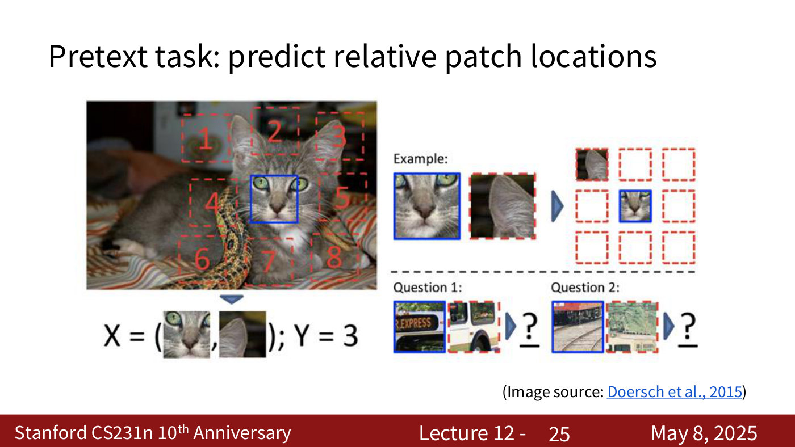

*Slide 25 — relative patch location: which of the eight positions around the centre does the second patch come from? The two questions at right have no printed answers. [Deck](https://cs231n.stanford.edu/slides/2025/lecture_12.pdf)*

### Jigsaw puzzles

A follow-up turns the patch task into a jigsaw puzzle: shuffle all nine patches of the 3 x 3 grid and predict the permutation (slide 26; Noroozi and Favaro, 2016; ≈24:15). The nine patches go through nine copies of the same convolutional network with shared weights, whose outputs are concatenated and classified. A student gives the number of possible permutations, "Nine factorial", and the lecturer adds "300,000 something, I think" (≈25:01). Predicting all of them makes no sense, so the authors fixed a "Permutation Set" of 64 and shuffle by one of those, which makes the output "just a 64-sized vector", a 64-way classification (slide 26; ≈25:01–25:49).

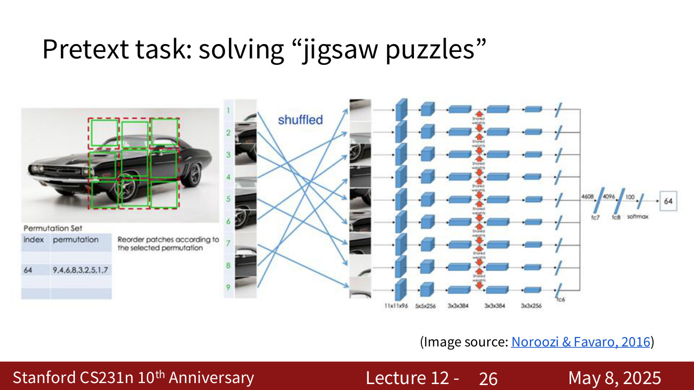

*Slide 26 — jigsaw puzzles: nine shuffled patches go through nine weight-sharing branches, and the network classifies which of 64 permutations was used. [Deck](https://cs231n.stanford.edu/slides/2025/lecture_12.pdf)*

Why 64? A student asks later, and the answer is that it is "almost arbitrary choice" (≈44:27): many permutations differ by a single swapped patch, so the authors "selected 64 of those that have the largest difference between them" (≈45:15).

On Pascal VOC 2007 the jigsaw features reach 67.6% classification, 53.2% detection and 37.6% segmentation, against 78.2%, 56.8% and 48.0% for Krizhevsky et al.'s supervised ImageNet features, and above the motion, relative-patch and context-encoder rows (slide 27). The table also lists pretraining time: 2.5 days for the jigsaw, 4 weeks for Doersch et al.'s relative-patch method, and 3 days with 1000 class labels for the supervised network.

### Inpainting

Mask out part of an image and ask the network to fill it in, which is what Pathak et al.'s context encoders do (slide 28; ≈26:36). An encoder maps the masked image to features, a channel-wise fully connected layer joins them to the decoder's features, and the decoder outputs the missing region, which a loss compares with the ground truth (slide 29). "This is basically learning to reconstruct the missing pixels", a form of autoencoder trained with a masking objective (≈27:22).

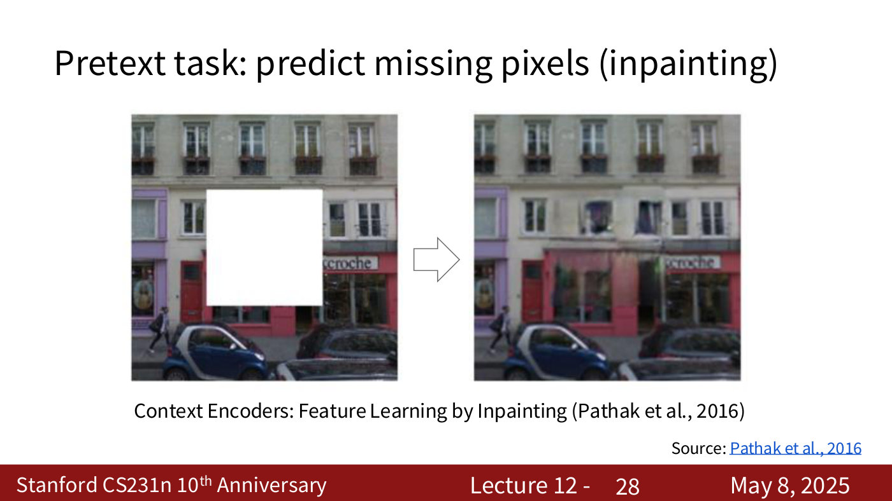

*Slide 28 — inpainting: a street scene with a hole, and the network's fill. [Deck](https://cs231n.stanford.edu/slides/2025/lecture_12.pdf)*

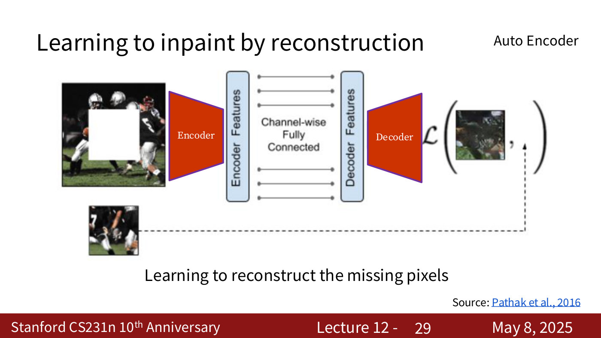

*Slide 29 — context encoder: encoder, a channel-wise fully connected layer, decoder, and a loss against the true patch (the dashed arrow). [Deck](https://cs231n.stanford.edu/slides/2025/lecture_12.pdf)*

Inpainting has no single right answer: "we can't say there is just one output" (≈28:08). A reconstruction loss alone gives a blurry fill, an adversarial loss alone a sharp but wrong one, and the two together a plausible one (slide 32). That is why the paper adds "an additional adversarial objective" (≈28:08), which "ensures the images that are generated are real looking" (≈29:41). Adversarial learning is left to the next lecture.

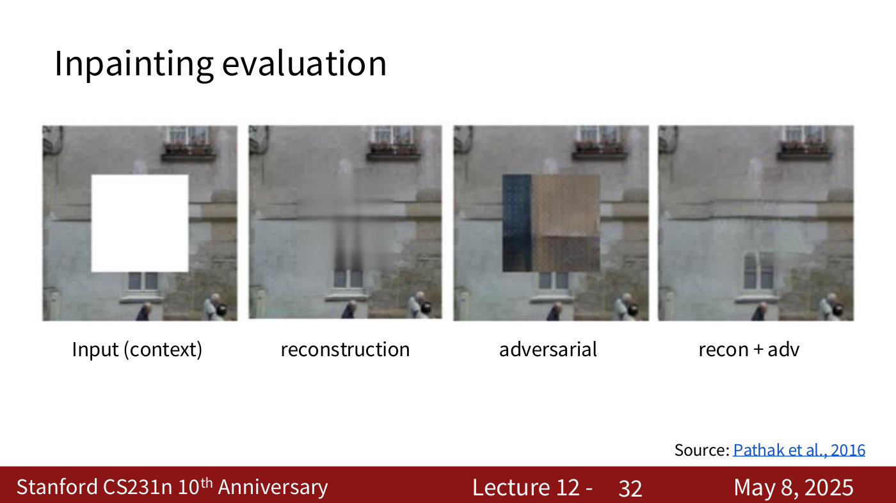

*Slide 32 — the same hole filled with a reconstruction loss (blurry), an adversarial loss (sharp but wrong) and both together (plausible). [Deck](https://cs231n.stanford.edu/slides/2025/lecture_12.pdf)*

The loss is the sum of the two terms:

$$L(x) = L_{recon}(x) + L_{adv}(x)$$

$$L_{recon}(x) = \lVert M \ast (x - F_\theta((1-M) \ast x)) \rVert_2^2$$

$$L_{adv} = \max_D \mathbb{E}[\log(D(x))] + \log(1 - D(F((1-M) \ast x)))]$$

Here $x$ is the image, $M$ is the mask (1 where masked, 0 elsewhere), $\ast$ is element-wise multiplication, $F_\theta$ is the network (labelled "Encoder" on the slide), and $D$ is the adversary's discriminator (slide 31). Multiplying by $(1-M)$ hides the masked region from the network, and multiplying the error by $M$ computes the loss "only on the masked area" (≈28:54–29:41). The adversarial term is transcribed as printed: its brackets do not balance (see [slips](#printed-slips-and-oddities)).

Transferred to Pascal VOC, the context encoder gives 56.5% classification, 44.5% detection and 30.0% segmentation, against 53.8%, 41.9% and 25.2% for a plain autoencoder and 53.3%, 43.4% and 19.8% for random initialization; its pretraining took 14 hours (slide 33; ≈30:28).

### Colourisation

Split a colour image in the Lab colour space into its lightness channel L and its two colour channels a and b, and train a network $\mathcal{F}$ to predict the colour from the lightness (slide 34). The input is $\mathbf{X} \in \mathbb{R}^{H \times W \times 1}$ and the prediction $\hat{\mathbf{Y}} \in \mathbb{R}^{H \times W \times 2}$. In the lecturer's words, "given the L channel, predict the A and B channels", and no annotation is needed because "It's already in the data" (≈31:58–32:45).

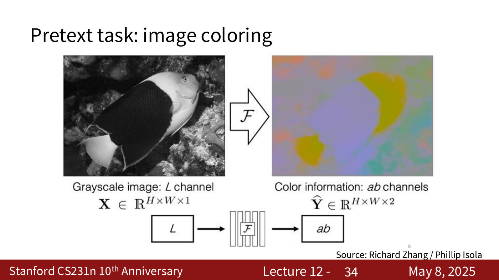

*Slide 34 — colourisation: from the lightness channel L, predict the colour channels ab. [Deck](https://cs231n.stanford.edu/slides/2025/lecture_12.pdf)*

Concatenating $(\mathbf{X}, \hat{\mathbf{Y}})$ gives back a full-colour image (slide 35).

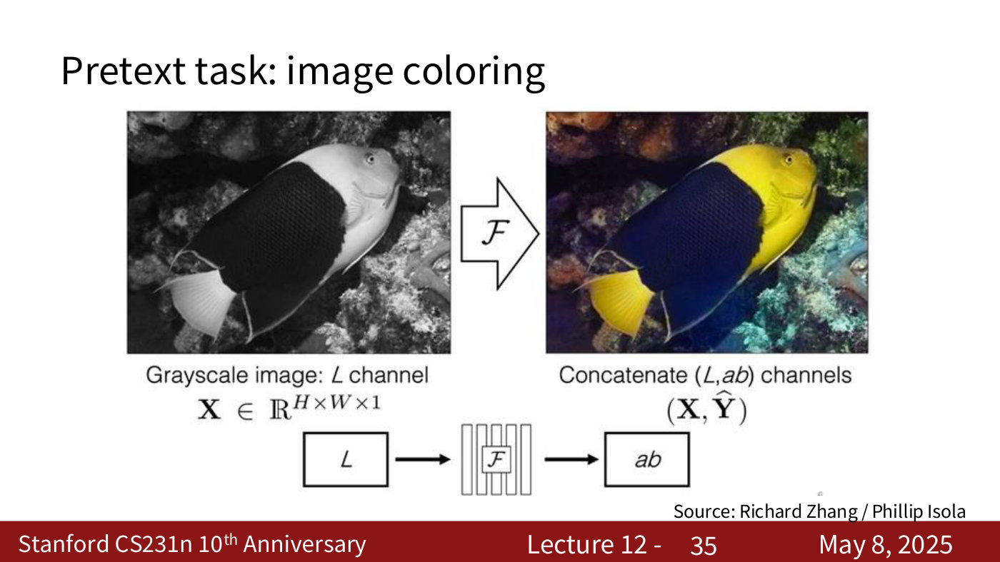

*Slide 35 — concatenating L with the predicted ab channels gives the colour image. [Deck](https://cs231n.stanford.edu/slides/2025/lecture_12.pdf)*

### Split-brain autoencoders

The split-brain autoencoder predicts in both directions: one network $\mathcal{F}_ {1}$ predicts colour from lightness, another $\mathcal{F}_ {2}$ predicts lightness from colour, and the two predictions together make the predicted image (slide 36; ≈32:45).

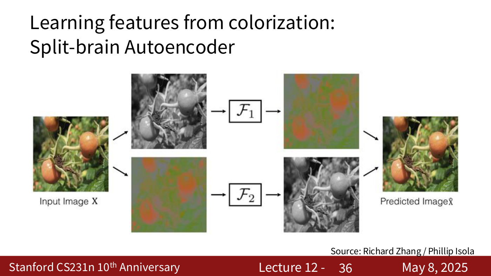

*Slide 36 — split-brain autoencoder: one network predicts colour from lightness, the other lightness from colour. [Deck](https://cs231n.stanford.edu/slides/2025/lecture_12.pdf)*

In general, the input $X$ is split into two sets of channels $X_1$ and $X_2$, each network predicts the other set, and the merged prediction $\hat{X}$ is trained with "an L2 loss, any distance function" (slide 37; ≈33:33). "The idea is, given one channel or a set of channels, predict the others" (≈33:33).

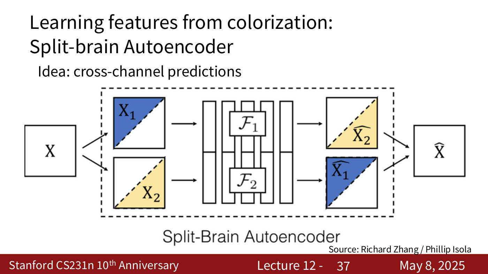

*Slide 37 — split-brain in general: split the channels into two sets and predict each set from the other. [Deck](https://cs231n.stanford.edu/slides/2025/lecture_12.pdf)*

The same split works for other channel pairs, such as the colour and depth channels of an RGB-D image (here RGB and HHA depth channels), from sensors "like for example Kinect" (slide 38; ≈34:20).

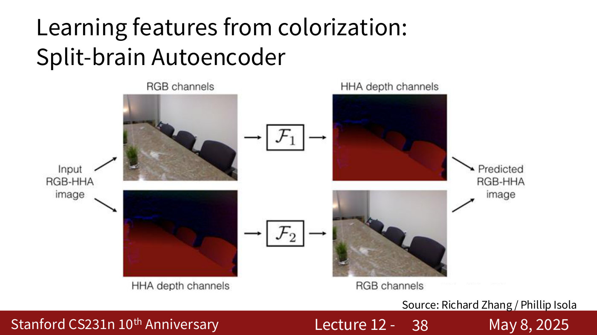

*Slide 38 — the same split on RGB-D data: depth channels from colour, and colour from depth. [Deck](https://cs231n.stanford.edu/slides/2025/lecture_12.pdf)*

Using the concatenated features of $\mathcal{F}_ {1}$ and $\mathcal{F}_ {2}$, a classifier trained layer by layer on Places reaches about 34% top-1 at conv3 and conv4, above the other self-supervised methods in the chart but below the supervised networks trained on Places labels (about 44% at conv5) and ImageNet labels (about 39% at conv4) (slide 39; ≈35:06). "Again, this is not as good as supervised learning because there is no label involved here" (≈35:06).

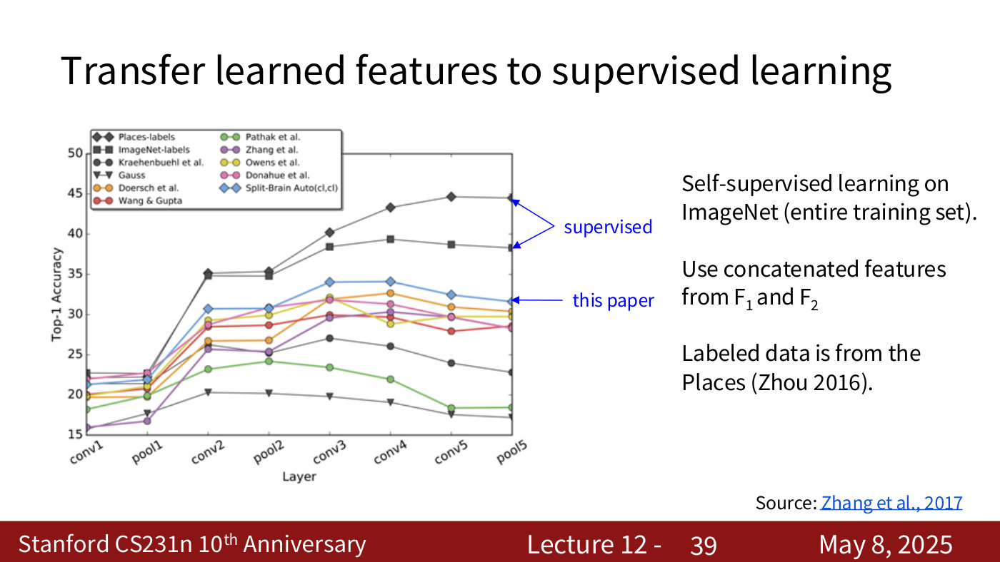

*Slide 39 — layer-by-layer accuracy on Places: split-brain (blue diamonds) above the other self-supervised methods and below the two supervised curves (grey). [Deck](https://cs231n.stanford.edu/slides/2025/lecture_12.pdf)*

Colourisation is also useful in itself, for colourising images and video that have no colour version (≈35:55). A colourised photo of a striped animal is one example (slide 40).

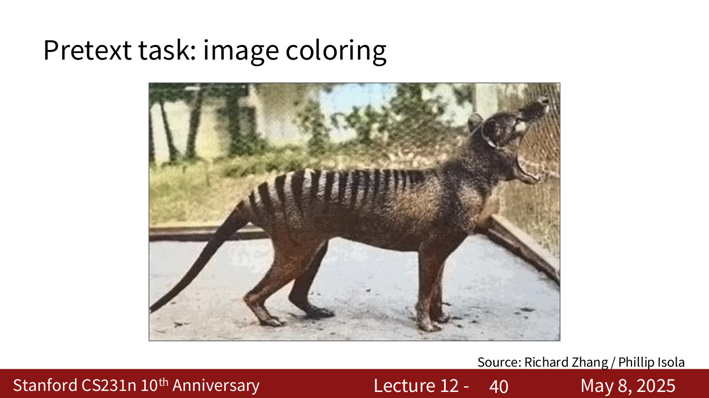

*Slide 40 — an example of colourisation. [Deck](https://cs231n.stanford.edu/slides/2025/lecture_12.pdf)*

In another, a river valley with a bridge and a mountain, the lecturer points to "the consistency between the actual object, the Half Dome or trees or the bridge, and its reflection in the water" (slide 41; ≈35:55).

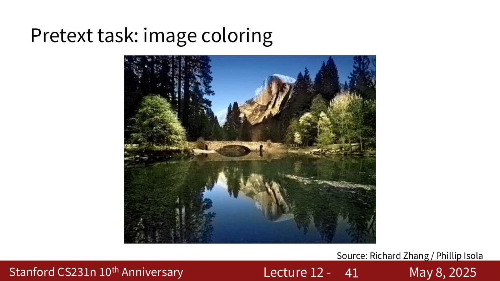

*Slide 41 — colourisation keeps the mountain and its reflection in the water consistent. [Deck](https://cs231n.stanford.edu/slides/2025/lecture_12.pdf)*

### Colourising video, and tracking

In video, colour should be consistent over time. Given one colour reference frame and later greyscale frames, a point on the car "Should be the same color!" in every frame. The hypothesis is that "learning to color video frames should allow model to learn to track regions or objects without labels!" (slide 43; Vondrick et al., 2018; ≈36:41–37:27). The lecturer's gloss: "the model implicitly learns how these tracks should be formed" (≈37:27).

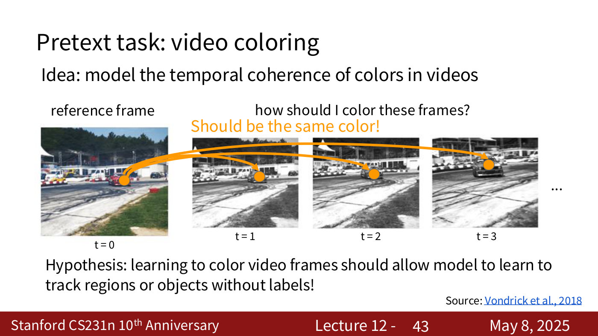

*Slide 43 — video colourisation: the orange point on the car should keep its colour in every frame, so colouring the video means tracking it. [Deck](https://cs231n.stanford.edu/slides/2025/lecture_12.pdf)*

The learning objective is to "Establish mappings between reference and target frames in a learned feature space", and to use the mapping as "pointers" to copy the correct colour (slide 44; ≈38:15).

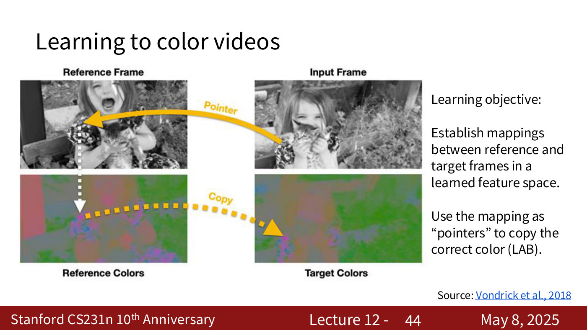

*Slide 44 — the target pixel points to its match in the reference frame and copies that pixel's colour. [Deck](https://cs231n.stanford.edu/slides/2025/lecture_12.pdf)*

A CNN embeds every pixel of the reference and the target frame. For a target pixel $j$ with embedding $f_j$, and reference pixels $i$ with embeddings $f_i$ and colours $c_i$, the attention over the reference frame is a softmax of embedding similarities, the predicted colour is the attention-weighted sum of reference colours, and the loss compares predicted with true colours $c_j$:

$$A_{ij} = \frac{\exp\left(f_{i}^{T} f_{j}\right)}{\sum_{k} \exp\left(f_{k}^{T} f_{j}\right)}, \qquad y_{j} = \sum_{i} A_{ij} c_{i}, \qquad \min_{\theta} \sum_{j} \mathcal{L}\left(y_{j}, c_{j}\right)$$

This is "very much similar to the same topic of attention that we talked about" (≈38:15; see [attention](attention.md)), and "attention is basically just similarity between the two" (≈39:02). The three formulas are built up on slides 45–47.

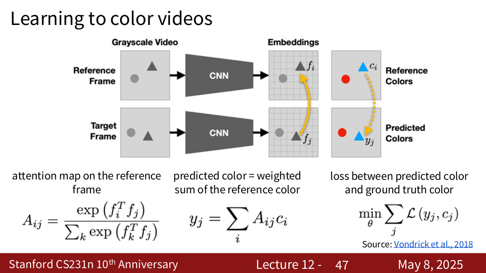

*Slide 47 — attention between target and reference embeddings, the colour copied as a weighted sum, and a loss against the true colour. [Deck](https://cs231n.stanford.edu/slides/2025/lecture_12.pdf)*

The results stay consistent across frames (slide 48). Coloured frame by frame instead, "the person's shirts or clothing changes color, because there's no constraint to keep it consistent" (≈39:50).

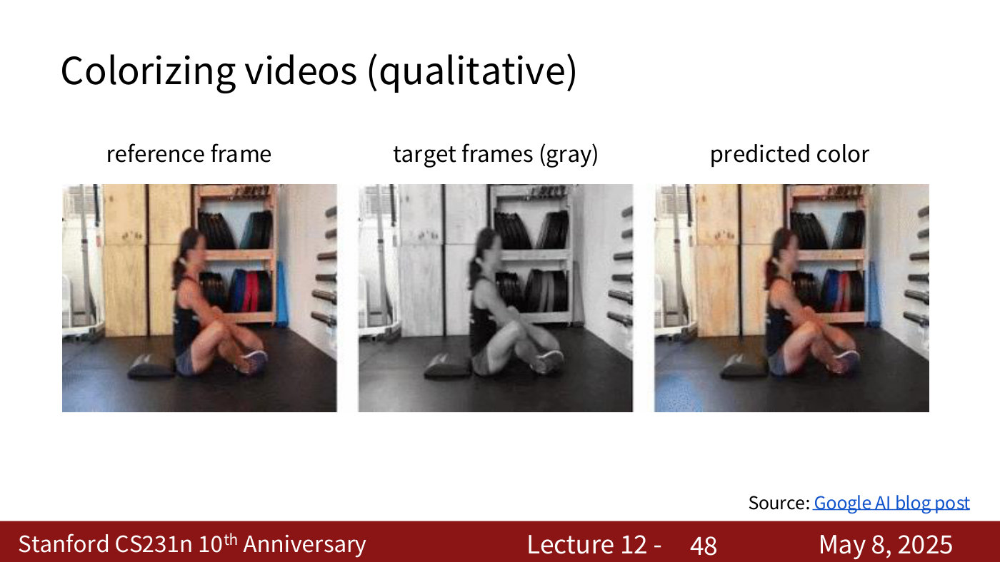

*Slide 48 — reference frame, grey target frame and predicted colour. [Deck](https://cs231n.stanford.edu/slides/2025/lecture_12.pdf)*

A second example is a person in a yellow outfit (slide 49). Both qualitative slides credit a Google AI blog post. Each holds one still image per panel; the PDF cannot show whether they played as animations in the lecture.

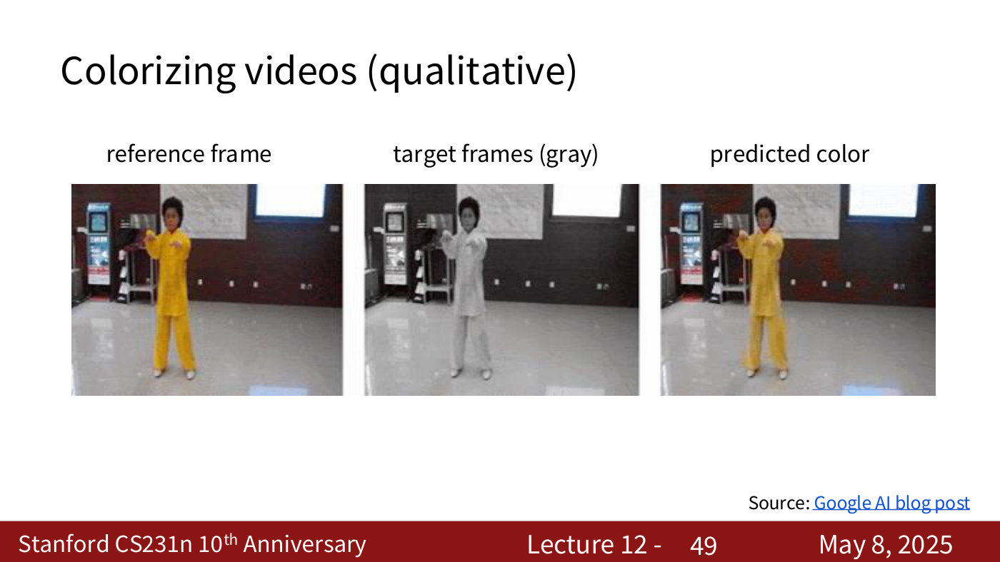

*Slide 49 — a second colourised example. [Deck](https://cs231n.stanford.edu/slides/2025/lecture_12.pdf)*

Because the model computes attention to a reference frame, it can also track: segmentation masks drawn on the first frame are propagated through the video with the learned attention (slide 50; ≈40:37).

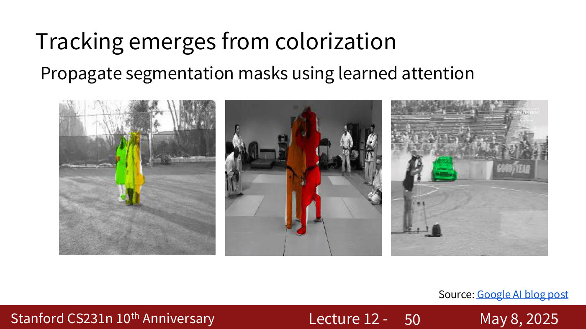

*Slide 50 — segmentation masks from the first frame, propagated through the video by the learned attention. [Deck](https://cs231n.stanford.edu/slides/2025/lecture_12.pdf)*

So are pose keypoints (slide 51; ≈40:37).

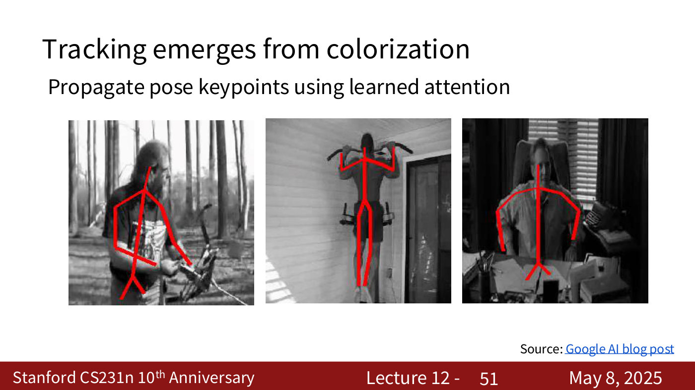

*Slide 51 — pose keypoints propagated the same way. [Deck](https://cs231n.stanford.edu/slides/2025/lecture_12.pdf)*

### Student questions

A run of questions follows (≈40:37–46:01). How does the encoder learn anything? The pretext task's decoder or classifier produces outputs that can be checked against labels taken from the data, and "on the way of predicting the right labels, this encoder is also trained" (≈41:22–42:09). Are the encoder and decoder one network? It depends on the pretext task: in rotation prediction the "decoder" is just the FC layers of one network, while autoencoding setups train two networks end to end, and in masked autoencoders "there is no symmetry between encoders and decoders" (≈42:09–43:41). The lecturer adds a disclaimer that "these are the very first methods for self-supervised learning", and agrees with a student that rotation is "a limited task by itself" (≈43:41–44:27).

### Masked autoencoders (MAE)

He et al.'s masked autoencoder (2021) is a reconstruction method like inpainting, but it masks many scattered patches at once, at 50% or 75% (slide 52; ≈46:01). In the lecturer's words, "when we want to pre-train on a data set, on raw data sets, we often use this MAE framework" (≈46:01).

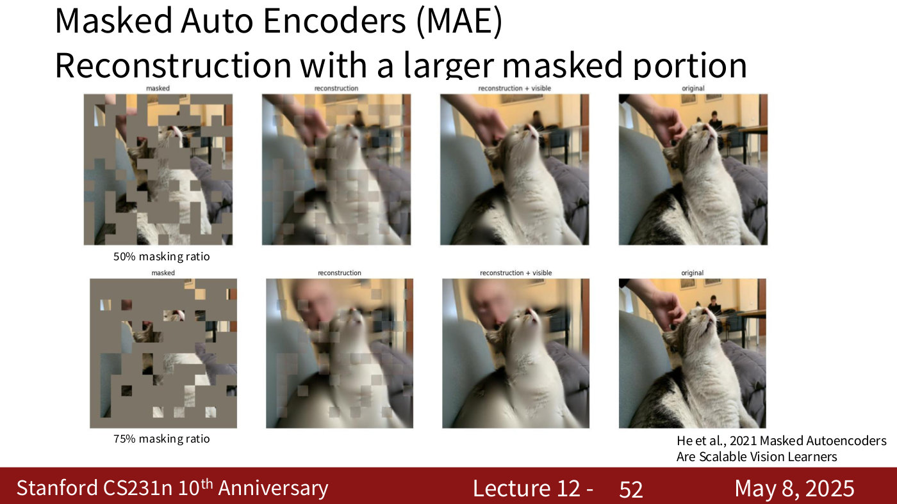

*Slide 52 — MAE at 50% and 75% masking: masked input, reconstruction, reconstruction with the visible patches pasted back, and the original. [Deck](https://cs231n.stanford.edu/slides/2025/lecture_12.pdf)*

The image is divided into patches and most are masked. Only the visible patches go through the encoder. The encoded patches are then put back in their places among mask tokens and decoded into the full image, which is the target (slide 53; ≈46:48–47:33). (The diagram masks 17 of its 25 patches.)

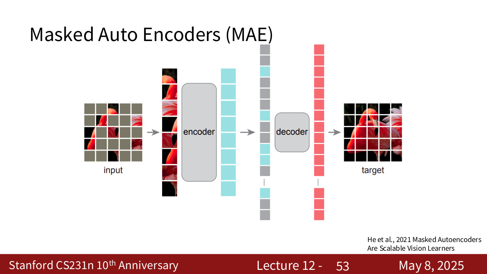

*Slide 53 — MAE: only the visible patches (8 of 25 here) go through the large encoder; mask tokens fill the gaps for the smaller decoder, which reconstructs every patch. [Deck](https://cs231n.stanford.edu/slides/2025/lecture_12.pdf)*

The design choices are spelled out on slides 54–57, all citing He et al. (2021):

**Masking.** As in the original ViT, the input is divided into non-overlapping patches. A "very large proportion (75%)" of them is sampled uniformly and masked. "Masking a high ratio makes predicting the task challenging and meaningful" (slide 54); in the lecturer's gloss, "challenging in the set of pretext tasks in self-supervised learning means the task is meaningful" (≈48:20). Because a different 75% can be masked each time, "you can reuse the same image multiple and multiple times during training" (≈49:06).

**Encoder.** It "only operates on unmasked patches (25%)", embeds them by linear projection, adds positional embeddings, and uses transformer blocks. Because its input is small, it "is chosen to be very large", with over 9 times the computation per token of the decoder (slide 55; ≈49:06–49:52). See [transformers](transformers.md) for the ViT it follows.

**Decoder.** It merges the encoder's outputs with "shared mask tokens" in the masked places, adds positional encodings, and uses transformer blocks followed by a linear projection to pixels. It is used only for reconstruction, "not used post-training", so its design is independent of the encoder's: "an asymmetrical autoencoder design" (slide 56). The mask token is a trainable parameter, which the lecturer suggests reading "as an average patch, an average representation, that is put for the ones that are missing" (≈50:37); "It's a learnable parameter. We can't necessarily interpret it" (≈56:51).

**Loss.** Mean squared error in pixel space between the input and the reconstruction, "only computed for masked patches" (slide 57; ≈50:37).

**Linear probing and fine-tuning.** These are the two ways to use the pre-trained encoder downstream (slide 58; ≈51:24–52:10). In linear probing the pre-trained model is frozen and only one linear layer is added and trained, which "is used to assess the quality of representations". In fine-tuning the pre-trained model is trained further, with one or more added layers, possibly with non-linearities. The slide's summary: linear probing "provides a measure of representation quality of a pre-training in restricted conditions"; fine-tuning "exploits models near-true potential to adopt for new tasks." The same distinction appears in [transfer learning](transfer-learning.md).

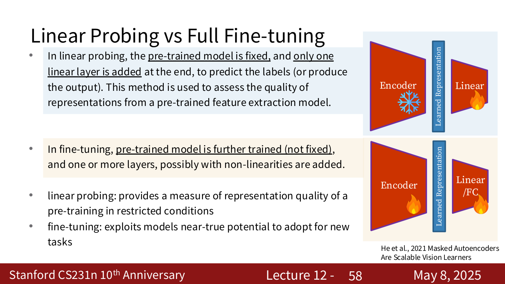

*Slide 58 — linear probing freezes the encoder (snowflake) and trains one linear layer; fine-tuning trains the encoder too (flames). [Deck](https://cs231n.stanford.edu/slides/2025/lecture_12.pdf)*

**Ablations.** Slide 59 lists the choices the paper studied: masking ratio, decoder depth and width, whether the encoder sees mask tokens, the reconstruction target, data augmentation, mask sampling and training schedule. Against masking ratio, fine-tuning accuracy peaks at 85.0 at 60% and is 84.9 at 75%, and linear-probing accuracy peaks at 73.5 at 75%, falling to 66.1 at 90% (slide 59). Random masking at 75% (84.9 fine-tuned, 73.5 linear) beats block masking at 50% (83.9, 72.3) and 75% (82.8, 63.9) and grid masking at 75% (84.0, 66.0). In the lecture, "the 75% is actually giving them a very high accuracy", and "they've come to the conclusion that this random masking was the best choice" (≈52:55).

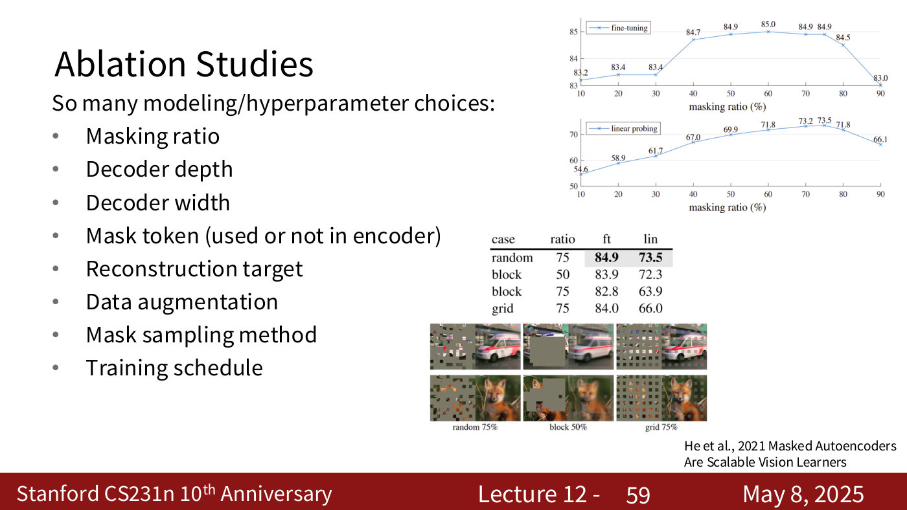

*Slide 59 — MAE ablations: accuracy against masking ratio, for fine-tuning and linear probing, and random masking against block and grid masking. [Deck](https://cs231n.stanford.edu/slides/2025/lecture_12.pdf)*

**Comparison.** Fine-tuned on ImageNet-1K, MAE reaches 83.6 with ViT-B, 85.9 with ViT-L, 86.9 with ViT-H and 87.8 with ViT-H at 448 pixels. That is above DINO (82.8, ViT-B), MoCo v3 (83.2, 84.1) and BEiT (83.2, 85.2), and above training from scratch (82.3, 82.6, 83.1) (slide 60). The lecturer notes that MAE "was actually outperforming those that are, at the time, more advanced frameworks of contrastive learning" (≈53:43).

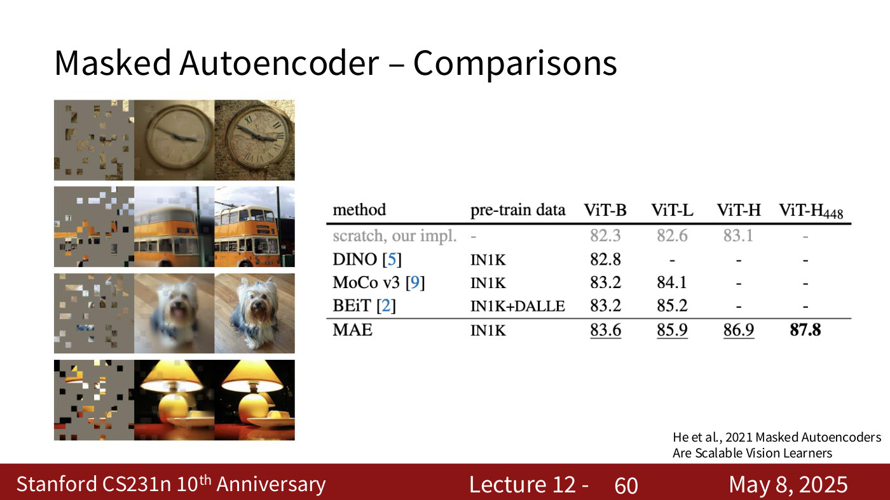

*Slide 60 — MAE reconstructions, and its fine-tuned ImageNet accuracy against DINO, MoCo v3 and BEiT. [Deck](https://cs231n.stanford.edu/slides/2025/lecture_12.pdf)*

A student asks how the encoder's outputs become the decoder's input (≈56:03). Each visible patch becomes a token, a shared mask token is put in the place of each masked patch, and the decoder takes "this long set of tokens and outputs those that are projected as the output pixel value" (≈56:51–57:40).

### What pretext tasks share, and where they fall short

Pretext tasks focus on "visual common sense"; the models are "forced learn good features about natural images" to solve them; and "We often do not care about the performance of these pretext tasks, but rather how useful the learned features are for downstream tasks" (slide 61; ≈53:43–54:29). The red bullet on slide 62 names the problems: "1) coming up with individual pretext tasks is tedious, and 2) the learned representations may not be general." They "may be tied to a specific pretext task" (slide 63; ≈54:29).

A student asks how a split-brain network knows what to predict. The lecturer answers with a question: how does a classifier know what features to extract? In both cases a loss is backpropagated from targets that exist in the data, here the other channel (≈55:16–56:03).

## Contrastive representation learning

### The idea

All of the transformed images (completed, rotated, shuffled, greyscale) show the same object as the original, and other images in the data set show different objects (≈58:26). So ask for representations in which views of the same object attract and views of different objects repel (slide 66). The task is to "try to bring them close in the representation space", and for different objects to "try to maximize the distance between them in the latent space" (≈59:12).

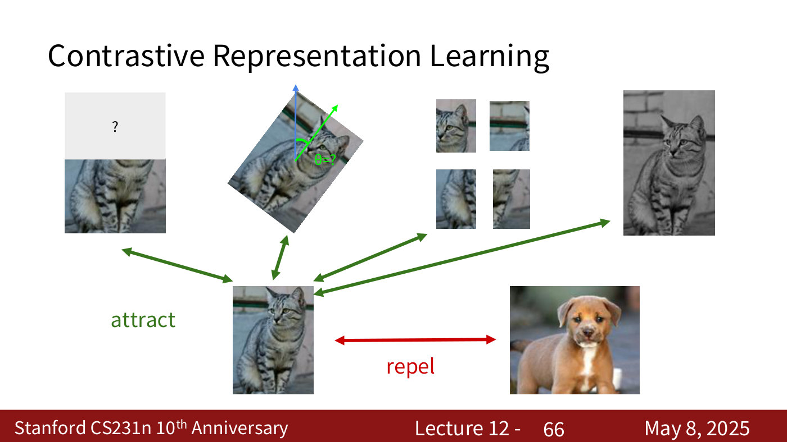

*Slide 66 — contrastive learning: transformed views of the same cat attract, and a different object repels. [Deck](https://cs231n.stanford.edu/slides/2025/lecture_12.pdf)*

In the notation used from here on, $x$ is the reference sample, $x^{+}$ a positive sample (a transformation of $x$) and $x^{-}$ a negative sample (another image) (slide 69; ≈59:59–1:00:47).

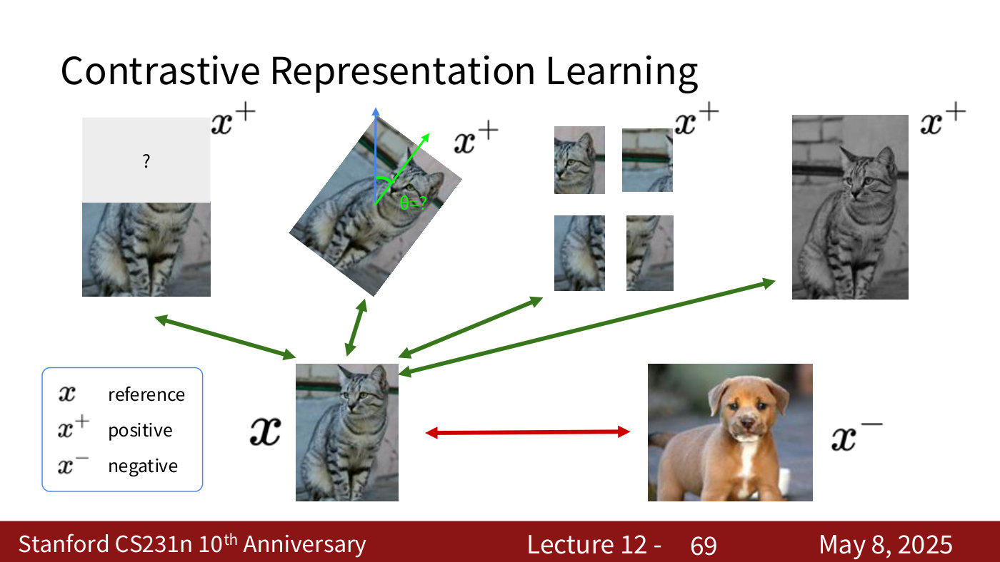

*Slide 69 — the notation: the reference x, positives x+ (its transformed views) and a negative x- (the puppy). [Deck](https://cs231n.stanford.edu/slides/2025/lecture_12.pdf)*

### A formulation: the InfoNCE loss

With an encoder $f$ and a score function, what we want is

$$\text{score}(f(x), f(x^{+})) \gg \text{score}(f(x), f(x^{-}))$$

that is, a high score for positive pairs and a low score for negative pairs (slide 70; ≈1:00:47).

Given one positive sample and $N - 1$ negative samples $x^{-}_ {j}$, with score function $s$, the loss is (slide 71):

$$L = -\mathbb{E}_ {X}\left[\log \frac{\exp(s(f(x), f(x^{+})))}{\exp(s(f(x), f(x^{+}))) + \sum_ {j=1}^{N-1} \exp(s(f(x), f(x^{-}_ {j})))}\right]$$

The numerator and the first term of the denominator are the score for the positive pair; the sum is the score for the $N-1$ negative pairs. In practice the negatives are the other images in the batch (slide 72; ≈1:01:34–1:02:21).

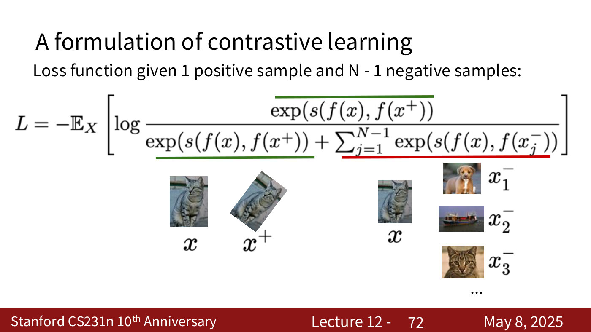

*Slide 72 — the InfoNCE loss: the positive pair's score (green) against the scores of the N-1 negatives (red), one positive and several negatives drawn below. [Deck](https://cs231n.stanford.edu/slides/2025/lecture_12.pdf)*

"This seems familiar": it is the "Cross entropy loss for a N-way softmax classifier!", which learns "to find the positive sample from the N samples" (slide 74). "This is the cross entropy for multiple classes", maximising the score for the one correct class and minimising it for the rest (≈1:02:21–1:03:07). See the softmax loss in [loss functions](loss-functions.md).

This loss is "Commonly known as the InfoNCE loss (van den Oord et al., 2018)", and its negative bounds the mutual information between $f(x)$ and $f(x^{+})$ from below (slide 75):

$$MI[f(x), f(x^{+})] - \log(N) \geq -L$$

So "if I minimize the InfoNCE I'm basically maximizing the mutual information between X and X plus" (≈1:04:41). And "The larger the negative sample size (N), the tighter the bound" (slide 75), which is why training with this loss needs "a huge batch size" (≈1:05:27). The slide points to Poole et al. (2019) for the derivation.

### SimCLR

SimCLR, "a simple framework for contrastive learning" (Chen et al., 2020), uses cosine similarity as the score function,

$$s(u, v) = \frac{u^{T} v}{\lVert u \rVert \thinspace \lVert v \rVert}$$

with a projection network $g(\cdot)$ that maps features to the space where the contrastive loss is applied, and data augmentation to make positive pairs: "random cropping, random color distortion, and random blur" (slide 76; ≈1:05:27–1:06:16). Two augmentations $t, t' \sim \mathcal{T}$ of an image $\boldsymbol{x}$ go through the encoder $f(\cdot)$ to representations $\boldsymbol{h}_ {i}$, $\boldsymbol{h}_ {j}$, and through $g(\cdot)$ to $\boldsymbol{z}_ {i}$, $\boldsymbol{z}_ {j}$, where agreement is maximised.

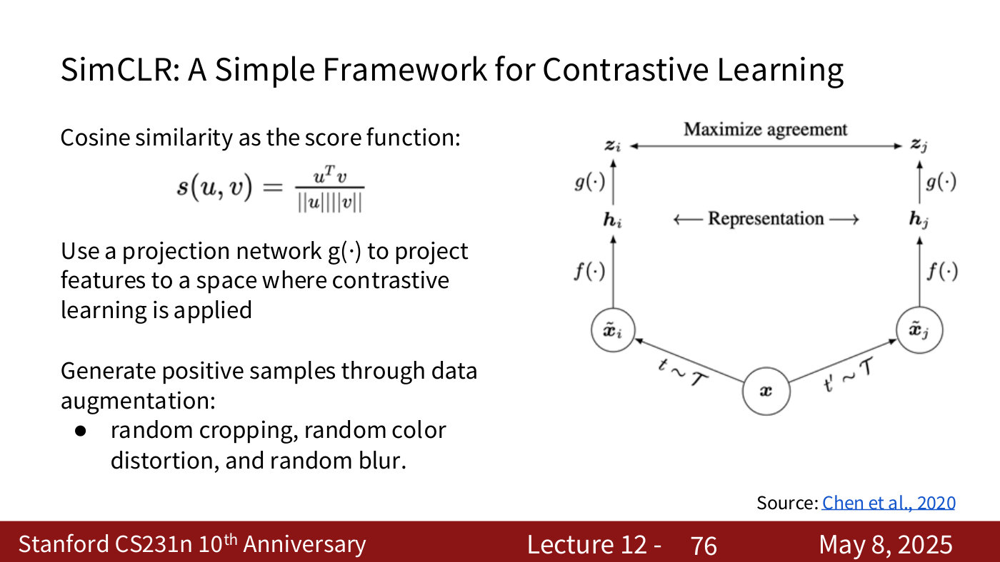

*Slide 76 — SimCLR: two augmentations of one image, the encoder f to representations h, and the projection g to z, where agreement is maximised. [Deck](https://cs231n.stanford.edu/slides/2025/lecture_12.pdf)*

The augmentations the paper tried are shown on one dog photo: crop and resize, crop, resize and flip, colour drop and jitter, rotation, cutout, Gaussian noise, Gaussian blur and Sobel filtering (slide 77). See [data augmentation](data-augmentation.md).

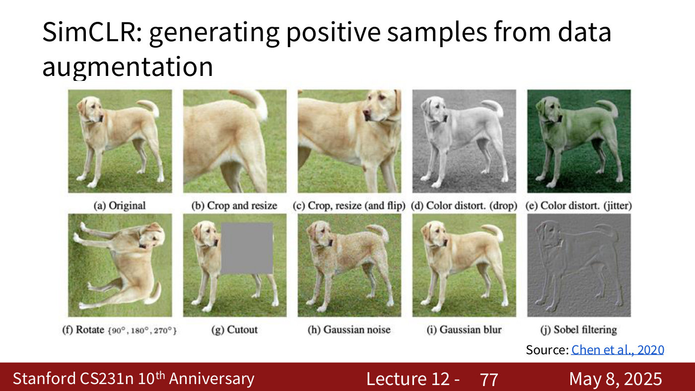

*Slide 77 — the augmentations SimCLR tried, on one dog photo. [Deck](https://cs231n.stanford.edu/slides/2025/lecture_12.pdf)*

**The algorithm** (slide 78). For a minibatch of $N$ images $\lbrace \boldsymbol{x}_ {k} \rbrace_ {k=1}^{N}$, draw two augmentation functions per image to get $2N$ views, $\tilde{\boldsymbol{x}}_ {2k-1}$ and $\tilde{\boldsymbol{x}}_ {2k}$, then compute $\boldsymbol{h} = f(\tilde{\boldsymbol{x}})$ and $\boldsymbol{z} = g(\boldsymbol{h})$ for each. With pairwise similarities $s_ {i,j}$ and a temperature $\tau$, the InfoNCE loss for the pair $(i, j)$ uses all other $2N - 2$ views in the batch as negatives:

$$\ell(i,j) = -\log \frac{\exp(s_ {i,j}/\tau)}{\sum_ {k=1}^{2N} \mathbb{1}_ {[k \neq i]} \exp(s_ {i,k}/\tau)}$$

Each of the $2N$ views is used once as the reference, and the loss is the average:

$$\mathcal{L} = \frac{1}{2N} \sum_ {k=1}^{N} \left[ \ell(2k-1, 2k) + \ell(2k, 2k-1) \right]$$

The networks $f$ and $g$ are updated to minimise $\mathcal{L}$; at the end the encoder $f$ is kept and $g$ is thrown away (slides 78–80; ≈1:07:02–1:07:48). The deck marks this slide and the next with a warning: "We use a slightly different formulation in the assignment. You should follow the assignment instructions." The lecturer repeats it for the SimCLR question in assignment 3: "be careful that the definition is slightly different from the standard definition that I presented here" (≈1:07:48–1:08:35).

**In a minibatch** (slide 82), the encoder turns the list of positive pairs into $\mathbf{z} \in \mathbb{R}^{2N \times D}$, where each 2k-th and (2k+1)-th element is a positive pair, and the "affinity matrix" of all $s_ {i,j}$ is $2N \times 2N$. Each row is then a classification problem whose label is the column of its positive partner, never the diagonal (≈1:07:48). The drawing is not self-consistent in size; see [slips](#printed-slips-and-oddities).

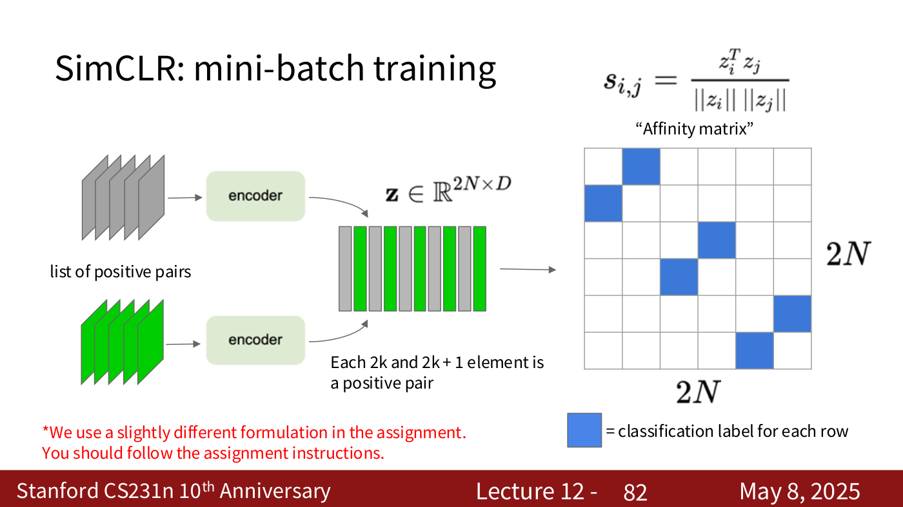

*Slide 82 — SimCLR in a minibatch: 2N views, the affinity matrix of their similarities, and each row's label at its positive partner (blue). [Deck](https://cs231n.stanford.edu/slides/2025/lecture_12.pdf)*

**Results.** With the encoder frozen and a linear classifier trained on ImageNet labels, SimCLR reaches about 69% top-1 with a ResNet-50, about 74% at twice the width, and about 76.5% at four times the width, about the height of the point marked "Supervised" (about 76%). The four-times model is above every other self-supervised point plotted (slide 83, values read off the chart). In the lecture, SimCLR managed "to surpass all of the previous works", although it needs a larger network (≈1:08:35–1:09:20).

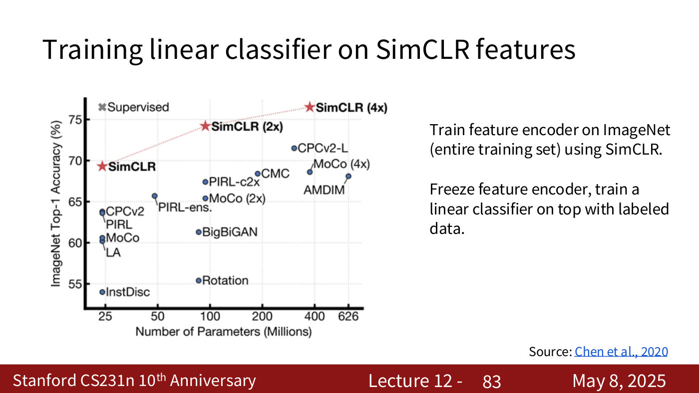

*Slide 83 — linear evaluation on ImageNet: SimCLR at 1x, 2x and 4x width (red stars) against other self-supervised methods (blue) and the supervised mark. [Deck](https://cs231n.stanford.edu/slides/2025/lecture_12.pdf)*

Fine-tuned with 1% or 10% of ImageNet's labels, SimCLR with a four-times-wide ResNet-50 reaches 85.8% and 92.6% top-5, against 48.4% and 80.4% for the table's supervised ResNet-50 baseline (slide 84).

**Design choice 1: the projection head.** Applying the loss to $\boldsymbol{z} = g(\boldsymbol{h})$ rather than to $\boldsymbol{h}$ helps: linear evaluation is about 60–61% top-1 with a linear head, about 63.5–65% with a non-linear head, and about 50% with none (slide 85). The slide's explanation is that "contrastive learning objective may discard useful information for downstream tasks", since $z$ is trained to be invariant to the transformations; with the head, "more information can be preserved in the h representation space." In the lecture: "when we have an objective function that does this contrast between samples, you often lose some more information" (≈1:09:20–1:10:07).

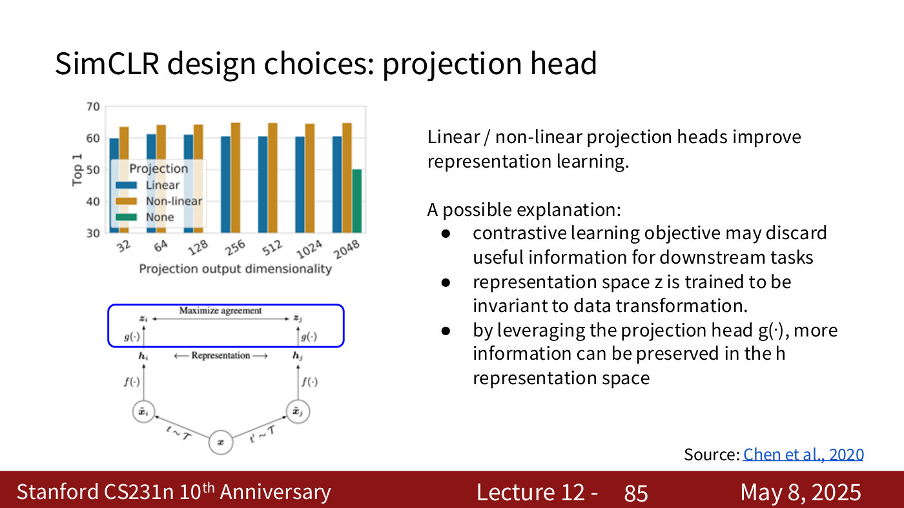

*Slide 85 — the projection head: a non-linear head (orange) beats a linear one (blue) at every output size, and no head (green) is far lower. [Deck](https://cs231n.stanford.edu/slides/2025/lecture_12.pdf)*

**Design choice 2: large batches.** "Large training batch size is crucial for SimCLR!" (slide 86). At 100 epochs, linear evaluation rises from about 57.5% with a batch of 256 to about 64.8% with 8192; longer training narrows the gap (about 67% and 69% at 1000 epochs). But large batches have a large memory footprint, which "requires distributed training on TPUs" (slide 86; ≈1:10:54). See [distributed training](distributed-training.md).

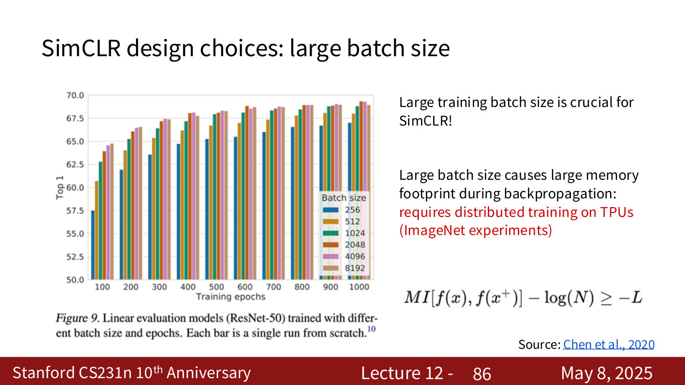

*Slide 86 — batch size: larger batches give higher linear-evaluation accuracy, most of all in short training runs. [Deck](https://cs231n.stanford.edu/slides/2025/lecture_12.pdf)*

### MoCo

Momentum Contrastive Learning (MoCo; He et al., 2020) removes SimCLR's dependence on huge batches (slide 87; ≈1:10:54–1:11:44). Its key differences:

It keeps "a running queue of keys (negative samples)", so negatives are not limited to the current batch. Gradients are computed and the encoder updated "only through the queries", because the queued keys cannot be backpropagated through: "those samples are not in the batch anymore" (≈1:11:44). And this decouples the minibatch size from the number of keys, so it "can support a large number of negative samples." The query $x^{\text{query}}$ goes through an encoder to $q$; the keys go through a separate momentum encoder to $k_0, k_1, k_2, \ldots$; their similarities feed the contrastive loss.

The key encoder is not trained by gradient. It slowly follows the query encoder through the momentum update

$$\theta_ {k} \leftarrow m\theta_ {k} + (1-m)\theta_ {q}$$

where $\theta_ {q}$ and $\theta_ {k}$ are the query and key encoders' parameters and $m$ is the momentum (slide 88; ≈1:12:31).

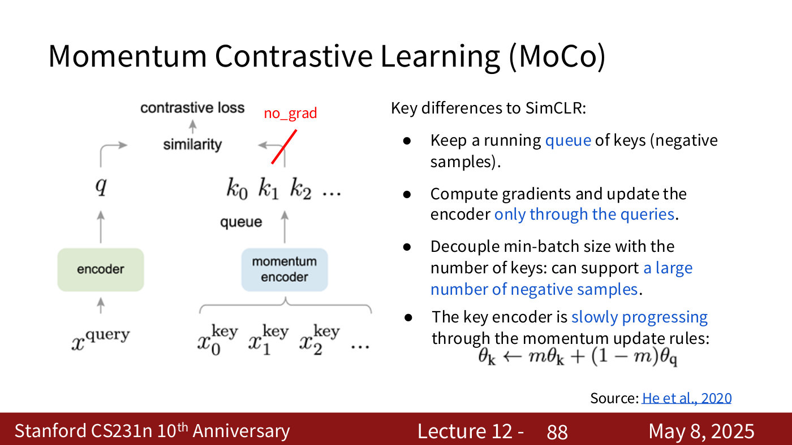

*Slide 88 — MoCo: a queue of keys from a momentum encoder supplies the negatives, and gradients flow only through the query encoder. [Deck](https://cs231n.stanford.edu/slides/2025/lecture_12.pdf)*

The paper's PyTorch-like pseudocode (slide 89, transcribed in full in the slide file) shows the whole loop. Two augmentations of a minibatch give queries `q = f_q.forward(x_q)` and keys `k = f_k.forward(x_k)`, with `k.detach()` so that no gradient reaches the keys. The positive logits are `bmm(q.view(N,1,C), k.view(N,C,1))` and the negative logits `mm(q.view(N,C), queue.view(C,K))`, concatenated into `Nx(1+K)` logits. The labels are all zero ("positives are the 0-th"), so the loss is `CrossEntropyLoss(logits/t, labels)`: InfoNCE as a classifier, with temperature `t`. After the SGD update of `f_q`, `f_k` is updated by momentum, the current minibatch's keys are enqueued and the oldest are dequeued.

### MoCo v2

MoCo v2 (Chen et al., 2020) is "A hybrid of ideas from SimCLR and MoCo": SimCLR's non-linear projection head and strong data augmentation, with MoCo's momentum-updated queue, which allows "a large number of negative samples (no TPU required!)" (slide 90; ≈1:13:17).

The ablation on slide 91 takes MoCo v1 from 60.6% ImageNet linear accuracy to 66.2% with an MLP head, 63.4% with extra blur augmentation, 67.3% with both, 67.5% with a cosine learning-rate schedule, and 71.1% with 800 epochs instead of 200. "Non-linear projection head and strong data augmentation are crucial for contrastive learning" (slides 91–93).

Against SimCLR (slide 92), MoCo v2 at batch size 256 and 200 epochs reaches 67.5%, where SimCLR reaches 61.9% at batch 256 and 66.6% at batch 8192. With longer training it reaches 71.1% (800 epochs, batch 256), against 69.3% for SimCLR (1000 epochs, batch 4096). Decoupling the batch size from the number of negatives "allows MoCo-V2 to outperform SimCLR with smaller batch size (256 vs. 8192)".

On eight 16 GB V100 GPUs, MoCo at batch 256 uses 5.0 GB per GPU and 53 hours for 200 epochs. End-to-end training (SimCLR here) uses 7.4 GB and 65 hours at batch 256, and at batch 4096 is estimated at 93.0 GB per GPU, with no time given (slide 93). In the lecture: done together, "it improves the performance by a lot" (≈1:13:17).

## Beyond the recording (slides only)

The lecturer stops after MoCo v2. Everything in this section is sourced to the slides; the lecture only names CPC, MoCo v3 and DINO (≈1:13:17–1:14:04).

### Instance and sequence contrastive learning

SimCLR and MoCo are *instance-level* contrastive learning: positives and negatives are instances, transformed copies of an image against other images. *Sequence-level* contrastive learning contrasts based on "sequential / temporal orders"; its example is Contrastive Predictive Coding (CPC) (slide 94).

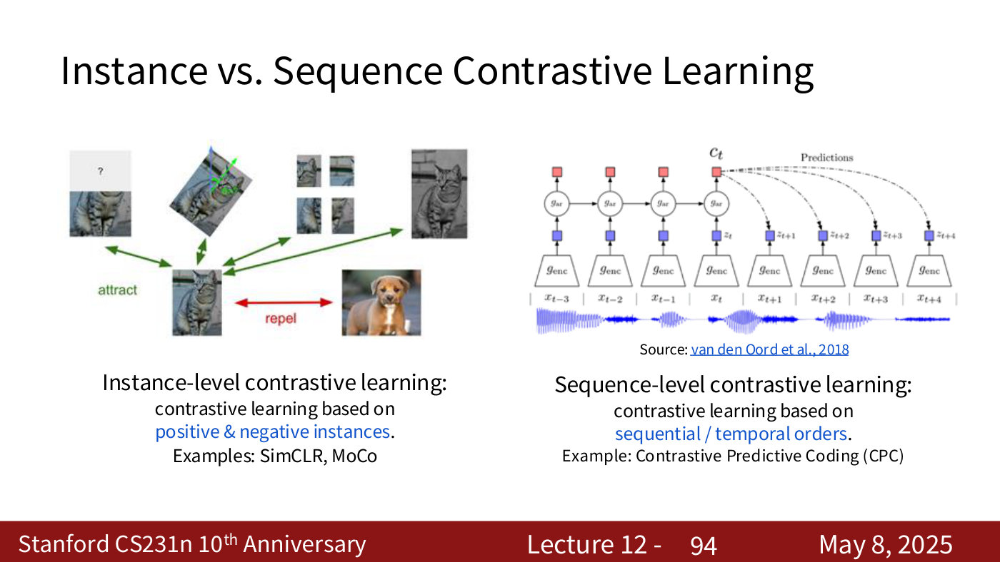

*Slide 94 — instance-level contrastive learning (left) against sequence-level contrastive learning, CPC (right). [Deck](https://cs231n.stanford.edu/slides/2025/lecture_12.pdf)*

### Contrastive predictive coding (CPC)

CPC (van den Oord et al., 2018) is contrastive, because it contrasts "right" and "wrong" sequences; predictive, because "the model has to predict future patterns given the current context"; and coding, because it learns useful feature vectors, a "code", for downstream tasks (slide 95). It works in three steps.

First, encode every sample of a sequence into a vector, $z_ {t} = g_ {enc}(x_ {t})$ (slide 96).

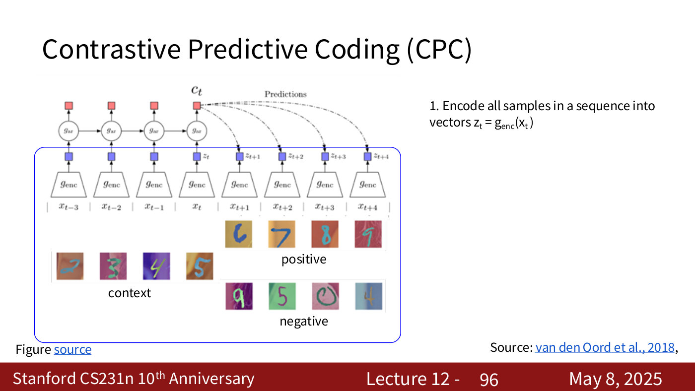

*Slide 96 — CPC step 1: encode every element of the sequence. [Deck](https://cs231n.stanford.edu/slides/2025/lecture_12.pdf)*

Second, summarise the context (for example half of a sequence) into a context code $c_ {t}$ with an autoregressive model $g_ {ar}$, a GRU-RNN in the original paper (slide 97).

*Slide 97 — CPC step 2: summarise the context into a context code with an autoregressive model. [Deck](https://cs231n.stanford.edu/slides/2025/lecture_12.pdf)*

Third, compute the InfoNCE loss between the context $c_ {t}$ and future codes $z_ {t+k}$, using a time-dependent score function with a trainable matrix $W_ {k}$ for each step ahead:

$$s_ {k}(z_ {t+k}, c_ {t}) = z_ {t+k}^{T} W_ {k} c_ {t}$$

The slide boxes the prediction half of the diagram for this step (slide 98).

*Slide 98 — CPC step 3: score future codes against the context code with a time-dependent score function. [Deck](https://cs231n.stanford.edu/slides/2025/lecture_12.pdf)*

In the slides' illustration, a context of the digits 2, 3, 4, 5 should predict the positive continuation 6, 7, 8, 9 rather than a negative sequence such as 9, 5, 0, 4.

On speech (LibriSpeech), linear classifiers on CPC representations reach 64.6% phone classification (against 74.6% supervised, 39.7% with MFCC features) and 97.4% speaker classification (against 98.5% supervised). A t-SNE plot of the representations separates ten speakers into ten clusters (slide 100).

*Slide 100 — CPC on speech: ten speakers' clusters in t-SNE, and linear classification of phones and speakers. [Deck](https://cs231n.stanford.edu/slides/2025/lecture_12.pdf)*

On images, CPC splits an image into overlapping patches (64-pixel patches with 50% overlap on a 256-pixel image) and treats the rows of patches from top to bottom as a sequence, using the top rows as context to predict the bottom rows (slide 101). It reaches 48.7% ImageNet top-1, above the earlier pretext-task methods in its table, but slide 110 says it is "not as effective in learning image representations compared to instance-level methods" (slide 114 holds the table).

*Slide 101 — CPC on images: rows of overlapping patches, with the top rows as context to predict the bottom rows. [Deck](https://cs231n.stanford.edu/slides/2025/lecture_12.pdf)*

### MoCo v3

Chen et al.'s study of training self-supervised Vision Transformers, which opens "This paper does not describe a novel method" (slide 102). Its table gives MoCo v3 76.7% to 81.0% linear-probing accuracy with ViT models (81.0% with ViT-BN-L/7), and 83.2% (ViT-B) and 84.1% (ViT-L) fine-tuned end to end.

### DINO and DINOv2

DINO (Caron et al., 2021, "Emerging Properties in Self-Supervised Vision Transformers") is self-distillation with no labels (slide 103). The figure shows the self-attention of the [CLS] token on the heads of the last layer of a Vision Transformer trained with no supervision. The maps pick out the main object of each photo, "unsupervised object segmentations", although the token "is not attached to any label nor supervision".

*Slide 103 — DINO: self-attention of the [CLS] token picks out the main object, with no labels. [Deck](https://cs231n.stanford.edu/slides/2025/lecture_12.pdf)*

Two augmented views $\mathbf{x}_ {1}$ and $\mathbf{x}_ {2}$ of an image go to a student network $g_ {\theta_ {s}}$ and a teacher network $g_ {\theta_ {t}}$ (slide 104). The teacher's output is centred and sharpened and passed through a softmax with a stop-gradient; the loss is the cross-entropy $-p_ {2} \log p_ {1}$ between teacher and student probabilities. Only the student is trained by backpropagation.

*Slide 104 — DINO: a student and a teacher, the teacher an exponential moving average of the student, see two views, and the student learns to match the teacher. [Deck](https://cs231n.stanford.edu/slides/2025/lecture_12.pdf)*

The teacher is an exponential moving average of the student:

$$\theta_ {\text{teacher}} \leftarrow \tau \cdot \theta_ {\text{teacher}} + (1-\tau) \cdot \theta_ {\text{student}}$$

The loss compares the student's and the teacher's outputs for two views of one image, and no negative samples appear in the diagram or in the pseudocode. The lecturer describes DINO as a method that "borrows concepts from contrastive learning but it's not necessarily a contrastive learning framework" (≈59:59), and later as "not necessarily contrastive learning, because now we have student and teacher networks" (≈1:14:04). The paper's pseudocode (slide 105) symmetrises the loss over the two views, updates the teacher by momentum, and keeps a running centre of the teacher's outputs.

DINOv2's figure colours image patches by their first three PCA components, computed across related images. The same parts match across changes of pose, style or object, for example the wings of eagles and of jets (slide 106). The slide's credit line names the 2021 DINO paper.

*Slide 106 — DINOv2: the first three PCA components of patch features, matching the same parts across related images. [Deck](https://cs231n.stanford.edu/slides/2025/lecture_12.pdf)*

### Summary

The deck's summary restates the general formulation and the InfoNCE loss as "N-way classification among positive and negative samples" (slide 107). SimCLR's key idea is the non-linear projection head; it is simple and effective but needs large batches and a large memory footprint. MoCo decouples the negative sample size from the minibatch size, and MoCo v2 adds SimCLR's projection head and augmentation. CPC contrasts right and wrong sequences with a time-dependent score function (slides 108–110).

### Appendix: Dense Object Net

The deck's last slides, after "Next time", apply contrastive learning to "pixel-wise feature descriptors" (Florence et al., 2018). Pairs of views of toy objects are joined by green lines between matching points and red lines between non-matching ones, in four settings labelled background randomization, cross object loss, direct multi object and synthetic multi object (slide 115).

*Slide 115 — Dense Object Net: matching (green) and non-matching (red) points between two views of the same objects. [Deck](https://cs231n.stanford.edu/slides/2025/lecture_12.pdf)*

Photos of objects sit above their descriptor maps, where each object appears as coloured blobs: a toy caterpillar moved by hand, shoes, caps and mugs (slide 116).

*Slide 116 — Dense Object Net: photos above their descriptor maps. [Deck](https://cs231n.stanford.edu/slides/2025/lecture_12.pdf)*

A last pair shows a pegboard and its descriptor map (slide 117).

*Slide 117 — Dense Object Net: a pegboard and its descriptor map. [Deck](https://cs231n.stanford.edu/slides/2025/lecture_12.pdf)*

## Printed slips and oddities

The deck's slips are kept as printed in the slide file, with `[Ed:]` notes where they matter:

- **Slide 31's** adversarial loss has unbalanced brackets. The expectation's "[" closes after $\log(D(x))$, and a second "]" follows the last term with nothing to close, so how far the expectation reaches is ambiguous.
- **Slide 81's** drawing is not self-consistent in size. Two stacks of 5 inputs give a row of 10 vectors ($2N = 10$), but the affinity matrix, labelled 2N on each side, is drawn as 6 x 6 cells. Slide 82's six blue cells fit the 6 x 6 grid.
- **Slide 13** prints "leaerned" and a stray closing parenthesis, and **slide 54's** title is "Masking Methos".
- **Slide 106** is titled "DINO v2", but its credit line names the 2021 DINO paper.
- The tables are reproduced from different papers and do not always agree on the same rows. Supervised ImageNet features score 78.9 (fc6-8) and 79.9 (all layers) on slide 23 but 78.2% on slides 27 and 33. The context encoder's segmentation score is 29.7 on slides 23 and 27 and 30.0% on slide 33.

One spoken slip: the lecturer calls the transfer data set "Pascal VOC 2017" (≈19:34), where the slides print 2007.

## Next time

Generative models (slide 111, not reached in the recording; the lecture mentions it as the place where adversarial learning will be explained, ≈28:54–30:28).

## Related pages

- [Self-supervised learning](self-supervised-learning.md) — the methods of this lecture side by side: what each pretext task predicts, and how the contrastive methods differ.
- [Transfer learning](transfer-learning.md) — reusing a pretrained encoder downstream, linear probing against fine-tuning.
- [Loss functions](loss-functions.md) — the softmax cross-entropy loss that InfoNCE is an instance of.
- [Data augmentation](data-augmentation.md) — the augmentations that make SimCLR's positive pairs.
- [Transformers](transformers.md) — the Vision Transformer that MAE, MoCo v3 and DINO train.
- [Attention](attention.md) — the softmax-over-similarities that video colourisation uses to copy colours.
- [Visualizing networks](visualizing-networks.md) — nearest neighbours in feature space and attention maps, the lecture's starting point.
- [Distributed training](distributed-training.md) — why SimCLR's large batches need many accelerators.
- [Video understanding](video-understanding.md) — the previous lectures' video models; here, tracking learned from colour.
- [Course logistics](course-logistics.md) — the course roadmap, and the midterm dates on slide 2.
- Previous lecture: [Lecture 11 — Large-Scale Distributed Training](11-large-scale-distributed-training.md).
