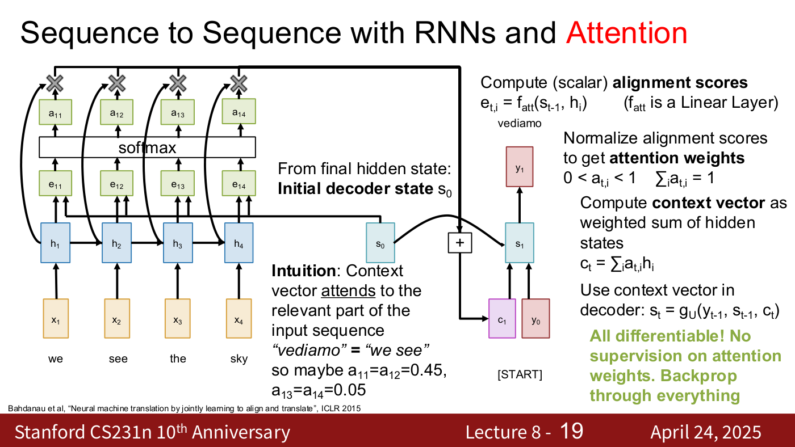
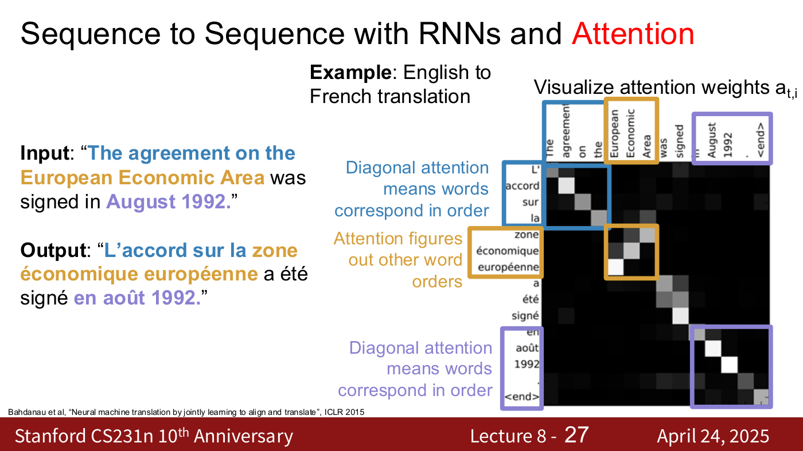
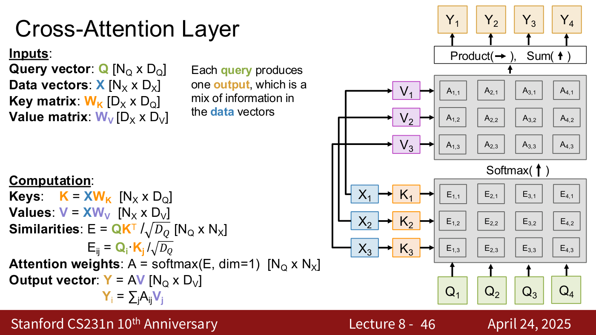
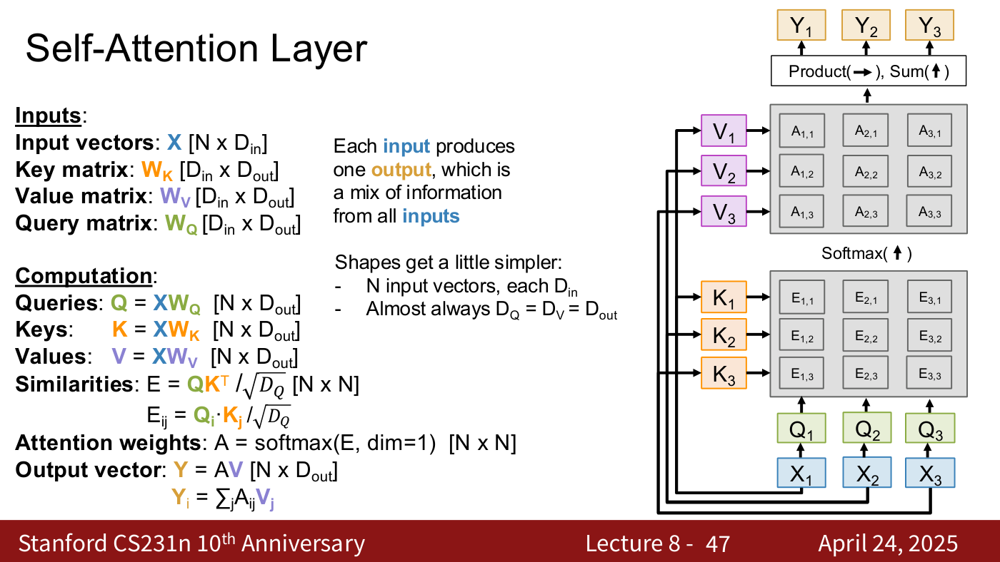
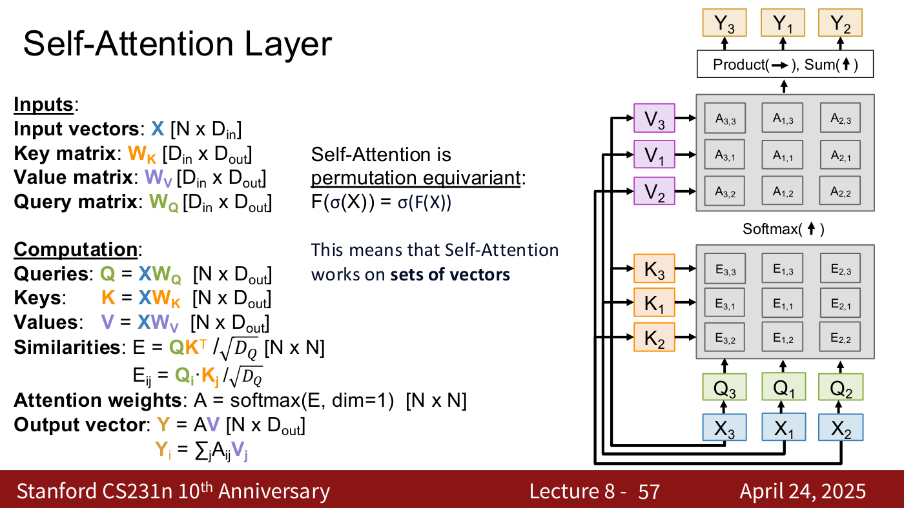
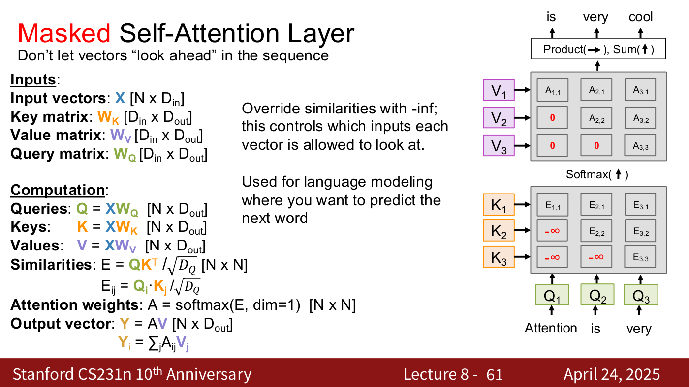
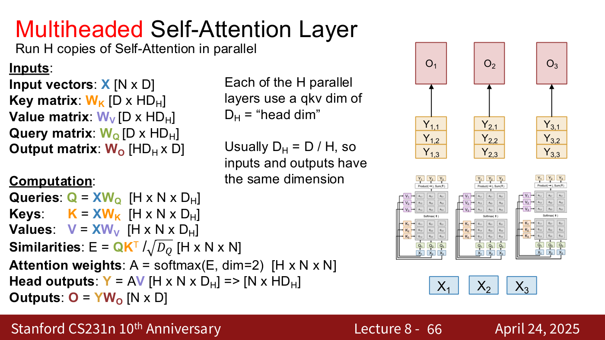
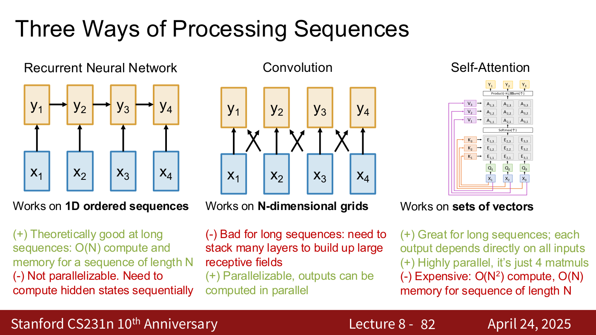

# Attention

**Attention** lets a model build each output as a weighted mix of a set of vectors, with the
weights computed on the fly from how well each vector matches what that output is looking for. The
course introduces it in [lecture 8](08-attention-transformers.md) (April 24, 2025) as "a new
primitive that operates on sets of vectors" (lecture 8, slide 4), and builds it in the order it
was discovered: first as a fix for recurrent translation models, then as a layer of its own. This
page gathers that material. Citations "lecture 8, slide N" are to the
[lecture 8 slide file](../raw/slides/08-attention-transformers.md), and timestamps
"(lecture 8, ≈M:SS)" to the [lecture 8 transcript](../raw/transcripts/08-attention-transformers.md).

Related pages: [transformers](transformers.md), the architecture built from attention, and
[recurrent neural networks](recurrent-neural-networks.md), the models attention grew out of.

## Where attention came from: the sequence-to-sequence bottleneck

A sequence-to-sequence RNN translates by running an **encoder** RNN over the input,
$h_t = f_W(x_t, h_{t-1})$, and a **decoder** RNN, $s_t = g_U(y_{t-1}, s_{t-1}, c)$, that produces
the output one token at a time from a single **context vector** $c$, often the encoder's last
hidden state $h_T$ (lecture 8, slides 6–10, citing Sutskever et al., NeurIPS 2014). Everything
the decoder knows about the input has to pass through that one fixed-size vector: "Input sequence
bottlenecks through fixed sized c. What if T=1000?" (lecture 8, slide 11). A vector of "128
floats, 1024 floats" may hold four words, but not "a whole paragraph, or a whole book"
(lecture 8, ≈6:58–7:43). The fix is to "look back at the whole input sequence on each step of the
output" (lecture 8, slide 12).

**Attention in the decoder** (lecture 8, slides 13–23, citing Bahdanau et al., ICLR 2015). At
decoder step $t$, score every encoder state $h_i$ against the previous decoder state with a
learned linear layer $f_{att}$, normalise the scores with a softmax into attention weights
$a_{t,i}$, and take the weighted sum of the encoder states as that step's context vector:

$$e_{t,i} = f_{att}(s_{t-1}, h_i) \qquad c_t = \sum_i a_{t,i} h_i$$

The decoder then uses $c_t$ in place of the fixed $c$: $s_t = g_U(y_{t-1}, s_{t-1}, c_t)$. Each
step gets its own context vector, so the input is "not bottlenecked through single vector"
(lecture 8, slide 23). The weights $a_{t,i}$ lie between 0 and 1 and sum to 1 over $i$
(lecture 8, slide 15). No one tells the network where to look: "All differentiable! No
supervision on attention weights. Backprop through everything" (lecture 8, slide 19), with the
usual cross-entropy loss on the output tokens (lecture 8, ≈14:38).

*Lecture 8, slide 19 — one decoder step with attention: s₀ is scored against h₁…h₄, the softmax gives weights a₁₁…a₁₄, and their weighted sum of the encoder states is the context vector c₁. [Deck](https://cs231n.stanford.edu/slides/2025/lecture_8.pdf)*

Because the weights form a distribution over input words for each output word, they can be
plotted. In English-to-French translation, "diagonal attention means words correspond in order",
while "European Economic Area" → "zone économique européenne" shows that "attention figures out
other word orders" (lecture 8, slides 24–27; ≈21:33–25:25). The network was never told about
grammar; "that's the mystery of deep learning" (lecture 8, ≈23:51).

*Lecture 8, slide 27 — attention weights of a translation model, one row per French word: in-order diagonals (blue, purple) and, in the gold box, the reversed order of "European Economic Area". [Deck](https://cs231n.stanford.edu/slides/2025/lecture_8.pdf)*

## The attention layer: queries, keys and values

"There's a general operator hiding here" (lecture 8, slide 28). The decoder states act as
**query vectors**, the encoder states as **data vectors**, and the context vectors are the
**outputs**: "Each query attends to all data vectors and gives one output vector" (lecture 8,
slide 29). Lecture 8 generalises this one step at a time (slides 30–40; ≈30:01–41:34):

1. Replace $f_{att}$ by a **dot product**, "the simplest possible function that inputs two vectors
   and gives us a scalar similarity score" (≈31:33).
2. **Scale** it by the square root of the dimension, because "large similarities will cause
   softmax to saturate and give vanishing gradients" (slide 38).
3. Process **many queries** at once, so the similarities become one matrix multiply.
4. Project the data vectors separately into **keys**, compared with the queries, and **values**,
   combined into the outputs, so the data vectors are no longer used for both jobs.

The result is the general attention layer (lecture 8, slide 40). The inputs are queries $Q$ of
shape $[N_Q \times D_Q]$, data vectors $X$ of shape $[N_X \times D_X]$, a key matrix $W_K$ of
shape $[D_X \times D_Q]$ and a value matrix $W_V$ of shape $[D_X \times D_V]$:

$$K = XW_K, \qquad V = XW_V$$

$$E = QK^T / \sqrt{D_Q}, \qquad A = \mathrm{softmax}(E, \text{dim}=1), \qquad Y = AV$$

The similarities $E$ and attention weights $A$ are $[N_Q \times N_X]$ and the outputs $Y$ are
$[N_Q \times D_V]$; elementwise, $E_{ij} = Q_i \cdot K_j / \sqrt{D_Q}$ and $Y_i = \sum_j A_{ij} V_j$.
Each query gets a distribution over the keys, and each output is "a linear combination of all
values, weighted by attention weights" (lecture 8, slides 44–45). On the slides' grids, each
query's similarities form a column and the softmax runs up each column; in the matrix $E$ they
form a row, which $\text{dim}=1$ normalises.

The lecturer's intuition for keys and values is a search engine: the query is what you type, it is
matched against keys on the back end, and the value you get back ("Stanford") is different from
the query you typed (lecture 8, ≈40:46–41:34). How a data vector is split into keys and values is
not specified: $W_K$ and $W_V$ are learned (lecture 8, ≈43:04–44:35).

## Cross-attention and self-attention

With two sets of inputs, queries and data vectors that may come from different sources, the layer
is a **cross-attention layer**: "each query produces one output, which is a mix of information in
the data vectors" (lecture 8, slide 46).

*Lecture 8, slide 46 — cross-attention: four queries and three data vectors; each column of the similarity grid belongs to one query and is softmaxed upwards into a distribution over the three keys. [Deck](https://cs231n.stanford.edu/slides/2025/lecture_8.pdf)*

With one set of inputs, the layer is a **self-attention layer**, "maybe even more commonly" used
(lecture 8, ≈45:21). Each of the $N$ input vectors $X$ of shape $[N \times D_{in}]$ is projected to
a query, a key and a value by learned matrices $W_Q$, $W_K$, $W_V$ of shape $[D_{in} \times D_{out}]$,
and "each input produces one output, which is a mix of information from all inputs"
(lecture 8, slide 47):

$$Q = XW_Q, \qquad K = XW_K, \qquad V = XW_V$$

$$E = QK^T / \sqrt{D_Q}, \qquad A = \mathrm{softmax}(E, \text{dim}=1), \qquad Y = AV$$

Here $E$ and $A$ are $[N \times N]$, and "almost always $D_Q = D_V = D_{out}$". The three
projections are "often fused to one matmul", $[N \times D_{in}] [D_{in} \times 3D_{out}]$
(lecture 8, slide 48).

*Lecture 8, slide 47 — self-attention: each input X₁…X₃ gives its own query, key and value, so the similarity and attention grids are 3-by-3 with one output per input. [Deck](https://cs231n.stanford.edu/slides/2025/lecture_8.pdf)*

Which to use depends on the problem (lecture 8, ≈49:11–50:43). Translation, or captioning with an
image and the words being generated, has two kinds of things to compare, which suits
cross-attention. Image classification has only the image, whose parts are compared with each
other, which suits self-attention.

## Sets, not sequences: permutation equivariance

Shuffle the inputs of a self-attention layer and the queries, keys, values, similarities, attention
weights and outputs all come out the same, shuffled the same way (lecture 8, slides 52–56;
≈50:43–51:29). Self-attention is **permutation equivariant**, $F(\sigma(X)) = \sigma(F(X))$ for a
permutation $\sigma$, so it "works on sets of vectors" (lecture 8, slide 57).

*Lecture 8, slide 57 — permuted inputs X₃, X₁, X₂ give the same queries, keys, values, similarities, weights and outputs, permuted the same way. [Deck](https://cs231n.stanford.edu/slides/2025/lecture_8.pdf)*

When order matters, that is a problem: "Self-Attention does not know the order of the sequence"
(lecture 8, slide 58). The slides' solution is to "add positional encoding to each input; this is
a vector that is a fixed function of the index" (lecture 8, slide 59). The lecturer speaks of
concatenating "a positional embedding" and says there are "a bunch of different mechanisms for
that", without describing one (lecture 8, ≈52:15–53:01). In a vision transformer, the encoding
tells the model "the 2D position of each patch" (lecture 8, slide 106).

## Masked self-attention

**Masked self-attention** controls which inputs each vector may look at by overriding
similarities with $-\infty$ before the softmax, which turns them into zero weights
(lecture 8, slide 60). For language modelling, each word may look only at the words before it:
"Don't let vectors 'look ahead' in the sequence" (lecture 8, slide 61). With this, the
next-word prediction of lecture 7 can be done "natively with this self-attention block", with no
RNN (lecture 8, ≈54:33). A vision transformer uses no masking: "each image patch can look at all
other image patches" (lecture 8, slide 107).

*Lecture 8, slide 61 — masked self-attention for "Attention is very" → "is very cool": the −∞ similarities (red) become zero weights, so no word attends to a later one. [Deck](https://cs231n.stanford.edu/slides/2025/lecture_8.pdf)*

## Multi-headed self-attention

"Run H copies of Self-Attention in parallel", each "head" with its own weights, stack the $H$
outputs for each input, and fuse them with an output projection (lecture 8, slides 62–65).
With $X$ of shape $[N \times D]$, each head works in a "head dim" $D_H$, "usually $D_H = D/H$, so
inputs and outputs have the same dimension" (lecture 8, slide 66):

$$Q = XW_Q, \qquad K = XW_K, \qquad V = XW_V \qquad [H \times N \times D_H]$$

$$A = \mathrm{softmax}(E, \text{dim}=2) \quad [H \times N \times N], \qquad Y = AV \Rightarrow [N \times HD_H], \qquad O = YW_O \quad [N \times D]$$

with $E = QK^T / \sqrt{D_Q}$ as printed (the slides keep the single-head $D_Q$; each head's query
dimension is $D_H$). The heads differ only in their weights, initialised differently
(lecture 8, ≈57:40). All heads are computed together with batched matrix multiplies, and this
form is "used everywhere in practice" (lecture 8, slide 67).

*Lecture 8, slide 66 — three heads read the same inputs; each input's head outputs are stacked (orange) and fused by the output projection into O₁, O₂, O₃. [Deck](https://cs231n.stanford.edu/slides/2025/lecture_8.pdf)*

## Cost: four matrix multiplies, quadratic in N

Multi-headed self-attention is four matrix multiplies (lecture 8, slides 69–72): the QKV
projection $[N \times D] [D \times 3HD_H]$, the QK similarity
$[H \times N \times D_H] [H \times D_H \times N] \Rightarrow [H \times N \times N]$, the V-weighting
$[H \times N \times N] [H \times N \times D_H]$, and the output projection
$[N \times HD_H] [HD_H \times D]$. That makes it highly parallel (lecture 8, ≈56:53).

The two middle steps make compute and memory grow as $O(N^2)$ in the number of vectors
(lecture 8, slides 73–76). With $N = 100{,}000$ and $H = 64$, the slide puts the attention weights
at "1.192 TB! GPUs don't have that much memory…" (lecture 8, slide 77). That is
$6.4 \times 10^{11}$ weights; the slide does not say how many bytes each takes, and its figure is
what 2 bytes per weight gives in GiB (1,192), divided by 1,000, so its units are mixed: in decimal
units it is 1.28 TB. **Flash Attention** (Dao et al., 2022) "computes 2+3 at the same time without
storing the full attention matrix", bringing memory down to $O(N)$ (lecture 8, slide 78). The
lecturer's view is that the $N^2$ compute "is actually a good thing", since more compute gives
the network "more ability to think" (lecture 8, ≈1:01:31–1:02:18).

## Attention compared with recurrence and convolution

Lecture 8, slides 80–82, set the three ways of processing sequences side by side (≈58:26–1:00:44).
An RNN works on 1D ordered sequences with $O(N)$ compute and memory, but is not parallelisable.
Convolution works on N-dimensional grids and is parallelisable, but needs many stacked layers to
build a large receptive field. Self-attention works on sets of vectors; every output depends
directly on every input and it is "just 4 matmuls", but it is expensive. The slide prints
$O(N^2)$ compute and $O(N)$ memory, the memory figure being what slide 78 gives with Flash
Attention.

*Lecture 8, slide 82 — an RNN chains its steps, a convolution mixes neighbours, and self-attention connects every input to every output. [Deck](https://cs231n.stanford.edu/slides/2025/lecture_8.pdf)*

The verdict is the title of Vaswani et al. (NeurIPS 2017), "Attention is All You Need"
(lecture 8, slide 83): "of the three, you can get a long way using only attention"
(lecture 8, ≈1:00:44). That paper's architecture is the [Transformer](transformers.md).

## Where the course covers attention

- [Lecture 8 — Attention and Transformers](08-attention-transformers.md): everything on this page.
- [Lecture 7 — Recurrent Neural Networks](07-recurrent-neural-networks.md) builds the RNNs and the
  sequence tasks attention starts from.
- [Lecture 1](01-introduction.md) previews attention in its tour of the course
  (lecture 1, part 2, slide 17).
