# Backpropagation and computational graphs

Training a network by gradient descent needs the gradient of the loss with respect to every
weight. **Backpropagation** computes all of those gradients mechanically, without anyone deriving
the network's gradient by hand. Lecture 4 defines it as "recursive application of the chain rule
along a computational graph to compute the gradients of all inputs/parameters/intermediates"
(lecture 4, slide 151). This page covers why it is needed, computational graphs, what each node
does in the backward pass, the two worked examples, the patterns of common gates, how frameworks
implement it, and how it extends to vectors and matrices.

Covered in: [Lecture 4](04-neural-networks-backpropagation.md#backpropagation-a-simple-example).
Its history, Rumelhart, Hinton and Williams's 1986 learning rule, is in
[lecture 1](01-introduction.md#the-neural-network-thread). Checking a backpropagation
implementation against a numerical gradient is on [gradient descent](gradient-descent.md#the-gradient).

## Why it is needed

A 2-layer network with hinge loss and L2 regularization has the total loss

$$L = \frac{1}{N}\sum_{i=1}^{N} L_i + \lambda R(W_1) + \lambda R(W_2)$$

averaged over $N$ examples, with regularization strength $\lambda$. "If we can compute
$\frac{\partial L}{\partial W_1}$, $\frac{\partial L}{\partial W_2}$ then we can learn $W_1$ and
$W_2$" (lecture 4, slides 51–52). Deriving those gradients on paper is a bad idea for three reasons
(lecture 4, slide 53). It is very tedious, with lots of matrix calculus. Any change to the loss
means re-deriving everything from scratch. And it is not feasible for very complex models. "If the
network has 100 layers, we're not going to be sitting down and writing the function for all of the
100 layers separately" (lecture 4, ≈53:07).

## Computational graphs

A **computational graph** writes a function as a network of simple operations, from the inputs and
parameters to the loss. For the linear classifier with hinge loss, $x$ and $W$ feed a multiply node
that produces the scores; the scores feed a hinge-loss node; $W$ also feeds a regularization node;
and an add node combines the two into $L$ (lecture 4, slide 54). The same framework scales to
AlexNet and to graphs far too large to differentiate by hand (lecture 4, slides 55–57).

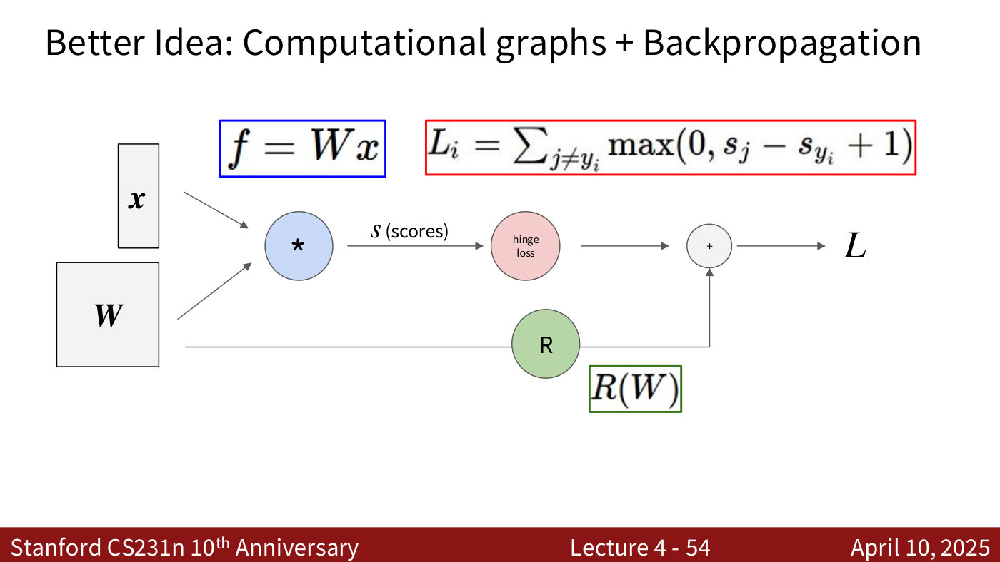

*Lecture 4, slide 54 — the linear classifier with hinge loss and regularization as a computational graph: x and W multiply into scores s, and the hinge loss and R(W) add into L. [Deck](https://cs231n.stanford.edu/slides/2025/lecture_4.pdf)*

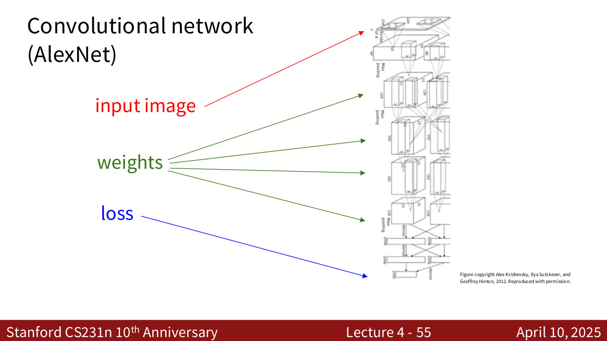

*Lecture 4, slide 55 — AlexNet as a computational graph, from input image through its weights to the loss. [Deck](https://cs231n.stanford.edu/slides/2025/lecture_4.pdf)*

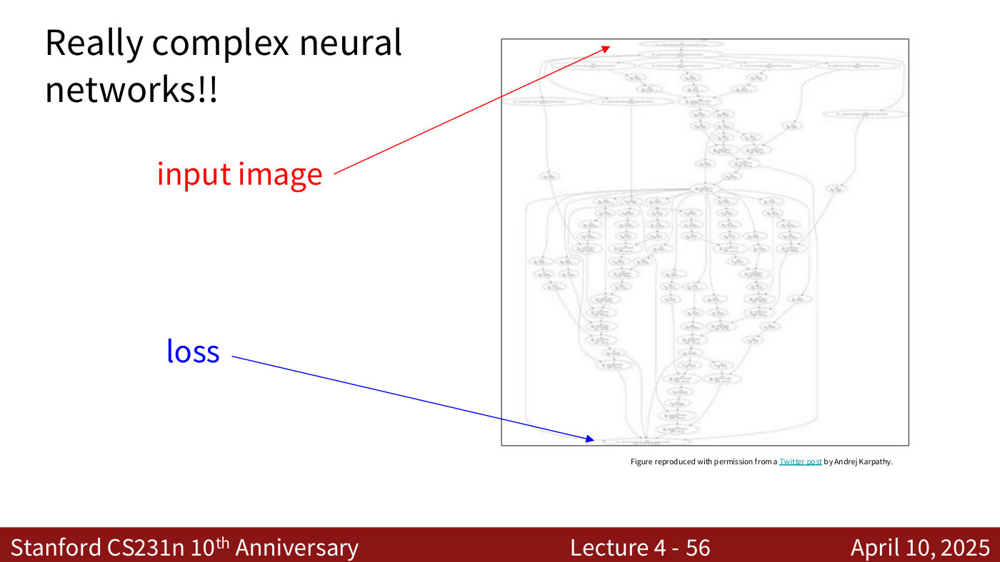

*Lecture 4, slide 56 — a very large computational graph (from a post by Andrej Karpathy): far too big to differentiate by hand. [Deck](https://cs231n.stanford.edu/slides/2025/lecture_4.pdf)*

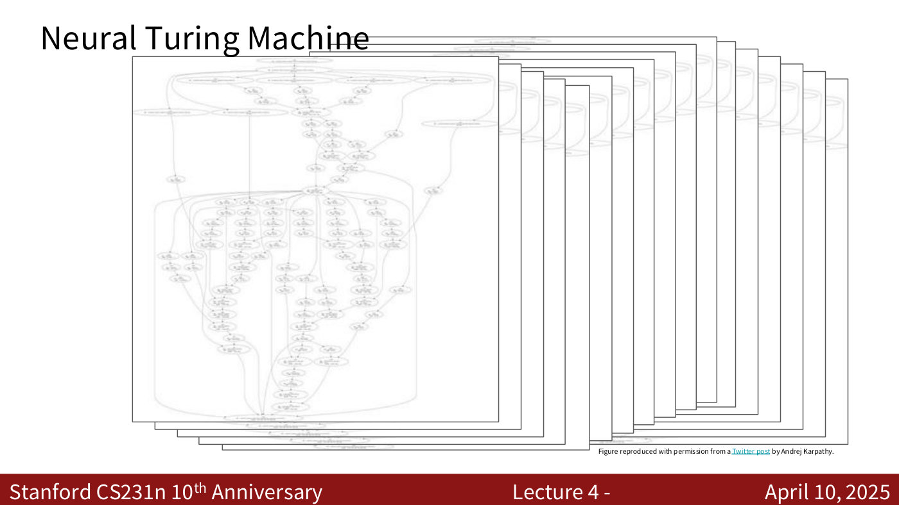

*Lecture 4, slide 57 — the Neural Turing Machine's graph, unrolled many times over. [Deck](https://cs231n.stanford.edu/slides/2025/lecture_4.pdf)*

A graph is not unique. Several nodes can be grouped into one when the group's gradient is easy to
write down: "Choose one where local gradients at each node can be easily expressed!" (lecture 4,
slide 97).

## What one node does

The backward pass starts at the output, where the gradient of the loss with respect to itself is
1, and works back through the graph one node at a time (lecture 4, ≈46:08–46:58). Take a node $f$
with inputs $x$, $y$ and output $z$:

- Its **local gradients** $\frac{\partial z}{\partial x}$ and $\frac{\partial z}{\partial y}$
  depend only on the node's own function, so it can always compute them.
- Its **upstream gradient** $\frac{\partial L}{\partial z}$, the gradient of the final loss $L$
  with respect to its output, arrives from the nodes after it.
- It multiplies the two, by the chain rule, to get the **downstream gradients**, and sends each to
  the node that produced that input, where it becomes that node's upstream gradient.

$$\frac{\partial L}{\partial x} = \frac{\partial L}{\partial z}\frac{\partial z}{\partial x}
\qquad
\frac{\partial L}{\partial y} = \frac{\partial L}{\partial z}\frac{\partial z}{\partial y}$$

Every node works the same way and needs only local information (lecture 4, slide 80).

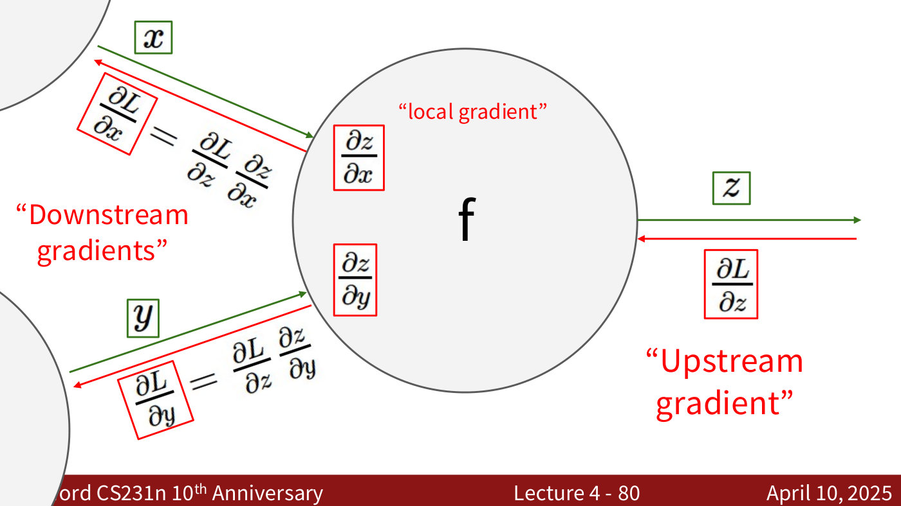

*Lecture 4, slide 80 — one node seen locally: it knows its local gradients, receives the upstream gradient ∂L/∂z, and multiplies them to send downstream gradients to the nodes that produced x and y. [Deck](https://cs231n.stanford.edu/slides/2025/lecture_4.pdf)*

## Worked example: f = (x + y)z

With $x = -2$, $y = 5$, $z = -4$, an add node gives $q = x + y = 3$ and a multiply node gives
$f = qz = -12$. Working backwards: $\frac{\partial f}{\partial f} = 1$;
$\frac{\partial f}{\partial z} = q = 3$; $\frac{\partial f}{\partial q} = z = -4$; and, by the chain
rule through $q$, $\frac{\partial f}{\partial y} = \frac{\partial f}{\partial q}\frac{\partial q}{\partial y} = (-4)(1) = -4$,
and likewise $\frac{\partial f}{\partial x} = -4$ (lecture 4, slide 74). The step-by-step version is
on the [lecture 4 page](04-neural-networks-backpropagation.md#backpropagation-a-simple-example).

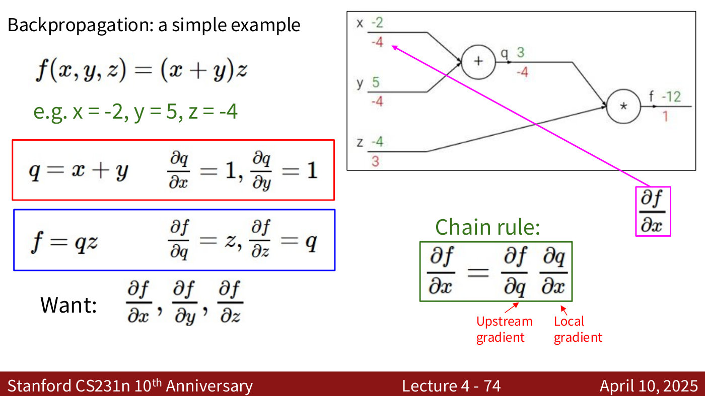

*Lecture 4, slide 74 — the finished backward pass for f = (x + y)z. Forward values are in green (x = −2, y = 5, q = 3, z = −4, f = −12), gradients in red beneath them (1 at f, 3 at z, −4 at q, y and x). [Deck](https://cs231n.stanford.edu/slides/2025/lecture_4.pdf)*

## Worked example: a sigmoid neuron

The second example is $f(w, x) = \frac{1}{1+e^{-(w_0 x_0 + w_1 x_1 + w_2)}}$ with $w_0 = 2$,
$x_0 = -1$, $w_1 = -3$, $x_1 = -2$, $w_2 = -3$, broken into multiplies, adds, a multiply by $-1$,
an exponential, an add of 1 and a reciprocal. The forward pass gives 0.73. The backward pass
multiplies upstream by local gradients node by node, giving $-0.53$, $-0.53$, $-0.20$ and 0.20 back
along the chain. The weights end with gradients $-0.20$ for $w_0$, $-0.40$ for $w_1$ and 0.20 for
$w_2$, and the inputs with 0.40 for $x_0$ and $-0.60$ for $x_1$ (lecture 4, slide 96 and
slide 105). The full table is on the
[lecture 4 page](04-neural-networks-backpropagation.md#another-example-a-sigmoid-neuron).

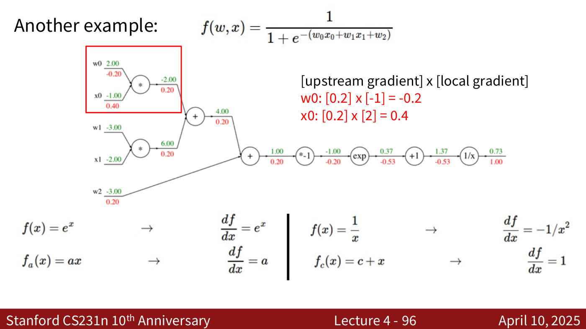

*Lecture 4, slide 96 — the sigmoid example near the end of its backward pass: green forward values above each edge, red gradients below, and the four derivative rules used along the way. [Deck](https://cs231n.stanford.edu/slides/2025/lecture_4.pdf)*

The last four nodes compute the **sigmoid** $\sigma(x) = \frac{1}{1+e^{-x}}$, whose local gradient
is expressed through its own output:

$$\frac{d\sigma(x)}{dx} = (1-\sigma(x))\thinspace\sigma(x)$$

Treated as one gate with output 0.73, it gives $[1.00] \times [(1 - 0.73)(0.73)] = 0.2$ in a single
step, the same as going node by node (lecture 4, slide 100).

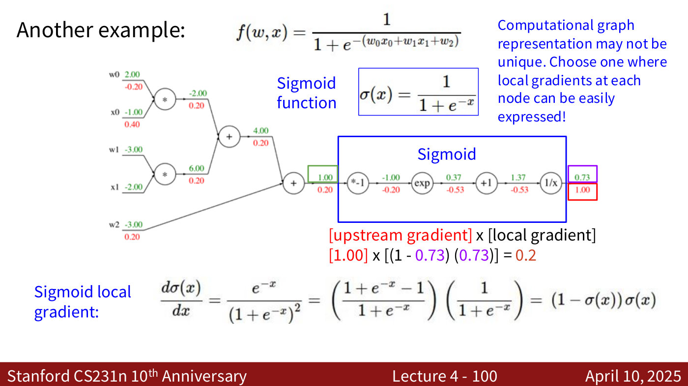

*Lecture 4, slide 100 — the last four nodes grouped as one sigmoid gate: its local gradient (1 − σ)σ, evaluated at the output 0.73, gives the same 0.2 as stepping through each node. [Deck](https://cs231n.stanford.edu/slides/2025/lecture_4.pdf)*

## Patterns in gradient flow

Four gates behave in ways worth memorising (lecture 4, slide 104):

- **Add gate: gradient distributor.** Every input receives the upstream gradient unchanged.
- **Mul gate: "swap multiplier".** Each input receives the upstream gradient times the *other*
  input; with inputs 2 and 3 and upstream gradient 5, they get 15 and 10.
- **Copy gate: gradient adder.** A value used in two places receives the sum of the gradients
  coming back from both.
- **Max gate: gradient router.** The larger input receives the whole upstream gradient; the other
  receives 0. The lecturer notes this is "very similar to the ReLU function" (lecture 4, ≈1:01:38).

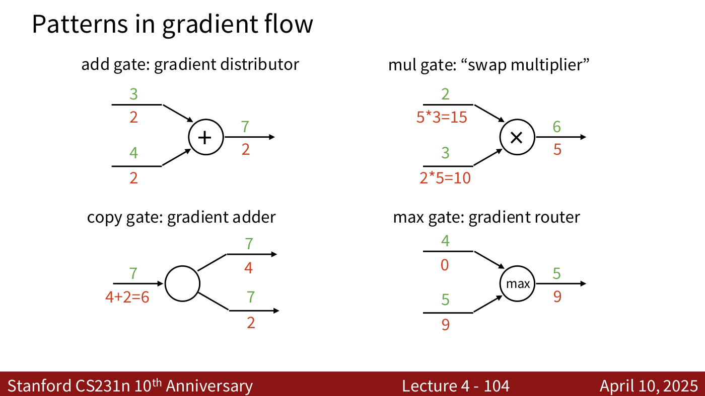

*Lecture 4, slide 104 — four gates to memorise. Add distributes the gradient, mul swaps the inputs as multipliers, copy adds the incoming gradients, max routes all of it to the larger input. [Deck](https://cs231n.stanford.edu/slides/2025/lecture_4.pdf)*

## How it is implemented

The simplest implementation is "flat" code. A forward pass computes and keeps every intermediate
value, then a backward pass walks the same steps in reverse, one line per gradient, starting from
`grad_L = 1.0` (lecture 4, slide 105).

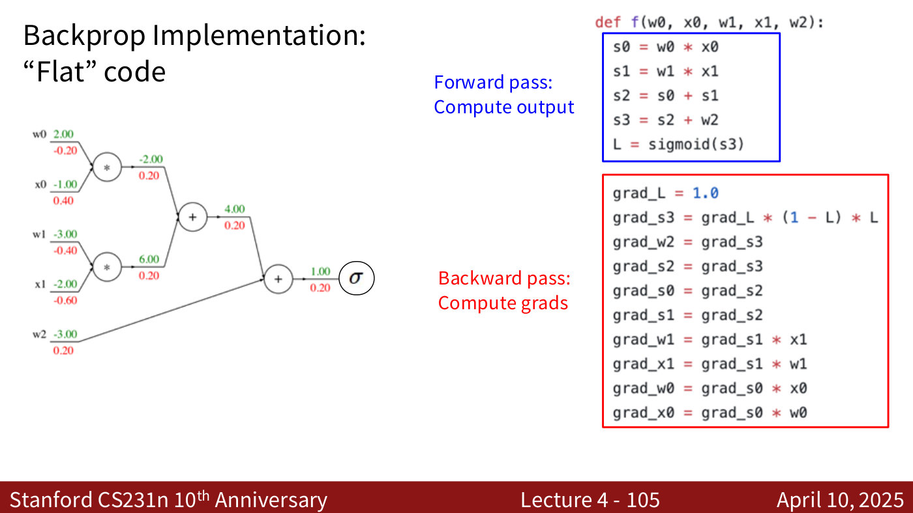

*Lecture 4, slide 105 — "flat" backprop code beside its graph: the forward pass computes the output, then the backward pass walks the graph in reverse, one line per gradient. [Deck](https://cs231n.stanford.edu/slides/2025/lecture_4.pdf)*

Frameworks modularise this instead. Each operation is a node object with a `forward()` and a
`backward()` method, and the graph calls them in order. The forward method computes the result
and caches whatever the backward method will need; the backward method receives the upstream
gradient and returns upstream times local (lecture 4, slides 115 and 151). Lecture 4's example is
PyTorch's own multiply function:

```python
class Multiply(torch.autograd.Function):
  @staticmethod
  def forward(ctx, x, y):
    ctx.save_for_backward(x, y)
    z = x * y
    return z
  @staticmethod
  def backward(ctx, grad_z):
    x, y = ctx.saved_tensors
    grad_x = y * grad_z   # dz/dx * dL/dz
    grad_y = x * grad_z   # dz/dy * dL/dz
    return grad_x, grad_y
```

PyTorch's sigmoid layer has the same shape. Its backward function computes upstream $\times (1 - z) \times z$
from the saved output $z$ (lecture 4, slides 117–119).

## Vectors and Jacobians

With vector inputs and outputs the method is unchanged, but the derivatives grow (lecture 4,
slide 123). The derivative of a scalar with respect to a vector $x \in \mathbb{R}^N$ is the
**gradient**, a vector in $\mathbb{R}^N$. The derivative of a vector $y \in \mathbb{R}^M$ with
respect to $x$ is the **Jacobian**, which the deck writes as a matrix in $\mathbb{R}^{N \times M}$
whose entry $(n, m)$ is $\frac{\partial y_m}{\partial x_n}$.

For a node with vector inputs $x$, $y$ and output $z$ of sizes $D_x$, $D_y$, $D_z$, the loss is
still a scalar. So the upstream gradient $\frac{\partial L}{\partial z}$ is a vector of size $D_z$,
the local gradients are Jacobian matrices of sizes $[D_x \times D_z]$ and $[D_y \times D_z]$, and
each downstream gradient is a matrix–vector product:

$$\frac{\partial L}{\partial x} = \frac{\partial z}{\partial x}\frac{\partial L}{\partial z}$$

The gradient with respect to a variable always has that variable's shape (lecture 4,
slides 130–131).

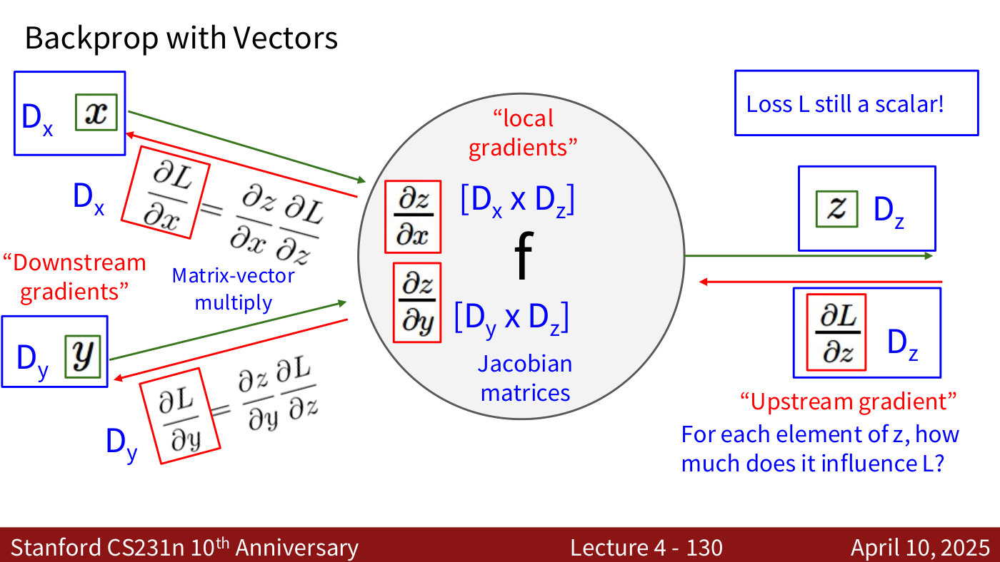

*Lecture 4, slide 130 — backprop with vectors: the upstream gradient has z's size, each local gradient is a Jacobian matrix, and each downstream gradient is a matrix–vector product with its input's size. [Deck](https://cs231n.stanford.edu/slides/2025/lecture_4.pdf)*

### Never form the Jacobian

Jacobians are usually huge and sparse, so implementations never build them. For elementwise ReLU,
$z = \max(0, x)$, each output depends only on its own input. With $x = [1, -2, 3, -1]$ and upstream
gradient $[4, -1, 5, 9]$, the Jacobian is $\mathrm{diag}(1, 0, 1, 0)$ and the downstream gradient is
$[4, 0, 5, 0]$ (lecture 4, slide 137). The rule that replaces the matrix is: pass the upstream
gradient where the input was positive, and 0 elsewhere (lecture 4, slide 138).

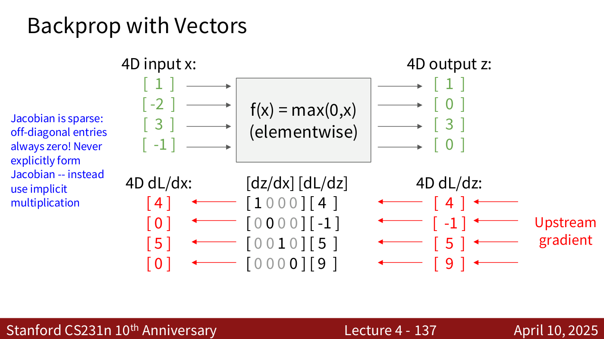

*Lecture 4, slide 137 — elementwise ReLU. The Jacobian is diagonal (1 where the input was positive, 0 elsewhere), so the downstream gradient [4, 0, 5, 0] just zeroes the upstream entries where the input was negative. [Deck](https://cs231n.stanford.edu/slides/2025/lecture_4.pdf)*

For a matrix multiplication $y = xw$, with $x$ of shape $[N \times D]$ and $w$ of shape
$[D \times M]$, each Jacobian would take about 256 GB at $N = 64$ and $D = M = 4096$
(lecture 4, slide 144). Working entry by entry instead, $x_{n,d}$ affects only row $n$ of $y$, and
affects $y_{n,m}$ by $w_{d,m}$, the "swap multiplier" again (lecture 4, slides 146–148). Collected,
the gradients are two matrix products:

$$\frac{\partial L}{\partial x} = \left(\frac{\partial L}{\partial y}\right) w^{T} \qquad \frac{\partial L}{\partial w} = x^{T}\left(\frac{\partial L}{\partial y}\right)$$

"These formulas are easy to remember: they are the only way to make shapes match up!" (lecture 4,
slide 150). The numbers on those slides contain a printed slip: the $y$ shown is not the product
of the $x$ and $w$ shown. The [lecture 4 page](04-neural-networks-backpropagation.md#example-matrix-multiplication)
gives the correct product. The derivation is in the course's
[linear-backprop handout](https://cs231n.stanford.edu/handouts/linear-backprop.pdf).

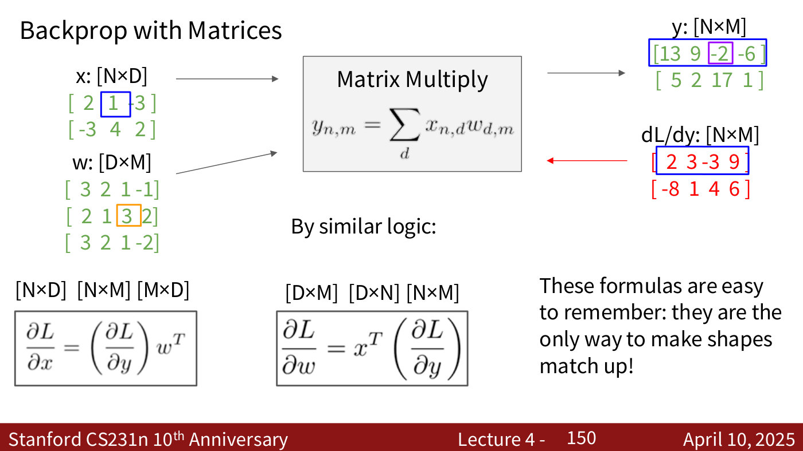

*Lecture 4, slide 150 — the matrix multiply's backward pass, ∂L/∂x = (∂L/∂y)wᵀ and ∂L/∂w = xᵀ(∂L/∂y), the only products whose shapes match. The printed y is not x times w (see the lecture 4 page). [Deck](https://cs231n.stanford.edu/slides/2025/lecture_4.pdf)*

## Through time: recurrent networks

Lecture 7 applies the same machinery to [recurrent neural networks](recurrent-neural-networks.md),
whose computational graph reuses one weight matrix at every time step (lecture 7, slides 39–45).
As at a copy gate, the gradient for the shared weights is the sum of the gradients from every place
they are used: "you can calculate the gradient for each time step separately and then you're going
to sum them all together" (lecture 7, ≈24:52). Running backward through the whole sequence is
**backpropagation through time**; on long sequences it runs out of memory, so **truncated**
backpropagation through time backpropagates only within chunks while carrying the hidden state
forward (lecture 7, slides 54–58). The chain rule through many steps multiplies many Jacobians
together, which is why gradients in a vanilla RNN vanish or explode (lecture 7, slides 106–115). See
[vanishing and exploding gradients](recurrent-neural-networks.md#vanishing-and-exploding-gradients)
and the [LSTM](lstm.md).

## Memory: storing activations, or recomputing them

The backward pass for a layer needs that layer's input activations as well as the upstream gradient, so a normal forward pass keeps every layer's activations until the backward pass consumes them: $O(N)$ memory for a network of $N$ layers (lecture 11, slides 71 and 81). For very large models those activations fill GPU memory. Lecture 11's **activation checkpointing** keeps only some of them and recomputes the rest during the backward pass. Recomputing everything takes $O(N^2)$ compute and $O(1)$ memory, and a checkpoint every $\sqrt{N}$ layers takes $O(N\sqrt{N})$ compute and $O(\sqrt{N})$ memory (lecture 11, slides 97 and 101). See [distributed training](distributed-training.md) and [lecture 11](11-large-scale-distributed-training.md#activation-checkpointing).

## Related pages

- [Neural networks](neural-networks.md) — the functions backpropagation is applied to.
- [Gradient descent and SGD](gradient-descent.md) — what the gradients are used for, and the
  numerical gradient check.
- [Optimizers](optimizers.md) — momentum, RMSProp and Adam, which all consume these gradients.
- [Loss functions](loss-functions.md) — the node at the end of every graph.
- [Distributed training](distributed-training.md) — activation checkpointing, which recomputes the activations the backward pass needs (lecture 11).
- [Visualizing what networks learn](visualizing-networks.md) — gradients with respect to the input pixels instead of the weights: saliency maps, Grad-CAM and guided backpropagation (lecture 9).
