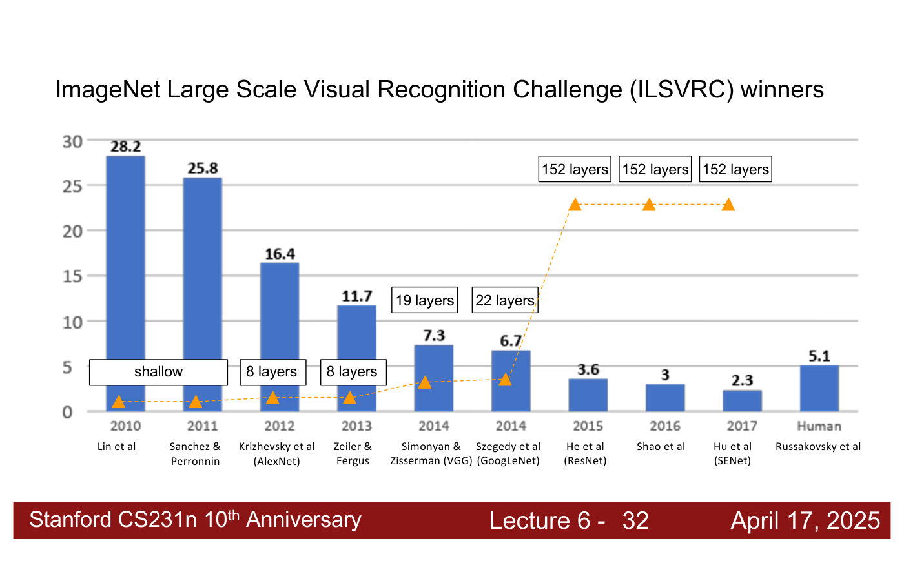
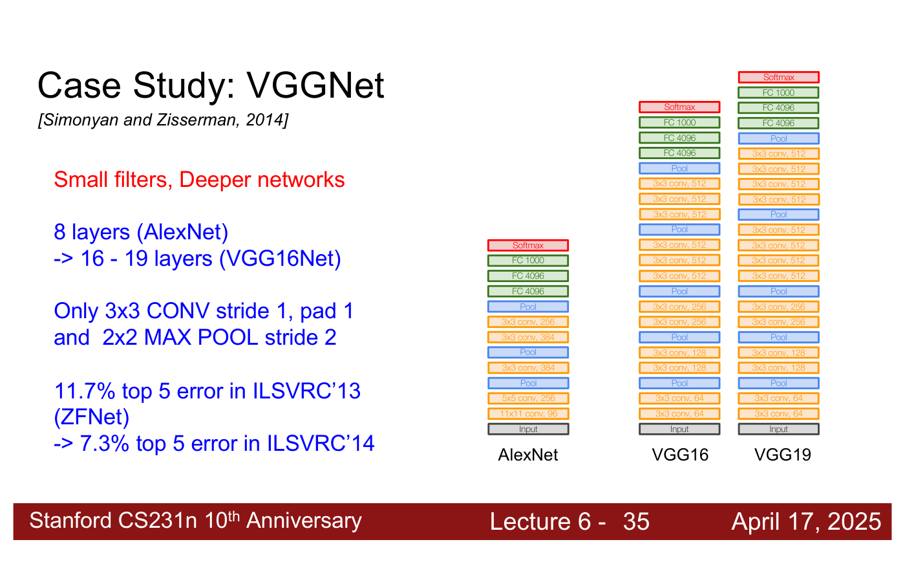
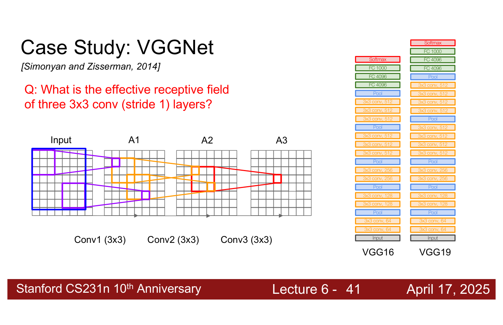
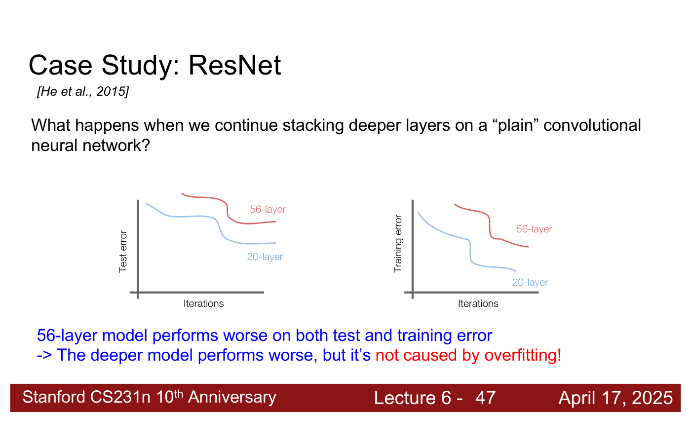
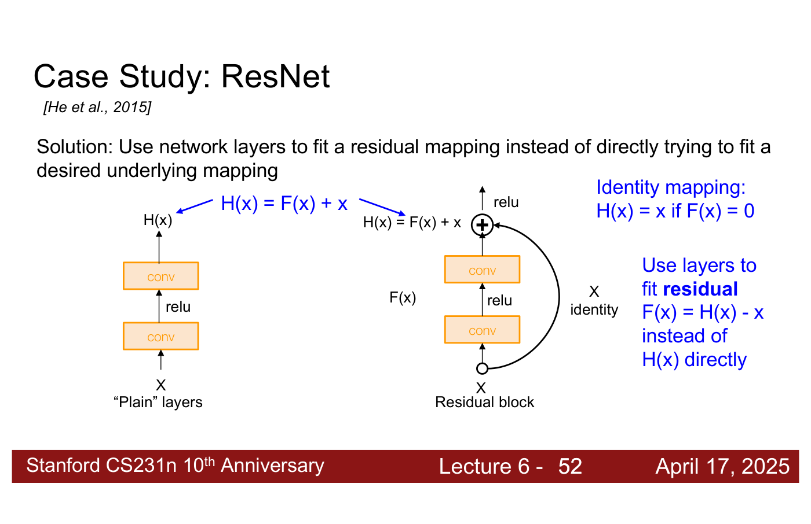
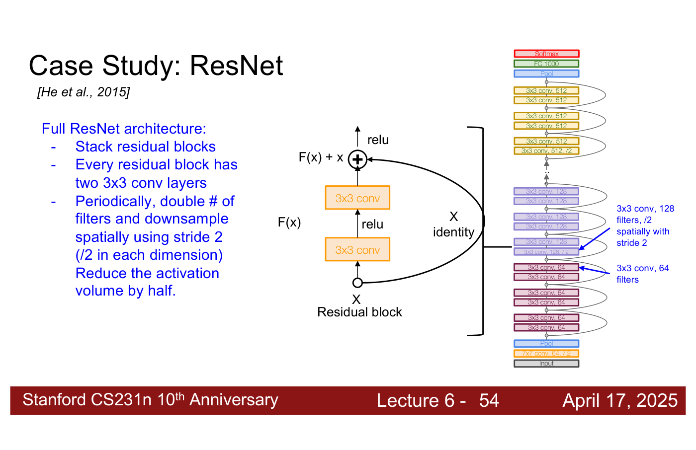
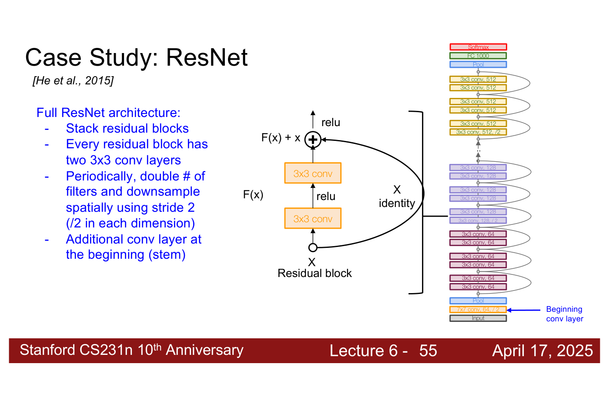
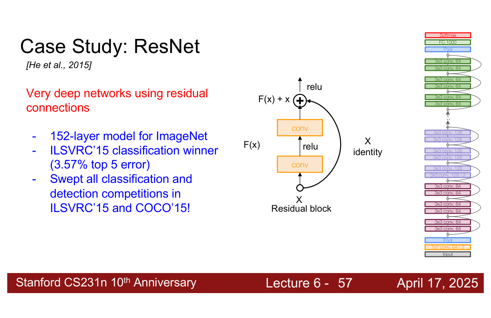

# CNN architectures

A CNN architecture is a particular way of stacking the layers of a
[convolutional network](convolutional-networks.md) — convolution, pooling, fully connected,
normalization and activation layers — into a model. This page gathers what the course says about
the architectures that won the ImageNet challenge: AlexNet, VGG and ResNet. Their main treatment
is [lecture 6](06-training-cnns-architectures.md#cnn-architectures) (Zane Durante, April 17,
2025). Citations "lecture 6, slide N" are to the
[lecture 6 slide file](../raw/slides/06-training-cnns-architectures.md), and timestamps
"(lecture 6, ≈M:SS)" to the
[lecture 6 transcript](../raw/transcripts/06-training-cnns-architectures.md).

## Block diagrams

Architectures are usually drawn as **block diagrams**: each block is one layer, or a group of
layers stacked together, which gives a feel for how two architectures differ at a glance
(lecture 6, ≈22:22–23:08). The course's diagrams stack the blocks bottom to top, from the input
image to a softmax over the classes.

## The ImageNet winners and the depth of their networks

The lecture opens its case studies with a chart of the ImageNet Large Scale Visual Recognition
Challenge winners (lecture 6, slide 32). Its blue bars are the winning error rate by year, though
the slide gives the axis no title (lecture 6, ≈21:37); its orange triangles are each winner's
number of layers.

*Lecture 6, slide 32 — the challenge winners by year: blue bars the error rate (no axis title on the slide), orange triangles the number of layers. The error falls below the human bar (5.1) in 2015, when depth jumps to 152 layers. [Deck](https://cs231n.stanford.edu/slides/2025/lecture_6.pdf)*

| Year | Winner | Bar | Layers |
| --- | --- | --- | --- |
| 2010 | Lin et al. | 28.2 | shallow |
| 2011 | Sanchez and Perronnin | 25.8 | shallow |
| 2012 | Krizhevsky et al. (AlexNet) | 16.4 | 8 |
| 2013 | Zeiler and Fergus | 11.7 | 8 |
| 2014 | Simonyan and Zisserman (VGG) | 7.3 | 19 |
| 2014 | Szegedy et al. (GoogLeNet) | 6.7 | 22 |
| 2015 | He et al. (ResNet) | 3.6 | 152 |
| 2016 | Shao et al. | 3 | 152 |
| 2017 | Hu et al. (SENet) | 2.3 | 152 |
| — | Human (Russakovsky et al.) | 5.1 | — |

Where the error first falls below the human figure, the number of layers jumps (lecture 6,
≈21:37–22:22). The deck calls 2015–2017 the "Revolution of Depth" (lecture 6, slide 44). The
history of the challenge, and why AlexNet won in 2012, is on the [ImageNet](imagenet.md) page.

## AlexNet

AlexNet was the first CNN-based model to work really well on ImageNet, and it was trained on GPUs
(lecture 6, ≈22:22). It has 8 layers. As the deck draws it, five convolutions (11x11 with 96
filters, 5x5 with 256, then 3x3 with 384, 384 and 256) have pooling after the second, third and
fifth, and are followed by fully connected layers of 4096, 4096 and 1000 (lecture 6, slide 35). Lecture 1 tells its history
and lecture 5 shows its architecture figure and its learned first-layer filters; see
[lecture 1](01-introduction.md) and [convolutional networks](convolutional-networks.md#history).

*Lecture 6, slide 35 — AlexNet, VGG16 and VGG19 as stacks of layers, bottom to top: orange 3x3 convolutions, blue pooling, green fully connected. As drawn, the VGG stacks have 15 and 17 weight layers (see above). [Deck](https://cs231n.stanford.edu/slides/2025/lecture_6.pdf)*

## VGG: small filters, deeper networks

VGG (Simonyan and Zisserman, 2014) was "a really standard and commonly used architecture in the
2010s" (lecture 6, ≈22:22). Its design is "small filters, deeper networks": 16 to 19 layers
against AlexNet's 8, using "only 3x3 CONV stride 1, pad 1 and 2x2 MAX POOL stride 2", which took
the challenge's top-5 error from 11.7% (ZFNet, 2013) to 7.3% (2014) (lecture 6, slide 35). The
$3 \times 3$ convolutions visit every position (stride 1) and do not shrink the activation
(padding 1). They come in groups followed by max pooling, and the network ends in two fully
connected layers of 4096 and one of 1000, one score per ImageNet class. It looks "like a
scaled-up version of AlexNet", built from basically three types of layer (lecture 6,
≈23:08–24:40).

The deck's drawing does not quite match the names: counting its boxes, the VGG16 stack has 12
convolution and 3 fully connected layers and the VGG19 stack 14 and 3, because each draws two
"3x3 conv, 256" boxes (lecture 6, slide 35).

### Why $3 \times 3$ filters

A stack of three $3 \times 3$ convolutions with stride 1 has the same **effective receptive
field** as one $7 \times 7$ convolution (lecture 6, slides 37–42). One value in the third
activation map depends on a $3 \times 3$ region of the second map, a $5 \times 5$ region of the
first and a $7 \times 7$ region of the input: each such layer adds two (lecture 6, ≈25:26–26:13).
See [receptive fields](convolutional-networks.md#receptive-fields).

*Lecture 6, slide 41 — the receptive field of three stacked 3x3 convolutions: one value in A3 sees 3x3 in A2, 5x5 in A1 and 7x7 (blue) in the input. [Deck](https://cs231n.stanford.edu/slides/2025/lecture_6.pdf)*

The stack is also deeper, with more non-linearities, and has fewer parameters. With $C$ channels
in and out of each layer, three $3 \times 3$ layers have $3 \cdot (3^2 C^2) = 27C^2$ weights,
against $7^2 C^2 = 49C^2$ for one $7 \times 7$ layer (lecture 6, slide 43). Fewer parameters,
and more complex relationships modelled: "a larger set of smaller filters is more expressive
than a smaller set of larger filters" (lecture 6, ≈27:45–28:30, ≈1:06:13).

## ResNet: residual connections

ResNet (He et al., 2015) began from an empirical finding (lecture 6, ≈28:30–29:16). Stacking more
layers on a "plain" convolutional network made it worse: a 56-layer plain network ends with
higher error than a 20-layer one, on the test set **and** on the training set (lecture 6,
slide 47). Higher training error rules out overfitting. A deeper model can represent everything a
shallower one can — set its extra layers to the identity — so the problem had to be
optimisation: "deeper models are harder to optimize" (lecture 6, slide 48; ≈29:16–30:53).

*Lecture 6, slide 47 — a 56-layer plain network (red) ends above a 20-layer one (blue) in both test error (left) and training error (right), so the deeper model's problem is not overfitting. [Deck](https://cs231n.stanford.edu/slides/2025/lecture_6.pdf)*

The fix builds the identity option into the architecture. A **residual block** passes its input
$x$ through two convolution layers to get $F(x)$, and adds $x$ back along a shortcut:

$$H(x) = F(x) + x$$

The layers now fit the **residual** $F(x) = H(x) - x$ rather than the desired mapping $H(x)$
itself. If $F(x) = 0$ the block is an identity mapping, so extra blocks can do nothing when
nothing helps, and in practice the filters only have to learn small values (lecture 6, slide 52;
≈31:40–33:12). Copying an earlier layer's values forward and adding them to a later layer's is a
**residual connection**; transformers use them for the same reason (lecture 6, ≈33:12, ≈34:44).

*Lecture 6, slide 52 — a plain block fits H(x) directly; a residual block fits F(x) = H(x) − x with two conv layers and adds the input back along the identity shortcut. [Deck](https://cs231n.stanford.edu/slides/2025/lecture_6.pdf)*

Plain networks did not just need more data or longer training: they did not reach the shallower
networks' performance however long they trained, which the lecturer puts down to being stuck in
essentially local minima. Exactly why residual connections avoid this is still being researched
(lecture 6, ≈34:44–36:15).

### The full architecture

A ResNet is a stack of residual blocks, each with two $3 \times 3$ convolutions (lecture 6,
slide 53). Periodically it doubles the number of filters and downsamples spatially with stride 2,
"/2 in each dimension" (lecture 6, slide 54), which halves the activation volume: as activations
pass through the network they become spatially smaller and deeper, until they are a vector for
classification (lecture 6, ≈40:03–40:49). Before the blocks sits a larger convolution, the
**stem**, "7x7 conv, 64, / 2", a purely empirical choice (lecture 6, slide 55; ≈40:49); after
them, pooling and one fully connected layer of 1000.

*Lecture 6, slide 54 — the full ResNet: residual blocks of two 3x3 convolutions, with the filters doubled and the spatial size halved (stride 2) at the start of each stage. [Deck](https://cs231n.stanford.edu/slides/2025/lecture_6.pdf)*

*Lecture 6, slide 55 — the same stack with the stem marked: one 7x7 convolution with 64 filters and stride 2 before the residual blocks. [Deck](https://cs231n.stanford.edu/slides/2025/lecture_6.pdf)*

Because blocks add tensors, the input and output of a block must have the same size, which the
stride-1, padding-1 $3 \times 3$ convolutions keep; residual connections sit within a stage,
before a pooling or downsampling step (lecture 6, ≈39:18–40:03). Within a block the network still
builds higher-level representations layer by layer, but each block learns the change to its input
rather than the representation directly (lecture 6, ≈38:32–39:18).

ResNets come in depths of 18, 34, 50, 101 and 152 layers for ImageNet (lecture 6, slide 56). Each
is trained separately, deeper ones did better by a shrinking margin — about 1% from 101 to 152 —
and GPU memory limits how large a model can be trained (lecture 6, ≈37:00–38:32). The 152-layer
model won ILSVRC'15 with 3.57% top-5 error and "swept all classification and detection
competitions in ILSVRC'15 and COCO'15" (lecture 6, slide 57). It was the first time models of more
than 100 layers trained successfully, and for a while almost every computer vision task used a
ResNet (lecture 6, ≈41:35). The stack drawn on slide 57 labels its last group "3x3 conv, 64",
where the earlier slides print 512.

*Lecture 6, slide 57 — the 152-layer ResNet won ILSVRC'15 with 3.57% top-5 error. The top group's "3x3 conv, 64" label is printed so; slides 53–56 print 512 there. [Deck](https://cs231n.stanford.edu/slides/2025/lecture_6.pdf)*

## Initialising and reusing them

Deep architectures need their weights initialised at the right scale, or activations vanish or
explode layer by layer; Kaiming initialization, by ResNet's first author, is the standard choice
(see [weight initialization](weight-initialization.md)). And few projects train these
architectures from scratch: a model pretrained on ImageNet is the usual starting point (see
[transfer learning](transfer-learning.md)).

## Lectures

- [Lecture 6 — Training CNNs and CNN Architectures](06-training-cnns-architectures.md#cnn-architectures):
  everything on this page.
- [Lecture 5 — Image Classification with CNNs](05-image-classification-cnns.md#summary-and-next-time):
  the layers, and a preview of four architecture diagrams.
- [Lecture 1 — Introduction](01-introduction.md): LeNet, AlexNet and the deep-learning explosion.

## Related pages

- [Convolutional networks](convolutional-networks.md) — the layers these architectures stack.
- [ImageNet](imagenet.md) — the challenge they competed in.
- [Normalization layers](normalization-layers.md) and [regularization](regularization.md#dropout)
  — the other layers a CNN may include.
