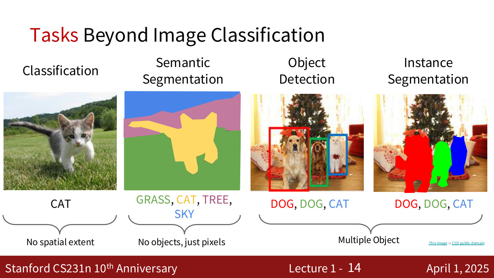
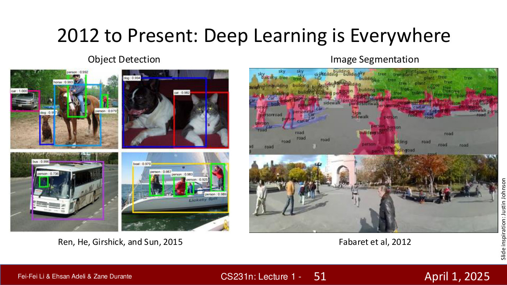
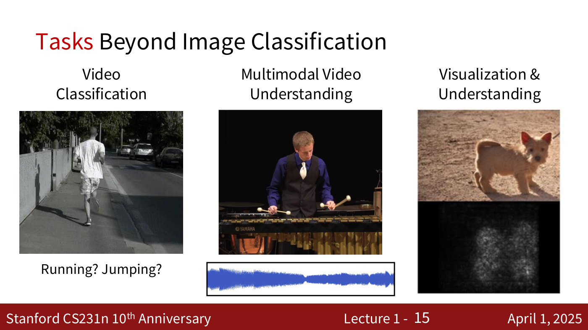
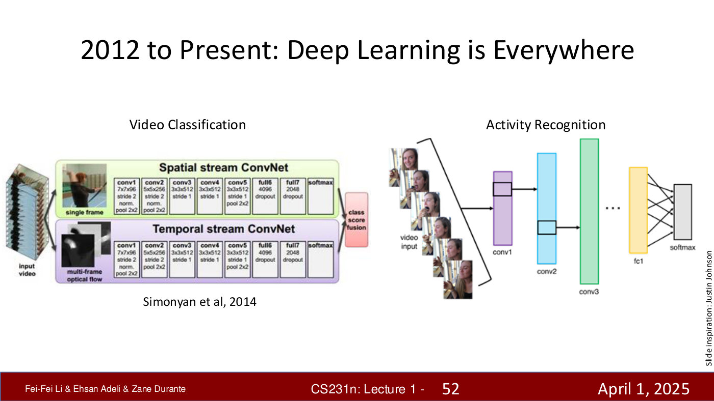
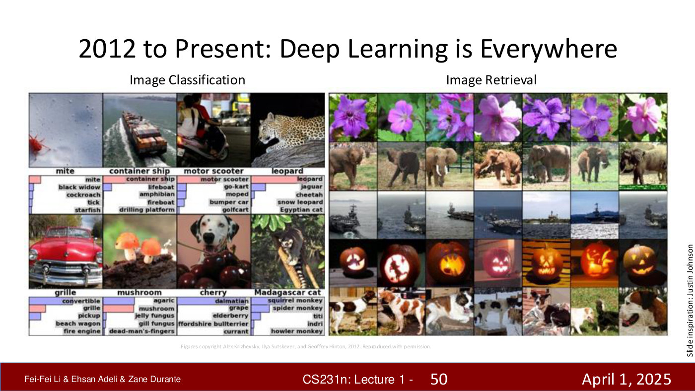
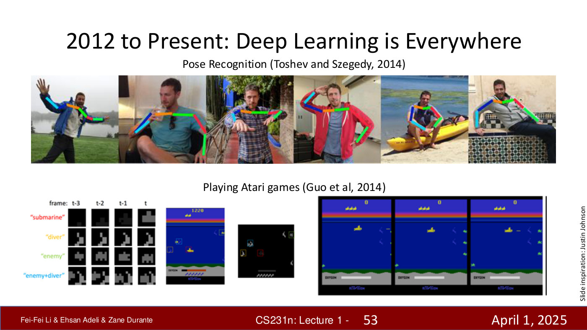
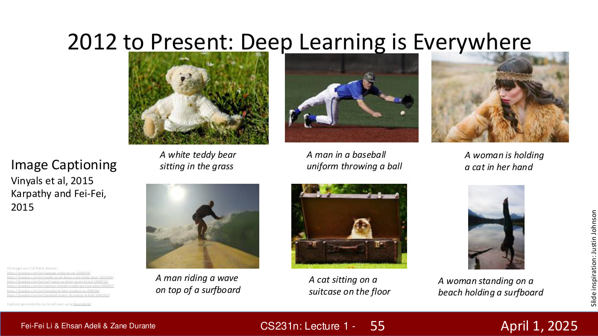
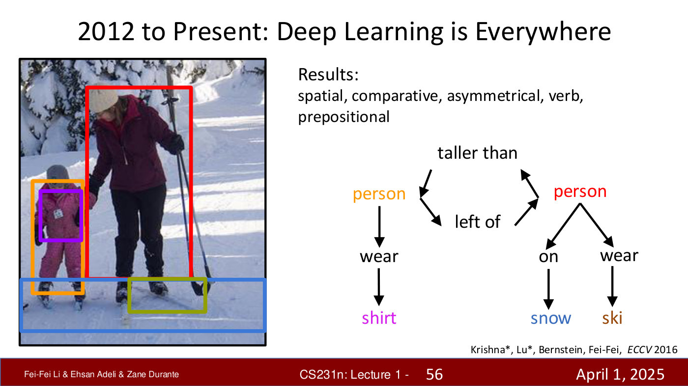
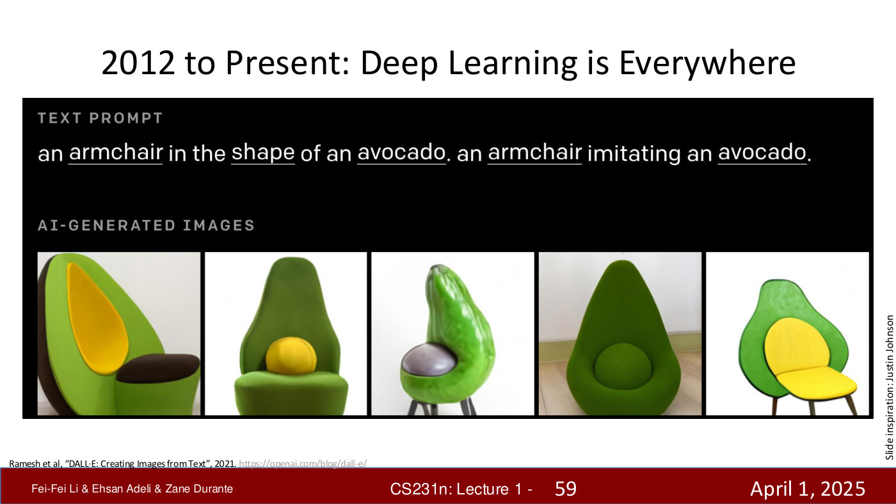

# Computer vision tasks

What a vision system can be asked to do, as the course defines the tasks. The course is organised
around pairing **tasks** — "specific challenges or problems we aim to solve" — with **models**,
the computational frameworks built to solve them (≈49:12–49:59; part 2, slide 13). This page holds
the task side. It is the first thing to read when a later lecture assumes you know the difference
between, say, semantic and instance segmentation.

**Sources so far:** lecture 1 only — [lecture page](01-introduction.md),
[transcript](../raw/transcripts/01-introduction.md), and both decks: part 1
([text](../raw/slides/01-introduction-part-1.md),
[PDF](https://cs231n.stanford.edu/slides/2025/lecture_1_part_1.pdf)) and part 2
([text](../raw/slides/01-introduction-part-2.md),
[PDF](https://cs231n.stanford.edu/slides/2025/lecture_1_part_2.pdf)). Lecture 1 introduces these
tasks without the methods for solving them; the lectures that cover each are named below from the
[course roadmap](course-logistics.md#course-roadmap).

## Image classification

Give the model an image and it outputs one label for the whole image — a photo of a cat in,
"cat" out (≈45:14–46:04; part 2, slide 7). Ehsan Adeli calls it "the most fundamental task in this
space", "deceptively simple", and "the foundation for much of the more complex applications, from
self-driving to medical diagnosis" (≈46:04). It has "no spatial extent": the label says what is in
the image, not where (part 2, slide 14). Image classification is the task of the ImageNet
challenge ([ImageNet](imagenet.md)), and it is the subject of lectures 2 (linear classifiers) and
5 (CNNs). [Lecture 2](02-image-classification.md) treats it in depth and
[lecture 5](05-image-classification-cnns.md) with convolutional networks; see
[image classification](image-classification.md).

*Part 2, slide 14 — one label for the image (classification), a label per pixel (semantic segmentation), a box per object (detection), a mask per object (instance segmentation). [Deck](https://cs231n.stanford.edu/slides/2025/lecture_1_part_2.pdf)*

## Tasks with spatial extent

Real-world vision "is much richer than this" (≈50:47). Three tasks add *where* to *what*, and the
deck shows them on the same kind of example — a cat on grass, then two dogs and a cat in front of a
Christmas tree (part 2, slide 14).

**Semantic segmentation** labels every pixel of the image with a class — grass, cat, tree, sky —
"but we don't distinguish between individual objects" (≈50:47–51:34). The slide's caption is "No
objects, just pixels".

**Object detection** says what is in the image and where: each object gets a bounding box and a
class label — in the slide's example, two dogs and a cat, each in its own coloured box (≈51:34).

**Instance segmentation** is "the most granular of them all": it "combines the ideas of detection
and segmentation together, and every object instance gets its own mask" (≈51:34). Unlike semantic
segmentation, the two dogs are separate masks.

The slide groups detection and instance segmentation as "multiple object" tasks. Fei-Fei Li's
history shows early results for both detection and segmentation — boxes with class confidences
such as "dog : 0.994" (Ren, He, Girshick and Sun, 2015), and a street scene parsed into labelled
regions (Farabet et al., 2012; printed "Fabaret") (part 1, slide 51). These tasks are covered in
lecture 9, Object Detection, Image Segmentation, Visualizing.

*Part 1, slide 51 — 2012 to Present: Deep Learning is Everywhere (object detection, image segmentation). [Deck](https://cs231n.stanford.edu/slides/2025/lecture_1_part_1.pdf)*

## Tasks over time and across modalities

"The complexity doesn't stop with static images" (≈52:21; part 2, slide 15).

*Part 2, slide 15 — Tasks Beyond Image Classification. [Deck](https://cs231n.stanford.edu/slides/2025/lecture_1_part_2.pdf)*

**Video classification** asks what is happening in a video: "is there someone running, jumping or
dancing" (≈52:21). Li's history shows a two-stream network that combines a single frame with
multi-frame optical flow, and a 3D convolutional network for activity recognition (part 1,
slide 52). Video is the subject of lecture 10, Video Understanding.

*Part 1, slide 52 — 2012 to Present: Deep Learning is Everywhere (video classification, activity recognition). [Deck](https://cs231n.stanford.edu/slides/2025/lecture_1_part_1.pdf)*

**Multimodal video understanding** combines vision with sound and other modalities. In the
example, a person playing a vibraphone, "we have to create a blend of visual features and audio
features to be able to understand what's happening" (≈52:21–53:08).

**Visualization and understanding** turns the question around: interpret "what's being learned by
the models", e.g. an attention map of what a model attends to when it classifies an image
(≈53:08). The slide pairs a photo of a dog with a saliency-style map (part 2, slide 15).

## Other tasks named in lecture 1

Li's tour of "the variety of vision tasks" (≈36:40–39:42) adds several more, each shown on a
slide of example results.

**Image retrieval** returns images that look like a query image; the slide shows rows of
retrieved photographs, one row per query (part 1, slide 50).

*Part 1, slide 50 — 2012 to Present: Deep Learning is Everywhere (image classification, image retrieval). [Deck](https://cs231n.stanford.edu/slides/2025/lecture_1_part_1.pdf)*

**Pose recognition** locates a person's body parts, drawn on the slide as a coloured skeleton over
each photograph (Toshev and Szegedy, 2014; part 1, slide 53).

*Part 1, slide 53 — 2012 to Present: Deep Learning is Everywhere (pose recognition, Atari). [Deck](https://cs231n.stanford.edu/slides/2025/lecture_1_part_1.pdf)*

**Image captioning** generates a sentence describing a photo — "A cat sitting on a suitcase on the
floor" — including Andrej Karpathy's thesis work with Li (≈38:56; part 1, slide 55).

*Part 1, slide 55 — 2012 to Present: Deep Learning is Everywhere (image captioning). [Deck](https://cs231n.stanford.edu/slides/2025/lecture_1_part_1.pdf)*

**Visual relationships** go "beyond pixels" to how objects relate, drawn as a graph such as
"person — taller than — person" and "person — on — snow" (≈38:56; part 1, slide 56).

*Part 1, slide 56 — 2012 to Present: Deep Learning is Everywhere (scene graphs / visual relationships). [Deck](https://cs231n.stanford.edu/slides/2025/lecture_1_part_1.pdf)*

**Style transfer and image generation** produce new images rather than labels: DeepDream and
neural style transfer (part 1, slide 57), and text-to-image generation such as early DALL·E
(part 1, slide 59).

![Part 1, slide 57 — [DeepDream and neural style transfer]](../raw/images/01-introduction-part-1/slide-57.jpg)

*Part 1, slide 57 — [DeepDream and neural style transfer]. [Deck](https://cs231n.stanford.edu/slides/2025/lecture_1_part_1.pdf)*

*Part 1, slide 59 — 2012 to Present: Deep Learning is Everywhere (DALL·E, avocado armchair). [Deck](https://cs231n.stanford.edu/slides/2025/lecture_1_part_1.pdf)*

Adeli's overview adds the tasks of the later lectures (≈55:30–59:27), each described with its
slide on the [lecture page](01-introduction.md#generative-and-interactive-visual-intelligence-lectures-1317):
learning representations without labels (self-supervised learning), generating images from text
or noise (generative and diffusion models), linking images and text for retrieval, captioning and
visual question answering (vision–language models), reconstructing 3D shape from images (3D
vision), and perceiving, planning and acting in the physical world (embodied intelligence).

## Why vision tasks are hard

Two arguments from lecture 1 apply to every task above. Recovering the 3D world from 2D images is
"mathematically … an ill-posed problem" that nature solved with multiple eyes and correspondence
(≈14:08–14:54). And unlike language, which "doesn't exist in nature" and is generated, 1D and
sequential, vision is about "a physical world out there respecting the laws of physics", so "vision
has very different tasks" (≈15:40–16:29).
