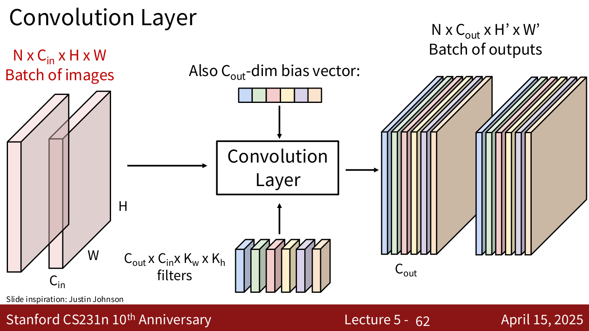
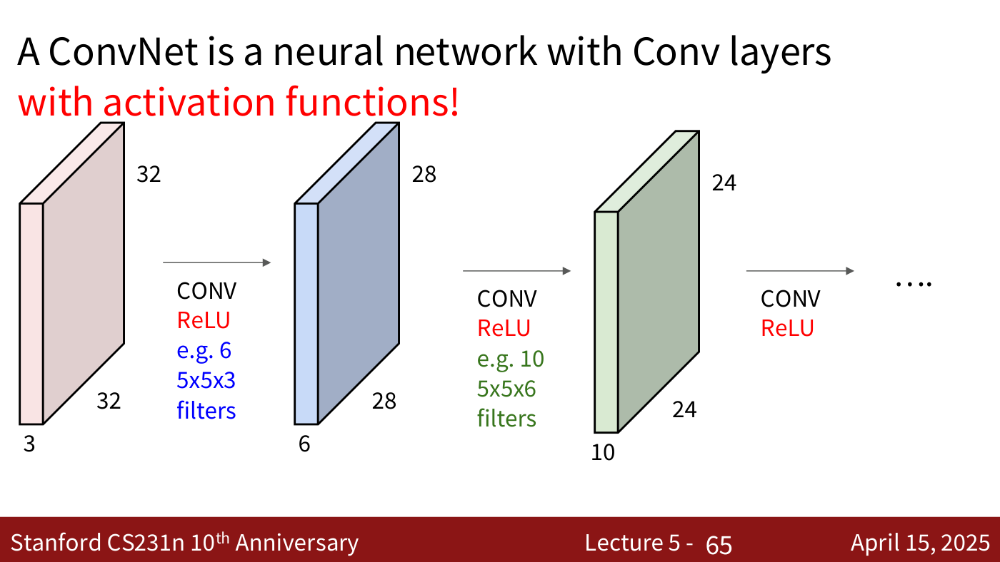
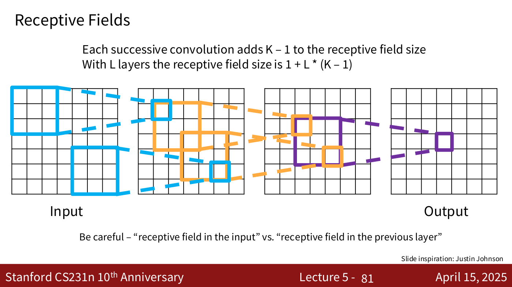
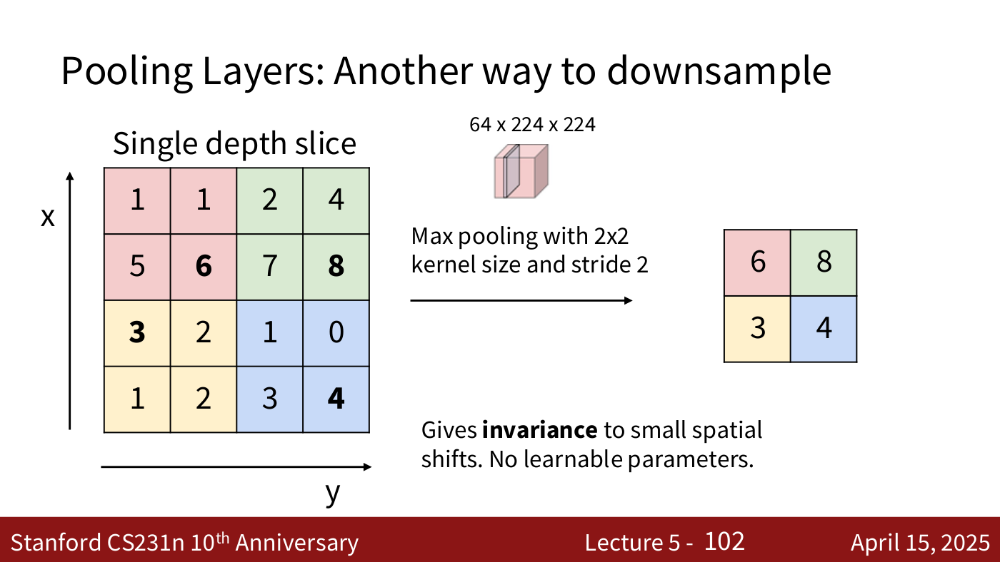
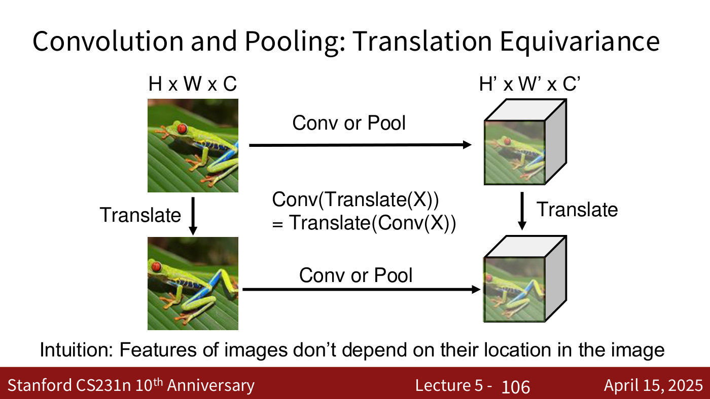
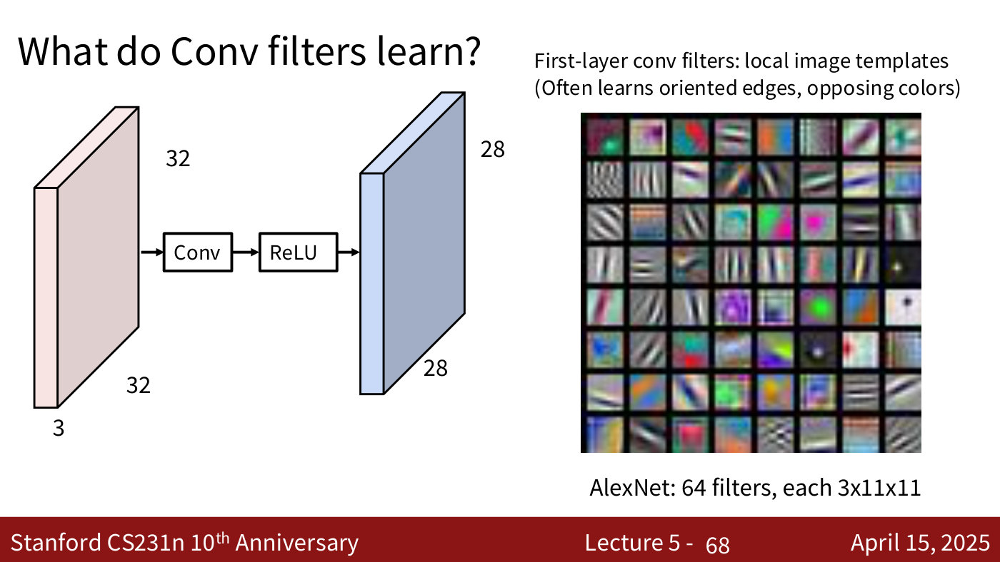

# Convolutional networks

A **convolutional network** (ConvNet, CNN) is a neural network for images built from four kinds
of layer: convolution layers, pooling layers, activation functions and fully connected layers.
This page gathers what the course says about them. Their main treatment is
[lecture 5](05-image-classification-cnns.md) (Justin Johnson, April 15, 2025); the next lecture,
on CNN architectures, is not yet in this knowledge base. Citations of the form "lecture 5,
slide N" are to the [lecture 5 slide file](../raw/slides/05-image-classification-cnns.md), and
timestamps "(≈M:SS)" are to the
[lecture 5 transcript](../raw/transcripts/05-image-classification-cnns.md).

## Why convolutional networks

The [neural networks](neural-networks.md) of lecture 4 take an image as one long vector: a
$32 \times 32 \times 3$ CIFAR-10 image becomes 3072 numbers. That "destroys the spatial structure of the
images". Images are two-dimensional, and that structure matters for their content (lecture 5,
≈22:15–23:00).

Before deep learning, the structure was supplied by hand. People designed **feature
representations** such as colour histograms, histograms of oriented gradients and bags of visual
words, and trained only a linear classifier on top of them (lecture 5, slides 21–25). A ConvNet
takes the other route. Every part of the system, from raw pixels to scores, is learned by
gradient descent, and the designer builds the knowledge about images into the operators instead.
In the lecturer's words, "gradient descent is probably a better programmer than you and lots of
data probably knows more about your problem than you do" (lecture 5, ≈18:28–20:43; lecture 5,
slide 26). See [image classification](image-classification.md).

A typical ConvNet has a body of interleaved convolution, pooling and non-linearity layers that
extracts features, and a head of one or more fully connected layers that classifies them. The
whole network is trained end to end with backpropagation (lecture 5, ≈23:00–23:46).

## The convolution layer

A fully connected layer computes, for each output, a dot product between one row of its weight
matrix and the entire input, a template the size of the whole image. A convolution layer keeps
the template matching but makes each template small (lecture 5, ≈31:28–33:00).

- Keep the input as a three-dimensional tensor, for example $3 \times 32 \times 32$: 3 channels (or depth) and a
  $32 \times 32$ spatial grid.
- A **filter** is a small template, for example $5 \times 5$ spatially. It always has as many channels as
  the input: "Filters always extend the full depth of the input volume" (lecture 5, slide 50).
- Placed on one $5 \times 5 \times 3$ chunk of the image, the filter gives one number, "a 5\*5\*3 = 75-dimensional
  dot product + bias", $w^T x + b$, where $w$ is the filter, $x$ the chunk and $b$ the filter's
  bias (lecture 5, slide 51).
- Sliding the filter over every position gives a plane of such scores, an **activation map**. A
  $5 \times 5$ filter on a $32 \times 32$ image gives a $28 \times 28$ map (lecture 5, slide 56).
- A layer has many filters, each with its own scalar bias. Their activation maps are stacked
  into the output's channels: six $3 \times 5 \times 5$ filters (a $6 \times 3 \times 5 \times 5$ weight tensor) and a six-dimensional
  bias turn a $3 \times 32 \times 32$ image into a $6 \times 28 \times 28$ output (lecture 5, ≈35:19–36:51).

In general, for a batch, the input is $N \times C_{in} \times H \times W$. The filters form a
$C_{out} \times C_{in} \times K_H \times K_W$ tensor ($C_{out}$ filters of size $C_{in} \times K_H \times K_W$, with kernel height $K_H$ and width $K_W$), plus a $C_{out}$-dimensional bias. The
output is $N \times C_{out} \times H' \times W'$ (lecture 5, slides 62 and 94). Slide 62 writes
the filter shape with the kernel width before the height, $K_w \times K_h$.

*Lecture 5, slide 62 — the general shapes of a convolution layer's input, filters, bias and output, for a batch of N images. [Deck](https://cs231n.stanford.edu/slides/2025/lecture_5.pdf)*

**Parameters and hyperparameters.** The values inside the filters are parameters: randomly
initialised, then learned by gradient descent. The number of filters, their size, the padding
and the stride are hyperparameters, set before training (for example by cross-validation)
because they fix the shapes of the tensors. Each filter must start different from the others.
If all filters started equal they would receive equal gradients and stay equal, so random
initialisation is what breaks the symmetry (lecture 5, ≈36:51–39:10, ≈48:25–49:11). See
[hyperparameters and validation](hyperparameters-and-validation.md).

**Non-linearity between convolutions.** Convolution is linear, and a composition of linear
operators is linear. So two convolution layers stacked directly are no more powerful than one,
"the same bug that we saw in multi-layer neural networks and the same fix": put an activation
function such as ReLU between them (lecture 5, ≈44:34–45:21; lecture 5, slide 65).

*Lecture 5, slide 65 — stacked convolutions with ReLU after each: 3x32x32 to 6x28x28 with six 5x5x3 filters, then 10x24x24 with ten 5x5x6 filters. [Deck](https://cs231n.stanford.edu/slides/2025/lecture_5.pdf)*

## Output size, padding and stride

For an input of width $W$ and a filter of width $K$, sliding one step at a time gives an output of
width $W - K + 1$: a $3 \times 3$ filter on a $7 \times 7$ input gives $5 \times 5$. Feature maps therefore shrink with each
layer (lecture 5, ≈49:56–50:42).

**Padding** adds $P$ rings of zeros around the input before convolving, which adds $2P$ to the
output. With an odd $K$ and $P = (K - 1)/2$, "same" padding, the output keeps the input's size. A
$3 \times 3$ convolution with $P = 1$ is the usual case. The zeros do cause effects at the borders, "but it
seems to be okay in a lot of cases" (lecture 5, ≈50:42–52:13; lecture 5, slide 79).

**Stride** $S$ places the filter only at every $S$-th position. With all four hyperparameters,
the output width is

$$\frac{W - K + 2P}{S} + 1.$$

Bigger kernels shrink the output, padding adds some size back, the stride divides it, and the
$+1$ is "some fence post math". A $3 \times 3$ filter with stride 2 on a $7 \times 7$ input gives $3 \times 3$ (lecture 5,
≈53:46–54:31; lecture 5, slide 87). Lecture 5's summary lists the common settings: $3 \times 3$ with
$P = 1, S = 1$; $5 \times 5$ with $P = 2, S = 1$; $1 \times 1$ with $P = 0, S = 1$; and $3 \times 3$ with $P = 1, S = 2$ to
downsample by 2, with channel counts in powers of 2 (lecture 5, slide 94).

**Notation warning.** The deck's appendix of older slides uses $K$ for the *number of filters*
and $F$ for the filter size: input $W_1 \times H_1 \times C$, output $W_2 \times H_2 \times K$
with $W_2 = (W_1 - F + 2P)/S + 1$, and $F^2 C K$ weights plus $K$ biases (lecture 5,
slide 111).

## Counting parameters and compute

Lecture 5's worked example applies 10 filters of size $5 \times 5$, with stride 1 and padding 2, to a
$3 \times 32 \times 32$ input (lecture 5, slides 88–93, ≈55:17–58:23).

- **Output:** $(32 + 2 \cdot 2 - 5)/1 + 1 = 32$, so $10 \times 32 \times 32$.
- **Parameters:** each filter has $3 \times 5 \times 5 = 75$ weights and 1 bias, 76 in all; ten
  filters make 760.
- **Multiply-adds:** each of the $10 \times 32 \times 32 = 10{,}240$ outputs is a 75-element dot
  product, so $75 \times 10{,}240 = 768{,}000$.

The general rule behind the last count: each entry of the output volume is one dot product
between a filter and a chunk of the input, so the compute is the number of outputs times the
size of a filter (lecture 5, ≈57:38).

## Receptive fields

Each output of a convolution with kernel size $K$ depends on a $K \times K$ region of the layer
below, its **receptive field**. Through a stack of layers the region of the original image that
can influence one output, the **effective receptive field**, grows: each layer adds $K - 1$, so
after $L$ layers it is $1 + L(K - 1)$. Three $3 \times 3$ layers see $7 \times 7$ (lecture 5, ≈52:13–53:46;
lecture 5, slide 81).

*Lecture 5, slide 81 — one output cell traced back through three 3x3 convolutions to a 7x7 region of the input. [Deck](https://cs231n.stanford.edu/slides/2025/lecture_5.pdf)*

Linear growth is slow, and a classifier should eventually see the whole image. **Downsampling**
inside the network, by strided convolution or by pooling, fixes this: if each layer halves the
feature map, the effective receptive field grows exponentially with depth (lecture 5, ≈55:17).
Receptive fields are also why deeper layers learn larger structures (lecture 5, ≈49:11).

## Other convolutions

The same idea works in other dimensions. A **1D convolution** has input $C_{in} \times W$ and
weights $C_{out} \times C_{in} \times K$. A **3D convolution** has input $C_{in} \times H \times W \times D$ and weights $C_{out} \times C_{in} \times K \times K \times K$ (lecture 5, slides
97–98).

A **$1 \times 1$ convolution** "make[s] perfect sense": each filter is a dot product through the depth
at one position, so 32 filters of size $1 \times 1 \times 64$ turn $56 \times 56 \times 64$ into $56 \times 56 \times 32$ (lecture 5, slide 114).

PyTorch's `torch.nn.Conv2d` also has groups and dilation, which the lecture does not cover:
"Dilation isn't really used so much anymore. Groups still get used sometimes" (lecture 5,
≈58:23).

## Pooling

A **pooling layer** downsamples each channel of its input independently and restacks the
results, so the number of channels stays the same. It is cheap, unlike convolution, which is
where most of a ConvNet's compute goes (lecture 5, ≈59:09–1:00:44). Its hyperparameters are the
kernel size $K$, the stride $S$ and the pooling function. Its output is
$C \times H' \times W'$ with $H' = (H - K)/S + 1$, and it has **no learnable parameters**
(lecture 5, slide 103).

**Max pooling** with a $2 \times 2$ kernel and stride 2, by far the most common setting, keeps the
largest value of each non-overlapping $2 \times 2$ tile and halves each spatial dimension (lecture 5,
≈1:00:44–1:02:15; lecture 5, slide 102). Lecture 5's deck says it "Gives invariance to small
spatial shifts". Average pooling is the other common function.

*Lecture 5, slide 102 — max pooling, 2x2 kernel, stride 2: each coloured tile of the 4x4 slice keeps its largest value, 6, 8, 3, 4. [Deck](https://cs231n.stanford.edu/slides/2025/lecture_5.pdf)*

Pooling layers are usually interspersed with convolutions, as in "conv, pool, conv, conv, pool,
conv, conv, pool, fully connected, fully connected". They are not usually padded. Max pooling is
itself a non-linearity, so some networks drop the ReLU before it; average pooling is linear, so a
ReLU is still needed (lecture 5, ≈1:01:29–1:04:32).

Lecture 5's first pooling diagram (slide 101) prints its two size labels the wrong way round; the
input is $64 \times 224 \times 224$ and the output $64 \times 112 \times 112$, as the deck's other copies of the figure label it.

## Translation equivariance

Convolution and pooling are **translation equivariant**: shifting the input and then applying
the operator gives the same result as applying the operator and then shifting,
Conv(Translate(X)) = Translate(Conv(X)), up to boundary effects. This is how the operators build
in the intuition that "Features of images don't depend on their location in the image". It is a
property of the operators, not a step a network performs (lecture 5, ≈1:04:32–1:07:34;
lecture 5, slide 106).

*Lecture 5, slide 106 — the commutative square: convolve or pool then translate, or translate then convolve or pool, and arrive at the same feature map. [Deck](https://cs231n.stanford.edu/slides/2025/lecture_5.pdf)*

## What the filters learn

First-layer filters can be viewed directly as small images. AlexNet's 64 first-layer filters
($3 \times 11 \times 11$) show oriented edges and opposing colours, and "just about all convolutional networks
end up learning filters that look something like this" (lecture 5, ≈46:07–46:53; lecture 5,
slide 68). Deeper layers respond to larger structures, such as eyes, text and circles in a sixth
layer (lecture 5, slide 69). For comparison, a linear classifier learns one whole-image template
per class ([linear classifiers](linear-classifiers.md)).

*Lecture 5, slide 68 — AlexNet's 64 first-layer filters, each 3x11x11: oriented edges and opposing colours. [Deck](https://cs231n.stanford.edu/slides/2025/lecture_5.pdf)*

## History

- **Biological inspiration.** Hubel and Wiesel's recordings from the cat visual cortex
  (1959–1968), topographical mapping, and the hierarchy of simple, complex and hypercomplex
  cells (lecture 5, slides 138–140; [lecture 1](01-introduction.md)).
- **Neocognitron** (Fukushima, 1980): alternating "simple cells" with modifiable parameters and
  "complex cells" that perform pooling (lecture 5, slide 141).
- **LeCun et al., 1998**: convolutional networks trained with backpropagation for digit
  recognition, "really expensive" without GPUs, but with an architecture much like those used
  well into the 2010s (lecture 5, ≈23:46–24:33).
- **AlexNet, 2012**: bigger and deeper, trained on GPUs with ImageNet-scale data. It began an
  era, about 2012 to 2020, in which ConvNets were the best model for almost every vision task:
  detection, segmentation, captioning and early text-to-image generation (lecture 5,
  ≈24:33–27:38). See [ImageNet](imagenet.md).
- **Transformers, 2021 on**: after the Vision Transformer (2021), replacing a ConvNet with a
  transformer often gives better performance and scales better. ConvNets are still used, often
  in hybrids with transformers, and they teach intuitions about images (lecture 5,
  ≈28:24–30:42). The course covers transformers in lecture 8.

## Lectures

- [Lecture 5 — Image Classification with CNNs](05-image-classification-cnns.md): everything on
  this page.
- [Lecture 1 — Introduction](01-introduction.md): the Neocognitron, LeNet and AlexNet in the
  history of vision.
- [Lecture 4 — Neural Networks and Backpropagation](04-neural-networks-backpropagation.md): the
  fully connected networks ConvNets extend, and backpropagation, which trains them.
