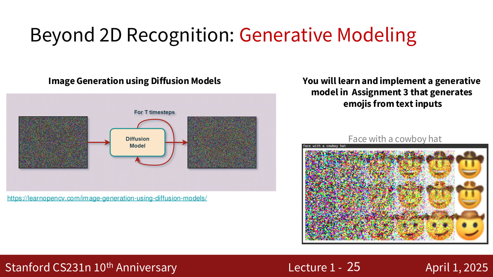

# Course logistics — CS231N, Spring 2025

How the course is run: the lecture roadmap, where things are posted, assignments, grading, late
days and the collaboration policy. **Everything here comes from the Lecture 1 part 2 slides as
posted on April 1, 2025.** These slides were *not* presented aloud — the recording skips from the
award slides to the learning objectives — so the slides are the only source, and nothing on this
page has a timestamp. Policies can change during a quarter; the course website,
<https://cs231n.stanford.edu/2025/>, and Ed are authoritative.

Slide citations are to the part 2 deck: [text](../raw/slides/01-introduction-part-2.md) ·
[PDF](https://cs231n.stanford.edu/slides/2025/lecture_1_part_2.pdf). Its printed slide numbers
are not its PDF page numbers; the [lecture page](01-introduction.md) explains the offset.

## Course roadmap

The course has four parts (part 2, slide 51). The lecture titles below are those of the Spring
2025 recordings; lectures 1–9 are in this knowledge base so far.

| Lecture | Title | Part of the course |
| --- | --- | --- |
| 1 | Introduction — [wiki page](01-introduction.md) | — |
| 2 | Image Classification with Linear Classifiers — [wiki page](02-image-classification.md) | Deep Learning Basics (lectures 2–4) |
| 3 | Regularization and Optimization — [wiki page](03-regularization-optimization.md) | Deep Learning Basics |
| 4 | Neural Networks and Backpropagation — [wiki page](04-neural-networks-backpropagation.md) | Deep Learning Basics |
| 5 | Image Classification with CNNs — [wiki page](05-image-classification-cnns.md) | Perceiving and Understanding the Visual World (lectures 5–12) |
| 6 | CNN Architectures — [wiki page](06-training-cnns-architectures.md) | Perceiving and Understanding |
| 7 | Recurrent Neural Networks — [wiki page](07-recurrent-neural-networks.md) | Perceiving and Understanding |
| 8 | Attention and Transformers — [wiki page](08-attention-transformers.md) | Perceiving and Understanding |
| 9 | Object Detection, Image Segmentation, Visualizing — [wiki page](09-detection-segmentation-visualization.md) | Perceiving and Understanding |
| 10 | Video Understanding | Perceiving and Understanding |
| 11 | Large Scale Distributed Training | Perceiving and Understanding |
| 12 | Self-Supervised Learning | Perceiving and Understanding |
| 13 | Generative Models 1 | Reconstructing and Interacting with the Visual World (lectures 13–17) |
| 14 | Generative Models 2 | Reconstructing and Interacting |
| 15 | 3D Vision | Reconstructing and Interacting |
| 16 | Vision and Language | Reconstructing and Interacting |
| 17 | Robot Learning | Reconstructing and Interacting |
| 18 | Human-Centered AI | Human-Centered Artificial Intelligence (lecture 18) |

The part names are those on part 2, slide 51. The agenda slides earlier in the same deck call the
third part "Generative and Interactive Visual Intelligence" and the fourth "Human-Centered
Applications and Implications" (part 2, slide 6). Self-supervised learning (lecture 12) is
introduced in the talk as the first topic of the generative-and-interactive part (≈55:30), while
slide 51's ranges place lecture 12 in the perception part.

## Lectures, sections and where things are posted

**Lectures** are Tuesdays and Thursdays, 12:00–1:20 PM, in the NVIDIA Auditorium. They are not
streamed on Zoom but are broadcast live via Panopto, and recordings are uploaded to Canvas under
the "Panopto Course Videos" tab. Slides are posted on the course website shortly before each
lecture (part 2, slide 36).

**Discussion sections** — six of them — are on Fridays, 12:30–1:20 PM, in the NVIDIA Auditorium:
hands-on tutorials "with more practical details than the main lecture". The Zoom link and
recordings are on Canvas (part 2, slide 38).

| Date | Section |
| --- | --- |
| 04/04 | Python / Numpy Review Session |
| 04/11 | Backprop Review Session |
| 04/18 | Final Project Overview and Guidelines |
| 04/25 | PyTorch / TensorFlow Review Session |
| 05/02 | RNNs & Transformers |
| 05/09 | Midterm Review Session |

**Where to go for what** (part 2, slides 39 and 41):

- **Course website** (<http://cs231n.stanford.edu/>) — syllabus, lecture slides, links to
  assignment downloads. The slide shows the website's schedule and says to refresh it, since
  updated slides are posted shortly before each lecture (part 2, slide 37).
- **Ed** — most communication with course staff: questions about assignments, the final project,
  the midterm, grading and logistics. Use private posts only if a post would violate the honor
  code if released publicly. Access is through Canvas → Deep Learning for Computer Vision → Ed
  Discussion; CGOE students register with their @stanford.edu address.
- **Course email** — cs231n-staff-spr25@stanford.edu.
- **Gradescope** — turning in homework and receiving grades.
- **Canvas** — recorded lectures and recorded discussion sessions.

**Office hours** start in week 2, both in person (Huang basement — look for CS231n signs) and
remote (Zoom, with a QueueStatus queue; TAs admit students to one-to-one rooms in turn). The
schedule is on the course website, and the QueueStatus link is on Canvas or Ed (part 2,
slide 40).

## Assignments

All assignments are completed in **Google Colab** (part 2, slide 42). **Assignment 1** is out
Wednesday 4/9 and due 4/23 by 11:59 PM, and covers:

- k-nearest neighbor;
- linear classifiers (softmax);
- a two-layer neural network;
- image features;
- deep neural networks and optimizers.

Lecture 2 repeated these dates and added the course-project timeline: the **project proposal** is
due Friday 4/25 at 11:59 PM; each project team is assigned a TA to contact for guidance (Canvas →
People → Groups); a Google Form helps find project partners; and "Is X a valid project for 231n?"
questions go to a private Ed post or TA office hours (lecture 2, slides 2–3). The first discussion
section, on Friday 4/4, covered Python, NumPy and Google Colab in person and on Zoom, presented by
Emily Jin with Matthew Jin (lecture 2, slide 4). These slides were not presented aloud; see
[Lecture 2](02-image-classification.md#administrative-notes-slides-only).

Assignment 3 includes implementing a generative model that produces emojis from text prompts
(part 2, slide 25; said aloud at ≈57:03).

*Part 2, slide 25 — diffusion: a model denoises step by step over T timesteps; Assignment 3 uses this to generate emojis from text. [Deck](https://cs231n.stanford.edu/slides/2025/lecture_1_part_2.pdf)*

Assignments — coding and written parts — are submitted through **Gradescope** and auto-graded
(part 2, slide 43). Public tests show results immediately; private tests are "generalizations of
the public tests to thoroughly test your implementation".

## Grading

| Component | Weight |
| --- | --- |
| 3 assignments | 12% + 18% + 15% = 45% |
| In-class midterm exam | 20% |
| Course project | 35% |
| — project proposal | 1% |
| — milestone | 2% |
| — final project report | 29% |
| — poster and poster session | 3% |
| Participation extra credit | up to 3% |

The components sum to 100%, with up to 3% participation extra credit on top (part 2, slide 44).

**Late policy** (part 2, slide 44): 4 free late days in total, at most 2 of them on any one
assignment; after that, 25% off per day late; no late days for the project report.

## Collaboration policy

The course follows the Stanford Honor Code and the CS Department Honor Code (part 2, slide 46):

1. Don't look at solutions or code that are not your own; everything you submit should be your
   own work.
2. Don't share your solution code with others; discussing ideas or general strategies is fine and
   encouraged.
3. Indicate in your submissions anyone you worked with.
4. Do not submit AI-generated responses.

"Turning in something late/incomplete is better than violating the honor code."

## Prerequisites and resources

**Prerequisites** (part 2, slide 47): proficiency in Python — all assignments are in Python with
numpy, and later in the class PyTorch and TensorFlow; a Python tutorial is on the course website.
Also college calculus and linear algebra.

**Optional textbooks** (part 2, slide 48), each with a free online version linked from the slide:

- *Deep Learning* by Goodfellow, Bengio and Courville;
- *Mathematics of Deep Learning* — chapters 5, 6 and 7 for vector calculus and continuous
  optimization;
- *Dive into Deep Learning* — an interactive book with code, math and discussions, based on the
  NumPy interface.

## Learning objectives

(part 2, slide 49; said aloud at ≈1:01:02)

- **Formalize computer vision applications into tasks** — inputs and outputs for vision problems,
  and the data and compute needed to train a model.
- **Develop and train vision models** — code, debug and train convolutional neural networks; use
  PyTorch and TensorFlow.
- **Understand where the field is and where it is headed** — research from the last 0–5 years,
  open challenges, and the ethical and societal considerations before deployment.

The course also pitches three reasons to take it (part 2, slide 50): to become a vision
researcher (get involved with vision research at Stanford; CVPR 2025 and ICCV 2025), to become a
vision engineer in industry (Google, Meta, Amazon AWS, Nvidia, Apple, Microsoft, OpenAI,
Salesforce and others), and to apply computer vision to problems in other fields of science and
engineering.
