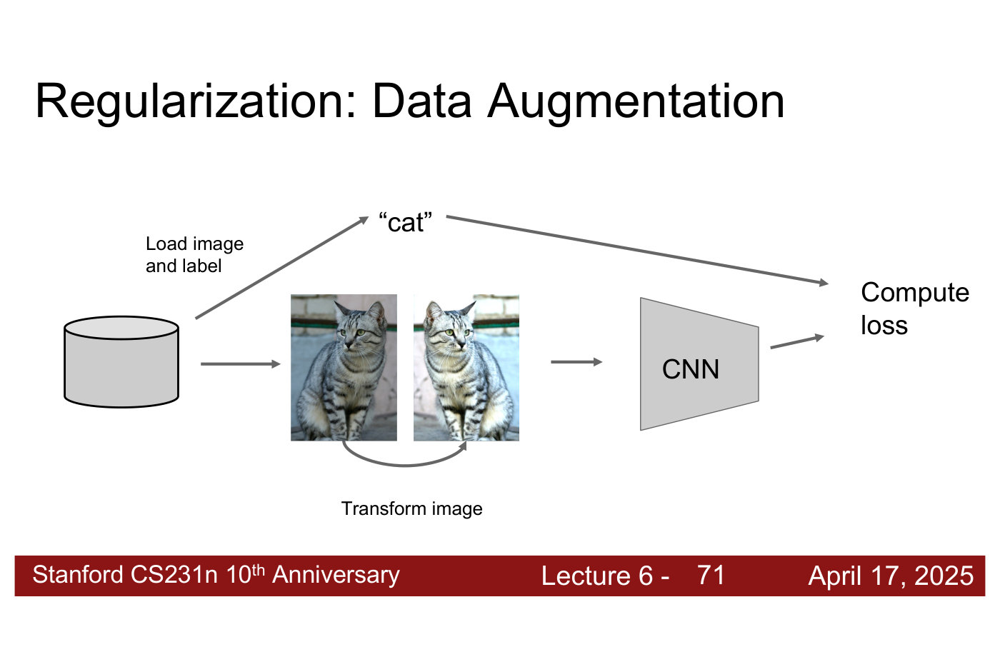
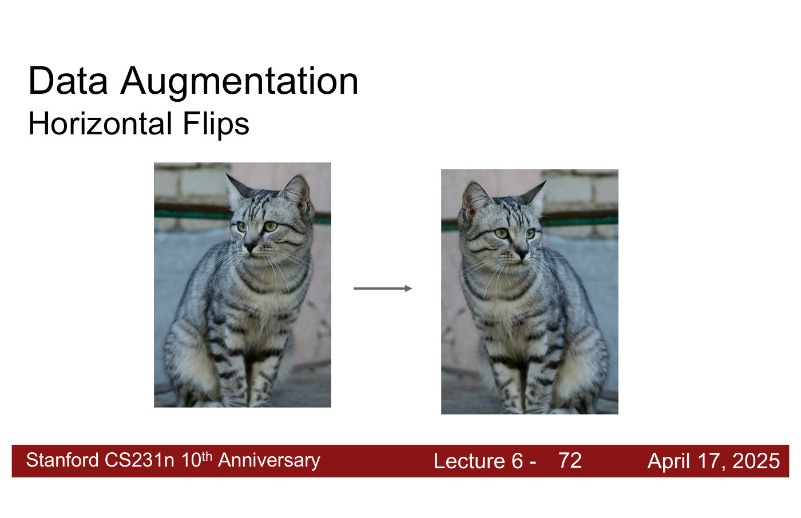
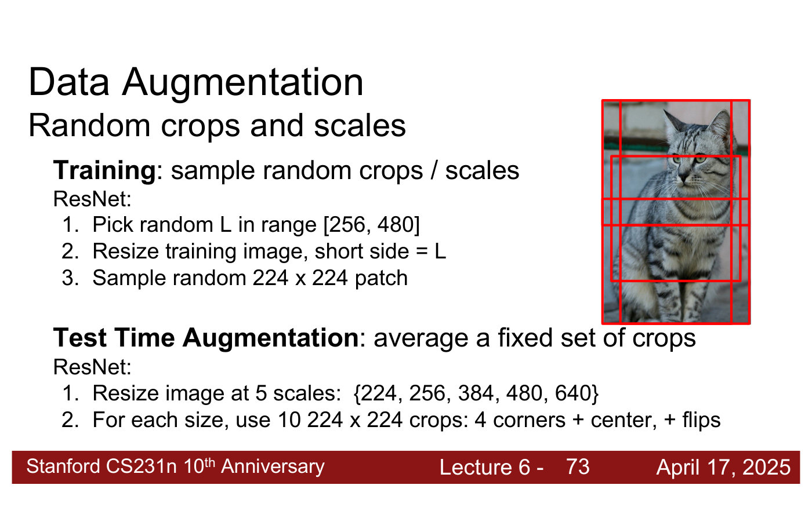
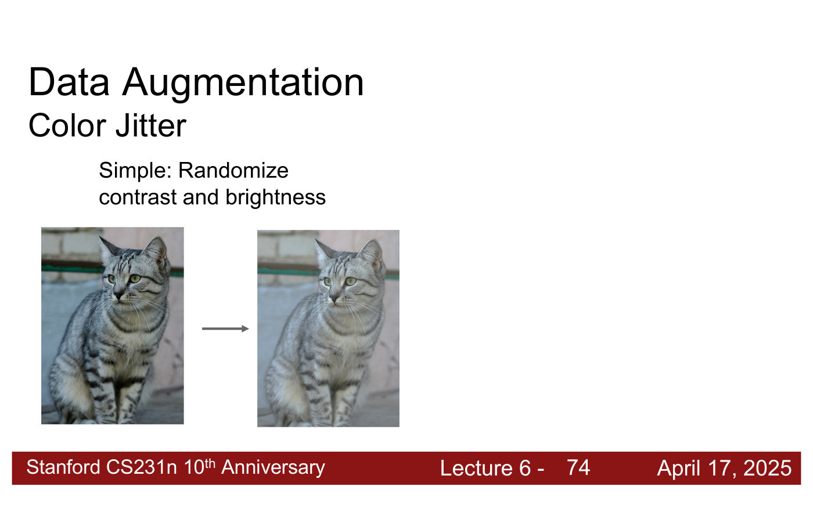
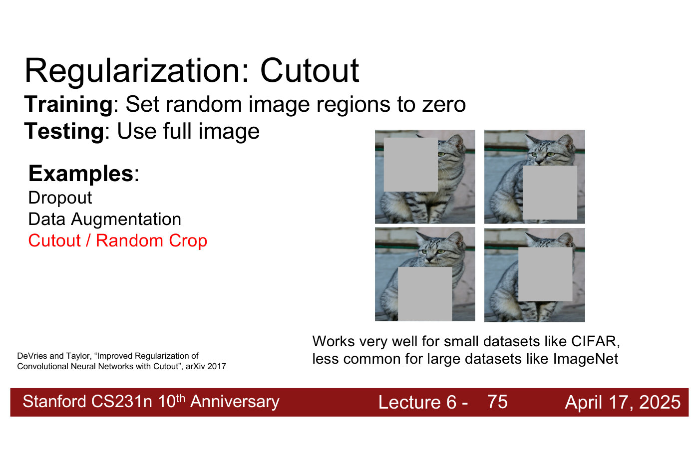

# Data preprocessing and augmentation

Before a CNN sees an image, two things usually happen to it. **Preprocessing** normalizes every
image the same way, in training and at test time. **Augmentation** transforms each training image
at random, so that the model never sees exactly the same example twice. The course covers both in
[lecture 6](06-training-cnns-architectures.md#data-preprocessing) (Zane Durante, April 17, 2025).
Citations "lecture 6, slide N" are to the
[lecture 6 slide file](../raw/slides/06-training-cnns-architectures.md), and timestamps
"(lecture 6, ≈M:SS)" to the
[lecture 6 transcript](../raw/transcripts/06-training-cnns-architectures.md).

## Data preprocessing

For images, preprocessing is easy: "center and scale for each channel" (lecture 6, slide 67).
Over the whole dataset, compute the mean and the standard deviation of each colour channel, red,
green and blue: three numbers of each. Then normalize every input image by subtracting the
per-channel mean and dividing by the per-channel standard deviation (lecture 6, ≈49:16). Almost
all modern models do this. The deck writes it as

```python
norm_pixel[i,j,c] = (pixel[i,j,c] - np.mean(pixel[:,:,c])) / np.std(pixel[:,:,c])
```

It requires pre-computing the statistics for the dataset, so people often use statistics computed
already. The most common choice is ImageNet's means and standard deviations, applied even to
models not trained on ImageNet. It is dataset-dependent, and different models use different
values. Every input image gets the operation before the model sees it (lecture 6, ≈49:16–50:03).

## Augmentation as regularization

Augmentation follows a pattern that [regularization](regularization.md#dropout) uses more than
once: "Training: Add some kind of randomness", $y = f_W(x, z)$; "Testing: Average out randomness
(sometimes approximate)", $y = f(x) = E_z[f(x, z)] = \int p(z) f(x, z) \thinspace dz$ (lecture 6,
slide 69). Here $x$ is the input, $W$ the weights and $z$ the random variable (the slide does not
name it). Dropout is one example: drop activations at random in training, use all of them at test
time and scale (lecture 6, slide 70). Augmentation adds the randomness to the input image instead,
which answers a student's earlier question about adding noise to the image (lecture 6,
≈50:03–50:49).

In the training pipeline, an image and its label are loaded from the dataset, the image is
transformed at random, and the transformed image goes through the CNN to compute the loss against
the unchanged label (lecture 6, slide 71). The transformation makes the image look different while
keeping it recognisably the same category. The model sees different versions of each image with the
same label, so the dataset effectively grows and the model generalises better. Its training loss
is higher, because it is not seeing the same example over and over and cannot simply memorise it.
In modern deep learning, people "will always use data augmentation for training computer vision
models" (lecture 6, ≈50:49–51:34).



*Lecture 6, slide 71 — augmentation in the training pipeline: load an image and its label, transform the image (here a horizontal flip), then run the CNN and compute the loss against the unchanged label. [Deck](https://cs231n.stanford.edu/slides/2025/lecture_6.pdf)*

## The augmentations

**Horizontal flips** (lecture 6, slide 72) suit everyday objects, most of which are symmetrical.
They would be a very bad augmentation for a model that reads text, which comes out mirrored.
Vertical flips make sense for microscope or overhead images, but not for everyday objects: a cat
is almost always upright, unless your dataset has cats in every orientation (lecture 6,
≈53:10–53:56).



*Lecture 6, slide 72 — a horizontal flip: still a cat. [Deck](https://cs231n.stanford.edu/slides/2025/lecture_6.pdf)*

**Random crops and scales** (lecture 6, slide 73). In training, ResNet picks a random $L$ in
$[256, 480]$, resizes the image so that its short side is $L$, preserving its aspect ratio, and
samples a random $224 \times 224$ patch. For an $800 \times 600$ image and $L = 256$, the short
side, 600, becomes 256 and the long side is scaled to match (lecture 6, ≈53:56–55:29). This
"random resized crop", as most libraries call it, is by far the most commonly used augmentation
(lecture 6, ≈55:29).



*Lecture 6, slide 73 — ResNet's random crops and scales in training (short side resized to L in [256, 480], then a random 224 x 224 patch) and its fixed crops for test-time augmentation; the red boxes are example crop windows. [Deck](https://cs231n.stanford.edu/slides/2025/lecture_6.pdf)*

**Colour jitter** (lecture 6, slide 74): "Simple: Randomize contrast and brightness", so that the
colours look more muted or brighter (lecture 6, ≈56:14).



*Lecture 6, slide 74 — colour jitter: the same photo with lower contrast and a washed-out look. [Deck](https://cs231n.stanford.edu/slides/2025/lecture_6.pdf)*

**Cutout** (DeVries and Taylor, 2017): in training, set random image regions to zero; at test
time, use the full image (lecture 6, slide 75). It "works very well for small datasets like CIFAR,
less common for large datasets like ImageNet". It suits settings where objects will be partly
blocked, such as an occluded camera (lecture 6, ≈57:00–57:46).



*Lecture 6, slide 75 — cutout: grey squares blank random regions in training, and the full image is used at test time. It works well on small datasets like CIFAR. [Deck](https://cs231n.stanford.edu/slides/2025/lecture_6.pdf)*

## Choosing augmentations

Ask which transformations keep the data recognisable to a human while making the training examples
harder for the model to memorise (lecture 6, ≈57:46). For each one, the lecturer tries a range of
values and keeps those that leave the images looking normal, in distribution: different from the
original but still easy to recognise (lecture 6, ≈56:14–57:00). Whether an augmentation makes sense
depends on the problem, as the flips show.

## Test-time augmentation

When every percentage point matters, average the model's predictions over several versions of each
test image. ResNet resizes the image to five scales, {224, 256, 384, 480, 640}, and at each takes
ten $224 \times 224$ crops, the four corners and the centre plus their flips (lecture 6, slide 73).
Returns diminish, but it can give a 1–2% boost on almost any computer vision problem (lecture 6,
≈55:29–56:14). It is the "average out randomness" half of the pattern above.

## Lectures

- [Lecture 6 — Training CNNs and CNN Architectures](06-training-cnns-architectures.md#data-augmentation):
  everything on this page.
- [Lecture 12 — Self-Supervised Learning](12-self-supervised-learning.md#simclr): augmentation as
  the source of positive pairs in contrastive learning. SimCLR draws two random augmentations of
  each image ("random cropping, random color distortion, and random blur"), and MoCo v2 adopts its
  stronger augmentation (lecture 12, slides 76–77, 90).

## Related pages

- [Regularization](regularization.md#dropout) — dropout and the other ways to keep a model from
  memorising its training data.
- [Transfer learning](transfer-learning.md) — the other remedy lecture 6 offers when data is
  scarce.
- [Image classification](image-classification.md) — the task these images are for.
