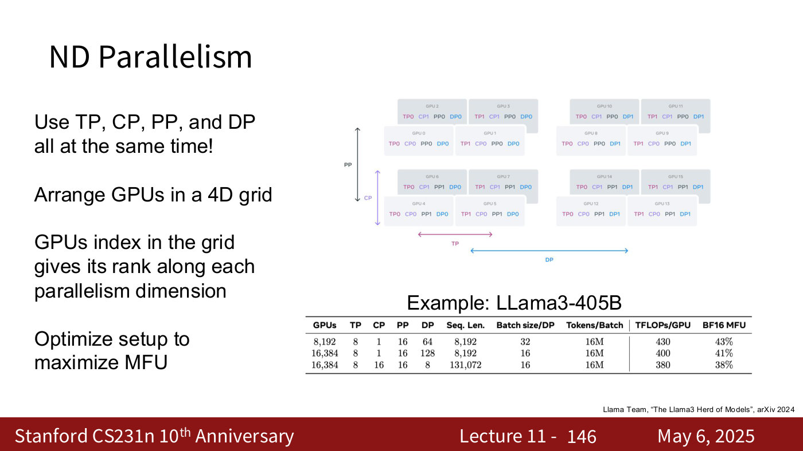

# Distributed training

Large models are trained on many GPUs at once: "the new norm is to train models on tens, hundreds, thousands, even tens of thousands of devices concurrently" (lecture 11, ≈0:05). The course covers this in [lecture 11](11-large-scale-distributed-training.md) (May 6, 2025). Citations "lecture 11, slide N" are to the [lecture 11 slide file](../raw/slides/11-large-scale-distributed-training.md), and timestamps to its [transcript](../raw/transcripts/11-large-scale-distributed-training.md). The lecture page has the full walk-through, with figures for each step. This page sets the ideas side by side.

## The hardware: a hierarchy of memory and links

A GPU's speed comes from its **Tensor Cores**, which do small matrix multiplies in mixed precision. On an H100 an SM (streaming multiprocessor) does 4096 FLOP per cycle on its four Tensor Cores, against 256 on its 128 FP32 cores (lecture 11, slides 15–16). Peak Tensor Core throughput grew from the V100's 125 TFLOP/sec to the B200's 5000, and the deck calls it a "1000x speedup since 2013" (lecture 11, slide 18).

Memory and communication form a hierarchy, and bandwidth falls at each level. Inside an H100, the 80 GB of HBM reaches the cores at 3352 GB/sec (lecture 11, slide 9). The eight GPUs of a server talk at 900 GB/sec. Meta's Llama 3 cluster puts two servers in a rack and 192 racks in a pod of 3072 GPUs, which talk at 50 GB/sec. Eight pods make a cluster of 24,576 GPUs, with less than 50 GB/sec between them (lecture 11, slides 21–24). The lecturer treats the whole cluster as "one big computer" (lecture 11, ≈21:41). Every strategy below decides which communication goes over which links.

## Four axes to split on

"A model with L layers operates on tensors of shape (Batch, Sequence, Dim)", and each axis gives a strategy (lecture 11, slide 30):

| Strategy | Splits | What is communicated | Notes |
| --- | --- | --- | --- |
| Data parallelism (DP) | the batch | gradients, all-reduced once per step | every GPU holds the whole model and optimizer |
| Fully sharded DP (FSDP) | the batch, and each layer's weights get an owner | weights in forward; weights and gradients in backward: "3x" the model | owners update their own weights |
| Hybrid sharded DP (HSDP) | FSDP inside groups of $K$, DP across $M$ groups | 3x inside a group, 1x (gradients) across groups | groups inside a node or pod |
| Context parallelism (CP) | the sequence | MLP and QKV gradients as in DP; attention needs ring attention or Ulysses | "Often used for long-sequence finetuning" |
| Pipeline parallelism (PP) | the layers | activations at GPU boundaries | idle "bubble"; microbatches shrink it |
| Tensor parallelism (TP) | the model dimension of each weight matrix | outputs gathered, every two layers with the two-layer trick | fits the transformer's two-layer MLP |

(lecture 11, slides 38–43, 46–64, 65–67, 116–125, 128–133, 135–143)

## Data parallelism, and why it runs out

Data parallelism works because gradients are linear. With $M$ GPUs each taking $N$ examples, the gradient of the average loss over all $MN$ examples is the average over GPUs of each GPU's own gradient (lecture 11, slide 34). So each GPU runs forward and backward on its own data, the gradients are all-reduced, and every GPU makes the same update. "This is not an approximation" (lecture 11, ≈30:52). The all-reduce of one layer's gradients overlaps with the backward pass of the next (lecture 11, slide 43). See [gradient descent](gradient-descent.md) for minibatch SGD.

It runs out of memory because every GPU holds a full copy. Each weight needs four numbers, the weight, its gradient and Adam's two moments, at 2 bytes each: "1B params takes 8GB; 10B params fills up 80GB GPU" (lecture 11, slide 44; see [optimizers](optimizers.md)). FSDP fixes this by giving each layer's weights an owner, which broadcasts them just before they are needed and receives the gradients afterwards. A 100B-parameter model's 800GB then becomes 10GB per GPU over 80 GPUs (lecture 11, slide 68).

## Memory for activations: checkpointing

With the weights split, the activations kept for the backward pass become the problem. Just the FFN hidden activations of Llama3-405B take 63GB (lecture 11, slide 69). **Activation checkpointing** stores fewer activations and recomputes the rest during the backward pass. For a network of $N$ layers (lecture 11, slides 81, 97, 100–101):

| Strategy | Compute | Memory |
| --- | --- | --- |
| Store everything | $O(N)$ | $O(N)$ |
| Recompute everything | $O(N^2)$ | $O(1)$ |
| $C$ checkpoints | $O(N^2/C)$ | $O(C)$ |
| $\sqrt{N}$ checkpoints | $O(N\sqrt{N})$ | $O(\sqrt{N})$ |

It "makes everything a lot slower, but it does let you train much bigger models" (lecture 11, ≈57:01). The backward pass needs the forward activations because of how [backpropagation](backpropagation.md) computes each layer's gradient.

## The metric: model FLOPs utilization

With so many knobs, the guide is **model FLOPs utilization (MFU)**: the time the model's forward and backward matrix multiplies would take at the device's theoretical peak, divided by the actual time of a full training iteration (lecture 11, slide 108). It differs from hardware FLOPs utilization (HFU), which measures matrix multiply alone. HFU reaches about 80% on an H100 for large matrices (lecture 11, slide 106), but it ignores everything else a training loop does (lecture 11, slide 107). "MFU >30% is good, >40% is excellent" (lecture 11, slide 111). Llama3-405B trained at 38–43% (lecture 11, slide 112). Newer devices can get *worse* MFU, because their FLOPs grow faster than their memory bandwidth: from the A100 to the H100, 3.1x against 2.1x (lecture 11, slide 113).

## Combining them

The deck's scaling recipe (lecture 11, slide 102) starts with plain data parallelism up to about 128 GPUs and 1B-parameter models, with the per-GPU batch maxing out memory. It moves to FSDP above 1B parameters, adds activation checkpointing for larger batches, and switches to HSDP above 256 GPUs. Context, pipeline and tensor parallelism come in above 1K GPUs, 50B parameters or 16K-token sequences.

The largest runs use all four axes, arranging the GPUs in a 4D grid in which each GPU's coordinates give its rank along each axis (lecture 11, slide 146). Llama3-405B's longest-context configuration used 16,384 GPUs as 8-way TP, 16-way CP, 16-way PP and 8-way DP (lecture 11, slide 146; ≈1:11:36).

*Lecture 11, slide 146 — 16 GPUs arranged in a 4D grid, each labelled with its rank along TP, CP, PP and DP, beside Llama3-405B's three training configurations, whose four degrees multiply to the GPU count. [Deck](https://cs231n.stanford.edu/slides/2025/lecture_11.pdf)*

## Where the course covers distributed training

- [Lecture 11 — Large-Scale Distributed Training](11-large-scale-distributed-training.md): everything on this page.
- [Lecture 8 — Attention and Transformers](08-attention-transformers.md): the transformer block and multi-head attention that context and tensor parallelism split, and the memory cost of attention.
- [Lecture 4 — Neural Networks and Backpropagation](04-neural-networks-backpropagation.md): the backward pass whose stored activations checkpointing trades away.
- [Lecture 3 — Regularization and Optimization](03-regularization-optimization.md): minibatch SGD and Adam, whose state is part of the per-weight memory.
