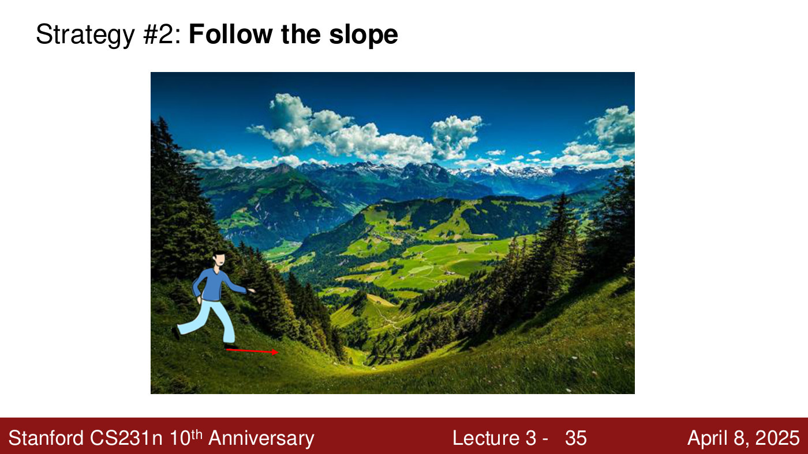
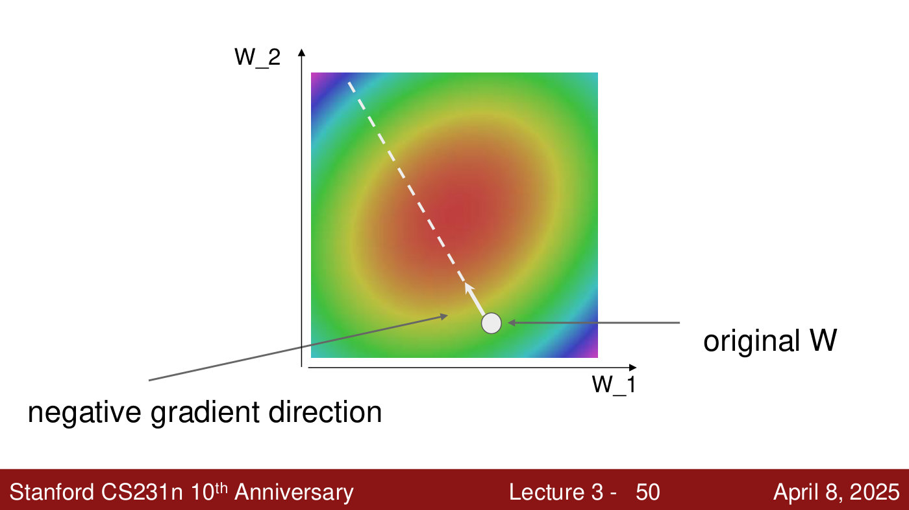
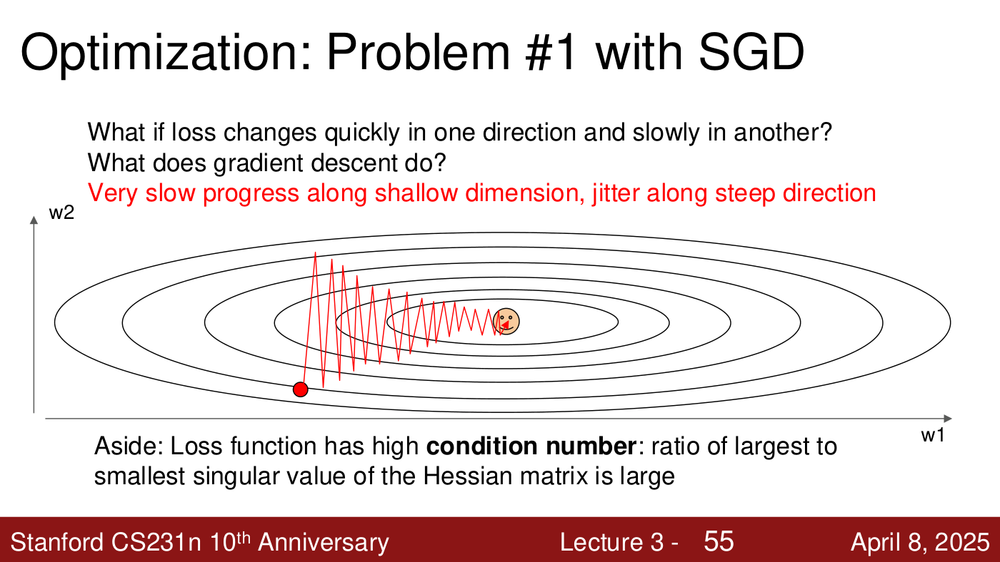
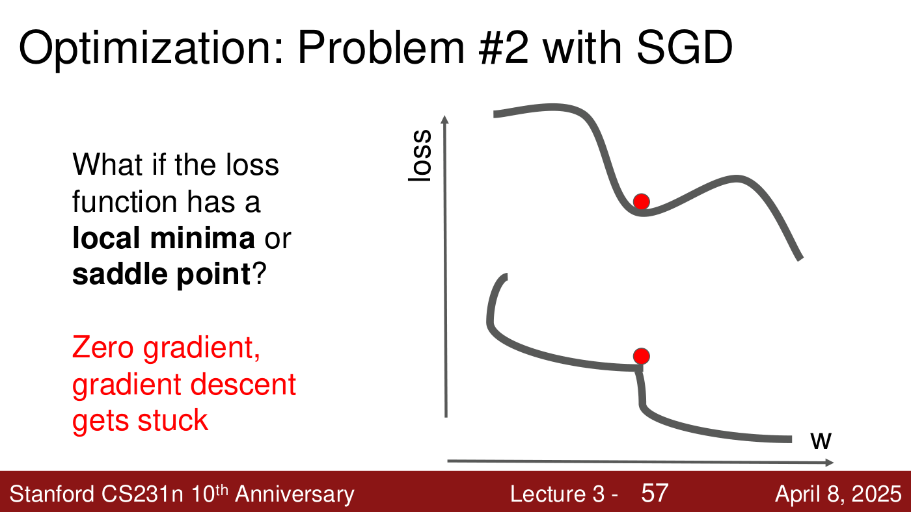
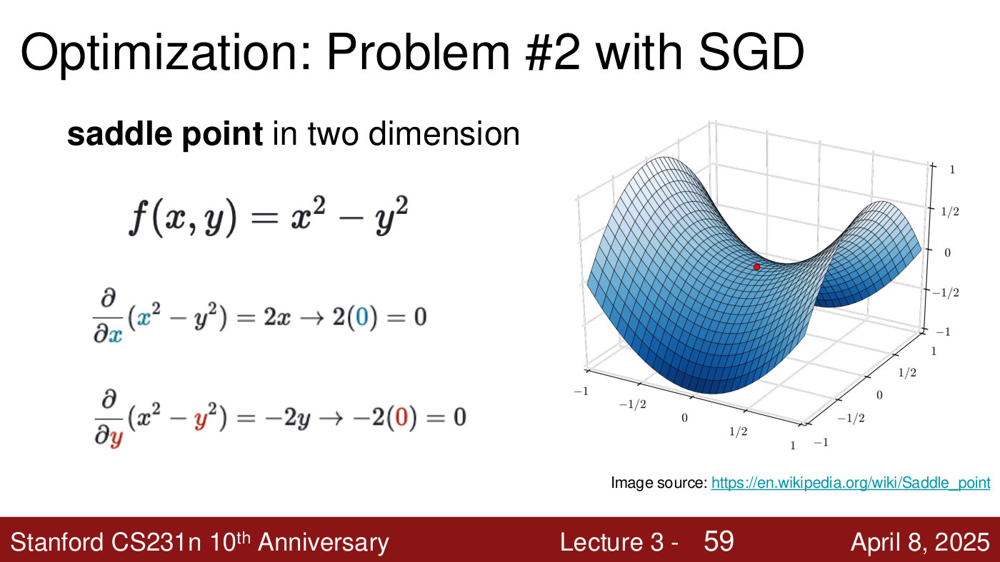
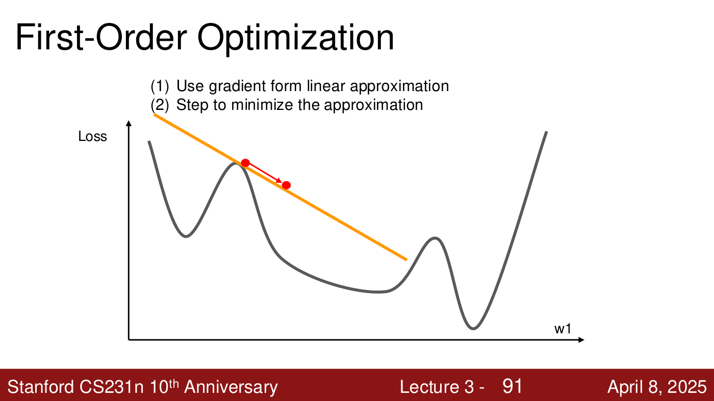
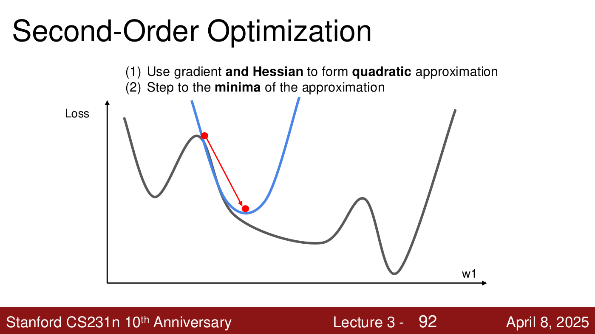

# Gradient descent and SGD

**Optimisation** is how a model's weights are found: search for the $W$ that minimises the loss.
CS231N's method throughout is **gradient descent** — compute which way the loss slopes and step
downhill — run on random minibatches as **stochastic gradient descent** (SGD). This page covers the
gradient, how to compute and check it, gradient descent and SGD, the three ways SGD struggles, and
why second-order methods are rarely used in deep learning. The optimisers that fix SGD's problems
(momentum, RMSProp, Adam, AdamW) are on [optimizers](optimizers.md), and how to set and change the
step size is on [learning-rate schedules](learning-rate-schedules.md).

Covered in: [Lecture 3](03-regularization-optimization.md#optimisation).

## The loss landscape

Think of the loss as a landscape: each position on the ground is a setting of the weights, and the
height is the loss. Training is walking to the lowest point. The analogy only works if the walker
is **blindfolded**: an optimiser cannot see the whole landscape, only feel the slope where it
stands (lecture 3, ≈24:46–25:32).

The baseline is random search: try 1,000 random weight matrices and keep the best. On CIFAR-10 it
reaches 15.5%, better than chance but far from the 99.7% state of the art (lecture 3, slides
33–34). The strategy that works is to follow the slope (lecture 3, slide 35).



*Lecture 3, slide 35 — the blindfolded walker on the loss landscape: feel the slope underfoot and step downhill. [Deck](https://cs231n.stanford.edu/slides/2025/lecture_3.pdf)*

## The gradient

In one dimension the slope is the derivative,
$\frac{df(x)}{dx} = \lim_{h \to 0} \frac{f(x+h) - f(x)}{h}$. In several dimensions it is the
**gradient**, the vector of partial derivatives along each dimension. The slope in any direction is
the dot product of that direction with the gradient, so the **negative gradient** is the direction
of steepest descent (lecture 3, slide 36).

**Numerical gradient.** Use the limit definition with a small $h$, one dimension at a time. In the
deck's example, adding $h = 0.0001$ to the first weight moves the loss from 1.25347 to 1.25322, so
the first gradient entry is $(1.25322 - 1.25347)/0.0001 = -2.5$ (lecture 3, slide 39). It is slow,
because it loops over every weight, and approximate (lecture 3, slide 44), with floating-point error
on top (lecture 3, ≈29:20).

**Analytic gradient.** The loss is a known function of $W$, so its gradient $\nabla_W L$ can be
derived with calculus, holding the data fixed (lecture 3, ≈29:20–30:52). It is exact and fast, but
error-prone to derive and code.

**Gradient check.** "In practice: Always use analytic gradient, but check implementation with
numerical gradient" (lecture 3, slide 48). The assignments use gradient checks to catch bugs
(lecture 3, ≈31:37).

## Gradient descent

Repeat: evaluate the gradient of the loss at the current weights, and move a fixed **step size**
(the **learning rate**) against it (lecture 3, slide 49):

```python
# Vanilla Gradient Descent

while True:
  weights_grad = evaluate_gradient(loss_fun, data, weights)
  weights += - step_size * weights_grad # perform parameter update
```

Seen from above, the negative gradient at the starting $W$ points toward the low region (lecture 3,
slide 50). The step size is fixed, but the step taken is the step size times the gradient, so steps
shrink as the ground flattens near a minimum (lecture 3, ≈34:40–35:27). The loop stops after a
fixed number of iterations, or when the loss improves by less than a tolerance such as $10^{-5}$
(lecture 3, ≈35:27–36:14).



*Lecture 3, slide 50 — a loss landscape seen from above (red is low, purple high) over two weights; from the original W the negative gradient points toward the minimum. [Deck](https://cs231n.stanford.edu/slides/2025/lecture_3.pdf)*

## Stochastic gradient descent

The loss is an average over all $N$ training examples, and so is its gradient:

$$\nabla_W L(W) = \frac{1}{N} \sum_{i=1}^{N} \nabla_W L_i(x_i, y_i, W) + \lambda \nabla_W R(W)$$

where $L_i$ is example $i$'s loss and $\lambda R(W)$ the [regularization](regularization.md) term.
The full sum is expensive when $N$ is large, so SGD estimates it from a **minibatch** sampled at
each step; 32, 64 or 128 examples are common (lecture 3, slide 52). In practice the data are
shuffled and passed through in full before repeating; one pass is an **epoch** (lecture 3,
≈36:59–37:46).

## Where SGD struggles

**Poor conditioning.** If the loss changes quickly in one direction and slowly in another — a long,
narrow valley — the gradient points mostly across the valley. SGD jitters from side to side and
makes slow progress along it, and with a large step it can bounce out entirely (lecture 3,
≈38:31–39:16).

Such a loss has a **high condition number**: the ratio of the largest to the smallest singular
value of the Hessian, the matrix of second derivatives, is large (lecture 3, slide 55).



*Lecture 3, slide 55 — poor conditioning: on a long, narrow valley, gradient descent (red) zig-zags across the steep direction and creeps along the shallow one. [Deck](https://cs231n.stanford.edu/slides/2025/lecture_3.pdf)*

**Local minima and saddle points.** Where the gradient is zero, gradient descent stops: at the
bottom of a local minimum, or on a flat point (lecture 3, slide 57).



*Lecture 3, slide 57 — two places with zero gradient where gradient descent gets stuck: the bottom of a local minimum (top curve) and a flat point just before a drop (bottom curve). [Deck](https://cs231n.stanford.edu/slides/2025/lecture_3.pdf)*

Saddle points are much more common in high dimensions (lecture 3, slide 58, citing Dauphin et al.,
NIPS 2014). At a saddle, the gradient is zero in every direction although the loss falls away on
either side: for $f(x, y) = x^2 - y^2$, both partial derivatives vanish at the origin (lecture 3,
slide 59).



*Lecture 3, slide 59 — a saddle point of f(x, y) = x² − y²: both partial derivatives are zero at the centre, which curves up in one direction and down in the other. [Deck](https://cs231n.stanford.edu/slides/2025/lecture_3.pdf)*

**Noisy gradients.** A minibatch gradient is only an estimate, so each step heads roughly, not
exactly, toward the minimum (lecture 3, slide 60; ≈42:22).

Momentum addresses all three; see [optimizers](optimizers.md#sgd-with-momentum).

## First- and second-order methods

Gradient descent is **first-order**: it uses the gradient to form a linear approximation of the
loss and steps to reduce it (lecture 3, slide 91).



*Lecture 3, slide 91 — first-order: the tangent line (orange) at the current point says which way is down, and the step follows it. [Deck](https://cs231n.stanford.edu/slides/2025/lecture_3.pdf)*

A **second-order** method uses the gradient and the Hessian to form a quadratic approximation and
steps straight to its minimum (lecture 3, slide 92).



*Lecture 3, slide 92 — second-order: a parabola (blue) fitted at the current point, and one step straight to its minimum. [Deck](https://cs231n.stanford.edu/slides/2025/lecture_3.pdf)*

With $J(\boldsymbol{\theta})$ the loss, $\boldsymbol{\theta}_ 0$ the current parameters and
$\boldsymbol{H}$ the Hessian, setting the gradient of the second-order Taylor expansion to zero
gives the **Newton update** (lecture 3, slide 93):

$$\boldsymbol{\theta}^\ast = \boldsymbol{\theta}_ 0 - \boldsymbol{H}^{-1}\nabla_{\boldsymbol{\theta}} J(\boldsymbol{\theta}_ 0)$$

It is impractical for deep learning: the Hessian has $O(N^2)$ elements and inverting it takes
$O(N^3)$, with $N$ in the tens or hundreds of millions (lecture 3, slide 94). The matrices do not
fit in GPU memory, and the time is better spent on more data, although second-order methods can
work well for small models (lecture 3, ≈1:04:37–1:05:24). Quasi-Newton methods such as L-BFGS
approximate the inverse Hessian instead; they work well in full-batch, deterministic settings but
poorly with minibatches (lecture 3, slides 116–117, from the deck's unpresented appendix).

## Related pages

- [Optimizers](optimizers.md) — momentum, Nesterov, AdaGrad, RMSProp, Adam, AdamW.
- [Learning-rate schedules](learning-rate-schedules.md) — choosing and changing the step size.
- [Loss functions](loss-functions.md) and [regularization](regularization.md) — what is being
  minimised.
