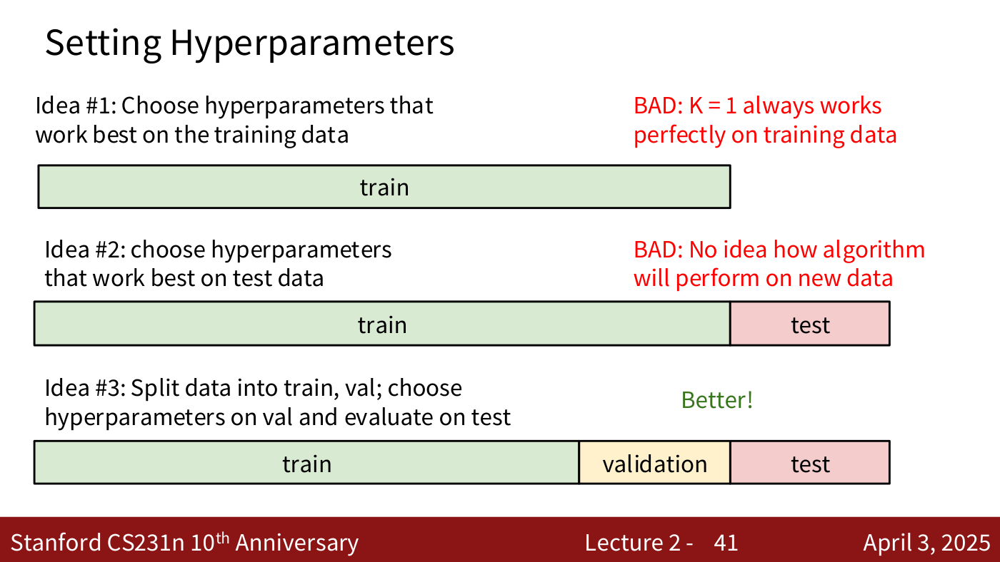
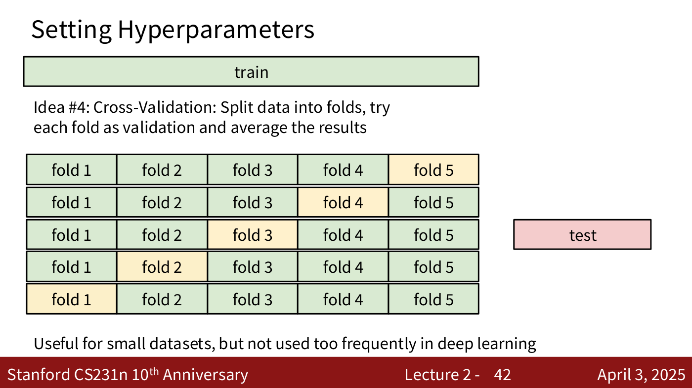
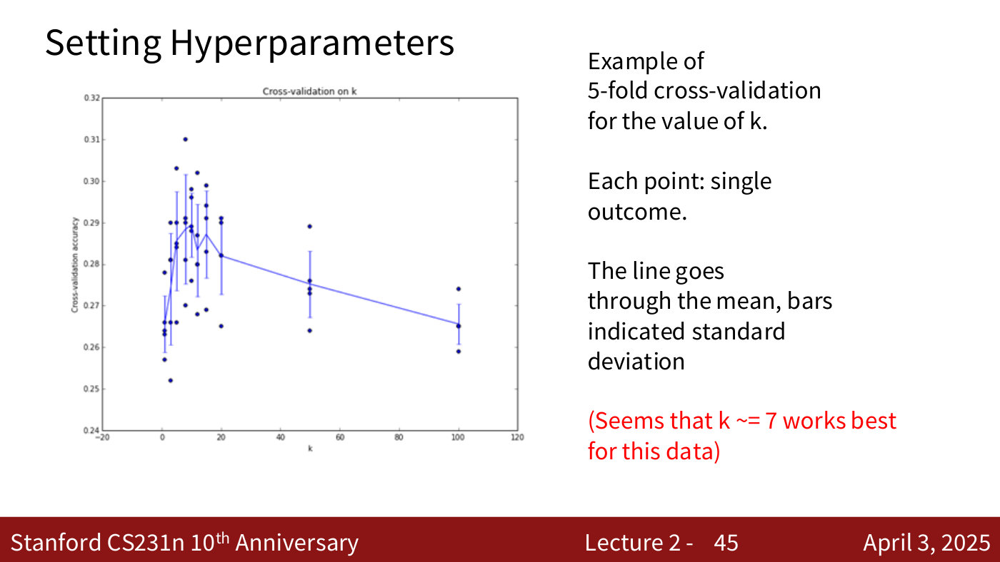
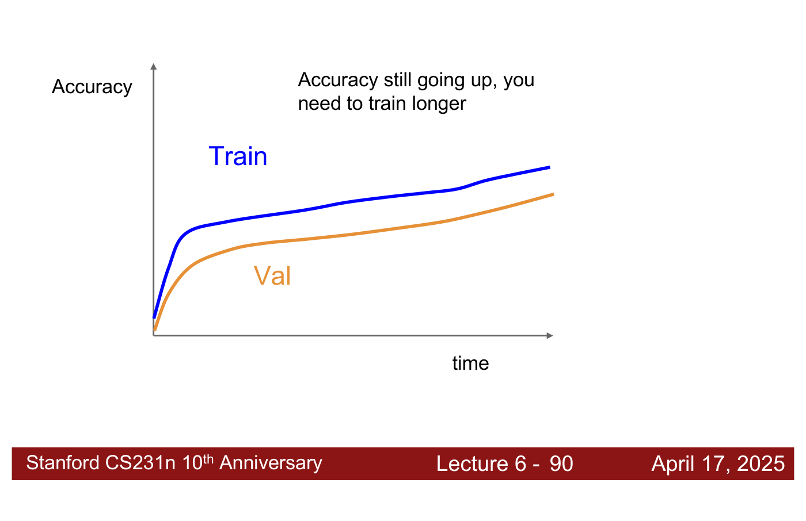
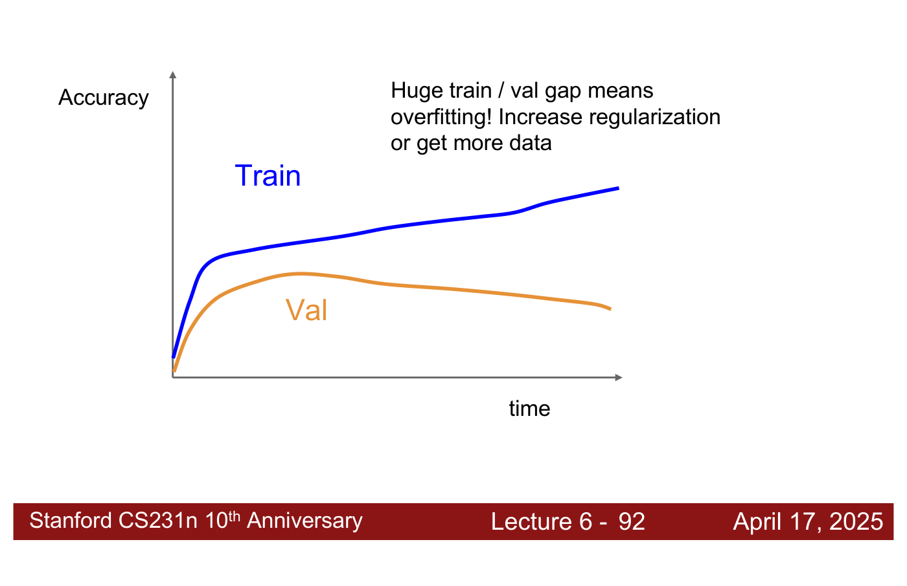
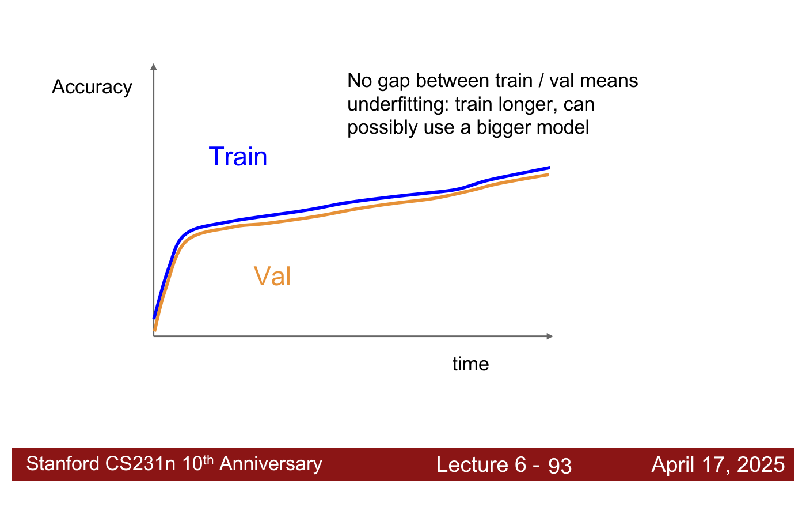
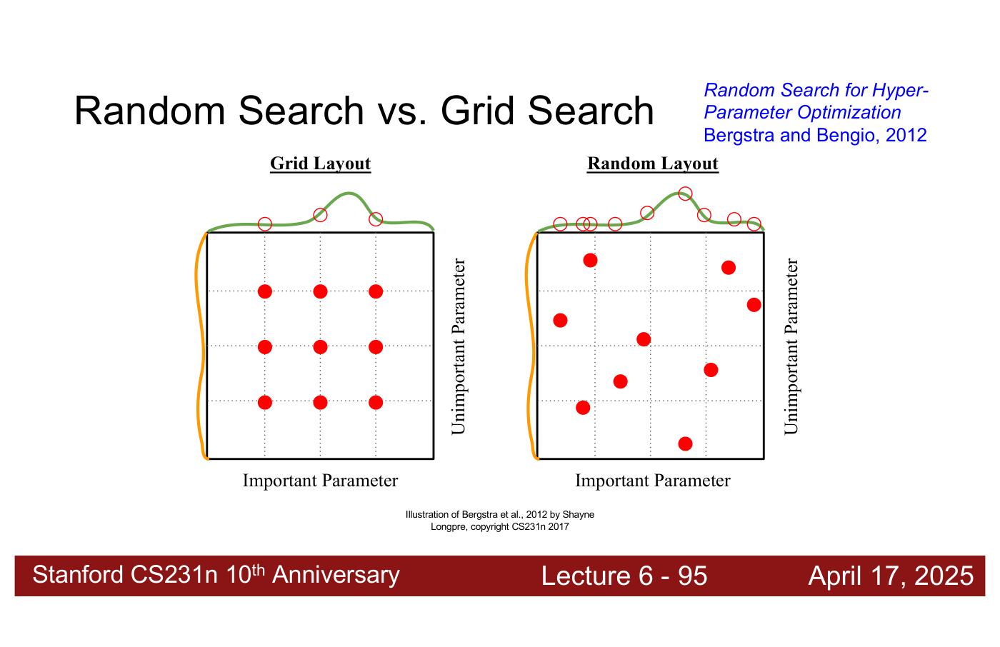

# Hyperparameters and validation

A **hyperparameter** is a choice about the algorithm itself that has to be made before it can run
— in CS231N's first example, the number of neighbours $k$ and the distance metric of a
[k-nearest-neighbour](k-nearest-neighbors.md) classifier (lecture 2, ≈35:39–36:25; lecture 2,
slide 36). Their best values are "very problem/dataset-dependent", so they must be found for each
problem, which is called **hyperparameter tuning** (lecture 2, ≈36:25).

Covered in: [Lecture 2](02-image-classification.md#hyperparameters-and-how-to-set-them); lecture 3
adds the regularization strength and the learning rate, lecture 4 a network's size and its
activation function, lecture 5 the convolution and pooling settings, and lecture 6 a recipe for
choosing them and random search (below).

## Four ways to choose them

Lecture 2 builds up four ideas, two bad and two good (lecture 2, slides 37–42).

*Lecture 2, slide 41 — Setting Hyperparameters. [Deck](https://cs231n.stanford.edu/slides/2025/lecture_2.pdf)*

*Lecture 2, slide 42 — Setting Hyperparameters. [Deck](https://cs231n.stanford.edu/slides/2025/lecture_2.pdf)*

**On the training data — bad.** Pick whatever gives the best training accuracy. For nearest
neighbour, $k = 1$ always wins with 100% training accuracy, because the training data is simply
memorised (lecture 2, ≈36:25–37:12).

**On the test data — bad.** Pick whatever does best on the test set. It is "kind of cheating": the
test set no longer tells you how the model will do on new data. "Never do this" (lecture 2,
≈37:12–38:00).

**On a validation set — better.** Split the data into train, validation and test. Train on the
training split, choose the hyperparameters on the validation split, and only then evaluate the
chosen setting on the test set (lecture 2, ≈38:00–39:33; lecture 2, slide 41). The weakness is that
the validation set is usually much smaller and may not represent the whole data.

**Cross-validation — more reliable.** Split the training data into folds; let each fold serve once
as the validation set while training on the others; average the validation accuracies; repeat for
each hyperparameter setting and keep the best; then evaluate once on the test set (lecture 2,
≈39:33–40:19; lecture 2, slide 42).

## In practice

Cross-validation is "useful for small datasets, but not used too frequently in deep learning"
(lecture 2, slide 42): training a large model five times on a huge dataset is very hard, so deep
learning usually relies on intuition and a single validation set. Outside large-scale vision it is
advised, and research papers often require it to show that results are reproducible (lecture 2,
≈40:19–41:07).

An example: five-fold cross-validation of $k$ for k-NN on CIFAR-10, with one point per fold at each
tested $k$, a line through the means, and bars showing the standard deviation. The slide's reading
is that "k ~= 7 works best for this data" (lecture 2, ≈41:53–42:39; lecture 2, slide 45); the
lecturer reads the accuracy there as about 28–29%, though the captions are unclear on the figure.

*Lecture 2, slide 45 — five-fold cross-validation on k for CIFAR-10: one dot per fold, the line through the means; the slide reads the best as k ≈ 7. [Deck](https://cs231n.stanford.edu/slides/2025/lecture_2.pdf)*

## The rule

"Choose hyperparameters using the validation set. Only run on the test set once at the very end!"
(lecture 2, slide 50).

## Hyperparameters from lecture 3

Lecture 3 introduces two more. The **regularization strength** $\lambda$ weights the
regularization term in the loss and is set with training and validation sets like any other
(lecture 3, ≈14:01–14:47; see [regularization](regularization.md)). The **learning rate** is a
hyperparameter of every optimiser the course uses (see
[learning-rate schedules](learning-rate-schedules.md)), as are Adam's $\beta_1$ and $\beta_2$,
whose usual starting values are 0.9 and 0.999 (see [optimizers](optimizers.md#adam)).

## Hyperparameters from lecture 4

A [neural network](neural-networks.md) adds the number of layers, the number of neurons in each,
and the activation function. All are chosen empirically: start from networks trained on similar
data, or from the activation standard for that kind of architecture (ReLU is the usual default),
and experiment (lecture 4, ≈22:46–23:33 and ≈33:37–34:26). The network's size is not normally
tuned to control overfitting. Instead, "go with a bit of a bigger network than we need" and tune
the regularization strength $\lambda$ (lecture 4, ≈29:48–30:34; see
[regularization](regularization.md#the-regularization-strength-and-the-networks-size)).

## Hyperparameters from lecture 5

A [convolution layer](convolutional-networks.md) adds the number of filters, the filter size,
the padding and the stride; a pooling layer adds its kernel size, stride and pooling function.
These are architectural hyperparameters, fixed before training because they set the shapes of the
tensors, while the values inside the filters are parameters learned by gradient descent. The
filter size, for example, is one "you would typically set via cross validation in some way"
(lecture 5, ≈37:37–39:10). In practice most are set by convention rather than tuned: "same"
padding $P = (K - 1)/2$ (lecture 5, ≈52:13), channel counts in powers of 2 (lecture 5, slide 94),
and for pooling "by far the most common" $2 \times 2$ with stride 2 (lecture 5, ≈1:02:15).

## Hyperparameters from lecture 6

Lecture 6 gives a recipe in seven steps (lecture 6, slides 88–89, 94). Step 1: check the initial
loss. Step 2: overfit a small sample. Step 3: find a learning rate that makes the loss go down:
with the previous step's architecture, all the training data and a small weight decay, find one
that makes the loss drop significantly within about 100 iterations, trying "1e-1, 1e-2, 1e-3,
1e-4, 1e-5". Step 4: a coarse grid of hyperparameters, training each for about 1–5 epochs. Step 5:
refine the grid and train longer. Step 6: look at the loss and accuracy curves. Step 7: go back to
step 5. The recording does not discuss step 1; lecture 2's softmax loss has a known value at
initialisation (see [loss functions](loss-functions.md)).

Overfitting a small sample is "the default debugging strategy in deep learning": a model should
be able to drive its training loss on a single example to essentially zero, and if it cannot, there
is a bug or the model is the wrong kind for the problem. It also shows which learning rates work
(lecture 6, ≈1:06:59–1:07:45). For the coarse grid, the lecturer tries learning rates first and
keeps the one whose training loss decreases most steadily over maybe one epoch (lecture 6,
≈1:07:45).

The accuracy curves say what to do next (lecture 6, slides 90–93). Training and validation
accuracy both still rising: "you need to train longer". Training accuracy rising while validation
accuracy falls: "huge train / val gap means overfitting! Increase regularization or get more
data", and the best model so far is at the validation peak. No gap between them: "underfitting:
train longer, can possibly use a bigger model" (lecture 6, ≈1:08:31–1:09:17). The lecturer twice
says "loss" for what these slides plot as accuracy (lecture 6, ≈1:08:31–1:09:17).

*Lecture 6, slide 90 — training (blue) and validation (orange) accuracy both still rising: train longer. [Deck](https://cs231n.stanford.edu/slides/2025/lecture_6.pdf)*

*Lecture 6, slide 92 — training accuracy keeps rising while validation accuracy peaks and falls: a huge train/val gap means overfitting. [Deck](https://cs231n.stanford.edu/slides/2025/lecture_6.pdf)*

*Lecture 6, slide 93 — no gap between training and validation accuracy: underfitting, so train longer or use a bigger model. [Deck](https://cs231n.stanford.edu/slides/2025/lecture_6.pdf)*

**Random search beats grid search** (Bergstra and Bengio, 2012; lecture 6, slide 95). With nine
trials over one important and one unimportant hyperparameter, a $3 \times 3$ grid tries only three
values of the important one, while nine random trials try nine. A grid wastes trials re-checking
an unimportant hyperparameter. So define a range for each hyperparameter, sample from the ranges at
random, and keep going until you have the best model (lecture 6, ≈1:09:17–1:10:04). See
[lecture 6](06-training-cnns-architectures.md#choosing-hyperparameters).

*Lecture 6, slide 95 — nine trials on a 3x3 grid test only three values of the important parameter; nine random trials test nine, one near the peak. Illustration of Bergstra and Bengio, 2012. [Deck](https://cs231n.stanford.edu/slides/2025/lecture_6.pdf)*
