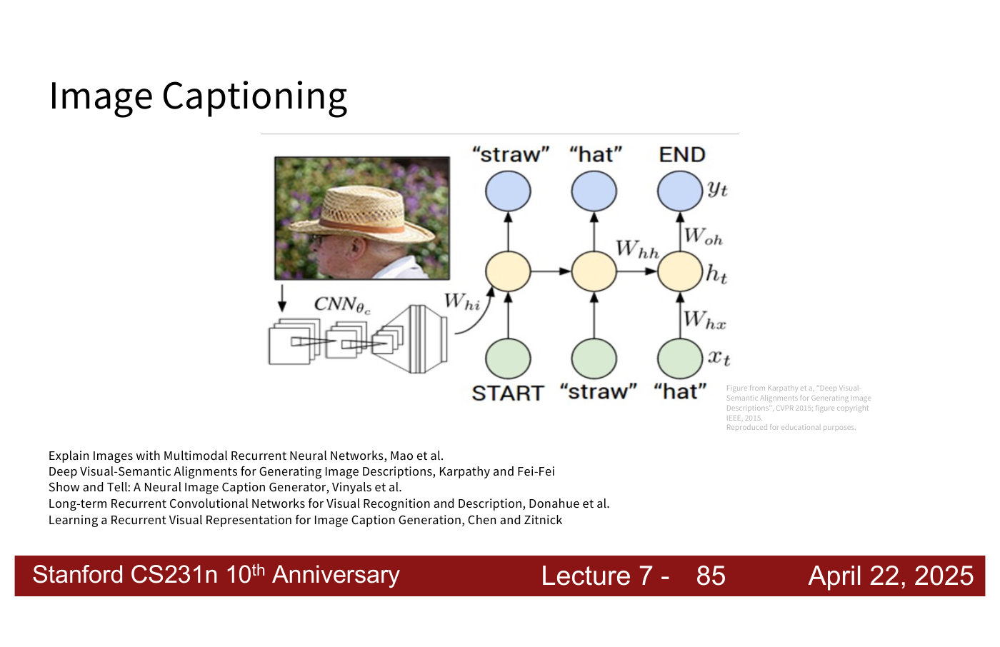
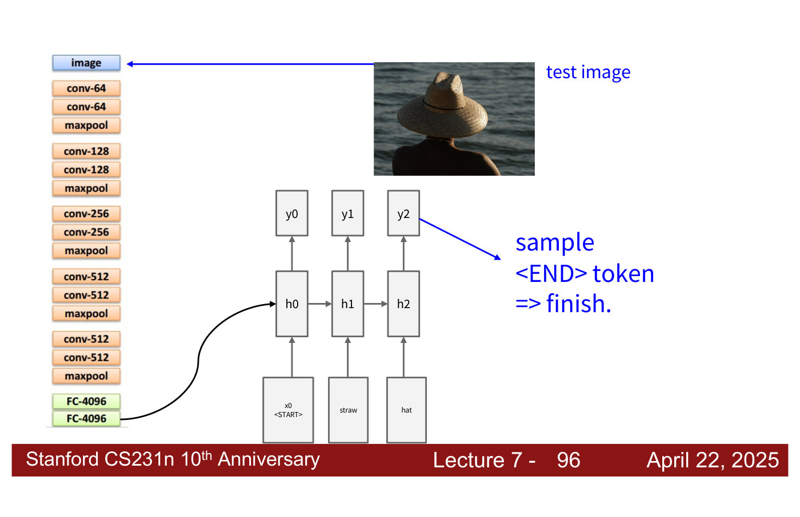
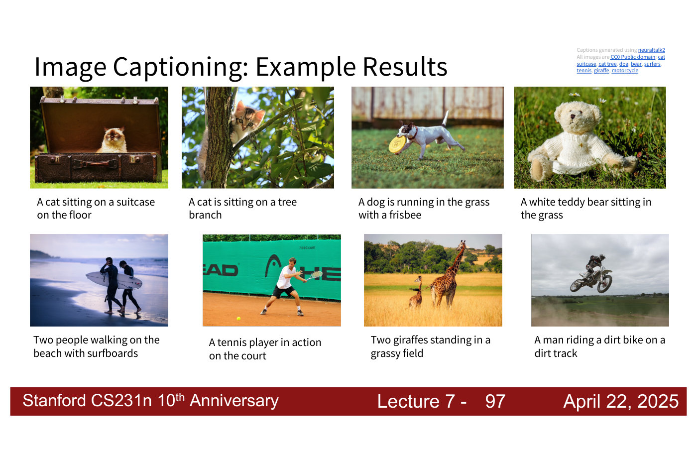
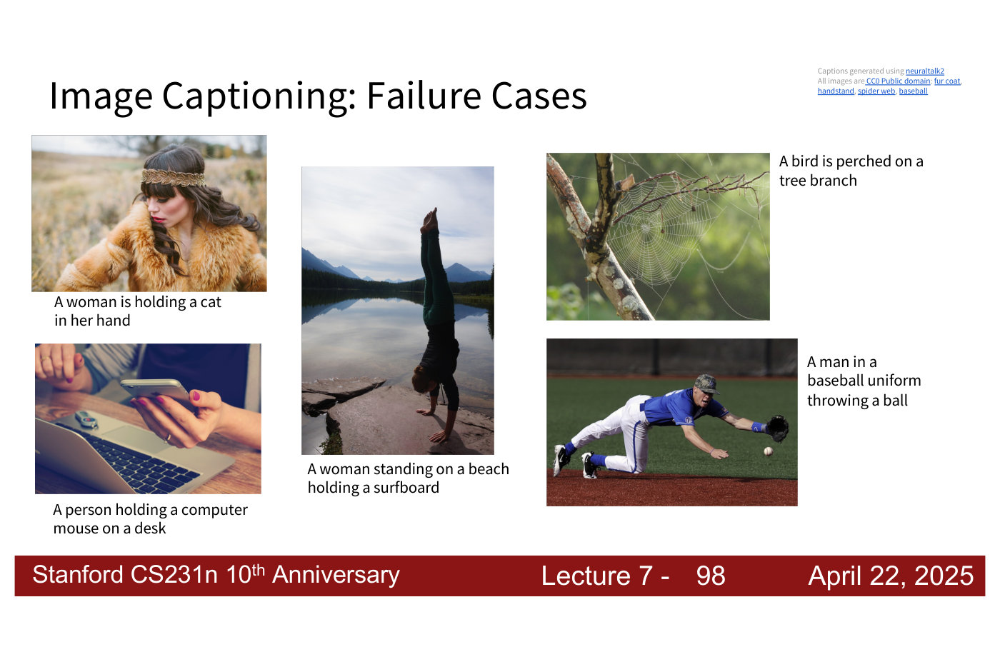
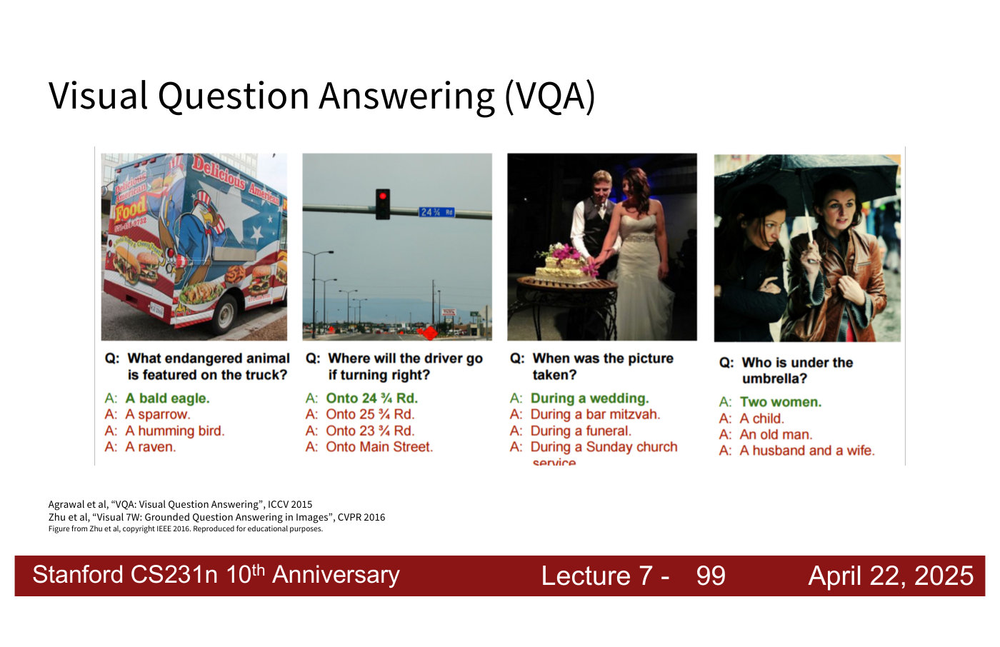
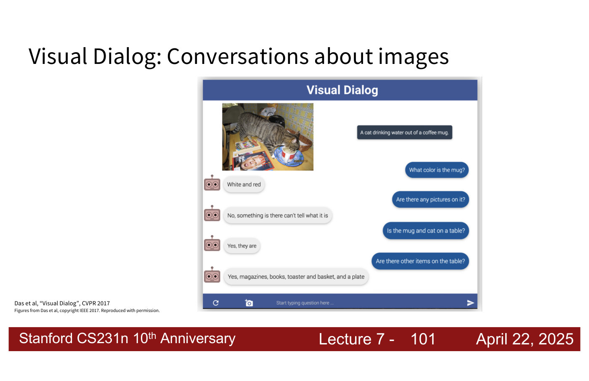
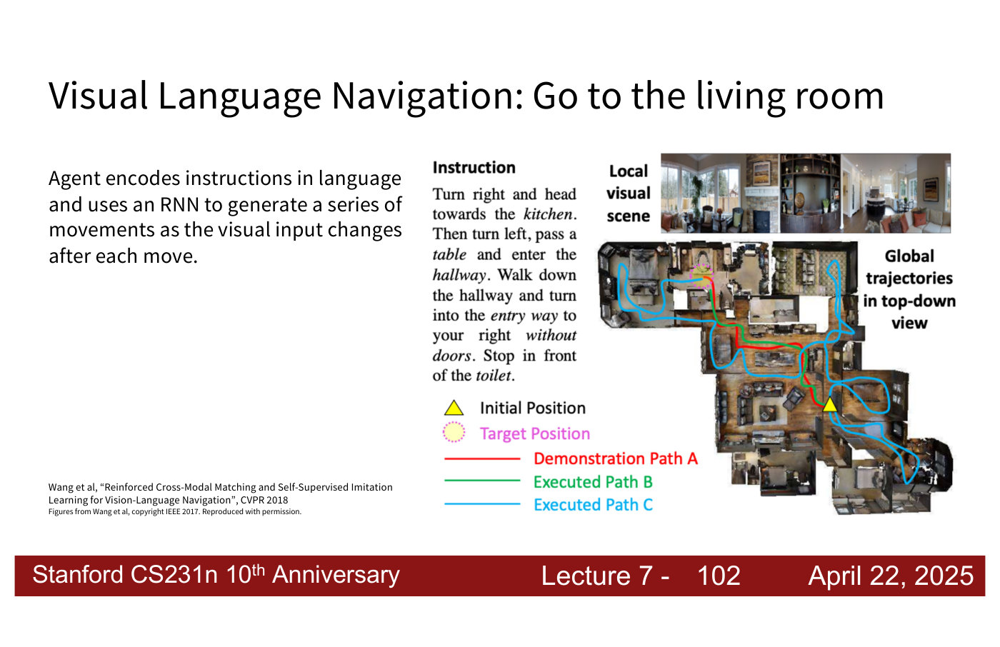

# Image captioning and visual question answering

**Image captioning** generates a sentence describing an image. Lecture 7 presents it as the main
application of [recurrent neural networks](recurrent-neural-networks.md) to computer vision: a
convolutional network encodes the image, and a recurrent network generates the caption word by word.
It also surveys visual question answering, visual dialog and visual language navigation. "I won't
spend too much time on this, because this won't be in any of the assignments" (lecture 7, ≈51:52).
Citations "lecture 7, slide N" are to the
[lecture 7 slide file](../raw/slides/07-recurrent-neural-networks.md), and timestamps
"(lecture 7, ≈M:SS)" to the [lecture 7 transcript](../raw/transcripts/07-recurrent-neural-networks.md).

## Captioning as a one-to-many sequence task

Captioning maps one input, an image, to a sequence of words: it is the course's example of a
**one-to-many** sequence task (lecture 7, slide 15; ≈5:30). The caption starts from a start token and
ends when the model produces an end token; in the lecture's example the tokens are words (lecture 7,
≈50:18–51:04). The lecture's figure is from Karpathy and Fei-Fei, "Deep Visual-Semantic Alignments
for Generating Image Descriptions", CVPR 2015, and slide 85 also lists Mao et al., Vinyals et al.
("Show and Tell"), Donahue et al., and Chen and Zitnick.

*Lecture 7, slide 85 — a CNN encodes the photograph, and an RNN generates "straw", "hat", END from the inputs START, "straw", "hat". [Deck](https://cs231n.stanford.edu/slides/2025/lecture_7.pdf)*

## How the CNN and the RNN are joined

The image goes through a CNN pretrained on ImageNet (lecture 7, slide 88). Its last two layers,
FC-1000 and softmax, are removed (slide 89): "we're not going to use the class labels, but we're going
to use this second to last layer", the same strategy used in [transfer learning](transfer-learning.md)
for good visual representations (lecture 7, ≈51:04–51:52). The feature vector $v$ from that layer
(4096 numbers in the drawn network) enters the RNN's hidden state through a new weight matrix
$W_{ih}$, so the vanilla update gains a third term (lecture 7, slide 91):

$$h = \tanh(W_{xh} \ast x + W_{hh} \ast h + W_{ih} \ast v)$$

where $x$ is the current input word, $h$ the hidden state, and $W_{xh}$, $W_{hh}$ the usual input and
recurrent weights. "So we don't necessarily have just a hidden state. We're also tracking the visual
components here" (lecture 7, ≈51:52).

Generation then works like [sampling from a language model](language-models.md#generating-text-sampling)
(lecture 7, slides 90–96; ≈52:38). The first input is the start token. A word is sampled from the
first output ("straw") and fed in as the next input; the next word ("hat") is sampled and fed in; and
when the end token is sampled, the caption is finished. The word can be chosen greedily or by "some
other version of sampling" (lecture 7, ≈52:38).

*Lecture 7, slide 96 — captioning at test time: the CNN without its last two layers feeds the first hidden state, each sampled word becomes the next input, and sampling the END token finishes the caption. [Deck](https://cs231n.stanford.edu/slides/2025/lecture_7.pdf)*

The CNN drawn on slides 88–96 is not named: as drawn it has 10 convolution layers in five groups of
two (64, 128, 256, 512 and 512 channels), each group followed by max pooling, then FC-4096, FC-4096,
FC-1000 and softmax.

## What captioning models get right and wrong

These models "worked very well for the time" (lecture 7, ≈52:38). Slide 97 shows eight captions
generated with neuraltalk2 that fit their photographs, such as "A cat sitting on a suitcase on the
floor" and "Two people walking on the beach with surfboards".

*Lecture 7, slide 97 — eight good captions, among them "A white teddy bear sitting in the grass" and "A man riding a dirt bike on a dirt track". [Deck](https://cs231n.stanford.edu/slides/2025/lecture_7.pdf)*

Slide 98 shows five failures (lecture 7, ≈52:38–54:54). A hand holding a phone above a laptop is
captioned "A person holding a computer mouse on a desk", because the cupped hand "very much looks
like how they might hold a mouse". A woman wearing a fur coat is "holding a cat". A person doing a
handstand by a lake is "standing on a beach holding a surfboard": "they see a beach so they assume
there's a surfboard". A spider web becomes "a bird perched on a tree branch", and a player catching
a ball is "throwing a ball".

*Lecture 7, slide 98 — five failures: fur taken for a cat, a phone for a mouse, a lake for a beach with a surfboard, a spider web for a bird, a catch for a throw. [Deck](https://cs231n.stanford.edu/slides/2025/lecture_7.pdf)*

The lecturer's diagnosis is **hallucination** driven by **dataset bias** (lecture 7, ≈53:23–54:54).
In the training data, certain objects and actions co-occur with certain scenes, so the model learns
to associate them without learning to disentangle them — that the ball is going into the glove, so
the player is catching. Because it is trained only to output the caption, nothing asks it to explain
itself. This kind of hallucination, of objects that commonly appear in such a scene but not in this
one, "is still extremely common with vision language models today" (lecture 7, ≈53:23).

## Visual question answering

**Visual question answering** (VQA) asks a question about an image and chooses or generates the
answer (lecture 7, slide 99; Agrawal et al., ICCV 2015; Zhu et al., "Visual 7W", CVPR 2016). The
lecturer describes two formulations (lecture 7, ≈54:54–55:40). A captioning-style model can be given
the question and score each candidate answer by multiplying the probabilities of its characters or
tokens. More commonly, the question and each candidate answer are given as inputs and the model is a
classifier over the answers: a four-way classifier when there are four candidates.

*Lecture 7, slide 99 — four VQA examples, each with four candidate answers and the correct one in green, such as "Where will the driver go if turning right?" — "Onto 24 ¾ Rd." [Deck](https://cs231n.stanford.edu/slides/2025/lecture_7.pdf)*

## Visual dialog and visual language navigation

**Visual dialog** extends this to a conversation about an image (lecture 7, slide 101; Das et al.,
CVPR 2017). "At the time these were all considered very separate tasks. These days you have sort of
one model that can do almost all of these", and their capabilities have exploded "in the last 2
years" (lecture 7, ≈55:40).

*Lecture 7, slide 101 — a dialog about a photograph of a cat drinking from a mug: "Is the mug and cat on a table?" — "Yes, they are". [Deck](https://cs231n.stanford.edu/slides/2025/lecture_7.pdf)*

In **visual language navigation**, an agent "encodes instructions in language and uses an RNN to
generate a series of movements as the visual input changes after each move" (lecture 7, slide 102;
Wang et al., CVPR 2018): images come in and the model outputs directions to reach a destination in a
floor plan (lecture 7, ≈56:25).

*Lecture 7, slide 102 — navigating from a written instruction: a demonstration path and an executed path reach the target fairly directly, another wanders through several rooms. [Deck](https://cs231n.stanford.edu/slides/2025/lecture_7.pdf)*

## Where the course covers these tasks

- [Lecture 7 — Recurrent Neural Networks](07-recurrent-neural-networks.md#rnns-in-computer-vision):
  everything on this page.
- [Computer vision tasks](computer-vision-tasks.md) places captioning among the course's other tasks.
- Lecture 16, Vision and Language, is not yet in this knowledge base.
