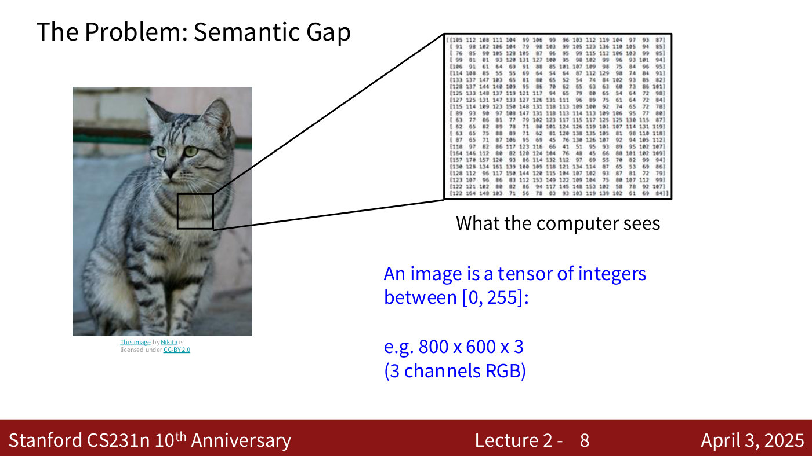
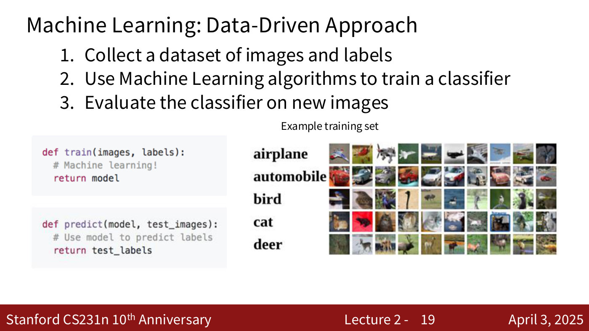
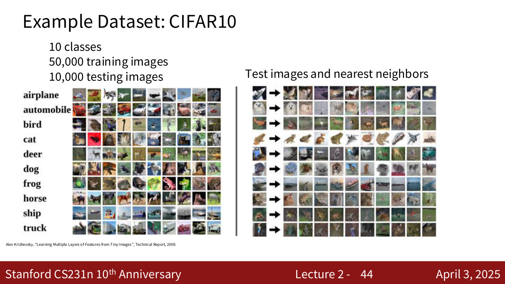
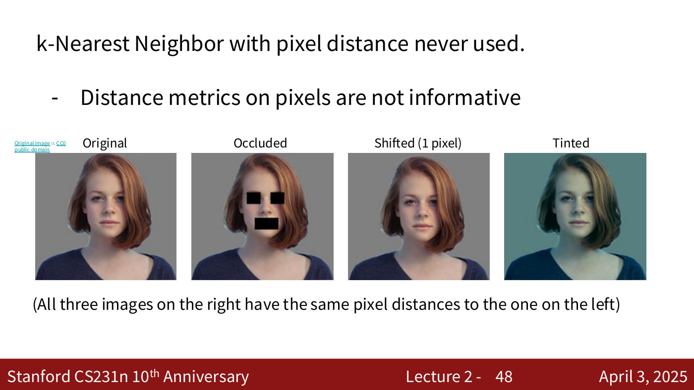

# Image classification

Image classification is the task of assigning one label, from a fixed set of possible labels, to a
whole image: a photograph of a cat in, "cat" out. CS231N treats it as the core task of computer
vision and returns to it throughout the quarter "because it's a very good benchmark" (lecture 2,
≈1:37). This page gathers what the course says about the task itself; the classifiers have their
own pages: [k-nearest neighbours](k-nearest-neighbors.md) and
[linear classifiers](linear-classifiers.md).

Covered in: [Lecture 1](01-introduction.md) (as one task among many — see
[computer vision tasks](computer-vision-tasks.md)) and
[Lecture 2](02-image-classification.md#the-image-classification-task) (in depth), and
[Lecture 5](05-image-classification-cnns.md) (hand-designed features, then convolutional networks).

## The task and the semantic gap

The input is an image and a predetermined set of labels — dog, cat, truck, plane, and so on — and
the output is one of those labels (lecture 2, ≈2:24–3:11). For a person this is effortless. For a
computer the image is only a tensor of integers, each between 0 and 255; an 800-by-600 colour image
is an $800 \times 600 \times 3$ tensor, one channel each for red, green and blue (lecture 2,
≈3:56; lecture 2, slide 8). The distance between what we perceive and those numbers is what the
course calls the **semantic gap** (lecture 2, ≈4:43).

*Lecture 2, slide 8 — the semantic gap: a patch of the cat becomes a grid of integers, which is all the computer sees. [Deck](https://cs231n.stanford.edu/slides/2025/lecture_2.pdf)*

## Why it is hard

The same object can produce completely different numbers. Lecture 2 walks through the challenges,
each with photographs of cats ([details](02-image-classification.md#why-it-is-hard-the-challenges)):

- **viewpoint variation** — move the camera and every pixel value changes;
- **illumination** — a pixel's RGB value depends on the surface's colour and on the light source;
- **background clutter** — the object blends into its surroundings;
- **scale** — zooming in and out, raised by a student;
- **occlusion** — only part of the object is visible, and context has to fill the gap;
- **deformation** — cats take very different shapes;
- **intraclass variation** — sizes, colours, patterns and breeds that are all still "cat";
- **context** — a cropped animal behind a fence looks striped like a tiger because of the bars'
  shadows; with the context it can be classified correctly (lecture 2, ≈9:24–10:09).

Despite all of these, today's classifiers do "a really great job", thanks to efforts like
[ImageNet](imagenet.md) and the larger benchmarks that followed (lecture 2, ≈10:55).

## The data-driven approach

There is no way to write down the steps for recognising a cat the way one writes a sorting
algorithm. Earlier attempts found edges, then corners, and mapped features of them to a class; they
worked on narrow kinds of images but did not scale, because the rules had to be written for every
object (lecture 2, ≈11:44–14:02).

Machine learning replaces the rules with data, in three steps (lecture 2, ≈14:02–16:20; lecture 2,
slide 19). Collect a dataset of images and labels. Train a classifier with a function
`train(images, labels)` that returns a model. Evaluate it with `predict(model, test_images)` on
images that were not in the training set. Every classifier in the course follows this shape.

*Lecture 2, slide 19 — Machine Learning: Data-Driven Approach. [Deck](https://cs231n.stanford.edu/slides/2025/lecture_2.pdf)*

## Datasets

**CIFAR-10** is the dataset the assignments use most: 10 classes (airplane, automobile, bird, cat,
deer, dog, frog, horse, ship, truck), 50,000 training images and 10,000 test images, each
$32 \times 32 \times 3$ (lecture 2, ≈41:07–41:53; lecture 2, slides 43–44 and 58). It comes from
Alex Krizhevsky, "Learning Multiple Layers of Features from Tiny Images", 2009. **ImageNet**, the
large-scale dataset and challenge of lecture 1, has its own page: [ImageNet](imagenet.md).

*Lecture 2, slide 44 — Example Dataset: CIFAR10. [Deck](https://cs231n.stanford.edu/slides/2025/lecture_2.pdf)*

## How well the first classifiers do

On CIFAR-10, a k-nearest-neighbour classifier using pixel distance reaches accuracy that the
lecturer puts at roughly 28–29% for the best $k$ (the captions are unclear on the exact figure),
against about 10% for random guessing among 10 classes — "much better than a random guess", with
"a lot of room to improve" (lecture 2, ≈42:39–43:25). Pixel distance is the weak point: an
occluded, a shifted and a tinted copy of a photograph are all equally far from the original, so
k-NN on pixels is never used in practice (lecture 2, ≈44:12; lecture 2, slide 48). The
[linear classifier](linear-classifiers.md) is the next step and the building block of neural
networks.

*Lecture 2, slide 48 — occluded, shifted by one pixel, and tinted copies all sit at the same pixel distance from the original. [Deck](https://cs231n.stanford.edu/slides/2025/lecture_2.pdf)*

## Hand-designed features and end-to-end learning

Lecture 5 contrasts two ways to build a classifier on top of pixels. Until about 2010 or 2011 the
common one was a **feature representation**: a human-designed function turns the pixels into
something believed to capture what matters, and a linear classifier is trained on that. Colour
histograms count the pixels falling into each colour bucket and ignore where they are; histograms
of oriented gradients record the local edge direction and ignore colour; bags of visual words
count how often each of a codebook of clustered patches appears; and in practice several were
concatenated into one feature vector (lecture 5, ≈14:37–18:28; lecture 5, slides 21–25). A
neural network instead learns every stage from pixels to scores by gradient descent: "gradient
descent is probably a better programmer than you and lots of data probably knows more about your
problem than you do", and this end-to-end approach "has basically won over the past decade and a
half" (lecture 5, ≈19:58–20:43). The image-specific network the course builds for this is the
[convolutional network](convolutional-networks.md). Lecture 6 closes the circle: a network
pretrained on a large dataset and then frozen is "a predefined feature extractor", much like the
old hand-designed ones, with a classifier trained on top of its features (lecture 6, ≈1:00:51;
see [transfer learning](transfer-learning.md)).

## Evaluating honestly

The test set is for the final evaluation only. Hyperparameters are chosen on a validation set or
by cross-validation, and the test set is run "once at the very end" (lecture 2, slide 50). See
[hyperparameters and validation](hyperparameters-and-validation.md).
