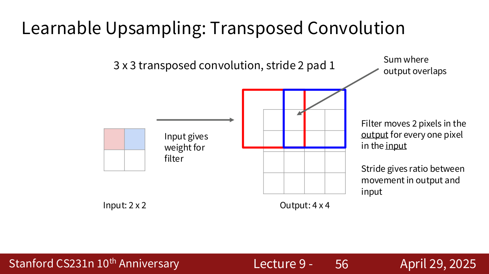
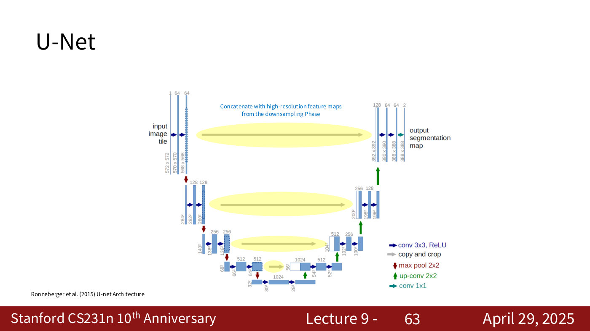
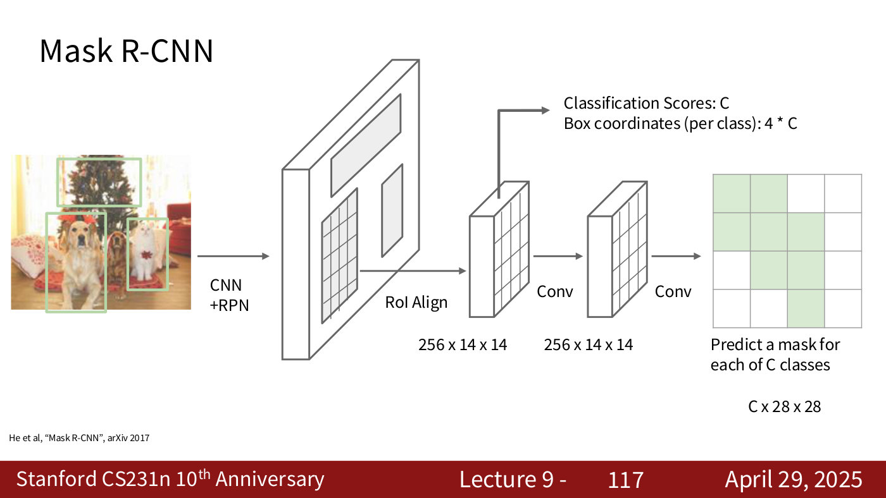

# Image segmentation

Segmentation labels pixels rather than whole images. **Semantic segmentation** gives every pixel a class label, and **instance segmentation** also separates the objects, giving each its own mask. Lecture 1 defines both tasks ([computer vision tasks](computer-vision-tasks.md#tasks-with-spatial-extent)), and [lecture 9](09-detection-segmentation-visualization.md) (April 29, 2025) shows how they are solved. Citations "lecture 9, slide N" are to the [lecture 9 slide file](../raw/slides/09-detection-segmentation-visualization.md), and timestamps "(lecture 9, ≈M:SS)" to the [lecture 9 transcript](../raw/transcripts/09-detection-segmentation-visualization.md).

## The task

Semantic segmentation assigns "a label to every single pixel inside the image" (lecture 9, ≈17:15). It is trained on paired data, "for each training image, each pixel is labeled with a semantic category", and at test time it must "classify each pixel of a new image" (lecture 9, slide 34). It does not separate instances — "Don't differentiate instances, only care about pixels" (lecture 9, slide 65) — so two cows side by side become one "Cow" region, and "if there are two instances of the same object, we have no idea which one is which" (lecture 9, ≈32:45). That is what instance segmentation adds.

## From sliding windows to fully convolutional networks

A pixel cannot be classified alone: "Impossible to classify without context" (lecture 9, slide 36). The first idea is a **sliding window**: extract a patch around each pixel and classify its centre with a CNN (lecture 9, slide 38). It is "Very inefficient! Not reusing shared features between overlapping patches" (lecture 9, slide 39), and running a full network per pixel "will take forever" (lecture 9, ≈19:35).

A **fully convolutional network** instead predicts every pixel at once. With only convolutional layers and no downsampling, an input of $3 \times H \times W$ goes through convolutions of $D \times H \times W$ to class scores of $C \times H \times W$, and an argmax over the $C$ classes gives the $H \times W$ prediction (lecture 9, slide 41). Keeping full resolution throughout is expensive (lecture 9, slide 42), so practical networks downsample and then upsample inside the network (lecture 9, slide 43; Long, Shelhamer and Darrell, CVPR 2015; Noh et al., ICCV 2015). Downsampling uses pooling or strided convolution, both from [convolutional networks](convolutional-networks.md#output-size-padding-and-stride). Upsampling needs new operations.

The network is trained with a classification loss at every pixel: "every single pixel is doing a classification", so the loss is a sum over all the pixels of a softmax loss ([loss functions](loss-functions.md#softmax-loss-cross-entropy)), and it needs ground-truth label maps (lecture 9, ≈23:25–24:58; spoken, not on a slide).

## Upsampling

**Unpooling** has no parameters. Nearest neighbor copies each value into its block, bed of nails puts it in one corner and zeros elsewhere (lecture 9, slide 45), and **max unpooling** puts each value back where the matching max-pooling layer found its maximum (lecture 9, slide 46).

**Transposed convolution** is learnable upsampling. A strided convolution moves the filter 2 pixels in the input for each output pixel, "learnable downsampling" (lecture 9, slide 52). A transposed convolution moves it 2 pixels in the *output* for each input pixel: each input value weights a copy of the filter, and overlapping copies are summed (lecture 9, slides 53–56). In 1D, inputs $a, b$ and a filter $x, y, z$ give $ax, ay, az + bx, by, bz$ (lecture 9, slide 58). It is called transposed because a convolution can be written as a matrix multiplication $X\vec{a}$, and the transposed convolution multiplies by $X^T$ (lecture 9, slides 151–152, not presented in the recording). The derivation is on the [lecture 9 page](09-detection-segmentation-visualization.md#learnable-upsampling-transposed-convolution).

*Lecture 9, slide 56 — transposed convolution: each input value weights a copy of the 3 x 3 filter in the output, the copies move 2 pixels per input pixel, and the overlaps are summed. [Deck](https://cs231n.stanford.edu/slides/2025/lecture_9.pdf)*

## U-Net

U-Net (Ronneberger et al., 2015) is the encoder–decoder network drawn as a U: a downsampling phase that "Increases field of view" and loses spatial information, and an upsampling phase that recovers a high-resolution map (lecture 9, slides 60–62). Its one addition is to "Concatenate with high-resolution feature maps from the downsampling Phase" at each level (lecture 9, slide 63). Copying the encoder's features across keeps "structural information within the image", so the outputs are "much sharper" and boundaries are not faded (lecture 9, ≈30:20–31:08). U-Net "or its variants" still give state-of-the-art results in medical segmentation "if you don't want to use any foundation model" (lecture 9, ≈29:35).

*Lecture 9, slide 63 — U-Net's skip connections: each level of the upsampling path concatenates the high-resolution feature maps from the same level of the downsampling path. [Deck](https://cs231n.stanford.edu/slides/2025/lecture_9.pdf)*

## Instance segmentation: Mask R-CNN

Instance segmentation builds on [object detection](object-detection.md). **Mask R-CNN** (He et al., ICCV 2017) takes the two-stage detector and adds "a small mask network that operates on each RoI and predicts a 28x28 binary mask" (lecture 9, slide 115). Each region's features, cropped with RoI Align to $256 \times 14 \times 14$, predict class scores and boxes and, through two convolutions, "a mask for each of C classes", $C \times 28 \times 28$ (lecture 9, slides 116–117). The training target is the object's mask cropped to its box (lecture 9, slides 118–121). The same model "Also does pose" (lecture 9, slide 123). See the [lecture 9 page](09-detection-segmentation-visualization.md#instance-segmentation-mask-r-cnn).

*Lecture 9, slide 117 — the Mask R-CNN head: RoI Align gives 256 x 14 x 14 features per region, which predict class scores and per-class boxes and, through two convolutions, a 28 x 28 mask for each class. [Deck](https://cs231n.stanford.edu/slides/2025/lecture_9.pdf)*

## Where the course covers segmentation

- [Lecture 1 — Introduction](01-introduction.md): the tasks defined, and early segmentation results in the history.
- [Lecture 9 — Detection, Segmentation, Visualization, and Understanding](09-detection-segmentation-visualization.md#semantic-segmentation): everything on this page.
