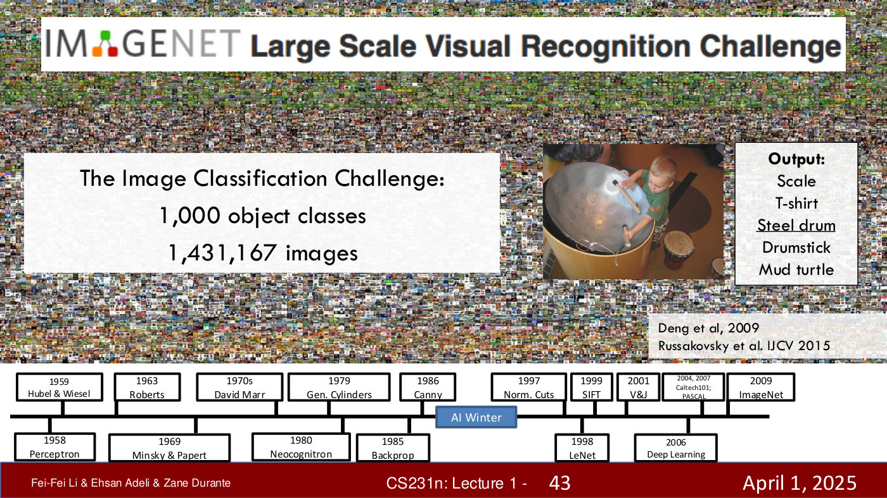
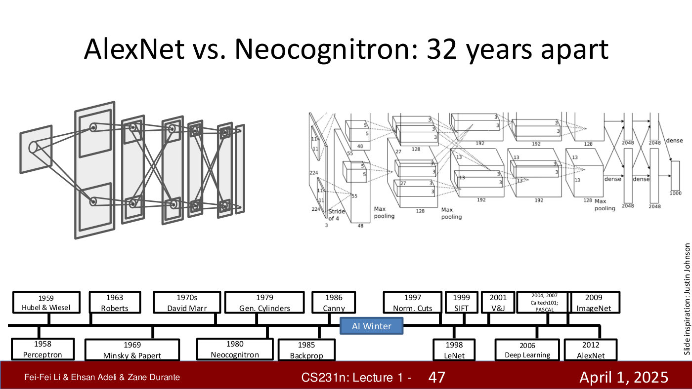
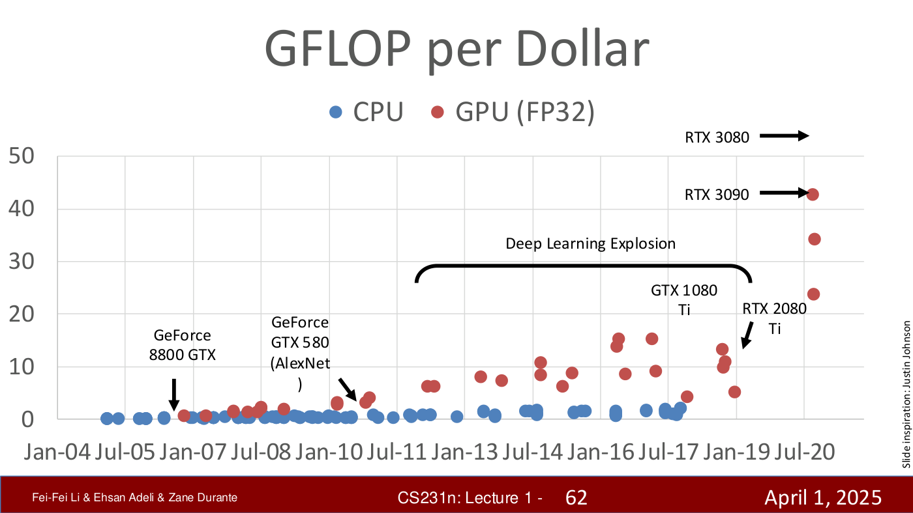
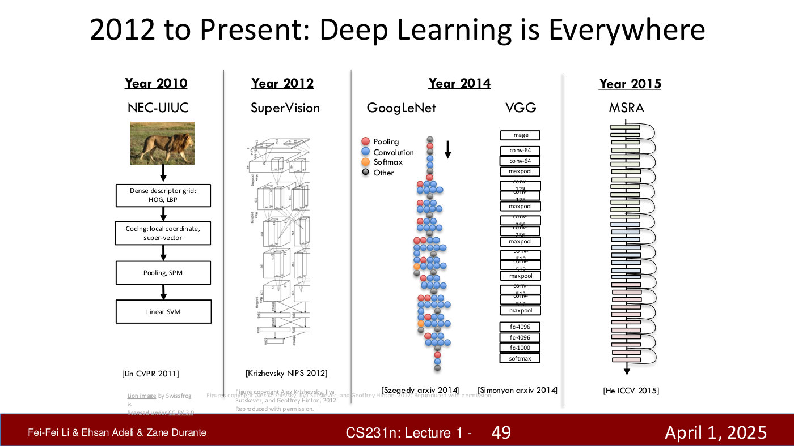

# ImageNet and the ImageNet challenge

ImageNet is the large-scale image dataset built in Fei-Fei Li's lab, and the ImageNet Large Scale
Visual Recognition Challenge (ILSVRC) is the annual competition run on a subset of it. In this
course's telling, the challenge is where computer vision and deep learning met: AlexNet's 2012 win
is the moment "many people consider … the birth, or rebirth, of modern AI" (≈35:08). This page
gathers what the course says about the dataset, the challenge and that result.

**Sources so far:** lecture 1 only — [lecture page](01-introduction.md),
[transcript](../raw/transcripts/01-introduction.md) (≈31:14–36:40), and the part 1 deck
([text](../raw/slides/01-introduction-part-1.md),
[PDF](https://cs231n.stanford.edu/slides/2025/lecture_1_part_1.pdf)). Later lectures (image
classification, CNN architectures) will add to it as they are built.

## Why a dataset: data as a first-class citizen

By the 2000s, neural networks could read digits and letters — a problem Li calls "quasi-solved" —
but on natural photographs of "cats and dogs and microwaves and chairs and flowers, it just didn't
work" (≈30:27–31:14). Li's diagnosis is the lack of data, and she insists this is "not just an
inconvenience. It's actually a mathematical problem": these are "high-capacity algorithms that
actually need to be driven by lots of data in order to learn to generalize", and there are "deep
mathematical principles behind these rules of generalization and model overfitting" (≈31:14).
The field had overlooked data because "most people were just looking at these architectures";
her lab's hypothesis was that data is "a first-class citizen for machine learning and deep
learning" (≈31:14–32:00). The deck sums up the 2000s the same way: deeper networks were being
tried, but there was "no good dataset to work on" (part 1, slide 42).

Earlier datasets were far smaller. In the early 2000s the field worked with "thousands of images
or tens of thousands of images", in datasets such as Caltech 101 and the PASCAL Visual Object
Challenge (≈25:02; part 1, slide 35).

![Part 1, slide 35 — [Caltech 101 and PASCAL Visual Object Challenge]](../raw/images/01-introduction-part-1/slide-35.jpg)

*Part 1, slide 35 — [Caltech 101 and PASCAL Visual Object Challenge]. [Deck](https://cs231n.stanford.edu/slides/2025/lecture_1_part_1.pdf)*

## The dataset

ImageNet has **15 million images**, kept after cleaning **a billion** candidates, sorted into
**22,000 categories** of objects (≈32:00). The number of categories was chosen from the cognitive
and psychology literature: 22,000 is "roughly in the order of the number of categories that humans
learn to recognize in the early years of their life" (≈32:00–32:48). The slides cite it as Deng et
al., 2009 (part 1, slide 43). Ten years later, at CVPR 2019, the original 2009 ImageNet paper
received the IEEE PAMI Longuet-Higgins Prize, which recognises one computer-vision paper from ten
years earlier with significant impact (part 2, slide 33).

*Part 1, slide 43 — ImageNet Large Scale Visual Recognition Challenge. [Deck](https://cs231n.stanford.edu/slides/2025/lecture_1_part_1.pdf)*

## The challenge

The lab open-sourced the dataset and ran an international object-recognition challenge for many
years on a curated subset of "a million plus images and a thousand object classes" (≈32:48). The
slide gives the exact figures — **1,000 object classes, 1,431,167 images** — and cites
Russakovsky et al., *IJCV* 2015 (part 1, slide 43). Any kind of algorithm could enter; entrants
were tested on "your algorithm's ability to recognize photos and see if you can call out these
thousand object classes as correctly as possible" (≈32:48–33:35). The slide's example output for a
photograph of a child playing a steel drum is a list of five labels — scale, T-shirt, steel drum,
drumstick, mud turtle — with "steel drum" underlined.

## The results, year by year

The winning error fell every year:

| Year | Winner | Error (%) |
| --- | --- | --- |
| 2010 | Lin et al | 28.2 |
| 2011 | Sanchez & Perronnin | 25.8 |
| 2012 | Krizhevsky et al (AlexNet) | 16.4 |
| 2013 | Zeiler & Fergus | 11.7 |
| 2014 | Simonyan & Zisserman (VGG) | 7.3 |
| 2014 | Szegedy et al (GoogLeNet) | 6.7 |
| 2015 | He et al (ResNet) | 3.6 |
| 2016 | Shao et al | 3.0 |
| 2017 | Hu et al (SENet) | 2.3 |
| — | Human (Russakovsky et al) | 5.1 |

These are the values printed on the bar chart (part 1, slide 44); the chart's vertical axis has
no title. From 2015 on, the winning error is below the human figure of 5.1. In the talk, Li puts
the first year's best error at "nearly 30%" and says "humans can perform at under, say, 3% error"
(≈33:35); the slide's human value is 5.1, and the talk does not say where the 3% comes from.

![Part 1, slide 44 — [ImageNet challenge bar chart of winning error by year]](../raw/images/01-introduction-part-1/slide-44.jpg)

*Part 1, slide 44 — winning ImageNet challenge error by year, falling from 28.2 (2010) to 2.3 (2017), against a human figure of 5.1. [Deck](https://cs231n.stanford.edu/slides/2025/lecture_1_part_1.pdf)*

## 2012: AlexNet

"2011 wasn't that exciting, but something happened in 2012" (≈33:35). Geoff Hinton and his
students entered a convolutional neural network, AlexNet (Krizhevsky, Sutskever and Hinton,
NeurIPS 2012), which "reduced the error almost by half and truly showed the power of deep learning
algorithms" (≈34:21). On the chart the winning error drops from 25.8 to 16.4 (part 1, slide 45,
where an arrow marks the 2012 bar).

What changed? Not mainly the architecture: "if you look at AlexNet, it's not that different from
Fukushima's Neocognitron 32 years ago" (≈34:21; the deck shows the two side by side, part 1,
slide 47). Two things had happened in between:

*Part 1, slide 47 — the Neocognitron (1980) and AlexNet (2012) side by side, 32 years apart. [Deck](https://cs231n.stanford.edu/slides/2025/lecture_1_part_1.pdf)*

**A learning rule.** Backpropagation is "a principled, mathematically rigorous learning rule, so
that you don't ever have to hand-tune parameters" — the Neocognitron's hundreds of parameters had
all been set by hand (≈28:07, ≈34:21).

**Data.** "The recognition of data and the understanding of data driving these high-capacity
models, which eventually will have trillions of parameters but at that time had millions of
parameters, was critical for setting off deep learning" (≈35:08).

Later in the lecture Li names a third force, computation: "the three converging forces of
computation, algorithms and data" (≈39:42; part 1, slide 61); her GFLOP-per-dollar chart labels one GPU "GeForce GTX 580
(AlexNet)" (part 1, slide 62).

![Part 1, slide 61 — [Computation, Algorithms, Data]](../raw/images/01-introduction-part-1/slide-61.jpg)

*Part 1, slide 61 — [Computation, Algorithms, Data]. [Deck](https://cs231n.stanford.edu/slides/2025/lecture_1_part_1.pdf)*

*Part 1, slide 62 — GFLOP per Dollar. [Deck](https://cs231n.stanford.edu/slides/2025/lecture_1_part_1.pdf)*

## After AlexNet

"Many new algorithms since then have been invented to participate in the ImageNet challenge in the
following years", and some "have had a profound impact in the progress of the field of computer
vision" (≈35:54). The deck's architecture slide traces the winners' structure: the 2010 NEC-UIUC
pipeline of hand-designed descriptors and a linear SVM, AlexNet ("SuperVision") in 2012,
GoogLeNet and VGG in 2014, and MSRA's very deep residual network in 2015 (part 1, slide 49). The
course studies several of these in its CNN-architectures lecture (lecture 6 on the
[roadmap](course-logistics.md#course-roadmap)).

*Part 1, slide 49 — 2012 to Present: Deep Learning is Everywhere. [Deck](https://cs231n.stanford.edu/slides/2025/lecture_1_part_1.pdf)*
