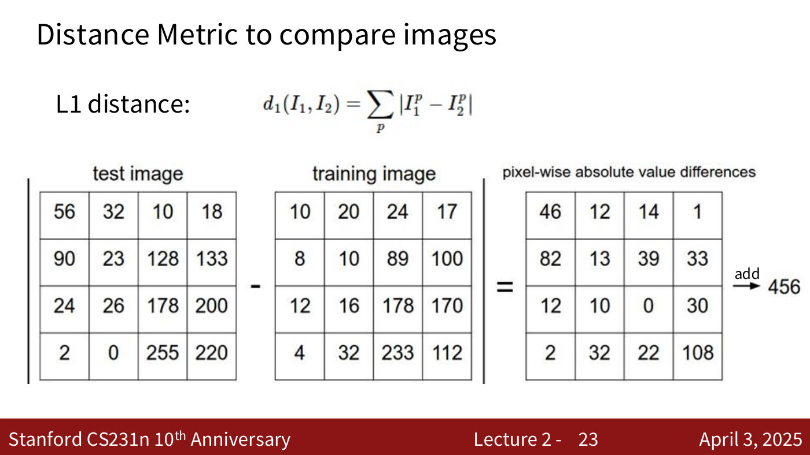
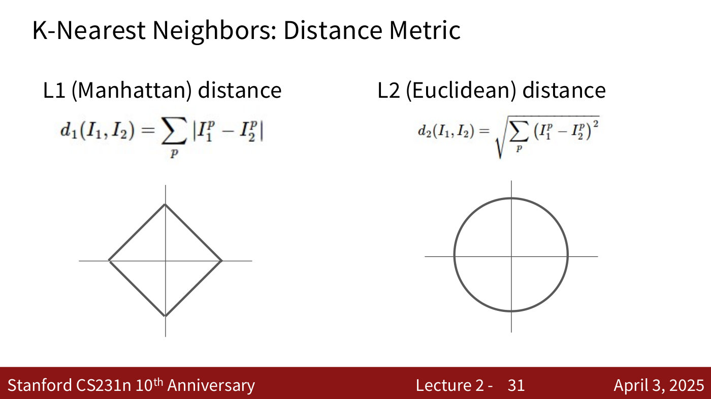
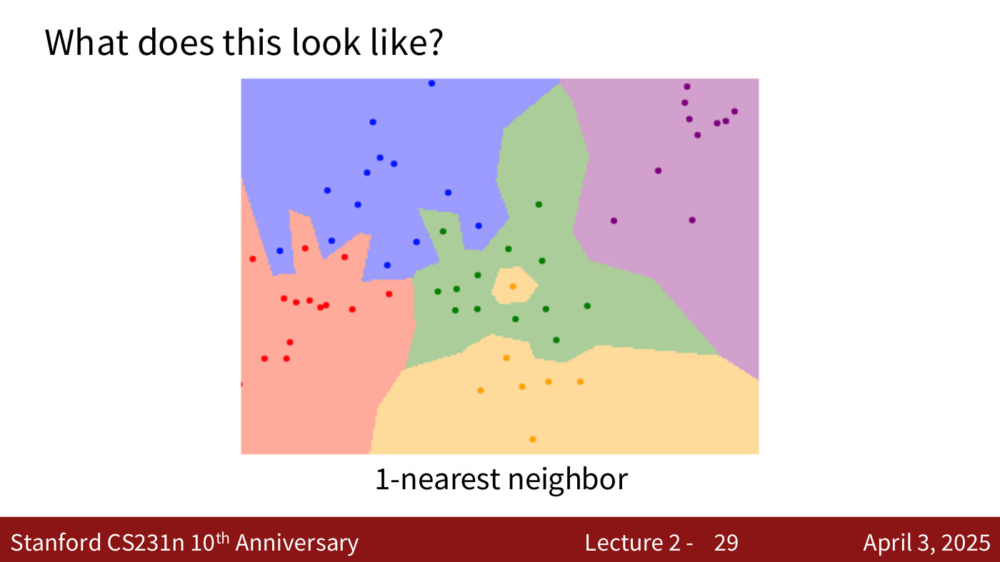
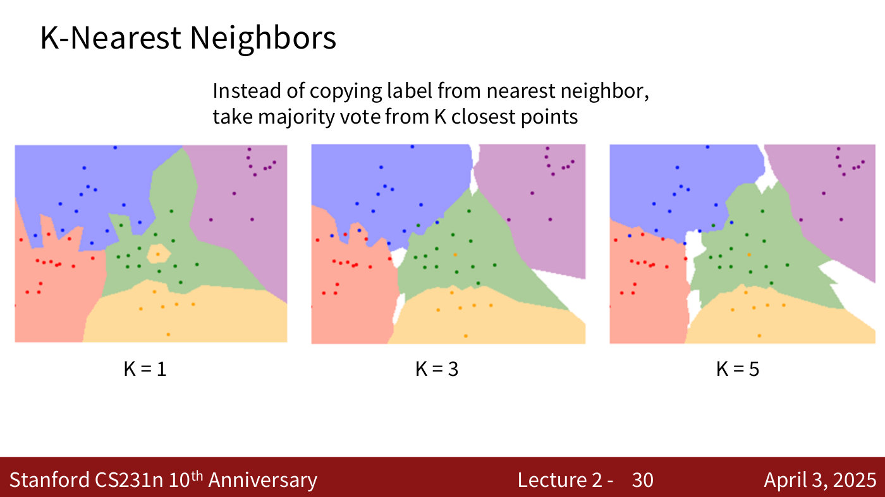
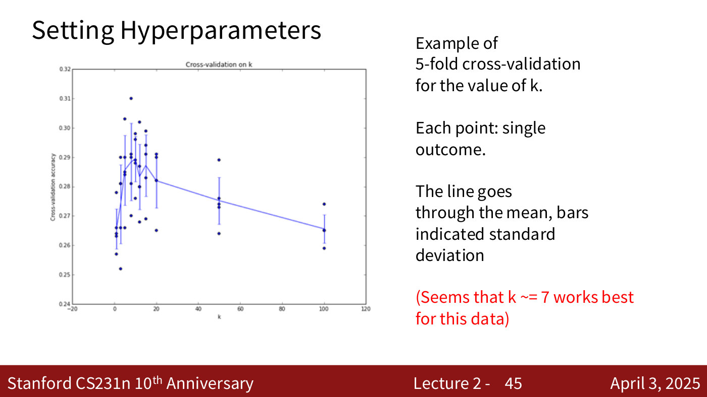
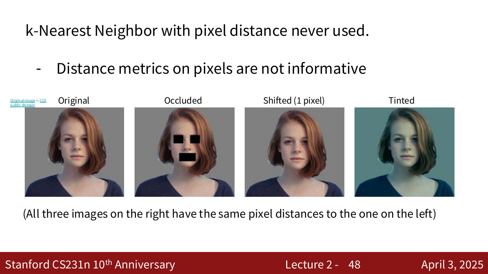

# k-nearest neighbours

The k-nearest-neighbour (k-NN) classifier labels a new image by looking up the training images
most similar to it. It is the first classifier CS231N builds, chosen because it is the simplest
data-driven approach and makes the surrounding ideas — distance metrics, hyperparameters,
validation — easy to see (lecture 2, ≈16:20–17:05; ≈35:39). It is also the first part of
Assignment 1 (lecture 2, slide 2).

Covered in: [Lecture 2](02-image-classification.md#the-nearest-neighbour-classifier).

## The algorithm

**Training** memorises all the training images and their labels; it computes nothing else.
**Prediction** compares a test image with every training image using a distance function and
returns the label of the closest one (lecture 2, ≈17:05–18:37). That is the 1-nearest-neighbour
classifier. **k-nearest neighbours** takes the $k$ closest training images instead and returns
the majority label among them (lecture 2, ≈27:09–27:55).

In NumPy the prediction loop is a few lines, here as printed on the slide (lecture 2, slide 24):

```python
# loop over all test rows
for i in xrange(num_test):
  # find the nearest training image to the i'th test image
  # using the L1 distance (sum of absolute value differences)
  distances = np.sum(np.abs(self.Xtr - X[i,:]), axis = 1)
  min_index = np.argmin(distances) # get the index with smallest distance
  Ypred[i] = self.ytr[min_index] # predict the label of the nearest example
```

## Distance metrics

The **L1** (Manhattan) distance sums the absolute pixel-by-pixel differences between two images
$I_1$ and $I_2$, with $p$ running over pixel positions (lecture 2, ≈18:37–19:22; lecture 2,
slide 23):



*Lecture 2, slide 23 — L1 distance between a test and a training image: subtract pixel by pixel, take absolute values, add up (456). [Deck](https://cs231n.stanford.edu/slides/2025/lecture_2.pdf)*

$$d_1(I_1, I_2) = \sum_p \vert I_1^p - I_2^p \vert$$

The **L2** (Euclidean) distance squares the differences, sums them and takes the square root
(lecture 2, ≈30:15):

$$d_2(I_1, I_2) = \sqrt{\sum_p \left(I_1^p - I_2^p\right)^2}$$

The points at distance 1 from the origin form a square (a diamond) under L1 and a circle under L2
(lecture 2, slides 31 and 33). The practical difference, as the lecture puts it: **rotating the
feature axes changes L1 distances but leaves L2 distances unchanged.** So when the individual
features are specific and meaningful, L1 is often the better choice; when they are more arbitrary,
L2 makes more sense (lecture 2, ≈31:01–34:04). With $k = 1$ on the same data, L1 decision
boundaries run mostly parallel to the axes and L2 boundaries are smoother (lecture 2, ≈34:04–34:51).



*Lecture 2, slide 31 — K-Nearest Neighbors: Distance Metric. [Deck](https://cs231n.stanford.edu/slides/2025/lecture_2.pdf)*

## Decision regions

Colouring every point of a 2D feature space by the label k-NN would give it shows how the
classifier carves up the space (lecture 2, slide 29). With $k = 1$ a single outlier — one yellow
point among the green ones — claims an island of its own. Raising $k$ smooths the boundaries and
removes the island, but leaves **white regions** where the vote is tied (lecture 2, ≈27:09–28:42;
lecture 2, slide 30). The lecture treats ties two ways: decide at random among the top candidates,
and treat ambiguous or empty pockets of the space as the places to collect more data (lecture 2,
≈28:42; ≈44:58–45:44).



*Lecture 2, slide 29 — What does this look like?. [Deck](https://cs231n.stanford.edu/slides/2025/lecture_2.pdf)*



*Lecture 2, slide 30 — majority vote over K = 1, 3, 5 neighbours: the yellow island disappears, and white tie regions appear where no class wins. [Deck](https://cs231n.stanford.edu/slides/2025/lecture_2.pdf)*

## Cost

Training is $O(1)$; prediction is $O(N)$ for $N$ training examples, because every test image is
compared with every training image. That is the wrong way round — "we want classifiers that are
fast at prediction; slow for training is ok" (lecture 2, ≈22:27–25:35; lecture 2, slide 27).
Fast approximate methods exist (the slide cites the `faiss` library) but are beyond the course
(lecture 2, slide 28).

## Hyperparameters

$k$ and the distance metric are **hyperparameters**: they must be set before the algorithm runs,
and their best values depend on the data. They are chosen on a validation set or by
cross-validation, never on the training or test set; on CIFAR-10, five-fold cross-validation puts
the best $k$ at about 7 (lecture 2, slide 45). See
[hyperparameters and validation](hyperparameters-and-validation.md).



*Lecture 2, slide 45 — five-fold cross-validation on k for CIFAR-10: one dot per fold, the line through the means; the slide reads the best as k ≈ 7. [Deck](https://cs231n.stanford.edu/slides/2025/lecture_2.pdf)*

## Why k-NN on pixels is not used

On CIFAR-10 the nearest neighbours by pixel distance are often the wrong class — a frog whose
nearest training image is a dog, because the two share colours in most pixels (lecture 2,
≈43:25–44:12). And very different changes to an image can leave the pixel distance identical: an
occluded, a one-pixel-shifted and a tinted copy of a photograph are all equally far from the
original (lecture 2, ≈44:12–44:58; lecture 2, slide 48). Hence slide 48's title: "k-Nearest
Neighbor with pixel distance never used."



*Lecture 2, slide 48 — occluded, shifted by one pixel, and tinted copies all sit at the same pixel distance from the original. [Deck](https://cs231n.stanford.edu/slides/2025/lecture_2.pdf)*
