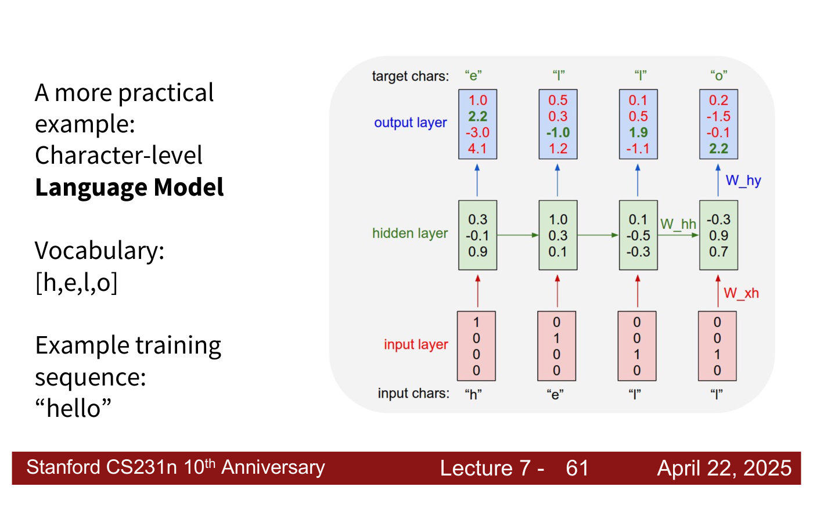
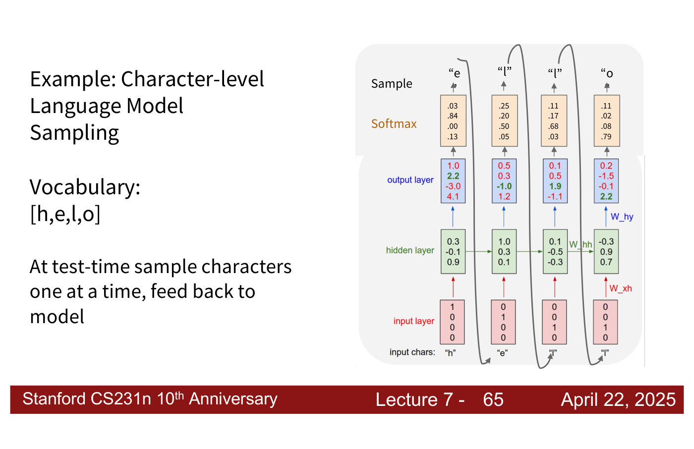
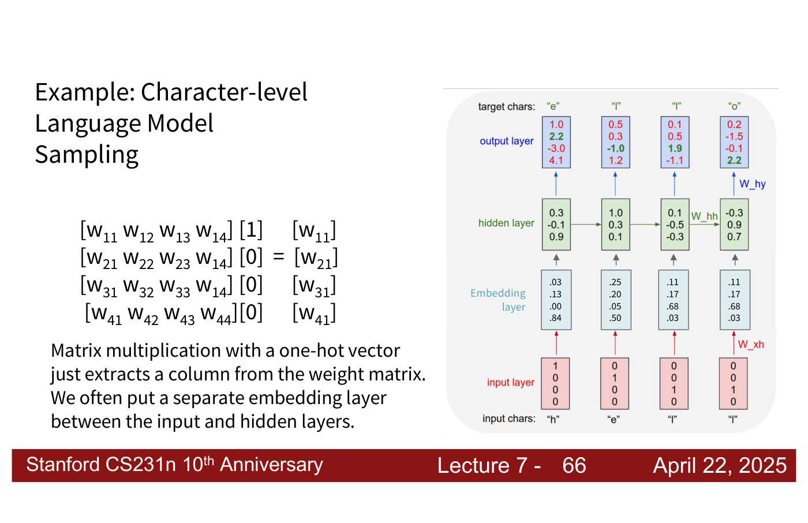
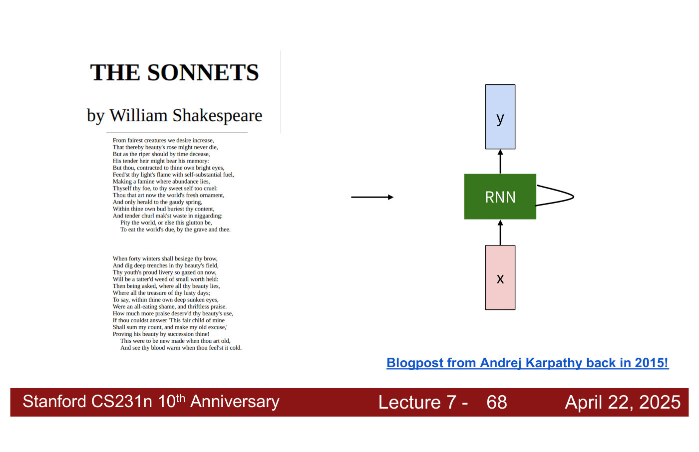
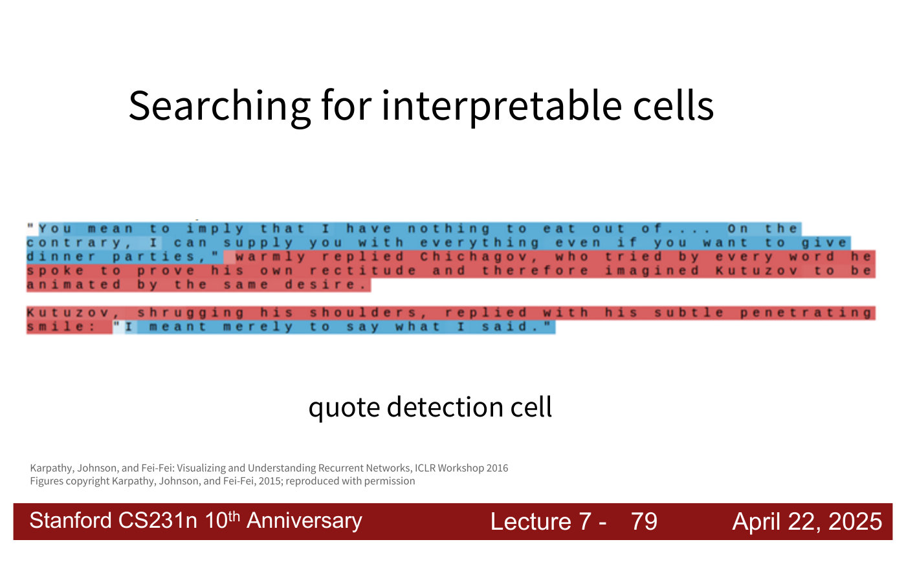
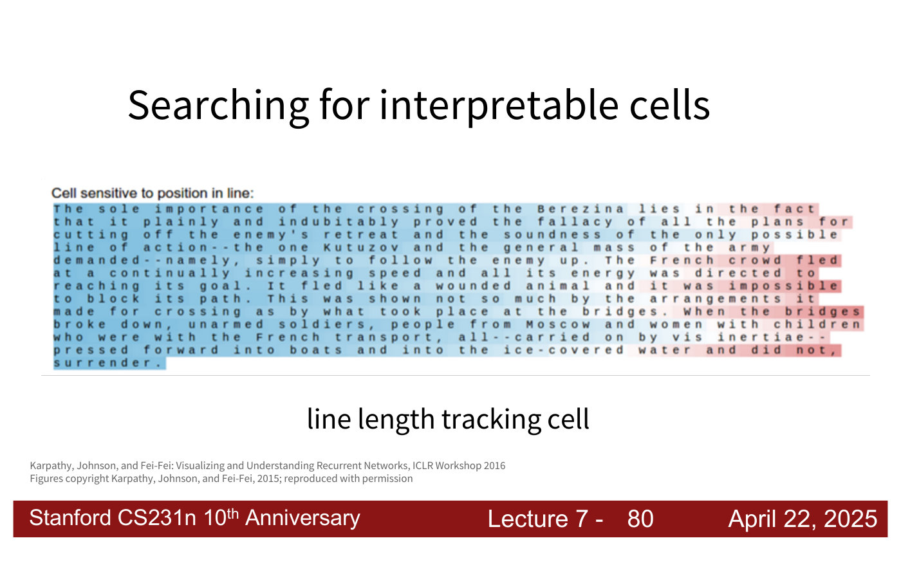
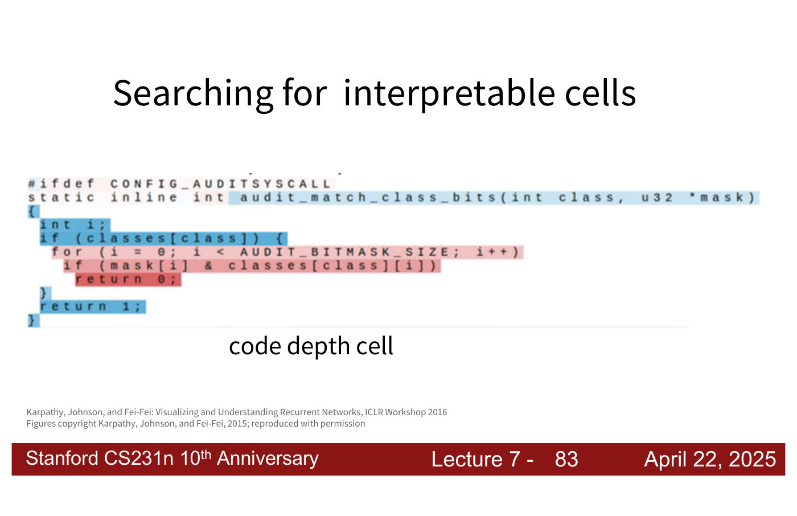

# Character-level language models

A **language model** predicts the next element of a text from the elements before it. Lecture 7 uses
a **character-level** language model, a [recurrent neural network](recurrent-neural-networks.md)
that reads and predicts one character at a time, as its "more practical example" of an RNN, and
points out that "the current wave of language models are sort of a buildup of this really simple
approach of just predicting characters with RNNs" (lecture 7, ≈36:23). This page gathers what the
course says about it. Citations "lecture 7, slide N" are to the
[lecture 7 slide file](../raw/slides/07-recurrent-neural-networks.md), and timestamps
"(lecture 7, ≈M:SS)" to the [lecture 7 transcript](../raw/transcripts/07-recurrent-neural-networks.md).

## Training: classification at every time step

The worked example has a vocabulary of four characters, h, e, l and o, and one training sequence,
"hello" (lecture 7, slide 59). Each input character is a **one-hot** vector, a 1 at the character's
index and 0s elsewhere, so "h" is $(1, 0, 0, 0)$ and "l" is $(0, 0, 1, 0)$ (lecture 7, ≈36:23–37:08).
A vanilla RNN reads them in turn, updating its hidden state with
$h_t = \tanh(W_{hh} h_{t-1} + W_{xh} x_t)$, where $x_t$ is the input at step $t$ and $h_t$ the hidden
state (lecture 7, slide 60). An output layer, through weights $W_{hy}$, gives a score for each of the
four characters at every step, and the target at each step is the next character: "e", "l", "l",
"o" for the inputs "h", "e", "l", "l" (lecture 7, slide 61).

*Lecture 7, slide 61 — training on "hello": one-hot inputs, a three-number hidden state per step, and four output scores per step, the target character's in bold green. At the first step the target "e" scores 2.2, below the 4.1 given to "o". [Deck](https://cs231n.stanford.edu/slides/2025/lecture_7.pdf)*

The scores are logits for a [softmax](loss-functions.md) over the vocabulary. At the first step the
target "e" scores 2.2, which "is lower than 4.1", so the model is not yet doing well there, and the
loss will penalize it (lecture 7, ≈37:08–37:56, 39:30). Training is therefore "a time step-wise
classification problem", "and that's exactly what, in general, these language models are doing:
time step-wise classification based on softmax" (lecture 7, ≈37:56). No labels are needed: the
targets are just the text shifted by one, which is why language models can be trained on
"essentially all available text" (lecture 7, ≈43:21).

## Generating text: sampling

At test time the model generates by sampling one character at a time from its softmax and feeding
that character back in as the next input (lecture 7, slides 62–65; ≈37:56). Generation needs a first
input: a random character would do, and language models usually use a predetermined start token
(lecture 7, ≈42:35).

*Lecture 7, slide 65 — sampling: each step's softmax (orange) is sampled and the sample fed back as the next input, giving "e", "l", "l", "o". The first two softmax columns are misprinted; from their scores they should read about (.04, .13, .00, .84) and (.25, .20, .06, .50). [Deck](https://cs231n.stanford.edu/slides/2025/lecture_7.pdf)*

Slide 65's first two probability columns do not follow from the scores beneath them: the softmax of
$(1.0, 2.2, -3.0, 4.1)$ is about $(.04, .13, .00, .84)$, where the slide prints $(.03, .84, .00, .13)$,
and the softmax of $(0.5, 0.3, -1.0, 1.2)$ is about $(.25, .20, .06, .50)$, where it prints
$(.25, .20, .50, .05)$. The last two columns are right. The lecturer acknowledges the error ("This is
incorrect, actually", lecture 7, ≈38:42; "imagine the probabilities are correct here", ≈43:21).

How to pick the next character matters (lecture 7, ≈43:21–44:53). Always taking the most probable
one is **greedy decoding**, and it gives the same output every time for the same input. "In practice
they sample based on a distribution, the distribution given by the probabilities output by your
softmax", so less likely characters are sometimes chosen. **Beam search** looks ahead, trying several
continuations and keeping the one with the highest overall probability for the sequence. How to
sample from these models is "a whole active area of research".

## The embedding layer

Multiplying a weight matrix by a one-hot vector "just extracts a column from the weight matrix", so
"we often put a separate embedding layer between the input and hidden layers" (lecture 7, slide 66):
a learned matrix holding one vector per possible input, from which each input selects its own. The
lecturer describes taking a row of the embedding matrix for each input, the same operation with the
matrix transposed (lecture 7, ≈38:42). Why use one? "Generally it's better to have vectors as input to
our models"; the embedding vectors are learned like any weights, initialized small (for instance with
Kaiming initialization), and "optimization-wise the embedding works better" than a one-hot input
(lecture 7, ≈39:30–40:16).

*Lecture 7, slide 66 — an embedding layer (light blue) between the one-hot inputs and the hidden layer; the two "l" inputs share one embedding. At left, a one-hot vector picks out the first column of a weight matrix. The slide prints w_14 at the end of rows 2 and 3, where the pattern needs w_24 and w_34. [Deck](https://cs231n.stanford.edu/slides/2025/lecture_7.pdf)*

## What such models learn to write

The complete model fits in 112 lines of Python, Andrej Karpathy's min-char-rnn: a vanilla RNN with a
hidden layer of 100 neurons, unrolled for 25 steps at a time, with gradients clipped to $-5$ to $5$
and an Adagrad update (lecture 7, slide 67; ≈39:30). Karpathy's 2015 blog post on how "unreasonably
effective" these RNNs are trained them on Shakespeare's sonnets (lecture 7, slide 68; ≈39:30).

*Lecture 7, slide 68 — Shakespeare's sonnets as training text for a character-level RNN. [Deck](https://cs231n.stanford.edu/slides/2025/lecture_7.pdf)*

As training goes on, samples move from gibberish to English-looking words to plausible prose
(lecture 7, slide 69; ≈41:01). Slide 70's samples are laid out like a play, with speakers such as
PANDARUS, VIOLA and KING LEAR: the model has learned the style, though the longer it generates "the
less and less sense" it makes (lecture 7, ≈41:01). Trained on the Linux kernel's source (lecture 7,
slide 74), it writes C code (slide 75) that "looks reasonable", whether or not it would compile
(lecture 7, ≈41:48). Today's coding tools (lecture 7, slide 76: OpenAI Codex, GitHub Copilot, Cursor)
do "a really similar thing", trained on existing code to predict the next token, "a group of
characters", rather than the next character (lecture 7, ≈41:48–42:35).

## Interpretable cells

A hidden state is a vector of activations, and some of its individual entries turn out to track
recognisable features of the text (lecture 7, slides 77–83; ≈45:39–47:59). Each figure colours every
character by one cell's value as the model reads it; the models use tanh, and "minus one means it's
visualized as red here and very close to one would be blue" (lecture 7, ≈45:39). The figures are from
Karpathy, Johnson and Fei-Fei, "Visualizing and Understanding Recurrent Networks", ICLR Workshop 2016.

Many cells show nothing interpretable (lecture 7, slide 78). But a **quote detection cell** turns on
when a quote starts and off when it ends (lecture 7, slide 79); a **line length tracking cell** is
high at the start of a line and falls towards the point where the model expects a newline
(slide 80); an **if statement cell** tracks the conditions of `if` statements (slide 81); a
**quote/comment cell** turns on inside comments and quotes, because the model must know to close
them (slide 82); and a **code depth cell** grows with the nesting depth of the code (slide 83)
(lecture 7, ≈46:25–47:13).

*Lecture 7, slide 79 — the quote detection cell: text inside quotation marks is blue, the narration between quotes red. [Deck](https://cs231n.stanford.edu/slides/2025/lecture_7.pdf)*

*Lecture 7, slide 80 — the line length tracking cell: blue at the start of each line, fading to red at its end. [Deck](https://cs231n.stanford.edu/slides/2025/lecture_7.pdf)*

*Lecture 7, slide 83 — the code depth cell: the deeper the nesting, the stronger the red. [Deck](https://cs231n.stanford.edu/slides/2025/lecture_7.pdf)*

These cells are read straight off the activations, "without needing to do any fancy tricks", and the
RNN is "internally doing a very similar process" to the hand-built example of lecture 7, whose hidden
state was set by hand to track the current and previous inputs (lecture 7, ≈47:13–47:59).

## Where the course covers language models

- [Lecture 7 — Recurrent Neural Networks](07-recurrent-neural-networks.md#a-character-level-language-model):
  everything on this page.
- [Image captioning](image-captioning.md) uses the same generate-and-feed-back loop, conditioned on
  an image.
