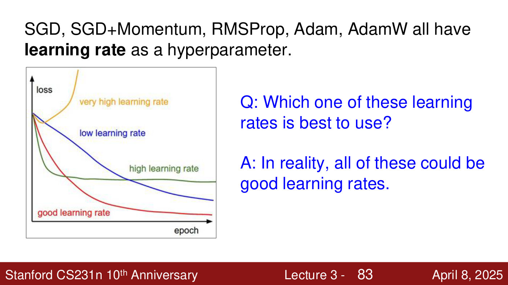
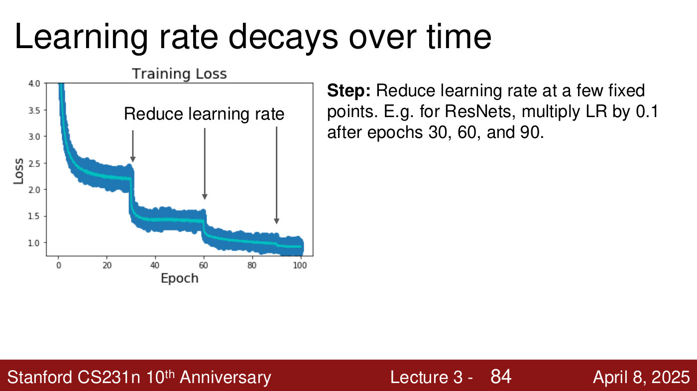
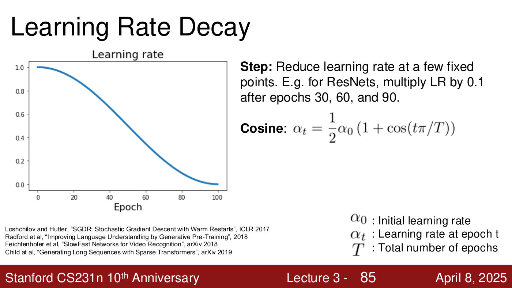
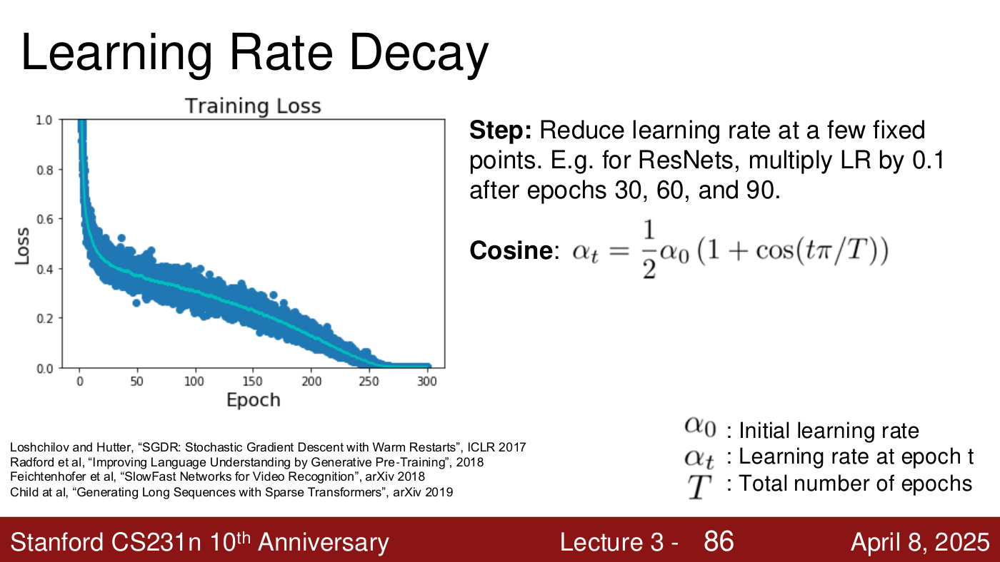
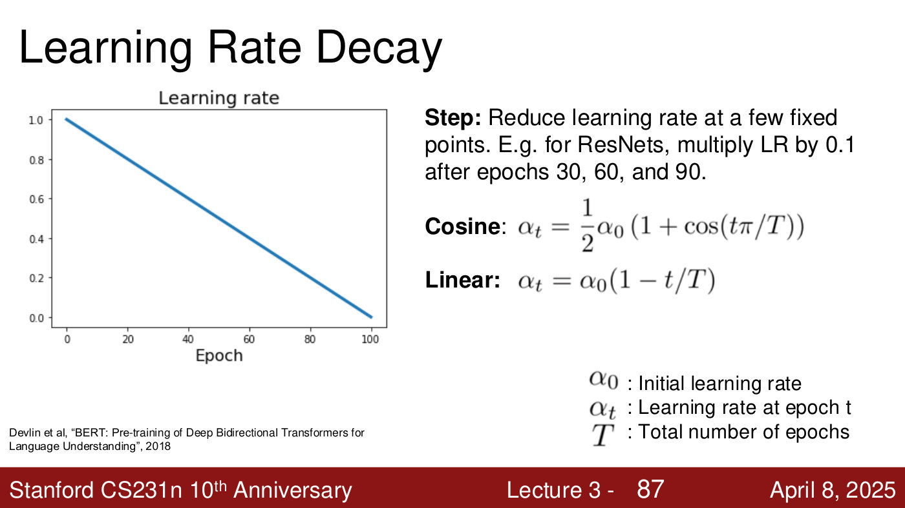
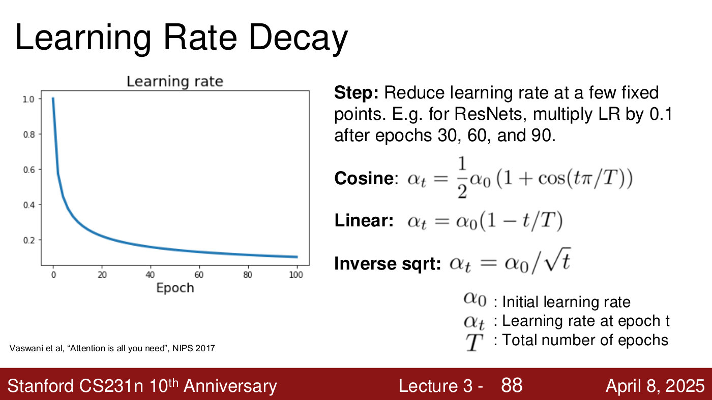
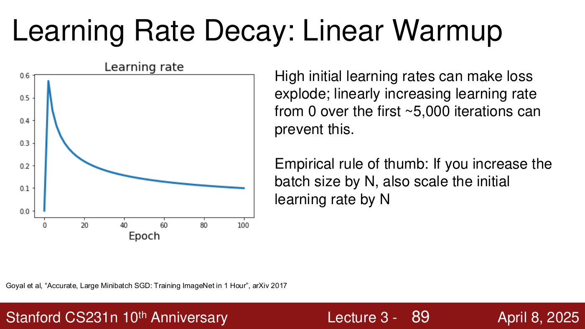

# Learning rates and schedules

Every optimiser in CS231N — SGD, SGD with momentum, RMSProp, Adam, AdamW — has a **learning rate**
(the step size) as a hyperparameter (lecture 3, slide 82). This page covers what a bad learning
rate looks like, and the schedules that change it during training: step decay, cosine, linear and
inverse square root decay, and linear warm-up.

Covered in: [Lecture 3](03-regularization-optimization.md#learning-rates-and-schedules).

## Too high, too low, about right

The deck plots training loss against epoch for four learning rates (lecture 3, slide 83). A very
high learning rate makes the loss blow up, as each step overshoots out of the valley. A low one
converges slowly. A high one drops fast and then plateaus, bouncing around a minimum it cannot get
lower into. A good one falls quickly and keeps improving (lecture 3, ≈59:12–59:59).

*Lecture 3, slide 83 — loss against epoch for four learning rates: very high (orange) blows up, low (blue) is slow, high (green) plateaus, good (red) keeps falling. "All of these could be good learning rates." [Deck](https://cs231n.stanford.edu/slides/2025/lecture_3.pdf)*

Which is best? "In reality, all of these could be good learning rates" (lecture 3, slide 83),
because the learning rate need not stay fixed. Nearly every modern model changes it during
training (lecture 3, ≈59:59).

## Schedules

The formulas use $\alpha_0$ for the initial learning rate, $\alpha_t$ for the learning rate at
epoch $t$, and $T$ for the total number of epochs, as the deck defines them.

**Step decay.** Reduce the learning rate at a few fixed points. For ResNets, multiply it by 0.1
after epochs 30, 60 and 90 (lecture 3, slide 84). Each cut lets training reach lower once the old
rate was too high to make progress, and each shows as a sharp drop in the loss curve (lecture 3,
≈59:59–1:00:46).

*Lecture 3, slide 84 — step decay: the training loss plateaus near 2.2, 1.4 and 1.0 and drops sharply each time the learning rate is cut, at epochs 30, 60 and 90. [Deck](https://cs231n.stanford.edu/slides/2025/lecture_3.pdf)*

**Cosine decay** follows half a cosine wave from $\alpha_0$ to zero (lecture 3, slide 85):

$$\alpha_t = \frac{1}{2}\alpha_0\left(1 + \cos(t\pi/T)\right)$$

*Lecture 3, slide 85 — cosine decay: the learning rate follows half a cosine wave from its initial value to zero over training. [Deck](https://cs231n.stanford.edu/slides/2025/lecture_3.pdf)*

It is "extremely popular" (lecture 3, ≈1:00:46). Under it, the training loss keeps improving
steadily through the middle of training rather than in steps (lecture 3, slide 86).

*Lecture 3, slide 86 — training loss under a cosine schedule: a steep early drop, steady gains through the middle, and zero by about epoch 250. [Deck](https://cs231n.stanford.edu/slides/2025/lecture_3.pdf)*

**Linear decay** falls in a straight line, $\alpha_t = \alpha_0(1 - t/T)$ (lecture 3, slide 87,
citing BERT, Devlin et al. 2018).

*Lecture 3, slide 87 — linear decay: the learning rate falls in a straight line to zero. [Deck](https://cs231n.stanford.edu/slides/2025/lecture_3.pdf)*

**Inverse square root** decay drops steeply and then slowly, $\alpha_t = \alpha_0/\sqrt{t}$
(lecture 3, slide 88, citing Vaswani et al., "Attention is all you need", NIPS 2017).

*Lecture 3, slide 88 — inverse square root decay: a steep early drop, then a slow tail. [Deck](https://cs231n.stanford.edu/slides/2025/lecture_3.pdf)*

There are endless variants; the shape of the loss curve depends heavily on which one is used, and
the choice is empirical (lecture 3, ≈1:01:31).

## Linear warm-up

High initial learning rates can make the loss explode. Increasing the learning rate linearly from
0 over the first ~5,000 iterations can prevent this (lecture 3, slide 89). Warm-up is then followed
by another schedule: linear warm-up then cosine, or then inverse square root, is a very popular
setup (lecture 3, ≈1:01:31–1:02:17).

*Lecture 3, slide 89 — linear warm-up: the learning rate climbs from 0 to its peak in the first few epochs, then decays. [Deck](https://cs231n.stanford.edu/slides/2025/lecture_3.pdf)*

## Batch size and learning rate

"Empirical rule of thumb: If you increase the batch size by N, also scale the initial learning
rate by N" (lecture 3, slide 89, citing Goyal et al., "Accurate, Large Minibatch SGD: Training
ImageNet in 1 Hour", 2017). The lecturer calls it something like a linear scaling law, says he
forgets the exact name, and stresses that it is shown empirically rather than proved (lecture 3,
≈1:02:17–1:03:05).

## In practice

Adam or AdamW often works even with a constant learning rate; Adam or AdamW with linear warm-up
then cosine decay is a popular combination; and SGD with momentum usually needs more learning rates
and schedules tried (lecture 3, slide 95; ≈1:05:24–1:06:09).

## Related pages

- [Optimizers](optimizers.md) — the update rules the learning rate scales.
- [Gradient descent and SGD](gradient-descent.md) — the step size in its simplest form.
- [Hyperparameters and validation](hyperparameters-and-validation.md) — how hyperparameters are
  chosen.
