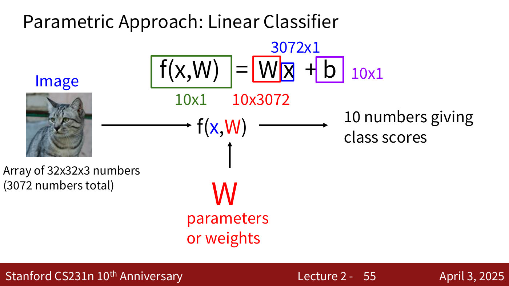
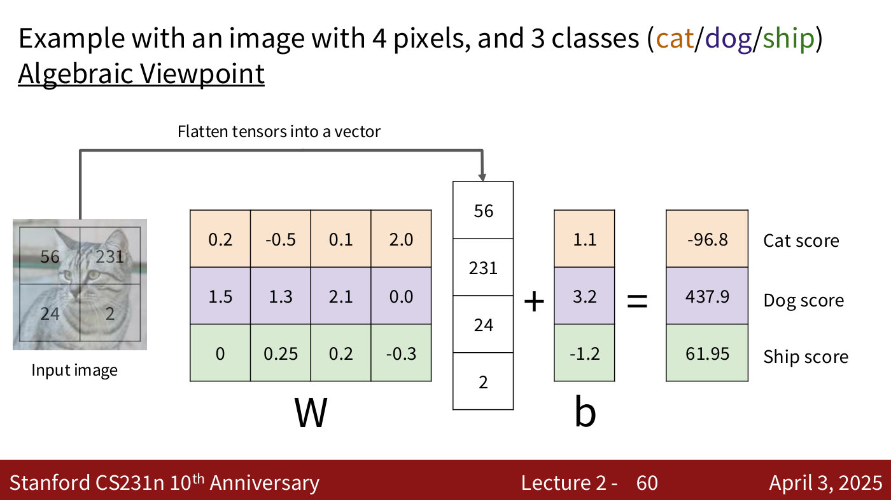
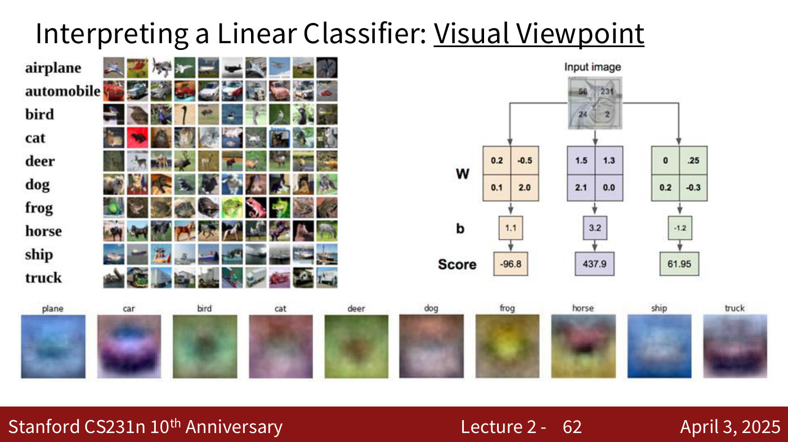
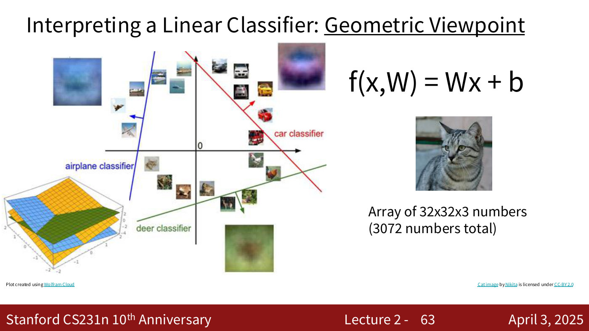
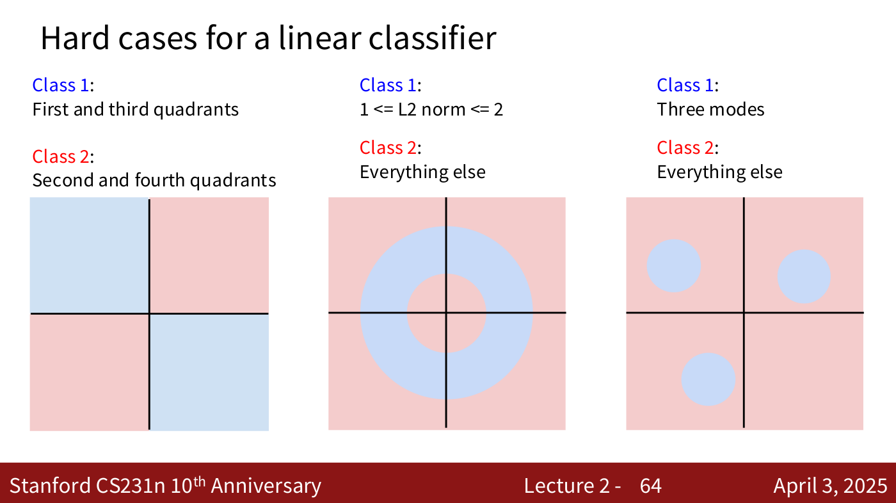
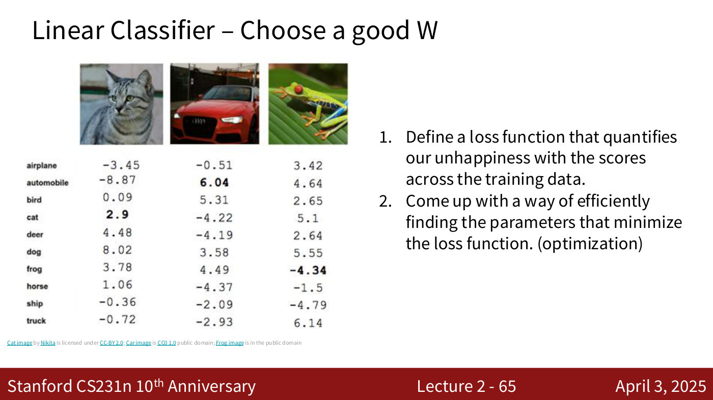
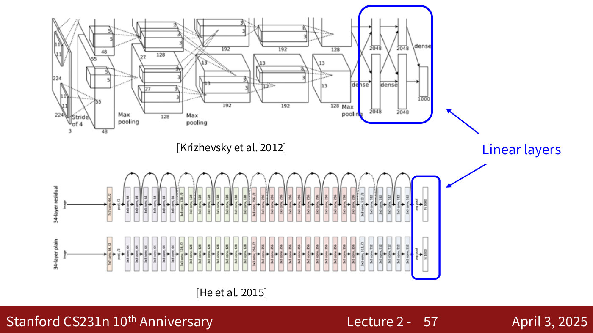

# Linear classifiers

A linear classifier maps an image to one score per class with a single matrix multiplication and
an added bias. Lecture 2 calls it "the most important building block for almost all of deep
learning": neural networks are linear functions stacked one after another with more added between
them (lecture 2, ≈46:29; ≈48:47–49:33).

Covered in: [Lecture 2](02-image-classification.md#the-linear-classifier).
[Lecture 4](04-neural-networks-backpropagation.md#from-linear-classifiers-to-neural-networks) builds
[neural networks](neural-networks.md) from it.

## The function

The classifier is **parametric**: unlike [k-nearest neighbours](k-nearest-neighbors.md), which
keeps the training data, it learns parameters — the weights $W$ — that map an input image $x$ to
class scores (lecture 2, ≈46:29–47:14). Flatten the image into a column vector $x$; then

$$f(x, W) = Wx + b$$

For a CIFAR-10 image ($32 \times 32 \times 3$, so 3,072 numbers) and 10 classes, $x$ is
$3072 \times 1$, $W$ is $10 \times 3072$, the bias $b$ is $10 \times 1$, and $f(x, W)$ is 10 scores
(lecture 2, ≈48:01; lecture 2, slide 55). The bias is input-independent: it shifts each class's
score, which helps separate the classes (lecture 2, ≈48:47).

*Lecture 2, slide 55 — Parametric Approach: Linear Classifier. [Deck](https://cs231n.stanford.edu/slides/2025/lecture_2.pdf)*

## Three ways to read it

**Algebraic.** Each score is a weighted sum of the pixels plus a bias. Lecture 2's toy example uses
a four-pixel image (56, 231, 24, 2) and three classes: $W$ is $3 \times 4$, and $Wx + b$ gives a cat
score of −96.8, a dog score of 437.9 and a ship score of 61.95 (lecture 2, ≈50:18–51:09; lecture 2,
slide 60). The printed ship score leaves out the bias of −1.2; with it the score is 60.75.

*Lecture 2, slide 60 — the algebraic viewpoint: a 4-pixel image times W plus b gives one score per class (the printed ship score, 61.95, omits the bias; with it, 60.75). [Deck](https://cs231n.stanford.edu/slides/2025/lecture_2.pdf)*

**Visual.** Each row of $W$ computes one class's score, so each row is a **template** for that
class and can be reshaped into an image. Trained on CIFAR-10, the ten templates are blurry colour
images; the car's shows "a template-ish front of a car" (lecture 2, ≈51:09–52:43; lecture 2,
slide 62).

*Lecture 2, slide 62 — the visual viewpoint: each row of W reshaped into an image, one learned template per CIFAR-10 class (bottom row). [Deck](https://cs231n.stanford.edu/slides/2025/lecture_2.pdf)*

**Geometric.** Each class's score defines a line in 2D, or a hyperplane in higher dimensions, that
separates that class from the others (lecture 2, ≈52:43; lecture 2, slide 63). The bias is what
lets these boundaries avoid passing through the origin (lecture 2, ≈53:29).

*Lecture 2, slide 63 — the geometric viewpoint: each classifier is a line in 2D (a hyperplane in higher dimensions), drawn with a perpendicular arrow; the 3D plot at the bottom left shows planes. [Deck](https://cs231n.stanford.edu/slides/2025/lecture_2.pdf)*

## What it cannot separate

Because every boundary is a hyperplane, some arrangements are out of reach (lecture 2,
≈53:29–55:01; lecture 2, slide 64): one class in the first and third quadrants and the other in
the second and fourth; one class in a ring ($1 \le$ L2 norm $\le 2$) and the other everywhere else;
and one class made of three separate modes.

*Lecture 2, slide 64 — three arrangements no single line can separate: opposite quadrants, a ring, and three separate modes. [Deck](https://cs231n.stanford.edu/slides/2025/lecture_2.pdf)*

## Training it

A linear classifier is only as good as its $W$. Choosing $W$ takes two things: a
[loss function](loss-functions.md) that measures how unhappy we are with the scores on the training
data, and optimisation, which finds the $W$ that minimises it (lecture 2, ≈55:01–55:49; lecture 2,
slide 65). Optimisation is the subject of [lecture 3](03-regularization-optimization.md#optimisation):
see [gradient descent and SGD](gradient-descent.md) and [optimizers](optimizers.md).

*Lecture 2, slide 65 — Linear Classifier – Choose a good W. [Deck](https://cs231n.stanford.edu/slides/2025/lecture_2.pdf)*

## As a layer in larger networks

Linear layers appear throughout modern architectures. Lecture 2 points to the fully connected
layers at the end of AlexNet (Krizhevsky et al., 2012) and the final "fc 1000" layer of a 34-layer
ResNet (He et al., 2015) (lecture 2, ≈49:33; lecture 2, slide 57).

Lecture 4 makes the stacking concrete. A 2-layer network is $f = W_2 \max(0, W_1 x)$: two linear
layers with a non-linearity between them, without which the two would collapse into one linear
classifier, $W_3 x$. With a 100-neuron hidden layer the network can learn 100 templates instead of
the linear classifier's 10, and share them between classes (lecture 4, ≈15:40–16:27). See
[neural networks](neural-networks.md).

*Lecture 2, slide 57 — Linear layers. [Deck](https://cs231n.stanford.edu/slides/2025/lecture_2.pdf)*
