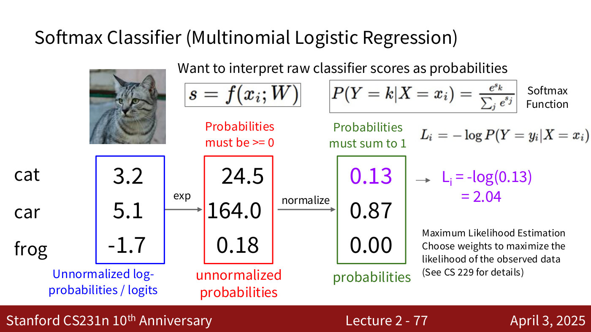
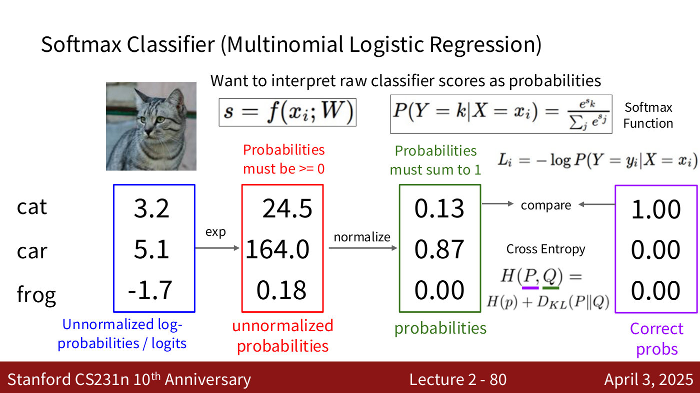
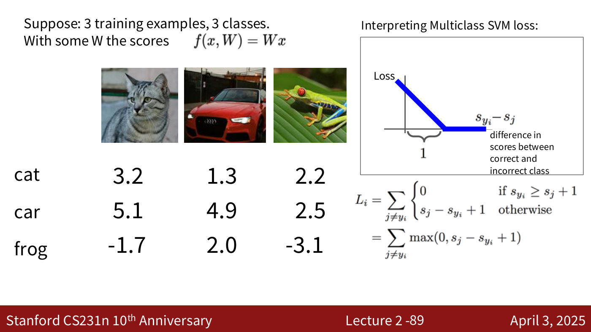
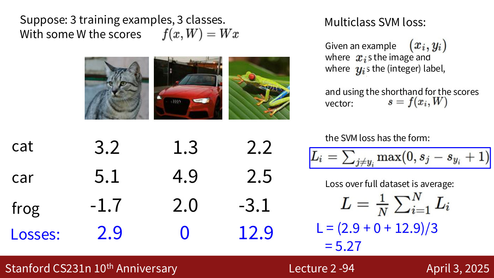
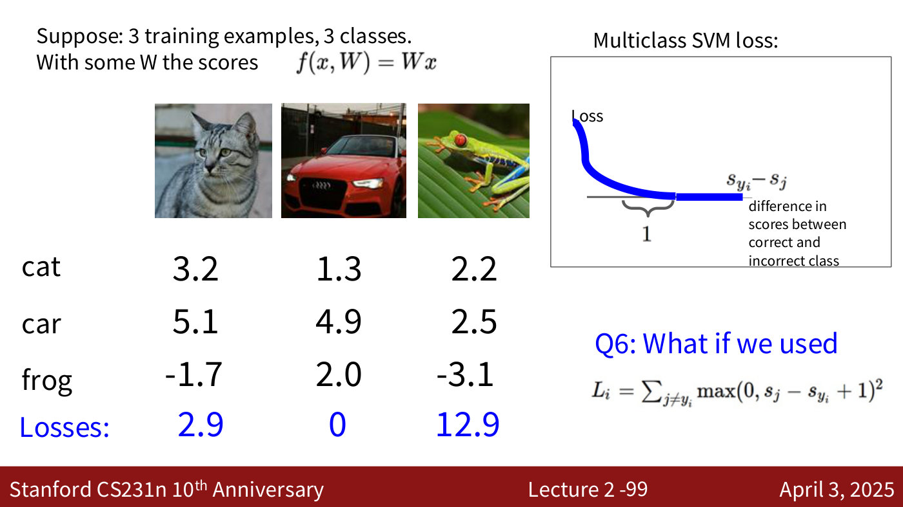
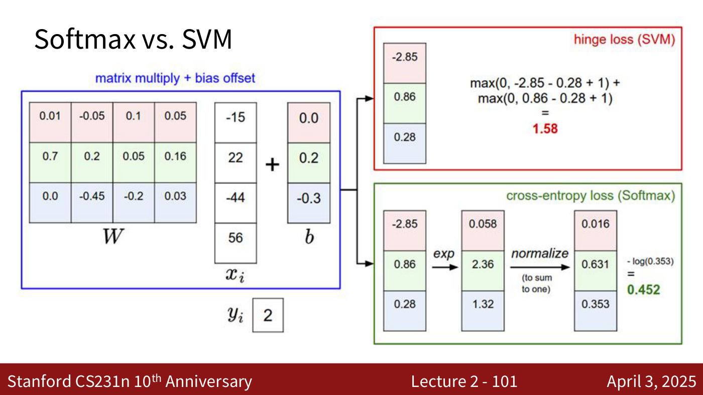
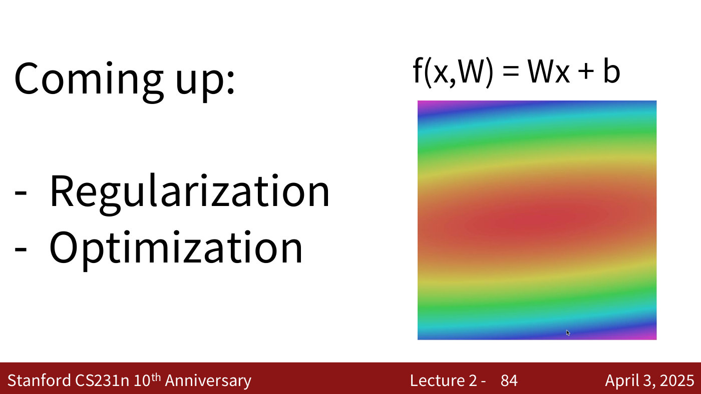

# Loss functions

A **loss function** (or objective function) quantifies how bad a classifier's scores are on the
training data — "our unhappiness with the scores", in lecture 2's words. Training then means
finding the weights that minimise it (lecture 2, ≈55:01–55:49). This page covers the two
classification losses CS231N introduces with the [linear classifier](linear-classifiers.md): the
**softmax (cross-entropy) loss**, presented in the lecture, and the **multiclass SVM (hinge)
loss**, assigned as reading.

Covered in: [Lecture 2](02-image-classification.md#choosing-w-the-loss-function);
[Lecture 3](03-regularization-optimization.md#recap-the-full-loss) recaps it, adds a
[regularization](regularization.md) term, and repeats the softmax-vs-SVM example in its appendix.
[Lecture 4](04-neural-networks-backpropagation.md#recap-of-lectures-2-and-3) explains the hinge loss
in its recap and puts the loss at the end of a network's computational graph.

## Setup

Take a dataset $\lbrace (x_i, y_i) \rbrace_{i=1}^{N}$ of $N$ examples, where $x_i$ is an image and
$y_i$ its integer label, and write $s = f(x_i, W)$ for the vector of class scores, with $s_j$ the
score of class $j$. A loss $L_i$ compares the scores for example $i$ with its label, and the loss
over the dataset is the average (lecture 2, ≈56:35–57:21; lecture 2, slides 68–69):

$$L = \frac{1}{N} \sum_i L_i(f(x_i, W), y_i)$$

The running example uses three images (a cat, a car, a frog) and three classes (lecture 2,
slide 66):

| class | cat image | car image | frog image |
| --- | --- | --- | --- |
| cat | **3.2** | 1.3 | 2.2 |
| car | 5.1 | **4.9** | 2.5 |
| frog | −1.7 | 2.0 | **−3.1** |

## Softmax loss (cross-entropy)

The softmax classifier, also called multinomial logistic regression, turns the scores into
probabilities (lecture 2, ≈57:21–1:00:26):

$$P(Y = k \mid X = x_i) = \frac{e^{s_k}}{\sum_j e^{s_j}}$$

Exponentiating makes every value positive, and dividing by the sum makes them add to 1. The raw
scores are called **logits**, or unnormalised log-probabilities (lecture 2, slide 75). For the cat
image, the scores 3.2, 5.1, −1.7 become 24.5, 164.0, 0.18 after exponentiating and 0.13, 0.87, 0.00
after normalising — so this $W$ gives the correct class only 13% (lecture 2, slides 73–74).

The loss is the negative log-probability of the correct class (lecture 2, ≈1:01:13–1:02:45):

$$L_i = -\log P(Y = y_i \mid X = x_i) = -\log\left(\frac{e^{s_{y_i}}}{\sum_j e^{s_j}}\right)$$

Maximising the probability of the correct class becomes a minimisation by negating it, and the log
makes the numbers more manageable. For the cat image, $L_i = -\log(0.13) = 2.04$ (lecture 2,
slide 76). This is **maximum likelihood estimation** (lecture 2, slide 77).

*Lecture 2, slide 77 — Softmax Classifier (Multinomial Logistic Regression). [Deck](https://cs231n.stanford.edu/slides/2025/lecture_2.pdf)*

Lecture 5 recaps the softmax loss in this form (lecture 5, slide 7). An unpresented appendix slide
of that deck restates it with minus signs in both exponents (lecture 5, slide 129), which would
reward a correct-class score going to $-\infty$; it is a printed slip, and the form above is the
correct one.

**Why "cross-entropy".** Compare the predicted distribution $Q$ (0.13, 0.87, 0.00) with the correct
one $P$ (1, 0, 0). The Kullback–Leibler divergence $D_{KL}(P \Vert Q) = \sum_y P(y) \log \frac{P(y)}{Q(y)}$
measures the mismatch, and the cross-entropy is $H(P, Q) = H(P) + D_{KL}(P \Vert Q)$. With a
one-hot $P$ the entropy $H(P)$ is zero, and both reduce to the same negative log (lecture 2,
≈1:02:45–1:04:19; lecture 2, slides 78–80).

*Lecture 2, slide 80 — the softmax pipeline: scores (logits) → exp → normalise to probabilities, compared with the correct one-hot probabilities by cross-entropy. [Deck](https://cs231n.stanford.edu/slides/2025/lecture_2.pdf)*

**Its range and starting value.** If the correct class's probability is zero, the loss is infinite
(lecture 2, ≈1:05:04). At initialisation, when all the scores are about equal, every probability
is about $1/C$ for $C$ classes, so the loss is $\log C$ — about 2.3 for 10 classes (lecture 2,
≈1:05:51–1:06:37; lecture 2, slide 83).

## Multiclass SVM loss (hinge loss)

This part of the deck is a reading assignment and was not presented in the recording (lecture 2,
slide 85); everything here is from the slides. For each wrong class $j$, the SVM loss asks the
correct class's score to beat $s_j$ by a margin of at least 1, and charges linearly for any
shortfall (lecture 2, slide 86):

$$L_i = \sum_{j \neq y_i} \max(0, s_j - s_{y_i} + 1)$$

Plotted against $s_{y_i} - s_j$, each term is a hinge: a straight line down to zero at 1, then flat
(lecture 2, slide 89). On the running example the losses are 2.9 for the cat image, 0 for the car
image and 12.9 for the frog image, so $L = (2.9 + 0 + 12.9)/3 = 5.27$ (lecture 2, slides 91–94).
The deck poses six questions about it — including the minimum and maximum loss, its value at
initialisation, and what happens if the hinge is squared — without printing answers (lecture 2,
slides 95–99).

*Lecture 2, slide 89 — the SVM hinge: the loss falls linearly as the correct class's score pulls ahead, and is zero once the margin reaches 1. [Deck](https://cs231n.stanford.edu/slides/2025/lecture_2.pdf)*

*Lecture 2, slide 94 — Multiclass SVM loss (untitled). [Deck](https://cs231n.stanford.edu/slides/2025/lecture_2.pdf)*

*Lecture 2, slide 99 — Multiclass SVM loss (untitled). [Deck](https://cs231n.stanford.edu/slides/2025/lecture_2.pdf)*

## Softmax vs. SVM

The deck runs one example through both (lecture 2, slide 101): scores −2.85, 0.86, 0.28 with the
third class correct give a hinge loss of 1.58 and a cross-entropy loss printed as 0.452 (a base-10
logarithm; with the natural log used elsewhere in the deck it is about 1.04). It then asks how each
loss responds to score vectors such as [10, −2, 3], [10, 9, 9] and [10, −100, −100] with class 0
correct, and to doubling the correct score to 20 (lecture 2, slides 102–104); no answers are
printed.

*Lecture 2, slide 101 — one example through both losses: hinge loss 1.58 (top) and cross-entropy loss (bottom), printed as 0.452 with a base-10 log. [Deck](https://cs231n.stanford.edu/slides/2025/lecture_2.pdf)*

## What comes next

Regularization and optimization are announced as coming next (lecture 2, slide 84). Lecture 3
covers both: [regularization](regularization.md) adds a term $\lambda R(W)$ to the loss, and
[gradient descent](gradient-descent.md) with the [optimizers](optimizers.md) built on it finds the
$W$ that minimises the total. Lecture 4 replaces the linear score function with a
[neural network](neural-networks.md) and keeps the same losses on top. The loss becomes the last
node of a computational graph, and [backpropagation](backpropagation.md) starts from it.

In lecture 4's recap, the lecturer adds a few words on the hinge loss because students had asked
why the course only uses softmax (lecture 4, ≈2:23–4:45). It is one of many losses, widely used in
the early years of neural networks. Unlike softmax it does not turn scores into probabilities: it
asks the correct class's score to beat every other class's by a margin, the 1 in the formula, and
grows linearly when it does not. Lecture 4's 20-line training example uses neither loss but the
summed squared difference between prediction and target, `np.square(y_pred - y).sum()`
(lecture 4, slide 36).

Lecture 7 uses the softmax loss at every time step of a sequence: a character-level language model
scores each possible next character, and training is "a time step-wise classification problem …
based on softmax" (lecture 7, ≈37:56). See [character-level language models](language-models.md).

*Lecture 2, slide 84 — Coming up:. [Deck](https://cs231n.stanford.edu/slides/2025/lecture_2.pdf)*
