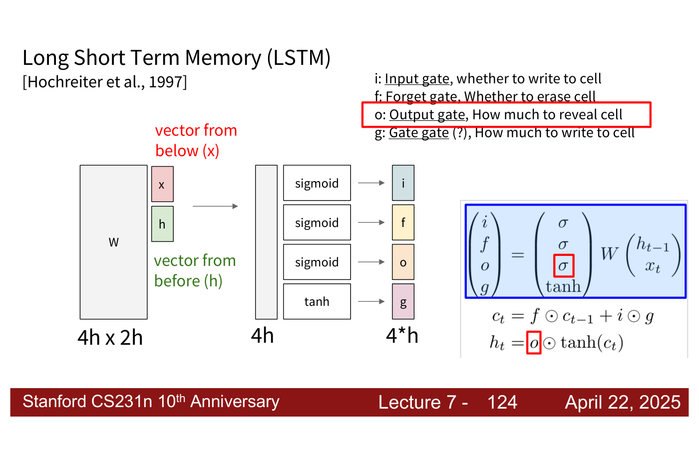
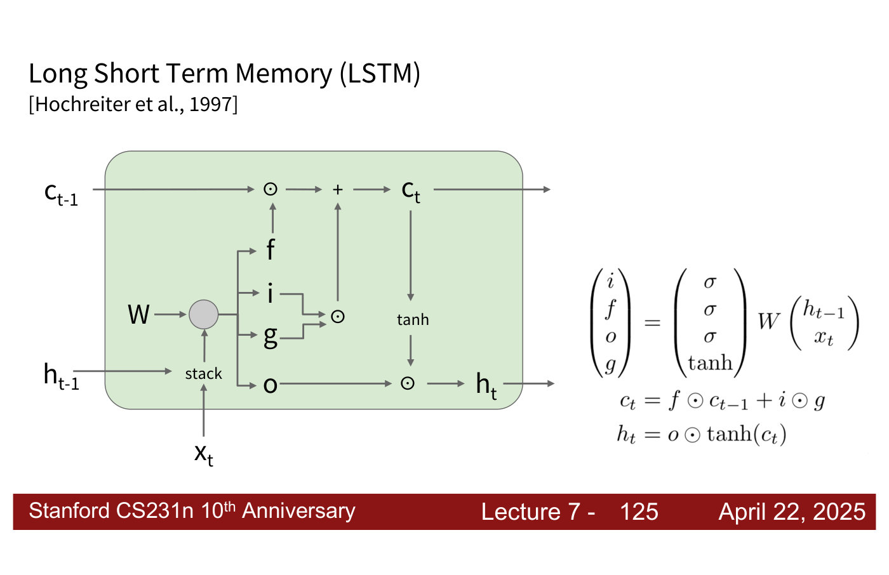
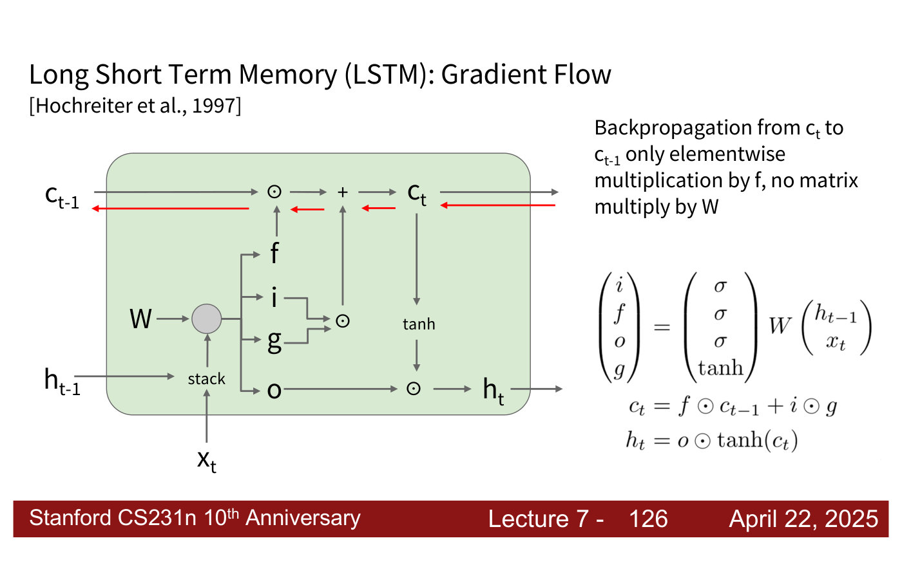
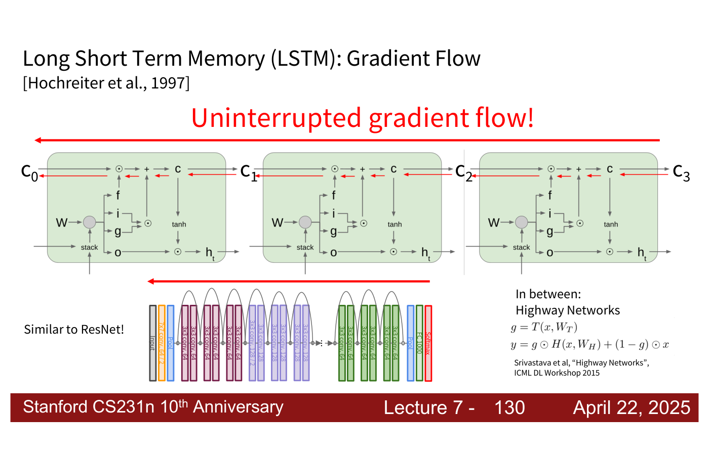

# Long Short Term Memory (LSTM)

The **LSTM** is a recurrent network designed so that information, and gradients, can pass across
many time steps more easily than in a vanilla RNN. It was proposed by Hochreiter and Schmidhuber
("Long Short Term Memory", Neural Computation 1997), "a while ago in the 1990s", and "saw a lot of
success for quite some time until the transformer revolution" (lecture 7, ≈57:58). This page gathers
what [lecture 7](07-recurrent-neural-networks.md#long-short-term-memory-lstm) says about it.
Citations "lecture 7, slide N" are to the
[lecture 7 slide file](../raw/slides/07-recurrent-neural-networks.md), and timestamps
"(lecture 7, ≈M:SS)" to the [lecture 7 transcript](../raw/transcripts/07-recurrent-neural-networks.md).

The lecture keeps to the high-level idea: "You won't need to know about the details of how LSTMs
operate, but what I hope you learn is that RNNs have some key disadvantages that LSTMs seek to
alleviate" (lecture 7, ≈57:58–58:44), and the LSTM is not implemented in the course (≈1:06:28).

## The problem it addresses

In a [vanilla RNN](recurrent-neural-networks.md#the-vanilla-rnn), the gradient flowing back from step
$T$ to step 1 is multiplied, at every step, by the derivative of tanh, which is at most 1, and by the
recurrent weight matrix $W_{hh}$. The first makes gradients vanish; the second makes them vanish or
explode depending on whether $W_{hh}$'s largest singular value is below or above 1 (lecture 7,
slides 113–115). Exploding gradients can be clipped, but vanishing gradients call for a different
architecture (lecture 7, slides 116–117). See
[vanishing and exploding gradients](recurrent-neural-networks.md#vanishing-and-exploding-gradients).

## The equations

The vanilla RNN computes

$$h_t = \tanh\left(W \begin{pmatrix} h_{t-1} \cr x_t \end{pmatrix}\right)$$

where $W$ holds $W_{hh}$ and $W_{xh}$ side by side. The LSTM instead computes four **gates** from the
same stacked vector (lecture 7, slides 105 and 118–119):

$$\begin{pmatrix} i \cr f \cr o \cr g \end{pmatrix} = \begin{pmatrix} \sigma \cr \sigma \cr \sigma \cr \tanh \end{pmatrix} W \begin{pmatrix} h_{t-1} \cr x_t \end{pmatrix}$$

$$c_t = f \odot c_{t-1} + i \odot g$$

$$h_t = o \odot \tanh(c_t)$$

Here $\sigma$ is the sigmoid, so $i$, $f$ and $o$ lie between 0 and 1, $g$ comes from tanh, and
$\odot$ is elementwise multiplication. Besides the **hidden state** $h_t$ the LSTM keeps a **cell
state** $c_t$ (lecture 7, slide 119). If the hidden state has size $h$, $W$ is $4h \times 2h$: it
multiplies the stacked input $x$ ("vector from below") and previous hidden state $h$ ("vector from
before"), and its output of size $4h$ is split into four vectors of size $h$, three passed through a
sigmoid and one through tanh (lecture 7, slide 120).

## The four gates

Slides 121–124 of lecture 7 define them:

- $i$, the **input gate**: whether to write to the cell;
- $f$, the **forget gate**: whether to erase the cell;
- $o$, the **output gate**: how much to reveal the cell;
- $g$, the "**gate gate** (?)": how much to write to the cell.

In the lecturer's words, $g$ is "what are you actually writing to the hidden state of the cell", the
input gate decides "whether or not you write information to the cell", the forget gate "how much to
forget from previous time steps", and the output gate "how much are you actually outputting for your
hidden state" (lecture 7, ≈1:04:56–1:05:41). So the cell state update keeps a gated fraction $f$ of
the old cell and adds a gated amount $i$ of new content $g$; the hidden state is a gated view, $o$, of
the squashed cell.

*Lecture 7, slide 124 — the gates: one 4h x 2h matrix maps the stacked x and h to a vector of size 4h, split into i, f, o (sigmoid) and g (tanh), with each gate's role written above. [Deck](https://cs231n.stanford.edu/slides/2025/lecture_7.pdf)*

## The cell diagram

In the cell diagram (lecture 7, slide 125), $h_{t-1}$ and $x_t$ are stacked and multiplied by $W$ to
give the four gates. Along the top runs the cell state: $c_{t-1}$ is multiplied elementwise by $f$,
then $i \odot g$ is added, giving $c_t$, which leaves the cell to the right. $c_t$ also passes through
tanh and is multiplied by $o$ to give $h_t$. The lecturer calls the whole thing "fairly complicated":
the weight multiply is the same as in an RNN, "but now we have four different values we're computing
instead of just the $h_t$" (lecture 7, ≈1:05:41).

*Lecture 7, slide 125 — one LSTM cell: the cell state runs along the top (f scales c(t−1), then i ⊙ g is added), and hₜ is o times tanh(cₜ). [Deck](https://cs231n.stanford.edu/slides/2025/lecture_7.pdf)*

## Why gradients flow more easily

"Backpropagation from $c_t$ to $c_{t-1}$ [is] only elementwise multiplication by $f$, no matrix
multiply by $W$" (lecture 7, slide 126). The top pathway is "like a highway, where the goal is to not
have any activation functions", so the gradient avoids the tanh derivatives that made it vanish, and
"as long as we're not basically forgetting all the information at each time step, we're able to pass
information more easily" (lecture 7, ≈1:05:41–1:06:28). Chained across time steps, the cell states
give "uninterrupted gradient flow" from the last step back to the first (lecture 7, slide 127).

*Lecture 7, slide 126 — the backward path from cₜ to c(t−1) (red) stays on the cell-state line: one elementwise multiplication by f, and no multiplication by W. [Deck](https://cs231n.stanford.edu/slides/2025/lecture_7.pdf)*

The cell state is also a second channel for information, which addresses the other weakness of the
vanilla RNN: having to "cram everything into this hidden state", so that long-term dependencies are
lost (lecture 7, ≈1:06:28).

## Does it solve vanishing gradients?

Not completely (lecture 7, slide 128; ≈1:07:14). "The LSTM architecture makes it easier for the RNN
to preserve information over many timesteps": for example, "if the f = 1 and the i = 0, then the
information of that cell is preserved indefinitely", whereas a vanilla RNN would have to learn a
recurrent weight matrix that preserves the hidden state. But the "LSTM doesn't guarantee that there
is no vanishing/exploding gradient, but it does provide an easier way for the model to learn
long-distance dependencies". It "works very well empirically", and someone taking the recurrent route
would more often train an LSTM than a vanilla RNN, though both "have also … significantly fallen out
of fashion" (lecture 7, ≈1:07:14–1:08:00). It remains "a really commonly used baseline still in some
deep learning papers" (lecture 7, ≈1:06:28).

## The connection to ResNet and Highway Networks

Adding a value directly and skipping activation functions is "highly related" to
[ResNet](cnn-architectures.md#resnet-residual-connections)'s skip connections, where a value is copied over and added
after a block of convolutions (lecture 7, slide 129; ≈1:08:00–1:08:45). ResNet does this across many
layers of depth; the LSTM across many time steps — "a parallel, but it's a little different". In
between sit **Highway Networks** (lecture 7, slide 130; Srivastava et al., ICML DL Workshop 2015),
where a learned gate $g = T(x, W_T)$ mixes a layer's transformation $H(x, W_H)$ with its input:

$$y = g \odot H(x, W_H) + (1 - g) \odot x$$

*Lecture 7, slide 130 — uninterrupted gradient flow along the LSTM's cell states, beside ResNet's skip connections and the Highway Networks equations. ResNet's last stage is labelled "3x3 conv, 64", as in lecture 6. [Deck](https://cs231n.stanford.edu/slides/2025/lecture_7.pdf)*

## Beyond the LSTM

Lecture 7's summary lists LSTMs and Mamba together as "more complex variants" that "can introduce
ways to selectively pass information forward" (lecture 7, slide 132). See
[modern RNNs](recurrent-neural-networks.md#modern-rnns-state-space-models).

## Where the course covers LSTMs

- [Lecture 7 — Recurrent Neural Networks](07-recurrent-neural-networks.md#long-short-term-memory-lstm).
- [Lecture 1](01-introduction.md) shows an unrolled RNN with an LSTM cell in its tour of the course
  (lecture 1, part 2, slide 17).
