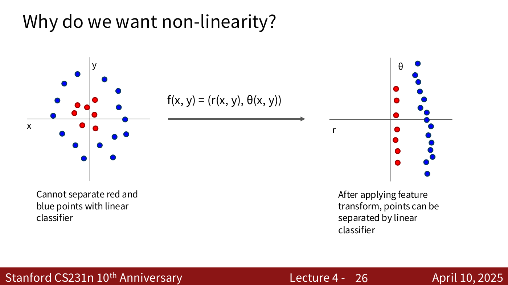
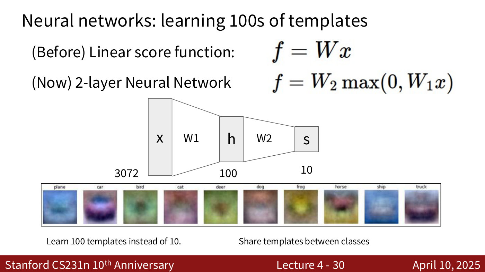
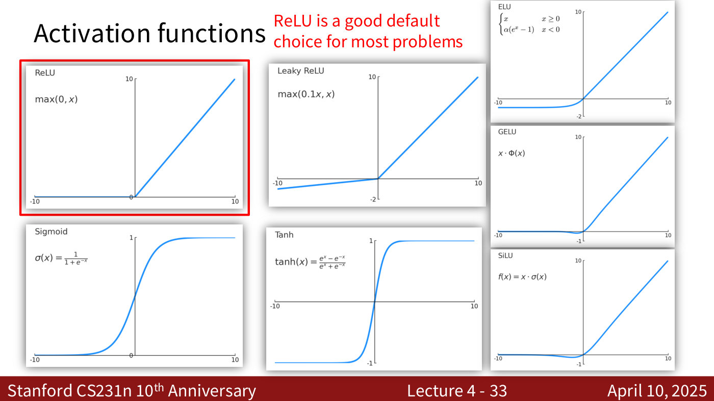
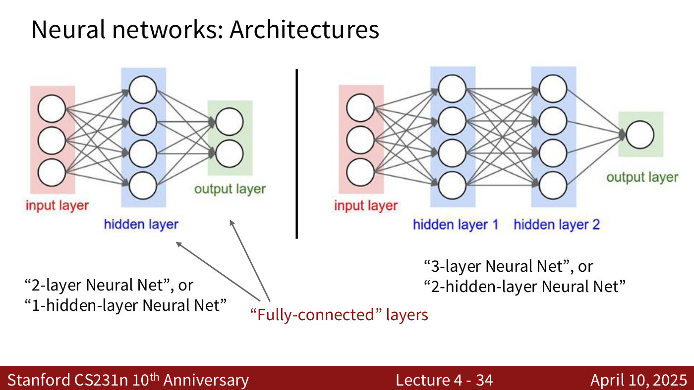
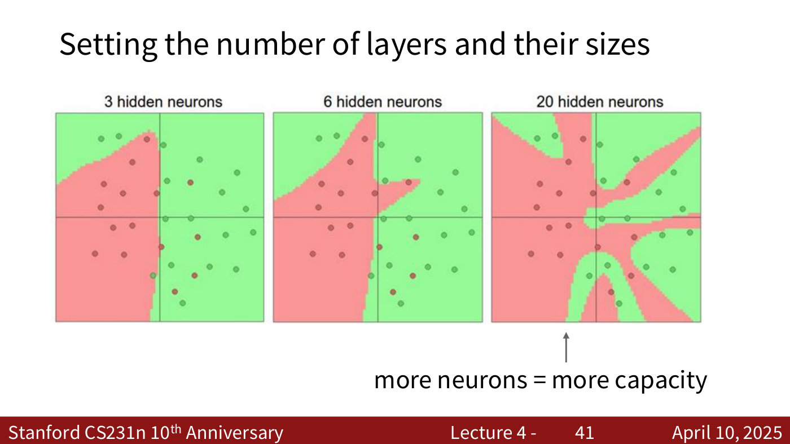
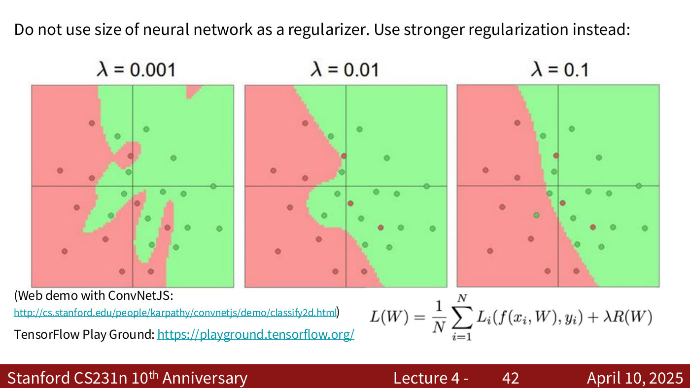
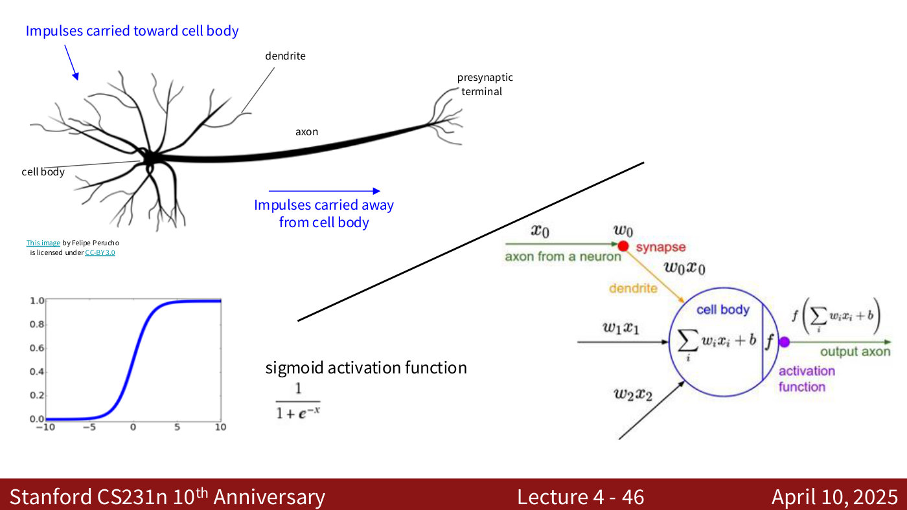
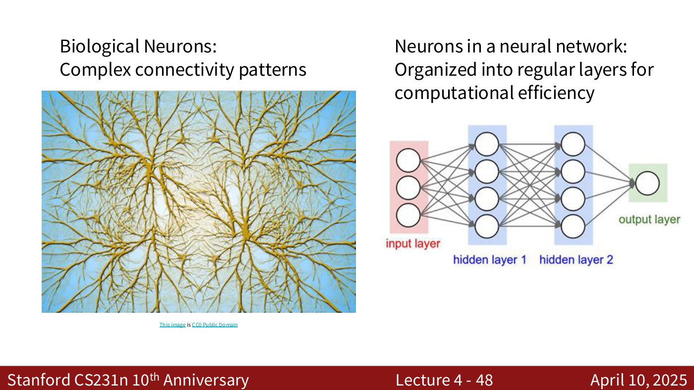
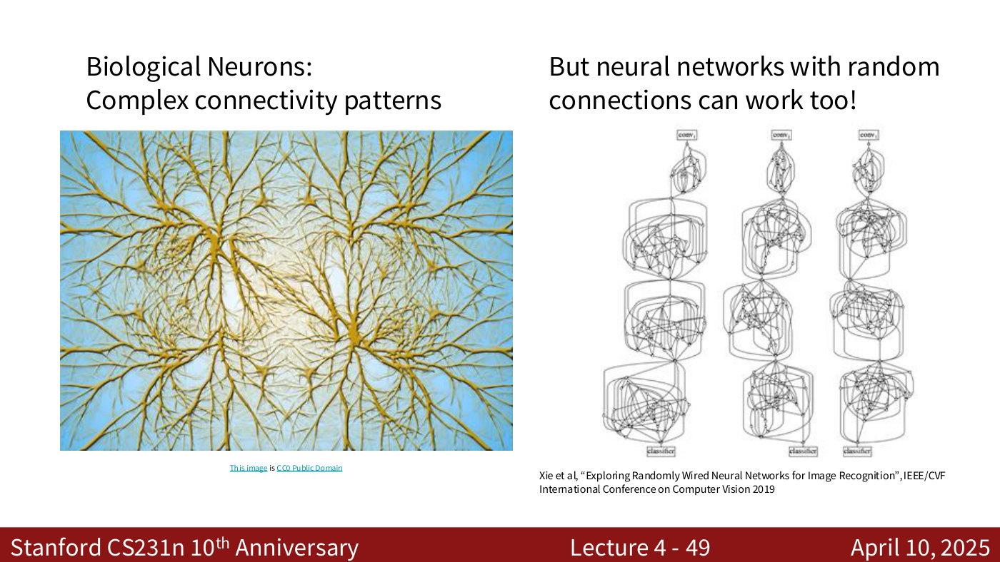

# Neural networks (fully connected networks)

A **neural network**, in the sense CS231N introduces first, is a stack of linear functions with a
non-linear **activation function** between each pair. The non-linearity is the whole point:
without it the stack collapses back into one linear classifier. These networks are more
accurately called **fully-connected networks** or **multi-layer perceptrons** (MLPs). This page
covers how a network is built from the linear classifier, why it needs non-linearity, what its
hidden layer learns, the activation functions the course lists, how layers are counted, how to
think about the network's size, and how far the analogy with the brain goes. How a network is
trained — computing the gradient of the loss with respect to every weight — is on
[backpropagation](backpropagation.md).

Covered in: [Lecture 4](04-neural-networks-backpropagation.md#from-linear-classifiers-to-neural-networks),
previewed at the end of [Lecture 3](03-regularization-optimization.md#looking-ahead-neural-networks).
[Lecture 2](02-image-classification.md#building-block-of-neural-networks) introduces the linear
layer as the building block. [Lecture 5](05-image-classification-cnns.md) builds
[convolutional networks](convolutional-networks.md) on top of these: it keeps the fully connected
layers and activation functions and adds convolution and pooling layers, because a fully connected
network on raw pixels "destroys the spatial structure of the images" (lecture 5, ≈22:15).

## From a linear classifier to a network

The linear classifier computes class scores $f = Wx$ from an input $x \in \mathbb{R}^{D}$ with
weights $W \in \mathbb{R}^{C \times D}$, where $D$ is the number of input features and $C$ the number
of classes (lecture 4, slide 23). A **2-layer neural network** adds a second weight matrix, with an
elementwise maximum between the two (lecture 4, slide 24):

$$f = W_2 \max(0, W_1 x)$$

where $W_1 \in \mathbb{R}^{H \times D}$, $W_2 \in \mathbb{R}^{C \times H}$, and $H$ is the number of
neurons in the **hidden layer** $\max(0, W_1 x)$. In practice each layer also has a learnable
bias, which the slides leave out for simplicity. Stacking further gives a **3-layer network**,

$$f = W_3 \max(0, W_2 \max(0, W_1 x))$$

with $W_1 \in \mathbb{R}^{H_1 \times D}$, $W_2 \in \mathbb{R}^{H_2 \times H_1}$ and
$W_3 \in \mathbb{R}^{C \times H_2}$: each matrix's input size is the previous one's output size
(lecture 4, slide 28). For CIFAR-10 a 2-layer network might map the 3072 numbers of an image to
100 hidden neurons and then to 10 class scores (lecture 4, slide 29).

## Why it needs non-linearity

Some data no line can separate. In lecture 4's example, a cluster of red points sits inside a ring
of blue ones; mapped to polar coordinates $(r, \theta)$, the red points sit at small radius and the
blue at large, and a vertical line separates them (lecture 4, slide 26). A network's hidden layers
can learn a transformation like that, so that its last, linear layer can do the separating
(lecture 4, ≈12:35–13:20).



*Lecture 4, slide 26 — why non-linearity: no line separates the seven red points from the ring of fifteen blue ones (left); after mapping each point to polar coordinates (r, θ), a vertical line does (right). [Deck](https://cs231n.stanford.edu/slides/2025/lecture_4.pdf)*

The $\max(0, \cdot)$ is what makes the transformation non-linear. Remove it and
$f = W_2 W_1 x$; but $W_2 W_1$ is just another matrix $W_3$, so $f = W_3 x$: "we end up with a
linear classifier again!" (lecture 4, slides 31–32). However many linear layers are stacked, they
"could be lumped together" into one (lecture 4, ≈17:59).

## What the hidden layer learns

[Lecture 2](02-image-classification.md) read each row of a linear classifier's weights as a
**template**, one per class. A network with a 100-neuron hidden layer can learn 100 templates
instead of 10, and share them between classes (lecture 4, slide 30). The lecturer's
"high-level" reading is that the hidden neurons can come to represent *parts* of objects: bird,
cat, deer, dog, frog and horse all have eyes, so one template might serve all six
(lecture 4, ≈15:40–16:27).



*Lecture 4, slide 30 — the two-layer network as sizes: a 3072-number image x, a 100-neuron hidden layer h, 10 class scores s. The strip is the 10 templates a linear classifier learns; the hidden layer can learn 100. [Deck](https://cs231n.stanford.edu/slides/2025/lecture_4.pdf)*

## Activation functions

Lecture 4 plots eight activation functions and recommends ReLU as "a good default choice for
most problems". With $x$ the function's input and $\sigma$ the sigmoid:

| Name | Formula as printed |
| --- | --- |
| ReLU | $\max(0, x)$ |
| Leaky ReLU | $\max(0.1x, x)$ |
| ELU | $x$ for $x \geq 0$; $\alpha(e^{x} - 1)$ for $x \lt 0$ |
| GELU | $x \cdot \Phi(x)$ |
| SiLU | $x \cdot \sigma(x)$ |
| Sigmoid | $\sigma(x) = \frac{1}{1+e^{-x}}$ |
| Tanh | $\tanh(x) = \frac{e^{x} - e^{-x}}{e^{x} + e^{-x}}$ |

These are the formulas printed on lecture 4, slide 33, which does not define ELU's $\alpha$ or
GELU's $\Phi$.



*Lecture 4, slide 33 — eight activation functions plotted from −10 to 10. ReLU, boxed in red, is the recommended default. [Deck](https://cs231n.stanford.edu/slides/2025/lecture_4.pdf)*

The lecturer's account of them (lecture 4, ≈18:46–21:14) runs as follows. ReLU, the rectified
linear unit, is very popular but can leave **dead neurons**, because it outputs zero for every
non-positive input. Leaky ReLU and ELU (exponential linear unit) avoid that, and ELU has "a better
zero-centered function". GELU (Gaussian error linear unit) is used more in transformers, and SiLU
(sigmoid linear unit, also called Swish) in some modern CNNs, including EfficientNet. Sigmoid and
tanh "squash values into a narrow range", which can cause **vanishing gradients**. So they are not
used in the middle of a network, only in later layers, for example to binarize outputs.
Recurrent networks are the exception: the vanilla RNN of lecture 7 uses tanh for its hidden state,
because it is bounded between $-1$ and $1$, so values stay in range when the same update is applied
step after step, and because it is zero-centred (lecture 7, ≈13:15). Its vanishing gradients are
exactly the problem there: see
[vanishing and exploding gradients](recurrent-neural-networks.md#vanishing-and-exploding-gradients).

Choosing one is "mostly empirical": start with ReLU, or with whatever is standard for the
architecture, and treat the choice like any other hyperparameter (lecture 4, ≈22:46–23:33). All of
them are non-linear, which is their purpose, and differentiable, because the network is trained
by gradients. Being zero-centred and smooth can make networks converge faster. Usually one
activation is used throughout, except sometimes a sigmoid or tanh at the output
(lecture 4, ≈24:19–25:53).

Lecture 6 revisits them with the reasons behind the modern choices. The purpose of an activation
function is to introduce non-linearity, without which convolutions and fully connected layers are
only multiplications and additions (lecture 6, ≈16:13). The **sigmoid** fell out of use because
its gradient is close to zero for very negative and very positive inputs, so many layers of
sigmoids give "smaller and smaller gradients" towards the early layers (lecture 6, ≈16:13–17:45).
**ReLU**'s gradient is one for every positive input and zero for every negative one, and it is
much cheaper to compute; it converged about six times faster than sigmoid in Krizhevsky et al.
2012 (lecture 6, ≈17:45–18:30). **GELU**, $x \cdot \Phi(x)$ with $\Phi$ the cumulative distribution
function of the unit Gaussian, approaches ReLU at both extremes but is smooth near zero and has
non-zero gradients just below it; it is the main activation in transformers today. **SiLU**,
$x \cdot \sigma(x)$, has the same shape for the same reason (lecture 6, ≈18:30–20:51). Activations
are generally placed after linear operators: after a fully connected layer or a convolution
(lecture 6, ≈20:51–21:37). See
[lecture 6](06-training-cnns-architectures.md#activation-functions).

## Architectures, and how layers are counted

Layers are counted by their weights, not their neurons (lecture 4, slide 34). Three inputs, one
hidden layer of four neurons and two outputs is a "2-layer Neural Net", or "1-hidden-layer Neural
Net". Two hidden layers of four and one output is a "3-layer Neural Net", or "2-hidden-layer
Neural Net". Every neuron is connected to every neuron in the next layer, which is what makes
these "fully-connected" layers.



*Lecture 4, slide 34 — layers are counted by weight layers: one hidden layer makes a "2-layer" net, two hidden layers a "3-layer" net. Every neuron connects to every neuron in the next layer. [Deck](https://cs231n.stanford.edu/slides/2025/lecture_4.pdf)*

The forward pass is a few lines of NumPy: apply each weight matrix, add the bias, apply the
activation, and repeat (lecture 4, slide 35):

```python
f = lambda x: 1.0/(1.0 + np.exp(-x)) # activation function (use sigmoid)
x = np.random.randn(3, 1) # random input vector of three numbers (3x1)
h1 = f(np.dot(W1, x) + b1) # calculate first hidden layer activations (4x1)
h2 = f(np.dot(W2, h1) + b2) # calculate second hidden layer activations (4x1)
out = np.dot(W3, h2) + b3 # output neuron (1x1)
```

A complete training loop for a 2-layer network, forward pass, gradients and gradient descent, takes
about 20 lines (lecture 4, slides 36–40); it is reproduced on the
[lecture 4 page](04-neural-networks-backpropagation.md#training-a-two-layer-network-in-about-20-lines).
Its gradient lines are what [backpropagation](backpropagation.md) produces.

## Size, capacity and regularization

More hidden neurons mean more capacity: the same data separated with 3, 6 and 20 hidden neurons
gives a boundary that goes from a smooth curve to one that bends around individual points
(lecture 4, slide 41). Too much capacity overfits, as
[nearest neighbour](k-nearest-neighbors.md) with $k = 1$ does (lecture 4, ≈29:00).



*Lecture 4, slide 41 — the same data separated by networks with 3, 6 and 20 hidden neurons: more neurons, more capacity, and a boundary that bends around individual points. [Deck](https://cs231n.stanford.edu/slides/2025/lecture_4.pdf)*

The course's rule of thumb is **"Do not use size of neural network as a regularizer. Use stronger
regularization instead"** (lecture 4, slide 42). Raising the regularization strength $\lambda$ from
0.001 to 0.1 smooths the same network's boundary down to a nearly straight line. "What we often do
is go with a bit of a bigger network than we need", then tune $\lambda$ rather than the size
(lecture 4, ≈29:48–30:34).



*Lecture 4, slide 42 — one network at regularization strengths λ = 0.001, 0.01 and 0.1: stronger regularization smooths the boundary, down to a nearly straight line. [Deck](https://cs231n.stanford.edu/slides/2025/lecture_4.pdf)*

A minute later, in answer to a question, the lecturer describes a slightly different practice:
grow the network until it starts to overfit, then regularize, and for a new problem start small
and grow (lecture 4, ≈32:51–33:37). How many neurons and layers to use is empirical. The guide is
networks trained on similar data, followed by experiment (lecture 4, ≈33:37–34:26). See
[regularization](regularization.md#the-regularization-strength-and-the-networks-size) and
[hyperparameters and validation](hyperparameters-and-validation.md).

## The brain analogy, and its limits

An artificial neuron is loosely modelled on a biological one: dendrites carry impulses to the cell
body, which aggregates them, and the axon carries the result onward. The artificial neuron computes
$f\left(\sum_i w_i x_i + b\right)$ from inputs $x_i$, weights $w_i$, a bias $b$ and an activation
function $f$ (lecture 4, slide 46). Biological neurons have complex connectivity, while a network's
neurons sit in regular layers "for computational efficiency" (lecture 4, slide 48). Randomly
wired networks also work (lecture 4, slide 49).



*Lecture 4, slide 46 — the biological neuron (dendrites, cell body, axon) beside the artificial one: weighted inputs summed with a bias and passed through an activation function f, here the sigmoid plotted at lower left. [Deck](https://cs231n.stanford.edu/slides/2025/lecture_4.pdf)*



*Lecture 4, slide 48 — biological neurons' complex connectivity (left) against the regular layers of a neural network (right). [Deck](https://cs231n.stanford.edu/slides/2025/lecture_4.pdf)*



*Lecture 4, slide 49 — randomly wired networks (Xie et al., 2019) also work. [Deck](https://cs231n.stanford.edu/slides/2025/lecture_4.pdf)*

The course is emphatic that the analogy is loose (lecture 4, ≈35:58 and ≈38:19). Biological
neurons come in many types; dendrites can perform complex non-linear computations; and synapses
are "not a single weight but a complex non-linear dynamical system" (lecture 4, slide 50).

## Related pages

- [Backpropagation](backpropagation.md) — how a network's gradients are computed.
- [Linear classifiers](linear-classifiers.md) — the single layer a network stacks.
- [Loss functions](loss-functions.md) — what the network's scores are fed into.
- [Regularization](regularization.md) — the preferred way to control a network's capacity.
- [Gradient descent and SGD](gradient-descent.md) and [optimizers](optimizers.md) — how the
  weights are updated once the gradients are known.
