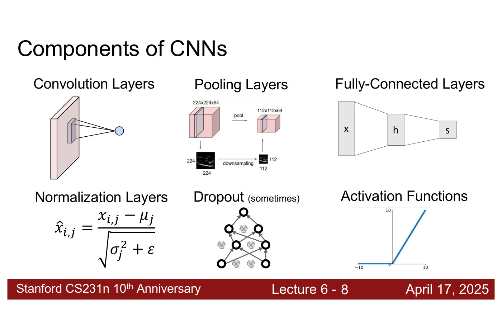
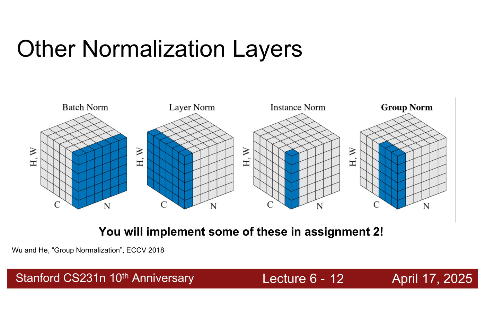
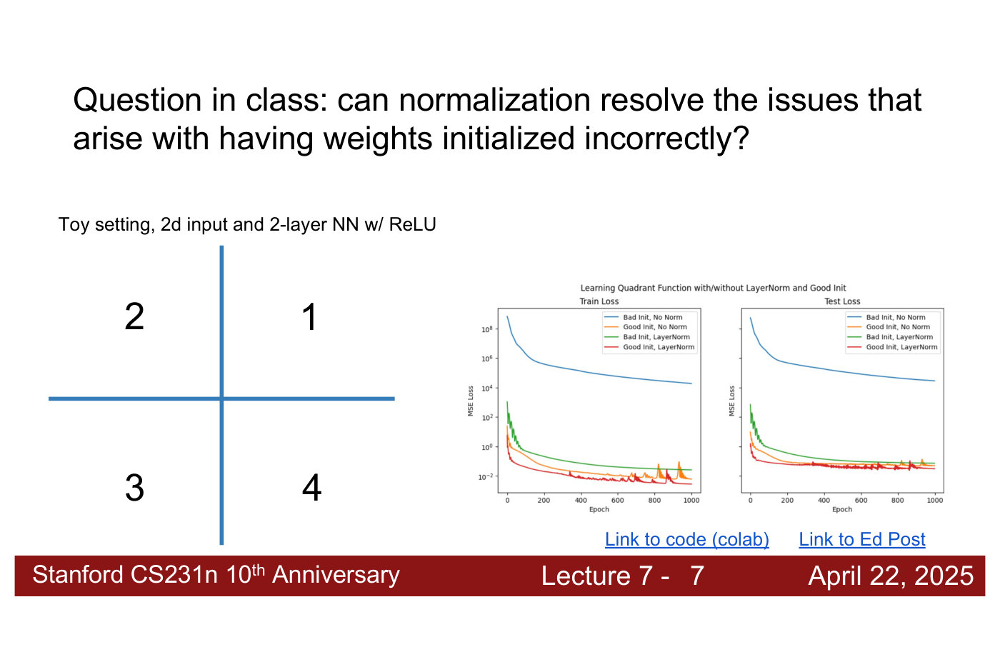

# Normalization layers

A **normalization layer** normalizes the values passing through a network and then rescales them
with learned parameters. The course introduces them in
[lecture 6](06-training-cnns-architectures.md#normalization-layers) (Zane Durante, April 17,
2025), alongside dropout, as one of the layers a CNN uses besides convolution, pooling and fully
connected layers. Citations "lecture 6, slide N" are to the
[lecture 6 slide file](../raw/slides/06-training-cnns-architectures.md), and timestamps
"(lecture 6, ≈M:SS)" to the
[lecture 6 transcript](../raw/transcripts/06-training-cnns-architectures.md).

## What every normalization layer does

The high-level idea is to "learn parameters that let us scale / shift the input data" (lecture 6,
slide 10). Every normalization layer does it in two steps (lecture 6, ≈3:59–4:45):

1. **Normalize** the input to a unit Gaussian, mean zero and standard deviation one, by
   subtracting a mean and dividing by a standard deviation computed from the data.
2. **Scale and shift** with learned parameters: multiply by a learned value, which sets the new
   standard deviation, and add a learned value, which sets the new mean. These are learned by
   gradient descent like the other weights, so the model learns the distribution it wants at that
   point.

The deck writes the normalization step as

$$\hat{x}_ {i,j} = \frac{x_{i,j} - \mu_j}{\sqrt{\sigma_j^2 + \varepsilon}}$$

with $\mu_j$ a mean, $\sigma_j^2$ a variance and $\varepsilon$ a small constant in the denominator
(lecture 6, slide 8; the slide does not define the symbols). The layers differ only in **how they
compute the statistics**: which values each mean and standard deviation is computed over, and
which values it is applied to (lecture 6, ≈4:45).

*Lecture 6, slide 8 — the six components of a CNN: convolution, pooling and fully connected layers (lecture 5), and normalization layers, dropout ("sometimes") and activation functions (this lecture). [Deck](https://cs231n.stanford.edu/slides/2025/lecture_6.pdf)*

## LayerNorm

LayerNorm (Ba, Kiros and Hinton, 2016) is, in the lecturer's view, the most commonly used
normalization layer today, especially in transformers (lecture 6, ≈4:45). For a batch $x$ of $N$
samples, each a vector of dimension $D$, it computes one mean $\mu$ and one standard deviation
$\sigma$ **per sample**, over that sample's $D$ values, and then applies learned parameters
$\gamma$ (scale) and $\beta$ (shift), each of dimension $D$, to every sample:

$$y = \gamma \frac{x - \mu}{\sigma} + \beta$$

The shapes: $x$ is N x D, $\mu$ and $\sigma$ are N x 1, and $\gamma$ and $\beta$
are 1 x D (lecture 6, slide 11; ≈4:45–5:31). The slide's annotation calls the statistics
"calculated per batch", but the N x 1 shape it points at is one pair per sample, as the lecturer
describes it. For a convolutional activation with channels and spatial dimensions, LayerNorm
computes one mean and one standard deviation per sample across all its channels, heights and
widths (lecture 6, ≈6:16–7:02).

## Batch, layer, instance and group norm

A figure from the Group Normalization paper (Wu and He, 2018) shows the four layers on one cube of
activations, with axes for the batch ($N$), the channels ($C$) and the spatial dimensions
($H, W$); the blue cells are the set over which one mean and one standard deviation are computed
and to which they are applied (lecture 6, slide 12).

*Lecture 6, slide 12 — four normalization layers on one cube (N batch, C channels, H, W spatial). Blue marks one set of statistics: batch norm one channel across the batch, layer norm one sample across all channels, instance norm one channel of one sample, group norm a group of channels of one sample. From Wu and He, ECCV 2018. [Deck](https://cs231n.stanford.edu/slides/2025/lecture_6.pdf)*

| Layer | One set of statistics per | Computed across |
| --- | --- | --- |
| Batch norm | channel | every sample in the minibatch, and all spatial positions |
| Layer norm | sample | all channels and all spatial positions |
| Instance norm | channel of one sample | all spatial positions |
| Group norm | group of channels of one sample | the channels in the group, and all spatial positions |

Batch norm's statistics therefore depend on the minibatch: they are computed per channel over all
the data in the batch fed to the model at a gradient step. Layer norm's are computed for each image
separately (lecture 6, ≈7:48–8:35). Group norm, which that paper introduced, is "not so commonly
used these days" (lecture 6, ≈6:16). The lecturer recommends the figure as the way to understand
all of them: "if you can understand this diagram, I think you understand what all of the different
normalization layers are doing" (lecture 6, ≈8:35). Students implement some of these in
Assignment 2 (lecture 6, slide 12).

## Normalization and initialization

Normalization layers interact with [weight initialization](weight-initialization.md). A student
suggests that normalization would solve activations blowing up from too large an initialization.
The lecturer agrees that it would solve that particular issue, but says the network might still be
harder to optimise (lecture 6, ≈48:28). Normalizing the input images themselves, before the
network, is a separate step: see
[data preprocessing](data-augmentation.md#data-preprocessing).

Lecture 7 answers a related question from lecture 6 — can normalization resolve the issues caused by
badly initialized weights? — with a toy experiment: a two-layer ReLU network learning which quadrant
a 2D point lies in, trained with good (Kaiming) or bad (too large) initialization, each with and
without LayerNorm (lecture 7, slides 7–10; ≈0:51–2:24). LayerNorm brings the badly initialized run's
loss down by several orders of magnitude, from around $10^{4}$ to a few hundredths, but a gap to good
initialization remains: "you can't get by this weight initialization issue with just normalization"
(lecture 7, ≈2:24). And normalization "may not always make sense": it helps here because LayerNorm
does not change an input's quadrant, but for functions in the accompanying code that need the exact
coordinates it hurts, because subtracting the mean and dividing by the standard deviation loses
information about the input's exact position (lecture 7, slide 10; ≈2:24).

*Lecture 7, slide 7 — training and test loss (log scale) for the quadrant function: bad initialization without normalization (blue) stays near 10⁴; adding LayerNorm (green) brings it to about 10⁻², still above the good-initialization runs (orange, red). [Deck](https://cs231n.stanford.edu/slides/2025/lecture_7.pdf)*

## Lectures

- [Lecture 6 — Training CNNs and CNN Architectures](06-training-cnns-architectures.md#normalization-layers):
  everything on this page except the lecture 7 experiment.
- [Lecture 7 — Recurrent Neural Networks](07-recurrent-neural-networks.md#clarifications-from-last-time):
  whether normalization can fix bad initialization.

## Related pages

- [CNN architectures](cnn-architectures.md) — the networks these layers sit in.
- [Regularization](regularization.md#dropout) — dropout, the other layer lecture 6 adds.
- [Neural networks](neural-networks.md) — the fully connected layers they normalize.
