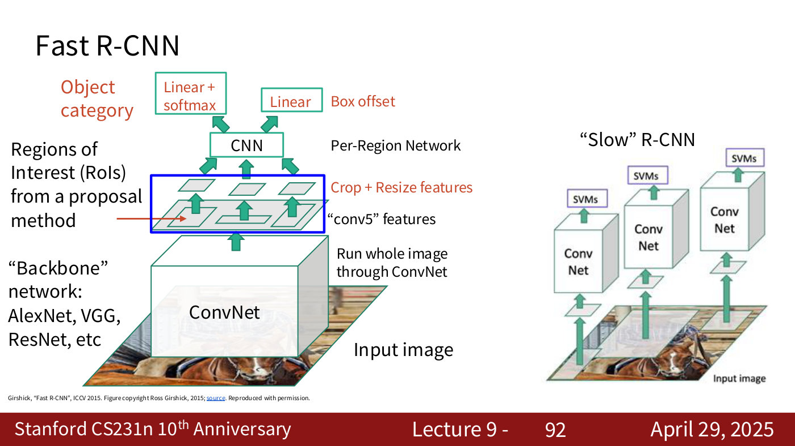
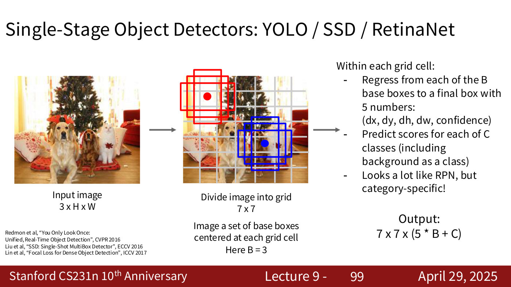
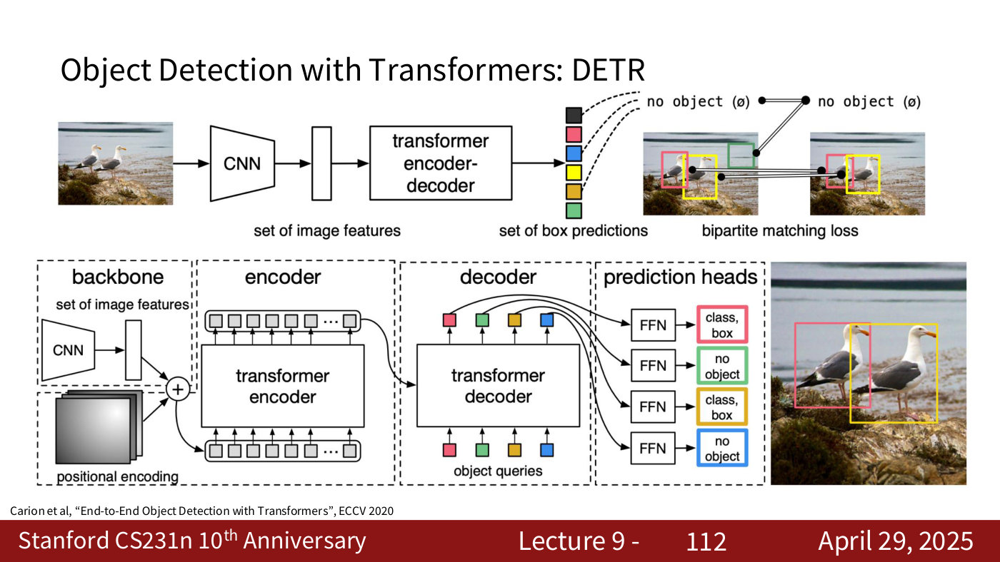

# Object detection

Object detection says what is in an image and where: a class label and a bounding box for every object. It has been "besides image classification, or after image classification, one of the core computer vision problems" (lecture 9, ≈33:32). The course covers it in [lecture 9](09-detection-segmentation-visualization.md#object-detection) (April 29, 2025). Citations "lecture 9, slide N" are to the [lecture 9 slide file](../raw/slides/09-detection-segmentation-visualization.md), and timestamps "(lecture 9, ≈M:SS)" to the [lecture 9 transcript](../raw/transcripts/09-detection-segmentation-visualization.md). The lecturer's framing: "nobody cares about object detection anymore because now we can just do it with one line of code", but the last 10 to 15 years of methods are worth knowing "if you have to design something new yourself" (lecture 9, ≈15:42–16:29).

## One object: classification plus localization

With a single object, detection is classification plus localization (lecture 9, slides 68–70). A CNN maps the image to a 4096-dimensional vector. One fully connected layer gives 1000 class scores, trained with a softmax loss, and another gives 4 box coordinates $(x, y, w, h)$, trained with an L2 loss against the correct box: "Treat localization as a regression problem!" The two losses are added into a **multitask loss** (see [loss functions](loss-functions.md)).

## Many objects

"Each image needs a different number of outputs!" — 4 numbers for one object, 12 for three, "Many numbers!" for a flock (lecture 9, slide 72). Classifying every crop of the image as an object class or background works but would need "huge number of locations, scales, and aspect ratios" (lecture 9, slide 77). **Region proposals** narrow the search to "blobby" regions likely to contain objects; Selective Search gives about 2,000 in a few seconds on a CPU (lecture 9, slide 78).

## Two-stage detectors: R-CNN to Faster R-CNN

**R-CNN** (Girshick et al., CVPR 2014) warps each of about 2,000 proposals to $224 \times 224$, runs each through an ImageNet-pretrained ConvNet, classifies it with SVMs and regresses a box correction $(dx, dy, dw, dh)$, which is "Very slow! Need to do ~2k independent forward passes for each image!" (lecture 9, slides 79–85).

**Fast R-CNN** (Girshick, ICCV 2015) runs the whole image once through a backbone network (AlexNet, VGG, ResNet) and crops each region from the features instead: "Pass the image through convnet before cropping! Crop the conv feature instead!" (lecture 9, slides 86–92). This works because convolutions keep spatial layout, so a region in the image corresponds to a region of the feature map (lecture 9, ≈39:38). The crop is done with **RoI Pool**, which snaps the region to the feature grid and max-pools it to a fixed size, or **RoI Align**, which samples with bilinear interpolation and avoids the misalignment (lecture 9, slides 153–164, not presented in the recording). Training time falls from 84 hours for R-CNN to 8.75, and test time from 49 seconds to 2.3, of which region proposals are most (lecture 9, slides 165–166).

**Faster R-CNN** (Ren et al., NIPS 2015) makes the CNN predict the proposals too. A **region proposal network** places $K$ anchor boxes at each position of the feature map, predicts for each whether it contains an object and how to correct it, and keeps the top ~300 as proposals (lecture 9, slides 93–98). It is trained jointly with four losses, runs in 0.2 seconds per image, and is "a Two-stage object detector": a first stage once per image (backbone, region proposal network) and a second once per region (crop features, predict class and box offset) (lecture 9, slides 167–171, mostly not presented). The full detail is on the [lecture 9 page](09-detection-segmentation-visualization.md#region-proposal-networks-and-faster-r-cnn). The lecturer says these two-network detectors "are not being used anymore these days because they are very heavy computationally" (lecture 9, ≈43:31–44:18).

*Lecture 9, slide 92 — Fast R-CNN (left) runs the backbone once and crops the conv5 features (blue box) for each region, against R-CNN's one ConvNet per region (right). [Deck](https://cs231n.stanford.edu/slides/2025/lecture_9.pdf)*

## Single-stage detectors: YOLO

Single-stage detectors (YOLO, SSD, RetinaNet) skip the second stage. They divide the image into a grid, $7 \times 7$ on the slide, place $B$ base boxes at each cell, regress each to a final box with 5 numbers $(dx, dy, dh, dw, \text{confidence})$, and predict $C$ class scores per cell, for an output of $7 \times 7 \times (5B + C)$: "Looks a lot like RPN, but category-specific!" (lecture 9, slide 99). **YOLO**, "you look only once", produces all the boxes "with one single pass on the image" and keeps the most probable with thresholding and non-maximal suppression (lecture 9, slides 100–106; ≈45:04–47:25). It remains a fast detector widely used as the base in industrial applications (lecture 9, ≈44:18–48:12). On the trade-off, the slides' takeaways are "Faster R-CNN is slower but more accurate", "SSD is much faster but not as accurate", and "Bigger / Deeper backbones work better" (lecture 9, slides 173–174, not presented).

*Lecture 9, slide 99 — single-stage detection: a 7 x 7 grid with B = 3 base boxes at each cell, each regressed to a final box with a confidence, plus C class scores per cell. [Deck](https://cs231n.stanford.edu/slides/2025/lecture_9.pdf)*

## DETR: detection with a transformer

**DETR** (Carion et al., ECCV 2020) "directly output[s] a set of boxes from a Transformer", with "No anchors, no regression of box transforms", and matches predicted boxes to ground-truth boxes with bipartite matching (lecture 9, slide 107). CNN features plus a positional encoding go through a transformer encoder. The decoder takes a set of learned **object queries** — "trainable parameters themselves", one per object it can output — and, through self-attention and cross-attention with the encoder's output, turns each into a class and a box, or "no object", with a feed-forward network (lecture 9, slides 108–112; ≈49:46–52:03). See [attention](attention.md#cross-attention-and-self-attention) and [transformers](transformers.md). The lecturer calls DETR "now kind of deprecated" but "a very good example of how to use transformers for object detection" (lecture 9, ≈49:00–49:46), and answers many questions about the queries on the [lecture 9 page](09-detection-segmentation-visualization.md#detr-detection-with-transformers).

*Lecture 9, slide 112 — DETR in detail: backbone features plus positional encoding go through the encoder; the decoder turns each learned object query into a class and box, or no object, through an FFN. [Deck](https://cs231n.stanford.edu/slides/2025/lecture_9.pdf)*

## From detection to instance segmentation

Adding a mask head to each detected region gives **Mask R-CNN**, the instance-segmentation model; see [image segmentation](image-segmentation.md#instance-segmentation-mask-r-cnn). Open-source implementations (the TensorFlow Detection API, Detectron2) let you "Finetune on your own dataset with pre-trained models" (lecture 9, slide 124; see [transfer learning](transfer-learning.md)).

## Where the course covers object detection

- [Lecture 1 — Introduction](01-introduction.md): the task defined ([computer vision tasks](computer-vision-tasks.md#tasks-with-spatial-extent)), and early detection results in the history (Ren, He, Girshick and Sun, 2015).
- [Lecture 9 — Detection, Segmentation, Visualization, and Understanding](09-detection-segmentation-visualization.md#object-detection): everything on this page.
