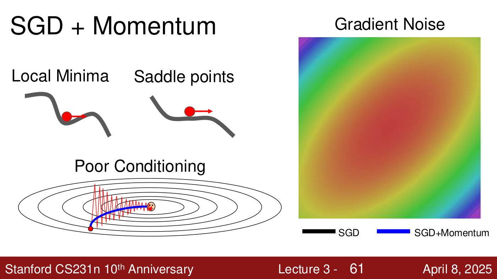
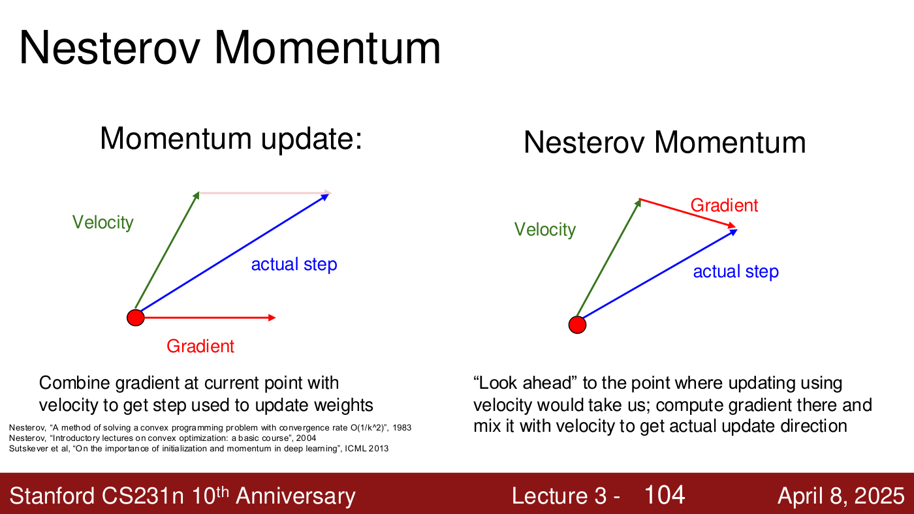
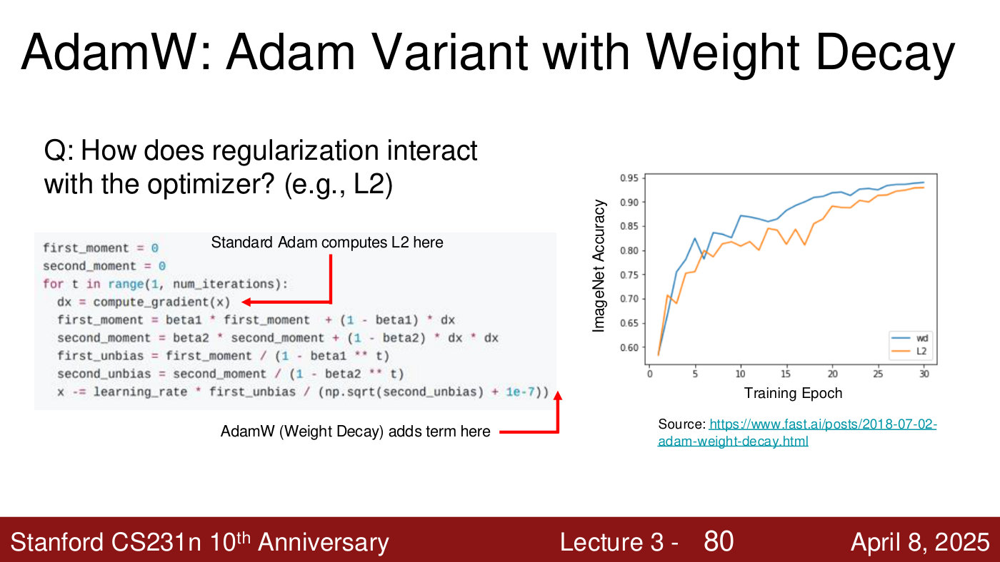

# Optimizers: momentum, RMSProp, Adam, AdamW

Plain [stochastic gradient descent](gradient-descent.md) steps against the gradient by a fixed
learning rate, and struggles in narrow valleys, at local minima and saddle points, and with noisy
minibatch gradients. The optimisers on this page change the step. **Momentum** accumulates a
velocity; **RMSProp** scales each parameter's step by its recent gradient size; **Adam** does both;
**AdamW** changes how regularization enters. Lecture 3 presents SGD, momentum, RMSProp, Adam and
AdamW; its deck's unpresented appendix adds Nesterov momentum and AdaGrad.

Covered in: [Lecture 3](03-regularization-optimization.md#sgd-with-momentum).

Notation, following the deck: $x_t$ is the parameter vector at step $t$, $\nabla f(x_t)$ the
gradient there, and $\alpha$ the learning rate. Plain SGD is
$x_{t+1} = x_t - \alpha \nabla f(x_t)$ (lecture 3, slide 62).

## SGD with momentum

Momentum works like a ball rolling downhill: it keeps a **velocity** $v$, a running mean of past
gradients, and steps along that instead of the current gradient (lecture 3, slides 63–64):

$$v_{t+1} = \rho v_t + \nabla f(x_t)$$

$$x_{t+1} = x_t - \alpha v_{t+1}$$

```python
vx = 0
while True:
  dx = compute_gradient(x)
  vx = rho * vx + dx
  x -= learning_rate * vx
```

$\rho$ weighs the past velocity against the current gradient; typically $\rho$ is 0.9 or 0.99
(lecture 3, slide 63; Sutskever et al., ICML 2013). An equivalent form,
$v_{t+1} = \rho v_t - \alpha \nabla f(x_t)$ with $x_{t+1} = x_t + v_{t+1}$, gives the same sequence
of $x$ (lecture 3, slide 65).

It helps with each of SGD's problems (lecture 3, slide 61). Built-up speed carries it through a
local minimum and over a saddle point. In a narrow valley, the side-to-side components of
successive gradients cancel while the component along the valley accumulates. And gradient noise
averages out, because only the direction the gradients share builds up (lecture 3, ≈43:08–43:55).



*Lecture 3, slide 61 — momentum against SGD's three problems: it rolls through a local minimum and over a saddle point, and in the poorly conditioned valley it arcs to the minimum (blue) where SGD zig-zags (red). The "Gradient Noise" panel's paths are not in the PDF. [Deck](https://cs231n.stanford.edu/slides/2025/lecture_3.pdf)*

The cost: momentum can overshoot, so it may converge more slowly, but on average it finds a better
minimum; and for some models plain SGD has done better. Which optimiser wins is largely empirical
(lecture 3, ≈47:43–48:30).

### Nesterov momentum (appendix, not presented)

Momentum adds the gradient at the current point to the velocity. **Nesterov momentum** "looks
ahead" to the point the velocity would reach, takes the gradient there, and mixes it with the
velocity (lecture 3, slide 104).



*Lecture 3, slide 104 — momentum adds the gradient at the current point to the velocity (left); Nesterov takes the gradient at the point the velocity leads to (right). [Deck](https://cs231n.stanford.edu/slides/2025/lecture_3.pdf)*

In equations (lecture 3, slide 105):

$$v_{t+1} = \rho v_t - \alpha \nabla f(x_t + \rho v_t)$$

$$x_{t+1} = x_t + v_{t+1}$$

With the change of variables $\tilde{x}_ t = x_t + \rho v_t$ it becomes an update in terms of the
gradient at the stored point:
$v_{t+1} = \rho v_t - \alpha \nabla f(\tilde{x}_ t)$ and
$\tilde{x}_ {t+1} = \tilde{x}_ t + v_{t+1} + \rho (v_{t+1} - v_t)$ (lecture 3, slide 108).

## AdaGrad (appendix, not presented)

**AdaGrad** (Duchi et al., JMLR 2011) divides each step by the square root of the running **sum**
of squared gradients, element by element, which gives "per-parameter learning rates" or "adaptive
learning rates" (lecture 3, slide 110):

```python
grad_squared = 0
while True:
  dx = compute_gradient(x)
  grad_squared += dx * dx
  x -= learning_rate * dx / (np.sqrt(grad_squared) + 1e-7)
```

Progress along steep directions is damped and along flat directions accelerated. But because the
sum only grows, the step size **decays to zero** over a long run (lecture 3, slides 112 and 114).

## RMSProp

**RMSProp** (Tieleman and Hinton, 2012) is "leaky AdaGrad": it replaces the sum with a decaying
running average, so old gradients fade (lecture 3, slide 115). The update (lecture 3, slide 66):

```python
grad_squared = 0
while True:
  dx = compute_gradient(x)
  grad_squared = decay_rate * grad_squared + (1 - decay_rate) * dx * dx
  x -= learning_rate * dx / (np.sqrt(grad_squared) + 1e-7)
```

Where gradients have been large, the denominator is large and the step shrinks; where they have
been small, the step grows. "Progress along 'steep' directions is damped; progress along 'flat'
directions is accelerated" (lecture 3, slide 69). In the lecture's animated comparison, which the
PDF does not contain, momentum overshoots and comes back, SGD is slow, and RMSProp quickly turns
toward the centre of the valley (lecture 3, ≈52:17–53:03).

## Adam

**Adam** (Kingma and Ba, ICLR 2015) is "by far the most popular optimizer" in deep learning
(lecture 3, ≈53:03). It combines the two ideas. Its **first moment** is a momentum-style running
average of the gradient, its **second moment** is RMSProp's running average of the squared
gradient, and it steps by the first divided by the square root of the second (lecture 3,
slide 72). The full form adds **bias correction** (lecture 3, slide 73):

```python
first_moment = 0
second_moment = 0
for t in range(1, num_iterations):
  dx = compute_gradient(x)
  first_moment = beta1 * first_moment  + (1 - beta1) * dx
  second_moment = beta2 * second_moment + (1 - beta2) * dx * dx
  first_unbias = first_moment / (1 - beta1 ** t)
  second_unbias = second_moment / (1 - beta2 ** t)
  x -= learning_rate * first_unbias / (np.sqrt(second_unbias) + 1e-7))
```

(The extra closing parenthesis is as printed on the slide.)

**Why bias correction?** Both moments start at zero, and $\beta_2$ is close to 1, so after the first
step the second moment is tiny. If the gradient is small, the step divides by nearly zero and is
far too large. Dividing by $1 - \beta_1^t$ and $1 - \beta_2^t$ corrects "for the fact that first
and second moment estimates start at zero", and matters less as $t$ grows (lecture 3, slide 73;
≈54:35–56:07).

**Defaults.** Adam with $\beta_1 = 0.9$, $\beta_2 = 0.999$ and learning rate $10^{-3}$ or
$5 \times 10^{-4}$ "is a great starting point for many models!" (lecture 3, slide 74).

## AdamW

How should [regularization](regularization.md) interact with the optimiser? "It depends!"
(lecture 3, slide 77). Standard Adam computes the L2 term inside the gradient, so it is "used
during moment calculations!" (lecture 3, slide 78). AdamW adds **weight decay** at the end of the
update, "computed after the moments!" (lecture 3, slide 79). Keeping the regularization out of the
moments lets them follow the loss landscape rather than the weight values (lecture 3,
≈58:27–59:12).

On the deck's chart weight decay stays ahead of L2 for most of 30 epochs (lecture 3, slide 80).
Under many settings AdamW works slightly better; the lecturer notes that Meta's Llama models use it
(lecture 3, ≈57:41–58:27).



*Lecture 3, slide 80 — where each variant applies regularization, and ImageNet accuracy over 30 epochs for weight decay ("wd", blue) and L2 (orange); wd ends at about 0.94 against about 0.93. Chart from fast.ai. [Deck](https://cs231n.stanford.edu/slides/2025/lecture_3.pdf)*

## Which to use

The deck's advice (lecture 3, slide 95): **Adam(W) is a good default** in many cases and often
works even with a constant learning rate; **SGD with momentum can outperform Adam** but may need
more tuning of the learning rate and schedule; and with full-batch updates, look beyond first-order
methods. A popular setup is Adam or AdamW with a constant learning rate, or with linear warm-up
then cosine decay (lecture 3, ≈1:05:24–1:06:09; see
[learning-rate schedules](learning-rate-schedules.md)).

## Related pages

- [Gradient descent and SGD](gradient-descent.md) — the baseline these optimisers modify.
- [Learning-rate schedules](learning-rate-schedules.md) — every optimiser here has a learning rate.
- [Regularization](regularization.md) — L2 vs. weight decay.
