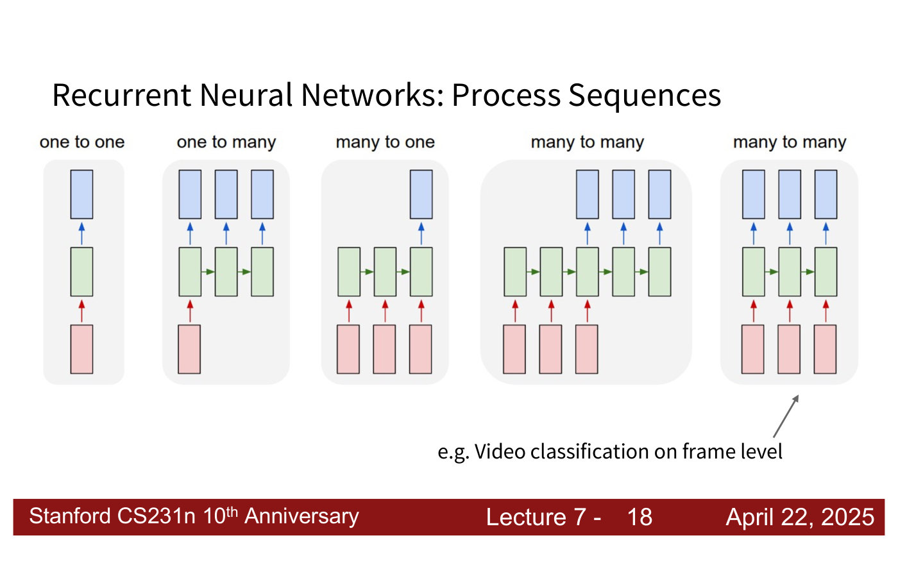
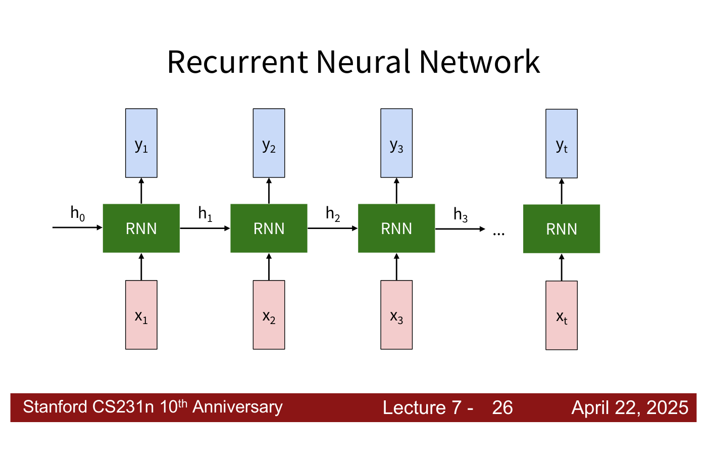
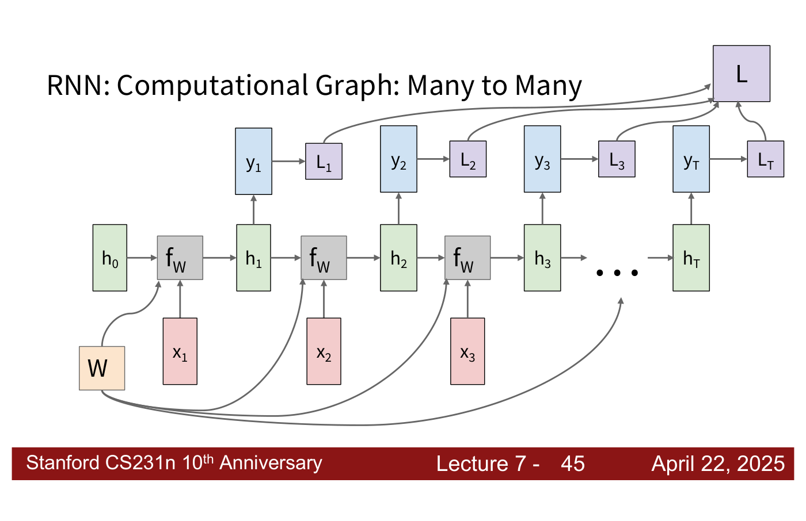
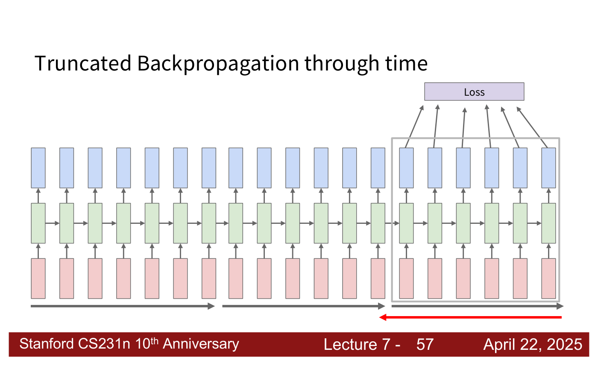
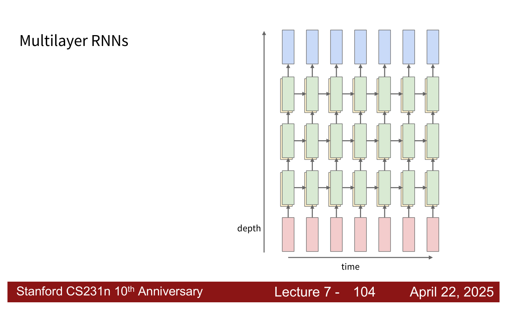
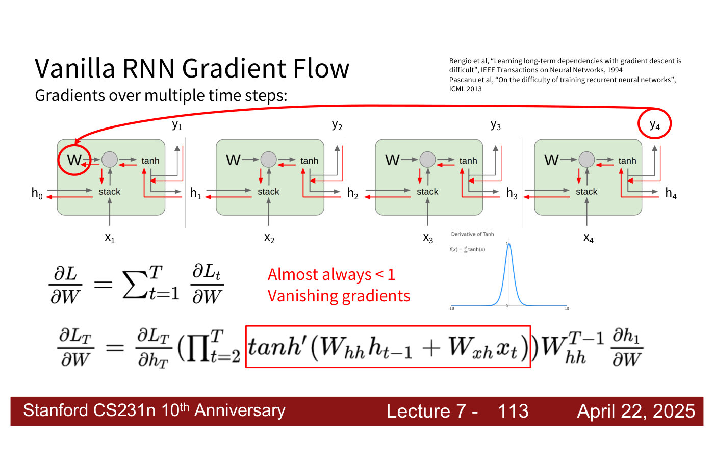
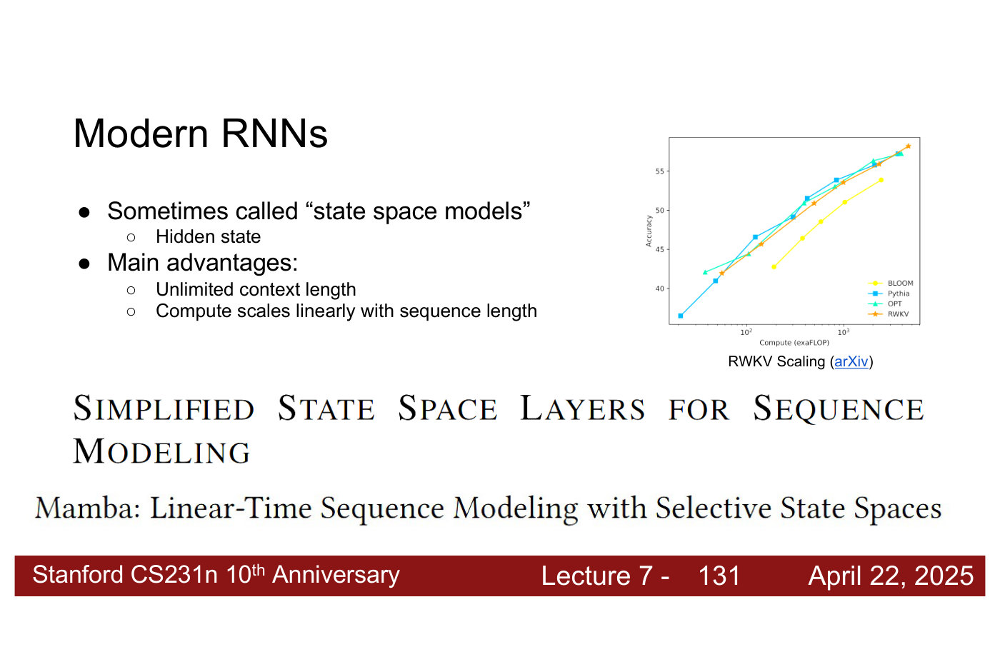

# Recurrent neural networks

A **recurrent neural network** (RNN) processes a sequence one step at a time, keeping an internal
**hidden state** that it updates at every step from the new input and the previous state, with the
same weights at every step. This page gathers what the course says about RNNs: the sequence tasks
they handle, the recurrence, how they are trained, why vanilla RNNs struggle with long sequences,
and where recurrent models stand today. The main treatment is
[lecture 7](07-recurrent-neural-networks.md) (Zane Durante, April 22, 2025). Citations
"lecture 7, slide N" are to the [lecture 7 slide file](../raw/slides/07-recurrent-neural-networks.md),
and timestamps "(lecture 7, ≈M:SS)" to the
[lecture 7 transcript](../raw/transcripts/07-recurrent-neural-networks.md).

Related pages: the [LSTM](lstm.md), the most successful RNN variant;
[character-level language models](language-models.md), the lecture's main worked application;
and [image captioning and visual question answering](image-captioning.md), its vision applications.
[Attention](attention.md) grew out of RNN translation models, and [transformers](transformers.md)
largely replaced RNNs.

## Why sequences need a different model

Every network earlier in the course takes a fixed-size input and gives a fixed-size output. Many
problems instead involve **sequences of variable length** (lecture 7, slide 13; ≈4:43). Lecture 7
lays out the shapes such a task can take (lecture 7, slides 14–18; ≈5:30–7:03):

**One to one** is the vanilla neural network: one fixed-size input, one fixed-size output, as in
image classification. **One to many** takes a fixed input and outputs a sequence: image
captioning turns an image into a sequence of words. **Many to one** takes a sequence and outputs one
result: a sequence of video frames becomes an action class. **Many to many** maps a sequence to a
sequence whose length need not match, such as video frames to a caption; or it gives one output per
input, as in classifying every frame of a video.

*Lecture 7, slide 18 — the five sequence shapes: one to one, one to many (captioning), many to one (action prediction), many to many with different lengths (video captioning) and many to many with one output per input (frame-level video classification). [Deck](https://cs231n.stanford.edu/slides/2025/lecture_7.pdf)*

## The recurrence

An RNN is drawn as a block with an arrow looping back into itself, because it has "an 'internal
state' that is updated as a sequence is processed" (lecture 7, slides 21–22). Unrolled over time,
it becomes one copy of the block per step, each taking that step's input and the previous hidden
state (lecture 7, slides 23 and 26; ≈7:50–8:37). The update is a recurrence formula applied at
every time step (lecture 7, slide 24):

$$h_t = f_W(h_{t-1}, x_t)$$

where $x_t$ is the input vector at time step $t$, $h_{t-1}$ the old state, $h_t$ the new state, and
$f_W$ a function with parameters $W$, usually a weight matrix followed by an activation function.
A second function with its own weights turns the hidden state into the output, changing its
dimension to the output's and applying a learned transformation (lecture 7, slide 25; ≈9:25–10:57):

$$y_t = f_{W_{hy}}(h_t)$$

"The same function and the same set of parameters are used at every time step" (lecture 7,
slide 27). The starting state $h_0$ can be initialized to anything, and "in principle usually this
is a learned input vector" (lecture 7, ≈11:42).

*Lecture 7, slide 26 — the RNN unrolled over time: each step takes its input xₜ and the previous hidden state, and passes a new hidden state to the next step. [Deck](https://cs231n.stanford.edu/slides/2025/lecture_7.pdf)*

### The vanilla RNN

The **vanilla RNN**, also called the Elman RNN after Jeffrey Elman (lecture 7, slide 28), uses a
single hidden vector:

$$h_t = \tanh(W_{hh} h_{t-1} + W_{xh} x_t)$$

$$y_t = W_{hy} h_t$$

$W_{hh}$ maps the previous hidden state, $W_{xh}$ maps the input, and $W_{hy}$ maps the hidden
state to the output, sometimes inside an output function $f_y$. tanh is used because it is bounded
between $-1$ and $1$, so repeated application keeps values in range, and because it is zero-centred
(lecture 7, ≈13:15). In a language model or other autoregressive task, the previous output is often
fed back as the next input (lecture 7, ≈11:42–12:29).

Lecture 7 builds a vanilla-style RNN by hand to make every weight concrete: with ReLU activations
and a hidden state holding the current input, the previous input and a constant 1, the weights
$W_{xh} = (1, 0, 0)^T$, $W_{hh}$ with rows $(0, 0, 0)$, $(1, 0, 0)$, $(0, 0, 1)$ and
$W_{hy} = (1, 1, -1)$ output 1 exactly when two 1s arrive in a row (lecture 7, slides 29–38;
≈14:04–23:19). The details are on the [lecture page](07-recurrent-neural-networks.md#a-hand-built-rnn-detecting-repeated-1s).
In practice the weights are found "the same way we're always finding the weight matrices in this
class", by gradient descent (lecture 7, ≈21:48).

## Training: backpropagation through time

Unrolled, an RNN is an ordinary computational graph in which one weight matrix is reused at every
step (lecture 7, slides 39–42), so [backpropagation](backpropagation.md) applies. In the many-to-many
case each step has its own loss and the losses are summed (lecture 7, slides 43–45). Because the same
$W$ appears at every step, its gradient is the sum of the gradients from each step: treat each step
as if it had its own copy of $W$, then add the copies' gradients together (lecture 7, ≈24:52–25:38).
Many-to-one models use the last hidden state, or pool over all of them (lecture 7, slides 46–47;
≈26:26); one-to-many models feed zeros or the previous output as the later inputs (lecture 7,
slides 48–51; ≈26:26–27:13).

*Lecture 7, slide 45 — the many-to-many computational graph: one weight matrix W feeds every step, each step's output has a loss Lₜ, and the losses sum to L. [Deck](https://cs231n.stanford.edu/slides/2025/lecture_7.pdf)*

Running forward through the entire sequence to compute the loss and then backward through the
entire sequence to compute the gradient is **backpropagation through time** (lecture 7, slide 54;
≈27:58). It must keep every step's activations in memory, which grows with the sequence and runs
out of GPU memory on long ones (lecture 7, ≈27:13–27:58).

**Truncated backpropagation through time** runs forward and backward through chunks of the sequence
instead (lecture 7, slide 55). Hidden states are carried forward "in time forever", but the model
only backpropagates "for some smaller number of steps" (lecture 7, slides 56–57): each chunk starts
from the previous chunk's last hidden state, "but the gradients are no longer carrying over"
(lecture 7, ≈28:44). With a single output at the end, gradients still reach every step of the chunk
through the upstream gradient (lecture 7, slide 58; ≈29:30–31:01). In a later answer to a student
the lecturer describes keeping the gradient at each chunk boundary and applying one update per chunk
(lecture 7, ≈31:48–35:36); the [lecture page](07-recurrent-neural-networks.md#backpropagation-through-time)
notes how that differs from the slides.

*Lecture 7, slide 57 — truncated backpropagation through time: the forward pass (grey) runs through the whole sequence chunk by chunk, while the loss and backward pass (red) cover only the current chunk. [Deck](https://cs231n.stanford.edu/slides/2025/lecture_7.pdf)*

Using a separate $W$ for each time step would no longer be a recurrence: it would need the sequence
length in advance and amount to one layer per step, which "would not work very well" for sequences
of variable length (lecture 7, ≈31:01–31:48).

## Multilayer RNNs

RNN layers can be stacked like any others (lecture 7, slide 104; ≈56:25–57:58). Each layer keeps its
own hidden state over time; the first layer reads the input, and each higher layer reads the outputs
of the layer below. Weights are shared across time within a layer, and each layer has its own
(lecture 7, ≈1:00:18). Every hidden state in the depth-by-time grid has to be computed before the
top-right one, so training is "a very involved process and not very efficient" (lecture 7, ≈57:58).

*Lecture 7, slide 104 — a three-layer RNN over seven time steps: hidden states pass right within a layer and up between layers. [Deck](https://cs231n.stanford.edu/slides/2025/lecture_7.pdf)*

## Vanishing and exploding gradients

Writing the two weight matrices side by side as one $W$ acting on the stacked $h_{t-1}$ and $x_t$,
backpropagating from $h_t$ to $h_{t-1}$ multiplies by $W_{hh}^T$, and one step's Jacobian is
(lecture 7, slides 106–108):

$$\frac{\partial h_t}{\partial h_{t-1}} = \tanh'(W_{hh} h_{t-1} + W_{xh} x_t) W_{hh}$$

The gradient of the last step's loss $L_T$ with respect to $W$ is a product of these over every step
(lecture 7, slides 110–113; ≈1:01:03–1:02:36):

$$\frac{\partial L_T}{\partial W} = \frac{\partial L_T}{\partial h_T} \left( \prod_{t=2}^{T} \tanh'(W_{hh} h_{t-1} + W_{xh} x_t) \right) W_{hh}^{T-1} \frac{\partial h_1}{\partial W}$$

Two factors cause trouble. The derivative of tanh is at most 1 and "almost always $\lt 1$", so the
product shrinks: **vanishing gradients** (lecture 7, slide 113). And even without the
non-linearity, $W_{hh}$ is multiplied in $T-1$ times: if its largest singular value is greater than 1
the gradients **explode**, and if it is less than 1 they **vanish** (lecture 7, slides 114–115;
≈1:03:23).

*Lecture 7, slide 113 — the gradient through a chain of vanilla RNN cells: a product of tanh derivatives, each at most 1 (the curve at right), times W_hh to the power T−1. [Deck](https://cs231n.stanford.edu/slides/2025/lecture_7.pdf)*

Exploding gradients are controlled by **gradient clipping**: "scale gradient if its norm is too big"
(lecture 7, slide 116). The slide's code computes `grad_norm = np.sum(grad * grad)`, which is the
squared norm, and multiplies the gradient by `threshold / grad_norm` when it exceeds the threshold.
The min-char-rnn code instead clips every gradient entry to the range $-5$ to $5$ "to mitigate
exploding gradients" (lecture 7, slide 67). Vanishing gradients are harder: they call for a change of
architecture (lecture 7, slide 117), and they are "the main issue with why people don't just use
really long RNNs in practice" (lecture 7, ≈1:04:10). The [LSTM](lstm.md) is the classic answer.

## Advantages and disadvantages

Lecture 7, slide 84 sums up the tradeoffs (≈47:59–50:18). RNNs can process input of any length, with
no maximum context window; the computation at step $t$ can in theory use information from many steps
back; the model does not grow with the input; and the same weights are applied at every step, so
inputs are processed symmetrically. But recurrent computation is slow, because each hidden state
needs the previous one, which makes training hard to batch and scale; and in practice information
from many steps back is hard to reach, because everything must fit in a fixed-size hidden state.

## Sequence to sequence and the bottleneck

Lecture 8 opens with the recurrent translation model that attention was invented to fix
(lecture 8, slides 6–12; ≈3:07–8:30), citing Sutskever et al. (NeurIPS 2014). An **encoder** RNN,
$h_t = f_W(x_t, h_{t-1})$, reads the input sentence, and from its final hidden state come the
initial decoder state $s_0$ and a **context vector** $c$, "often $c = h_T$". A **decoder** RNN with
its own weights, $s_t = g_U(y_{t-1}, s_{t-1}, c)$, then produces the output one token at a time,
reading the same $c$ at every step. The weakness: "Input sequence bottlenecks through fixed sized
c. What if T=1000?" (lecture 8, slide 11). The context vector's size is fixed by the architecture,
so a whole paragraph or book would have to fit in it (lecture 8, ≈7:43).
[Attention](attention.md#where-attention-came-from-the-sequence-to-sequence-bottleneck) removes
the bottleneck by computing a new context vector at every decoder step from all the encoder
states.

Lecture 8 later sets RNNs beside convolution and self-attention as three ways of processing
sequences. RNNs work on 1D ordered sequences with $O(N)$ compute and memory, but are "not
parallelizable", since each hidden state needs the previous one (lecture 8, slide 80), which makes
them "very difficult to scale, very difficult to make very big" (lecture 8, ≈58:26).

## Modern RNNs: state space models

Recurrent models have "made a bit of a resurgence in the last year or two", sometimes under the name
**state space models** (lecture 7, slide 131; ≈1:08:45–1:10:18). Their two advantages over
transformers are unlimited context length and compute that scales linearly with sequence length,
where a transformer's scales quadratically because it has an operation that looks across the whole
input. The lecture names **RWKV** and **Mamba**; slide 131's "RWKV Scaling" chart shows RWKV matching
transformer language models of similar compute (Pythia, OPT) on accuracy. The research question is
"how can you get the performance of transformers with the scaling of RNNs?" (lecture 7, ≈1:10:18).
The course turns to attention and transformers in lecture 8 (lecture 7, slide 133); see
[attention](attention.md) and [transformers](transformers.md).

*Lecture 7, slide 131 — "RWKV Scaling": accuracy against compute for BLOOM, Pythia, OPT and RWKV, with RWKV level with Pythia and OPT; below, the S5 and Mamba paper titles. [Deck](https://cs231n.stanford.edu/slides/2025/lecture_7.pdf)*

## Where the course covers RNNs

- [Lecture 7 — Recurrent Neural Networks](07-recurrent-neural-networks.md): everything on this page
  except the sequence-to-sequence section.
- [Lecture 8 — Attention and Transformers](08-attention-transformers.md#sequence-to-sequence-with-rnns):
  the sequence-to-sequence model and its bottleneck, and RNNs compared with convolution and
  self-attention.
- [Lecture 1](01-introduction.md) previews recurrent networks in its tour of the course, with an
  unrolled RNN built from LSTM cells (lecture 1, part 2, slide 17).
